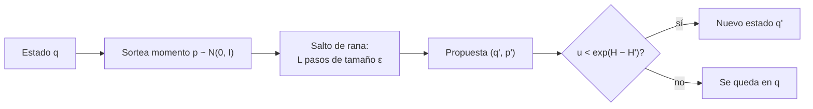

# B19-C03 — Hamiltonian Monte Carlo y NUTS

<!-- nav:top -->
[🏠 Programa](../../../../README.md) · [📚 Bloque B19](../../../tronco-comun/B19-inferencia-bayesiana-y-computacion-probabilistica.md) · [← Anterior: B19-C02 — Modelos jerárquicos](../B19-C02-modelos-jerarquicos/CLASE.md) · [Siguiente: B19-C04 — Diagnóstico de convergencia de cadenas →](../B19-C04-diagnostico-de-convergencia-de-cadenas/CLASE.md)
<!-- /nav -->

## 1. Ubicación, nivel y alcance

Tercera clase del bloque B19. En [C02](../B19-C02-modelos-jerarquicos/CLASE.md) calculaste una posterior con una rejilla, porque tenía una sola dimensión efectiva. Con diez o cien parámetros la rejilla es imposible y hace falta un algoritmo que explore la posterior. De B12-C13 conoces los métodos de Metropolis de paso aleatorio; aquí aprendes por qué se atascan y cómo el *Hamiltonian Monte Carlo* (HMC) y su variante adaptativa NUTS usan el gradiente del logaritmo de la posterior para avanzar más lejos con la misma aceptación.

Verás la analogía física, el integrador de salto de rana, el paso de aceptación, los límites de estabilidad del paso y la idea del criterio de giro en U de NUTS. No verás el diagnóstico de las cadenas (C04) ni una implementación completa de NUTS: el laboratorio comprueba HMC y solo el criterio de giro.

## 2. Por qué esta clase existe

Una posterior bidimensional con dos parámetros correlacionados al 95 % tiene forma de un óvalo muy alargado y estrecho. Un Metropolis de paso aleatorio, para no salirse del óvalo, da pasos minúsculos y recorre la distribución a paso de tortuga. La pregunta es: **¿cómo propongo movimientos largos que casi siempre se acepten?** HMC responde usando la geometría de la posterior: lanza una «partícula» que se desliza por la superficie de `−log p` y la sigue durante varios pasos.

La decisión central es: **¿cuántos pasos y de qué tamaño?** El tamaño `ε` está acotado por la estabilidad numérica; el número de pasos `L` por el riesgo de volver al punto de partida. NUTS elige `L` automáticamente. Esto sostiene C04 (¿cómo sé que las cadenas funcionaron?) y todo lo que sigue.

## 3. Lo que podrás hacer al terminar

1. Escribir el hamiltoniano de un problema de muestreo y relacionar `U(q) = −log π(q)` con la posterior.
2. Ejecutar a mano un paso del integrador de salto de rana y calcular el error de energía.
3. Calcular la probabilidad de aceptación de una propuesta de HMC.
4. Determinar el límite de estabilidad del tamaño de paso a partir de la curvatura.
5. Explicar por qué NUTS se detiene cuando la trayectoria «da la vuelta».
6. Comparar HMC y Metropolis por tamaño efectivo por evaluación.

La evidencia es el **informe comparativo HMC–Metropolis** del ejercicio 12 (sección 20).

## 4. Con qué llegas y cómo comprobarlo

Necesitas C01–C02, derivadas parciales y gradiente (B09), la matriz de covarianza (B12) y autovalores (B10-C08). Cinco preguntas:

1. ¿Qué es el gradiente de `U(q)` y qué dirección indica?
2. Si `π(q) ∝ exp(−q²/2)`, ¿cuánto vale `U(q)` y su derivada?
3. ¿Qué dice la regla de aceptación de Metropolis para una propuesta con razón de densidades `r`?
4. ¿Qué mide el tamaño efectivo de una cadena autocorrelacionada?
5. ¿Cuál es el mayor autovalor de la matriz `[[1, 0,95],[0,95, 1]]`?

<details>
<summary>Ver respuestas</summary>

1. El vector de derivadas parciales; apunta hacia donde `U` crece más rápido. 2. `U = q²/2`, `U' = q`. 3. Se acepta con probabilidad `min(1, r)`. 4. Cuántas muestras independientes «valen» las muestras dependientes que tienes. 5. 1,95 (el otro es 0,05).
</details>

Con cuatro o cinco aciertos, sigue; con tres o menos, repasa B12-C13 y B10-C08.

## 5. Un caso real: una revisión de HMC y el algoritmo NUTS

Radford Neal (fuente S1) explica que HMC añade variables de momento ficticias para que las propuestas de Metropolis recorran grandes distancias en un espacio continuo, en vez de difundirse lentamente como los pasos aleatorios; y que la dinámica hamiltoniana conserva el volumen, por lo que no hace falta calcular un jacobiano ni siquiera al discretizar el tiempo. Hoffman y Gelman (fuente S2) observan que el rendimiento de HMC depende mucho de dos valores fijados por el usuario, el tamaño de paso y el número de pasos, y presentan NUTS, que elimina la elección del número de pasos construyendo candidatos recursivamente y deteniéndose cuando la trayectoria empieza a retroceder; además adapta el tamaño de paso durante el muestreo. Betancourt (fuente S3) ofrece una introducción conceptual y cuándo falla.

De las tres fuentes solo se leyeron los resúmenes; los resultados numéricos de esta clase son de un banco de pruebas **simulado**, de media y covarianza exactas, no de un artículo.

## 6. Vocabulario

La **posición** `q` es el vector de parámetros. El **momento** `p` es un vector auxiliar de la misma dimensión, sorteado de `N(0, I)` en cada iteración. La **energía potencial** es `U(q) = −log π(q)` (salvo constante), la **cinética** `K(p) = ½ pᵀp` y el **hamiltoniano** `H(q, p) = U(q) + K(p)`. La dinámica evoluciona según `dq/dt = p`, `dp/dt = −∇U(q)`, y conserva `H`.

El **salto de rana** (*leapfrog*) es un integrador numérico con tres sub-pasos: medio paso de momento, paso entero de posición, medio paso de momento. Tiene paso `ε` y se aplica `L` veces; la trayectoria dura `T = εL`. Es **reversible** y **conserva el volumen**, pero no exactamente la energía: su **error de energía** `ΔH` escala como `ε²`. La **aceptación** es `min(1, exp(−ΔH))`, que corrige ese error. La **matriz de masa** es la métrica con la que se mide la energía cinética (aquí, la identidad). El **giro en U** (*U-turn*) ocurre cuando la trayectoria empieza a volver hacia su inicio.

## 7. Modelo mental: una canica en un cuenco

Piensa que `U(q)` es la altura de un terreno y que lanzas una canica con una velocidad aleatoria. La canica rueda, sube las laderas y desacelera, y al cabo de un tiempo la detienes: esa es tu propuesta. En un cuenco alargado, la canica corre a lo largo del eje largo sin tener que vencer las paredes, algo que un paso aleatorio no puede hacer.



*Descripción textual:* desde el estado `q` se sortea un momento, se integran `L` pasos y se obtiene una propuesta; se acepta con probabilidad `min(1, exp(H − H'))` y, si no, la cadena se queda donde estaba.

**Límite de la analogía:** la canica real pierde energía por fricción; aquí no hay fricción y la energía se conserva en el modelo exacto. Lo que falla es solo la discretización. Además, la «altura» es `−log π`, que no tiene unidades físicas.

## 8. La explicación, paso a paso

### 8.1 El salto de rana, un paso

Para un paso de tamaño `ε`, a partir de `(q, p)`:

```text
p ← p − (ε/2) ∇U(q)
q ← q + ε p
p ← p − (ε/2) ∇U(q)
```

Con `L` pasos seguidos, los dos medios pasos intermedios se funden en pasos enteros. Es *reversible*: si al final inviertes el signo del momento y repites `L` pasos, vuelves al punto inicial (el laboratorio lo comprueba a 10⁻¹⁰).

### 8.2 Aceptación

La integración no conserva `H` exactamente. Para corregir el error se acepta la propuesta `(q', p')` con probabilidad `min(1, exp(H(q, p) − H(q', p')))`. Si la energía baja o se conserva, se acepta siempre; si sube mucho, casi nunca. Como el error escala como `ε²`, achicar `ε` a la mitad lo divide por cuatro (el laboratorio mide un cociente de 4,03).

### 8.3 El límite de estabilidad

El salto de rana es estable solo si `ε` es menor que `2/ω`, donde `ω` es la frecuencia de oscilación más alta del problema. Para una gaussiana con matriz de precisión `Σ⁻¹`, `ω² ` es su mayor autovalor, así que `ε < 2/√λ_max(Σ⁻¹)`. Para el banco de pruebas, `λ_max = 20` y `ε < 0,447`: más allá, la energía explota y la aceptación cae a cero. Un parámetro con escala muy pequeña impone un `ε` pequeño a todo el problema; por eso conviene reescalar (ejercicio 10).

### 8.4 Longitud de la trayectoria

Con `ε` fijo, la longitud `T = εL` se elige para recorrer la distribución sin dar la vuelta: si `T` es muy corto, HMC se parece a un paso aleatorio; si es muy largo, la trayectoria vuelve sobre sí misma y se desperdicia cómputo. El problema es que la longitud adecuada depende de la región de la posterior.

### 8.5 NUTS: parar cuando se da la vuelta

NUTS construye la trayectoria hacia delante y hacia atrás en el tiempo, duplicando su longitud, y se detiene cuando uno de los extremos empieza a volver hacia el otro. Un criterio sencillo de «giro en U»: sea `q⁻` el extremo del pasado y `q⁺` el del futuro; se detiene si `(q⁺ − q⁻)·p⁺ < 0` o `(q⁺ − q⁻)·p⁻ < 0`, es decir, si algún extremo se mueve hacia el otro. Para un oscilador armónico `q(t) = sin t`, `p(t) = cos t` (la gaussiana unidimensional) el producto con `p⁺` cambia de signo en `t = π/2`: un cuarto del periodo `2π`. El laboratorio mide 1,575 frente a 1,571. Además NUTS ajusta `ε` durante la fase de calentamiento (S2).

### 8.6 Cuándo HMC no es la herramienta

HMC necesita el gradiente de `log π`, así que no sirve para parámetros discretos (hay que marginalizarlos) ni para densidades no diferenciables. Funciona mal en geometrías con cuellos muy estrechos, como la de los modelos jerárquicos con `τ` pequeña (C04). Y su coste por iteración es `L` evaluaciones del gradiente: debe compararse por *tamaño efectivo por evaluación*.

## 9. Magnitudes, símbolos y unidades

| Símbolo | Qué es | Unidad | Nota |
|---|---|---|---|
| `q` | posición (parámetros) | las del parámetro | dimensión `d` |
| `p` | momento auxiliar | adimensional (masa unidad) | `p ~ N(0, I)` |
| `U(q)` | `−log π(q)` | adimensional | salvo constante |
| `K(p)` | `½ pᵀp` | adimensional | |
| `H` | `U + K` | adimensional | se conserva en la dinámica exacta |
| `ε`, `L`, `T` | paso, número de pasos, `εL` | adimensional | tiempo ficticio |
| `ΔH` | error de energía | adimensional | `∝ ε²` |
| `Σ` | covarianza del objetivo | de `q²` | |
| `λ_max(Σ⁻¹)` | mayor autovalor de la precisión | de `q⁻²` | fija `ε < 2/√λ_max` |

El tiempo `t` no es tiempo físico: es un parámetro ficticio de la dinámica auxiliar.

## 10. Convenciones y referencias

La masa es la identidad, así que los parámetros deben estar reescalados a escalas comparables. El objetivo del banco de pruebas es una gaussiana con media 0 y `Σ = [[1; 0,95], [0,95; 1]]` en unidades arbitrarias. La eficiencia se mide como **ESS mínimo entre coordenadas dividido por el número total de evaluaciones** (de densidad o de gradiente). Se fija la semilla del generador de números aleatorios para reproducir.

## 11. De dónde sale lo que afirmamos

| ID | Fuente | Localizador | Respalda | Estado |
|---|---|---|---|---|
| S1 | Neal, R. M., «MCMC using Hamiltonian dynamics», 2012 | arXiv:1206.1901 | Momentos auxiliares, propuestas lejanas, conservación del volumen sin jacobiano | Resumen consultado el 2026-11-05 |
| S2 | Hoffman, M. D. y Gelman, A., «The No-U-Turn Sampler», 2011 | arXiv:1111.4246 | NUTS elimina el número de pasos, para al retroceder la trayectoria, adapta `ε` (preprint) | Resumen consultado el 2026-11-05 |
| S3 | Betancourt, M., «A Conceptual Introduction to Hamiltonian Monte Carlo», 2017 (rev. 2018) | arXiv:1701.02434 | Introducción conceptual: cómo funciona, aplicación y fallos | Resumen consultado el 2026-11-05 |
| S4 | Este bloque, `hmc_gaussiana.py` | misma carpeta | Cifras de las secciones 13 y 17 (datos **simulados**) | Ejecutado el 2026-11-05 |

**Límites.** De S1–S3 solo se leyeron los resúmenes: no respaldan la forma exacta del criterio de giro de la sección 8.5 ni la condición `ε < 2/ω`, que son resultados clásicos comprobados aquí por implementación (oscilador armónico y autovalores). No se afirma nada sobre detalles internos de NUTS (muestreo multinomial, divergencias) más allá del resumen.

## 12. Cómo ver HMC

Dibuja el óvalo de contorno de la gaussiana (eje largo a 45°, semiejes `√1,95 = 1,40` y `√0,05 = 0,22`), y encima una trayectoria de HMC (10 pasos, flechas pequeñas) que atraviesa el óvalo de lado a lado, junto a la de Metropolis con muchos pasitos desordenados. **Accesibilidad:** marca el inicio y el fin con símbolos distintos (círculo y cuadrado) y acompaña con la tabla de la sección 17.

## 13. Ejemplo trabajado: un paso a mano

Objetivo unidimensional `N(0,1)`: `U = q²/2`, `∇U = q`. Estado `q = 1`, `p = 0`, `ε = 0,5`, un solo paso.

1. Medio paso de momento: `p = 0 − 0,25·1 = −0,25`.
2. Paso de posición: `q = 1 + 0,5·(−0,25) = 0,875`.
3. Medio paso de momento: `p = −0,25 − 0,25·0,875 = −0,46875`.

Energía inicial `H = 0,5·1 + 0 = 0,5`. Energía final `H' = 0,5·0,875² + 0,5·0,46875² = 0,38281 + 0,10986 = 0,49268`. Error `ΔH = H' − H = −0,00732`. La aceptación es `min(1, exp(0,00732)) = 1`: se acepta siempre. Con `ε = 0,25`, el error caería a un cuarto del anterior, aproximadamente.

## 14. Comparación de métodos

**Metropolis de paso aleatorio:** una evaluación de densidad por iteración, sin gradiente, pero con pasos cortos y mucha autocorrelación en distribuciones alargadas. **HMC:** `L` evaluaciones de gradiente por iteración, pasos largos y casi independientes, pero exige gradientes y sintonizar `ε` y `L`. **NUTS:** igual que HMC sin sintonizar `L`, a costa de implementación más compleja y de un coste variable por iteración. Ninguno es mejor siempre: en el banco de pruebas, HMC rinde ≈ 8 veces más tamaño efectivo por evaluación que Metropolis; en un problema sin gradiente, Metropolis es lo que hay.

## 15. Práctica guiada

**Ejercicio 1 · con los pasos indicados.** Repite el ejemplo de la sección 13 con `q = 1`, `p = 0`, `ε = 0,25` y un paso. *Pasos:* medio paso, paso, medio paso.

<details><summary>Solución comentada</summary>

`p = −0,125`; `q = 1 + 0,25·(−0,125) = 0,96875`; `p = −0,125 − 0,125·0,96875 = −0,24609`. `H' = 0,5·0,96875² + 0,5·0,24609² = 0,46924 + 0,03028 = 0,49952`. `ΔH = −0,00048`, unas 15 veces menor que con `ε = 0,5` (−0,00732). Si esperabas 4, recuerda que aquí se compara *un paso*, no a tiempo total fijo.
</details>

**Ejercicio 2 · con una pista.** Una propuesta tiene `ΔH = +0,3` (la energía sube). Calcula su probabilidad de aceptación. *Pista:* `min(1, exp(−ΔH))`.

<details><summary>Solución comentada</summary>

`exp(−0,3) = 0,741`: se acepta con 74 %. Si `ΔH` fuera negativo, la aceptación sería 1.
</details>

**Ejercicio 3 · casi autónomo.** Una gaussiana tiene autovalores de precisión 100 y 1. Calcula el límite de `ε` y cuántos pasos necesitas para una trayectoria de `T = 2`.

<details><summary>Solución comentada</summary>

`ε < 2/√100 = 0,2`. Con `ε = 0,1` (margen de seguridad), `L = T/ε = 20` pasos. El problema lo marca el autovalor mayor, aunque la dirección «lenta» (autovalor 1) sea la que necesita más tiempo.
</details>

## 16. Práctica autónoma, transferencia e integrador

**Ejercicio 4.** Con el banco de pruebas (`λ_max = 20`), explica por qué `ε = 0,5` da aceptación 0,01 y `ε = 0,25` da 0,93 (laboratorio, `T = 2,5` fijo).

<details><summary>Solución comentada</summary>

El límite es `0,447`. `ε = 0,5` lo supera: el integrador es inestable y la energía crece sin cota, por eso se rechaza casi todo. `ε = 0,25` está por debajo: el error de energía es pequeño y se acepta el 93 %.
</details>

**Ejercicio 5.** El laboratorio da ESS mínimo por evaluación 0,1000 para HMC y 0,0127 para Metropolis. Calcula el cociente y explica por qué el ESS = 20 000 de HMC no significa una eficiencia infinita.

<details><summary>Solución comentada</summary>

`0,1000/0,0127 ≈ 7,9`: HMC rinde ocho veces más por evaluación. El ESS de HMC iguala al número de iteraciones (20 000) porque el estimador de Geyer corta la suma de autocorrelaciones en el primer par negativo; es un tope del estimador, no una ganancia mágica. Para estimar eficiencia con rigor se necesitan más cadenas y diagnósticos (C04).
</details>

**Ejercicio 6.** ¿Por qué se vuelve a sortear el momento `p` en cada iteración?

<details><summary>Solución comentada</summary>

La dinámica conserva `H`: sin resorteo la cadena quedaría confinada a una sola curva de nivel de energía. Resortear `p` permite cambiar de nivel y explorar toda la distribución.
</details>

**Ejercicio 7.** Con `ε = 0,005`, ¿en cuántos pasos de salto de rana se activa el criterio de giro del oscilador armónico (`t = π/2`)?

<details><summary>Solución comentada</summary>

`(π/2)/0,005 = 314,2`; el laboratorio detecta el giro a 1,575, es decir, en el paso 315. Si hubiera tomado `t = π` (el otro criterio, solo con el momento inicial), habría seguido 628 pasos: usar ambos extremos corta antes.
</details>

**Ejercicio 8.** ¿Qué le pasa a HMC si el objetivo tiene un parámetro entero?

<details><summary>Solución comentada</summary>

No hay gradiente respecto de un entero, y la dinámica requiere un espacio continuo. Se marginaliza el parámetro discreto (si es posible) o se usa otro algoritmo.
</details>

**Ejercicio 9 · transferencia.** Tienes una posterior de 100 parámetros y no puedes calcular gradientes (la función es una simulación opaca). ¿Qué algoritmo usas y qué esperas de su eficiencia?

<details><summary>Solución comentada</summary>

Un Metropolis o variante sin gradiente (o ensamblados de caminantes): HMC no es posible. Se espera autocorrelación alta, y por tanto muchos más pasos para un ESS dado; conviene reducir dimensión o conseguir un modelo diferenciable. Honestidad: no se asegura calidad solo por haber corrido muchas iteraciones (C04).
</details>

**Ejercicio 10 · transferencia.** Dos parámetros tienen escalas de 1 y de 0,01 (desviaciones típicas, sin correlación). Calcula el límite de `ε` con masa identidad y propón una solución.

<details><summary>Solución comentada</summary>

Precisiones: 1 y 10⁴. `ε < 2/√10⁴ = 0,02`. Con ese paso, recorrer la escala 1 exige ≈ 50 pasos por unidad. Solución: reescalar el parámetro pequeño (cambio de unidades, p. ej. de K a mK) o usar una matriz de masa que adapte la métrica, de modo que ambas escalas valgan ≈ 1.
</details>

**Ejercicio 11 · transferencia.** Un compañero afirma: «HMC acepta todo, entonces es perfecto». Evalúa con ε = 0,1 (aceptación 0,99 en el laboratorio) y `L = 25`.

<details><summary>Solución comentada</summary>

La aceptación alta solo dice que el integrador es preciso, no que explore bien: con `ε` muy pequeño hacen falta muchos pasos para llegar lejos. Hay que mirar el ESS por evaluación. En el laboratorio `ε = 0,25` con aceptación 0,93 es más eficiente que `ε = 0,1` con 0,99.
</details>

**Ejercicio 12 · integrador.** Ejecuta el laboratorio y escribe un **informe comparativo HMC–Metropolis** de una página: (a) tabla de aceptación, ESS y ESS por evaluación para los dos métodos; (b) barrido de `ε` con el límite de estabilidad teórico; (c) la verificación del giro en U; (d) tres limitaciones del banco de pruebas.

<details><summary>Solución modelo</summary>

(a) HMC (`ε = 0,25`, `L = 10`): aceptación 0,92, ESS 20 000, 0,1000 por evaluación; Metropolis (paso 0,5): 0,45, ESS ≈ 255, 0,0127. (b) Aceptación 0,99 (ε = 0,1), 0,93 (0,25), 0,01 (0,5), 0,00 (1,0 y 1,5); límite 0,447. (c) Giro a 1,575 frente a π/2 = 1,571. (d) Gaussiana (sin colas ni multimodalidad); gradiente exacto; una sola semilla y una sola cadena; no es NUTS completo; el ESS tiene tope en N. Datos simulados.
</details>

## 17. Laboratorio: HMC en una gaussiana correlacionada

El script [hmc_gaussiana.py](hmc_gaussiana.py) implementa el salto de rana, HMC y Metropolis para la gaussiana del ejemplo, y comprueba antes de correr: la **reversibilidad** (10⁻¹⁰), el escalado `ε²` del error de energía (cociente entre 3 y 5), que las muestras de HMC reproducen media y covarianza exactas (±0,05; ±0,1) y el **criterio de giro en U** del oscilador armónico (±0,02 de `π/2`). **Datos:** simulados. **Predice antes de ejecutar:** ¿qué método tendrá más autocorrelación? (Metropolis.)

**Ejecución del 2026-11-05 (Python 3.12.9, numpy 2.4.4):**

```text
Pruebas: OK (errores de energia 5.53e-01 y 1.37e-01; cociente 4.03; giro en U en t = 1.575 vs pi/2 = 1.571)

metodo                      acept.   ESS q1   ESS q2  evals/iter  ESS(min)/eval
HMC eps=0.25, L=10            0.92    20000    20000          10         0.1000
Metropolis paso 0.5           0.45      253      255           1         0.0127

media HMC: [-0.001  0.005] | cov HMC: [0.994 0.947 0.947 0.999]
media RWM: [-0.028 -0.033] | cov RWM: [0.985 0.942 0.942 1.002]

Limite de estabilidad del salto de rana: eps < 2/sqrt(lambda_max(Sigma^-1)) = 0.447
Paso eps (T = 2.5 fijo): aceptacion de HMC
  eps=0.1   L=25  aceptacion 0.99
  eps=0.25  L=10  aceptacion 0.93
  eps=0.5   L=5   aceptacion 0.01
  eps=1.0   L=2   aceptacion 0.00
  eps=1.5   L=2   aceptacion 0.00
```

```bash
python programa/clases/B19/B19-C03-hamiltonian-monte-carlo-y-nuts/hmc_gaussiana.py
```

**Límites:** el script **no** implementa NUTS; el ESS usa un estimador simple con tope en `N`; una sola cadena y una semilla.

## 18. Errores frecuentes y cómo corregirlos

**Tomar la aceptación alta como señal de buen muestreo.** Ejercicio 11.

**Elegir `ε` sin mirar la escala del problema.** Ejercicio 10.

**Olvidar el término de aceptación.** Sin él, el error de discretización sesga las muestras; se corrige con la sección 8.2.

**Usar HMC con parámetros discretos.** Ejercicio 8.

**Creer que NUTS no tiene parámetros.** Sigue necesitando adaptar `ε` y una métrica; solo evita elegir `L` (S2, resumen).

## 19. Cómo sabrás que vas bien

Tras la 8.1: ¿puedes hacer un paso a mano? Si no, ejercicio 1. Tras la 8.3: ¿calculas el límite de `ε` desde una matriz? Ejercicio 3. Tras la 8.5: ¿puedes explicar con tus palabras por qué se para en `π/2`? Tras el laboratorio: ¿sabes decir por qué la aceptación se desploma de 0,93 a 0,01 entre `ε = 0,25` y `ε = 0,5`? Al final: ¿tu informe distingue lo comprobado de lo supuesto?

## 20. Qué entregas y cómo se evalúa

El producto es el **informe comparativo HMC–Metropolis** del ejercicio 12.

| Criterio | Inicial | En desarrollo | Logrado | Destacado |
|---|---|---|---|---|
| Mecánica de HMC | Describe sin fórmulas | Hace el paso a mano | Calcula `ΔH` y aceptación | Relaciona `ε²` con el error medido |
| Estabilidad | Ignora el límite | Lo menciona | Lo calcula y lo contrasta con la aceptación | Propone reescalar o una métrica |
| Comparación | Solo aceptación | ESS sin coste | ESS por evaluación | Discute el tope del estimador |
| Honestidad | Generaliza | Declara datos simulados | Lista limitaciones | Dice qué NO prueba el banco |

**Condiciones críticas:** no afirmar que el script implementa NUTS; no extrapolar la eficiencia a posteriores no gaussianas; citar solo lo consultado.

## 21. Ética, seguridad y límites

Un muestreador mal sintonizado puede dar resultados que parecen razonables: el riesgo de decidir con muestras sin convergencia se trata en C04. No se debe usar este material para operaciones reales; los datos son simulados. El cómputo tiene coste energético: comparar por evaluación ayuda a no gastarlo en vano. Accesibilidad: diagramas con descripción textual, ejercicios sin conexión.

## 22. Para cerrar y seguir

HMC sustituye los pasos aleatorios por trayectorias que siguen el gradiente de `−log π`; el salto de rana es reversible y conserva el volumen, y la aceptación corrige su error. El paso `ε` está limitado por la curvatura, y NUTS elige la longitud parando cuando la trayectoria da la vuelta. Queda abierta una pregunta: si las cadenas se ven bien, ¿cómo sé que realmente funcionaron? Eso es C04.

**Glosario español–inglés.** momento · *momentum*; salto de rana · *leapfrog*; energía potencial · *potential energy*; tamaño de paso · *step size*; giro en U · *U-turn*; tamaño efectivo de muestra · *effective sample size*; matriz de masa · *mass matrix*; trayectoria · *trajectory*.

**Continuidad.** B19-C04 usa tu capacidad de **medir ESS y reconocer aceptaciones engañosas** para diagnosticar cadenas, incluidas las divergencias de los modelos jerárquicos de C02.

**Referencias:** ver sección 11. De S1–S3 solo se leyeron resúmenes.

<!-- nav:bottom -->
---

[← Anterior: B19-C02 — Modelos jerárquicos](../B19-C02-modelos-jerarquicos/CLASE.md) · [📚 Bloque B19](../../../tronco-comun/B19-inferencia-bayesiana-y-computacion-probabilistica.md) · [Siguiente: B19-C04 — Diagnóstico de convergencia de cadenas →](../B19-C04-diagnostico-de-convergencia-de-cadenas/CLASE.md)
<!-- /nav -->
