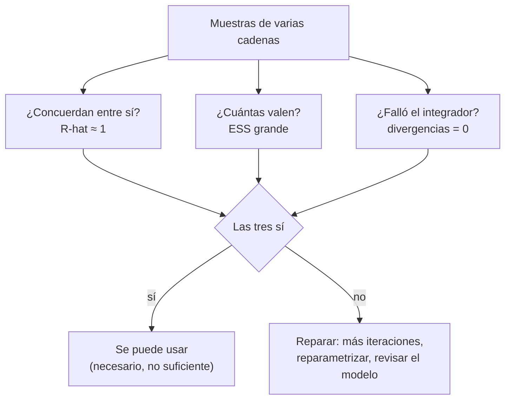

# B19-C04 — Diagnóstico de convergencia de cadenas

<!-- nav:top -->
[🏠 Programa](../../../../README.md) · [📚 Bloque B19](../../../tronco-comun/B19-inferencia-bayesiana-y-computacion-probabilistica.md) · [← Anterior: B19-C03 — Hamiltonian Monte Carlo y NUTS](../B19-C03-hamiltonian-monte-carlo-y-nuts/CLASE.md) · [Siguiente: B19-C05 — Inferencia variacional →](../../../tronco-comun/B19-inferencia-bayesiana-y-computacion-probabilistica.md#b19-c05)
<!-- /nav -->

## 1. Ubicación, nivel y alcance

Cuarta clase del bloque B19. En [C03](../B19-C03-hamiltonian-monte-carlo-y-nuts/CLASE.md) generaste muestras de una posterior con HMC. Un muestreador siempre devuelve números; la pregunta de esta clase es si esos números representan la posterior. Aprendes a medir la convergencia con el R̂ dividido, a estimar cuántas muestras independientes valen tus muestras y a reconocer las divergencias de HMC como señal de una geometría mal tratada.

No verás cómo se construye el muestreador (C03) ni cómo se evalúa el modelo en sí (C06 a C08): aquí solo preguntas «¿funcionó el cómputo?».

## 2. Por qué esta clase existe

Una cadena que parece haberse estabilizado puede estar atrapada en una región de la posterior, o llevar meses de iteraciones en una sola zona y no haber visto la otra. Con una sola cadena y una mirada al gráfico, la tentación de decir «ya convergió» es fuerte.

La decisión central es: **¿puedo confiar en estas muestras para reportar medias, intervalos y probabilidades, y cuánta precisión tienen?** Se responde con tres herramientas complementarias: R̂ (¿concuerdan las cadenas entre sí?), tamaño efectivo (¿cuántas muestras independientes tengo?) y divergencias (¿falló el integrador en alguna región?). Esto sostiene el resto del bloque: no tiene sentido comparar modelos (C07) ni calibrarlos (C08) con muestras que no funcionaron.

## 3. Lo que podrás hacer al terminar

1. Calcular a mano el R̂ dividido de varias cadenas cortas.
2. Explicar qué mide el tamaño efectivo y calcular el de una cadena AR(1) con su fórmula exacta.
3. Decidir cuántas muestras efectivas hacen falta para una precisión dada.
4. Interpretar las divergencias de HMC y proponer una reparametrización.
5. Escribir un informe de diagnóstico con umbrales, evidencia y decisión.
6. Explicar por qué los diagnósticos son necesarios pero no suficientes.

La evidencia es el **informe de diagnóstico** del ejercicio 12 (sección 20).

## 4. Con qué llegas y cómo comprobarlo

Necesitas C03 (HMC y ESS), varianza y covarianza (B12-C04 y B12-C05) y la idea de cadena de Markov (B12-C13). Cinco preguntas:

1. ¿Qué es la autocorrelación a retardo `t` de una serie?
2. Si una cadena tiene autocorrelación alta, ¿su tamaño efectivo es mayor o menor que `N`?
3. ¿Qué significa que dos cadenas «concuerden»?
4. ¿Qué error estándar tiene la media de `N` muestras independientes de desviación `s`?
5. ¿Para qué sirve empezar varias cadenas en puntos distintos?

<details>
<summary>Ver respuestas</summary>

1. La correlación entre `x_i` y `x_{i+t}`. 2. Menor. 3. Que sus distribuciones de valores coinciden, no solo sus medias. 4. `s/√N`. 5. Para ver si todas llegan a la misma región; si no, algo falla.
</details>

Con cuatro o cinco aciertos, sigue; con tres o menos, repasa B12-C13 y C03.

## 5. Un caso real: por qué se reemplazó el R̂ clásico

Vehtari, Gelman, Simpson, Carpenter y Bürkner (fuente S1) argumentan que el diagnóstico de Gelman–Rubin tiene fallos importantes: puede no detectar problemas cuando las cadenas tienen colas pesadas o cuando la varianza difiere entre cadenas. Proponen un R̂ basado en rangos, medidas locales de eficiencia para cuantiles, una forma de estimar el error Monte Carlo de los cuantiles y recomiendan sustituir los gráficos de traza por gráficos de rangos de varias cadenas. Hogg y Foreman-Mackey (fuente S2) sostienen, en un artículo pedagógico, que el tiempo de autocorrelación es la prueba de convergencia más importante y que el muestreo es una forma de calcular integrales.

De ambas fuentes se leyó solo el resumen. El laboratorio implementa la versión clásica dividida (sin rangos), por lo que **no reproduce** el diagnóstico mejorado de S1; los datos son **simulados**.

## 6. Vocabulario

Una **cadena** es la secuencia de muestras de un algoritmo de Markov. Varias cadenas, comenzadas en puntos distintos, permiten comparar. Un **calentamiento** (*warm-up*) son las primeras iteraciones, que se descartan. **Convergencia** significa que las cadenas muestrean la misma distribución estacionaria, la posterior; no es una propiedad que se demuestre, solo que se detecta su ausencia.

El **R̂ dividido** (*split-R̂*) divide cada cadena en dos mitades y compara. Con `M` cadenas ya divididas de longitud `n`, `W` es la media de las varianzas intra-cadena, `B/n` la varianza entre las medias de cadena, `var⁺ = ((n−1)/n) W + B/n` y `R̂ = √(var⁺/W)`. El **tamaño efectivo de muestra** `ESS = M n/(1 + 2 Σ ρ_t)` donde `ρ_t` es la autocorrelación a retardo `t`. El **error Monte Carlo estándar** de la media es `s/√ESS`. Una **divergencia** es una trayectoria de HMC en la que el error de energía excede un umbral grande (aquí 1000): el integrador no pudo seguir la geometría.

## 7. Modelo mental: tres preguntas independientes



*Descripción textual:* las muestras de varias cadenas pasan por tres pruebas independientes (concordancia, tamaño efectivo, divergencias). Solo si las tres se cumplen se usan las muestras, y aun así el resultado es necesario pero no suficiente; si alguna falla, se repara.

**Límite de la analogía:** las tres pruebas no pueden demostrar convergencia: sólo pueden delatar su ausencia. Cadenas que se quedan juntas en un modo equivocado pasan todas.

## 8. La explicación, paso a paso

### 8.1 R̂ dividido: la idea

Si todas las cadenas muestrean la misma distribución, la variabilidad *entre* medias de cadenas debe ser parecida a la variabilidad *dentro* de ellas. R̂ compara la varianza total estimada `var⁺` con la intra-cadena `W`. Si las cadenas aún no se mezclan, `var⁺ > W` y `R̂ > 1`. Dividir cada cadena en dos mitades sirve para detectar una cadena que sigue una tendencia: sus dos mitades tendrán medias diferentes. Una regla práctica habitual es exigir `R̂` cercano a 1 (por ejemplo, menor que 1,01 a 1,05); el umbral es una convención, no un teorema.

### 8.2 Tamaño efectivo

Muestras sucesivas de una cadena están correlacionadas. Para una serie AR(1) con coeficiente `ρ` el ESS por muestra es exactamente `(1 − ρ)/(1 + ρ)`: con `ρ = 0,9`, solo 5,3 % de las muestras valen. El estimador suma autocorrelaciones hasta el primer par negativo (secuencia positiva inicial). El error Monte Carlo de una media es `s/√ESS`: para que sea 5 % de la desviación de la posterior hacen falta `ESS ≥ 400`.

### 8.3 Una cadena en otra zona

Si una cadena se queda en una región distinta (caso B del laboratorio, media 3 frente a 0), la varianza entre cadenas aparece y `R̂` sube (1,69), y el ESS se desploma (6). Más iteraciones no lo arreglan si la cadena no sale de su zona: hay multimodalidad o mala inicialización.

### 8.4 Cadenas que aún no llegaron

Si las cadenas arrancan lejos (en −5 y 5) y la mezcla es lenta, las primeras iteraciones aportan una tendencia (caso C): `R̂ = 1,60`. Se descarta el calentamiento, se alarga la corrida y se vuelve a medir.

### 8.5 Divergencias

En HMC, una trayectoria diverge cuando el error de energía es enorme porque el paso `ε` es demasiado grande para la curvatura local. Una causa típica es el **embudo de Neal**: `v ~ N(0, 3²)` y `x | v ~ N(0, e^v)`. Cuando `v` es muy negativo, la escala de `x` es diminuta, el paso necesario es pequeñísimo y el integrador falla; las divergencias se concentran en el cuello del embudo y la cadena **no visita** esa región, de modo que subestima la dispersión de `v`. Es la misma geometría que aparece en los modelos jerárquicos con `τ` pequeña (C02; Betancourt y Girolami, S3).

### 8.6 Reparametrizar

En la parametrización **no centrada** se muestrea `z ~ N(0,1)` y se define `x = e^{v/2} z`. Los parámetros muestreados son independientes a priori y el embudo desaparece. Es la misma distribución para `(v, x)`, solo cambia cómo la explora el algoritmo. En el laboratorio, las divergencias pasan de 41 de 4000 a cero, y la desviación de `v` de 2,59 a 2,96 (exacta: 3,00).

### 8.7 Límites

Un R̂ bueno con una sola zona explorada no detecta la zona perdida. Por eso se combinan varias cadenas dispersas, gráficos de rango (S1) y una verificación independiente de la calibración (C08). Y un resultado "malo" no se arregla bajando el umbral.

## 9. Magnitudes, símbolos y unidades

| Símbolo | Qué es | Unidad | Nota |
|---|---|---|---|
| `M`, `n` | número de cadenas y longitud (tras dividir) | adimensional | |
| `W` | media de varianzas intra-cadena | de `x²` | |
| `B/n` | varianza entre medias de cadena | de `x²` | |
| `var⁺` | varianza total estimada | de `x²` | |
| `R̂` | razón `√(var⁺/W)` | adimensional | ≥ 1 en la práctica |
| `ρ_t` | autocorrelación a retardo `t` | adimensional | |
| `ESS` | tamaño efectivo | adimensional | ≤ `Mn` salvo antitética |
| `ε`, `L` | paso y pasos de HMC | adimensional | de C03 |

## 10. Convenciones y referencias

Se parten las cadenas en dos mitades antes de calcular `R̂` y `ESS`. Las cadenas arrancan en puntos dispersos. Se descarta el calentamiento. Una divergencia se define por un error de energía mayor que 1000. Los umbrales de `R̂` y de ESS son convenciones prácticas, no resultados teóricos; se informan los valores, no solo «convergió».

## 11. De dónde sale lo que afirmamos

| ID | Fuente | Localizador | Respalda | Estado |
|---|---|---|---|---|
| S1 | Vehtari, A., Gelman, A., Simpson, D., Carpenter, B. y Bürkner, P.-C., «Rank-normalization, folding, and localization: An improved R̂ for assessing convergence of MCMC», *Bayesian Analysis* (2021; arXiv:1903.08008) | arXiv:1903.08008 | Fallos del R̂ clásico (colas pesadas, varianzas distintas); R̂ por rangos; gráficos de rango; ESS local | Resumen consultado el 2026-11-05 |
| S2 | Hogg, D. W. y Foreman-Mackey, D., «Data analysis recipes: Using Markov Chain Monte Carlo», 2017 | arXiv:1710.06068 | Tiempo de autocorrelación como prueba principal; consejos de uso; MCMC como integración | Resumen consultado el 2026-11-05 |
| S3 | Betancourt, M. J. y Girolami, M., «Hamiltonian Monte Carlo for Hierarchical Models», 2013 | arXiv:1312.0906 | Modelos jerárquicos plantean problemas a los métodos comunes | Resumen consultado el 2026-11-05 |
| S4 | Gabry, J. et al., «Visualization in Bayesian workflow», *J. R. Stat. Soc. A* 182, 389 (2019) | arXiv:1709.01449 | Visualizar va más allá de las trazas en todo el flujo bayesiano | Resumen consultado el 2026-11-05 |
| S5 | Este bloque, `diagnosticos.py` | misma carpeta | Cifras de las secciones 13 y 17 (datos **simulados**) | Ejecutado el 2026-11-05 |

**Límites.** De S1–S4 solo se leyeron los resúmenes: la forma de `R̂` y de `ESS` de la sección 6 son las clásicas, implementadas y verificadas aquí contra una fórmula cerrada y la teoría de AR(1), no contra el texto de S1. Los umbrales del párrafo 8.1 son convención práctica, no se afirman como citas.

## 12. Cómo ver la convergencia

Dibuja las trazas de las cuatro cadenas (iteración en horizontal, valor en vertical, un trazo distinto por cadena). Si se mezclan en una banda ancha y estable, es buen signo; si tienen bandas separadas o tendencias, no. Mejor aún, un histograma de rangos por cadena (S1, S4): si es plano para todas, las cadenas son intercambiables. **Accesibilidad:** diferencia las cadenas por patrón y rotula, y entrega junto la tabla de `R̂` y ESS.

## 13. Ejemplo trabajado: cuatro cadenas, tres historias

Resultados del laboratorio (datos **simulados**, 4 cadenas de 1000):

| Caso | R̂ | ESS | Lectura |
|---|---|---|---|
| A · AR(1) `ρ = 0,9`, estacionarias | 1,024 | 245 | Mezcla correcta pero lenta: ESS es el 6 % de 4000 |
| B · una cadena con media 3 | 1,689 | 6 | No concuerdan: una cadena en otra zona |
| C · AR(1) `ρ = 0,99` desde −5, −5, 5, 5 | 1,603 | 9 | No llegaron: más iteraciones y calentamiento |

Para A, la teoría da `ESS/N = (1 − 0,9)/(1 + 0,9) = 0,0526`, es decir, 210 sobre 4000; la medición única da 245 y el promedio de cinco corridas, 0,051 (204). Así que un `R̂` de 1,024 es aceptable con la convención de 1,05, pero el error Monte Carlo es `1/√245 = 6,4 %` de la desviación posterior: suficiente para una media a 10 %, no para una cola.

Para el embudo: con parametrización centrada, 41 divergencias de 4000 (1,0 %), `R̂` de `v` = 1,006 y desviación de `v` = 2,59 (exacta 3). Con la no centrada: 0 divergencias, `R̂` = 1,001, desviación 2,96. Moraleja: **el R̂ de 1,006 no delató el sesgo de la parametrización centrada; lo delataron las divergencias y la comparación con el valor exacto.**

## 14. Comparación de diagnósticos

El **gráfico de traza** es intuitivo, pero subjetivo con muchas cadenas o parámetros (S1 recomienda sustituirlo por gráficos de rango). **R̂** es objetivo y escalable, pero clásico no ve bien colas pesadas o varianzas distintas (S1). **ESS** cuantifica la precisión pero depende del estimador de autocorrelación y del parámetro. **Divergencias** detectan problemas geométricos que los otros no ven. **Comparar con una solución conocida** (como en C08) es lo único que valida el resultado. Los cuatro se usan juntos.

## 15. Práctica guiada

**Ejercicio 1 · con los pasos indicados.** Dos cadenas cortas (ya divididas), `A = (0, 1, 2, 1)` y `B = (2, 3, 4, 3)`. Calcula `W`, `B/n`, `var⁺` y `R̂`. *Pasos:* varianza muestral con divisor `n − 1`.

<details><summary>Solución comentada</summary>

Medias 1 y 3; varianzas `(1 + 0 + 1 + 0)/3 = 0,667` cada una, luego `W = 0,667`. Varianza de las medias (divisor 1): `(1 + 1)/1 = 2`, `B/n = 2`. `var⁺ = (3/4)(0,667) + 2 = 2,5`. `R̂ = √(2,5/0,667) = √3,75 = 1,94`: las cadenas no concuerdan.
</details>

**Ejercicio 2 · con una pista.** `A = (0, 1, 2, 1)` y `B = (1, 0, 1, 2)`: calcula `R̂`. *Pista:* ambas medias valen 1.

<details><summary>Solución comentada</summary>

`W = 0,667`; `B/n = 0`; `var⁺ = (3/4)(0,667) = 0,5`; `R̂ = √(0,5/0,667) = 0,866`. Un `R̂` menor que 1 es un artefacto de muestras tan pequeñas; indica que no hay evidencia de discordancia, no que haya «más que convergencia».
</details>

**Ejercicio 3 · casi autónomo.** Calcula `ESS/N` para AR(1) con `ρ = 0,5` y `ρ = 0,99`, y el ESS para `N = 4000`.

<details><summary>Solución comentada</summary>

`ρ = 0,5`: `0,5/1,5 = 1/3`, ESS = 1333. `ρ = 0,99`: `0,01/1,99 = 0,00503`, ESS = 20. Con autocorrelación 0,99, 4000 muestras valen unas 20.
</details>

## 16. Práctica autónoma, transferencia e integrador

**Ejercicio 4.** Una cadena es `(0, 0, 0, 0, 1, 1, 1, 1)`. Divídela y calcula `R̂` entre mitades. ¿Qué detecta la división?

<details><summary>Solución comentada</summary>

Mitades `(0,0,0,0)` y `(1,1,1,1)`: `W = 0`, `B/n > 0`, `R̂ → ∞`. La división detecta una tendencia dentro de una sola cadena que no se vería comparando medias de cadenas enteras.
</details>

**Ejercicio 5.** Caso B del laboratorio: `R̂ = 1,69`. ¿Duplicar las iteraciones lo resuelve? Propón dos acciones.

<details><summary>Solución comentada</summary>

No necesariamente: la cadena atrapada en otra zona no sale por correr más. Acciones: revisar si la posterior es multimodal (¿es real o un error de modelo?) y arrancar desde puntos más variados o reparametrizar.
</details>

**Ejercicio 6.** En el embudo centrado, `R̂ = 1,006` pero la desviación de `v` es 2,59 frente a 3,00. ¿Qué indica y qué diagnóstico lo muestra?

<details><summary>Solución comentada</summary>

Las cuatro cadenas coinciden entre sí (por eso `R̂` es bueno) pero todas se pierden la misma región, el cuello del embudo: sesgo compartido. Lo muestran las 41 divergencias y la comparación con la solución exacta. Es el ejemplo de que el `R̂` es necesario, no suficiente.
</details>

**Ejercicio 7.** Explica por qué `x = e^{v/2} z` con `z ~ N(0,1)` elimina el embudo.

<details><summary>Solución comentada</summary>

Los parámetros muestreados `(v, z)` son independientes a priori y de escala 3 y 1: ya no hay un cuello cuya anchura dependa de `v`. El integrador ve una geometría sencilla y el paso `ε` sirve en todas partes. La distribución de `(v, x)` es la misma.
</details>

**Ejercicio 8.** ¿Qué ESS necesitas para que el error Monte Carlo de la media sea el 5 % de la desviación posterior? ¿Y el 1 %?

<details><summary>Solución comentada</summary>

Error relativo `1/√ESS`: 5 % → `ESS = 400`; 1 % → `ESS = 10 000`. Para colas (cuantiles extremos) hace falta aún más.
</details>

**Ejercicio 9 · transferencia.** ¿Por qué se usan cuatro cadenas con arranques dispersos y no una cadena cuatro veces más larga?

<details><summary>Solución comentada</summary>

Una cadena larga no puede revelar que se quedó en una zona: no hay con qué compararla. Varias cadenas dispersas hacen visible la falta de acuerdo. Además permiten calcular `R̂`.
</details>

**Ejercicio 10 · transferencia.** Un artículo dice: «R̂ = 1,00 para todos los parámetros, el modelo convergió». ¿Qué preguntas harías?

<details><summary>Solución comentada</summary>

¿Cuántas cadenas y desde dónde arrancaron? ¿ESS bulk y de colas? ¿Hubo divergencias? ¿Qué `ε` y qué semilla? ¿Se comparó con una solución conocida? ¿Qué versión del software? Sin esas respuestas, `R̂ = 1,00` no basta (ejercicio 6).
</details>

**Ejercicio 11 · transferencia.** Diseña una lista de **qué reportar** de una corrida MCMC para que otra persona la reproduzca.

<details><summary>Solución comentada</summary>

Modelo y priors; datos y su procedencia; número de cadenas, iteraciones y calentamiento; semilla; versión del lenguaje y bibliotecas; `ε` y métrica adaptados; `R̂` y ESS por parámetro; número de divergencias; comprobaciones (comparación con solución conocida).
</details>

**Ejercicio 12 · integrador.** Ejecuta el laboratorio y redacta un **informe de diagnóstico** con una fila por caso (A, B, C, embudo centrado, embudo no centrado): métricas, umbral usado, decisión (aceptar, alargar, reparar o rechazar) y una frase de justificación.

<details><summary>Solución modelo</summary>

A: `R̂` 1,024, ESS 245 → aceptar para medias, alargar para colas. B: `R̂` 1,69, ESS 6 → rechazar, investigar multimodalidad. C: `R̂` 1,60, ESS 9 → alargar con calentamiento. Embudo centrado: 41 divergencias, sesgo de la desviación de `v` (2,59 vs 3,00) → reparar (reparametrizar). Embudo no centrado: 0 divergencias, `R̂` 1,001, desviación 2,96 → aceptar. El informe debe indicar que los datos son simulados y que el `R̂` usado es el clásico, no el de rangos.
</details>

## 17. Laboratorio: diagnósticos con soluciones conocidas

El script [diagnosticos.py](diagnosticos.py) implementa `R̂` dividido, ESS y un HMC para el embudo de Neal. **Pruebas que detienen la ejecución:** `R̂ < 1,05` en cadenas estacionarias; el ESS de AR(1) coincide con `(1 − ρ)/(1 + ρ)` dentro del 15 % (promedio de cinco corridas); y `R̂` coincide con su fórmula cerrada a 10⁻¹². **Datos:** simulados, semilla fija. **Predice antes de ejecutar:** ¿qué parametrización tendrá divergencias? (La centrada.)

**Ejecución del 2026-11-05 (Python 3.12.9, numpy 2.4.4):**

```text
Pruebas: OK (ESS/N de AR(1) rho=0.9: teoria 0.053, medida 0.051)

caso                                           R-hat      ESS
A  AR(1) rho=0.9, estacionarias                1.024      245
B  una cadena en otra zona (mu=3)              1.689        6
C  AR(1) rho=0.99 arrancando en -5,-5,5,5      1.603        9

Embudo de Neal, HMC (eps=0.15, L=20), 4 cadenas x 1000 iteraciones
  centrada     divergencias:   41/4000 | R-hat de v: 1.006 | min v: -5.33 | sd v: 2.59 (exacta 3.00)
  no centrada  divergencias:    0/4000 | R-hat de v: 1.001 | min v: -10.58 | sd v: 2.96 (exacta 3.00)
```

```bash
python programa/clases/B19/B19-C04-diagnostico-de-convergencia-de-cadenas/diagnosticos.py
```

**Límites:** R̂ clásico (sin rangos ni plegado); ESS simple; el HMC del embudo es un banco de pruebas con `ε` y `L` fijos, no una herramienta de producción; los resultados de un solo conjunto de semillas.

## 18. Errores frecuentes y cómo corregirlos

**Declarar convergencia con una cadena.** Ejercicio 9.

**Pensar que `R̂ ≈ 1` basta.** Ejercicio 6.

**Confundir `N` con ESS.** Ejercicio 3: 4000 muestras con `ρ = 0,99` valen ≈ 20.

**Ignorar las divergencias porque «son pocas».** Se concentran en regiones importantes (sección 8.5).

**Subir el umbral hasta que pase.** Cambiar el criterio después de ver el resultado invalida el diagnóstico.

## 19. Cómo sabrás que vas bien

Tras la 8.1: ¿calculas `R̂` a mano? Ejercicio 1. Tras la 8.2: ¿conviertes un error Monte Carlo deseado en un ESS? Ejercicio 8. Tras la 8.5: ¿puedes explicar con tus palabras por qué las divergencias sesgan? Tras el laboratorio: ¿sabes qué caso aceptarías y por qué? Al final: ¿tu informe cita los umbrales y declara el `R̂` usado?

## 20. Qué entregas y cómo se evalúa

El producto es el **informe de diagnóstico** del ejercicio 12.

| Criterio | Inicial | En desarrollo | Logrado | Destacado |
|---|---|---|---|---|
| Métricas | Solo dice «converge» | Da `R̂` | Da `R̂`, ESS y divergencias | Relaciona ESS con precisión deseada |
| Decisión | Sin criterio | Criterio vago | Umbral y decisión por caso | Anticipa qué métrica falla primero |
| Reparación | No propone | Más iteraciones | Reparametriza con razón | Verifica contra solución conocida |
| Honestidad | Generaliza | Rotula datos | Declara `R̂` clásico y límites | Dice qué no puede detectar |

**Condiciones críticas:** no afirmar convergencia por una sola métrica; declarar que el `R̂` es el clásico; rotular datos simulados; citar solo lo consultado.

## 21. Ética, seguridad y límites

Reportar solo las corridas que "salieron bien" es un sesgo de selección. Decisiones con consecuencias (por ejemplo, de seguridad de una misión) no deben apoyarse en muestras sin diagnóstico completo y verificación independiente. Los datos de la clase son simulados. Accesibilidad: usa tablas además de gráficos de traza y descripciones textuales de los diagramas.

## 22. Para cerrar y seguir

La convergencia no se demuestra, se intenta refutar con varias pruebas: concordancia entre cadenas (`R̂`), tamaño efectivo y divergencias. Cada una ve lo que las otras no, y el `R̂` clásico puede pasar por alto un sesgo compartido. Queda abierta una pregunta: cuando el muestreo es demasiado caro, ¿qué se puede hacer? Es la inferencia variacional de C05.

**Glosario español–inglés.** cadena · *chain*; calentamiento · *warm-up / burn-in*; tamaño efectivo de muestra · *effective sample size (ESS)*; divergencia · *divergence*; autocorrelación · *autocorrelation*; gráfico de traza · *trace plot*; gráfico de rangos · *rank plot*; embudo · *funnel*; reparametrización no centrada · *non-centered parameterization*.

**Continuidad.** B19-C05 usa tu capacidad de **reconocer cuándo la aproximación falla** para estudiar una alternativa a MCMC; B19-C08 retoma la validación de la inferencia con simulaciones, más fuerte que los diagnósticos de esta clase.

**Referencias:** ver sección 11. De S1 a S4 solo se leyeron los resúmenes.

<!-- nav:bottom -->
---

[← Anterior: B19-C03 — Hamiltonian Monte Carlo y NUTS](../B19-C03-hamiltonian-monte-carlo-y-nuts/CLASE.md) · [📚 Bloque B19](../../../tronco-comun/B19-inferencia-bayesiana-y-computacion-probabilistica.md) · [Siguiente: B19-C05 — Inferencia variacional →](../../../tronco-comun/B19-inferencia-bayesiana-y-computacion-probabilistica.md#b19-c05)
<!-- /nav -->
