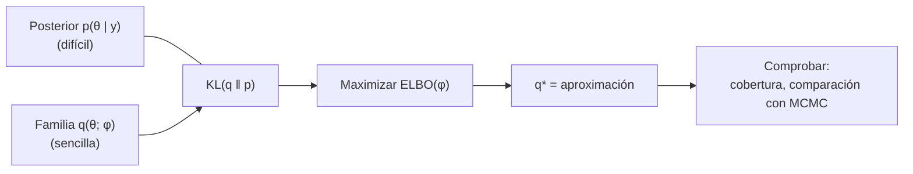

# B19-C05 — Inferencia variacional

<!-- nav:top -->
[🏠 Programa](../../../../README.md) · [📚 Bloque B19](../../../tronco-comun/B19-inferencia-bayesiana-y-computacion-probabilistica.md) · [← Anterior: B19-C04 — Diagnóstico de convergencia de cadenas](../B19-C04-diagnostico-de-convergencia-de-cadenas/CLASE.md) · [Siguiente: B19-C06 — Distribución predictiva posterior →](../B19-C06-distribucion-predictiva-posterior/CLASE.md)
<!-- /nav -->

## 1. Ubicación, nivel y alcance

Quinta clase del bloque B19. En [C03](../B19-C03-hamiltonian-monte-carlo-y-nuts/CLASE.md) y [C04](../B19-C04-diagnostico-de-convergencia-de-cadenas/CLASE.md) muestreaste la posterior y comprobaste que el muestreo funcionó. Aquí cambias de estrategia: en vez de generar muestras, **aproximas** la posterior con una distribución sencilla y la ajustas por optimización. Es más rápido y a veces es la única opción viable, pero introduce un sesgo que debes saber medir.

Verás la divergencia de Kullback–Leibler, la cota inferior de la evidencia (ELBO), la aproximación de campo medio y sus límites. No verás redes neuronales ni inferencia variacional estocástica de gran escala; el laboratorio usa tres problemas de solución conocida o comprobable.

## 2. Por qué esta clase existe

Con miles de parámetros o millones de datos, un muestreador puede tardar horas o días. La inferencia variacional (VI) elige una familia de distribuciones manejables, por ejemplo gaussianas, y busca dentro de ella la más cercana a la posterior. Convierte un problema de integración en uno de optimización.

La decisión central es: **¿cuándo me conviene una aproximación rápida, y cómo sé cuánto me equivoco?** La respuesta tiene dos partes: el ELBO dice cuán buena es la aproximación *relativa* a otras de la misma familia, pero no dice por sí solo cuánta incertidumbre pierdes; eso lo muestra el caso de campo medio (sección 8.4). Esto enlaza con C08, donde la calibración detecta el exceso de confianza.

## 3. Lo que podrás hacer al terminar

1. Definir la divergencia KL y el ELBO y relacionarlos con la evidencia.
2. Calcular el ELBO de una aproximación gaussiana en un modelo normal–normal y comprobar que, con la posterior exacta, iguala `log p(y)`.
3. Explicar por qué el campo medio subestima la varianza de variables correlacionadas y cuantificarlo.
4. Ajustar una gaussiana variacional a una posterior no gaussiana y medir el error contra una rejilla.
5. Decidir entre VI y MCMC según el problema.
6. Calcular la cobertura real de un intervalo variacional.

La evidencia es el **informe de aproximación variacional** del ejercicio 12 (sección 20).

## 4. Con qué llegas y cómo comprobarlo

Necesitas C01–C04, esperanza matemática y logaritmos (B09, B12), y la gaussiana multivariante (B12, B10). Cinco preguntas:

1. ¿Cuál es la entropía de una gaussiana `N(m, s²)`?
2. ¿Qué es la evidencia `p(y)` en el teorema de Bayes?
3. Si `X ~ N(0, 1)`, ¿cuánto vale `E[X²]`?
4. ¿Qué es la matriz de precisión de una gaussiana?
5. ¿Por qué una divergencia entre distribuciones no es simétrica en general?

<details>
<summary>Ver respuestas</summary>

1. `½ log(2π e s²)`. 2. La constante de normalización `∫ p(y | θ) p(θ) dθ`. 3. 1. 4. La inversa de la covarianza. 5. Porque el promedio se toma sobre una de las dos distribuciones, no sobre la otra.
</details>

Con cuatro o cinco aciertos, sigue; con tres o menos, repasa B12.

## 5. Un caso real: VI como alternativa a MCMC

Blei, Kucukelbir y McAuliffe (fuente S1) presentan la inferencia variacional como un método de aprendizaje automático que aproxima densidades difíciles, como las posteriores bayesianas, mediante optimización: se escoge una familia de densidades y se busca el miembro más cercano al objetivo en divergencia de Kullback–Leibler. Cubren campo medio, familias exponenciales, un ejemplo completo y una variante estocástica para grandes conjuntos de datos. Kucukelbir, Tran, Ranganath, Gelman y Blei (fuente S2) presentan ADVI: el usuario solo da el modelo y los datos y el algoritmo deriva el procedimiento, sin exigir conjugación; según su resumen está integrado en el sistema Stan.

De ambas fuentes se leyó solo el resumen. Los resultados numéricos de la clase son de tres bancos de prueba **sintéticos y simulados**, con respuesta exacta o comprobable por rejilla.

## 6. Vocabulario

La **divergencia de Kullback–Leibler** de `q` respecto de `p` es `KL(q ‖ p) = E_q[log q(θ) − log p(θ)]`; es ≥ 0 y vale 0 solo si `q = p`. Una **familia variacional** es el conjunto de distribuciones permitidas (por ejemplo, gaussianas con media `m` y desviación `s`). La **aproximación variacional** `q*` es el miembro de la familia que minimiza `KL(q ‖ p(θ | y))`.

El **ELBO** (*evidence lower bound*) es `E_q[log p(y, θ)] − E_q[log q(θ)]`. Se cumple la identidad `log p(y) = ELBO(q) + KL(q ‖ p(θ | y))`, de donde `ELBO ≤ log p(y)`: maximizar el ELBO equivale a minimizar la KL, sin necesidad de conocer la evidencia. El **campo medio** (*mean field*) exige que `q` se factorice en factores independientes, `q(θ) = Π q_i(θ_i)`. **CAVI** (ascenso coordenado) actualiza un factor por vez manteniendo los demás fijos.

## 7. Modelo mental: la sombra de la posterior

Imagina la posterior como un objeto en 3D y la familia variacional como una pantalla en la que solo caben ciertas formas. `q*` es la sombra que mejor la recuerda. Si la pantalla solo admite elipses alineadas con los ejes (campo medio), la sombra de un óvalo inclinado es una elipse más pequeña.



*Descripción textual:* la KL mide la distancia entre la familia sencilla y la posterior difícil; se maximiza el ELBO sobre los parámetros variacionales `φ`; el resultado `q*` se somete a comprobaciones de cobertura y de comparación con MCMC.

**Límite de la analogía:** la sombra pierde información de una manera específica: la KL en este sentido penaliza poner masa donde la posterior no tiene, de modo que `q*` tiende a ser más estrecha que `p`, no más ancha.

## 8. La explicación, paso a paso

### 8.1 Del problema de integrar al de optimizar

La evidencia `p(y)` requiere integrar sobre todos los parámetros, difícil con muchos. En cambio, el ELBO es una esperanza respecto de `q`, que se puede calcular o estimar si `q` es sencilla. Maximizar el ELBO sobre `φ` es una optimización.

### 8.2 El caso exacto: normal–normal

Con `θ ~ N(m₀, s₀²)` y `y_i | θ ~ N(θ, s²)` para `i = 1..n`, la posterior es normal con precisión `1/s₀² + n/s²` y media `(m₀/s₀² + Σ y_i/s²)/precisión`. Si tomas `q = N(m_q, s_q²)`, el ELBO tiene forma cerrada:

```text
ELBO = −(n/2) log(2π s²) − [Σ(y_i − m_q)² + n s_q²]/(2 s²)
       − ½ log(2π s₀²) − [(m_q − m₀)² + s_q²]/(2 s₀²) + ½ log(2π e s_q²)
```

Con `q` igual a la posterior exacta, `KL = 0` y el ELBO coincide con `log p(y)`. Esa igualdad es la prueba de que la fórmula está bien.

### 8.3 Cuando la familia no contiene la posterior

Para una tasa de Poisson `λ = e^η`, con prior `η ~ N(1, 1)`, la posterior de `η` no es normal. Aun así se ajusta `q = N(m, s²)` en `η`: el ELBO es `E_q[n η − T e^η − (η − 1)²/2] + ½ log(2π e s²)` más constantes. La esperanza se calcula con cuadratura de Gauss–Hermite y se maximiza numéricamente. La posterior exacta se obtiene por rejilla, de modo que puedes medir el error de la aproximación.

### 8.4 El campo medio subestima la varianza

Para una gaussiana bidimensional con correlación `r` y varianzas marginales 1, la precisión tiene diagonal `1/(1 − r²)`. CAVI converge a factores normales con media exacta y varianza `1/Λ_ii = 1 − r²`, es decir, desviación `√(1 − r²)`. Con `r = 0,9` es 0,436: menos de la mitad de la desviación real. Las medias son correctas; las incertidumbres, demasiado pequeñas. Con `r = 0,5` el factor es 0,87 y con `r = 0,99`, 0,14.

### 8.5 ¿Es buena la aproximación?

El ELBO permite comparar aproximaciones entre sí, pero un ELBO "alto" no demuestra que `q*` sea fiel: depende de la familia. Hay que contrastar con una referencia: MCMC en un subconjunto, una solución exacta, o la calibración de C08. Un indicio práctico: si los intervalos variacionales cubren menos de lo nominal, la aproximación es demasiado confiada.

### 8.6 Cuándo usar VI

VI es adecuada cuando necesitas rapidez (exploración de modelos, grandes volúmenes de datos) y aceptas el sesgo; MCMC, cuando necesitas intervalos fiables y puedes pagar el cómputo. Una práctica sensata es explorar con VI y confirmar el modelo final con MCMC.

## 9. Magnitudes, símbolos y unidades

| Símbolo | Qué es | Unidad | Nota |
|---|---|---|---|
| `θ` | parámetro | las suyas | |
| `y_i` | datos | las suyas | sintéticos |
| `p(θ \| y)` | posterior | densidad | objetivo |
| `q(θ; φ)` | distribución variacional | densidad | `φ = (m, s)` |
| `KL(q ‖ p)` | divergencia | nats | ≥ 0 |
| `ELBO` | cota inferior de `log p(y)` | nats | `≤ log p(y)` |
| `r` | correlación | adimensional | −1 a 1 |
| `η = log λ` | log de la tasa | adimensional | para `λ` en h⁻¹ |

Se usan logaritmos naturales, así que KL y ELBO se miden en *nats*.

## 10. Convenciones y referencias

Se denomina «exacta» a la solución analítica (modelos normales) o a una rejilla suficientemente fina; «variacional» a `q*`. Las comparaciones se hacen en media y desviación estándar. El campo medio se aplica a un objetivo gaussiano cuya covarianza se conoce. La optimización usa Nelder–Mead sobre `(m, log s)`.

## 11. De dónde sale lo que afirmamos

| ID | Fuente | Localizador | Respalda | Estado |
|---|---|---|---|---|
| S1 | Blei, D. M., Kucukelbir, A. y McAuliffe, J. D., «Variational Inference: A Review for Statisticians», *J. Am. Stat. Assoc.* 112 (518), 2017 | arXiv:1601.00670 | VI aproxima densidades por optimización minimizando KL; campo medio; familias exponenciales; variante estocástica | Resumen consultado el 2026-11-05 |
| S2 | Kucukelbir, A., Tran, D., Ranganath, R., Gelman, A. y Blei, D. M., «Automatic Differentiation Variational Inference», 2016 | arXiv:1603.00788 | ADVI deriva el algoritmo desde modelo y datos, sin conjugación; integrado en Stan | Resumen consultado el 2026-11-05 |
| S3 | Gelman, A. et al., «Bayesian Workflow», 2020 | arXiv:2011.01808 | Flujo iterativo con comprobaciones del modelo | Resumen consultado el 2026-11-05 |
| S4 | Este bloque, `elbo_y_campo_medio.py` | misma carpeta | Cifras de las secciones 13 y 17 (datos **sintéticos**) | Ejecutado el 2026-11-05 |

**Límites.** De S1–S3 solo se leyeron los resúmenes. La identidad `log p(y) = ELBO + KL`, el resultado `√(1 − r²)` del campo medio y la forma cerrada del ELBO normal son resultados clásicos que se **comprueban numéricamente** en el laboratorio, no se atribuyen a un pasaje leído. Que VI tienda a subestimar la varianza se muestra aquí en un caso gaussiano; no se generaliza a todo problema.

## 12. Cómo ver la aproximación

Dibuja el contorno de la gaussiana correlacionada (`r = 0,9`) como un óvalo inclinado y, dentro de él, la elipse circular de campo medio, con semiejes 0,436. La elipse queda dentro del óvalo. Para la tasa de Poisson, superpón las curvas de la posterior exacta y de `q*` sobre el eje `η`. **Accesibilidad:** una curva continua y otra a trazos, con la tabla de media y desviación en la sección 17.

## 13. Ejemplo trabajado: ELBO exacto y ELBO de una mala aproximación

Datos sintéticos: `y = (9,8; 10,4; 10,1; 9,6; 10,6)`, `s = 0,5`, prior `N(10, 2²)`.

Posterior exacta: precisión `1/4 + 5/0,25 = 20,25`; `Σ y = 50,5`; media `(2,5 + 202)/20,25 = 10,0988`; desviación `1/√20,25 = 0,2222`. La evidencia (calculada de forma independiente con la covarianza marginal completa) es `log p(y) = −4,687416`.

Con `q` exacta, el ELBO calculado con la fórmula de 8.2 también da `−4,687416`: la brecha es 0. Con una `q` desplazada 0,3 y 1,5 veces más ancha, el ELBO baja a `−5,818201`. La diferencia, `1,130785` nats, es la `KL(q ‖ p)` por la identidad de la sección 6. Por tanto, el ELBO sirve para ordenar aproximaciones: la mejor es la que tiene mayor ELBO.

## 14. Comparación de métodos

**MCMC** (C03) es asintóticamente exacto y diagnosticable (C04), pero costoso. **VI de campo medio** es rápido y escalable, con media razonable pero incertidumbre subestimada si hay correlación. **VI con familia más rica** (por ejemplo, gaussiana de covarianza completa) reduce ese sesgo con más coste y no elimina la limitación de la forma. **Soluciones exactas** (conjugadas) son lo mejor cuando existen. La elección depende de qué necesitas: el valor central, o intervalos fiables.

## 15. Práctica guiada

**Ejercicio 1 · con los pasos indicados.** Para el modelo de la sección 13, calcula la precisión y la media posterior. *Pasos:* sección 8.2.

<details><summary>Solución comentada</summary>

Precisión `0,25 + 5/0,25 = 20,25`. Media `(10/4 + 50,5/0,25)/20,25 = 204,5/20,25 = 10,0988`. Desviación `0,2222`. Coincide con el laboratorio.
</details>

**Ejercicio 2 · con una pista.** Con `ELBO(q) = −5,818201` y `log p(y) = −4,687416`, calcula `KL(q ‖ p)`. *Pista:* identidad de la sección 6.

<details><summary>Solución comentada</summary>

`KL = log p(y) − ELBO = −4,687416 + 5,818201 = 1,130785` nats. Es positiva, como debe.
</details>

**Ejercicio 3 · casi autónomo.** Calcula la desviación de campo medio para correlaciones `r = 0,5` y `r = 0,99` (varianza marginal 1).

<details><summary>Solución comentada</summary>

`√(1 − 0,25) = 0,866` y `√(1 − 0,9801) = 0,141`. Cuanto mayor la correlación, más se subestima la dispersión.
</details>

## 16. Práctica autónoma, transferencia e integrador

**Ejercicio 4.** Un intervalo variacional del 90 % de campo medio con `r = 0,9` se construye con la `q*`. ¿Qué cobertura real tiene sobre la marginal verdadera?

<details><summary>Solución comentada</summary>

Semiancho `1,645 × 0,436 = 0,717` desviaciones verdaderas. Cobertura `2Φ(0,717) − 1 ≈ 0,527`: un «90 %» que cubre ≈ 53 %. Es la señal del exceso de confianza que C08 aprende a medir.
</details>

**Ejercicio 5.** En el laboratorio, la `q*` gaussiana en `η = log λ` tiene `m = 1,1651`, `s = 0,3573`; la exacta, `1,1645` y `0,3659`. Calcula los errores relativos y el valor aproximado de la media de `λ` bajo `q*`.

<details><summary>Solución comentada</summary>

Media: error de 0,0006 (0,05 %). Desviación: `(0,3659 − 0,3573)/0,3659 = 2,4 %` menos. Media de `λ` bajo `q*`: `exp(m + s²/2) = exp(1,1651 + 0,0638) = 3,42 h⁻¹`, distinta de `exp(m) = 3,21`, que es la mediana. La tasa observada es 3,5 h⁻¹. Cuidado con confundir mediana y media al transformar.
</details>

**Ejercicio 6.** ¿Por qué la KL en el sentido `KL(q ‖ p)` favorece aproximaciones más estrechas que la posterior?

<details><summary>Solución comentada</summary>

Penaliza fuertemente que `q` ponga masa donde `p` casi no la tiene (el logaritmo de `q/p` crece), pero no penaliza tanto que `q` ignore regiones de `p`. Resultado: `q*` evita las colas y se concentra en un modo.
</details>

**Ejercicio 7.** El ELBO de un modelo A es −120 y el de un modelo B es −115. ¿Puedes afirmar que B explica mejor los datos?

<details><summary>Solución comentada</summary>

No sin cautela: cada ELBO es una cota inferior con brecha desconocida y distinta según el modelo. Para comparar modelos se usa la evidencia o la predicción (C07). Un ELBO más alto solo garantiza que, dentro del mismo modelo, una `q` es mejor que otra.
</details>

**Ejercicio 8.** Muestra que, si `q` es la posterior exacta, la identidad `log p(y) = ELBO + KL` implica `ELBO = log p(y)`.

<details><summary>Solución comentada</summary>

Con `q = p(θ | y)`, `KL = 0`; por tanto `ELBO = log p(y)`. El laboratorio lo comprueba con tolerancia 10⁻¹⁰.
</details>

**Ejercicio 9 · transferencia.** Tienes un modelo con 10⁶ observaciones. Describe cuándo usarías VI y cómo comprobarías el resultado.

<details><summary>Solución comentada</summary>

Para explorar rápido variantes del modelo y obtener estimaciones centrales. Para comprobar: MCMC en un subconjunto o en el modelo final, comparación de cobertura por simulación (C08) y chequeos predictivos (C06). Si la cobertura sale muy por debajo de la nominal, se usa MCMC.
</details>

**Ejercicio 10 · transferencia.** Un artículo reporta intervalos al 95 % de campo medio para dos parámetros con correlación posterior de 0,95. ¿Qué advertencia harías?

<details><summary>Solución comentada</summary>

Con `r = 0,95`, la desviación variacional es `√(1 − 0,9025) = 0,31` de la real: los intervalos cubren muy por debajo del 95 %. Habría que pedir la comparación con MCMC o una familia con covarianza completa.
</details>

**Ejercicio 11 · transferencia.** «El ELBO converge, por lo tanto la aproximación es correcta.» Evalúa la frase.

<details><summary>Solución comentada</summary>

Converger significa que la optimización terminó, no que `q*` se parezca a `p`: depende de la familia. Un óvalo correlacionado con campo medio converge perfectamente a una elipse demasiado pequeña. Falta la validación externa.
</details>

**Ejercicio 12 · integrador.** Ejecuta el laboratorio y redacta un **informe de aproximación variacional** de una página: (a) comprobación exacta del ELBO, (b) efecto del campo medio, (c) error de la gaussiana en el problema de Poisson, (d) recomendación VI frente a MCMC con la cobertura implicada.

<details><summary>Solución modelo</summary>

(a) `log p(y) = −4,687416`; ELBO exacto igual; mal `q` −5,818201 (KL 1,130785). (b) CAVI da media 0 y desviación 0,4359 = `√(1 − r²)` para `r = 0,9`; cobertura nominal 90 % → ≈ 53 %. (c) `m = 1,1651` vs 1,1645; `s = 0,3573` vs 0,3659 (−2,4 %). (d) VI sirve para valores centrales y exploración; para intervalos se confirma con MCMC o calibración. Debe declarar datos sintéticos y que el campo medio se probó solo en una gaussiana.
</details>

## 17. Laboratorio: ELBO y campo medio

El script [elbo_y_campo_medio.py](elbo_y_campo_medio.py) tiene tres partes. **Parte 1:** ELBO del modelo normal–normal, con evidencia calculada por la covarianza marginal completa. **Parte 2:** CAVI para una gaussiana con `r = 0,9`. **Parte 3:** VI gaussiana en `log λ` de una tasa de Poisson con cuadratura de Gauss–Hermite (40 nodos) y Nelder–Mead, comparada con una rejilla. **Pruebas que detienen la ejecución:** ELBO exacto = `log p(y)` (10⁻¹⁰); un `q` malo tiene ELBO menor; CAVI converge a media 0 y desviación `√(1 − r²)` (10⁻⁸); la gaussiana variacional coincide con la rejilla a 0,05 en media y desviación. **Datos:** sintéticos. **Predice antes de ejecutar:** ¿la desviación de campo medio será mayor o menor que 1? (Menor.)

**Ejecución del 2026-11-05 (Python 3.12.9, numpy 2.4.4, scipy 1.17.1):**

```text
Pruebas: OK

Parte 1: log p(y) = -4.687416; posterior exacta N(10.0988, 0.2222^2)
         ELBO con q exacta = -4.687416; ELBO con q desplazada y ancha = -5.818201 (< log p(y))
         brecha = KL(q||p) = 1.130785
Parte 2: CAVI r=0.9 -> medias [-0. -0.], sd de q [0.4359 0.4359] (sd marginal exacta 1.0000; cociente 0.4359 = sqrt(1-r^2))
Parte 3: VI gaussiana en eta=log(lambda): m = 1.1651, s = 0.3573
         posterior exacta (rejilla):     m = 1.1645, s = 0.3659
         lambda aprox. exp(m) = 3.206 /h (MLE n/T = 3.50 /h)
```

```bash
python programa/clases/B19/B19-C05-inferencia-variacional/elbo_y_campo_medio.py
```

**Límites:** requiere scipy; no hay estocasticidad; no implementa ADVI; el campo medio se prueba solo en un objetivo gaussiano.

## 18. Errores frecuentes y cómo corregirlos

**Pensar que `ELBO` alto significa aproximación fiel.** Ejercicios 7 y 11.

**Creer que VI da intervalos fiables.** Ejercicios 4 y 10.

**Confundir mediana y media tras transformar.** Ejercicio 5.

**Olvidar que el ELBO es una cota.** Ejercicio 8.

**Comparar ELBO de modelos distintos como si fuera la evidencia.** Ejercicio 7.

## 19. Cómo sabrás que vas bien

Tras la 8.2: ¿calculas la posterior normal–normal sin mirar? Ejercicio 1. Tras la 8.4: ¿predices la desviación de campo medio para una correlación dada? Ejercicio 3. Tras el laboratorio: ¿puedes explicar por qué la media está bien y la desviación no? Al final: ¿tu informe indica la cobertura real?

## 20. Qué entregas y cómo se evalúa

El producto es el **informe de aproximación variacional** del ejercicio 12.

| Criterio | Inicial | En desarrollo | Logrado | Destacado |
|---|---|---|---|---|
| Fundamento | Define sin relacionar | Define KL y ELBO | Usa la identidad con cálculo | Verifica el caso exacto |
| Límites | No los ve | Nota la subestimación | La cuantifica con `√(1 − r²)` | Traduce a cobertura |
| Comparación | Sin referencia | Compara con rejilla | Mide errores relativos | Recomienda según objetivo |
| Honestidad | Generaliza | Rotula datos | Declara límites | Señala cómo validar |

**Condiciones críticas:** no presentar un ELBO como prueba de fidelidad; rotular los datos como sintéticos; no atribuir a las fuentes más de lo que dicen sus resúmenes.

## 21. Ética, seguridad y límites

Un intervalo demasiado estrecho transmite una seguridad que no existe y puede llevar a decisiones mal fundadas: declara siempre el método usado. Los datos son sintéticos y el material es educativo. Accesibilidad: tablas con valores, descripciones textuales y ejercicios sin conexión.

## 22. Para cerrar y seguir

La inferencia variacional sustituye la integración por una optimización: escoge la distribución más parecida a la posterior dentro de una familia, maximizando el ELBO. Es rápida y suele acertar en el valor central, pero el campo medio subestima la dispersión cuando hay correlación. Queda abierta una pregunta: más allá de los parámetros, ¿qué datos predice el modelo? Es la predictiva posterior de C06.

**Glosario español–inglés.** inferencia variacional · *variational inference*; cota inferior de la evidencia · *evidence lower bound (ELBO)*; divergencia de Kullback–Leibler · *Kullback–Leibler divergence*; campo medio · *mean field*; familia variacional · *variational family*; ascenso coordenado · *coordinate ascent*.

**Continuidad.** B19-C06 usa tu capacidad de **distinguir aproximación y verdad** para pasar de los parámetros a las predicciones; B19-C08 medirá si los intervalos, de VI o de MCMC, cubren lo que prometen.

**Referencias:** ver sección 11. De S1–S3 solo se leyeron resúmenes.

<!-- nav:bottom -->
---

[← Anterior: B19-C04 — Diagnóstico de convergencia de cadenas](../B19-C04-diagnostico-de-convergencia-de-cadenas/CLASE.md) · [📚 Bloque B19](../../../tronco-comun/B19-inferencia-bayesiana-y-computacion-probabilistica.md) · [Siguiente: B19-C06 — Distribución predictiva posterior →](../B19-C06-distribucion-predictiva-posterior/CLASE.md)
<!-- /nav -->
