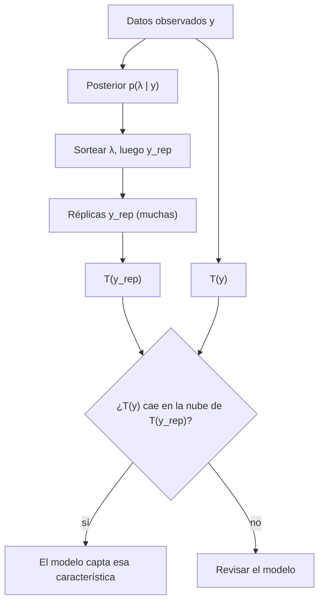

# B19-C06 — Distribución predictiva posterior

<!-- nav:top -->
[🏠 Programa](../../../../README.md) · [📚 Bloque B19](../../../tronco-comun/B19-inferencia-bayesiana-y-computacion-probabilistica.md) · [← Anterior: B19-C05 — Inferencia variacional](../B19-C05-inferencia-variacional/CLASE.md) · [Siguiente: B19-C07 — Comparación de modelos bayesianos →](../B19-C07-comparacion-de-modelos-bayesianos/CLASE.md)
<!-- /nav -->

## 1. Ubicación, nivel y alcance

Sexta clase del bloque B19. Ya sabes obtener la posterior de un parámetro ([C01](../B19-C01-priors-fisicamente-informados/CLASE.md), [C02](../B19-C02-modelos-jerarquicos/CLASE.md)), muestrearla ([C03](../B19-C03-hamiltonian-monte-carlo-y-nuts/CLASE.md), [C04](../B19-C04-diagnostico-de-convergencia-de-cadenas/CLASE.md)) o aproximarla ([C05](../B19-C05-inferencia-variacional/CLASE.md)). Pero un parámetro rara vez es lo que alguien necesita: se necesita saber qué *observaremos* mañana y si el modelo describe lo que ya observamos. Esta clase construye esas dos herramientas: la distribución predictiva posterior y el chequeo predictivo.

Verás cómo predecir un conteo futuro propagando la incertidumbre del parámetro, cómo comparar réplicas simuladas con los datos y cómo leer un valor p predictivo. No verás aún la comparación formal entre modelos (C07) ni la calibración (C08).

## 2. Por qué esta clase existe

El contador de partículas lleva 12 horas midiendo. Con la posterior de la tasa `λ`, la pregunta práctica es: ¿cuántos eventos esperar en la hora 13, y qué tan sorprendente sería ver 8? Reportar solo `λ ≈ 2,15 h⁻¹ ± 0,41` no responde: un conteo tiene ruido de Poisson *además* de la incertidumbre de `λ`. Y hay otra pregunta: ¿tiene sentido el modelo mismo? Si el detector tuvo ráfagas, un modelo de tasa constante puede ajustar la media y fallar en todo lo demás.

La decisión central es: **¿qué predice el modelo para datos nuevos, y los datos que ya tengo son típicos de esa predicción?** Responde a ambas con simulación o con fórmula exacta.

## 3. Lo que podrás hacer al terminar

1. Escribir la distribución predictiva posterior como una integral sobre la posterior.
2. Obtener la predictiva exacta (binomial negativa) del modelo Gamma–Poisson y calcular su media, varianza y probabilidades.
3. Descomponer la varianza predictiva en ruido del dato e incertidumbre del parámetro.
4. Diseñar un estadístico de chequeo y calcular un valor p predictivo posterior por simulación.
5. Interpretar el resultado e identificar la falla del modelo.
6. Distinguir predictiva a priori, predictiva posterior y réplica.

La evidencia es el **informe de chequeo predictivo** del ejercicio 12 (sección 20).

## 4. Con qué llegas y cómo comprobarlo

Necesitas C01 (Gamma–Poisson), simulación de variables aleatorias (B12-C14) y varianza (B12-C04). Cinco preguntas:

1. Si el prior es Gamma(2, 1) y observas 26 eventos en 12 h, ¿cuál es la posterior de `λ`?
2. ¿Cuál es la varianza de una Poisson de tasa `μ`?
3. ¿Qué dice la ley de la varianza total, `Var(Y) = E[Var(Y | λ)] + Var(E[Y | λ])`?
4. ¿Qué es un valor p en una prueba de hipótesis?
5. ¿Cómo se simula una Poisson cuya tasa es aleatoria?

<details>
<summary>Ver respuestas</summary>

1. Gamma(28, 13). 2. `μ`. 3. La varianza total es la media de las varianzas condicionales más la varianza de las medias condicionales. 4. Probabilidad, bajo la hipótesis, de un resultado al menos tan extremo como el observado. 5. Se sortea `λ` y luego `Y | λ`.
</details>

Con cuatro o cinco aciertos, sigue; con tres o menos, repasa C01 y B12-C03.

## 5. Un caso real: el chequeo como parte del flujo de trabajo

Gelman y coautores (fuente S1) describen el análisis bayesiano aplicado como un proceso iterativo y desordenado que abarca la construcción del modelo, su comprobación, su validación, la solución de problemas computacionales, la comprensión del modelo y su comparación; señalan que en la práctica se ajustan muchos modelos por problema y solo algunos sostienen las conclusiones. Gabry y coautores (fuente S2) sostienen que la visualización apoya cada etapa de ese ciclo (construir, inferir, comprobar y ampliar el modelo) y que va más allá de mirar las trazas de las cadenas.

Esta clase se ubica en la etapa de comprobar. De ambas fuentes se leyó solo el resumen; las fórmulas de la clase son resultados clásicos verificados aquí. Los datos del ejemplo conductor son **sintéticos**: conteos de un contador de partículas inventados para la clase.

## 6. Vocabulario

La **distribución predictiva posterior** de un dato nuevo `ỹ` es `p(ỹ | y) = ∫ p(ỹ | θ) p(θ | y) dθ`: promedia la predicción para cada valor del parámetro, ponderada por su posterior. Una **réplica** `y_rep` es un conjunto de datos simulado del modelo ajustado, del mismo tamaño que los observados. La **predictiva a priori** (C01) es la misma integral con el prior en lugar de la posterior.

Un **estadístico de chequeo** `T(y)` resume una característica de los datos que importa para la pregunta (aquí, el índice de dispersión `T = varianza/media`). El **valor p predictivo posterior** es `P(T(y_rep) ≥ T(y) | y)`. Valores cercanos a 0 o a 1 indican que los datos observados son atípicos respecto del modelo. Un **valor p predictivo** no es un valor p clásico: usa los datos dos veces (para ajustar y para comprobar) y no es uniforme bajo el modelo correcto.

## 7. Modelo mental: ¿lo que veo es lo que el modelo imagina?

El modelo ajustado es una máquina que fabrica conjuntos de datos. Los datos observados son uno de ellos o no lo son. Si dibujas muchos conjuntos fabricados y los observados caen en medio de la nube, el modelo captura esa característica; si caen fuera, no.



*Descripción textual:* desde los datos se obtiene la posterior; de ella se sortean parámetros y réplicas; se calcula el estadístico en réplicas y en los datos; si el valor observado cae dentro de la nube de réplicas el modelo capta esa característica, y si no, se revisa.

**Límite de la analogía:** el chequeo es siempre *relativo a un estadístico*. Un modelo puede pasar el de la media y fallar en el de la dispersión; que no falle uno no prueba que sea correcto.

## 8. La explicación, paso a paso

### 8.1 La predictiva por mezcla

Si `λ | y ~ Gamma(a', b')` y `ỹ | λ ~ Poisson(λ t)` para una exposición futura `t` (h), la mezcla es una **binomial negativa**:

```text
P(ỹ = k) = Γ(k + a') / (k! Γ(a')) · p^{a'} (1 − p)^k ,   p = b'/(b' + t)
```

con media `a' t/b'` y varianza `a' (1 − p)/p²`. Es una Poisson cuya tasa es incierta: tiene más varianza que la Poisson de tasa fija.

### 8.2 Descomposición de la varianza

Para `t = 1`, la ley de la varianza total da `Var(ỹ) = E[λ | y] + Var(λ | y)`: el primer término es el ruido de Poisson, el segundo la incertidumbre sobre la tasa. Si tienes muchos datos, `Var(λ | y)` se hace pequeño y la predictiva tiende a una Poisson. Con pocos datos, la incertidumbre del parámetro importa.

### 8.3 Predicción por simulación

Cuando no hay fórmula, se sortea `λ^(s)` de la posterior y luego `ỹ^(s)` de `p(ỹ | λ^(s))`, para `s = 1..S`. Los `ỹ^(s)` son sorteos de la predictiva. Con muestras de MCMC (C03), el procedimiento es el mismo. El laboratorio comprueba que la simulación reproduce la fórmula binomial negativa.

### 8.4 Elegir el estadístico

Se escoge el estadístico según lo que el modelo podría fallar. Para un modelo de tasa constante, el **índice de dispersión** `T = s²/ȳ` detecta ráfagas: con Poisson, `T ≈ 1`; con ráfagas, `T ≫ 1`. Otros: el máximo, la proporción de ceros, la autocorrelación temporal. Se declara antes de mirar el resultado.

### 8.5 Valor p predictivo posterior

Para cada réplica `y_rep^(s)` se calcula `T(y_rep^(s))`; la proporción de réplicas con `T(y_rep) ≥ T(y)` es el valor p. Si T(y) está en la cola, el modelo no reproduce esa característica. No se interpreta como un umbral de «significación»: sirve para localizar el desajuste. Un valor muy cercano a 1 también es informativo (datos menos dispersos que lo que el modelo espera).

### 8.6 Qué hacer con un desajuste

Se amplía el modelo en la dirección indicada. Para ráfagas, una tasa que varía por intervalo con un modelo jerárquico (C02) o una binomial negativa explícita. Y se vuelve a chequear. Si el desajuste persiste, la conclusión sobre `λ` bajo el modelo simple no es confiable.

## 9. Magnitudes, símbolos y unidades

| Símbolo | Qué es | Unidad | Nota |
|---|---|---|---|
| `λ` | tasa de eventos | h⁻¹ | `λ > 0` |
| `y_i` | conteo en el intervalo `i` | adimensional | entero, intervalos de 1 h |
| `a`, `b` | prior Gamma | adimensional, h⁻¹ | `a = 2`, `b = 1` |
| `a'`, `b'` | posterior Gamma | adimensional, h⁻¹ | `a' = a + Σy`, `b' = b + n` |
| `t` | exposición futura | h | |
| `p` | `b'/(b' + t)` | adimensional | parámetro de la binomial negativa |
| `T(y)` | índice de dispersión | adimensional | `s²/ȳ` |
| `S` | número de réplicas | adimensional | 20 000 en el laboratorio |

## 10. Convenciones y referencias

Los intervalos predictivos son intervalos centrales del 90 % de la distribución discreta, tomados como los enteros entre los cuantiles 5 % y 95 %. Un conteo es entero; sus intervalos no son continuos. Las réplicas tienen el mismo número de intervalos que los datos (12). El generador de números aleatorios se inicializa con semilla fija para reproducir.

## 11. De dónde sale lo que afirmamos

| ID | Fuente | Localizador | Respalda | Estado |
|---|---|---|---|---|
| S1 | Gelman, A. et al., «Bayesian Workflow», 2020 | arXiv:2011.01808 | El análisis bayesiano es iterativo e incluye comprobación y comparación de modelos | Resumen consultado el 2026-11-05 |
| S2 | Gabry, J. et al., «Visualization in Bayesian workflow», *J. R. Stat. Soc. A* 182, 389 (2019) | arXiv:1709.01449 | La visualización apoya cada etapa del ciclo y va más allá de las trazas | Resumen consultado el 2026-11-05 |
| S3 | Gelman, A. et al., *Bayesian Data Analysis*, 3.ª ed. | https://sites.stat.columbia.edu/gelman/book/ | Referencia general | Solo página del libro |
| S4 | Este bloque, `predictiva_posterior.py` | misma carpeta | Cifras de las secciones 13 y 17 (datos **sintéticos**) | Ejecutado el 2026-11-05 |

**Límites.** De S1–S3 solo se leyó el resumen o la página; no se afirma nada de su contenido más allá de eso. La binomial negativa como mezcla Gamma–Poisson, la ley de la varianza total y el valor p predictivo posterior son resultados clásicos, comprobados aquí contra una simulación independiente (diferencia máxima por casilla menor de 0,004), no contra un pasaje leído.

## 12. Cómo ver la predicción

Dibuja un histograma de barras con la pmf predictiva para `ỹ = 0..10`, con el valor observado (por ejemplo, 8 en una hora) marcado con una línea vertical. Para el chequeo, dibuja un histograma del índice de dispersión de 20 000 réplicas con una línea en `T(y)`. **Accesibilidad:** rotula las barras con su probabilidad numérica y describe en texto dónde cae la línea.

## 13. Ejemplo trabajado: dos conjuntos de 12 horas

**Datos (sintéticos):** BIEN `= 2 1 4 2 0 3 2 5 1 2 3 1`; RÁFAGA `= 1 0 2 1 9 0 1 2 0 8 1 0`. Modelo Gamma–Poisson, prior Gamma(2, 1).

| | BIEN | RÁFAGA |
|---|---|---|
| Σ y | 26 | 25 |
| media muestral | 2,17 | 2,08 |
| `T = s²/ȳ` | 0,91 | 4,58 |
| posterior | Gamma(28, 13) | Gamma(27, 13) |
| media de `λ` (h⁻¹) | 2,154 | 2,077 |
| sd de `λ` (h⁻¹) | 0,407 | 0,400 |
| predictiva 1 h: media y sd | 2,154; 1,523 | 2,077; 1,496 |
| mediana y 90 % central | 2; [0, 5] | 2; [0, 5] |
| `P(ỹ = 0)` | 0,126 | 0,135 |
| valor p predictivo (dispersión) | 0,525 | 0,000 |

Las dos posteriores de `λ` son casi idénticas (2,15 y 2,08), y también sus predicciones medias. Sin embargo, el chequeo las distingue: en RÁFAGA el índice de dispersión observado, 4,58, supera a todas las réplicas (valor p menor que 1/20 000), mientras en BIEN cae en medio de la nube (0,525). El modelo de tasa constante describe bien BIEN y no describe RÁFAGA, aunque la media coincida.

## 14. Comparación de formas de predecir

La **predicción plug-in** sustituye `λ` por su media (Poisson(2,15)) y subestima la incertidumbre: su sd es `√2,154 = 1,468` frente a 1,523 de la binomial negativa. La **predictiva posterior** propaga la incertidumbre del parámetro y es la correcta bajo el modelo. La **predictiva a priori** (C01) comprueba el modelo antes de ver datos. La predictiva posterior no corrige un modelo mal especificado; para eso está el chequeo.

## 15. Práctica guiada

**Ejercicio 1 · con los pasos indicados.** Para BIEN, calcula la posterior de `λ` con prior Gamma(2, 1) y su media y desviación. *Pasos:* `a' = a + Σy`, `b' = b + n`.

<details><summary>Solución comentada</summary>

`a' = 2 + 26 = 28`, `b' = 1 + 12 = 13`. Media `28/13 = 2,154 h⁻¹`; sd `√28/13 = 0,407 h⁻¹`.
</details>

**Ejercicio 2 · con una pista.** Para 1 h futura, calcula la media y la desviación de la predictiva y `P(ỹ = 0)`. *Pista:* `p = b'/(b' + 1)`.

<details><summary>Solución comentada</summary>

`p = 13/14 = 0,9286`. Media `28 (1 − p)/p = 2,154`. Varianza `28 (1 − p)/p² = 2,3195`; sd `1,523`. Comprueba con la descomposición: `2,154 + 0,407² = 2,154 + 0,166 = 2,320`. `P(0) = p²⁸ = exp(28 ln 0,9286) = exp(−2,075) = 0,126`.
</details>

**Ejercicio 3 · casi autónomo.** Repite para una exposición de 3 h: media, desviación y `P(ỹ = 0)`.

<details><summary>Solución comentada</summary>

`p = 13/16 = 0,8125`. Media `28 (0,1875)/0,8125 = 6,46` (= 3 × 2,154). Varianza `28 (0,1875)/0,6602 = 7,95`, sd 2,82. `P(0) = 0,8125²⁸ = exp(−5,814) = 0,0030`.
</details>

## 16. Práctica autónoma, transferencia e integrador

**Ejercicio 4.** Calcula el índice de dispersión de RÁFAGA a mano.

<details><summary>Solución comentada</summary>

Media `25/12 = 2,083`. `Σ y² = 157`. Varianza muestral `(157 − 12 · 2,083²)/11 = (157 − 52,08)/11 = 9,54`. `T = 9,54/2,083 = 4,58`.
</details>

**Ejercicio 5.** Con la predictiva de BIEN, ¿cuál es la probabilidad de contar 8 o más eventos en una hora? Compárala con la plug-in Poisson(2,154).

<details><summary>Solución comentada</summary>

Binomial negativa: `P(ỹ ≥ 8) = 0,00277`. Poisson plug-in: `0,00174`. La predictiva da una probabilidad ≈ 60 % mayor: la cola es más pesada por la incertidumbre de `λ`.
</details>

**Ejercicio 6.** En RÁFAGA hubo conteos de 9 y 8 en una hora. Con el modelo ajustado a RÁFAGA, `P(ỹ ≥ 8) = 0,0023`. En 12 horas, ¿es sorprendente ver dos o más intervalos así?

<details><summary>Solución comentada</summary>

Con `q = 0,0023` por hora, el número esperado en 12 horas es `0,027`; ver dos es del orden de `C(12,2) q² ≈ 66 · 5,2 × 10⁻⁶ = 3,5 × 10⁻⁴` (aproximando independencia). Muy poco probable: el modelo de tasa constante no explica las ráfagas, coherente con el valor p cercano a 0.
</details>

**Ejercicio 7.** El chequeo de BIEN dio 0,525. ¿Prueba que el modelo es correcto?

<details><summary>Solución comentada</summary>

No: solo dice que el modelo no falla en *ese* estadístico. Podría fallar en otro (por ejemplo, autocorrelación temporal). Falta probar más estadísticos y, mejor, datos nuevos.
</details>

**Ejercicio 8.** Si en vez de un valor p de 0,000 hubieras obtenido 0,999 para un estadístico de dispersión, ¿qué dirías de los datos?

<details><summary>Solución comentada</summary>

Que están menos dispersos de lo que el modelo espera (por ejemplo, conteos casi regulares, como un detector con tiempo muerto que limita los eventos). También es un desajuste, en sentido contrario.
</details>

**Ejercicio 9 · transferencia.** Propón un estadístico para detectar que la tasa **crece con el tiempo** en los 12 intervalos, y cómo calcularías su valor p predictivo.

<details><summary>Solución comentada</summary>

Por ejemplo, la diferencia entre el total de las últimas 6 horas y el de las primeras 6, o la pendiente de una regresión del conteo contra el índice. Se calcula en cada réplica (que, bajo tasa constante, no tiene tendencia) y se compara con el valor observado.
</details>

**Ejercicio 10 · transferencia.** Un colega predice «la próxima hora tendrá 2 eventos» usando la media posterior. ¿Qué le sugieres?

<details><summary>Solución comentada</summary>

Dar la predictiva completa: media 2,15, mediana 2, intervalo 90 % de 0 a 5 y `P(0) = 0,126`. Un único número oculta que lo más probable es entre 0 y 5 eventos y que `P(0)` es 12,6 %.
</details>

**Ejercicio 11 · transferencia.** ¿Por qué el valor p predictivo posterior puede no ser uniforme aunque el modelo sea correcto?

<details><summary>Solución comentada</summary>

Porque los datos se usan dos veces: para ajustar la posterior y para el chequeo. Eso tiende a concentrar los valores p hacia el centro, y por eso el chequeo es conservador. Se interpreta como localizador de desajustes, no como prueba formal (C08 verifica la calibración con simulaciones).
</details>

**Ejercicio 12 · integrador.** Escribe un **informe de chequeo predictivo** para RÁFAGA: posterior, predictiva a una hora (media, sd, intervalo y `P(0)`), estadístico elegido y su valor p, interpretación, una ampliación del modelo propuesta y qué verificarías después.

<details><summary>Solución modelo</summary>

Posterior Gamma(27, 13), `λ` media 2,077 h⁻¹, sd 0,400; predictiva: media 2,077, sd 1,496, mediana 2, 90 % [0, 5], `P(0) = 0,135`. Estadístico: índice de dispersión, `T = 4,58`, réplica media 1,00, valor p 0,000. Interpretación: el modelo de tasa constante no explica la sobredispersión (ráfagas en dos intervalos); su predictiva subestima las colas. Ampliación: tasa por intervalo con jerarquía (C02), o mezcla ráfaga/fondo. Verificar: repetir el chequeo con el modelo ampliado y comparar su predicción con datos nuevos. Debe declarar los datos como sintéticos.
</details>

## 17. Laboratorio: predictiva exacta y chequeo por simulación

El script [predictiva_posterior.py](predictiva_posterior.py) calcula la posterior, la predictiva binomial negativa exacta y el valor p predictivo posterior para dos conjuntos de datos. **Pruebas que detienen la ejecución:** la simulación (200 000 sorteos) reproduce la pmf binomial negativa para `t = 1` y `t = 3` con diferencia máxima por casilla menor de 0,004, y la pmf suma 1 (10⁻⁹). **Datos:** sintéticos. **Predice antes de ejecutar:** ¿cuál conjunto tendrá el valor p cercano a cero? (RÁFAGA.)

**Ejecución del 2026-11-05 (Python 3.12.9, numpy 2.4.4):**

```text
Pruebas: OK

BIEN: sum y = 26, media 2.17, T(y) = var/media = 0.91
   posterior de lambda: Gamma(28, 13); media 2.154 /h; sd 0.407
   predictiva de 1 conteo en 1 h: media 2.154; sd 1.523; mediana 2, 90 % central [0, 5]; P(Y=0) = 0.126
   chequeo: T medio replicado 1.01; valor p predictivo posterior = 0.5254
RAFAGA: sum y = 25, media 2.08, T(y) = var/media = 4.58
   posterior de lambda: Gamma(27, 13); media 2.077 /h; sd 0.400
   predictiva de 1 conteo en 1 h: media 2.077; sd 1.496; mediana 2, 90 % central [0, 5]; P(Y=0) = 0.135
   chequeo: T medio replicado 1.00; valor p predictivo posterior = 0.0000
```

```bash
python programa/clases/B19/B19-C06-distribucion-predictiva-posterior/predictiva_posterior.py
```

**Límites:** un solo estadístico; semilla fija; el valor p simulado tiene error Monte Carlo (con 20 000 réplicas, "0,0000" significa menos de 1/20 000); modelo de tasa constante y eventos independientes.

## 18. Errores frecuentes y cómo corregirlos

**Predecir con la media del parámetro.** Subestima la incertidumbre, ejercicio 5.

**Leer 0,525 como «el modelo es correcto».** Ejercicio 7.

**Elegir el estadístico después de ver el resultado.** Sesga el chequeo: se declara antes.

**Confundir predictiva a priori y posterior.** La primera usa solo el prior, la segunda incorpora los datos.

**Tratar el valor p predictivo como el clásico.** Ejercicio 11.

## 19. Cómo sabrás que vas bien

Tras la 8.1: ¿calculas media y varianza predictivas sin mirar? Ejercicio 2. Tras la 8.2: ¿puedes separar ruido y parámetro? Tras la 8.5: ¿interpretas un 0,000 y un 0,999? Ejercicio 8. Tras el laboratorio: ¿propones una ampliación del modelo? Al final: ¿tu informe declara el estadístico antes del resultado?

## 20. Qué entregas y cómo se evalúa

El producto es el **informe de chequeo predictivo** del ejercicio 12.

| Criterio | Inicial | En desarrollo | Logrado | Destacado |
|---|---|---|---|---|
| Predicción | Solo la media | Media y sd | Media, sd, intervalo y `P(0)` | Descompone la varianza |
| Chequeo | No lo hace | Compara a ojo | Calcula el valor p | Elige el estadístico con razón |
| Interpretación | Binaria | Localiza el desajuste | Propone una ampliación | Anticipa qué verificar luego |
| Honestidad | Generaliza | Rotula datos | Declara límites | Señala el error Monte Carlo |

**Condiciones críticas:** no usar la media posterior como única predicción; declarar los datos como sintéticos; no presentar el valor p predictivo como prueba de corrección.

## 21. Ética, seguridad y límites

Una predicción con incertidumbre mal comunicada puede inducir decisiones erróneas (por ejemplo, subestimar la probabilidad de un evento raro). Reporta intervalos y probabilidades, no solo valores centrales. Los datos son sintéticos y el material es educativo: no sirve para dimensionar operaciones reales. Accesibilidad: tablas con valores, diagramas con descripción textual y ejercicios sin conexión.

## 22. Para cerrar y seguir

La predictiva posterior promedia las predicciones sobre la posterior e incluye ruido del dato e incertidumbre del parámetro. Con réplicas simuladas y un estadístico se localizan los desajustes del modelo: dos conjuntos con la misma media posterior pueden tener comportamientos totalmente distintos frente al chequeo. Queda abierta una pregunta: si hay varios modelos que predicen, ¿cuál elegir? Es la comparación de C07.

**Glosario español–inglés.** predictiva posterior · *posterior predictive*; réplica · *replicate*; chequeo predictivo · *posterior predictive check*; binomial negativa · *negative binomial*; sobredispersión · *overdispersion*; índice de dispersión · *index of dispersion*.

**Continuidad.** B19-C07 usa tu capacidad de **predecir y chequear** para comparar modelos por su capacidad predictiva; B19-C08 verificará que los intervalos predictivos cubren lo que prometen.

**Referencias:** ver sección 11. De S1–S3 solo se leyeron resúmenes o la página.

<!-- nav:bottom -->
---

[← Anterior: B19-C05 — Inferencia variacional](../B19-C05-inferencia-variacional/CLASE.md) · [📚 Bloque B19](../../../tronco-comun/B19-inferencia-bayesiana-y-computacion-probabilistica.md) · [Siguiente: B19-C07 — Comparación de modelos bayesianos →](../B19-C07-comparacion-de-modelos-bayesianos/CLASE.md)
<!-- /nav -->
