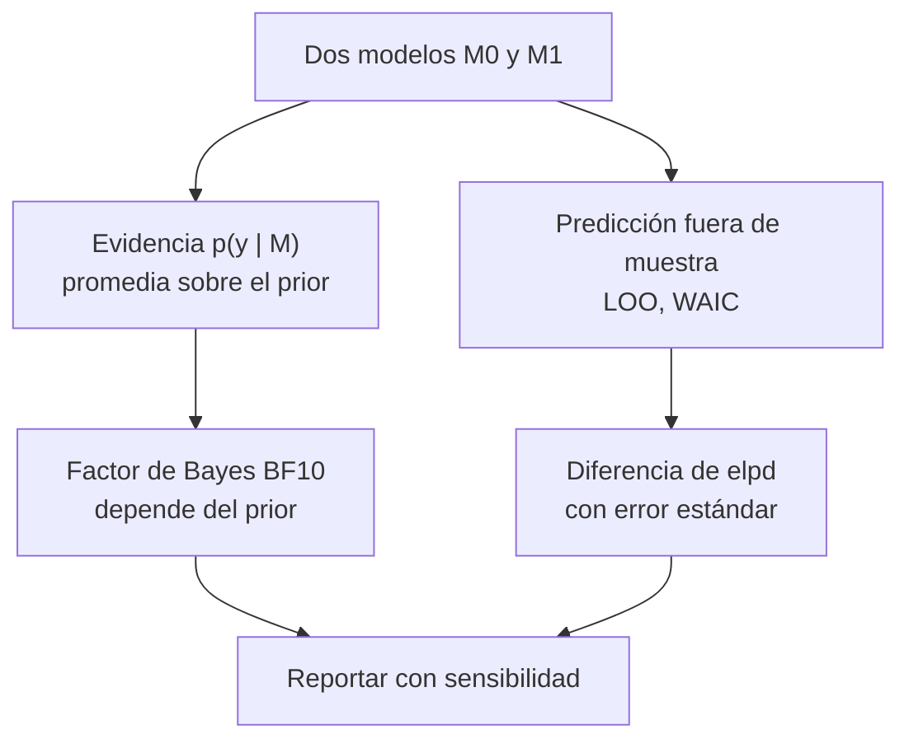

# B19-C07 — Comparación de modelos bayesianos

<!-- nav:top -->
[🏠 Programa](../../../../README.md) · [📚 Bloque B19](../../../tronco-comun/B19-inferencia-bayesiana-y-computacion-probabilistica.md) · [← Anterior: B19-C06 — Distribución predictiva posterior](../B19-C06-distribucion-predictiva-posterior/CLASE.md) · [Siguiente: B19-C08 — Calibración probabilística →](../B19-C08-calibracion-probabilistica/CLASE.md)
<!-- /nav -->

## 1. Ubicación, nivel y alcance

Séptima clase del bloque B19. Con [C06](../B19-C06-distribucion-predictiva-posterior/CLASE.md) aprendiste a preguntar si un modelo describe los datos. Ahora tienes dos o más modelos candidatos y debes decidir cuál apoyar. Hay dos caminos bayesianos distintos: la **evidencia** (o factor de Bayes), que compara qué tan bien cada modelo predijo los datos *promediando sobre su prior*, y los criterios predictivos **WAIC y LOO**, que estiman qué tan bien predecirá datos nuevos.

Verás ambos en un problema donde se calculan de forma exacta, cómo el factor de Bayes depende del ancho del prior y cómo se lee una diferencia de capacidad predictiva con su incertidumbre. No verás la comparación con AIC/BIC (programada en B12-C22) ni la implementación de PSIS-LOO.

## 2. Por qué esta clase existe

Miras 10 mediciones de la amplitud de una señal y el promedio es 0,57 con ruido conocido 1. ¿Hay señal (`μ ≠ 0`) o solo ruido (`μ = 0`)? Un contraste clásico daría un valor p cercano a 0,07. Un bayesiano pregunta otra cosa: ¿cuánto más probable hacen los datos al modelo «con señal» que al modelo «sin señal»? Y la respuesta depende, de manera incómoda, de qué tan ancho sea el prior de la señal.

La decisión central es: **¿qué pregunta estoy haciendo (cuál modelo describe mejor el mecanismo, o cuál predice mejor datos nuevos) y qué herramienta la responde honestamente?** Esto sostiene C08: lo que decidas aquí también debe estar calibrado.

## 3. Lo que podrás hacer al terminar

1. Definir la evidencia de un modelo y el factor de Bayes entre dos modelos.
2. Calcular la evidencia y el factor de Bayes de un modelo normal con forma cerrada y comprobarlos numéricamente.
3. Explicar por qué el factor de Bayes premia la parsimonia (factor de Occam) y depende del prior.
4. Calcular `elpd_waic` y `elpd_loo` y explicar su diferencia.
5. Reportar una diferencia entre modelos con su error estándar y decidir si es concluyente.
6. Elegir entre evidencia y capacidad predictiva según la pregunta.

La evidencia es el **informe de comparación de modelos** del ejercicio 12 (sección 20).

## 4. Con qué llegas y cómo comprobarlo

Necesitas C01 (prior y posterior), C06 (predictiva) y la gaussiana (B12). Cinco preguntas:

1. ¿Qué es la evidencia `p(y)` y qué integral la define?
2. Si `y ~ N(μ, σ²)` y `μ ~ N(0, τ²)`, ¿qué distribución tiene `y` marginalmente?
3. ¿Qué significan las probabilidades *a posteriori* de dos modelos en términos de probabilidades a priori y evidencias?
4. ¿Qué es la validación cruzada de «dejar uno fuera»?
5. ¿Qué es un error estándar?

<details>
<summary>Ver respuestas</summary>

1. `p(y | M) = ∫ p(y | θ, M) p(θ | M) dθ`. 2. `N(0, σ² + τ²)`. 3. Cocientes: odds posteriores = odds a priori × cociente de evidencias. 4. Predecir cada dato con un modelo ajustado a los demás. 5. La desviación típica de un estimador.
</details>

Con cuatro o cinco aciertos, sigue; con tres o menos, repasa C01 y C06.

## 5. Un caso real: la evidencia en cosmología

Trotta (fuente S1) escribió una revisión invitada sobre inferencia bayesiana y selección de modelos en cosmología y astrofísica: cubre el teorema de Bayes y el papel de los priors, la inferencia de parámetros con técnicas como MCMC, y la comparación bayesiana de modelos, incluyendo la evidencia y la complejidad efectiva de un modelo. Vehtari, Gelman y Gabry (fuente S2) presentan métodos para estimar cuán bien predecirá un modelo bayesiano datos nuevos: validación cruzada «dejar uno fuera» (LOO) y el criterio de información ampliamente aplicable (WAIC); proponen calcular LOO eficientemente con muestreo de importancia suavizado por Pareto, y encuentran que LOO es más robusto que WAIC en muestras finitas, sobre todo con priors débiles u observaciones influyentes.

De ambas fuentes se leyó solo el resumen. Los datos del ejemplo son **sintéticos**; las fórmulas son resultados clásicos comprobados en el laboratorio.

## 6. Vocabulario

La **evidencia** (o verosimilitud marginal) del modelo `M` es `p(y | M) = ∫ p(y | θ, M) p(θ | M) dθ`: la probabilidad que el modelo asignaba a los datos antes de verlos, promediando sobre su prior. El **factor de Bayes** de `M₁` frente a `M₀` es `BF₁₀ = p(y | M₁)/p(y | M₀)`, y `BF₀₁ = 1/BF₁₀`. Las **odds posteriores** son `BF₁₀` por las odds a priori.

El **factor de Occam** es la parte del factor de Bayes que penaliza la complejidad: cuanto más se reparte el prior de un modelo en valores que no explican los datos, menor su evidencia. La **densidad predictiva logarítmica esperada** (`elpd`) es la suma esperada de `log p(ỹ_i | y)` sobre datos futuros; mayor es mejor. **LOO**: `elpd_loo = Σ_i log p(y_i | y_{−i})`. **WAIC**: `elpd_waic = lppd − p_waic`, con `lppd = Σ_i log E_post[p(y_i | θ)]` y `p_waic = Σ_i Var_post[log p(y_i | θ)]`, la penalización por complejidad efectiva.

## 7. Modelo mental: dos preguntas distintas

La evidencia mira hacia atrás y entera: «¿qué tan bien habría apostado este modelo, con su prior, a estos datos?». LOO y WAIC miran hacia adelante: «con lo aprendido de estos datos, ¿cómo predice un dato nuevo?».



*Descripción textual:* los dos modelos pueden compararse por la evidencia, que lleva al factor de Bayes y depende del prior, o por la predicción fuera de muestra, que lleva a una diferencia de `elpd` con su error estándar. Ambas se reportan con análisis de sensibilidad.

**Límite de la analogía:** «mirar hacia atrás» no significa usar los datos dos veces: la evidencia es una probabilidad de los datos bajo el modelo, no un ajuste.

## 8. La explicación, paso a paso

### 8.1 El problema de la señal

Datos `y_1..y_n` con `y_i ~ N(μ, σ²)`, `σ = 1` conocida. **M₀** (sin señal): `μ = 0`. **M₁** (con señal): `μ ~ N(0, τ²)`. Con `z = √n ȳ/σ` y `r = nτ²/σ²`, el factor de Bayes tiene forma cerrada:

```text
BF₀₁ = p(y | M₀)/p(y | M₁) = √(1 + r) · exp[ −½ z² · r/(1 + r) ]
```

El factor `√(1 + r)` crece con el ancho del prior (`τ`) y es la penalización de Occam: M₁ reparte su prior sobre valores que los datos descartan. El exponente premia ajustar bien (`z` grande).

### 8.2 Dependencia del prior

Si `τ → ∞`, `r → ∞`, `√(1 + r) → ∞` y el exponente tiende a `−z²/2`: `BF₀₁ → ∞`. Es decir, **cuanto más vago el prior de la señal, más favorece al modelo sin señal**, aunque los datos no cambien (a veces llamado paradoja de Lindley). Por eso el factor de Bayes se reporta con un barrido de `τ`, no con un solo número, y nunca con un prior vago "para no influir".

### 8.3 Cómo se comprueba

Hay tres vías: la fórmula cerrada, la normal multivariante directa con covarianza `σ² I + τ² 1 1ᵀ` y una cuadratura numérica de `∫ p(y | μ) p(μ) dμ`. Deben coincidir; si no, hay un error.

### 8.4 WAIC y LOO

Con muestras `μ^(s)` de la posterior, `lppd_i = log (1/S) Σ_s p(y_i | μ^(s))` y `p_waic` es la varianza muestral de `log p(y_i | μ^(s))`. LOO deja fuera `y_i`, ajusta con los otros `n − 1` datos y evalúa `log p(y_i | y_{−i})`. En este modelo normal, la posterior sin `y_i` es normal, y la predictiva es `N(m_{−i}, σ² + v_{−i})`: LOO exacto, sin aproximaciones. En problemas generales se aproxima con muestreo de importancia (S2).

### 8.5 Diferencias y error estándar

La diferencia `elpd_M₁ − elpd_M₀ = Σ_i d_i` con `d_i` las diferencias por observación. Su error estándar aproximado es `√n · sd(d_i)`. Si la diferencia no supera un par de errores estándar, los modelos no se distinguen con estos datos. Con pocos datos el error estándar es una aproximación tosca.

### 8.6 Cuál usar

La **evidencia** responde «¿qué modelo, con estos priors, habría predicho mejor estos datos?»; es sensible al prior y adecuada si los priors son una parte seria del modelo (S1). **LOO/WAIC** responden «¿qué modelo predecirá mejor datos nuevos?»; son menos sensibles al prior y adecuadas para elegir con fines predictivos (S2). Ninguna da una probabilidad de verdad del modelo: asumen que el conjunto de modelos considerados incluye una buena descripción.

## 9. Magnitudes, símbolos y unidades

| Símbolo | Qué es | Unidad | Nota |
|---|---|---|---|
| `y_i` | amplitud medida | unidades arbitrarias (u.a.) | sintética |
| `σ` | ruido conocido | u.a. | `σ = 1` |
| `μ` | amplitud verdadera | u.a. | `M₀: μ = 0` |
| `τ` | ancho del prior de `μ` en M₁ | u.a. | se barre |
| `z` | `√n ȳ/σ` | adimensional | estadístico clásico |
| `r` | `nτ²/σ²` | adimensional | |
| `BF₁₀`, `BF₀₁` | factores de Bayes | adimensional | `BF₀₁ = 1/BF₁₀` |
| `elpd`, `p_waic` | densidad predictiva y complejidad | nats | logaritmos naturales |

## 10. Convenciones y referencias

Logaritmos naturales. Los factores de Bayes se dan como razones, no como "evidencia fuerte" o "débil": existen escalas de interpretación, pero no se consultaron en esta clase y no se usan. Los `elpd` se miden en nats; una diferencia se interpreta con su error estándar. El modelo M₀ no tiene parámetros: `p_waic = 0`.

## 11. De dónde sale lo que afirmamos

| ID | Fuente | Localizador | Respalda | Estado |
|---|---|---|---|---|
| S1 | Trotta, R., «Bayes in the sky», *Contemporary Physics* 49, 71 (2008) | arXiv:0803.4089 | Revisión: priors, inferencia de parámetros, MCMC, evidencia y complejidad efectiva en cosmología | Resumen consultado el 2026-11-05 |
| S2 | Vehtari, A., Gelman, A. y Gabry, J., «Practical Bayesian model evaluation using leave-one-out cross-validation and WAIC», *Statistics and Computing* 27(5), 1413 (2017) | arXiv:1507.04544 | LOO y WAIC; PSIS-LOO; LOO más robusto que WAIC en muestras finitas; errores estándar de diferencias | Resumen consultado el 2026-11-05 |
| S3 | Gelman, A. et al., «Bayesian Workflow», 2020 | arXiv:2011.01808 | Se ajustan muchos modelos por problema; la comparación es parte del flujo | Resumen consultado el 2026-11-05 |
| S4 | Este bloque, `evidencia_y_loo.py` | misma carpeta | Cifras de las secciones 13 y 17 (datos **sintéticos**) | Ejecutado el 2026-11-05 |

**Límites.** De S1–S3 solo se leyeron los resúmenes. La fórmula cerrada de `BF₀₁`, el comportamiento con `τ → ∞` y las definiciones de `lppd`, `p_waic` y LOO exacto son resultados clásicos **verificados en el laboratorio** contra la normal multivariante y una cuadratura, y no atribuidos a un pasaje leído. No se usan escalas de interpretación de Jeffreys o de Kass–Raftery porque no se consultaron.

## 12. Cómo ver la comparación

Dibuja `log BF₁₀` contra `log τ` (eje horizontal logarítmico): sube hasta un máximo (BF₁₀ = 1,71 en `τ = 0,47`) y desciende sin límite. Para LOO, dibuja las diferencias `d_i` por observación (diez puntos) con la línea en 0. **Accesibilidad:** acompaña los gráficos con la tabla de la sección 13 y describe en texto el máximo y la caída.

## 13. Ejemplo trabajado: ¿hay señal?

**Datos (sintéticos):** `y = (0,9; −0,2; 1,1; 0,4; 0,7; 1,5; −0,3; 0,8; 0,2; 0,6)`, `n = 10`, `σ = 1`. `ȳ = 0,570`, `z = √10 · 0,570 = 1,802`, con valor p clásico bilateral 0,0715.

Con `τ = 1`: `r = 10`, `√(1 + r) = 3,317`; exponente `−½ · 3,249 · 10/11 = −1,477`; `exp(−1,477) = 0,228`; `BF₀₁ = 3,317 · 0,228 = 0,757` y `BF₁₀ = 1,32`. Los datos favorecen ligeramente a M₁, pero apenas.

| `τ` | `log p(y\|M₁)` | `BF₀₁` | `BF₁₀` |
|---|---|---|---|
| 0,1 | −12,134 | 0,905 | 1,105 |
| 0,3 | −11,786 | 0,639 | 1,566 |
| 1 | −11,957 | 0,757 | 1,320 |
| 3 | −12,883 | 1,913 | 0,523 |
| 10 | −14,066 | 6,243 | 0,160 |
| 100 | −16,366 | 62,301 | 0,016 |
| 1000 | −18,669 | 623,0 | 0,002 |

(`log p(y | M₀) = −12,234` en todos los casos.) El máximo de `BF₁₀` es 1,71, en `τ = 0,47`: **no existe un prior bajo el cual los datos apoyen fuertemente la señal**, y con prior muy ancho favorecen decididamente la hipótesis nula. El mismo `ȳ` se lee como «ligera evidencia a favor» o «fuerte evidencia en contra» según `τ`.

**Capacidad predictiva** (M₁ con `τ = 1`): `elpd_waic = −11,237` con `p_waic = 0,300`; `elpd_loo = −11,243`; M₀: `elpd = −12,234`. Diferencia LOO: `0,991 ± 0,918`: apenas 1,08 errores estándar. No concluyente.

## 14. Comparación de herramientas

El **factor de Bayes** es la respuesta natural al problema "¿cuál modelo?", pero depende del prior y es costoso de calcular fuera de casos sencillos. **WAIC** es barato con muestras posteriores, pero menos robusto con priors débiles u observaciones influyentes (S2). **LOO** es más robusto y se aproxima con PSIS (S2); aquí es exacto por la normalidad. La **comparación clásica** (valor p) responde a otra pregunta y no penaliza la complejidad de la misma manera. Declarar la herramienta es parte del resultado.

## 15. Práctica guiada

**Ejercicio 1 · con los pasos indicados.** Calcula `BF₀₁` para `τ = 1` con `z² = 3,249`. *Pasos:* `r = nτ²/σ²`, luego la fórmula de 8.1.

<details><summary>Solución comentada</summary>

`r = 10`; `√11 = 3,317`; exponente `−½ · 3,249 · (10/11) = −1,477`; `e^{−1,477} = 0,228`; `BF₀₁ = 0,757`. Coincide con el laboratorio. Si te dio 0,228, olvidaste el factor de Occam.
</details>

**Ejercicio 2 · con una pista.** Con odds a priori 1 (igual confianza en ambos modelos), calcula la probabilidad posterior de M₁ si `BF₁₀ = 1,32`. *Pista:* `P = odds/(1 + odds)`.

<details><summary>Solución comentada</summary>

Odds posteriores `= 1 · 1,32`; `P(M₁) = 1,32/2,32 = 0,569`. Prácticamente un 57 % a 43 %: no es una conclusión.
</details>

**Ejercicio 3 · casi autónomo.** Con `τ = 100`, calcula `BF₀₁` y explica el resultado.

<details><summary>Solución comentada</summary>

`r = 10⁵`; `√(1 + r) = 316,2`; exponente `−½ · 3,249 · (10⁵/100001) = −1,6245`; `e^{−1,6245} = 0,197`; `BF₀₁ = 62,3`. Un prior tan ancho reparte su masa en valores de amplitud ≈ 100 que los datos (con σ = 1) descartan: M₁ «apostó» por valores absurdos y pierde. Es el factor de Occam, no una prueba de ausencia de señal.
</details>

## 16. Práctica autónoma, transferencia e integrador

**Ejercicio 4.** Descompón `BF₁₀` (τ = 1) en razón de verosimilitudes máximas y factor de Occam.

<details><summary>Solución comentada</summary>

La razón de verosimilitudes en `μ = ȳ` frente a `μ = 0` es `exp(z²/2) = exp(1,6245) = 5,08`. Entonces `BF₁₀ = 1,32 = 5,08 × Occam`, con factor de Occam `1,32/5,08 = 0,26`. M₁ ajusta mejor (5 veces), pero paga un 74 % de penalización por la libertad de `μ`.
</details>

**Ejercicio 5.** ¿Por qué `p_waic = 0,30` es menor que 1, el número de parámetros de M₁?

<details><summary>Solución comentada</summary>

Porque el prior `N(0, 1)` y los 10 datos restringen `μ` (posterior de desviación `1/√11 = 0,30`): el parámetro es "parcialmente libre". `p_waic` mide la complejidad efectiva, no el conteo de parámetros.
</details>

**Ejercicio 6.** La diferencia de `elpd_loo` es 0,991 ± 0,918. ¿Puedes elegir M₁?

<details><summary>Solución comentada</summary>

La diferencia es de 1,08 errores estándar: en el orden del ruido. No se puede afirmar que M₁ prediga mejor. Se dice "no concluyente" y se necesitan más datos. Además, el error estándar con 10 datos es aproximado.
</details>

**Ejercicio 7.** Con odds a priori 1 a 4 (80 % de confianza en M₀) y `BF₁₀ = 1,32`, ¿cuál es `P(M₁ | y)`?

<details><summary>Solución comentada</summary>

Odds a priori `0,25`; posteriores `0,25 · 1,32 = 0,33`; `P = 0,33/1,33 = 0,248`. Los datos casi no mueven la creencia previa.
</details>

**Ejercicio 8.** ¿Por qué `BF₁₀` tiene un máximo en `τ ≈ 0,47` y no crece con `τ`?

<details><summary>Solución comentada</summary>

Para `τ` pequeño, M₁ se parece a M₀ (BF → 1). Para `τ` grande, el factor de Occam la penaliza. El máximo es el punto en que el prior concentra masa donde los datos están (`ȳ ≈ 0,57`) sin desperdiciarla.
</details>

**Ejercicio 9 · transferencia.** Un colega escoge `τ` «para maximizar el factor de Bayes» y reporta 1,71. Critica el procedimiento.

<details><summary>Solución comentada</summary>

Es usar los datos para ajustar el prior y luego contarlos de nuevo como evidencia: el máximo es el mejor caso posible, no el valor del factor para un prior definido antes. Debe fijarse el prior por razones físicas (C01) y reportar el barrido.
</details>

**Ejercicio 10 · transferencia.** Quieres elegir entre dos modelos para predecir la próxima medición, y tus priors son vagos. ¿Evidencia o LOO?

<details><summary>Solución comentada</summary>

LOO (o WAIC): la pregunta es predictiva y los priors vagos hacen inestable la evidencia (sección 8.2). Se reporta la diferencia con su error estándar.
</details>

**Ejercicio 11 · transferencia.** «Como `BF₁₀ = 1,3 > 1`, se detectó la señal.» Evalúa.

<details><summary>Solución comentada</summary>

No: un factor de 1,3 apenas mueve las odds (ejercicio 2), el resultado cambia con `τ` (a 0,5 en `τ = 3`) y el valor p clásico (0,07) tampoco es concluyente. Se debe declarar «sin evidencia concluyente».
</details>

**Ejercicio 12 · integrador.** Redacta un **informe de comparación de modelos** M₀ frente a M₁ con los datos de la sección 13: (a) evidencia y `BF` para al menos cuatro valores de `τ`, con máximo; (b) WAIC y LOO con error estándar; (c) elección de la herramienta justificada; (d) conclusión y qué datos la cambiarían.

<details><summary>Solución modelo</summary>

(a) Tabla de 13: BF₁₀ entre 1,1 y 1,57 para `τ ≤ 1`, 0,52 para `τ = 3`, 0,16 para `τ = 10`; máximo 1,71 en `τ = 0,47`. (b) `elpd_waic = −11,237`, `elpd_loo = −11,243`, M₀ −12,234; diferencia 0,99 ± 0,92. (c) Para predicción, LOO; la evidencia es sensible al prior. (d) No concluyente: ni la evidencia ni LOO distinguen los modelos; más mediciones (el `z` crecería como √n si `μ ≈ 0,57`) lo decidirían. Declara datos sintéticos y el supuesto de `σ` conocida.
</details>

## 17. Laboratorio: evidencia y LOO con solución exacta

El script [evidencia_y_loo.py](evidencia_y_loo.py) calcula la evidencia de M₀ y M₁ de tres maneras (fórmula cerrada, normal multivariante y cuadratura), el barrido en `τ`, WAIC con 100 000 sorteos de la posterior y LOO exacto. **Pruebas que detienen la ejecución:** las tres formas de la evidencia coinciden (10⁻⁸ en el factor de Bayes; 10⁻⁶ en la cuadratura) para `τ = 0,5; 1; 3`, y `|elpd_waic − elpd_loo| < 0,15`. **Datos:** sintéticos. **Predice antes de ejecutar:** ¿`BF₁₀` crecerá con `τ`? (No: sube y luego baja.)

**Ejecución del 2026-11-05 (Python 3.12.9, numpy 2.4.4):**

```text
Pruebas: OK

ybar = 0.570; z = sqrt(n) ybar/sigma = 1.802  (p bilateral clasico ~ 0.0715)

Factor de Bayes frente al ancho del prior tau (M1: mu ~ N(0,tau^2)):
     tau   log p(y|M0)   log p(y|M1)      BF01      BF10
     0.1      -12.2344      -12.1344     0.905     1.105
     0.3      -12.2344      -11.7858     0.639     1.566
       1      -12.2344      -11.9565     0.757     1.320
       3      -12.2344      -12.8832     1.913     0.523
      10      -12.2344      -14.0659     6.243     0.160
     100      -12.2344      -16.3664    62.301     0.016
    1000      -12.2344      -18.6689   623.001     0.002

BF10 maximo = 1.708 en tau = 0.474

WAIC y LOO exacto (M1 con tau = 1; M0 sin parametros):
   M0: elpd = -12.234 (p_efectivo = 0)
   M1: elpd_waic = -11.237 (p_waic = 0.300); elpd_loo = -11.243
   diferencia elpd_loo(M1) - elpd(M0) = 0.991 +- 0.918 (error estandar aproximado)
```

```bash
python programa/clases/B19/B19-C07-comparacion-de-modelos-bayesianos/evidencia_y_loo.py
```

**Límites:** `σ` conocida y normalidad; dos modelos; no hay PSIS-LOO ni modelos con muchos parámetros; el error estándar de la diferencia es aproximado con `n = 10`.

## 18. Errores frecuentes y cómo corregirlos

**Reportar un solo factor de Bayes.** Se corrige con el barrido, ejercicio 9.

**Usar un prior vago para "no influir".** Favorece al modelo simple, sección 8.2.

**Confundir `BF₁₀ > 1` con detección.** Ejercicio 11.

**Contar parámetros en vez de complejidad efectiva.** Ejercicio 5.

**Elegir por una diferencia menor que su error estándar.** Ejercicio 6.

## 19. Cómo sabrás que vas bien

Tras la 8.1: ¿calculas `BF₀₁` a mano? Ejercicio 1. Tras la 8.2: ¿puedes explicar por qué un prior ancho favorece al modelo simple? Ejercicio 3. Tras la 8.5: ¿distingues "mejor" de "no distinguible"? Ejercicio 6. Al final: ¿tu informe incluye el barrido y la herramienta elegida?

## 20. Qué entregas y cómo se evalúa

El producto es el **informe de comparación de modelos** del ejercicio 12.

| Criterio | Inicial | En desarrollo | Logrado | Destacado |
|---|---|---|---|---|
| Evidencia | Un solo BF | BF correcto | Barrido en `τ` | Descompone en Occam y ajuste |
| Predicción | No la usa | `elpd` sin error | `elpd` con error estándar | Contrasta WAIC y LOO |
| Decisión | Binaria | Menciona incertidumbre | Elige herramienta con razón | Dice qué datos cambiarían la conclusión |
| Honestidad | Generaliza | Rotula datos | Declara supuestos | Evita escalas no consultadas |

**Condiciones críticas:** no reportar un factor de Bayes sin su dependencia del prior; no afirmar detección con una diferencia menor que su error estándar; rotular datos sintéticos.

## 21. Ética, seguridad y límites

Elegir el modelo que da la conclusión deseada, o el prior que maximiza el factor de Bayes, es una forma de manipular el resultado. Reporta todos los modelos considerados (S3). Los datos son sintéticos y el material es educativo: no uses esta clase para afirmar la detección de una señal real. Accesibilidad: tablas con valores, descripciones textuales de los gráficos, ejercicios sin conexión.

## 22. Para cerrar y seguir

La evidencia promedia la verosimilitud sobre el prior y penaliza la complejidad, pero depende del prior; LOO y WAIC estiman la predicción fuera de muestra y son más robustas. En el ejemplo, ninguna decide: el factor de Bayes nunca supera 1,71 y la diferencia predictiva es de 1,08 errores estándar. Queda abierta una pregunta: cuando elijo un modelo y doy un intervalo, ¿ese intervalo cubre lo que promete? Eso es C08.

**Glosario español–inglés.** evidencia · *evidence / marginal likelihood*; factor de Bayes · *Bayes factor*; factor de Occam · *Occam factor*; validación cruzada dejando uno fuera · *leave-one-out cross-validation*; criterio de información ampliamente aplicable · *widely applicable information criterion*; complejidad efectiva · *effective number of parameters*.

**Continuidad.** B19-C08 usa tu capacidad de **comparar y justificar modelos** para validar que la inferencia es calibrada; los criterios aquí vistos no sustituyen esa comprobación.

**Referencias:** ver sección 11. De S1–S3 solo se leyeron resúmenes.

<!-- nav:bottom -->
---

[← Anterior: B19-C06 — Distribución predictiva posterior](../B19-C06-distribucion-predictiva-posterior/CLASE.md) · [📚 Bloque B19](../../../tronco-comun/B19-inferencia-bayesiana-y-computacion-probabilistica.md) · [Siguiente: B19-C08 — Calibración probabilística →](../B19-C08-calibracion-probabilistica/CLASE.md)
<!-- /nav -->
