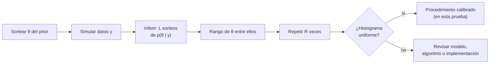

# B19-C08 — Calibración probabilística

<!-- nav:top -->
[🏠 Programa](../../../../README.md) · [📚 Bloque B19](../../../tronco-comun/B19-inferencia-bayesiana-y-computacion-probabilistica.md) · [← Anterior: B19-C07 — Comparación de modelos bayesianos](../B19-C07-comparacion-de-modelos-bayesianos/CLASE.md) · [Siguiente: B20-C01 — Búsqueda bibliográfica sistemática y gestión de referencias →](../../B20/B20-C01-busqueda-bibliografica-sistematica-y-gestion-de-referencias/CLASE.md)
<!-- /nav -->

## 1. Ubicación, nivel y alcance

Octava y última clase del bloque B19. Has construido priors, modelos jerárquicos, muestreadores, diagnósticos, aproximaciones, predicciones y comparaciones. Falta la pregunta que cierra el bloque: cuando un análisis dice «90 % creíble», ¿ese 90 % significa algo? Aquí aprendes a comprobar la **calibración**: que las probabilidades que reporta un procedimiento se parezcan a las frecuencias con las que ocurren las cosas.

Verás la cobertura de intervalos creíbles, la calibración basada en simulación (SBC) con histogramas de rangos y el diagrama de fiabilidad para pronósticos de sucesos. No verás las puntuaciones de habilidad de pronóstico (Brier, TSS, HSS), que se desarrollan en B12.

## 2. Por qué esta clase existe

Un intervalo del 90 % que cubre el valor verdadero solo la mitad de las veces es peor que no tener intervalo: transmite una seguridad falsa. Los diagnósticos de C04 dicen si el cómputo funcionó; los chequeos de C06 si el modelo reproduce los datos. Ninguno asegura que las incertidumbres reportadas sean *fiables*.

La decisión central es: **¿puedo reportar este intervalo o esta probabilidad como lo que dice ser?** Se responde con simulación: se fabrican problemas cuya respuesta se conoce, se aplica el procedimiento y se mide con qué frecuencia acierta. Es también la forma de saber si un método rápido (C05) es aceptable.

## 3. Lo que podrás hacer al terminar

1. Definir calibración y cobertura y distinguir calibración de precisión (*sharpness*).
2. Calcular la cobertura de un intervalo creíble por simulación y su error Monte Carlo.
3. Calcular la cobertura exacta en un modelo normal con un prior o un ruido mal especificados.
4. Construir y leer un histograma de rangos de SBC.
5. Leer un diagrama de fiabilidad y reconocer sobreconfianza.
6. Decidir si un procedimiento es reportable y qué advertencia añadir.

La evidencia es el **informe de calibración** del ejercicio 12 (sección 20).

## 4. Con qué llegas y cómo comprobarlo

Necesitas C01, C05 (por qué el campo medio puede dar intervalos estrechos), C06 y probabilidad básica (B12). Cinco preguntas:

1. ¿Qué es un intervalo creíble del 90 % central?
2. Si tienes `L` sorteos de la posterior, ¿cómo defines el rango de un valor `θ` entre ellos?
3. ¿Cuál es el error estándar de una proporción `p̂` estimada con `R` repeticiones independientes?
4. ¿Qué distribución tiene el rango de `θ` entre los sorteos si `θ` proviene de la misma distribución que ellos?
5. ¿Qué pasa con un intervalo si el ruido real es mayor que el supuesto?

<details>
<summary>Ver respuestas</summary>

1. Entre los cuantiles 5 % y 95 % de la posterior. 2. Cuántos sorteos son menores que `θ` (de 0 a `L`). 3. `√(p(1 − p)/R)`. 4. Uniforme sobre `0..L`. 5. Se queda corto: cubre menos de lo nominal.
</details>

Con cuatro o cinco aciertos, sigue; con tres o menos, repasa C06 y B12.

## 5. Un caso real: validar el algoritmo, no solo el modelo

Talts, Betancourt, Simpson, Vehtari y Gelman (fuente S1) introducen la calibración basada en simulación (SBC): un método general para comprobar si los algoritmos bayesianos que producen muestras posteriores dan inferencias válidas. Según su resumen, puede revelar cómputo inexacto e inconsistencias en la implementación del modelo, y sus resúmenes gráficos ayudan a ver qué falla. Gelman y coautores (fuente S2) sitúan esa validación dentro del flujo de trabajo bayesiano, junto con la construcción, la comprobación y la comparación de modelos; y Gabry y coautores (fuente S3) defienden la visualización en todas las etapas.

De las tres fuentes se leyó solo el resumen: el procedimiento del laboratorio (sortear parámetro, simular datos, ajustar, calcular el rango) es la idea de SBC tal como la entendemos aquí y se **verifica contra cobertura exacta**, no contra un pasaje leído. Los datos son **simulados**.

## 6. Vocabulario

Un procedimiento está **calibrado** si sus probabilidades coinciden con las frecuencias: de los intervalos creíbles al 90 % que reporta, el 90 % contiene el valor verdadero. La **cobertura** de un intervalo es esa fracción. La **precisión** (*sharpness*) es qué tan estrechos son los intervalos: un procedimiento puede estar calibrado y ser inútil (intervalos enormes).

En **SBC** se repite `R` veces: (1) sortear un parámetro `θ̃` del prior, (2) simular datos `ỹ` con `θ̃`, (3) obtener `L` sorteos de la posterior dado `ỹ`, (4) calcular el **rango** de `θ̃` entre ellos (cuántos sorteos son menores). Si el procedimiento es correcto, los rangos son **uniformes** sobre `0..L`. Un **histograma de rangos** con forma de U indica posterior demasiado estrecha (sobreconfianza); con forma de colina, demasiado ancha; con sesgo hacia un lado, posterior corrida. Un **diagrama de fiabilidad** (*reliability diagram*) agrupa pronósticos de probabilidad en casillas y compara la probabilidad media pronosticada con la frecuencia observada del suceso.

## 7. Modelo mental: apostar con tu propio intervalo

Cada vez que reportas un intervalo del 90 %, apuestas que el valor verdadero está dentro. Si repites la apuesta cien veces en problemas donde conoces la verdad y aciertas 60, tu intervalo no vale 90 %. SBC es hacer esa prueba de forma sistemática.



*Descripción textual:* se sortea un parámetro y datos, se hace la inferencia, se calcula el rango del parámetro entre los sorteos posteriores y se repite muchas veces; si el histograma de rangos es uniforme, el procedimiento pasa la prueba, y si no, se revisa.

**Límite de la analogía:** la calibración que prueba SBC es *promedio sobre el prior*. Un procedimiento puede estar calibrado en promedio y fallar en una región concreta de parámetros (escenario 2 de la sección 13).

## 8. La explicación, paso a paso

### 8.1 El modelo de la prueba

Para poder calcular todo con exactitud, usa un modelo normal–normal: `θ ~ N(0, 1)` es el prior del analista, `y | θ ~ N(θ, σ²)` con `σ = 1`. La posterior es normal con precisión `1 + 1/σ_a²` y media `(y/σ_a²)/precisión`, donde `σ_a` es el ruido que *supone* el analista. Si el analista acierta con el prior y el ruido, el procedimiento está calibrado por construcción: es la prueba de que la maquinaria de simulación funciona.

### 8.2 Cobertura por simulación y su incertidumbre

Con `R = 20 000` repeticiones, la proporción de intervalos que contienen a `θ` tiene error estándar `√(0,9 · 0,1/20 000) = 0,0021`. Una cobertura medida de 0,902 es compatible con 0,90; una de 0,586 no lo es de ninguna manera.

### 8.3 Cuando el prior no refleja la realidad

Si la realidad produce `θ ~ N(2, 1)` y el analista supone el prior `N(0, 1)`, la posterior se tira hacia 0 y se queda corta de la verdad. El error `θ − m = 0,5 θ − 0,5 ε` tiene media 1 y desviación 0,707, y el intervalo (semiancho `1,645 · 0,707 = 1,163`) lo cubre con probabilidad `Φ(0,23) − Φ(−3,06) = 0,590`. Es el «90 %» que cubre el 59 %.

### 8.4 Cuando el ruido está subestimado

Si el analista supone `σ_a = 0,5` y el ruido real es 1, su posterior tiene precisión 5 y media `0,8 y`. El error `θ − m = 0,2 θ − 0,8 ε` tiene desviación `√(0,04 + 0,64) = 0,825`, y el intervalo (semiancho `1,645/√5 = 0,736`) cubre con probabilidad `2Φ(0,892) − 1 = 0,628`. De nuevo, un «90 %» que cubre el 63 %.

### 8.5 Leer el histograma de rangos

Con 20 000 repeticiones y 10 casillas, se esperan 2000 en cada una. La estadística `χ² = Σ (obs − 2000)²/2000` tiene 9 grados de libertad bajo uniformidad; su percentil 99,9 % es 27,88. Una forma de **U** (muchos rangos en los extremos) significa que la verdad cae a menudo fuera de lo que la posterior consideraba posible: sobreconfianza (escenario 3). Un histograma **escorado** hacia el extremo alto (escenario 2) significa que la verdad suele estar por encima de los sorteos: la posterior está corrida hacia abajo.

### 8.6 Diagrama de fiabilidad para sucesos

Para un pronóstico de probabilidad `p` de un suceso (sí/no), se agrupan los pronósticos por casilla y se compara la `p` media con la frecuencia observada. Un pronóstico calibrado sigue la diagonal. Un pronóstico **sobreconfiado** exagera: los 3 % ocurren el 14 %, y los 97 % ocurren el 86 %. La calibración no basta: pronosticar siempre la frecuencia base está calibrado y no sirve para nada. Por eso se complementa con precisión, tema de B12.

## 9. Magnitudes, símbolos y unidades

| Símbolo | Qué es | Unidad | Nota |
|---|---|---|---|
| `θ`, `y` | parámetro y dato | unidades arbitrarias | simulados |
| `m_v`, `s_v` | media del parámetro y ruido reales | u.a. | «verdad» |
| `s_a` | ruido supuesto por el analista | u.a. | |
| `R` | repeticiones | adimensional | 20 000 |
| `L` | sorteos de la posterior por repetición | adimensional | 99 |
| rango | número de sorteos menores que `θ` | adimensional | `0..L` |
| `χ²` | estadístico de uniformidad | adimensional | 9 g.l. con 10 casillas |
| `p`, `f` | probabilidad pronosticada y frecuencia | adimensional | 0 a 1 |

## 10. Convenciones y referencias

Los intervalos son centrales: extremos en los cuantiles 5 % y 95 % (cuantil 0,95 de la normal estándar, 1,6449). Los rangos se agrupan en 10 casillas de 10 valores. Las semillas están fijas. Los pronósticos de probabilidad se agrupan en 10 casillas iguales. «Verdad» significa el mecanismo simulado, que conocemos; en datos reales no se conoce y la calibración se comprueba con simulaciones del modelo y con pronósticos verificables.

## 11. De dónde sale lo que afirmamos

| ID | Fuente | Localizador | Respalda | Estado |
|---|---|---|---|---|
| S1 | Talts, S., Betancourt, M., Simpson, D., Vehtari, A. y Gelman, A., «Validating Bayesian Inference Algorithms with Simulation-Based Calibration», 2018 (rev. 2020) | arXiv:1804.06788 | SBC comprueba si los algoritmos bayesianos dan inferencias válidas, revela cómputo inexacto e inconsistencias de implementación y tiene resúmenes gráficos | Resumen consultado el 2026-11-05 |
| S2 | Gelman, A. et al., «Bayesian Workflow», 2020 | arXiv:2011.01808 | La validación es parte de un flujo iterativo | Resumen consultado el 2026-11-05 |
| S3 | Gabry, J. et al., «Visualization in Bayesian workflow», *J. R. Stat. Soc. A* 182, 389 (2019) | arXiv:1709.01449 | La visualización apoya todas las etapas | Resumen consultado el 2026-11-05 |
| S4 | Este bloque, `cobertura_y_sbc.py` | misma carpeta | Cifras de las secciones 13 y 17 (datos **simulados**) | Ejecutado el 2026-11-05 |

**Límites.** De S1–S3 solo se leyeron resúmenes. La uniformidad de los rangos bajo un procedimiento correcto, el percentil 27,88 del χ² con 9 g.l. y las coberturas exactas de la sección 8 son resultados clásicos **comprobados por cálculo propio** (coberturas exactas) y por simulación; el percentil χ² no se tomó de una fuente consultada y se cita como valor estándar de tablas. No se consultó literatura sobre diagramas de fiabilidad: la sección 8.6 es una descripción propia y elemental.

## 12. Cómo ver la calibración

Dibuja el histograma de rangos con 10 barras y una línea horizontal en 2000. En el escenario 1 las barras se mantienen cerca de esa línea; en el 3 forman una U; en el 2, una rampa. Para pronósticos, dibuja la diagonal y los puntos `(p, f)`: los sobreconfiados forman una S tumbada. **Accesibilidad:** rotula cada barra con su conteo, usa trazos distintos para las curvas y entrega la tabla de la sección 17.

## 13. Ejemplo trabajado: tres analistas

Resultados del laboratorio (datos **simulados**, `R = 20 000`, `L = 99`):

| Escenario | Cobertura medida (nominal 0,90) | Cobertura exacta | χ² de rangos | Veredicto |
|---|---|---|---|---|
| 1 · todo correcto | 0,9020 | 0,9000 | 9,1 | calibrado |
| 2 · prior mal (verdad `N(2,1)`) | 0,5863 | 0,5901 | 48 535 | rangos escorados; cobertura 59 % |
| 3 · ruido subestimado (0,5 frente a 1) | 0,6224 | 0,6276 | 10 119 | forma de U; cobertura 63 % |

Histogramas (10 casillas de 2000 esperados): escenario 1: 1996, 2085, 1962, 1958, 1989, 2038, 2007, 1964, 1951, 2050 (plano). Escenario 2: 69, 159, 313, 428, 647, 882, 1286, 1984, 3328, 10 904 (rampa: en el 54,5 % de los casos el parámetro verdadero cae por encima de casi todos los sorteos). Escenario 3: 4866, 1592, 1344, 1145, 1066, 1124, 1156, 1293, 1637, 4777 (U: el 48 % de los rangos está en las dos casillas extremas).

**Diagrama de fiabilidad** (pronóstico medio → frecuencia observada; 10 casillas): calibrado: 0,06→0,06; 0,25→0,25; 0,55→0,56; 0,94→0,94. Sobreconfiado: 0,03→0,14; 0,15→0,29; 0,45→0,48; 0,75→0,64; 0,97→0,86. La moraleja: la cobertura medida coincide con la exacta (diferencias menores de 0,005), y los dos errores de especificación producen firmas distintas.

## 14. Comparación de formas de comprobar

La **cobertura** responde a «¿cubren los intervalos?» y solo mira un nivel. El **histograma de rangos de SBC** mira todos los niveles a la vez y distingue sesgo de sobreconfianza. El **diagrama de fiabilidad** hace lo mismo para pronósticos de sucesos. Los **chequeos predictivos** (C06) comprueban el ajuste a datos reales, pero no la calibración. Los **diagnósticos de cadenas** (C04) comprueban el cómputo. Ninguna comprobación sustituye a las otras.

## 15. Práctica guiada

**Ejercicio 1 · con los pasos indicados.** Calcula el error estándar de la cobertura medida con `R = 20 000` y nominal 0,90, y decide si 0,9020 es compatible con 0,90. *Pasos:* sección 8.2.

<details><summary>Solución comentada</summary>

`√(0,9 · 0,1/20 000) = 0,0021`. La diferencia 0,0020 es menor que un error estándar: compatible. Con 0,586 la diferencia sería de 150 errores estándar.
</details>

**Ejercicio 2 · con una pista.** En el escenario 1, con dato `y = 1,4`, calcula la posterior y el intervalo del 90 %. *Pista:* precisión 2, media `y/2`.

<details><summary>Solución comentada</summary>

Media `0,7`, desviación `1/√2 = 0,707`. Intervalo `0,7 ± 1,645 · 0,707 = 0,7 ± 1,163 = [−0,463; 1,863]`.
</details>

**Ejercicio 3 · casi autónomo.** Deduce la cobertura exacta del escenario 3 (0,628). *Pista:* `θ − m = 0,2 θ − 0,8 ε`.

<details><summary>Solución comentada</summary>

Varianza `0,2² · 1 + 0,8² · 1 = 0,68`, sd `0,825`. Semiancho `1,645/√5 = 0,736`. `z = 0,736/0,825 = 0,892`; `2Φ(0,892) − 1 = 2 · 0,8138 − 1 = 0,628`.
</details>

## 16. Práctica autónoma, transferencia e integrador

**Ejercicio 4.** Explica con el histograma del escenario 2 por qué la posterior está «corrida hacia abajo».

<details><summary>Solución comentada</summary>

La casilla más alta tiene 10 904 de 20 000: en el 54,5 % de los casos el parámetro verdadero queda por encima de casi todos los sorteos de la posterior. El prior `N(0, 1)` tira las estimaciones hacia 0, mientras la verdad tiene media 2.
</details>

**Ejercicio 5.** ¿Por qué la U del escenario 3 indica sobreconfianza y no sesgo?

<details><summary>Solución comentada</summary>

Es simétrica: la verdad cae tanto por encima como por debajo de los sorteos, con demasiada frecuencia en los extremos. Eso ocurre cuando la posterior es más estrecha que el error real. Un sesgo daría una rampa.
</details>

**Ejercicio 6.** En el escenario 1 el χ² es 9,1. ¿Qué concluyes y qué valor te haría sospechar?

<details><summary>Solución comentada</summary>

9,1 está cerca de la media (9 grados de libertad): uniformidad plausible. Un valor mayor que 27,88 (percentil 99,9 %) haría sospechar. Los escenarios 2 y 3 dan 48 535 y 10 119, de otro orden.
</details>

**Ejercicio 7.** El pronóstico sobreconfiado dice 3 % y ocurre el 14 %. ¿Cuántas veces más ocurre de lo anunciado? ¿Por qué importa para sucesos raros?

<details><summary>Solución comentada</summary>

`14/3 ≈ 4,7` veces. En sucesos raros (de alto costo), subestimar su probabilidad por un factor de casi cinco puede llevar a decisiones peligrosas; la calibración de las colas es la más importante y la más difícil de verificar.
</details>

**Ejercicio 8.** Calcula la cobertura exacta del escenario 2.

<details><summary>Solución comentada</summary>

`θ − m = 0,5 θ − 0,5 ε`, con `θ ~ N(2, 1)`: media 1, sd 0,707. Semiancho `1,645 · 0,707 = 1,163`. `P = Φ((1,163 − 1)/0,707) − Φ((−1,163 − 1)/0,707) = Φ(0,23) − Φ(−3,06) = 0,591 − 0,001 = 0,590`.
</details>

**Ejercicio 9 · transferencia.** Quieres validar un muestreador HMC nuevo. Describe cómo aplicarías SBC.

<details><summary>Solución comentada</summary>

Repetir `R` veces: sortear parámetros del prior, simular datos con el modelo, ejecutar el muestreador, calcular el rango del parámetro verdadero entre los sorteos (con `L` sorteos aproximadamente independientes, por ejemplo adelgazando según el ESS) y examinar los histogramas por parámetro. Ajustar `R` y `L` para que la prueba tenga potencia. Un fallo apunta a un error de implementación o a un muestreador que no explora bien (S1).
</details>

**Ejercicio 10 · transferencia.** Un intervalo variacional de campo medio al 90 % con `r = 0,9` (C05) cubre ≈ 53 %. ¿Qué firma esperarías en SBC?

<details><summary>Solución comentada</summary>

Una U (sobreconfianza), como en el escenario 3: la posterior es demasiado estrecha. Si la media estuviera sesgada se sumaría una asimetría.
</details>

**Ejercicio 11 · transferencia.** Un equipo dice: «nuestro pronóstico siempre dice 20 % (la frecuencia base) y está perfectamente calibrado». Evalúa.

<details><summary>Solución comentada</summary>

Es cierto y es inútil: no distingue entre días con y sin sucesos. La calibración es necesaria, no suficiente; hace falta además precisión (sharpness) o una puntuación de habilidad (B12).
</details>

**Ejercicio 12 · integrador.** Redacta un **informe de calibración** de media a una página para los tres escenarios del laboratorio: tabla de coberturas medida y exacta con su error Monte Carlo, interpretación del histograma, diagrama de fiabilidad, una recomendación por escenario y las limitaciones de la prueba.

<details><summary>Solución modelo</summary>

Tabla de la sección 13; error Monte Carlo 0,002; escenario 1 calibrado (χ² 9,1); escenario 2 con cobertura 0,586 (exacta 0,590): revisar el prior; escenario 3 con 0,622 (exacta 0,628): corregir el modelo de ruido. Fiabilidad: el pronóstico calibrado sigue la diagonal y el sobreconfiado exagera (3 %→14 %). Limitaciones: modelo normal–normal, una dimensión, datos simulados, calibración promedio sobre el prior, una semilla, intervalos centrales a un solo nivel.
</details>

## 17. Laboratorio: cobertura, rangos y fiabilidad

El script [cobertura_y_sbc.py](cobertura_y_sbc.py) simula los tres escenarios con 20 000 repeticiones y 99 sorteos de la posterior exacta por repetición, y el diagrama de fiabilidad con 200 000 pronósticos. **Pruebas que detienen la ejecución:** cobertura del escenario 1 `0,90 ± 0,01`; coberturas de los escenarios 2 y 3 a menos de 0,01 de su valor exacto; χ² de rangos menor que 27,88 en el escenario 1 y mayor en los otros. **Datos:** simulados. **Predice antes de ejecutar:** ¿qué escenario dará forma de U? (El 3.)

**Ejecución del 2026-11-05 (Python 3.12.9, numpy 2.4.4):**

```text
Pruebas: OK (coberturas exactas: escenario 2 = 0.5901, escenario 3 = 0.6276)

escenario       cobertura 90 %  chi2 rangos   casillas SBC (10 de 99 rangos)
1 BIEN                  0.9020          9.1    1996  2085  1962  1958  1989  2038  2007  1964  1951  2050
2 PRIOR MAL             0.5863      48535.3      69   159   313   428   647   882  1286  1984  3328 10904
3 RUIDO MAL             0.6224      10118.6    4866  1592  1344  1145  1066  1124  1156  1293  1637  4777

Diagrama de fiabilidad (casilla: pronostico medio -> frecuencia observada)
  calibrado: 0.06->0.06  0.15->0.15  0.25->0.25  0.35->0.35  0.45->0.45  0.55->0.56  0.65->0.65  0.75->0.75  0.85->0.85  0.94->0.94
  sobreconfiado: 0.03->0.14  0.15->0.29  0.25->0.37  0.35->0.42  0.45->0.48  0.55->0.53  0.65->0.58  0.75->0.64  0.85->0.71  0.97->0.86
```

```bash
python programa/clases/B19/B19-C08-calibracion-probabilistica/cobertura_y_sbc.py
```

**Límites:** posterior exacta (no hay MCMC ni VI); una dimensión; una sola semilla; la prueba de uniformidad usa el χ² con 10 casillas y es poco sensible a desviaciones sutiles.

## 18. Errores frecuentes y cómo corregirlos

**Medir la cobertura con pocas repeticiones.** Se corrige con el error estándar, ejercicio 1.

**Confundir sesgo con sobreconfianza.** Ejercicios 4 y 5.

**Creer que calibrado significa útil.** Ejercicio 11.

**Asumir que lo calibrado en promedio lo está en cada región.** Sección 7, escenario 2.

**Validar un método solo con un caso donde acierta.** Se debe probar también con casos mal especificados.

## 19. Cómo sabrás que vas bien

Tras la 8.2: ¿conviertes un número de repeticiones en un error? Ejercicio 1. Tras la 8.3 y la 8.4: ¿reproduces las coberturas exactas? Ejercicios 3 y 8. Tras la 8.5: ¿lees una U y una rampa? Ejercicios 4 y 5. Al final: ¿tu informe distingue lo comprobado de lo supuesto?

## 20. Qué entregas y cómo se evalúa

El producto es el **informe de calibración** del ejercicio 12.

| Criterio | Inicial | En desarrollo | Logrado | Destacado |
|---|---|---|---|---|
| Cobertura | No la mide | La mide sin error | Con error y valor exacto | Explica la discrepancia con la teoría |
| SBC | Ignora el histograma | Lo describe | Distingue U de rampa | Relaciona la forma con la causa |
| Fiabilidad | No la usa | La dibuja | Detecta sobreconfianza | Distingue calibración de precisión |
| Honestidad | Generaliza | Rotula datos | Declara límites | Dice qué no puede detectar |

**Condiciones críticas:** no reportar un intervalo como calibrado sin una comprobación; rotular los datos como simulados; no extrapolar la calibración a regiones no probadas.

## 21. Ética, seguridad y límites

Reportar un intervalo mal calibrado como si fuera fiable puede inducir decisiones erróneas, sobre todo con sucesos raros y costosos (seguridad de una misión, alertas). Si un procedimiento no pasa la prueba, se dice. Los datos son simulados y el material es educativo: no sustituye la validación de un sistema real. Accesibilidad: tablas con valores, descripciones textuales de los gráficos, ejercicios sin conexión.

## 22. Para cerrar y seguir

Un procedimiento está calibrado si sus probabilidades se parecen a las frecuencias. Se comprueba con simulación: cobertura de intervalos, histogramas de rangos y diagramas de fiabilidad. Los tres escenarios tienen firmas distintas, y la cobertura medida coincide con la exacta. Con esto termina el bloque: construiste el prior (C01), los niveles (C02), el muestreo (C03, C04), la aproximación (C05), la predicción (C06), la comparación (C07) y su verificación (C08). Queda abierta una pregunta: ¿cómo se resumen las habilidades de un pronóstico de sucesos con una puntuación? Es tema de B12.

**Glosario español–inglés.** calibración · *calibration*; cobertura · *coverage*; calibración basada en simulación · *simulation-based calibration (SBC)*; histograma de rangos · *rank histogram*; diagrama de fiabilidad · *reliability diagram*; sobreconfianza · *overconfidence*; precisión (agudeza) del pronóstico · *sharpness*.

**Continuidad.** El bloque B19 queda completo; las puntuaciones de habilidad de pronóstico (Brier, TSS, HSS) se desarrollan en B12, y la calibración de instrumentos en B13.

**Referencias:** ver sección 11. De S1–S3 solo se leyeron resúmenes.

<!-- nav:bottom -->
---

[← Anterior: B19-C07 — Comparación de modelos bayesianos](../B19-C07-comparacion-de-modelos-bayesianos/CLASE.md) · [📚 Bloque B19](../../../tronco-comun/B19-inferencia-bayesiana-y-computacion-probabilistica.md) · [Siguiente: B20-C01 — Búsqueda bibliográfica sistemática y gestión de referencias →](../../B20/B20-C01-busqueda-bibliografica-sistematica-y-gestion-de-referencias/CLASE.md)
<!-- /nav -->
