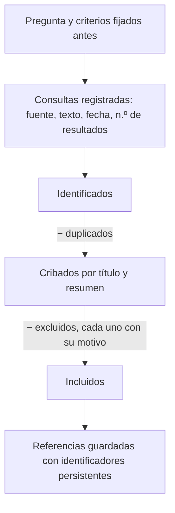

# B20-C01 — Búsqueda bibliográfica sistemática y gestión de referencias

<!-- nav:top -->
[🏠 Programa](../../../../README.md) · [📚 Bloque B20](../../../tronco-comun/B20-metodologia-de-la-investigacion-cientifica.md) · [← Anterior: B19-C08 — Calibración probabilística](../../../tronco-comun/B19-inferencia-bayesiana-y-computacion-probabilistica.md#b19-c08) · [Siguiente: B20-C02 — Diseño de un plan de análisis y preregistro →](../B20-C02-diseno-de-un-plan-de-analisis-y-preregistro/CLASE.md)
<!-- /nav -->

## 1. Ubicación, nivel y alcance

Primera clase del bloque B20, que cierra el área de métodos con la parte menos matemática y más decisiva de una investigación: cómo se apoya un trabajo en lo que otras personas ya hicieron. Entras en el nivel N4 (profesional) y sales con un paso hacia N5 (investigación): aquí el producto no es un cálculo sino un **protocolo de búsqueda** que otra persona pueda repetir.

Verás cómo convertir una pregunta en una consulta, cómo registrar qué buscaste, dónde y cuándo, cómo decidir qué entra y qué no, cómo eliminar duplicados y cómo guardar las referencias con identificadores que no se pierdan. No verás todavía cómo leer un artículo con ojo crítico ni cómo citar dentro del texto: eso aparece en C04. Tampoco enseña a usar un programa de gestión de referencias concreto; fija los datos que cualquiera de ellos debe guardar.

## 2. Por qué esta clase existe

Cuando alguien afirma «no hay estudios sobre esto» o «es sabido que…», la frase vale tanto como el procedimiento con que se buscó. Dos personas que buscan lo mismo sin anotar cómo lo hicieron obtendrán listas distintas y no podrán explicar por qué. El propio estándar editorial de la medicina exige que quien escribe una revisión describa cómo buscó, seleccionó y extrajo los datos (S4); la idea se aplica a cualquier disciplina.

La decisión central es: **¿qué debo anotar antes, durante y después de una búsqueda para que otra persona obtenga la misma lista, o entienda exactamente por qué obtiene otra?** Aprenderás a fijar criterios antes de mirar resultados, a registrar cada consulta con su fecha, a contar el flujo desde lo encontrado hasta lo incluido y a guardar las referencias con identificadores persistentes. Esta clase alimenta el plan de análisis de C02 (¿qué se sabe ya?) y la introducción del artículo de C04.

## 3. Lo que podrás hacer al terminar

1. Traducir una pregunta de investigación en una consulta con términos, campos y operadores lógicos.
2. Redactar criterios de inclusión y exclusión operativos, fijados antes de ver los resultados.
3. Construir y leer la consulta a la API de arXiv con sus parámetros de paginación y orden.
4. Registrar una búsqueda con fecha, fuente, consulta y número de resultados.
5. Eliminar duplicados de forma explícita y contar el flujo identificados → cribados → incluidos.
6. Guardar una referencia con identificadores persistentes y reconocer cuándo dos registros son la misma obra.

La evidencia es la **hoja de protocolo de búsqueda** del ejercicio 12 (sección 20).

## 4. Con qué llegas y cómo comprobarlo

Necesitas de B01 la distinción entre fuente fiable y no fiable (B01-C19) y la idea de pregunta investigable (B01-C06). Cinco preguntas:

1. ¿Qué diferencia hay entre una fuente primaria y un titular de prensa sobre la misma noticia?
2. Escribe en una frase una pregunta investigable sobre estrellas variables.
3. ¿Qué significa que una consulta sea «reproducible»?
4. Si de 20 resultados hay 3 repetidos, ¿cuántos distintos hay?
5. ¿Para qué sirve anotar la fecha de consulta de una página web?

<details>
<summary>Ver respuestas</summary>

1. La primaria contiene el dato original y su método; el titular lo resume y puede distorsionarlo. 2. Por ejemplo: «¿qué métodos se han evaluado para hallar períodos con muestreo irregular?». 3. Que otra persona, con tus anotaciones, obtiene el mismo resultado. 4. 17. 5. Porque el contenido cambia; la fecha dice a qué versión te refieres.
</details>

Con cuatro o cinco aciertos, sigue. Con tres o menos, repasa B01-C06 y B01-C19.

## 5. Un caso real: lo que dice el manual de arXiv sobre pedir resultados

arXiv es un archivo abierto de manuscritos y ofrece una interfaz programática de consulta. Su manual indica que la consulta se hace con una URL base, que los campos de búsqueda llevan prefijos (título, autor, resumen, categoría, todos), que se combinan con `AND`, `OR` y `ANDNOT`, y que el número de resultados por llamada y el tamaño de las páginas se controlan con parámetros. Pide además dejar una pausa de 3 segundos entre llamadas repetidas y no repetir la misma consulta más de una vez al día, porque los resultados cambian solo cuando se añaden artículos, una vez al día (S2). Y fija un tope: una sola llamada devuelve como máximo 2 000 resultados y el total acumulado por consultas paginadas no puede pasar de 30 000 (S2).

La lección para esta clase es doble. Primero, una búsqueda es un **procedimiento con parámetros**, no un acto de buscar «a ojo»: quien conoce los parámetros puede repetirla. Segundo, hay límites y normas de cortesía que forman parte del método. Ten presente el límite del caso: describe una herramienta concreta en una fecha concreta (sección 11); otras bases de datos funcionan distinto y sus reglas pueden cambiar.

## 6. Vocabulario

Una **pregunta de revisión** es la pregunta que guía la búsqueda («¿qué métodos de búsqueda de períodos se han evaluado con muestreo irregular?»). Una **cadena de consulta** es el texto que se envía a la base de datos, con sus términos, campos y operadores. Un **operador lógico** combina términos: `AND` exige ambos, `OR` admite cualquiera, `ANDNOT` excluye el segundo (S2).

Los **criterios de inclusión y exclusión** son reglas escritas antes de ver los resultados que deciden qué obra entra al análisis. El **cribado** es la aplicación de esos criterios, primero al título y resumen y luego al texto completo. Un **duplicado** es la misma obra registrada más de una vez, por ejemplo la versión de un manuscrito y la del artículo publicado. Un **identificador persistente** es un código único y estable que permite volver a encontrar la obra; los principios FAIR piden que los datos y sus metadatos lo tengan (S5). Un **preprint** es un manuscrito difundido antes de su publicación en una revista. Un **artículo arbitrado** es el que pasó por revisión de especialistas (se verá en C03). Un **protocolo de búsqueda** es el documento que reúne pregunta, fuentes, consultas, criterios y fechas.

## 7. Modelo mental: un embudo con registro

Piensa en un embudo de cuatro etapas. Arriba entran todos los resultados que devuelven las consultas; cada etapa descarta algo por una razón que se escribe; abajo queda el conjunto que se leerá. Lo que distingue una búsqueda sistemática de una búsqueda casual no es que sea más larga, sino que **cada descarte tiene una razón anotada** y **cada número del embudo se puede recomponer**.



*Descripción textual:* un diagrama vertical de seis cajas. Una pregunta con criterios fijados de antemano da lugar a consultas registradas; sus resultados forman el conjunto de identificados; se restan los duplicados y queda el conjunto de cribados; se restan los excluidos, cada uno con su motivo, y queda el conjunto de incluidos, cuyas referencias se guardan con identificadores persistentes.

Una analogía: el cuaderno de un cocinero. Quien anota cantidades y tiempos puede repetir un plato y encontrar por qué un día salió distinto. El límite de la analogía: una receta se repite exactamente en la cocina, pero una búsqueda en una base viva puede devolver más resultados mañana, porque la base cambia; por eso la fecha forma parte del registro.

## 8. La explicación, paso a paso

### 8.1 De la curiosidad a la pregunta de revisión

Parte de una pregunta con tres elementos: el objeto (estrellas variables pulsantes), lo que te interesa de él (cómo se halla su período) y la condición que acota el caso (series con muestreo irregular). Si falta uno, la búsqueda devuelve demasiado o demasiado poco. De ella salen los **términos**: palabras que aparecerían en el título o el resumen, con sus variantes (singular y plural, sinónimos, inglés, porque la literatura astronómica se publica sobre todo en ese idioma).

### 8.2 Cadena de consulta

Combina los términos con operadores: los sinónimos del mismo concepto con `OR`, los conceptos distintos con `AND`, lo que quieres evitar con `ANDNOT`. Después elige el campo en el que se busca cada término. En arXiv los prefijos documentados son `ti` (título), `au` (autor), `abs` (resumen), `cat` (categoría) y `all` (todos los campos) (S2). Buscar en el título da pocos resultados muy pertinentes; en el resumen, más resultados y más ruido. Es una decisión de método y se anota. La búsqueda en ADS, el índice bibliográfico de la astronomía, tiene su propia sintaxis de campos, que se consulta en su ayuda en línea (sección 11, límites).

### 8.3 Criterios de inclusión y exclusión, antes de mirar

Escríbelos antes de abrir la primera lista, para que no se ajusten a lo que ya viste, en el mismo espíritu de decidir antes de mirar que verás en C02. Un criterio es **operativo** si dos personas lo aplican igual: «publicado entre 2015 y 2024» lo es; «reciente» no. Los tres de esta clase son periodo, tema y tipo de documento (arbitrado o no, según lo que pida tu pregunta).

### 8.4 Registro de cada consulta

Para cada consulta anota la base, el texto exacto, la fecha, el número de resultados y quién la hizo. La fecha importa porque los resultados cambian: arXiv avisa de que los suyos varían una vez al día (S2). Si usas una interfaz con clave de acceso, como la API de ADS, la documentación indica que el acceso requiere una cuenta y una clave personal enviada en una cabecera, y que cada punto de acceso tiene un límite diario de consultas informado en las cabeceras de respuesta (S1). La clave es un secreto: no se escribe en el protocolo ni se sube a un repositorio.

### 8.5 Paginar sin abusar

Una consulta amplia devuelve más resultados de los que caben en una página. En arXiv se controla con `start` (índice inicial, desde 0) y `max_results` (por defecto 10), se ordena con `sortBy` y `sortOrder`, y el manual recomienda refinar la consulta si devuelve más de 1 000 resultados (S2). Si te hacen falta varias páginas, deja 3 segundos entre llamadas. Por ejemplo, 1 200 resultados con `max_results=100` son 12 llamadas y 11 pausas, al menos 33 s de espera.

### 8.6 Flujo: contar para poder explicar

Cuenta en cada etapa: identificados; duplicados eliminados; cribados; excluidos por cada motivo; incluidos. Debe cumplirse una conservación sencilla: `identificados − duplicados = cribados = incluidos + excluidos`. Si no cuadra, algo se perdió. La medicina formaliza este conteo en un diagrama de flujo para revisiones sistemáticas, y la guía correspondiente, PRISMA, se nombra en el documento de la ICMJE (S4); aquí adoptamos la idea del embudo, no esa guía completa.

### 8.7 Duplicados y versiones

Dos registros son la misma obra si comparten identificador (por ejemplo, el mismo DOI) o, a falta de él, si sus títulos normalizados coinciden: en minúsculas, sin tildes, sin puntuación y con espacios simples. Un preprint y su artículo publicado son dos registros de la misma obra: conserva uno para el análisis y anota el identificador del otro, para citar la versión que realmente leíste. Un preprint no es arbitrado; arXiv describe su proceso como una revisión de relevancia y adecuación de lo enviado (S3), que a nuestro juicio es una moderación y no una evaluación científica por pares (la diferencia se desarrolla en C03).

### 8.8 Guardar la referencia

Cada referencia guarda: autores, título, año, medio (revista o archivo), identificador persistente, fecha de consulta y una nota de por qué se incluyó. Los principios FAIR (S5) piden identificadores persistentes y únicos, metadatos ricos, acceso por protocolos abiertos y licencias claras; sirven aquí como lista de control: ¿puede otra persona encontrar esta obra solo con lo que anotaste?

## 9. Magnitudes, símbolos y unidades

| Símbolo | Qué es | Unidad | Nota |
|---|---|---|---|
| `N_id` | resultados identificados | adimensional (conteo) | suma de todas las consultas |
| `N_dup` | duplicados eliminados | conteo | por identificador o título normalizado |
| `N_cri` | registros cribados | conteo | `N_id − N_dup` |
| `N_exc` | excluidos | conteo | con motivo |
| `N_inc` | incluidos | conteo | `N_cri − N_exc` |
| `start` | índice inicial en arXiv | conteo, desde 0 | S2 |
| `max_results` | resultados por llamada | conteo | por defecto 10; máximo 2 000 (S2) |
| `Δt` | pausa entre llamadas | s | 3 s según S2 |

## 10. Convenciones y referencias

Las fechas se escriben en formato año-mes-día (2026-11-05) y se indica si son de consulta o de publicación. Los años son años de publicación. Las cifras de esta clase (20 registros, 3 duplicados, 9 excluidos, 8 incluidos) son **sintéticas**: se inventaron para practicar y no representan literatura real. El protocolo declara la zona horaria de las fechas de consulta si la base lo requiere.

## 11. De dónde sale lo que afirmamos

| ID | Fuente | Localizador | Respalda | Estado |
|---|---|---|---|---|
| S1 | ADS, repositorio `adsabs-dev-api`, README | https://github.com/adsabs/adsabs-dev-api/blob/master/README.md | URL base de la API, acceso con cuenta y clave en cabecera, límite diario en cabeceras de respuesta, reinicio a medianoche UTC | Página consultada el 2026-11-05 |
| S2 | arXiv, *API User's Manual* | https://info.arxiv.org/help/api/user-manual.html | Prefijos de campo, operadores, `start`, `max_results`, `sortBy`, topes, pausa de 3 s, actualización diaria | Página consultada el 2026-11-05 |
| S3 | arXiv, ayuda de envíos | https://info.arxiv.org/help/submit/index.html | Moderación de relevancia y adecuación; formatos; licencia | Página consultada el 2026-11-05 |
| S4 | ICMJE, *Preparing a Manuscript for Submission to a Medical Journal* | https://www.icmje.org/recommendations/browse/manuscript-preparation/preparing-for-submission.html | Quien revisa debe describir cómo buscó, seleccionó y sintetizó; PRISMA nombrada | Página consultada el 2026-11-05; sin fecha de versión visible |
| S5 | Wilkinson, M. D. et al. (2016), «The FAIR Guiding Principles for scientific data management and stewardship», *Scientific Data* 3, 160018 | doi:10.1038/sdata.2016.18 (leído en https://pmc.ncbi.nlm.nih.gov/articles/PMC4792175/) | Identificadores persistentes, metadatos ricos, acceso, licencia | Texto consultado el 2026-11-05 |
| S6 | ICMJE, *Responsibilities in the Submission and Peer-Review Process* (sección II.C) | https://www.icmje.org/recommendations/browse/roles-and-responsibilities/responsibilities-in-the-submission-and-peer-peview-process.html | Confidencialidad del manuscrito y de sus ideas para quien revisa | Página consultada el 2026-11-05; sin fecha de versión visible |

Límites: S1 es la documentación general de la API de ADS; su página de ayuda de sintaxis de búsqueda (`ui.adsabs.harvard.edu/help`) no entregó contenido al consultarla, por lo que **la sintaxis de campos de ADS no se enseña aquí** y debes leerla en su ayuda. El ejemplo de límite diario (5 000) que aparece en S1 es un ejemplo de su documentación, no un límite garantizado para tu cuenta. S4 y S6 son normas de revistas médicas y se usa solo como ejemplo de buena práctica transferible. Las explicaciones de la sección 8 que no llevan fuente son nuestras.

## 12. Cómo ver el embudo

La tabla es la versión accesible del diagrama de la sección 7, con las cifras del ejemplo sintético de la sección 13.

| Etapa | Registros | Qué se resta |
|---|---|---|
| Identificados | 20 | — |
| Cribados | 17 | 3 duplicados |
| Incluidos | 8 | 9 excluidos (3 periodo, 4 tema, 2 sin arbitraje) |

Si lo dibujas como un diagrama de flujo, usa texto dentro de las cajas, flechas con el motivo escrito en palabras y no dependas del color. Descripción larga: tres cajas verticales con 20, 17 y 8, y entre cada par una flecha rotulada con lo que se resta.

## 13. Ejemplo trabajado: el protocolo del proyecto de períodos

Tu proyecto (hipotético, con datos **sintéticos**) estudia qué métodos de búsqueda de períodos se han evaluado en series con muestreo irregular. Los 20 registros están en el script de la sección 17.

**Paso 1 · Pregunta y términos.** Objeto: estrellas variables; propiedad: período; condición: muestreo irregular. Términos: `variable stars`, `period`, `unevenly sampled`, `sparse`.

**Paso 2 · Consulta.** Un ejemplo de consulta en arXiv: título con `"variable stars"` y resumen con `period`, que en la URL queda `search_query=ti%3A%22variable%20stars%22%20AND%20abs%3Aperiod&start=0&max_results=20` (la API se llama como en S2; el script construye la URL sin enviarla).

**Paso 3 · Criterios, fijados antes.** Periodo 2015–2024; tema «variables»; solo obras arbitradas.

**Paso 4 · Duplicados.** `a2` repite a `a1` (mismo DOI, título que solo cambia en mayúsculas y puntuación). `a4` repite a `a3` (sin DOI, mismo título normalizado). `a12` repite a `a11` (mismo DOI). Son 3 duplicados y quedan 17 registros.

**Paso 5 · Cribado.** Fuera de periodo: `a6` (2012), `a15` (2014), `a16` (2013). Fuera de tema: `a5`, `a9`, `a13`, `a17`. Sin arbitraje: `a7`, `a19`. Son 9 excluidos con su motivo.

**Paso 6 · Conservación.** `20 − 3 = 17 = 8 + 9`. Los 8 incluidos son `a1, a3, a8, a10, a11, a14, a18, a20`.

**Sentido del resultado.** La lista no «demuestra» nada sobre la literatura real: muestra que, con este procedimiento, cualquiera de ustedes dos obtiene los mismos 8. Si alguien discrepa, la discusión se centra en un criterio concreto y no en una impresión.

## 14. Distintas formas de buscar, y cuándo dejan de servir

La **búsqueda por palabras** es rápida, pero depende de que el autor haya usado tus términos. La **búsqueda por citas**, partir de una obra clave y mirar quién la cita o qué cita, encuentra literatura con otro vocabulario, aunque hereda los sesgos de la obra de partida. La **búsqueda en un archivo de preprints** llega antes que la revista pero incluye obras sin arbitraje. La **búsqueda en un índice** que reúne revistas y archivos abarca más, y exige que sepas qué cubre y qué no. Ninguna basta sola: un protocolo serio declara cuáles usó y reconoce lo que pudo quedar fuera.

## 15. Práctica guiada

**Ejercicio 1 · con los pasos indicados.** Normaliza los títulos «Detección de Señales Periódicas» y «Deteccion de senales periodicas.» y di si son el mismo. *Pasos:* minúsculas, quita tildes y puntuación, espacios simples (sección 8.7).

<details><summary>Solución comentada</summary>

Ambos quedan en `deteccion de senales periodicas` (al normalizar a ASCII, la ñ pierde la virgulilla; conviene decidir esa regla y declararla). Son el mismo título normalizado; si además comparten identificador, es duplicado seguro; si no, revisa autores y año antes de eliminar.
</details>

**Ejercicio 2 · con una pista.** En un flujo hay 50 identificados, 12 duplicados y 20 excluidos. ¿Cuántos se criban y cuántos se incluyen? *Pista:* sección 8.6.

<details><summary>Solución comentada</summary>

Cribados: `50 − 12 = 38`. Incluidos: `38 − 20 = 18`. Comprobación: `18 + 20 = 38`. Si te salió 30, restaste los excluidos dos veces.
</details>

**Ejercicio 3 · casi autónomo.** Escribe en palabras qué hace esta consulta de arXiv: `ti:"light curve" ANDNOT abs:exoplanet`.

<details><summary>Solución comentada</summary>

Busca obras cuyo título contiene la frase «light curve» y excluye las que mencionan «exoplanet» en el resumen (prefijos `ti` y `abs`, operador `ANDNOT`, según S2). Ojo: excluir por una palabra descarta también obras pertinentes que solo la mencionan de pasada.
</details>

## 16. Práctica autónoma, transferencia e integrador

**Ejercicio 4.** Reescribe «artículos recientes y buenos sobre fotometría» como dos criterios operativos.

<details><summary>Solución comentada</summary>

«Publicados entre 2019 y 2024» (periodo) y «arbitrados» (tipo de documento), por ejemplo. «Buenos» no es operativo: si dos personas pueden discrepar al aplicarlo, hay que traducirlo a algo comprobable. Cualquier par de criterios verificables es aceptable.
</details>

**Ejercicio 5.** Una consulta devuelve 1 200 resultados. Con `max_results=100`, ¿cuántas llamadas hacen falta y cuánto dura como mínimo la espera total entre ellas? ¿Qué recomienda el manual?

<details><summary>Solución comentada</summary>

12 llamadas y 11 pausas de 3 s: al menos 33 s (sección 8.5). El manual recomienda refinar las consultas que devuelven más de 1 000 resultados (S2), así que lo primero es afinar términos o campos.
</details>

**Ejercicio 6.** Si tu límite diario fuera el valor de ejemplo de S1 (5 000) y ya hiciste 120 consultas, ¿cuántas te quedan? ¿Cuándo se reinicia?

<details><summary>Solución comentada</summary>

`5 000 − 120 = 4 880`. Según S1 el contador se reinicia a medianoche UTC. El 5 000 es un ejemplo de la documentación; el límite real se lee en las cabeceras de respuesta.
</details>

**Ejercicio 7.** Completa la ficha de referencia de esta obra sintética: «Sparse sampling and aliasing in period searches», 2021, DOI `10.0000/x.015`. ¿Qué campos faltan para que otra persona la encuentre?

<details><summary>Solución comentada</summary>

Faltan autores, medio (revista o archivo), fecha de consulta y nota de inclusión (sección 8.8). El DOI ya es el identificador persistente. Un registro sin autores ni medio no se puede citar en C04.
</details>

**Ejercicio 8.** Encontraste un preprint y su artículo publicado. ¿Cuál conservas, qué anotas y qué cuentas como duplicado?

<details><summary>Solución comentada</summary>

Conservas la versión que leíste y comparaste (por criterio de tu protocolo, normalmente la publicada si cumple «arbitrada»), anotas el identificador de la otra y cuentas 1 duplicado (sección 8.7). Si las dos versiones difieren en resultados, lo anotas: puede ser relevante.
</details>

**Ejercicio 9 · transferencia.** Tu búsqueda usó solo arXiv. Enumera dos tipos de obra relevantes que podrían faltar y cómo lo declararías.

<details><summary>Solución comentada</summary>

Faltan obras no enviadas a arXiv (algunas revistas o grupos no lo usan) y obras arbitradas posteriores con cambios sustanciales respecto del preprint. Lo declaras en el protocolo como limitación de cobertura («fuente única: arXiv; no cubre obras no depositadas»), sin presentarlo como revisión exhaustiva.
</details>

**Ejercicio 10 · transferencia.** Repites tu búsqueda un año después y obtienes más resultados con la misma cadena. ¿Es un error? ¿Qué debías haber anotado?

<details><summary>Solución comentada</summary>

No es un error: la base se actualiza (S2 indica actualización diaria). Debías anotar la fecha de la primera consulta y, mejor, filtrar por fecha de envío (hay un orden por fecha de envío en S2) para comparar solo lo anterior a ella. Las diferencias se explican con el registro.
</details>

**Ejercicio 11 · transferencia.** Un informe dice «se revisó toda la literatura sobre el tema». Señala qué falta para que la afirmación sea comprobable y reescríbela.

<details><summary>Solución comentada</summary>

Faltan fuentes, consultas, fechas, criterios y flujo. Una versión acotada: «Se consultó arXiv el 2026-11-05 con la consulta X; se identificaron 20 registros, se eliminaron 3 duplicados y se incluyeron 8 que cumplían los criterios Y». «Toda la literatura» no puede afirmarse con una fuente y unas consultas.
</details>

**Ejercicio 12 · integrador.** Elabora la *hoja de protocolo de búsqueda* (sección 20) para una pregunta tuya de astronomía: pregunta, términos con sinónimos, fuentes, consultas con fecha, criterios operativos, flujo con conteos que cuadren, motivos de exclusión y tres referencias completas.

<details><summary>Solución modelo</summary>

Debe seguir el ejemplo de la sección 13 con otra pregunta: criterios escritos antes del conteo, al menos una consulta con operadores, un flujo cuya suma se verifica (`identificados − duplicados = incluidos + excluidos`), una limitación de cobertura declarada y referencias con identificador persistente. Se acepta cualquier tema con fuentes consultadas realmente.
</details>

## 17. Laboratorio: un protocolo ejecutable

El script [registro_de_busqueda.py](registro_de_busqueda.py) aplica el protocolo de la sección 13 a 20 registros **sintéticos**: normaliza títulos, elimina duplicados por DOI o título, aplica los criterios en orden (periodo, tema, arbitraje), cuenta el flujo y construye, sin enviarla, la URL de consulta a arXiv codificada según el manual (S2). Antes de calcular comprueba que 3 duplicados, 9 excluidos y 8 incluidos coinciden con el conteo hecho a mano y que la URL tiene el formato esperado; si no, se detiene.

**Datos:** sintéticos. **Modelo:** reglas deterministas. **Supuestos:** metadatos completos salvo los DOI vacíos de `a4` y `a19`. **Validez:** demostración didáctica. **Tolerancia:** conteos enteros exactos. **Predice antes de ejecutar:** ¿cuántos incluidos? (8.)

**Resultados reales (2026-11-05, Python 3.12.9):**

```text
python 3.12.9 | pruebas OK | datos SINTÉTICOS
Identificados: 20
Duplicados eliminados: 3
Cribados: 17
  excluidos por fuera de periodo: 3
  excluidos por fuera de tema: 4
  excluidos por sin arbitraje: 2
Incluidos: 8  (a1, a3, a8, a10, a11, a14, a18, a20)
URL de consulta (no enviada): http://export.arxiv.org/api/query?search_query=ti%3A%22variable%20stars%22%20AND%20abs%3Aperiod&start=0&max_results=20
Pausa mínima entre consultas repetidas a la API: 3 s (manual de arXiv)
```

```bash
python programa/clases/B20/B20-C01-busqueda-bibliografica-sistematica-y-gestion-de-referencias/registro_de_busqueda.py
```

**Límites:** no se conecta a ninguna base; no valida DOI reales; la normalización quita tildes (la «ñ» pierde la virgulilla). No sirve como sustituto de una búsqueda real.

## 18. Errores frecuentes y cómo corregirlos

**Fijar los criterios después de ver los resultados.** Se detecta cuando los criterios «casualmente» dejan fuera lo que no gusta. Se corrige escribiéndolos antes (ejercicio 4).

**No anotar la fecha de consulta.** Imposibilita explicar por qué la lista cambia. Se corrige con el ejercicio 10.

**Contar mal el flujo.** Restar dos veces o mezclar cribados con identificados. Se corrige con el ejercicio 2.

**Eliminar duplicados solo por título parecido.** Dos obras distintas pueden compartir título; se confirma con identificador y autores (ejercicios 1 y 8).

**Presentar una búsqueda parcial como exhaustiva.** Se corrige con los ejercicios 9 y 11.

## 19. Cómo sabrás que vas bien

Tras la sección 8.3: ¿tus criterios son operativos? Si dos compañeros pueden discrepar, repite el ejercicio 4. Tras la 8.5: ¿calculas llamadas y pausas sin mirar? Si no, rehaz el ejercicio 5. Tras la 8.6: ¿cuadra tu flujo? Si no, repite el ejercicio 2. Tras el ejemplo: ¿puedes explicar por qué `a4` es duplicado de `a3`? Tras el laboratorio: ¿qué comprueba el script antes de imprimir? Si no lo sabes, lee su cabecera. Al final: ¿qué dato de tu búsqueda no podrías reconstruir un año después? Ese es el que debes anotar.

## 20. Qué entregas y cómo se evalúa

El producto es tu **hoja de protocolo de búsqueda**: una página con pregunta, términos, fuentes, consultas con fecha y número de resultados, criterios operativos, flujo con conteos, motivos de exclusión, limitaciones y tres referencias completas con identificador persistente.

| Criterio | Inicial | En desarrollo | Logrado | Destacado |
|---|---|---|---|---|
| Pregunta y términos | Vaga | Con ayuda | Concreta, con sinónimos | Anticipa vocabulario alternativo |
| Criterios | Subjetivos | Algunos operativos | Todos operativos y anteriores a los resultados | Los prueba con un compañero |
| Registro de consultas | Falta fecha o texto | Parcial | Completo | Otra persona lo repite sin preguntar |
| Flujo | No cuadra | Cuadra con ayuda | Cuadra y justifica cada exclusión | Declara límites de cobertura |
| Referencias | Sin identificador | Algunas | Todas con identificador persistente | Distingue versiones y las cita bien |

**Condiciones críticas:** fijar los criterios antes de ver los resultados; incluir fecha de consulta; no declarar exhaustividad no demostrada; no incluir en el protocolo claves de acceso; citar solo fuentes consultadas.

## 21. Ética, seguridad y límites

Respeta los límites y normas de uso de cada servicio: las pausas y topes de S2 y los límites de S1 son parte de la cortesía profesional. Las claves de acceso son personales y secretas. Cita siempre la fuente original y no atribuyas a una obra algo que solo leíste en un resumen: si solo viste el resumen, escríbelo. Quien revisa para una revista debe mantener la confidencialidad de los manuscritos y no usar sus ideas (S6, que ampliamos en C03); no subas manuscritos ajenos a servicios externos sin permiso. Accesibilidad: todas las cifras tienen versión en tabla, los diagramas tienen descripción, y el laboratorio funciona sin conexión.

## 22. Para cerrar y seguir

Una búsqueda sistemática es un procedimiento con pregunta, criterios anteriores a los resultados, consultas registradas con fecha, un flujo que cuadra y referencias con identificadores persistentes. Su valor no es exhaustividad, sino que otra persona pueda repetirla o explicar la diferencia. Queda abierta una pregunta: ¿cómo se pondera lo que se encontró cuando unas fuentes pesan más que otras? Eso es lo que lees críticamente en cada obra incluida.

**Glosario español–inglés.** búsqueda sistemática · *systematic search*; cadena de consulta · *query string*; criterios de inclusión · *inclusion criteria*; cribado · *screening*; duplicado · *duplicate*; identificador persistente · *persistent identifier*; preprint · *preprint*; arbitraje · *peer review*.

**Continuidad.** B20-C02 usa tu capacidad de **fijar reglas por escrito antes de mirar los datos** para planificar el análisis y preregistrarlo. B20-C04 reutilizará tus referencias guardadas para la introducción y la bibliografía del artículo.

**Referencias:** ver sección 11. S1–S3 son documentación oficial de las herramientas; S4 es de otra disciplina; S5 es un artículo de principios.

<!-- nav:bottom -->
---

[← Anterior: B19-C08 — Calibración probabilística](../../../tronco-comun/B19-inferencia-bayesiana-y-computacion-probabilistica.md#b19-c08) · [📚 Bloque B20](../../../tronco-comun/B20-metodologia-de-la-investigacion-cientifica.md) · [Siguiente: B20-C02 — Diseño de un plan de análisis y preregistro →](../B20-C02-diseno-de-un-plan-de-analisis-y-preregistro/CLASE.md)
<!-- /nav -->
