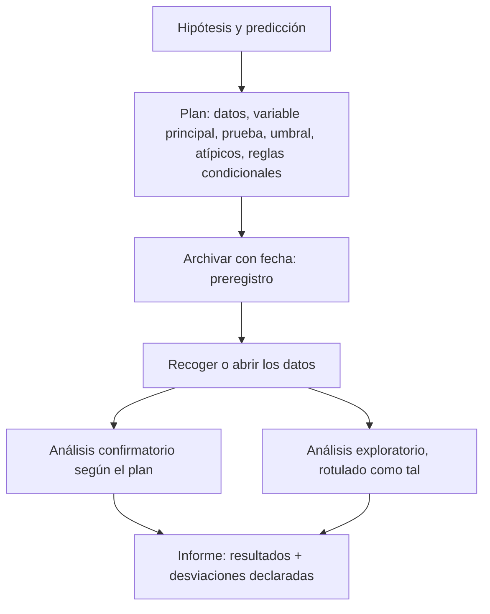

# B20-C02 — Diseño de un plan de análisis y preregistro

<!-- nav:top -->
[🏠 Programa](../../../../README.md) · [📚 Bloque B20](../../../tronco-comun/B20-metodologia-de-la-investigacion-cientifica.md) · [← Anterior: B20-C01 — Búsqueda bibliográfica sistemática y gestión de referencias](../B20-C01-busqueda-bibliografica-sistematica-y-gestion-de-referencias/CLASE.md) · [Siguiente: B20-C03 — Revisión por pares y respuesta a árbitros →](../B20-C03-revision-por-pares-y-respuesta-a-arbitros/CLASE.md)
<!-- /nav -->

## 1. Ubicación, nivel y alcance

Segunda clase del bloque B20. En C01 aprendiste a fijar reglas por escrito antes de mirar los resultados de una búsqueda. Aquí aplicas la misma disciplina a los **datos propios**: decidir, antes de verlos, qué vas a calcular, con qué criterio y qué harás si algo sale raro. Nivel de entrada N3 (analizas datos con código); nivel de salida N4, con un paso hacia N5.

Verás cómo redactar un plan de análisis, por qué la libertad de elegir el análisis después de ver los datos infla las falsas alarmas, cómo estimar el tamaño de muestra que necesitas, qué es un preregistro y cómo registrar las desviaciones. No repetirás las técnicas estadísticas (están en B12): aquí usarás solo una prueba z sencilla como ejemplo y las fórmulas que se explican en la clase.

## 2. Por qué esta clase existe

Un grupo mide cinco variantes razonables de un mismo análisis y publica la que da «un resultado significativo». Nadie mintió con un número, y sin embargo el resultado ya no significa lo que dice. Los autores de un artículo muy citado sobre preregistro lo plantean así: confundir la **generación** de una hipótesis a partir de datos con la **prueba** de una predicción reduce la credibilidad de los resultados, y sesgos de razonamiento comunes, como el sesgo retrospectivo, hacen difícil evitarlo (S2, resumen).

La decisión central es: **¿qué debo dejar escrito antes de ver los datos para que mi conclusión sea una prueba y no una justificación a posteriori?** Aprenderás a separar lo planificado (confirmatorio) de lo no planificado (exploratorio), a medir cuánto cuesta no hacerlo con una simulación y a redactar un plan con reglas de decisión y registro de desviaciones. Alimenta el artículo de C04 (la sección de métodos) y las respuestas a árbitros de C03.

## 3. Lo que podrás hacer al terminar

1. Distinguir un análisis confirmatorio de uno exploratorio y rotular cada resultado.
2. Calcular la probabilidad de al menos una falsa alarma al elegir entre `k` análisis independientes, y la corrección de Bonferroni.
3. Estimar el tamaño de muestra para una potencia dada con la fórmula de la prueba z.
4. Redactar un plan de análisis con hipótesis, variable principal, prueba, criterio, tratamiento de datos atípicos y reglas condicionales.
5. Decidir qué declarar cuando los datos ya existen.
6. Registrar una desviación del plan sin ocultarla.

La evidencia es el **plan de análisis preregistrable** del ejercicio 12 (sección 20).

## 4. Con qué llegas y cómo comprobarlo

Necesitas de B12 la idea de contraste de hipótesis y de valor p, de B01 la hipótesis falsable (B01-C07) y de C01 el hábito de fijar criterios antes de mirar. Cinco preguntas:

1. ¿Qué significa un nivel de significación `α = 0,05`?
2. ¿Qué es una hipótesis nula?
3. Si lanzas 20 monedas justas, ¿esperas exactamente 10 caras? ¿Por qué?
4. ¿Por qué un resultado inesperado en datos ya vistos no prueba nada por sí solo?
5. ¿Qué es una predicción falsable?

<details>
<summary>Ver respuestas</summary>

1. Que aceptamos rechazar la hipótesis nula, si es verdadera, en el 5 % de las veces. 2. La que dice que no hay efecto o diferencia. 3. No: hay variación aleatoria; 10 es lo más probable, no lo seguro. 4. Porque se eligió mirando esos datos: casi cualquier conjunto contiene alguna coincidencia. 5. Una que dice qué resultado la refutaría.
</details>

Con cuatro o cinco aciertos, sigue. Con tres o menos, repasa B12 (contrastes) y B01-C07.

## 5. Un caso real: el registro previo, descrito por quien lo promueve

El Center for Open Science define el preregistro como especificar el plan de investigación por adelantado y enviarlo a un registro (S1). Su página distingue dos tipos de trabajo: el **confirmatorio**, que prueba hipótesis concretas, no depende de los datos y busca reducir las falsas alarmas (con lo cual los valores p conservan su valor diagnóstico), y el **exploratorio**, que genera hipótesis a partir de los datos, busca no perder hallazgos y exige réplica (con valores p que pierden su valor diagnóstico) (S1). Añade que el plan puede incluir reglas condicionales del tipo «si no se cumple tal supuesto, hago tal otro análisis», que se definen las variables usadas en las pruebas confirmatorias y que, si los datos ya existen, se declara si existen y hasta dónde se los ha mirado (S1).

La lección: preregistrar no prohíbe explorar. Obliga a **rotular** qué fue una cosa y qué fue la otra. Ten presente el límite: S1 es la página de una organización que promueve la práctica; existe discusión crítica sobre qué protege cada tipo de preregistro y no se resume aquí.

## 6. Vocabulario

Una **hipótesis de investigación** es la afirmación sustantiva que quieres evaluar; la **hipótesis nula** `H₀` es la que niega el efecto, y la **alternativa** `H₁` la que lo afirma. La **variable principal** (o resultado primario) es la magnitud que decide la conclusión. El **análisis confirmatorio** prueba lo especificado antes; el **exploratorio** busca patrones sin plan previo (S1). Un **grado de libertad del analista** es cada decisión razonable que cambia el resultado: qué datos excluir, qué transformación aplicar, qué prueba usar.

El **nivel de significación** `α` es la probabilidad máxima admitida de rechazar `H₀` cuando es verdadera. Un **falso positivo** es rechazar `H₀` siendo verdadera. La **potencia** `1 − β` es la probabilidad de rechazar `H₀` cuando existe el efecto que te interesa. El **tamaño del efecto** `d` es la diferencia que quieres poder detectar, medida en unidades de la desviación típica `σ`. La **corrección de Bonferroni** divide `α` entre el número de pruebas. Un **preregistro** es un plan fechado y archivado en un registro externo antes de analizar. Una **desviación** es cualquier cambio respecto del plan.

## 7. Modelo mental: un camino con bifurcaciones

Imagina el análisis como un camino con bifurcaciones: ¿qué datos entran?, ¿qué filtro?, ¿qué prueba?, ¿qué umbral? Cada bifurcación tiene varias salidas razonables. Si eliges el camino después de ver adónde lleva cada uno, te quedas con el que da lo que esperabas. Si lo eliges antes, el resultado es una prueba. El plan de análisis es el mapa fechado del camino elegido.



*Descripción textual:* un diagrama con siete cajas. De la hipótesis se pasa a un plan escrito; el plan se archiva con fecha; luego se obtienen los datos; de ahí salen dos ramas, un análisis confirmatorio que sigue el plan y un análisis exploratorio rotulado; ambas confluyen en un informe que incluye las desviaciones declaradas.

Una analogía: apostar antes o después de la carrera. Quien anota su apuesta antes de que corran los caballos puede ser evaluado; quien «apuesta» cuando ya ve la llegada siempre acierta. El límite de la analogía: en ciencia explorar después de ver los datos es legítimo y valioso; lo que no es legítimo es presentarlo como si hubiera sido una apuesta anterior.

## 8. La explicación, paso a paso

### 8.1 Qué entra en un plan de análisis

A partir de lo que S1 describe y de la práctica general, un plan contiene: la pregunta y la hipótesis con su predicción; los datos (origen, cuántos, criterios de inclusión); la definición de cada variable usada en las pruebas confirmatorias; la variable principal; la prueba, el umbral `α` y la corrección si hay varias pruebas; el tratamiento de valores atípicos y faltantes **decidido de antemano**; las reglas condicionales; y el tamaño de muestra con su justificación. S1 señala que debe haber detalle suficiente para que otra persona replique los métodos; ese es el criterio práctico.

### 8.2 El costo de decidir después: la fórmula

Supón que la hipótesis nula es verdadera (no hay efecto) y haces una sola prueba con `α = 0,05`: la probabilidad de falso positivo es 0,05. Si haces `k` análisis **independientes** y te quedas con el mejor, la probabilidad de que al menos uno dé `p < α` es

```text
P(al menos un falso positivo) = 1 − (1 − α)^k
```

porque `(1 − α)^k` es la probabilidad de que ninguno falle. Con `α = 0,05`: `k = 1` da 0,050; `k = 5`, 0,226; `k = 10`, 0,401; `k = 20`, 0,642. Con diez caminos razonables, la «falsa alarma» ocurre en cuatro de cada diez estudios sin efecto. En la práctica las variantes comparten datos y se correlacionan, por lo que la cifra real es menor que esta cota de variantes independientes, pero sigue siendo mayor que `α`.

### 8.3 Corregir cuando hay varias pruebas

La corrección de Bonferroni exige `p < α/k` en cada prueba. Con `k = 5`, el umbral es 0,01; la probabilidad de al menos una falsa alarma pasa a `1 − 0,99⁵ = 0,049`, de vuelta cerca de 0,05. Es simple y conservadora (pierde potencia cuando hay muchas pruebas). La corrección se decide **antes**, y se registra.

### 8.4 Tamaño de muestra y potencia

Para detectar un efecto `d` (en unidades de `σ`) con una prueba z bilateral de media sobre `n` observaciones, la potencia aproximada es `Φ(d√n − z_{1−α/2})`, donde `Φ` es la función de distribución de la normal estándar y `z_{1−α/2} = 1,96` para `α = 0,05`. Para una potencia de 0,80, la condición es `d√n ≥ 1,96 + 0,8416`, es decir, `n ≥ ((1,96 + 0,8416)/d)²`. Con `d = 0,5`: `n ≥ (2,8016/0,5)² = 31,4`, y se redondea hacia arriba: **32**. Con `d = 0,4`: `n ≥ 49,1`, es decir, **50**. Estos valores son los del script (sección 17). Decide `d` por razones físicas o de utilidad (el menor efecto que te importaría), no mirando los datos.

### 8.5 Datos atípicos y faltantes: decidir la regla antes

Los valores atípicos son una bifurcación clásica. Una regla preregistrable es: «se excluyen las mediciones marcadas como saturadas por el instrumento (criterio objetivo, anterior a ver el resultado); no se excluye ninguna otra; se reporta además el análisis con y sin los puntos dudosos». Lo que no se debe hacer es quitar el punto que «estropea» el ajuste. En C03 verás la herramienta (el análisis de un punto a la vez) con la que un árbitro puede pedirte esa comprobación.

### 8.6 Reglas condicionales

Anticipa los problemas previsibles: «si los residuos no son aproximadamente normales, uso la mediana y una prueba sin supuesto de normalidad; si falta más del 10 % de los datos de una serie, la excluyo». Cada regla tiene una condición medible y una acción. S1 las llama reglas de decisión (si-entonces) (S1).

### 8.7 Datos que ya existen

En astronomía es habitual analizar archivos que ya están publicados. No puedes aparentar ignorancia: S1 pide declarar si los datos existen y hasta dónde los has mirado. La honestidad consiste en escribir, por ejemplo, «los datos están archivados; no he calculado estadísticos de la variable principal; sí he visto la tabla de metadatos». S2 (resumen) afirma que hay estrategias prácticas para aprovechar el preregistro cuando los datos ya existen; el detalle de cada estrategia no se leyó, y no lo enseñamos.

### 8.8 Registrar y archivar

Se archiva el plan en un registro externo con fecha, de modo que no pueda reescribirse sin dejar rastro. Después, cada cambio se anota como **desviación**: qué cambió, cuándo, por qué y qué efecto tiene sobre la lectura. Un cambio justificado y declarado no invalida el trabajo; uno silencioso sí.

## 9. Magnitudes, símbolos y unidades

| Símbolo | Qué es | Unidad | Nota |
|---|---|---|---|
| `H₀`, `H₁` | hipótesis nula y alternativa | — | — |
| `α` | nivel de significación | adimensional | 0,05 en los ejemplos |
| `k` | número de análisis o pruebas | conteo | independientes en 8.2 |
| `p` | valor p | adimensional | entre 0 y 1 |
| `n` | número de observaciones | conteo | — |
| `σ` | desviación típica | la de la variable | conocida y = 1 en el ejemplo |
| `d` | efecto en unidades de `σ` | adimensional | `d = Δ/σ` |
| `1 − β` | potencia | adimensional | 0,80 en los ejemplos |
| `Φ(x)` | acumulada de la normal estándar | adimensional | `Φ(1,96) = 0,975` |
| `z_{1−α/2}` | cuantil de la normal | adimensional | 1,96 para `α = 0,05` |

## 10. Convenciones y referencias

La prueba es **bilateral**. Los valores p se presentan con tres decimales (o `p < 0,001`). Los datos de esta clase son **simulados** y sintéticos; no hay ningún efecto real en el laboratorio por construcción. Las fechas son año-mes-día y el plan se archiva antes de abrir el archivo de datos. La semilla del generador pseudoaleatorio se registra.

## 11. De dónde sale lo que afirmamos

| ID | Fuente | Localizador | Respalda | Estado |
|---|---|---|---|---|
| S1 | Center for Open Science, «Preregistration» | https://www.cos.io/initiatives/prereg | Definición de preregistro; confirmatorio frente a exploratorio; reglas condicionales; declarar estado de los datos existentes | Página consultada el 2026-11-05 |
| S2 | Nosek, B. A., Ebersole, C. R., DeHaven, A. C. y Mellor, D. T., «The Preregistration Revolution» (preprint, 2018-03-12) | doi:10.31219/osf.io/2dxu5 (resumen leído en https://econpapers.repec.org/RePEc:osf:osfxxx:2dxu5) | Postdicción frente a predicción; sesgo retrospectivo; preregistro como remedio; estrategias con datos existentes | Solo resumen consultado el 2026-11-05 |

Límites: de S2 se leyó únicamente el resumen en un índice; el texto completo no se abrió (la página de la revista PNAS rechazó el acceso). Una búsqueda indicó que existe una versión publicada en *PNAS* 115(11), 2600–2606 (2018), pero no la abrimos, así que la citamos solo como dato por verificar. La fórmula de 8.2 es un resultado elemental de probabilidad y se contrasta con la simulación de la sección 17; las de 8.4 son de la prueba z y se contrastan con el cálculo del script.

## 12. Cómo ver el costo de elegir después

La tabla es la versión accesible de un gráfico de probabilidad de al menos una falsa alarma frente al número de análisis `k`.

| `k` | Sin corregir (`α = 0,05`) | Con Bonferroni (`α/k`) |
|---|---|---|
| 1 | 0,050 | 0,050 |
| 3 | 0,143 | 0,049 |
| 5 | 0,226 | 0,049 |
| 10 | 0,401 | 0,049 |
| 20 | 0,642 | 0,049 |

Si lo grafica, pon `k` en el eje horizontal con su valor numérico, la probabilidad en el vertical de 0 a 1, dos líneas distinguibles por forma de marcador y no solo por color. Descripción larga: la línea sin corregir sube de 0,05 a 0,64 al pasar de 1 a 20 análisis; la corregida se mantiene casi horizontal cerca de 0,05.

## 13. Ejemplo trabajado: el plan del proyecto de períodos

Seguimos con el proyecto de C01 (hipotético, con datos **sintéticos**): comparar dos métodos de búsqueda de períodos (A y B) en series con muestreo irregular. Se quiere saber si el error relativo del período es menor con A que con B.

**Paso 1 · Hipótesis y predicción.** `H₁`: el error relativo medio del método A es menor que el de B. Predicción: en series simuladas, la media de las diferencias `error_B − error_A` es mayor que 0.

**Paso 2 · Variable principal.** La diferencia por serie, `Δ = error_B − error_A`, en unidades de error relativo (adimensional). Prueba: prueba z bilateral sobre la media de `Δ`, con `σ` estimada de una simulación piloto, `α = 0,05`.

**Paso 3 · Efecto y tamaño de muestra.** El menor efecto que importa: `d = 0,5` (media de `Δ` igual a media desviación típica). Potencia objetivo 0,80. De 8.4: `n = 32` series. Comprobación: la potencia con `n = 32` es 0,807.

**Paso 4 · Datos atípicos.** Se excluyen las series en que el programa de simulación marca fallo numérico; ninguna otra. Se reporta también el análisis sin esa exclusión.

**Paso 5 · Reglas condicionales.** Si los `Δ` muestran asimetría fuerte (|asimetría| > 1), se usa la mediana y una prueba de signos; se decide qué estadístico mide la asimetría y se escribe.

**Paso 6 · Lo que queda como exploratorio.** Dependencia con la amplitud o el período verdadero: se declara exploratoria.

**Paso 7 · Archivo.** Se archiva el plan con fecha y se anota la semilla del generador.

**Sentido del resultado.** Si luego se prueban cinco variantes distintas del análisis y se informa la mejor, el plan queda anulado en la práctica (8.2): la probabilidad de una falsa alarma sube a 0,226. El plan hace que la conclusión valga lo que dice.

## 14. Distintas formas de proteger el análisis, y cuándo dejan de servir

El **preregistro completo** fija todo antes; es el más fuerte, pero rígido ante imprevistos. El **plan con reglas condicionales** admite bifurcaciones previstas y es el compromiso habitual. La **corrección por comparaciones múltiples** (Bonferroni u otras) protege cuando hay varias pruebas, a costa de potencia. La **separación en muestra de exploración y de confirmación** divide los datos: se explora en una parte y se confirma en la otra; exige suficientes datos. Con datos ya existentes, el análisis exploratorio sigue valiendo si se rotula como tal. Ninguno corrige un diseño que no puede responder la pregunta.

## 15. Práctica guiada

**Ejercicio 1 · con los pasos indicados.** Con `α = 0,05` y `k = 3` análisis independientes, ¿cuál es la probabilidad de al menos un falso positivo? *Pasos:* `1 − (0,95)³` (sección 8.2).

<details><summary>Solución comentada</summary>

`0,95³ = 0,857375`; `1 − 0,857375 = 0,1426`, es decir, 14,3 %. Si te salió 0,15 como 3 × 0,05, usaste una suma aproximada: sirve para `k` pequeño, pero sobrestima cuando crece.
</details>

**Ejercicio 2 · con una pista.** ¿Qué umbral de Bonferroni corresponde a `k = 8` y `α = 0,05`? *Pista:* divide.

<details><summary>Solución comentada</summary>

`0,05/8 = 0,00625`. Cada prueba debe dar `p < 0,00625`. Comprobación: `1 − (1 − 0,00625)⁸ = 0,049`.
</details>

**Ejercicio 3 · casi autónomo.** Clasifica como confirmatorio (C) o exploratorio (E): (a) la prueba de la media de `Δ`, definida en el plan; (b) buscar si el error depende del período verdadero, idea surgida al ver los gráficos; (c) la mediana usada porque la asimetría superó el umbral del plan; (d) excluir tres series porque «se veían raras».

<details><summary>Solución comentada</summary>

(a) C. (b) E: surgió de los datos. (c) C: era una regla condicional del plan. (d) E, y además una desviación que debe declararse: la exclusión no estaba en el plan ni respondía a un criterio objetivo (sección 8.5).
</details>

## 16. Práctica autónoma, transferencia e integrador

**Ejercicio 4.** Convierte «mejorará la precisión» en una variable principal con unidad y definición.

<details><summary>Solución comentada</summary>

Por ejemplo: «error relativo del período = |P_estimado − P_verdadero| / P_verdadero (adimensional), por serie». Es operativa: dos personas la calculan igual. «Precisión» sola no lo es: no dice con respecto a qué ni cómo se mide.
</details>

**Ejercicio 5.** Calcula el tamaño de muestra para `d = 0,4`, `α = 0,05` y potencia 0,80.

<details><summary>Solución comentada</summary>

`n ≥ ((1,96 + 0,8416)/0,4)² = (7,004)² = 49,06`, y se redondea hacia arriba: 50. Rebajar el efecto de 0,5 a 0,4 sube la muestra de 32 a 50: la necesidad crece con `1/d²`.
</details>

**Ejercicio 6.** Calcula la potencia con `d = 0,5` y `n = 32`.

<details><summary>Solución comentada</summary>

`d√n = 0,5 × 5,657 = 2,828`; `2,828 − 1,96 = 0,868`; `Φ(0,868) ≈ 0,807`. Coincide con el script. Si la potencia te sale menor que 0,5, comprobaste mal la raíz o restaste al revés.
</details>

**Ejercicio 7.** Redacta una regla preregistrable para valores faltantes en una serie.

<details><summary>Solución comentada</summary>

Ejemplo: «Si a una serie le falta más del 10 % de sus puntos, se excluye del análisis confirmatorio; si no, se analiza con los puntos disponibles. Se reporta el número de series excluidas.» Tiene condición medible, acción y reporte.
</details>

**Ejercicio 8.** Redacta la entrada de un registro de desviaciones: cambias el umbral de asimetría de 1 a 0,8 tras ver los datos.

<details><summary>Solución comentada</summary>

«2026-11-20: el umbral de asimetría pasó de 1 a 0,8. Motivo: [razón]. Datos vistos antes del cambio: sí, la distribución de Δ. Efecto: el análisis afectado pasa a considerarse exploratorio; se reportan ambos.» Un cambio tras ver los datos degrada ese análisis a exploratorio; declararlo es lo que corresponde.
</details>

**Ejercicio 9 · transferencia.** Vas a analizar un catálogo público que ya descargaste y ordenaste por columnas, pero sin calcular nada. ¿Qué declaras?

<details><summary>Solución comentada</summary>

Que los datos existen, su origen y versión, y hasta dónde los has mirado (S1): «he inspeccionado columnas y el número de filas; no he calculado estadísticos de la variable principal». El plan se archiva antes del primer cálculo.
</details>

**Ejercicio 10 · transferencia.** Un árbitro te pide un análisis adicional que no estaba en el plan. ¿Cómo lo presentas?

<details><summary>Solución comentada</summary>

Lo haces si es razonable y lo rotulas como exploratorio, o como desviación solicitada, separado de los resultados confirmatorios; explicas cuál era el plan y qué cambió. No lo mezclas silenciosamente con la prueba principal.
</details>

**Ejercicio 11 · transferencia.** Un artículo dice: «de 12 correlaciones, la mejor es significativa (p = 0,03)». Evalúa la afirmación.

<details><summary>Solución comentada</summary>

Con 12 pruebas independientes sin efecto, la probabilidad de al menos una con `p < 0,05` es `1 − 0,95¹² = 0,46`. Un `p = 0,03` sin corrección (Bonferroni: umbral `0,05/12 = 0,0042`) no es evidencia. Debe tratarse como exploratorio y replicarse.
</details>

**Ejercicio 12 · integrador.** Elabora el *plan de análisis preregistrable* (sección 20) para una pregunta con datos sintéticos o archivados: hipótesis y predicción, datos, variable principal con unidad, prueba y umbral, efecto y tamaño de muestra, regla de atípicos, dos reglas condicionales, declaración sobre el estado de los datos y registro de desviaciones vacío.

<details><summary>Solución modelo</summary>

Debe seguir el ejemplo de la sección 13 con otra pregunta: variable principal sin ambigüedad, tamaño de muestra justificado con la fórmula, reglas con condición medible, una distinción explícita entre lo confirmatorio y lo exploratorio y una declaración honesta sobre qué se ha visto de los datos. Se acepta cualquier tema.
</details>

## 17. Laboratorio: la falsa alarma, simulada y exacta

El script [sesgo_de_analisis_flexible.py](sesgo_de_analisis_flexible.py) simula 20 000 estudios **sin efecto real** con `n = 30` observaciones gaussianas y compara la frecuencia de falsos positivos de un análisis único, del mejor de `k` análisis independientes y de Bonferroni con la fórmula exacta de la sección 8.2. También calcula el tamaño de muestra y la potencia de 8.4. Antes de imprimir comprueba que `p(1,959964) = 0,05` con la función de error, que `n_min(0,5) = 32` y `n_min(0,4) = 50`, y que las frecuencias simuladas coinciden con la fórmula dentro de 4 desviaciones típicas binomiales; si no, se detiene.

**Datos:** simulados (semilla 20261105). **Modelo:** prueba z bilateral, `σ = 1` conocida. **Supuestos:** análisis independientes. **Validez:** ilustra el mecanismo, no mide un sesgo real. **Tolerancia:** 4 desviaciones típicas binomiales. **Predice antes de ejecutar:** con `k = 10`, ¿qué fracción de falsos positivos? (0,40.)

**Resultados reales (2026-11-05, Python 3.12.9):**

```text
python 3.12.9 | pruebas OK | datos SIMULADOS (sin efecto real)
n=30, alfa=0.05, ensayos=20000, semilla=20261105
  k   umbral  simulado   exacto
  1    0.050     0.049    0.050  análisis único preregistrado
  5    0.050     0.229    0.226  mejor de 5, sin corregir
 10    0.050     0.399    0.401  mejor de 10, sin corregir
  5    0.010     0.048    0.049  mejor de 5, Bonferroni
Tamaño mínimo para potencia 0,80: d=0,5 -> n=32; d=0,4 -> n=50
Potencia con d=0,5 y n=32: 0.807
```

```bash
python programa/clases/B20/B20-C02-diseno-de-un-plan-de-analisis-y-preregistro/sesgo_de_analisis_flexible.py
```

**Límites:** análisis independientes (caso extremo); la distribución es gaussiana con `σ` conocida. No sirve para decidir el tamaño de muestra de un estudio real sin revisar sus supuestos.

## 18. Errores frecuentes y cómo corregirlos

**Elegir el análisis mirando los datos y presentarlo como planificado.** Se detecta porque el plan no existe o es posterior a los datos. Se corrige con los ejercicios 3 y 8.

**Sumar probabilidades en vez de usar `1 − (1 − α)^k`.** Se corrige con el ejercicio 1.

**Definir el efecto a partir de los datos.** El `d` se decide por razones físicas antes (ejercicios 5 y 6).

**Redondear el tamaño de muestra hacia abajo.** Se redondea siempre hacia arriba.

**Creer que preregistrar prohíbe explorar.** Se corrige con los ejercicios 3 y 10.

## 19. Cómo sabrás que vas bien

Tras la sección 8.2: ¿calculas la probabilidad para `k = 4` sin mirar? Si no, repite el ejercicio 1. Tras la 8.4: ¿puedes obtener `n` para otro efecto? Si no, repite el ejercicio 5. Tras la 8.7: ¿qué declararías sobre datos ya descargados? Si dudas, repite el ejercicio 9. Tras el ejemplo: ¿qué análisis de tu trabajo serían confirmatorios y cuáles exploratorios? Tras el laboratorio: ¿por qué debe la simulación coincidir con la fórmula? Al final: ¿qué cambio de tu plan tendrías que declarar como desviación?

## 20. Qué entregas y cómo se evalúa

El producto es tu **plan de análisis preregistrable**: un documento breve y fechado con hipótesis, variable principal, prueba, umbral, tamaño de muestra justificado, regla de atípicos, reglas condicionales y declaración sobre el estado de los datos.

| Criterio | Inicial | En desarrollo | Logrado | Destacado |
|---|---|---|---|---|
| Hipótesis y variable principal | Vagas | Con ayuda | Operativas y sin ambigüedad | Con predicción numérica |
| Tamaño de muestra | Sin justificar | Con fórmula sin contexto | Justificado con efecto físico | Con análisis de sensibilidad |
| Reglas de decisión | Ausentes | Algunas | Condición medible y acción | Cubre fallos previsibles |
| Rótulo confirmatorio/exploratorio | No distingue | Parcial | Distingue todo | Lo mantiene en el informe |
| Honestidad sobre los datos | Omite | Parcial | Declara qué vio | Documenta cada cambio |

**Condiciones críticas:** fechar el plan antes del análisis; declarar el estado de los datos existentes; no presentar un análisis exploratorio como confirmatorio; no ocultar una desviación; citar solo fuentes consultadas.

## 21. Ética, seguridad y límites

Manipular el análisis hasta obtener un resultado, aun sin falsear un dato, es una mala práctica que contamina la literatura que otros usan; por eso la transparencia es un deber ético y no un trámite. Los datos simulados deben presentarse como tales y no sustituir mediciones. Si trabajas con datos de personas (por ejemplo, de participantes de ciencia ciudadana), necesitas consentimiento y privacidad; la clase no cubre ese caso. Accesibilidad: fórmulas en texto, tabla equivalente a la gráfica, laboratorio sin conexión. Esta clase no reemplaza el criterio de un estadístico para diseños complejos.

## 22. Para cerrar y seguir

Un plan de análisis fija antes de ver los datos la hipótesis, la variable principal, la prueba, el umbral y las reglas, y el preregistro lo archiva con fecha; lo que se hace después se rotula como exploratorio y las desviaciones se declaran. Elegir entre `k` caminos después de mirar eleva la falsa alarma a `1 − (1 − α)^k`. Queda abierta una pregunta: ¿cómo evaluarán otros que seguiste tu plan? Eso es la revisión por pares.

**Glosario español–inglés.** plan de análisis · *analysis plan*; preregistro · *preregistration*; análisis confirmatorio · *confirmatory analysis*; análisis exploratorio · *exploratory analysis*; potencia · *power*; tamaño del efecto · *effect size*; corrección de Bonferroni · *Bonferroni correction*; desviación · *deviation*.

**Continuidad.** B20-C03 usa tu capacidad de **distinguir lo planificado de lo no planificado** para responder a los árbitros sin ocultar cambios. B20-C04 reutiliza tu plan como base de la sección de métodos del artículo.

**Referencias:** ver sección 11. S1 es la página de una organización promotora; S2 se leyó solo en resumen.

<!-- nav:bottom -->
---

[← Anterior: B20-C01 — Búsqueda bibliográfica sistemática y gestión de referencias](../B20-C01-busqueda-bibliografica-sistematica-y-gestion-de-referencias/CLASE.md) · [📚 Bloque B20](../../../tronco-comun/B20-metodologia-de-la-investigacion-cientifica.md) · [Siguiente: B20-C03 — Revisión por pares y respuesta a árbitros →](../B20-C03-revision-por-pares-y-respuesta-a-arbitros/CLASE.md)
<!-- /nav -->
