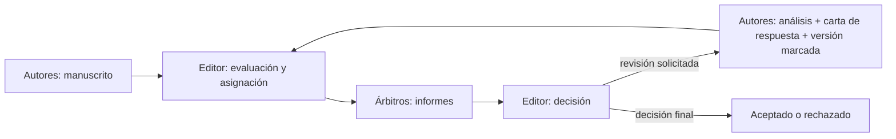

# B20-C03 — Revisión por pares y respuesta a árbitros

<!-- nav:top -->
[🏠 Programa](../../../../README.md) · [📚 Bloque B20](../../../tronco-comun/B20-metodologia-de-la-investigacion-cientifica.md) · [← Anterior: B20-C02 — Diseño de un plan de análisis y preregistro](../B20-C02-diseno-de-un-plan-de-analisis-y-preregistro/CLASE.md) · [Siguiente: B20-C04 — Redacción de un artículo científico →](../B20-C04-redaccion-de-un-articulo-cientifico/CLASE.md)
<!-- /nav -->

## 1. Ubicación, nivel y alcance

Tercera clase del bloque B20. En C01 y C02 preparaste el terreno: buscaste con método y fijaste tu análisis antes de ver los datos. Ahora tu trabajo se expone a la crítica de personas expertas. Nivel de entrada N4, nivel de salida N4 con evidencia de N5: una respuesta documentada a críticas reales o simuladas.

Verás qué es la revisión por pares, quiénes participan, qué se espera de quien revisa y de quien responde, cómo clasificar un comentario, cómo escribir una respuesta punto por punto y cómo comprobar con datos una objeción antes de contestarla. No verás todavía cómo redactar el artículo que se revisa (C04), ni las políticas de una revista concreta: los plazos y procedimientos varían y se consultan en las instrucciones de cada una.

## 2. Por qué esta clase existe

Una crítica recibida a las once de la noche se lee con el estómago antes que con la cabeza. La reacción inmediata, defenderse o rendirse, suele empeorar el trabajo y la relación con quien revisa. Pero la crítica de un especialista es, bien usada, la comprobación más barata que tendrá tu trabajo antes de que lo usen otros.

La decisión central es: **¿cómo convierto cada comentario de un árbitro en una acción comprobable (cambiar, aclarar o discrepar con evidencia) y dejo un registro que cualquiera pueda seguir?** Aprenderás a clasificar los comentarios, a comprobar con un análisis una objeción antes de contestarla, a redactar una carta de respuesta punto por punto y a distinguir cuándo corresponde ceder y cuándo discrepar con respeto. Depende de C02 (separar lo planificado de lo explorado) y prepara la versión final del artículo de C04.

## 3. Lo que podrás hacer al terminar

1. Describir las funciones de autor, árbitro y editor en la revisión por pares y sus deberes de confidencialidad y de declaración de conflictos.
2. Clasificar un comentario de árbitro como mayor, menor, malentendido o petición fuera de alcance.
3. Comprobar con un análisis de sensibilidad (un punto a la vez) si una conclusión depende de una observación.
4. Redactar una respuesta punto por punto con la cita del comentario, la decisión, la acción y el lugar del cambio.
5. Declarar los cambios respecto del plan original como desviaciones.
6. Evaluar un comentario de revisión propio o ajeno con criterios de tono y utilidad.

La evidencia es la **carta de respuesta a árbitros** del ejercicio 12 (sección 20).

## 4. Con qué llegas y cómo comprobarlo

Necesitas de C02 la distinción confirmatorio–exploratorio y el registro de desviaciones, de B12 el ajuste por mínimos cuadrados y de B01 la incertidumbre (B01-C18). Cinco preguntas:

1. ¿Qué es una desviación del plan de análisis?
2. ¿Qué es la pendiente de una recta ajustada a puntos `(x, y)`?
3. ¿Por qué un punto atípico puede cambiar una conclusión?
4. ¿Por qué es mejor reportar el análisis con y sin puntos dudosos?
5. ¿Qué diferencia hay entre un dato y una interpretación (B01-C05)?

<details>
<summary>Ver respuestas</summary>

1. Un cambio respecto del plan archivado. 2. El cambio de `y` por unidad de `x`. 3. Porque el ajuste da más peso a puntos lejanos del centro. 4. Porque muestra si la conclusión depende de la decisión. 5. El dato es lo medido; la interpretación es una lectura de él.
</details>

Con cuatro o cinco aciertos, sigue. Con tres o menos, repasa C02 y B01-C05.

## 5. Un caso real: lo que piden las normas editoriales a quien revisa

El Comité Internacional de Editores de Revistas Médicas (ICMJE) recoge deberes de quien revisa un manuscrito. Debe mantenerlo confidencial: no discutirlo públicamente ni usar las ideas de los autores antes de su publicación; debe declarar cualquier relación que pueda sesgar su evaluación y apartarse si existe un conflicto; debe responder con prontitud y entregar la revisión en el plazo acordado; y sus comentarios deben ser «constructivos, honestos y corteses». Pide además que no se suban manuscritos a herramientas de inteligencia artificial salvo que se garantice la confidencialidad y con permiso de la revista (S1).

Sobre las decisiones, el mismo documento dice que se basan en la relevancia, originalidad, calidad y aporte del manuscrito y no en intereses comerciales ni en que los resultados sean negativos; que quien edita es responsable del contenido y no está obligado a seguir lo que recomienda cada revisor; y que informa a los revisores de la decisión final (S1).

La lección: la revisión por pares tiene **reglas** de conducta para las tres partes. Ten presente el límite: S1 es la norma de revistas médicas. Su fondo (confidencialidad, conflictos, tono) se aplica a cualquier disciplina, pero los plazos, la forma de la carta de respuesta y los procedimientos de apelación de las revistas de astronomía no se pudieron consultar y no se enseñan (sección 11).

## 6. Vocabulario

La **revisión por pares** (o arbitraje) es la evaluación de un manuscrito por especialistas independientes antes de su publicación. El **autor** responde por el trabajo; el **árbitro** (*referee*, *reviewer*) lo evalúa y emite un informe; el **editor** decide, con base en los informes y en su criterio (S1). Un **informe de árbitro** reúne un resumen del trabajo, comentarios mayores y menores y una recomendación. Un **comentario mayor** cuestiona una conclusión, el método o la validez de los datos; uno **menor** pide aclaraciones, correcciones de forma o referencias. Un **malentendido** es un comentario que surge de una lectura errónea del texto. Una **petición fuera de alcance** pide un trabajo que el estudio no puede asumir.

Una **carta de respuesta** es el documento que acompaña la versión revisada: reproduce cada comentario y señala qué decidiste, qué hiciste y dónde. Un **análisis de sensibilidad** es repetir el análisis cambiando una decisión para ver cuánto cambia la conclusión. El **jackknife** (o *leave-one-out*) repite el ajuste quitando una observación cada vez. Una **versión con cambios marcados** muestra qué texto se añadió o eliminó.

Un **conflicto de interés** es cualquier relación que podría sesgar la evaluación o el trabajo (S1). Un **preprint**, que difundes antes del arbitraje, no ha pasado por esta evaluación; arXiv describe su proceso como revisión de relevancia y adecuación de lo enviado (S2), lo que a nuestro juicio es una moderación y no un arbitraje científico.

## 7. Modelo mental: un ciclo con registro

Piensa en el arbitraje como un ciclo de ida y vuelta con tres actores y un registro. Los autores envían; el editor reparte; los árbitros critican; los autores responden con evidencia; el editor decide. El registro (la carta de respuesta y la versión con cambios marcados) es lo que permite al editor y a los árbitros comprobar rápido qué cambió.



*Descripción textual:* un ciclo de seis cajas. El manuscrito de los autores llega al editor, que lo asigna a árbitros; sus informes vuelven al editor, que decide. Si pide una revisión, los autores preparan análisis, carta de respuesta y versión marcada y el ciclo vuelve al editor; si la decisión es final, termina en aceptación o rechazo.

Una analogía: la revisión de un plano de ingeniería. Otro ingeniero lo recorre para encontrar fallas que tú ya no ves, y tú no discutes la persona sino la viga. El límite de la analogía: en ingeniería hay normas con límites numéricos, mientras que en investigación varias lecturas razonables pueden coexistir, y el árbitro puede estar equivocado, sin que eso sea una falta de respeto señalarlo con evidencia.

## 8. La explicación, paso a paso

### 8.1 Quién hace qué

Los autores preparan el manuscrito y responden a las críticas. El editor es responsable del contenido y toma la decisión; no está obligado a seguir la recomendación de cada árbitro, y puede rechazar en cualquier momento antes de la publicación si surgen problemas de integridad (S1). Los árbitros evalúan y recomiendan. Quien revisa no es tu adversario ni tu coautor: es un lector especializado que no tiene tus datos en la cabeza.

### 8.2 Qué se espera de quien revisa (y qué puedes esperar)

De S1: confidencialidad, declaración de conflictos, puntualidad y un tono constructivo, honesto y cortés. Para ti, como autor, implica que tienes derecho a críticas fundamentadas y no ofensivas, y para ti como futuro árbitro, un código de conducta. Si recibes un comentario irrespetuoso, no respondas con el mismo tono: señálalo al editor con calma y responde al contenido técnico.

### 8.3 Clasificar los comentarios

Antes de contestar, numera cada comentario y asígnale una de cuatro clases: **mayor** (afecta una conclusión), **menor** (forma, aclaración), **malentendido** (el texto no era claro o fue mal leído) y **fuera de alcance**. Un malentendido es casi siempre una señal de que tu texto debe aclararse, aunque tengas razón. La clasificación decide la acción: los mayores exigen evidencia; los menores, correcciones puntuales; los malentendidos, una explicación y un cambio de redacción; los fuera de alcance, una justificación breve y respetuosa.

### 8.4 Comprobar antes de responder: sensibilidad a un punto

Supón que una árbitra escribe: «la pendiente que defiendes parece depender del último punto». Responder «no depende» sin comprobarlo es una opinión. Lo adecuado es repetir el ajuste quitando un punto cada vez y reportar el rango de la pendiente. Con la recta `y = a + b x` ajustada por mínimos cuadrados,

```text
b = Σ (xᵢ − x̄)(yᵢ − ȳ) / Σ (xᵢ − x̄)²          a = ȳ − b x̄
```

donde `x̄` e `ȳ` son las medias de `x` e `y`. En el jackknife se calcula `b₋ᵢ` sin el punto `i` para cada `i`. Si todas las `b₋ᵢ` quedan cerca de `b`, la conclusión no depende de un punto; si una se aleja mucho, la crítica es fundada y debes decirlo. Con la recta exacta (sin ruido) todas valen lo mismo, y con cuatro puntos puedes hacerlo a mano (ejercicio 4).

### 8.5 Decidir: ceder, aclarar o discrepar

Tres respuestas posibles, siempre con evidencia. **Ceder**: haces el cambio y lo marcas. **Aclarar**: tenías razón, pero el texto no lo mostraba; cambias el texto. **Discrepar**: mantienes tu posición, explicas por qué con datos o referencias y reconoces la alternativa. Discrepar no es rechazar el comentario: es dar razones. Si la objeción es válida y cambia una conclusión, conviene cambiar la conclusión.

### 8.6 La carta de respuesta punto por punto

Para cada comentario, cuatro elementos: la **cita** del comentario, tu **decisión** (cedo, aclaro, discrepo), la **acción** (qué hiciste, con cifras) y el **lugar** del cambio (sección, página o línea de la versión marcada). Se agradece de forma sobria (una vez, no en cada punto) y se evita el tono defensivo. Una carta clara permite al editor ver en minutos qué cambió.

### 8.7 Cambios y desviaciones

Si, para responder, haces un análisis que no estaba en tu plan (C02), lo declaras como exploratorio o como desviación solicitada, con fecha y motivo. Si el comentario revela un error tuyo, lo corriges y lo dices. Ocultar un cambio es peor que haberlo cometido.

### 8.8 Confidencialidad cuando eres tú quien revisa

Si algún día revisas, el manuscrito es confidencial: no lo discutes, no usas sus ideas antes de publicarse y no lo subes a servicios externos sin permiso (S1). Declara tus conflictos y entrega a tiempo. Y si un colega o estudiante te ayudó, S1 pide dar crédito a quien contribuyó a la revisión.

## 9. Magnitudes, símbolos y unidades

| Símbolo | Qué es | Unidad | Nota |
|---|---|---|---|
| `x`, `y` | variables del ajuste | las de cada variable | sintéticas en la clase |
| `x̄`, `ȳ` | medias de `x` e `y` | las de cada variable | — |
| `b` | pendiente | unidades de `y` por unidad de `x` | de los datos completos |
| `a` | ordenada en el origen | unidades de `y` | — |
| `b₋ᵢ` | pendiente sin el punto `i` | igual que `b` | jackknife |
| `Δb` | rango `máx(b₋ᵢ) − mín(b₋ᵢ)` | igual que `b` | mide dependencia de un punto |
| `n` | número de puntos | conteo | 10 en el ejemplo |

## 10. Convenciones y referencias

Los comentarios se numeran R1.1, R1.2… (árbitro 1, comentario 1…). Las acciones se citan con el lugar del cambio en la versión revisada. Los datos de esta clase son **sintéticos** y se rotulan así; el valor atípico es deliberado. Las fechas son año-mes-día. Una respuesta cita solo fuentes realmente consultadas.

## 11. De dónde sale lo que afirmamos

| ID | Fuente | Localizador | Respalda | Estado |
|---|---|---|---|---|
| S1 | ICMJE, *Responsibilities in the Submission and Peer-Review Process* (sección II.C) | https://www.icmje.org/recommendations/browse/roles-and-responsibilities/responsibilities-in-the-submission-and-peer-peview-process.html | Deberes de revisores (confidencialidad, conflictos, puntualidad, tono); criterios y autonomía del editor; rechazo posible hasta la publicación; informar a los revisores | Página consultada el 2026-11-05; sin fecha de versión visible |
| S2 | arXiv, ayuda de envíos | https://info.arxiv.org/help/submit/index.html | Moderación de relevancia y adecuación de lo enviado | Página consultada el 2026-11-05 |
| S3 | Center for Open Science, «Preregistration» | https://www.cos.io/initiatives/prereg | Análisis planificado frente a no planificado; reglas condicionales | Página consultada el 2026-11-05 |

Límites: S1 es de revistas médicas; el URL contiene la errata «peview» tal como figura en el índice del sitio. No se pudieron consultar las páginas de proceso de revisión de revistas de astronomía (de la AAS y de *Astronomy & Astrophysics*: un acceso devolvió error 404/403 y la página de recursos de autores de la AAS no describe el proceso), por lo que **no se enseñan plazos, plantillas ni procedimientos de apelación de ninguna revista concreta**. El método de sensibilidad de 8.4 es nuestra explicación, con la fórmula de mínimos cuadrados estándar y contrastada con casos analíticos en el script.

## 12. Cómo ver la dependencia de un punto

La tabla es la versión accesible de un gráfico de la pendiente `b₋ᵢ` frente al punto omitido, con los resultados del script sobre los datos **sintéticos** de la sección 13.

| Punto omitido | `b₋ᵢ` |
|---|---|
| 1 | 2,415 |
| 2 | 2,340 |
| 3 | 2,338 |
| 4 | 2,330 |
| 5 | 2,323 |
| 6 | 2,331 |
| 7 | 2,352 |
| 8 | 2,389 |
| 9 | 2,409 |
| 10 | **2,001** |

Si lo dibujas, pon el índice del punto en el eje horizontal, la pendiente en el vertical, una línea horizontal para `b` con los 10 puntos (2,327) y marca el punto 10 con forma distinta, no solo con color. Descripción larga: nueve valores agrupados entre 2,32 y 2,42 y uno, el del punto 10, aislado cerca de 2,00.

## 13. Ejemplo trabajado: responder a la árbitra 1

Tu manuscrito (hipotético, **datos sintéticos**) afirma que `y` crece con `x` con pendiente `b = 2,327` (10 puntos). La árbitra 1 escribe: **R1.1** «la pendiente parece depender del último punto»; **R1.2** «falta la unidad de `y` en la tabla 2»; **R1.3** «¿por qué no usó una función exponencial?».

**Paso 1 · Clasificar.** R1.1: mayor (toca la conclusión). R1.2: menor. R1.3: fuera de alcance o aclaración, según el caso.

**Paso 2 · Comprobar R1.1.** Se repite el ajuste quitando un punto cada vez (sección 8.4). Resultado: nueve pendientes entre 2,323 y 2,415 y una, sin el punto 10, de 2,001. El rango es `2,415 − 2,001 = 0,414`. Sin el punto 10, `b = 2,001` y `a = 1,013`. El cambio relativo de la pendiente es `(2,327 − 2,001)/2,327 = 14,0 %`.

**Paso 3 · Decidir.** La árbitra tiene parcialmente razón: el punto 10 es influyente. Decisión: **ceder en parte** y **aclarar**. Se reporta la pendiente con y sin el punto 10 (2,327 y 2,001), se muestra el análisis completo, y se discute si el punto 10 es un valor válido (según el plan, solo se excluyen los saturados; no es el caso) o un posible problema de medición.

**Paso 4 · R1.2.** Se añade la unidad; cambio mínimo, se cita la línea.

**Paso 5 · R1.3.** Se explica brevemente que la hipótesis planificada era lineal (plan archivado) y que el modelo exponencial se ofrece como análisis exploratorio, rotulado así.

**Paso 6 · Escribir la carta.** Para cada punto: cita, decisión, acción con cifras y lugar. La conclusión del resumen se reformula: «pendiente de 2,327 con los 10 puntos y de 2,001 sin el último; la conclusión depende parcialmente de él».

**Sentido del resultado.** Responder con el análisis mejora el trabajo: la conclusión ahora declara su dependencia. Una respuesta del tipo «no, no depende» sin comprobarlo habría sido incorrecta en este caso.

## 14. Distintas formas de responder, y cuándo dejan de servir

**Ceder** es lo correcto cuando la crítica es válida; deja de servir si implica abandonar una posición bien fundada. **Aclarar** soluciona malentendidos; no sirve si el problema es de fondo. **Discrepar con evidencia** respeta al árbitro y al autor; deja de servir si se sustituye la evidencia por insistencia. **Pedir al editor una evaluación adicional** puede ser razonable ante un informe con errores objetivos o tono inadecuado, pero la decisión es del editor (S1). **Ignorar** un comentario nunca es una opción: toda observación recibe respuesta.

## 15. Práctica guiada

**Ejercicio 1 · con los pasos indicados.** Clasifica cada comentario como mayor, menor, malentendido o fuera de alcance: (a) «la conclusión de la sección 5 no se sigue de los datos»; (b) «hay un error tipográfico en la ecuación 3»; (c) «el autor no consideró el efecto X» cuando el texto lo trata en la sección 4; (d) «sería interesante repetir con diez telescopios». *Pasos:* sección 8.3.

<details><summary>Solución comentada</summary>

(a) mayor; (b) menor; (c) malentendido: se aclara dónde está tratado y se mejora la redacción; (d) fuera de alcance: se agradece y se explica el límite. La clasificación decide la acción.
</details>

**Ejercicio 2 · con una pista.** Con los datos del ejemplo, calcula el cambio relativo de la pendiente al quitar el punto 10. *Pista:* `(b − b₋₁₀)/b`.

<details><summary>Solución comentada</summary>

`(2,327 − 2,001)/2,327 = 0,140`, es decir 14,0 %. Si te salió 16 %, dividiste entre `b₋₁₀` en vez de `b`. Se reporta con la referencia que elijas, declarándola.
</details>

**Ejercicio 3 · casi autónomo.** Escribe la respuesta a R1.2 («falta la unidad de `y` en la tabla 2») con cita, decisión, acción y lugar.

<details><summary>Solución comentada</summary>

«**R1.2** *Falta la unidad de y en la tabla 2.* **Decisión:** de acuerdo. **Acción:** se añadió la unidad en el encabezado de la columna y en el pie de tabla. **Lugar:** tabla 2, versión marcada.» Es corta porque el cambio es menor; el agradecimiento va una vez en la carta, no aquí.
</details>

## 16. Práctica autónoma, transferencia e integrador

**Ejercicio 4.** Calcula a mano el jackknife de la pendiente para los puntos `(0,0), (1,1), (2,2), (3,6)`: la pendiente completa y la que resulta al quitar cada punto. ¿Cuál es el más influyente?

<details><summary>Solución comentada</summary>

Completa: `b = 9,5/5 = 1,9`. Sin el punto 1 `(0,0)`: puntos `(1,1),(2,2),(3,6)`, `b = 5/2 = 2,5`. Sin `(1,1)`: `b = 1,857`. Sin `(2,2)`: `b = 2,071`. Sin `(3,6)`: `(0,0),(1,1),(2,2)`, `b = 1,0`. El más influyente es el cuarto (cambia la pendiente en 0,9): sin él la recta es `y = x`. Los valores coinciden con el script.
</details>

**Ejercicio 5.** Reescribe con tono constructivo la respuesta «El árbitro no entendió nada» a un comentario que resultó ser un malentendido.

<details><summary>Solución comentada</summary>

«Agradecemos la observación: muestra que la sección 4 no fue suficientemente clara. El efecto X sí se trata allí (tabla 3); hemos reordenado el texto y añadido una frase al inicio de la sección para que se vea antes.» Reconoce la parte del autor (la claridad), señala el lugar y no ataca.
</details>

**Ejercicio 6.** Un comentario pide eliminar un punto «porque parece un error». Tu plan solo excluye datos saturados. ¿Cómo respondes?

<details><summary>Solución comentada</summary>

Decisión: discrepar con evidencia. Explicas que el plan archivado solo excluye puntos saturados (criterio objetivo), que este no lo está, y entregas el análisis con y sin el punto. El resultado queda a la vista del lector. Quitarlo solo porque «parece un error» sería un grado de libertad del analista (C02).
</details>

**Ejercicio 7.** Una carta responde a 5 comentarios y deja 2 sin respuesta. ¿Qué proporción está atendida? ¿Qué debe hacerse?

<details><summary>Solución comentada</summary>

`3/5 = 60 %`. Deben responderse los 5: ningún comentario se ignora (sección 14). Un seguimiento de comentarios con tabla (número, clase, decisión, acción, lugar) evita olvidos.
</details>

**Ejercicio 8.** Ordena los elementos de una carta de respuesta: acción, cita, lugar del cambio, decisión.

<details><summary>Solución comentada</summary>

Cita, decisión, acción, lugar. La cita permite al editor ver a qué responde; la decisión orienta; la acción da cifras o texto; el lugar permite verificar. Cualquier orden consistente se acepta si están los cuatro.
</details>

**Ejercicio 9 · transferencia.** Te piden revisar un manuscrito y un estudiante de tu grupo ofrece ayudarte. ¿Qué debes hacer con el manuscrito, y cómo reconoces su ayuda?

<details><summary>Solución comentada</summary>

El manuscrito es confidencial (S1): no se comparte sin permiso de la revista. Si hay permiso, el estudiante debe conocer las normas de confidencialidad, y su contribución se reconoce en la revisión, como indica S1. Si no hay permiso, no se comparte.
</details>

**Ejercicio 10 · transferencia.** La árbitra 2 afirma que tu incertidumbre está mal calculada. Revisas y es ella quien se equivoca. ¿Cómo lo dices?

<details><summary>Solución comentada</summary>

Con respeto y evidencia: muestras el cálculo paso a paso con tus datos, citas la fuente del método y reconoces que el texto debió ser más claro (cambias la redacción). No dices «la árbitra se equivoca»; dices «el cálculo es el siguiente y da X, que coincide con el valor del manuscrito». Si ella encuentra después un error real, lo reconoces.
</details>

**Ejercicio 11 · transferencia.** El árbitro 1 recomienda aceptar y la árbitra 2 rechazar. ¿Quién decide?

<details><summary>Solución comentada</summary>

El editor: S1 indica que es responsable del contenido y no está obligado a seguir las recomendaciones de los revisores. Tú no «eliges» entre árbitros; respondes a ambos con evidencia. La decisión se informa a los revisores (S1).
</details>

**Ejercicio 12 · integrador.** Elabora la *carta de respuesta a árbitros* (sección 20) para estos cuatro comentarios sobre un manuscrito tuyo (sintético o real): R1.1 «la conclusión depende de un punto»; R1.2 «falta una unidad»; R2.1 «el tamaño de muestra es pequeño»; R2.2 «el autor no comparó con el método de la referencia X». Incluye clasificación, comprobación con cifras para R1.1 y R2.1, decisión, acción y lugar en cada caso.

<details><summary>Solución modelo</summary>

La carta debe: clasificar (R1.1 mayor, R1.2 menor, R2.1 mayor, R2.2 fuera de alcance o mayor según el caso); comprobar R1.1 con un jackknife con cifras; justificar R2.1 con la potencia del plan (C02) y reconocer el límite si la muestra era pequeña; para R2.2, comparar o explicar por qué no se hace; declarar como exploratorio lo no planificado; y citar solo fuentes consultadas.
</details>

## 17. Laboratorio: ¿depende la conclusión de un solo punto?

El script [sensibilidad_a_un_punto.py](sensibilidad_a_un_punto.py) ajusta una recta a 10 puntos **sintéticos** (con un valor atípico deliberado en el último), repite el ajuste quitando un punto cada vez, informa el rango de la pendiente y señala el punto más influyente. Antes comprueba que una recta exacta se recupera con error menor que 1e-12, que el jackknife de una recta exacta no varía y que el caso de cuatro puntos del ejercicio 4 da `b = 1,9`, `a = −0,6`; si no, se detiene.

**Datos:** sintéticos. **Modelo:** mínimos cuadrados sin ponderar. **Supuestos:** errores en `y`. **Validez:** ilustra una respuesta a un árbitro, no autoriza a descartar datos. **Tolerancia:** 1e-12. **Predice antes de ejecutar:** ¿qué punto será el más influyente? (el último, por construcción.)

**Resultados reales (2026-11-05, Python 3.12.9):**

```text
python 3.12.9 | pruebas OK | datos SINTÉTICOS
Ajuste con los 10 puntos: a = -0.183, b = 2.327
  sin el punto  1: b = 2.415
  sin el punto  2: b = 2.340
  sin el punto  3: b = 2.338
  sin el punto  4: b = 2.330
  sin el punto  5: b = 2.323
  sin el punto  6: b = 2.331
  sin el punto  7: b = 2.352
  sin el punto  8: b = 2.389
  sin el punto  9: b = 2.409
  sin el punto 10: b = 2.001
Rango de la pendiente: 2.001 a 2.415  (ancho 0.414)
Punto más influyente: 10
Ajuste sin el punto 10: a = 1.013, b = 2.001
```

```bash
python programa/clases/B20/B20-C03-revision-por-pares-y-respuesta-a-arbitros/sensibilidad_a_un_punto.py
```

**Límites:** no calcula incertidumbres de `b` ni pondera por errores; con pocos puntos el jackknife es grueso; no decide si un punto debe excluirse.

## 18. Errores frecuentes y cómo corregirlos

**Responder sin comprobar.** Se detecta cuando la respuesta es una opinión. Se corrige con los ejercicios 2 y 4.

**Tomar la crítica como ataque personal.** Se corrige con el ejercicio 5.

**Quitar un punto porque «parece un error».** Se corrige con el ejercicio 6.

**Dejar comentarios sin responder.** Se corrige con el ejercicio 7.

**Mezclar análisis nuevos con los planificados sin rotular.** Se corrige con la sección 8.7 y el ejercicio 12.

## 19. Cómo sabrás que vas bien

Tras la sección 8.3: ¿puedes clasificar un comentario nuevo en 10 segundos? Si no, repite el ejercicio 1. Tras la 8.4: ¿calculas un jackknife de cuatro puntos sin ayuda? Si no, repite el ejercicio 4. Tras el ejemplo: ¿por qué «ceder en parte» fue la respuesta correcta? Tras el laboratorio: ¿qué comprueba el script con la recta exacta? Al final: ¿qué diferencia hay entre discrepar y rechazar un comentario?

## 20. Qué entregas y cómo se evalúa

El producto es tu **carta de respuesta a árbitros**: una carta punto por punto con cita, decisión, acción y lugar del cambio, apoyada por un análisis de sensibilidad con cifras y por una lista de desviaciones respecto del plan.

| Criterio | Inicial | En desarrollo | Logrado | Destacado |
|---|---|---|---|---|
| Clasificación | Sin clasificar | Parcial | Todos clasificados | Prioriza por efecto en la conclusión |
| Evidencia | Opiniones | Alguna comprobación | Comprobación con cifras en los mayores | Propone una prueba adicional útil |
| Tono | Defensivo u hostil | Neutro | Constructivo y respetuoso | Reconoce el aporte del árbitro con precisión |
| Trazabilidad | Sin lugar del cambio | Parcial | Cita, decisión, acción y lugar | Versión marcada coherente con la carta |
| Honestidad | Oculta cambios | Declara algunos | Declara todos como desviaciones | Revisa conclusiones con el resultado |

**Condiciones críticas:** responder cada comentario; no ocultar un cambio ni un error; no presentar lo exploratorio como planificado; no atacar a la persona; mantener la confidencialidad de manuscritos ajenos; citar solo fuentes consultadas.

## 21. Ética, seguridad y límites

La revisión por pares funciona sobre la confianza: confidencialidad, declaración de conflictos y tono cortés son deberes (S1). No se usan las ideas de un manuscrito ajeno antes de su publicación, ni se suben a servicios externos sin permiso. Responder con evidencia incluye reconocer errores propios. Si recibes un trato abusivo, informa al editor; si dudas de la integridad de un trabajo, la vía es el editor, no una discusión pública. Esta clase no sustituye las normas de ninguna revista concreta. Accesibilidad: fórmulas en texto, tabla equivalente al gráfico, ejemplo sin conexión.

## 22. Para cerrar y seguir

La revisión por pares es un ciclo regulado entre autores, árbitros y editor. Una buena respuesta clasifica cada comentario, comprueba con datos las objeciones mayores, decide con razones (ceder, aclarar o discrepar) y deja un registro de cita, decisión, acción y lugar; los cambios no planificados se declaran. Queda abierta la pregunta de cómo hacer que el texto mismo anticipe estas críticas: eso es redactar bien un artículo.

**Glosario español–inglés.** revisión por pares · *peer review*; árbitro · *referee / reviewer*; editor · *editor*; carta de respuesta · *response letter*; comentario mayor · *major comment*; análisis de sensibilidad · *sensitivity analysis*; conflicto de interés · *conflict of interest*; versión con cambios marcados · *tracked-changes version*.

**Continuidad.** B20-C04 usa tu capacidad de **responder con evidencia y trazabilidad** para escribir un artículo que anticipa las objeciones: estructura, estilo y presentación de resultados.

**Referencias:** ver sección 11. S1 es una norma de revistas médicas; S2 y S3 son páginas de organizaciones.

<!-- nav:bottom -->
---

[← Anterior: B20-C02 — Diseño de un plan de análisis y preregistro](../B20-C02-diseno-de-un-plan-de-analisis-y-preregistro/CLASE.md) · [📚 Bloque B20](../../../tronco-comun/B20-metodologia-de-la-investigacion-cientifica.md) · [Siguiente: B20-C04 — Redacción de un artículo científico →](../B20-C04-redaccion-de-un-articulo-cientifico/CLASE.md)
<!-- /nav -->
