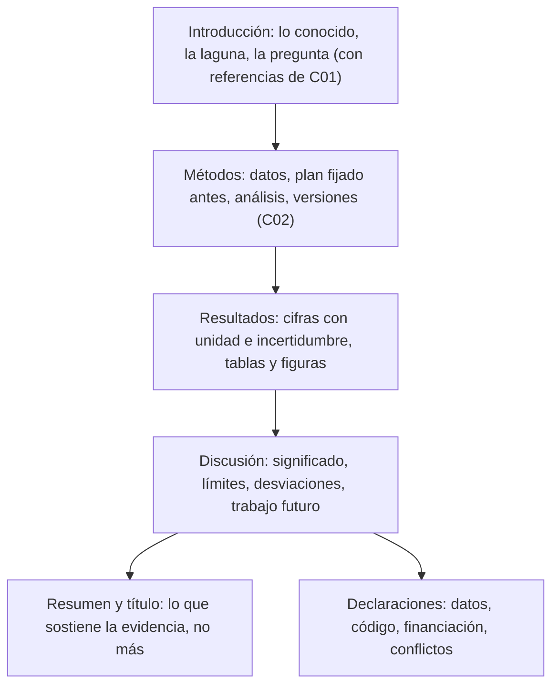

# B20-C04 — Redacción de un artículo científico

<!-- nav:top -->
[🏠 Programa](../../../../README.md) · [📚 Bloque B20](../../../tronco-comun/B20-metodologia-de-la-investigacion-cientifica.md) · [← Anterior: B20-C03 — Revisión por pares y respuesta a árbitros](../B20-C03-revision-por-pares-y-respuesta-a-arbitros/CLASE.md) · [Siguiente: B21-C01 — Volúmenes finitos y solucionadores de Riemann para leyes de conservación →](../../../tronco-comun/B21-metodos-numericos-para-edp-y-fluidos-computacionales.md#b21-c01)
<!-- /nav -->

## 1. Ubicación, nivel y alcance

Cuarta y última clase del bloque B20. Ya sabes buscar la literatura (C01), planificar el análisis (C02) y responder a la crítica (C03). Falta el producto que reúne todo: el artículo. Nivel de entrada N4; nivel de salida N5 en la parte de comunicación: un texto que otra persona pueda evaluar, reproducir y citar.

Verás la estructura de un artículo (introducción, métodos, resultados, discusión), cómo escribir un resumen que no exagere, cómo presentar una medida con su incertidumbre, cómo diseñar tablas y figuras legibles, cómo declarar datos y código y qué pide un archivo de preprints. No verás las normas de una revista concreta (cada una tiene las suyas) ni la redacción de propuestas de misión, que pertenece a otro bloque.

## 2. Por qué esta clase existe

Un resultado correcto mal comunicado se pierde: nadie sabe qué se midió, con qué incertidumbre ni qué supuestos hay detrás, y no puede reproducirse ni usarse. Los editores médicos lo resumen al describir el artículo de investigación: la estructura habitual (introducción, métodos, resultados y discusión) refleja cómo avanza la indagación científica y no es un formato arbitrario (S1).

La decisión central es: **¿qué debe decir cada parte del artículo, y qué debe poder comprobar quien lo lea, para que la conclusión no diga más de lo que sostienen los datos?** Aprenderás a asignar a cada parte su función, a escribir conclusiones acotadas por la evidencia, a presentar cifras con unidades e incertidumbre, a declarar datos y código, y a preparar el envío a un archivo abierto. Usa el plan de C02 (métodos), las referencias de C01 (introducción y bibliografía) y la lógica de C03 (anticipar las objeciones).

## 3. Lo que podrás hacer al terminar

1. Asignar a cada sección del artículo su función y su contenido mínimo.
2. Redactar un resumen que contenga propósito, método, resultado principal con incertidumbre y límite, sin exagerar.
3. Escribir una medida con valor, incertidumbre y unidad con una regla de redondeo declarada.
4. Diseñar una tabla o figura con ejes, unidades, leyenda y descripción accesible.
5. Redactar declaraciones de disponibilidad de datos y código y de desviaciones respecto del plan.
6. Preparar un envío a un archivo de preprints respetando formatos, nombres de archivo y metadatos.

La evidencia es el **borrador de artículo breve** del ejercicio 12 (sección 20).

## 4. Con qué llegas y cómo comprobarlo

Necesitas de C01 las referencias con identificador persistente, de C02 el plan de análisis y la distinción confirmatorio–exploratorio, de C03 la carta de respuesta y de B01 la incertidumbre (B01-C18). Cinco preguntas:

1. ¿Qué datos mínimos tiene una referencia guardada correctamente?
2. ¿Cómo se rotula un análisis no planificado?
3. ¿Por qué un valor sin unidad no sirve?
4. ¿Qué es una desviación del plan?
5. ¿Qué diferencia hay entre un resultado y su interpretación?

<details>
<summary>Ver respuestas</summary>

1. Autores, título, año, medio, identificador persistente, fecha de consulta. 2. Como exploratorio. 3. Porque no se puede comparar ni reproducir. 4. Un cambio respecto del plan, que se declara. 5. El resultado es lo medido o calculado; la interpretación es lo que significa y puede depender de supuestos.
</details>

Con cuatro o cinco aciertos, sigue. Con tres o menos, repasa C01, C02 y B01-C18.

## 5. Un caso real: qué piden los editores del resumen

La guía de preparación de manuscritos del ICMJE describe cómo debe ser el resumen de un artículo de investigación: contiene antecedentes, propósito, métodos básicos, hallazgos principales con tamaños de efecto y su significación, y conclusiones clave; menciona limitaciones importantes y evita exagerar los hallazgos. Debe coincidir con el texto completo, porque muchos lectores y bases de datos usan solo el resumen. La financiación se declara después del resumen, no dentro, y si los datos se depositaron en un repositorio público, el resumen debe dar su identificador persistente (S1).

Estos requisitos están pensados para revistas médicas, pero su fondo es transferible: el resumen es la parte que más gente lee y, por eso, la que más debe cuidarse de afirmar más de lo que sostiene el trabajo. Ten presente el límite: no son las normas de las revistas de astronomía (sección 11).

## 6. Vocabulario

Un **artículo de investigación original** es el que presenta datos y análisis nuevos. Su estructura habitual se abrevia **IMRaD**: Introducción, Métodos, Resultados y Discusión (S1). El **resumen** condensa el trabajo en un párrafo. Una **afirmación** es lo que el artículo sostiene; la **evidencia** es lo que la apoya; el **límite** es lo que la evidencia no permite concluir. La **incertidumbre** es el intervalo o el margen que acompaña a una medida (B01-C18). Una **cifra significativa** es un dígito con información. Un **identificador persistente** (DOI, número de preprint) permite volver a encontrar una obra o un conjunto de datos (S4). Un **preprint** es un manuscrito difundido antes de su arbitraje. Una **declaración de disponibilidad** dice dónde están los datos y el código, con su versión.

Una **figura** es un gráfico o imagen; una **tabla**, una disposición de valores en filas y columnas. El **pie** es el texto que acompaña a una figura o tabla. Un **marco de referencia** y una **escala de tiempo** (B01-C04) se declaran en métodos cuando importan.

## 7. Modelo mental: afirmar, apoyar, acotar

Un artículo es una cadena de afirmaciones, cada una apoyada por evidencia y acotada por un límite. La introducción dice qué se sabía y qué faltaba; los métodos, qué se hizo, con qué datos y qué reglas se fijaron antes; los resultados, qué salió, con su incertidumbre; la discusión, qué significa y qué no puede concluirse. Si una frase de la conclusión no remite a un resultado, o un resultado no se puede reproducir con los métodos, el artículo tiene un hueco.



*Descripción textual:* un diagrama de seis cajas. La introducción alimenta los métodos; los métodos, los resultados; los resultados, la discusión; y de la discusión salen el resumen con el título (que se escriben al final con lo que la evidencia sostiene) y las declaraciones de datos, código, financiación y conflictos.

Una analogía: el informe de un mecánico. Dice qué trajo el auto, qué se midió, qué se encontró y qué se recomienda, sin afirmar nada que la medición no respalde. El límite de la analogía: un informe de taller se escribe para una sola persona; un artículo se escribe para lectores que no conoces y que pueden reutilizarlo dentro de varios años.

## 8. La explicación, paso a paso

### 8.1 Escribir al revés: primero lo que sostienes

Antes de redactar, escribe en tres líneas: la **afirmación principal**, la **evidencia** (la cifra o figura que la apoya) y el **límite**. Todo lo demás se organiza alrededor. Es el modo más rápido de evitar un artículo que no sabe qué dice. Después, escribe en el orden que quieras, pero termina por el resumen y el título.

### 8.2 Introducción

Tres movimientos: qué se sabe (con referencias de tu búsqueda de C01), qué falta y qué haces tú. La laguna debe ser concreta: «ningún trabajo comparó A y B en series con muestreo irregular» solo puede afirmarse si tu búsqueda de C01 lo respalda y declaras su alcance. Cita lo que consultaste y como lo consultaste: si solo leíste el resumen, no atribuyas a la obra un resultado interno.

### 8.3 Métodos

Los métodos permiten reproducir: datos y su procedencia (observados, estimados, sintéticos o simulados), instrumentos, reglas de selección, plan de análisis fijado antes (C02), software y versiones, semillas de generadores, unidades y marcos de referencia. Si hubo cambios respecto del plan, se dicen aquí como desviaciones. S1 señala que quien revisa debe describir cómo buscó, seleccionó y sintetizó; para tu artículo, la sección de métodos cumple ese papel.

### 8.4 Resultados

Los resultados informan lo que salió, sin interpretar. Cada cifra va con su unidad y su incertidumbre. Primero lo planificado (confirmatorio); luego, rotulado como tal, lo exploratorio. Si una conclusión depende de un punto (C03), lo dices aquí con el análisis de sensibilidad.

### 8.5 Discusión

La discusión interpreta: ¿responde el resultado a la pregunta?, ¿qué explicaciones alternativas hay?, ¿qué límites tiene (muestra, supuestos, datos simulados frente a observados)?, ¿qué haría falta para decidir entre ellas? Aquí van las objeciones anticipadas, las que un árbitro formularía (C03). Una conclusión no puede ser más fuerte que la evidencia: «los datos sintéticos sugieren que A reduce el error» no es «A es mejor».

### 8.6 Resumen y título

El resumen, según S1, contiene antecedentes, propósito, método básico, hallazgos principales con su magnitud y significación, conclusiones clave y limitaciones, sin exagerar, y es consistente con el texto completo. El título dice qué se hizo o qué se encontró, con las palabras que alguien usaría para buscarlo (el título y el resumen son metadatos que aparecen en búsquedas y anuncios, según el archivo arXiv, S2). Se redactan al final.

### 8.7 Cifras: valor, incertidumbre y unidad

Una medida se escribe `valor ± incertidumbre unidad`. La regla de esta clase (una convención editorial nuestra, no una norma citada) es redondear la incertidumbre a dos cifras significativas y el valor al mismo decimal. Así, `662,9317 ± 0,1234 nm` se escribe `662,93 ± 0,12 nm`; `43,17 ± 3,82 Mpc` se escribe `43,2 ± 3,8 Mpc`. Declara la regla de redondeo (aquí, redondeo al par ante empate exacto). Nunca redondees antes de calcular: redondea solo al presentar. Y no des más decimales de los que la incertidumbre justifica.

### 8.8 Tablas y figuras

Cada figura o tabla se entiende sola con su pie: qué muestra, qué son los ejes, con unidades, cuántos datos, de qué origen (observado, simulado, etc.). Elige símbolos y líneas distinguibles por forma y no solo por color, con contraste suficiente. Añade una descripción textual de lo que la figura transmite, para quien no la ve. Una figura sin escala o una tabla sin unidades no se puede usar.

### 8.9 Datos, código y reproducibilidad

Declara dónde están los datos y el código, con su versión. Los principios FAIR piden datos con identificadores persistentes, metadatos ricos, acceso por protocolos abiertos y licencia clara (S4). La AAS invita a sumar datos y otros materiales digitales y ofrece servicios de revisión y archivo de los datos de las figuras, según su página de recursos para autores (S3, hub general). S1 pide dar, en el resumen, el identificador persistente del conjunto de datos si se depositó en un repositorio público.

### 8.10 Enviar a un archivo de preprints

arXiv acepta LaTeX (preferido), PDF o HTML con imágenes JPEG, PNG o GIF; no acepta DVI, PostScript, PDF generados desde TeX ni escaneos. Los nombres de archivo solo pueden contener letras, dígitos y `_ + - . , =`, distinguen mayúsculas y las figuras deben coincidir exactamente con lo citado. No se admiten figuras omitidas aunque estén enlazadas. Solo se envía con cuenta; pueden pedir endorsement a quien es nuevo o cambia de categoría. Título y resumen se ingresan como metadatos y aparecen en búsquedas y anuncios: revísalos antes del paso final. Todo envío pasa una moderación de relevancia y adecuación; quien envía concede a arXiv una licencia perpetua e irrevocable de distribución, y debe aceptar sus acuerdos. Los envíos recibidos antes de las 14:00 hora del este se anuncian normalmente a las 20:00 (S2). Un preprint no sustituye al arbitraje (C03).

### 8.11 Estilo

Frases cortas, una idea por frase, voz activa cuando aclara quién hizo qué, términos definidos antes de usarse y el mismo término para la misma cosa. No uses un adjetivo («notable», «enorme») donde puedas dar una cifra con su unidad. Estas recomendaciones de estilo son nuestras y no remiten a una fuente.

## 9. Magnitudes, símbolos y unidades

| Símbolo | Qué es | Unidad | Nota |
|---|---|---|---|
| `v` | valor medido | la de la magnitud | se escribe con unidad |
| `u` | incertidumbre | misma que `v` | positiva y finita |
| `e` | exponente decimal de `u` | adimensional | `e = ⌊log₁₀ u⌋` |
| `c` | cifras significativas de `u` | conteo | 2 en esta clase |
| `m` | decimales conservados | conteo | `m = c − 1 − e` |
| `λ` | longitud de onda | nm | ejemplo de la sección 13 |
| `D` | distancia | Mpc | ejemplo de la sección 13 |
| `H₀` | constante de Hubble | km/s/Mpc | ejemplo |

La regla: se redondean `u` y `v` a `m` decimales, y si `m` es negativo, a la potencia de diez correspondiente.

## 10. Convenciones y referencias

Los números se escriben con coma decimal en el texto de la clase y con punto en la salida del script, que sigue la convención de Python; en un artículo se adopta una sola convención según la revista. Las fechas son año-mes-día. Los datos de los ejemplos son **sintéticos** o **simulados** y se rotulan así. Las referencias se citan por su identificador, y solo se cita lo que se consultó (si solo leíste el resumen, se escribe «resumen»).

## 11. De dónde sale lo que afirmamos

| ID | Fuente | Localizador | Respalda | Estado |
|---|---|---|---|---|
| S1 | ICMJE, *Preparing a Manuscript for Submission to a Medical Journal* | https://www.icmje.org/recommendations/browse/manuscript-preparation/preparing-for-submission.html | Estructura IMRaD; contenido del resumen; financiación fuera del resumen; identificador del conjunto de datos; revisores deben describir búsqueda y selección | Página consultada el 2026-11-05; sin fecha de versión visible |
| S2 | arXiv, ayuda de envíos | https://info.arxiv.org/help/submit/index.html | Formatos, figuras, nombres de archivo, endorsement, moderación, metadatos, licencia, horarios | Página consultada el 2026-11-05 |
| S3 | AAS Journals, página de recursos para autores | https://journals.aas.org/author-resources/ | AASTeX como paquete de formato; invitación a incluir datos y servicios de archivo y revisión de datos | Página consultada el 2026-11-05; solo hub, enlaza a páginas que no se abrieron |
| S4 | Wilkinson, M. D. et al. (2016), «The FAIR Guiding Principles for scientific data management and stewardship», *Scientific Data* 3, 160018 | doi:10.1038/sdata.2016.18 (leído en https://pmc.ncbi.nlm.nih.gov/articles/PMC4792175/) | Identificadores persistentes, metadatos ricos, acceso, licencia | Texto consultado el 2026-11-05 |

Límites: S1 es una norma de revistas médicas y se usa como ejemplo de buena práctica transferible; no son las instrucciones de ninguna revista de astronomía. La página de la AAS (S3) no describe la organización de las secciones ni la citación de software, y las guías de preparación a las que enlaza no se abrieron; tampoco se consultó una guía de citación de software, por lo que **no se enseña una convención de citación de software** (declara versión y origen en métodos). La regla de redondeo de 8.7 es una convención editorial nuestra, contrastada con casos de referencia en el script; no se contrastó con una norma de expresión de la incertidumbre. Las recomendaciones de estilo de 8.11 son nuestras.

## 12. Cómo presentar una figura de resultados

La tabla describe una figura posible con los datos del ejemplo de la sección 13 y es su versión accesible.

| Elemento | Qué debe contener | Ejemplo |
|---|---|---|
| Eje horizontal | magnitud, símbolo y unidad | «Número de puntos por serie, `n` (conteo)» |
| Eje vertical | magnitud, símbolo y unidad | «Error relativo del período (adimensional)» |
| Series | forma de marcador y de línea distintas | A: círculo, línea continua; B: cuadrado, línea discontinua |
| Barras de error | qué representan | «± 1 desviación típica de la media» |
| Origen de los datos | observados, simulados, etc. | «Datos simulados» |
| Descripción larga | lo que se ve, en palabras | «El error de A queda por debajo del de B en las 32 series simuladas» |

Si la figura usa color, que la información no dependa de él; si hay escala logarítmica, dilo en el eje. Descripción larga alternativa: el pie de la figura debe poder leerse sin ver la imagen.

## 13. Ejemplo trabajado: del plan al borrador

Retomamos el proyecto de C01–C03 (hipotético, datos **simulados**): comparar dos métodos A y B de búsqueda de períodos con muestreo irregular. En C02 fijaste `n = 32` series y una prueba z; en C03 respondiste a una árbitra. Ahora escribes.

**Paso 1 · Tres líneas.** Afirmación: «en 32 series simuladas, A tiene menor error relativo de período que B». Evidencia: la media de `Δ = error_B − error_A` con su incertidumbre y la prueba preplanificada. Límite: datos simulados; muestreo irregular de un solo tipo; no se prueba con datos observados.

**Paso 2 · Introducción.** Lo conocido (obras de tu búsqueda de C01, con el alcance declarado: «fuente única arXiv, 2026-11-05»), la laguna («no encontramos comparación directa en nuestra búsqueda») y la pregunta.

**Paso 3 · Métodos.** Datos simulados (semilla y versión del programa), plan archivado antes del análisis (C02), regla de atípicos, desviaciones declaradas (por ejemplo, el análisis de sensibilidad pedido por la árbitra, C03).

**Paso 4 · Resultados con cifras.** Supón que la media de `Δ` es `0,0412 ± 0,0087` (adimensional, valores sintéticos). Con la regla de 8.7: `u = 0,0087` tiene `e = −3`, así que `m = 2 − 1 − (−3) = 4` decimales y se escribe `0,0412 ± 0,0087`. Un segundo valor, `v = 662,9317 nm` con `u = 0,1234 nm`: `e = −1`, `m = 2`, se escribe `662,93 ± 0,12 nm`. Un tercero, `43,17 ± 3,82 Mpc`: `e = 0`, `m = 1`, `43,2 ± 3,8 Mpc`.

**Paso 5 · Discusión.** Se interpreta con cautela («sugiere que A reduce el error en este tipo de series») y se incluyen límites y la sensibilidad a un punto de C03.

**Paso 6 · Resumen y título.** Se redactan al final: propósito, método, resultado con incertidumbre, límite. Título: «Comparación de dos métodos de búsqueda de períodos con muestreo irregular en series simuladas».

**Paso 7 · Declaraciones.** Datos: la simulación es regenerable con la semilla y el código; versión del programa y de Python; financiación y conflictos (ninguno, en el ejemplo).

**Sentido del resultado.** Cada frase de la conclusión remite a un resultado, y cada resultado se puede reproducir con los métodos. Si algo no cumple, el borrador aún no está listo.

## 14. Distintas formas de comunicar un resultado, y cuándo dejan de servir

El **artículo completo** es el formato que permite evaluar y reproducir; exige más trabajo. La **nota breve** comunica un resultado acotado y rápido, pero con menos método. El **preprint** difunde antes del arbitraje, útil para recibir comentarios, y no es evaluación (S2). La **presentación oral** o el **póster** comunican a una audiencia concreta y no sustituyen al texto. Los **datos y el código depositados** permiten reutilizar (S4), y no explican por sí solos qué significan. Cada formato sirve para algo; ninguno reemplaza a una buena sección de métodos.

## 15. Práctica guiada

**Ejercicio 1 · con los pasos indicados.** Escribe `662,9317 ± 0,1234 nm` con la regla de la sección 8.7. *Pasos:* `u = 0,1234` tiene `e = −1`; `m = 2 − 1 − (−1) = 2`; redondea ambos a 2 decimales.

<details><summary>Solución comentada</summary>

`662,93 ± 0,12 nm`. Si escribiste `662,9317 ± 0,12`, mezclaste decimales: el valor no puede tener más decimales que la incertidumbre justifica. Si escribiste `662,9 ± 0,1`, redondeaste a una cifra significativa, que es otra convención (declárala si la usas).
</details>

**Ejercicio 2 · con una pista.** Escribe `43,17 ± 3,82 Mpc`. *Pista:* `e = 0`.

<details><summary>Solución comentada</summary>

`u = 3,82`, `e = 0`, `m = 2 − 1 − 0 = 1` decimal: `43,2 ± 3,8 Mpc`. La unidad va una vez, al final, y aplica a ambos números.
</details>

**Ejercicio 3 · casi autónomo.** Ordena según IMRaD: (a) «Se simularon 32 series con semilla 20261105»; (b) «No hay comparación directa en la literatura consultada»; (c) «`Δ` = 0,0412 ± 0,0087»; (d) «Esto sugiere, con las limitaciones señaladas, que A reduce el error».

<details><summary>Solución comentada</summary>

(b) Introducción; (a) Métodos; (c) Resultados; (d) Discusión. El orden IMRaD (S1) sigue el de la indagación: qué faltaba, qué se hizo, qué salió, qué significa.
</details>

## 16. Práctica autónoma, transferencia e integrador

**Ejercicio 4.** Corrige este resumen: «Demostramos que nuestro método es mucho mejor y resuelve el problema del muestreo irregular».

<details><summary>Solución comentada</summary>

Una versión acotada: «En 32 series simuladas con muestreo irregular, el método A redujo el error relativo del período en 0,0412 ± 0,0087 respecto de B (prueba preplanificada). No se probó con datos observados.» Incluye método, cifra con incertidumbre y límite; elimina «demostramos», «mucho mejor» y «resuelve» (sección 8.6, S1).
</details>

**Ejercicio 5.** Escribe un pie completo para la figura de la sección 12.

<details><summary>Solución comentada</summary>

«Error relativo del período (adimensional) en función del número de puntos por serie, para el método A (círculos, línea continua) y el método B (cuadrados, línea discontinua). Datos simulados, 32 series por punto; barras: ±1 desviación típica de la media.» Tiene qué muestra, ejes, series, origen y significado de las barras.
</details>

**Ejercicio 6.** Escribe `12 345 ± 432 m` con la regla de la clase. ¿Qué convención de redondeo declaras?

<details><summary>Solución comentada</summary>

`u = 432`, `e = 2`, `m = 2 − 1 − 2 = −1`: se redondea a decenas. `432 → 430`; `12 345` está exactamente entre 12 340 y 12 350, y el redondeo al par da `12 340`: `12 340 ± 430 m`. Con redondeo hacia arriba sería `12 350`. Lo importante es declarar la convención.
</details>

**Ejercicio 7.** Marca cada frase como afirmación, evidencia o límite: (a) «A reduce el error»; (b) «`Δ` = 0,0412 ± 0,0087»; (c) «solo series simuladas»; (d) «la prueba se fijó antes de analizar».

<details><summary>Solución comentada</summary>

(a) afirmación; (b) evidencia; (c) límite; (d) evidencia de procedimiento (respalda que la prueba es confirmatoria). Una conclusión sin evidencia, o una evidencia sin afirmación, indica un hueco.
</details>

**Ejercicio 8.** Indica cuáles nombres de archivo de figuras aceptaría arXiv según S2: `fig 1.png`, `Fig_1.png`, `fig1(a).pdf`, `res=2,0.png`.

<details><summary>Solución comentada</summary>

Válidos: `Fig_1.png` y `res=2,0.png` (solo letras, dígitos y `_ + - . , =`). No válidos: `fig 1.png` (espacio) y `fig1(a).pdf` (paréntesis). Además, son sensibles a mayúsculas: la referencia en el texto debe ser idéntica.
</details>

**Ejercicio 9 · transferencia.** Redacta una declaración de disponibilidad de datos y código para el ejemplo (datos simulados).

<details><summary>Solución comentada</summary>

«Los datos son simulados y se regeneran con el código [repositorio, versión/etiqueta], con la semilla 20261105 y Python 3.12.9. El plan de análisis fechado antes del análisis está en [registro]. Los identificadores persistentes de ambos se dan al final del resumen.» Todo es verificable; no se afirma que existan enlaces que no existen: se completan con los reales.
</details>

**Ejercicio 10 · transferencia.** Quieres subir tu manuscrito a arXiv antes del arbitraje. Enumera tres cosas que debes considerar.

<details><summary>Solución comentada</summary>

(1) Formato y nombres de archivo (S2). (2) Título y resumen son metadatos públicos que aparecen en búsquedas y anuncios; revisarlos antes del envío. (3) Concedes a arXiv una licencia perpetua e irrevocable de distribución, y debes aceptar sus acuerdos. También: moderación y, si eres nuevo, posible endorsement; y que un preprint no ha pasado arbitraje.
</details>

**Ejercicio 11 · transferencia.** Un árbitro (C03) te pidió declarar que la conclusión depende de un punto. ¿Dónde y cómo lo escribes en el artículo?

<details><summary>Solución comentada</summary>

En resultados, con las cifras de sensibilidad (con y sin el punto), y en la discusión como límite; el resumen lo menciona con una frase. El método de sensibilidad se declara en métodos como análisis no planificado si lo fue. No lo dejas solo en la carta de respuesta: el lector del artículo no la ve.
</details>

**Ejercicio 12 · integrador.** Elabora el *borrador de artículo breve* (sección 20): título, resumen acotado, introducción con referencias de tu protocolo de C01, métodos con el plan de C02, resultados con al menos tres medidas bien formateadas, una tabla o figura con pie y descripción, discusión con límites y sensibilidad (C03), declaraciones de datos y código, y la lista de referencias consultadas.

<details><summary>Solución modelo</summary>

Debe seguir el ejemplo de la sección 13 con otro caso: tres líneas previas (afirmación, evidencia, límite), IMRaD completo, cifras con valor, incertidumbre y unidad con regla de redondeo declarada, datos rotulados (observados, estimados, sintéticos o simulados), resumen coherente con el texto, y solo fuentes realmente consultadas. Se acepta cualquier tema.
</details>

## 17. Laboratorio: medidas bien escritas

El script [formato_de_medidas.py](formato_de_medidas.py) aplica la regla de la sección 8.7 (incertidumbre a dos cifras significativas y valor al mismo decimal; redondeo al par) a cinco medidas **sintéticas**. Antes de imprimir comprueba que cada caso devuelve exactamente la cadena esperada (hecha a mano) y que rechaza incertidumbres nulas, negativas, `NaN` o infinitas; si no, se detiene.

**Datos:** sintéticos. **Modelo:** convención editorial de la clase. **Supuestos:** incertidumbre positiva y finita. **Validez:** presentación de resultados; no calcula incertidumbres. **Tolerancia:** coincidencia exacta de cadenas. **Predice antes de ejecutar:** `43,17 ± 3,82 Mpc` →  `43,2 ± 3,8 Mpc`.

**Resultados reales (2026-11-05, Python 3.12.9):**

```text
python 3.12.9 | pruebas OK | datos SINTÉTICOS
    662.9317 ,    0.1234 nm        ->  662.93 ± 0.12 nm
   0.0101234 ,  0.000153           ->  0.01012 ± 0.00015
       43.17 ,      3.82 Mpc       ->  43.2 ± 3.8 Mpc
        70.4 ,      1.27 km/s/Mpc  ->  70.4 ± 1.3 km/s/Mpc
     12345.0 ,     432.0 m         ->  12340 ± 430 m
```

```bash
python programa/clases/B20/B20-C04-redaccion-de-un-articulo-cientifico/formato_de_medidas.py
```

**Límites:** el script usa punto decimal; con valores en notación científica o con incertidumbres asimétricas hay que adaptar la presentación; no calcula ni valida la incertidumbre misma.

## 18. Errores frecuentes y cómo corregirlos

**Conclusión más fuerte que la evidencia.** Se detecta con el ejercicio 7 (frase sin evidencia). Se corrige con el ejercicio 4.

**Cifras sin unidad o con decimales de más.** Se corrige con los ejercicios 1, 2 y 6.

**Escribir el resumen primero.** Se corrige escribiéndolo al final (sección 8.1).

**Figuras que dependen del color o sin pie.** Se corrige con el ejercicio 5.

**Nombres de archivo inválidos o metadatos sin revisar.** Se corrige con los ejercicios 8 y 10.

## 19. Cómo sabrás que vas bien

Tras la sección 8.1: ¿escribes las tres líneas de tu trabajo sin mirar? Si no, repite el ejercicio 7. Tras la 8.7: ¿formateas una medida nueva sin ayuda? Si no, repite el ejercicio 6. Tras el ejemplo: ¿puedes remitir cada frase de tu conclusión a un resultado? Tras el laboratorio: ¿por qué el script rechaza una incertidumbre cero? Al final: ¿qué dato necesitaría otra persona para reproducir tu cifra principal?

## 20. Qué entregas y cómo se evalúa

El producto es tu **borrador de artículo breve** (dos a cuatro páginas): título, resumen, IMRaD, al menos una tabla o figura con pie y descripción, declaraciones de datos y código, y referencias.

| Criterio | Inicial | En desarrollo | Logrado | Destacado |
|---|---|---|---|---|
| Estructura y coherencia | Secciones mezcladas | IMRaD con huecos | IMRaD completo y coherente | Cada frase de la conclusión remite a un resultado |
| Resumen | Exagera o falta | Parcial | Propósito, método, resultado con incertidumbre, límite | Consistente con el texto y legible sin él |
| Cifras | Sin unidad o incertidumbre | Algunas | Todas con unidad e incertidumbre y regla declarada | Verifica dimensional y redondeo |
| Tablas y figuras | Sin pie o ejes | Parcial | Pie completo y descripción accesible | Legibles sin color |
| Reproducibilidad | Sin datos ni versiones | Parcial | Datos, código, versiones y semilla declarados | Otra persona reproduce la cifra principal |
| Fuentes | Sin respaldo | Parcial | Solo consultadas, con alcance | Distingue lo leído en resumen |

**Condiciones críticas:** no afirmar más que la evidencia; rotular datos (observados, estimados, sintéticos o simulados); declarar desviaciones del plan; no omitir unidades ni incertidumbres; no citar lo no consultado; no copiar texto ni figuras ajenos.

## 21. Ética, seguridad y límites

Escribir con honestidad incluye acreditar lo ajeno, declarar conflictos de interés y financiación y reconocer limitaciones. Los criterios de autoría y de uso de herramientas de redacción los fija cada revista o institución: consúltalos antes de enviar. No copies texto ni figuras de otros: se parafrasea y se cita. Un resultado de simulación no se presenta como observado ni como certificación de nada. Si el trabajo toca datos de personas o puede tener uso dual, se consulta a los comités correspondientes. Accesibilidad: descripciones de figuras, tablas equivalentes, contraste y formas distintas, matemáticas en texto, ejemplo sin conexión. La clase no sustituye las instrucciones de una revista concreta.

## 22. Para cerrar y seguir

Un artículo organiza la evidencia en afirmaciones apoyadas y acotadas: introducción con la laguna, métodos reproducibles y con el plan previo, resultados con cifras bien escritas, discusión con límites y declaraciones de datos y código. El resumen y el título se escriben al final, con lo que la evidencia sostiene. Con esto cierras un ciclo: buscar con método, planificar antes de mirar, responder con evidencia y comunicar con honestidad. Queda abierta la pregunta de cómo se convierte un artículo en conocimiento compartido: replicación, citación y datos abiertos.

**Glosario español–inglés.** artículo científico · *research article*; resumen · *abstract*; introducción · *introduction*; métodos · *methods*; resultados · *results*; discusión · *discussion*; pie de figura · *figure caption*; disponibilidad de datos · *data availability*; cifras significativas · *significant figures*; preprint · *preprint*.

**Continuidad.** El bloque B20 cierra aquí. Tu capacidad de **comunicar un resultado con su evidencia, incertidumbre y límites** se reutiliza en los bloques de proyectos y en la redacción de propuestas de misión (B124).

**Referencias:** ver sección 11. S1 es una norma médica; S2 y S3 son páginas oficiales de servicios; S4 es un artículo de principios.

<!-- nav:bottom -->
---

[← Anterior: B20-C03 — Revisión por pares y respuesta a árbitros](../B20-C03-revision-por-pares-y-respuesta-a-arbitros/CLASE.md) · [📚 Bloque B20](../../../tronco-comun/B20-metodologia-de-la-investigacion-cientifica.md) · [Siguiente: B21-C01 — Volúmenes finitos y solucionadores de Riemann para leyes de conservación →](../../../tronco-comun/B21-metodos-numericos-para-edp-y-fluidos-computacionales.md#b21-c01)
<!-- /nav -->
