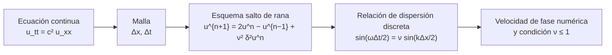

# B21-C02 — Ecuación de onda: esquemas y dispersión numérica

<!-- nav:top -->
[🏠 Programa](../../../../README.md) · [📚 Bloque B21](../../../tronco-comun/B21-metodos-numericos-para-edp-y-fluidos-computacionales.md) · [← Anterior: B21-C01 — Volúmenes finitos y solucionadores de Riemann para leyes de conservación](../B21-C01-volumenes-finitos-y-solucionadores-de-riemann-para-leyes-de-conservacion/CLASE.md) · [Siguiente: B21-C03 — Ecuación de Poisson: relajación y multigrid →](../B21-C03-ecuacion-de-poisson-relajacion-y-multigrid/CLASE.md)
<!-- /nav -->

## 1. Ubicación, nivel y alcance

Segunda clase del bloque B21. En [C01](../B21-C01-volumenes-finitos-y-solucionadores-de-riemann-para-leyes-de-conservacion/CLASE.md) viste que un esquema de primer orden emborrona los frentes. Aquí el problema es más sutil: una onda suave, que **no** tiene discontinuidades, viaja a la velocidad equivocada si la malla es demasiado gruesa, y lo hace de manera distinta según su longitud de onda. Nivel N3. Verás el esquema explícito de «salto de rana» para la ecuación de onda, la relación de dispersión numérica, el error de fase y la condición de estabilidad. No verás ondas con medios variables, fronteras absorbentes ni esquemas implícitos.

Las clases B11-C13 y B11-C14 están programadas y **no redactadas**; por eso la clase define las aproximaciones por diferencias que usa.

## 2. Por qué esta clase existe

Casi toda señal que viaja en el espacio —ondas de radio, ondas de Alfvén en la corona solar, ondas sísmicas en una luna, vibraciones de una estructura— obedece alguna forma de la ecuación de onda. Un programa que simula una onda durante muchos periodos acumula un error de fase: el pulso llega tarde, aparece un rastro de rizos detrás, o el cálculo explota. Saber predecir cuánto ocurrirá sin ejecutar nada es lo que separa a quien usa un código de quien solo lo ejecuta.

La pregunta motivadora: **¿cuántos puntos por longitud de onda hacen falta para que una onda llegue a su destino con la fase correcta, y qué paso de tiempo lo permite?** La decisión central: **elegir `Δx` y `Δt` a partir de una tolerancia de fase, no por costumbre**.

## 3. Lo que podrás hacer al terminar

1. Escribir la ecuación de onda y su solución de ondas viajeras y estacionarias.
2. Aproximar la segunda derivada por diferencias centradas y escribir el esquema de salto de rana.
3. Deducir la relación de dispersión numérica `sin(ωΔt/2) = ν sin(kΔx/2)` y de ella el error de fase.
4. Aplicar la condición de estabilidad `ν ≤ 1` y reconocer una inestabilidad.
5. Estimar el número de puntos por longitud de onda para una tolerancia de fase dada.
6. Verificar un código de ondas contra la solución analítica y la relación de dispersión.

La evidencia es el **informe de dispersión numérica** del ejercicio 12 (sección 20).

## 4. Con qué llegas y cómo comprobarlo

Necesitas el desarrollo de Taylor y el orden observado ([B11-C05](../../B11/B11-C05-metodo-de-euler/CLASE.md)), la idea de derivada parcial (B09) y los números complejos elementales. Cinco preguntas:

1. ¿Cuánto es `d²/dx² sin(kx)`?
2. ¿Cuánto vale `sin(π/6)`?
3. Si una onda tiene longitud de onda `λ`, ¿cuánto vale su número de onda `k`?
4. Una onda avanza a velocidad `c`: ¿qué distancia recorre en 100 s si `c = 1 000 km/s`?
5. ¿Qué es el orden observado de un método?

<details>
<summary>Ver respuestas</summary>

1. `−k² sin(kx)`. 2. `0,5`. 3. `k = 2π/λ`. 4. `100 000 km = 100 Mm`. 5. El exponente `p` con que el error baja al reducir el paso, `p ≈ log₂(E(h)/E(h/2))`.
</details>

Con cuatro o cinco aciertos, sigue; si no, repasa B09 y B11-C05.

## 5. Un caso real: una onda que cruza un bucle

Imagina una perturbación que viaja a lo largo de un bucle magnético de la corona solar. Para tener una escala, usaremos valores **ilustrativos**, no una medición de ningún bucle real: longitud `L = 100 Mm` y velocidad de la onda `c = 1 000 km/s`. Una onda tarda `L/c = 100 s` en cruzar el bucle. El modelo es la ecuación de onda de una cuerda tensa de densidad uniforme, una idealización de lo que ocurre a lo largo del campo.

Queremos que nuestro programa muestre un pulso que cruza el bucle diez veces (1 000 s). Veremos que, con una malla ordinaria, el pulso llega con media longitud de onda de retraso. Este es el **ejemplo conductor**.

## 6. Vocabulario

La **ecuación de onda** es `∂²u/∂t² = c² ∂²u/∂x²`, donde `u(x, t)` es el desplazamiento y `c` la velocidad de la onda. Una **onda viajera** es una solución de la forma `f(x − ct)`. Una **onda estacionaria** es de la forma `sin(kx) cos(ωt)`. El **número de onda** `k = 2π/λ` y la **frecuencia angular** `ω` se relacionan con `ω = ck`: es la **relación de dispersión**. Un medio o un esquema es **dispersivo** si ondas de distinta `k` viajan a distinta velocidad. La **velocidad de fase** es `ω/k`. El **salto de rana** (*leapfrog*) es el esquema explícito de tres niveles de tiempo que usaremos. El **número de Courant** `ν = cΔt/Δx` compara cuánto avanza la onda en un paso con el ancho de celda. **Puntos por longitud de onda** es `λ/Δx`. El **error de fase** es la diferencia entre la fase calculada y la exacta.

## 7. Modelo mental: una cuerda hecha de cuentas

Reemplazar la cuerda continua por una fila de cuentas unidas por resortes. Cada cuenta acelera según cuánto se aparta de sus dos vecinas. Una onda larga se parece mucho a la cuerda real; una onda cuya longitud es de apenas unas cuentas «ve» la granularidad y viaja más lenta.



*Descripción textual:* de la ecuación continua se pasa a una malla; el esquema de salto de rana se escribe con tres niveles de tiempo; al probar ondas senoidales se obtiene la relación de dispersión discreta, de la que se leen la velocidad de fase numérica y el límite de estabilidad.

Analogía: una fila de personas que se pasan un mensaje de mano en mano; un rumor largo viaja bien, pero uno que cambia en cada persona sufre distorsión. Su límite: en la fila hay interpretación humana, mientras que aquí la distorsión es una fórmula exacta.

## 8. La explicación, paso a paso

### 8.1 La ecuación y sus soluciones

Prueba `u = sin(kx − ωt)`: `u_tt = −ω² u` y `c² u_xx = −c² k² u`; son iguales si `ω = ck`. Es una onda viajera hacia `x` positivo con velocidad `c`. Cualquier forma `f(x − ct)` y `g(x + ct)` también es solución (fórmula de d'Alembert). Con el pulso inicial en reposo, la solución es `½[f(x − ct) + f(x + ct)]`: el pulso se parte en dos mitades que viajan en sentidos opuestos, como en la sección 5.

### 8.2 La segunda derivada en una malla

Con celdas de ancho `Δx`, el desarrollo de Taylor da

`(u_{i+1} − 2u_i + u_{i−1})/Δx² = u_xx + (Δx²/12) u_xxxx + …`

es decir, una aproximación de **segundo orden**: el error baja a la cuarta parte al duplicar los puntos. Lo mismo vale para la derivada temporal con `Δt`. Llamamos `δ²u_i = u_{i+1} − 2u_i + u_{i−1}`.

### 8.3 El esquema de salto de rana

Sustituyendo ambas aproximaciones y despejando el nivel de tiempo nuevo:

`u_i^{n+1} = 2u_i^n − u_i^{n−1} + ν² δ²u_i^n`, con `ν = cΔt/Δx`.

Necesita dos niveles de tiempo para empezar. Si la onda parte del reposo, el primer paso es `u_i^1 = u_i^0 + ½ν² δ²u_i^0`. Es **explícito**: no resuelve sistemas, cada celda se calcula con tres números del pasado y dos vecinas. Con `ν = 1` el esquema es `u_i^{n+1} = u_{i+1}^n + u_{i−1}^n − u_i^{n−1}`, exactamente la fórmula de d'Alembert en la malla: el pulso se mueve exactamente una celda por paso y el error es nulo.

### 8.4 La relación de dispersión discreta

Prueba una onda discreta `u_i^n = e^{i(k x_i − ω t_n)}` (aquí `i` en el exponente es la unidad imaginaria). Al sustituirla, el esquema pide

`e^{iωΔt} − 2 + e^{−iωΔt} = ν² (e^{ikΔx} − 2 + e^{−ikΔx})`, o sea `sin²(ωΔt/2) = ν² sin²(kΔx/2)`,

y por tanto `sin(ωΔt/2) = ν sin(kΔx/2)`. Para `ν = 1` esto da `ωΔt = kΔx`, es decir, `ω = ck`: sin error. Para `ν < 1`, la frecuencia numérica es menor que `ck`. La velocidad de fase numérica es

`c_num/c = ω_num/(ck) = (2/(ν k Δx)) arcsen(ν sin(kΔx/2))`.

Para `kΔx` pequeño (muchos puntos por longitud de onda) se obtiene `c_num/c ≈ 1 − (kΔx)²(1 − ν²)/24`. El error de fase es de segundo orden en `Δx`, proporcional a `1 − ν²`, y crece con `k`: las ondas cortas se atrasan más. Ése es el sentido de «dispersión numérica». Con `ν = 0,5` y 10 puntos por longitud de onda (`kΔx = 0,628`) la aproximación da `−1,23 %` y la fórmula exacta `−1,24 %`.

### 8.5 Estabilidad

Para que `ω` sea real hace falta `|ν sin(kΔx/2)| ≤ 1` para todo `k` representable, y el valor extremo es `sin = 1` (la onda más corta posible, de dos celdas, el «damero»). Entonces `ν ≤ 1`. Si `ν > 1`, para esa onda el factor de amplificación por paso `G` obedece `G² − (2 − 4ν²)G + 1 = 0` y una de las raíces `G` tiene módulo mayor que 1: cualquier perturbación de redondeo crece de forma exponencial. Con `ν = 1,05` la raíz de mayor módulo es `1,8773`; tras 20 pasos la amplitud se multiplica por unos `3 × 10⁵`. Es la **condición CFL** para este esquema; Athena (S1) y RAMSES (S2) la usan para fijar el paso de tiempo en sus propios sistemas de ecuaciones.

### 8.6 Cuánto se atrasa una onda y cuántos puntos hacen falta

Tras recorrer una distancia `D`, una onda de longitud `λ` se atrasa `D(1 − c_num/c)`. Con la aproximación de 8.4, expresado en longitudes de onda: `(D/λ)(kΔx)²(1 − ν²)/24`. Si se exige un atraso máximo `ε λ`, se despeja `kΔx = 2π/(puntos por longitud de onda)`. Con `ν = 0,5`, 10 puntos por longitud de onda y 10 cruces del bucle de la sección 5 (si la onda tiene 25 Mm de longitud de onda, o sea `L/4`), el atraso es de **0,50 longitudes de onda**: la onda llega invertida. Con 20 puntos baja a 0,12 y con 40 a 0,03, una reducción por 4 al duplicar los puntos, como indica el segundo orden. En tiempo, 0,50 longitudes de onda equivalen a 12 s de los 25 s de periodo.

### 8.7 Lo que el esquema no hace

Este esquema no disipa: conserva la amplitud (si es estable), de modo que todo el error es de fase. Con discontinuidades produce rizos (no los emborrona como Rusanov en C01). Esquemas implícitos o de orden alto cambian el compromiso, pero la pregunta de cuántos puntos por longitud de onda sigue siendo la misma.

## 9. Magnitudes, símbolos y unidades

| Símbolo | Qué es | Unidad | Nota |
|---|---|---|---|
| `x, t` | posición, tiempo | m, s | adimensionales en el laboratorio |
| `u` | desplazamiento | m | |
| `c` | velocidad de la onda | m s⁻¹ | `1 000 km/s` ilustrativa |
| `k` | número de onda | m⁻¹ | `2π/λ` |
| `ω` | frecuencia angular | s⁻¹ | `ck` en el caso continuo |
| `Δx, Δt` | ancho de celda, paso | m, s | |
| `ν` | número de Courant | — | `cΔt/Δx` |
| `δ²u_i` | segunda diferencia | como `u` | `u_{i+1} − 2u_i + u_{i−1}` |
| `L` | longitud del dominio | m | `100 Mm` ilustrativa |
| `G` | factor de amplificación por paso | — | en 8.5 |

## 10. Convenciones y referencias

Dominio periódico de longitud `L`; el eje `x` crece hacia la derecha; el tiempo en unidades de `L/c` en el laboratorio (con `c = 1`, `L = 1`). La unidad imaginaria se escribe `i` solo en las fórmulas de 8.4; en el resto, `i` es el índice de celda. «Atraso» es positivo cuando la onda calculada va por detrás de la exacta.

## 11. De dónde sale lo que afirmamos

| ID | Fuente | Localizador | Respalda | Estado |
|---|---|---|---|---|
| S1 | Stone, Gardiner, Teuben, Hawley y Simon, «Athena: a new code for astrophysical MHD» (preprint, 2008) | arXiv:0804.0402, https://arxiv.org/pdf/0804.0402 | Paso de tiempo limitado por la estimación de la condición CFL (ec. 34) con número CFL `≤ 1` | Texto extraído del PDF el 2026-11-05 |
| S2 | Teyssier, «Cosmological hydrodynamics with adaptive mesh refinement: a new high resolution code called RAMSES» (preprint, 2001) | arXiv:astro-ph/0111367, https://arxiv.org/pdf/astro-ph/0111367 | La estabilidad del paso de tiempo viene dada por la condición de Courant–Friedrichs–Lewy (sección 2.2.5) | Texto extraído del PDF el 2026-11-05 |

Límites: la ecuación de onda, la fórmula de d'Alembert, la relación de dispersión discreta, la condición `ν ≤ 1` y la fórmula del error de fase son resultados estándar que **no se atribuyen a una fuente consultada**; el laboratorio las comprueba numéricamente (el modo simulado coincide con la solución discreta a `10⁻¹¹`). Los datos son **sintéticos**; la escala del bucle es **ilustrativa**.

## 12. Cómo ver la dispersión

Equivalente accesible a una gráfica de la velocidad de fase numérica `c_num/c` frente a los puntos por longitud de onda, con `ν = 0,5` (lab. sección 17):

| Puntos por longitud de onda | `c_num/c` | Error de fase |
|---|---|---|
| 200 | 0,999969 | −3,1 × 10⁻⁵ |
| 40 | 0,999229 | −7,7 × 10⁻⁴ |
| 20 | 0,996911 | −3,1 × 10⁻³ |
| 10 | 0,987588 | −1,24 × 10⁻² |
| 5 | 0,949508 | −5,05 × 10⁻² |

Descripción larga: la curva parte de casi 1 para ondas largas y cae cada vez más rápido al acortarse la onda; con 5 puntos por longitud de onda el pulso viaja un 5 % más lento y con 2 puntos (el damero) el esquema ya no propaga con sentido. En un pulso, las ondas cortas que lo componen quedan atrás y forman un rastro de rizos.

## 13. Ejemplo trabajado: una onda de 10 puntos por longitud de onda

**Paso 1 · Datos.** Malla `N = 200` en `L = 1` (tiempo en unidades de `L/c`), `Δx = 0,005`, `ν = 0,5`, de modo que `Δt = 0,0025`. Modo `m = 20` (20 longitudes de onda en el dominio): `λ = 0,05`, 10 puntos por longitud de onda.

**Paso 2 · Número de onda.** `k = 2π·20 = 125,66`; `kΔx = 0,6283`.

**Paso 3 · Frecuencia numérica.** `sin(ωΔt/2) = 0,5 · sin(0,31416) = 0,5 · 0,30902 = 0,15451`. Entonces `ωΔt/2 = arcsen(0,15451) = 0,15513` y `ωΔt = 0,31026`.

**Paso 4 · Frecuencia exacta.** `ω_exacta Δt = ck Δt = ν kΔx = 0,31416`.

**Paso 5 · Razón.** `c_num/c = 0,31026/0,31416 = 0,9876`; con más cifras, `0,987588` (el valor del laboratorio). Error de fase: `−1,24 %`.

**Paso 6 · Aproximación.** `(kΔx)²(1 − ν²)/24 = 0,39478·0,75/24 = 0,01234`: dentro de un 1 % del valor exacto.

**Paso 7 · Efecto en el bucle.** En 10 cruces del bucle (1 000 s), la onda se atrasa `10 · 0,01241 = 0,1241` de `L`, que es `0,1241/0,05 = 2,5` longitudes de onda con esta onda de `λ = L/20`. Para la onda del texto de 8.6 (`λ = L/4`, 25 Mm) el atraso es 0,50 longitudes de onda. Datos **sintéticos**; escala **ilustrativa**.

## 14. Comparación de métodos

Con `ν = 1`, el salto de rana es exacto en la malla pero no es robusto: cualquier variación de `c` en el espacio impide fijar `ν = 1` en todas las celdas. Con `ν = 0,5`, el esquema es estable pero tiene error de fase, y un `ν` más cercano a 1 (por ejemplo, 0,9) lo reduce: el factor `1 − ν²` pasa de 0,75 a 0,19. El costo es el opuesto: más cerca del límite hay menos margen ante un cambio de `c`. Los esquemas de mayor orden en el espacio reducen el error de fase con menos puntos por longitud de onda, a costa de estencils más anchos; se verán más adelante.

## 15. Práctica guiada

**Ejercicio 1 · con los pasos indicados.** En una malla periódica de 4 celdas con `ν = 1`, el estado inicial en reposo es `u⁰ = (0, 1, 0, 0)`. Calcula `u¹` y `u²`. *Pasos:* primer paso `u¹_i = ½(u⁰_{i+1} + u⁰_{i−1})`; después `u²_i = u¹_{i+1} + u¹_{i−1} − u⁰_i` (8.3).

<details><summary>Solución comentada</summary>

`u¹ = (0,5; 0; 0,5; 0)`: el pulso se parte en dos mitades. `u²`: celda 0: `u¹₁ + u¹₃ − u⁰₀ = 0 + 0 − 0 = 0`; celda 1: `0,5 + 0,5 − 1 = 0`; celda 2: `0 + 0 − 0 = 0`; celda 3: `0,5 + 0,5 − 0 = 1`. Las dos mitades se encuentran en la celda opuesta: `u² = (0, 0, 0, 1)`. Exacto, porque `ν = 1`.
</details>

**Ejercicio 2 · con una pista.** Calcula `c_num/c` para `ν = 0,5` y `kΔx = π/2` (4 puntos por longitud de onda). *Pista:* `sin(π/4) = 0,70711`.

<details><summary>Solución comentada</summary>

`sin(ωΔt/2) = 0,5·0,70711 = 0,35355`; `ωΔt/2 = 0,36137`; `ωΔt = 0,72273`; el valor exacto es `ν kΔx = 0,78540`. Razón: `0,92021`. La onda viaja un 8 % más lenta.
</details>

**Ejercicio 3 · casi autónomo.** Con el bucle de la sección 5 y 200 celdas (`Δx = 0,5 Mm`), `ν = 0,8` y `c = 1 Mm/s`, calcula `Δt` y los pasos para un cruce.

<details><summary>Solución comentada</summary>

`Δt = νΔx/c = 0,8·0,5/1 = 0,4 s`. Un cruce son 100 s: 250 pasos.
</details>

## 16. Práctica autónoma, transferencia e integrador

**Ejercicio 4.** Con la aproximación de 8.4, estima el error de fase para 20 puntos por longitud de onda y `ν = 0,5` y compáralo con la tabla de la sección 12.

<details><summary>Solución comentada</summary>

`kΔx = 2π/20 = 0,31416`; `(kΔx)²(1 − ν²)/24 = 0,09870·0,75/24 = 3,08 × 10⁻³`. La tabla da `3,09 × 10⁻³`.
</details>

**Ejercicio 5.** ¿Cuántos puntos por longitud de onda hacen falta para que el error de fase relativo sea menor que 1 % con `ν = 0,5`?

<details><summary>Solución comentada</summary>

`(kΔx)²·0,75/24 ≤ 0,01` → `(kΔx)² ≤ 0,32` → `kΔx ≤ 0,5657` → `2π/0,5657 = 11,1`: hacen falta 12 puntos. Con 12 puntos el error exacto es 0,86 %; con 11, 1,02 % (el cálculo con la fórmula completa lo confirma).
</details>

**Ejercicio 6.** Con `ν = 1,05`, ¿en cuánto crece la amplitud del modo más corto en 20 pasos?

<details><summary>Solución comentada</summary>

`2 − 4ν² = 2 − 4,41 = −2,41`; raíces de `λ² + 2,41λ + 1 = 0`: `(−2,41 ± 1,3446)/2`, de las que la de mayor módulo es `−1,8773`. `1,8773²⁰ = e^{20·0,6298} = 2,96 × 10⁵`.
</details>

**Ejercicio 7.** Demuestra con la relación de dispersión que para `ν = 1` el error de fase es nulo para toda `k`.

<details><summary>Solución comentada</summary>

`sin(ωΔt/2) = 1·sin(kΔx/2)` implica `ωΔt/2 = kΔx/2` y `ω = kΔx/Δt = kc` (porque `ν = 1` significa `Δx/Δt = c`). Sin error.
</details>

**Ejercicio 8.** En la tabla de la sección 12, ¿qué malla produce un error cercano al 5 % y cuántos puntos por longitud de onda tiene?

<details><summary>Solución comentada</summary>

La de 5 puntos por longitud de onda (modo `m = 40` en `N = 200`): error `−5,05 %`.
</details>

**Ejercicio 9 · transferencia.** En el bucle ilustrativo se quiere propagar un pulso de longitud de onda `λ = 5 Mm` durante 10 cruces con atraso menor que `0,1 λ` y `ν = 0,5`. Estima los puntos por longitud de onda, `N` y los pasos.

<details><summary>Solución comentada</summary>

Distancia: `10 L = 200 λ`. Atraso: `200 (kΔx)²·0,75/24 ≤ 0,1` → `(kΔx)² ≤ 0,016` → `kΔx ≤ 0,1265` → 49,7: **50 puntos por longitud de onda**. `Δx = 0,1 Mm`, `N = 1 000` celdas. `Δt = 0,5·0,1/1 = 0,05 s`; 1 000 s son **20 000 pasos**. Es una estimación con la serie de 8.4.
</details>

**Ejercicio 10 · transferencia.** Repite el ejercicio 9 con `ν = 0,9`. ¿Qué ganas y qué arriesgas?

<details><summary>Solución comentada</summary>

`(kΔx)² ≤ 2,4/(200·0,19) = 0,0632` → `kΔx ≤ 0,2513` → 25 puntos; con 26 el atraso queda bajo el umbral. `Δx ≈ 0,19 Mm`, `N ≈ 520`, `Δt = 0,9·0,19 = 0,17 s`, unos 5 800 pasos: unas 3,5 veces menos pasos. Se arriesga el margen: un `ν` efectivo mayor que 1 en cualquier punto (si `c` crece) desestabiliza el cálculo.
</details>

**Ejercicio 11 · transferencia.** Un programa produce, con `ν = 0,5`, un pulso con un rastro de rizos detrás y de velocidad ligeramente baja; otro, con `ν = 1,05`, produce números enormes tras unas decenas de pasos. ¿Cuál es un error de programa y cuál es una propiedad del método?

<details><summary>Solución comentada</summary>

El primero es propiedad del método (dispersión: las ondas cortas del pulso van más lentas; se reduce con más puntos o con `ν` mayor, sin pasar de 1). El segundo es violación de la CFL, no un error en las fórmulas: se resuelve bajando `Δt`. Si el primero no mejora al refinar, entonces sí hay un fallo (8.4).
</details>

**Ejercicio 12 · integrador.** Elabora tu *informe de dispersión numérica*: para tres mallas, tabula el error de fase medido por el laboratorio y el predicho por la fórmula, verifica la estabilidad con `ν` en tres valores y concluye cuántos puntos por longitud de onda necesitas para un caso del bucle ilustrativo.

<details><summary>Solución modelo</summary>

Tabla de la sección 12 contra la fórmula de 8.4 (diferencia `< 10⁻¹⁰` en el laboratorio); estabilidad: `ν = 0,9` y `1,0` acotados, `ν = 1,05` con factor 1,877; conclusión con el ejercicio 9 o 10 rotulada como estimación; datos sintéticos y escala ilustrativa declarados; S1 y S2 con fecha.
</details>

## 17. Laboratorio: salto de rana, dispersión y estabilidad

El script [onda_dispersion_numerica.py](onda_dispersion_numerica.py) integra la ecuación de onda periódica. Comprueba que un modo senoidal simulado coincide con la solución discreta exacta (`cos(ω_num t)`) a `10⁻¹¹` y que la frecuencia medida coincide con la relación de dispersión; que con `ν = 1` el pulso es exacto; y que el factor de amplificación del modo de damero con `ν = 1,05` coincide con la predicción. Falla si alguna comprobación se incumple.

**Datos:** sintéticos; bucle ilustrativo de 100 Mm y 1 000 km/s. **Predice antes de ejecutar:** ¿cuál es el error de fase con 5 puntos por longitud de onda? (≈5 %.) **Ejecución del 2026-11-05 (Python 3.12.9, NumPy 2.4.4):**

```text
Python 3.12.9  NumPy 2.4.4
Escala ilustrativa: L/c = 100 s
(a) modo sin(k x), nu = 0.5, N = 200; w_num / w = c_fase_num / c
    m= 1  puntos por longitud de onda = 200  w_num/w = 0.999969  error de fase relativo = -3.084e-05
    m= 5  puntos por longitud de onda =  40  w_num/w = 0.999229  error de fase relativo = -7.714e-04
    m=10  puntos por longitud de onda =  20  w_num/w = 0.996911  error de fase relativo = -3.089e-03
    m=20  puntos por longitud de onda =  10  w_num/w = 0.987588  error de fase relativo = -1.241e-02
    m=40  puntos por longitud de onda =   5  w_num/w = 0.949508  error de fase relativo = -5.049e-02
(b) pulso gaussiano (ancho 0.05 L), N = 400, hasta t = 0.25 L/c
    nu = 1.0  error max = 2.276e-15
    nu = 0.5  error max = 7.623e-04
(c) modo de Nyquist (damero): factor de amplificación por paso
    nu = 0.90  |lambda| teorico = 1.000000  amplitud máxima en 60 pasos = 1.000
    nu = 1.00  |lambda| teorico = 1.000000  amplitud máxima en 60 pasos = 1.000
    nu = 1.05  |lambda| teorico = 1.877328  razón medida = 1.877328
(d) desfase de un modo tras cruzar el bucle 10 veces (nu = 0.5)
    10 puntos/long. de onda: c_num/c = 0.987588  retraso tras 10 cruces = 0.496 longitudes de onda
    20 puntos/long. de onda: c_num/c = 0.996911  retraso tras 10 cruces = 0.124 longitudes de onda
    40 puntos/long. de onda: c_num/c = 0.999229  retraso tras 10 cruces = 0.031 longitudes de onda
Pruebas superadas.
```

```bash
python programa/clases/B21/B21-C02-ecuacion-de-onda-esquemas-y-dispersion-numerica/onda_dispersion_numerica.py
```

**Límites:** medio uniforme, dominio periódico, un solo esquema; el error de fase se mide con modos que son soluciones exactas de la ecuación discreta, no con una onda en un medio real. Los resultados son **simulados**.

## 18. Errores frecuentes y cómo corregirlos

**Elegir `Δx` por la forma del dominio y no por la longitud de onda.** Se corrige con los ejercicios 5 y 9.

**Creer que `ν` pequeño siempre es mejor.** En este esquema empeora el error de fase (8.4 y ejercicio 10).

**Confundir dispersión numérica con inestabilidad.** Se corrige con el ejercicio 11.

**Iniciar mal el primer paso.** Con `u¹ = u⁰` en lugar de `u⁰ + ½ν²δ²u⁰` el esquema pierde segundo orden; se detecta contra el modo exacto del laboratorio.

**Extrapolar el error de fase a una onda corta con la serie de 8.4.** La serie vale para `kΔx` pequeño; con 4 o 5 puntos use la fórmula exacta (ejercicio 2).

## 19. Cómo sabrás que vas bien

Tras 8.3: ¿puedes avanzar a mano dos pasos en una malla de 4 celdas? Si no, ejercicio 1. Tras 8.4: ¿sabes por qué `ν = 1` es exacto? Si no, ejercicio 7. Tras 8.5: ¿puedes reconocer una inestabilidad? Si no, ejercicio 11. Tras el laboratorio: ¿cómo distingues un error de método de un error de programa? (refinando: el primero baja con `Δx²`).

## 20. Qué entregas y cómo se evalúa

El producto es tu **informe de dispersión numérica** (ejercicio 12).

| Criterio | Inicial | En desarrollo | Logrado | Destacado |
|---|---|---|---|---|
| Esquema | Sin fórmula | Fórmula sin primer paso | Esquema completo con primer paso | Explica el origen del primer paso |
| Dispersión | Ausente | Cita la fórmula | Deduce y compara con la medida | Predice el atraso en cruces |
| Estabilidad | Ausente | Enuncia `ν ≤ 1` | Calcula el factor de amplificación | Discute el costo de acercarse al límite |
| Elección de malla | Arbitraria | Sin justificar | Puntos por longitud de onda justificados | Compara dos valores de `ν` |
| Fuentes y rotulado | Sin fuentes | Sin fecha | Con localizador y fecha | Rotula sintético, ilustrativo y simulado |

**Condiciones críticas (no se compensan con promedio):** comparar con la solución analítica o con la relación de dispersión; declarar que el bucle es ilustrativo; citar solo fuentes consultadas.

## 21. Ética, seguridad y límites

Un error de fase de media longitud de onda convierte una predicción en la opuesta. Un cálculo con este esquema no debe usarse para fechar la llegada de una perturbación a una nave sin contrastarlo con la tolerancia de fase y con datos reales. Ningún resultado de esta clase es operativo. Accesibilidad: fórmulas en texto, tablas equivalentes a las gráficas, ejercicios sin conexión.

## 22. Para cerrar y seguir

El esquema de salto de rana avanza la onda con una fórmula explícita; su relación de dispersión `sin(ωΔt/2) = ν sin(kΔx/2)` dice que las ondas cortas se atrasan y que `ν ≤ 1` es obligatorio; el error de fase baja como `Δx²`. Queda abierta una pregunta: hasta ahora el estado evoluciona en el tiempo; ¿qué pasa con los problemas que no evolucionan, como el potencial gravitatorio de una nube, donde todos los puntos dependen de todos? Es el problema de Poisson.

**Glosario español–inglés.** ecuación de onda · *wave equation*; salto de rana · *leapfrog*; número de Courant · *Courant number*; relación de dispersión · *dispersion relation*; velocidad de fase · *phase velocity*; error de fase · *phase error*; puntos por longitud de onda · *points per wavelength*; estabilidad · *stability*; damero · *checkerboard mode*.

**Continuidad.** B21-C03 reutiliza tu **estimación de errores de segundo orden** para el problema elíptico.

**Referencias:** ver sección 11.

<!-- nav:bottom -->
---

[← Anterior: B21-C01 — Volúmenes finitos y solucionadores de Riemann para leyes de conservación](../B21-C01-volumenes-finitos-y-solucionadores-de-riemann-para-leyes-de-conservacion/CLASE.md) · [📚 Bloque B21](../../../tronco-comun/B21-metodos-numericos-para-edp-y-fluidos-computacionales.md) · [Siguiente: B21-C03 — Ecuación de Poisson: relajación y multigrid →](../B21-C03-ecuacion-de-poisson-relajacion-y-multigrid/CLASE.md)
<!-- /nav -->
