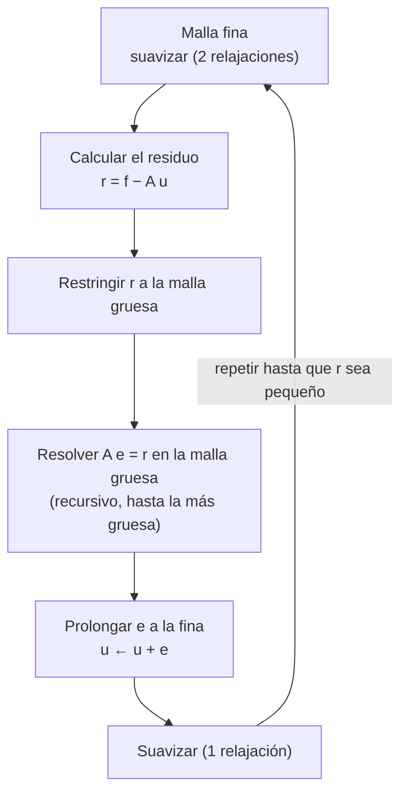

# B21-C03 — Ecuación de Poisson: relajación y multigrid

<!-- nav:top -->
[🏠 Programa](../../../../README.md) · [📚 Bloque B21](../../../tronco-comun/B21-metodos-numericos-para-edp-y-fluidos-computacionales.md) · [← Anterior: B21-C02 — Ecuación de onda: esquemas y dispersión numérica](../B21-C02-ecuacion-de-onda-esquemas-y-dispersion-numerica/CLASE.md) · [Siguiente: B21-C04 — Ecuaciones de Navier-Stokes y dinámica de fluidos computacional →](../B21-C04-ecuaciones-de-navier-stokes-y-dinamica-de-fluidos-computacional/CLASE.md)
<!-- /nav -->

## 1. Ubicación, nivel y alcance

Tercera clase del bloque B21. En [C01](../B21-C01-volumenes-finitos-y-solucionadores-de-riemann-para-leyes-de-conservacion/CLASE.md) y [C02](../B21-C02-ecuacion-de-onda-esquemas-y-dispersion-numerica/CLASE.md) el estado evolucionaba en el tiempo; aquí no hay tiempo: el valor del potencial en un punto depende de **todos** los demás a la vez. Es el problema elíptico, y su solución numérica es un sistema de ecuaciones enorme. Nivel N3. Verás cómo plantearlo con diferencias finitas, por qué los métodos de relajación (Jacobi, Gauss–Seidel) son lentos y cómo el multigrid los acelera hasta que el trabajo es proporcional al número de incógnitas. No verás gradiente conjugado, FFT en detalle, mallas no uniformes ni condiciones de frontera mixtas.

Las clases B11-C13, B11-C14 y B11-C12 (problemas de frontera) están programadas y **no redactadas**; la clase define lo que usa.

## 2. Por qué esta clase existe

El potencial gravitatorio de una nube de gas, el potencial electrostático alrededor de una nave que se carga en el plasma y la presión en un fluido incompresible obedecen la misma ecuación: la de Poisson. Los códigos de simulación astrofísica la resuelven en cada paso de tiempo; RAMSES, por ejemplo, la resuelve con una transformada rápida de Fourier en la malla gruesa y con relajación en los niveles finos (S1), y Athena++ ofrece un solucionador multigrid completo por ser más eficiente y escalable que las FFT (S2). Si el solucionador es lento, domina el costo total de la simulación.

La pregunta motivadora: **¿cuántas iteraciones hacen falta para resolver Poisson en una malla de `N × N` puntos, y por qué el método más simple las multiplica por `N²`?** La decisión central: **qué método iterativo usar y cuándo detenerlo**.

## 3. Lo que podrás hacer al terminar

1. Plantear la ecuación de Poisson con condiciones de frontera de Dirichlet y discretizarla con el estencil de cinco puntos.
2. Aplicar a mano una iteración de Jacobi y calcular el residuo.
3. Predecir el número de iteraciones de Jacobi con el radio espectral `cos(πh)`.
4. Explicar la propiedad de suavizado y escribir un ciclo V de multigrid.
5. Separar el error de discretización del error del solucionador y decidir cuándo detener la iteración.
6. Verificar un solucionador contra la solución discreta exacta y medir su factor de convergencia.

La evidencia es el **informe de convergencia del solucionador de Poisson** del ejercicio 12 (sección 20).

## 4. Con qué llegas y cómo comprobarlo

Necesitas el desarrollo de Taylor y el orden observado ([B11-C05](../../B11/B11-C05-metodo-de-euler/CLASE.md)), la segunda derivada por diferencias ([C02](../B21-C02-ecuacion-de-onda-esquemas-y-dispersion-numerica/CLASE.md) 8.2) y las operaciones con matrices y vectores (B10). Cinco preguntas:

1. ¿Cuánto es `∇²(sin πx · sin πy)` en dos dimensiones?
2. ¿Qué es un sistema lineal `A u = f`?
3. ¿Cuánto es `ln 10⁶`?
4. ¿Cuánto vale `cos(π/4)`?
5. Si el error baja a un cuarto al duplicar los puntos, ¿cuál es el orden?

<details>
<summary>Ver respuestas</summary>

1. `−2π² sin πx sin πy`. 2. Un conjunto de ecuaciones lineales con incógnitas `u` y términos conocidos `f`; `A` es la matriz de coeficientes. 3. `13,8155`. 4. `0,7071`. 5. Orden 2.
</details>

Con cuatro o cinco aciertos, sigue; si no, repasa B09, B10 y B11-C05.

## 5. Un caso real: el potencial de una nube de gas

Una nube de gas con una densidad que varía suavemente ocupa un cuadrado de lado `L = 1` (en unidades en que `4πG ρ₀ = 2π²`; datos **sintéticos y adimensionales**). La densidad es `4πGρ = 2π² sin(πx) sin(πy)`: máxima en el centro, nula en el borde. El potencial gravitatorio `Φ` obedece `∇²Φ = 4πGρ` y vale 0 en el borde. Esta nube tiene solución exacta, `Φ = −sin(πx) sin(πy)`, que no es una coincidencia: se eligió para poder comprobar al solucionador. Es el **ejemplo conductor**. En un caso real la densidad es irregular, no hay solución exacta y el solucionador debe ser más rápido.

## 6. Vocabulario

La **ecuación de Poisson** es `∇²φ = s` con `∇²φ = ∂²φ/∂x² + ∂²φ/∂y²` y `s` una fuente conocida. Un problema **elíptico** es el que no tiene tiempo y acopla todo el dominio. Una condición **de Dirichlet** fija el valor en la frontera. El **estencil de cinco puntos** aproxima el laplaciano con el nodo y sus cuatro vecinos. Un **método iterativo** parte de una estimación inicial y la mejora paso a paso. El **residuo** `r = f − A u` mide cuánto incumple la estimación la ecuación. El **error** `e = u_exacta − u` es la diferencia con la solución del sistema. **Jacobi** y **Gauss–Seidel** son métodos de **relajación**. El **radio espectral** es el factor con que se reduce el error por iteración en el modo más lento. El **suavizado** es la propiedad de la relajación de eliminar rápido los errores oscilantes. El **multigrid** combina relajaciones en una jerarquía de mallas. Un **ciclo V** baja de la malla fina a la más gruesa y vuelve a subir. **Restricción** es pasar un campo a la malla gruesa; **prolongación**, a la fina.

## 7. Modelo mental: alisar una sábana

Un potencial es como una sábana sujeta por los bordes sobre la que se ha dejado caer peso. La relajación hace lo que haría una persona que pasa la mano sobre la tela: cada punto se coloca en el promedio de sus vecinos, más una corrección por el peso. Las arrugas pequeñas desaparecen enseguida; las ondulaciones largas desaparecen muy despacio, porque cada pasada solo mueve la información un punto. Multigrid hace la parte lenta mirando la sábana desde lejos: en una malla gruesa, una ondulación larga se ve como una arruga y se corrige rápido.



*Descripción textual:* en la malla fina se alisan los errores oscilantes, se calcula el residuo y se lo lleva a una malla más gruesa; allí se resuelve la ecuación del error (otra vez con el mismo procedimiento, hasta una malla con un único punto); se sube la corrección a la malla fina, se suma y se vuelve a suavizar.

Analogía: revisar un mapa a distancia para ver las manchas grandes y de cerca para los detalles. Su límite: un mapa no cambia sus datos al verlo desde lejos; multigrid sí reemplaza el problema por uno más pequeño que hay que resolver.

## 8. La explicación, paso a paso

### 8.1 El problema

Convención de la clase: `−∇²φ = f` con `φ = 0` en la frontera del cuadrado unidad. Para el potencial gravitatorio, `∇²Φ = 4πGρ` equivale a `f = −4πGρ`; para el electrostático, `∇²φ = −ρ_e/ε₀` equivale a `f = ρ_e/ε₀`. Es el mismo problema con distinta fuente. Para el ejemplo conductor, `f = −2π² sin(πx) sin(πy)` y la solución es `φ = −sin(πx) sin(πy)`, porque `−∇²` de ella da `−2π² sin sin`.

### 8.2 El estencil de cinco puntos

Con una malla de `N` intervalos por lado (`h = 1/N`), aplicando dos veces la segunda diferencia de [C02](../B21-C02-ecuacion-de-onda-esquemas-y-dispersion-numerica/CLASE.md) (una por dirección):

`(4φ_{i,j} − φ_{i+1,j} − φ_{i−1,j} − φ_{i,j+1} − φ_{i,j−1})/h² = f_{i,j}`.

Hay una ecuación por punto interior: `(N−1)²` ecuaciones lineales, un sistema `A u = f`. Esta aproximación es de **segundo orden** en `h`.

La función `sin(pπx) sin(qπy)` es un **vector propio** del operador discreto, con valor propio `λ_{p,q} = (4/h²)[sin²(pπh/2) + sin²(qπh/2)]`; el valor continuo es `π²(p² + q²)`. Por eso la solución discreta de una fuente senoidal se conoce exactamente: se divide la fuente entre `λ_{p,q}`. Para `p = q = 1`: `λ = (8/h²) sin²(πh/2)`, ligeramente menor que `2π²`, y la solución discreta resulta ligeramente mayor que la continua; la diferencia relativa es `≈ π²h²/12`.

### 8.3 Por qué iterar

Con `N = 1 000`, `u` tiene un millón de incógnitas, pero cada ecuación involucra solo cinco. El sistema es muy **ralo**. Un método directo cuesta mucha memoria y trabajo; los métodos iterativos sacan partido de que cada ecuación es local.

### 8.4 Jacobi y Gauss–Seidel

Despeja `φ_{i,j}` de su ecuación y úsalo como regla de actualización:

`φ_{i,j}^{nuevo} = ¼(φ_{i+1,j} + φ_{i−1,j} + φ_{i,j+1} + φ_{i,j−1} + h² f_{i,j})`.

En **Jacobi** los cuatro vecinos son de la iteración anterior. En **Gauss–Seidel** se usan los valores nuevos tan pronto como existen; la versión **rojo-negro** colorea los puntos como un tablero y actualiza primero los rojos y después los negros, lo que permite hacerlo en paralelo. Jacobi tiene la ventaja de que todos los puntos se calculan a la vez.

Cada iteración mueve información solo un punto, así que reducir un error de longitud de onda larga lleva muchas iteraciones. Para el modo más suave, el error se multiplica por `cos(πh)` en cada pasada de Jacobi. Como `cos(πh) ≈ 1 − π²h²/2`, para reducir el error en un factor `10⁶` hacen falta `ln(10⁶)/(−ln cos πh)` iteraciones: unas 713 para `N = 16`, unas 2 862 para `N = 32`, unas 11 462 para `N = 64`: **cuatro veces más al duplicar `N`**, es decir, proporcional a `N²`. Gauss–Seidel tarda la mitad, pero con la misma escala.

### 8.5 Suavizado

Un error de longitud de onda corta (oscilante) se corrige rápido. Con Jacobi **ponderado** (`φ^{nuevo} = (1 − ω)φ + ω·Jacobi(φ)` con `ω = 0,8`), el error en el modo `(p, p)` se multiplica por `|1 − ω + ω cos(pπh)|`. Con `N = 32` es `0,996` para `p = 1` (casi no cambia), `0,939` para `p = 4`, `0,200` para `p = 16` y `0,539` para `p = 28`: el error rápido se amortigua mucho; el lento, casi nada. Esa asimetría es la **propiedad de suavizado**, y es la clave del multigrid.

### 8.6 La idea de multigrid

Después de unas relajaciones queda un error **suave**. Un error suave se representa bien con pocos puntos: en una malla de la mitad de puntos deja de ser lento y se vuelve oscilante, así que allí se corrige con barridos baratos. El procedimiento (ciclo V) es:

1. **Preajuste:** relajar la solución actual unas veces en la malla fina.
2. **Residuo:** calcular `r = f − A u`.
3. **Restricción:** llevar `r` a la malla gruesa (aquí con ponderación completa de nueve puntos, que promedia con pesos 4, 2 y 1 sobre 16).
4. **Corrección gruesa:** resolver `A e = r` en la malla gruesa; para eso se aplica el mismo ciclo, recursivamente, hasta una malla con un solo punto, donde la ecuación se resuelve a mano.
5. **Prolongación:** llevar `e` a la malla fina por interpolación bilineal y sumar `u ← u + e`.
6. **Postajuste:** relajar una vez más.

### 8.7 Costo

Cada malla gruesa tiene la cuarta parte de puntos, así que el costo total de un ciclo es una constante por el de la malla fina. Y el factor con que reduce el residuo por ciclo es casi el mismo para cualquier `N` (en el laboratorio, entre 0,24 y 0,26 de `N = 16` a `N = 256`). Si el número de ciclos para una tolerancia dada no depende de `N`, el trabajo total es proporcional al número de incógnitas: Athena++ lo dice con la notación `O(N)` del multigrid completo frente a `O(N log N)` de la FFT (S2). Con Jacobi, en cambio, el trabajo crece como `N²` iteraciones por `N²` puntos, es decir, `N⁴`.

### 8.8 Dos errores distintos

La solución del sistema discreto no es la solución de la ecuación continua: difieren en `≈ (π²/12) h²` para este problema (error de discretización, de segundo orden). Y la estimación iterativa no es la solución exacta del sistema discreto (error del solucionador). No tiene sentido iterar hasta `10⁻¹⁵` si la discretización ya se equivoca en `10⁻³`: hay que detener la iteración cuando el error del solucionador baja a una fracción del de discretización.

## 9. Magnitudes, símbolos y unidades

| Símbolo | Qué es | Unidad | Nota |
|---|---|---|---|
| `φ`, `Φ` | potencial | J kg⁻¹ (gravitatorio), V (electrostático) | adimensional en el laboratorio |
| `f` | fuente (`−∇²φ = f`) | potencial por m² | `−4πGρ` en gravitación |
| `ρ` | densidad de masa | kg m⁻³ | |
| `G` | constante de gravitación | m³ kg⁻¹ s⁻² | |
| `h` | separación entre puntos | m | `1/N` en el laboratorio |
| `N` | intervalos por lado | — | potencia de 2 en multigrid |
| `A` | operador discreto | m⁻² | estencil de 5 puntos |
| `r, e` | residuo y error | como `f` y `φ` | |
| `ω` | peso de Jacobi | — | 0,8 |
| `λ_{p,q}` | valor propio del operador discreto | m⁻² | `(4/h²)[sin²(pπh/2)+sin²(qπh/2)]` |

## 10. Convenciones y referencias

Cuadrado `[0, 1]²` con malla uniforme de `(N+1) × (N+1)` nodos; los nodos del borde valen 0 (Dirichlet) y no se actualizan. El primer índice es `x`, el segundo `y`. Se detiene la iteración cuando el residuo (norma discreta `‖r‖ = (Σ r²)^{1/2} h`) baja a una fracción del inicial. Los ciclos V usan 2 preajustes y 1 postajuste de Jacobi con `ω = 0,8`.

## 11. De dónde sale lo que afirmamos

| ID | Fuente | Localizador | Respalda | Estado |
|---|---|---|---|---|
| S1 | Teyssier, «Cosmological hydrodynamics with adaptive mesh refinement: a new high resolution code called RAMSES» (preprint, 2001) | arXiv:astro-ph/0111367, https://arxiv.org/pdf/astro-ph/0111367 (sección 2.2.3) | Poisson resuelto con FFT en la malla gruesa y con relajación y estencil de `2·dim+1` puntos y condiciones de Dirichlet en los niveles finos | Texto extraído del PDF el 2026-11-05 |
| S2 | Stone, Tomida, White y Felker, «The Athena++ adaptive mesh refinement framework: design and magnetohydrodynamic solvers» (preprint, 2020) | arXiv:2005.06651, https://arxiv.org/pdf/2005.06651 (sección 5, autogravedad) | Dos métodos de autogravedad: FFT y multigrid completo (FMG); el FMG es `O(N)` y la FFT `O(N log N)` y el primero es más eficiente y escalable | Texto extraído del PDF el 2026-11-05; el módulo FMG se describe allí como en desarrollo para AMR |

Límites: el estencil de cinco puntos, la propiedad de suavizado, el radio espectral `cos(πh)`, el ciclo V y los factores de convergencia son resultados estándar que **no se atribuyen a una fuente consultada**; el laboratorio los verifica contra la solución discreta exacta (a `10⁻¹⁰`). Los datos son **sintéticos y adimensionales**.

## 12. Cómo ver la convergencia

Equivalente accesible a una gráfica del residuo frente a las iteraciones (lab. sección 17; reducción del residuo en un factor `10⁶` desde cero):

| `N` | Jacobi | Gauss–Seidel rojo-negro | Ciclos V |
|---|---|---|---|
| 16 | 713 | 366 | 10 |
| 32 | 2 862 | 1 468 | 10 |
| 64 | 11 462 | 5 875 | 11 |

Descripción larga: en escala logarítmica, el residuo de Jacobi baja en una recta casi horizontal (muy lenta) y la de Gauss–Seidel, el doble de empinada; el residuo del multigrid cae a la quinta parte aproximadamente en cada ciclo (factor 0,25). Al duplicar `N`, las dos primeras curvas se aplanan por un factor de cuatro; la tercera casi no cambia.

## 13. Ejemplo trabajado: una malla de 4 × 4 intervalos

**Paso 1 · Malla.** `N = 4`, `h = 0,25`; hay 9 puntos interiores. La fuente es `f = −2π² sin(πx) sin(πy)`: en el centro `−19,739`, en los puntos medios de los lados `−13,958`, y en las esquinas interiores `−9,870`.

**Paso 2 · Valor propio.** `λ = (8/h²) sin²(πh/2) = 128 · sin²(π/8) = 128 · 0,14645 = 18,745`. El valor continuo es `2π² = 19,739`.

**Paso 3 · Solución discreta exacta.** Al ser un modo propio, `φ_h = f/λ`: en el centro `−19,739/18,745 = −1,0530`. El valor continuo es `−1`; diferencia `5,3 %` (la estimación `π²h²/12 = 5,1 %`).

**Paso 4 · Una iteración de Jacobi desde cero.** `φ = h² f/4 = 0,015625 f`: centro `−0,3084`, lados `−0,2181`, esquinas `−0,1542`.

**Paso 5 · Comprobación con el radio espectral.** Una iteración de Jacobi reduce el error del modo (1,1) en `cos(πh) = cos(π/4) = 0,7071`. El error pasa de `−1,0530` a `−1,0530(1 − 0,7071) = −0,3084` en el centro: coincide con el paso 4.

**Paso 6 · Lectura.** Con 4 intervalos el error de discretización ya es del 5 %: la malla es demasiado gruesa; con 16 intervalos sería 0,32 %. Y todavía faltan muchas iteraciones de Jacobi: el error remanente se multiplica solo por 0,7071 cada vez. Datos **sintéticos**.

## 14. Comparación de métodos

Para el mismo problema y la misma tolerancia (`10⁻⁶` en el residuo), con `N = 64` Jacobi necesitó 11 462 iteraciones, Gauss–Seidel rojo-negro 5 875 y el multigrid 11 ciclos de costo mayor por ciclo. Si se estima grosso modo que un ciclo equivale a unas decenas de relajaciones de la malla fina (estimación, no medida aquí), el multigrid trabaja del orden de cien veces menos y la ventaja crece con `N`. La FFT es la mejor opción cuando el dominio es periódico y regular (RAMSES la usa en la malla gruesa, S1); la relajación y el multigrid se imponen cuando la malla es irregular o con condiciones de frontera variadas (S1 y S2).

## 15. Práctica guiada

**Ejercicio 1 · con los pasos indicados.** En un punto interior de una malla con `h = 0,25`, los cuatro vecinos valen `0,1; 0,2; 0,3; 0,4` y `f = −8`. Calcula la actualización de Jacobi. *Pasos:* regla de 8.4.

<details><summary>Solución comentada</summary>

`¼(0,1 + 0,2 + 0,3 + 0,4 + 0,0625·(−8)) = ¼(1,0 − 0,5) = 0,125`.
</details>

**Ejercicio 2 · con una pista.** Si el valor actual en ese punto es `0,2`, calcula el residuo `r = f − A u`. *Pista:* `A u = (4·0,2 − 1,0)/h²`.

<details><summary>Solución comentada</summary>

`A u = (0,8 − 1,0)/0,0625 = −3,2`. `r = −8 − (−3,2) = −4,8`. Distinto de 0: la ecuación no se cumple todavía.
</details>

**Ejercicio 3 · casi autónomo.** Calcula `λ₁,₁` para `h = 1/8` y la diferencia relativa entre la solución discreta y la continua del modo (1,1).

<details><summary>Solución comentada</summary>

`λ = 8·64·sin²(π/16) = 512·0,03806 = 19,487`. Cociente `19,739/19,487 = 1,0130`: la solución discreta es un `1,3 %` mayor. La estimación `π²h²/12 = 1,29 %`.
</details>

## 16. Práctica autónoma, transferencia e integrador

**Ejercicio 4.** Predice las iteraciones de Jacobi para reducir el error en `10⁶` con `N = 48`.

<details><summary>Solución comentada</summary>

`cos(π/48) = 0,99786`; `−ln = 2,143 × 10⁻³`; `13,8155/2,143 × 10⁻³ ≈ 6 446` (8.4).
</details>

**Ejercicio 5.** Con los errores de discretización `3,219 × 10⁻³` (`N = 16`) y `8,036 × 10⁻⁴` (`N = 32`), calcula el orden.

<details><summary>Solución comentada</summary>

`log₂(3,219/0,8036) = 2,002`: segundo orden, como predice el estencil.
</details>

**Ejercicio 6.** ¿Qué `N` hace falta para un error de discretización de `10⁻⁴`?

<details><summary>Solución comentada</summary>

`E ≈ (π²/12) h² = 0,8225 h²`; `h = √(10⁻⁴/0,8225) = 0,01103`; `N = 91`. Para multigrid se usa `N = 128` (potencia de 2), con error `5 × 10⁻⁵`.
</details>

**Ejercicio 7.** Calcula el factor de suavizado de Jacobi ponderado (`ω = 0,8`) del modo `p = 4` con `N = 32`.

<details><summary>Solución comentada</summary>

`|0,2 + 0,8 cos(4π/32)| = 0,2 + 0,8·0,92388 = 0,939` (8.5): casi no se amortigua; es un modo suave para esa malla.
</details>

**Ejercicio 8.** ¿Cuántas mallas tiene un ciclo V que empieza en `N = 64` y termina en una malla con un solo punto interior?

<details><summary>Solución comentada</summary>

`N = 64, 32, 16, 8, 4, 2`: seis mallas; la de `N = 2` tiene un solo punto interior.
</details>

**Ejercicio 9 · transferencia.** Si la nube del ejemplo conductor se hiciese de lado `L` y densidad pico `ρ₀`, la solución sería `Φ = −(2Gρ₀L²/π) sin(πx/L) sin(πy/L)`. ¿Cómo cambia la amplitud si `L` se duplica con el mismo `ρ₀`? ¿Y qué debería cambiar en el programa?

<details><summary>Solución comentada</summary>

La amplitud se multiplica por 4 (`∝ L²`). En el programa, solo la fuente (`f = −4πGρ·L²` en las unidades escaladas, si se trabaja con `x/L`); el solucionador no cambia. Comprueba el resultado con la forma de la solución; la amplitud en unidades físicas depende de `G`.
</details>

**Ejercicio 10 · transferencia.** RAMSES resuelve la malla gruesa por FFT y los niveles finos por relajación (S1). ¿Qué dice esa fuente sobre cómo tratan los niveles finos la frontera y por qué eso puede ser razonable?

<details><summary>Solución comentada</summary>

En los niveles finos, la fuente describe condiciones de frontera de Dirichlet definidas en una zona temporal alrededor del nivel, con el potencial interpolado linealmente del nivel anterior; la solución gruesa «no ve» a las mallas finas («one-way interface»). Es razonable porque el dominio fino es irregular (se refina donde hace falta) y una FFT supone un dominio regular y periódico. El costo es que el resultado no puede ser mejor que el de una malla uniforme del mismo tamaño de celda (S1).
</details>

**Ejercicio 11 · transferencia.** Estima las iteraciones de Jacobi para `N = 128` y compáralas con las de `N = 16` (713).

<details><summary>Solución comentada</summary>

`cos(π/128) = 0,999699`; `−ln = 3,012 × 10⁻⁴`; `13,8155/3,012 × 10⁻⁴ ≈ 45 860`. Cociente `45 860/713 = 64,3 = (128/16)²`: el costo crece como `N²` iteraciones (8.4). Un multigrid lo resolvería en unos 10 ciclos.
</details>

**Ejercicio 12 · integrador.** Elabora tu *informe de convergencia del solucionador de Poisson*: tabula el error de discretización y su orden para cuatro mallas, las iteraciones de Jacobi, Gauss–Seidel y multigrid, el factor por ciclo V, y decide con qué tolerancia detendrías la iteración.

<details><summary>Solución modelo</summary>

Tabla con `N = 16, 32, 64, 128`: errores `3,22 × 10⁻³`, `8,04 × 10⁻⁴`, `2,01 × 10⁻⁴`, `5,02 × 10⁻⁵` y orden 2,00; iteraciones de la sección 12; factor por ciclo `0,24–0,26`; criterio de parada: residuo de un orden por debajo del error de discretización (8.8); datos sintéticos y adimensionales rotulados; S1 y S2 con fecha.
</details>

## 17. Laboratorio: relajación y multigrid contra la solución discreta exacta

El script [poisson_relajacion_multigrid.py](poisson_relajacion_multigrid.py) resuelve el problema de la nube con Jacobi, Gauss–Seidel rojo-negro y un ciclo V. Comprueba que el multigrid reproduce la solución discreta exacta (modo a modo) a `10⁻¹⁰`, que el error de discretización tiene orden 2, que el factor de Jacobi coincide con `cos(πh)` a `10⁻⁹`, que el factor de suavizado coincide con su fórmula y que el factor por ciclo V queda bajo 0,30. Falla si algo se incumple.

**Datos:** sintéticos y adimensionales. **Predice antes de ejecutar:** ¿cuántos ciclos V necesita `N = 64` para reducir el residuo en `10⁶`? (≈ 11.) **Ejecución del 2026-11-05 (Python 3.12.9, NumPy 2.4.4):**

```text
Python 3.12.9  NumPy 2.4.4
(a) error de discretización max|u_h - Phi|, solución del multigrid hasta 1e-13
    N=  16  h=0.06250  error = 3.2190e-03
    N=  32  h=0.03125  error = 8.0358e-04
    N=  64  h=0.01562  error = 2.0082e-04
    N= 128  h=0.00781  error = 5.0201e-05
    orden observado: 2.002 2.001 2.000
(b) Jacobi: error inicial = modo (1,1); razón por iteración frente a cos(pi h)
    N= 16  razón medida = 0.98078528  cos(pi h) = 0.98078528
    N= 32  razón medida = 0.99518473  cos(pi h) = 0.99518473
    N= 64  razón medida = 0.99879546  cos(pi h) = 0.99879546
(c) una pasada de Jacobi ponderado (omega=0.8) sobre un modo (p,p), N = 32
    p= 1  factor medido = 0.996148  símbolo = 0.996148
    p= 4  factor medido = 0.939104  símbolo = 0.939104
    p=16  factor medido = 0.200000  símbolo = 0.200000
    p=28  factor medido = 0.539104  símbolo = 0.539104
(d) iteraciones/ciclos para reducir el residuo en un factor 1e6 (cero como estimación inicial)
    N= 16  Jacobi =   713  GS rojo-negro =   366  ciclos V =  10
    N= 32  Jacobi =  2862  GS rojo-negro =  1468  ciclos V =  10
    N= 64  Jacobi = 11462  GS rojo-negro =  5875  ciclos V =  11
(e) factor de reducción del residuo por ciclo V
    N=  16  factor por ciclo = 0.2387
    N=  32  factor por ciclo = 0.2460
    N=  64  factor por ciclo = 0.2521
    N= 128  factor por ciclo = 0.2586
    N= 256  factor por ciclo = 0.2648
Pruebas superadas.
```

```bash
python programa/clases/B21/B21-C03-ecuacion-de-poisson-relajacion-y-multigrid/poisson_relajacion_multigrid.py
```

**Límites:** cuadrado con Dirichlet homogéneo, fuente senoidal suave, malla uniforme y un solo tipo de ciclo; el factor por ciclo crece muy despacio con `N` (de 0,239 a 0,265), por lo que «independiente de `N`» es una aproximación. Los resultados son **simulados**.

## 18. Errores frecuentes y cómo corregirlos

**Iterar hasta el redondeo.** Se corrige con la sección 8.8 y el ejercicio 12.

**Medir el progreso por el cambio entre iteraciones y no por el residuo.** Un cambio pequeño no significa solución cercana: Jacobi cambia poco por iteración justo cuando está lejos (ejercicio 4).

**Suponer que más relajaciones en la malla fina equivalen a multigrid.** Se corrige con el ejercicio 11.

**Olvidar que el borde no se actualiza.** Es una condición de Dirichlet.

**Confundir el error de discretización con el del solucionador.** Se corrige con los ejercicios 5 y 6.

## 19. Cómo sabrás que vas bien

Tras 8.2: ¿puedes escribir la ecuación de un punto interior? Si no, ejercicio 1. Tras 8.4: ¿por qué Jacobi cuesta `N²` iteraciones? Si no, ejercicio 4 o 11. Tras 8.5: ¿qué errores elimina la relajación y cuáles no? Si no, ejercicio 7. Tras el laboratorio: ¿cómo compruebas el solucionador sin conocer la solución continua? (con la solución discreta exacta y el residuo).

## 20. Qué entregas y cómo se evalúa

El producto es tu **informe de convergencia del solucionador de Poisson** (ejercicio 12).

| Criterio | Inicial | En desarrollo | Logrado | Destacado |
|---|---|---|---|---|
| Discretización | Sin estencil | Estencil sin orden | Estencil y orden medido | Predice el error con `π²h²/12` |
| Relajación | Solo describe | Itera sin medir | Predice y mide iteraciones | Relaciona con el radio espectral |
| Multigrid | Solo nombra | Describe el ciclo | Mide el factor por ciclo | Explica por qué el costo es lineal |
| Criterio de parada | Ausente | Arbitrario | Compara dos errores | Elige tolerancia justificada |
| Fuentes y rotulado | Sin fuentes | Sin fecha | Con localizador y fecha | Rotula sintético y simulado |

**Condiciones críticas (no se compensan con promedio):** verificar contra una solución conocida; distinguir error de discretización y de solucionador; citar solo fuentes consultadas.

## 21. Ética, seguridad y límites

Un potencial mal resuelto produce fuerzas falsas: una nube que colapsa donde no debe o una nave cuya carga se subestima. Un solucionador que parece converger puede estar resolviendo el problema equivocado, y por eso la verificación contra la solución discreta es obligatoria. Ningún resultado de esta clase es operativo. Accesibilidad: fórmulas en texto, tablas equivalentes a las gráficas, ejercicios sin conexión.

## 22. Para cerrar y seguir

La ecuación de Poisson discretizada es un sistema ralo; Jacobi y Gauss–Seidel lo resuelven con `N²` iteraciones porque solo alisan lo oscilante; multigrid corrige lo suave en mallas más gruesas y llega a un trabajo proporcional al número de incógnitas; hay que detener la iteración al nivel del error de discretización. Queda abierta una pregunta: en un fluido incompresible, la presión se calcula en cada paso resolviendo Poisson para que la velocidad quede sin divergencia. ¿Cómo se arman con esto las ecuaciones de Navier–Stokes?

**Glosario español–inglés.** ecuación de Poisson · *Poisson equation*; problema elíptico · *elliptic problem*; condición de Dirichlet · *Dirichlet condition*; relajación · *relaxation*; residuo · *residual*; suavizado · *smoothing*; ciclo V · *V-cycle*; restricción · *restriction*; prolongación · *prolongation*; radio espectral · *spectral radius*.

**Continuidad.** B21-C04 reutiliza tu **solucionador de Poisson** para la proyección de presión.

**Referencias:** ver sección 11.

<!-- nav:bottom -->
---

[← Anterior: B21-C02 — Ecuación de onda: esquemas y dispersión numérica](../B21-C02-ecuacion-de-onda-esquemas-y-dispersion-numerica/CLASE.md) · [📚 Bloque B21](../../../tronco-comun/B21-metodos-numericos-para-edp-y-fluidos-computacionales.md) · [Siguiente: B21-C04 — Ecuaciones de Navier-Stokes y dinámica de fluidos computacional →](../B21-C04-ecuaciones-de-navier-stokes-y-dinamica-de-fluidos-computacional/CLASE.md)
<!-- /nav -->
