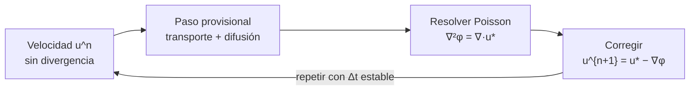

# B21-C04 — Ecuaciones de Navier-Stokes y dinámica de fluidos computacional

<!-- nav:top -->
[🏠 Programa](../../../../README.md) · [📚 Bloque B21](../../../tronco-comun/B21-metodos-numericos-para-edp-y-fluidos-computacionales.md) · [← Anterior: B21-C03 — Ecuación de Poisson: relajación y multigrid](../B21-C03-ecuacion-de-poisson-relajacion-y-multigrid/CLASE.md) · [Siguiente: B21-C05 — Mallas adaptativas (AMR) →](../B21-C05-mallas-adaptativas-amr/CLASE.md)
<!-- /nav -->

## 1. Ubicación, nivel y alcance

Cuarta clase del bloque B21. Reúne lo anterior: de [C01](../B21-C01-volumenes-finitos-y-solucionadores-de-riemann-para-leyes-de-conservacion/CLASE.md) viene la conservación y el paso de tiempo limitado por la información que viaja, de [C02](../B21-C02-ecuacion-de-onda-esquemas-y-dispersion-numerica/CLASE.md) la verificación contra relaciones exactas y de [C03](../B21-C03-ecuacion-de-poisson-relajacion-y-multigrid/CLASE.md) el solucionador de Poisson. Nivel N3. Verás las ecuaciones de Navier–Stokes, la diferencia entre la formulación compresible y la incompresible, el método de proyección para la incompresible y su verificación con un vórtice que tiene solución exacta. No verás turbulencia, mallas desplazadas (*staggered*), condiciones de pared ni flujos con superficies libres.

## 2. Por qué esta clase existe

Un fluido aparece en casi toda la ingeniería aeroespacial: el aire alrededor de un cohete, el propelente que se mueve en un tanque, el refrigerante de un satélite. La dinámica de fluidos computacional (CFD) calcula esos flujos, pero un solucionador puede dar campos de aspecto convincente que violan la conservación o la incompresibilidad. Esta clase enseña a plantear las ecuaciones, a elegir entre las dos formulaciones y a comprobar un solucionador antes de usarlo.

La pregunta motivadora: **¿cómo se avanza en el tiempo un fluido cuya velocidad debe seguir sin divergencia, y cómo se sabe que el código calcula bien la difusión y el transporte?** La decisión central: **qué formulación usar (compresible o incompresible) y qué paso de tiempo es estable**.

## 3. Lo que podrás hacer al terminar

1. Escribir las ecuaciones de Navier–Stokes y reconocer en ellas conservación de masa, momento y energía.
2. Distinguir los regímenes compresible e incompresible y elegir formulación con el número de Mach.
3. Describir el método de proyección y el papel de la ecuación de Poisson de la presión.
4. Calcular el número de Reynolds y el paso de tiempo máximo (difusivo y advectivo).
5. Verificar un solucionador con el vórtice de Taylor–Green: error, orden, energía y divergencia.
6. Reconocer una inestabilidad por un paso de tiempo excesivo.

La evidencia es el **informe de verificación de un solucionador de fluidos** del ejercicio 12 (sección 20).

## 4. Con qué llegas y cómo comprobarlo

Necesitas el esquema de Heun ([B11-C06](../../B11/B11-C06-metodo-de-heun/CLASE.md)), el solucionador de Poisson de [C03](../B21-C03-ecuacion-de-poisson-relajacion-y-multigrid/CLASE.md) y derivadas parciales (B09). Cinco preguntas:

1. ¿Qué es la divergencia de un campo de velocidad `∇·u = ∂u/∂x + ∂v/∂y`?
2. ¿Cuánto es `e^{−0,4}`?
3. ¿Cuánto vale el promedio de `cos² x` en un periodo?
4. ¿Qué significa que un método sea de segundo orden?
5. ¿Qué es el residuo de un sistema `A u = f`?

<details>
<summary>Ver respuestas</summary>

1. La rapidez con que el flujo se expande localmente; es 0 si el fluido no se comprime. 2. `0,6703`. 3. `1/2`. 4. El error baja a la cuarta parte al duplicar los puntos. 5. `r = f − A u`.
</details>

Con cuatro o cinco aciertos, sigue; si no, repasa B09, B11-C06 y B21-C03.

## 5. Un caso real: un remolino en un tanque

Un remolino que se desvanece por viscosidad en un fluido es el caso más simple que contiene toda la física que nos interesa: transporte no lineal (el flujo arrastra su propia velocidad), difusión (la viscosidad lo amortigua) y presión (impone la incompresibilidad). El **vórtice de Taylor–Green** es un remolino periódico de solución exacta: `u = −cos x sin y e^{−2νt}`, `v = sin x cos y e^{−2νt}`, donde `ν` es la viscosidad cinemática. Lo usaremos con `ν = 0,1`, velocidad típica `U = 1` y longitud típica `1` (datos **sintéticos y adimensionales**), como modelo ilustrativo de un remolino en un tanque de propelente. Este es el **ejemplo conductor**.

## 6. Vocabulario

Las **ecuaciones de Navier–Stokes** expresan la conservación de masa, momento y energía de un fluido con viscosidad (S1). Las **ecuaciones de Euler** son su versión sin viscosidad (S2). Un flujo es **incompresible** cuando su densidad no cambia y `∇·u = 0`. La **viscosidad cinemática** `ν` mide cuánto difunde el momento. El **número de Reynolds** `Re = UL/ν` compara transporte y difusión. El **número de Mach** `M = |u|/c` compara la velocidad con la del sonido. La **presión cinemática** `p` es aquí la presión dividida por la densidad. El **método de proyección** avanza la velocidad sin imponer la incompresibilidad y luego la corrige restando un gradiente. Una **malla colocada** guarda todas las variables en los mismos puntos. El **vórtice de Taylor–Green** es la solución exacta usada para verificar.

## 7. Modelo mental: avanzar y luego enderezar

Imagina empujar agua en una bañera: si avanzas la velocidad solo con transporte y difusión, aparecen zonas donde el agua se acumula o se vacía, lo que el agua real no permite. La presión es el «empujón» que lo corrige. El método de proyección separa ambos pasos: primero avanza ignorando la restricción y después proyecta sobre el conjunto de campos sin divergencia.



*Descripción textual:* de una velocidad sin divergencia se da un paso con transporte y difusión; el resultado tiene divergencia; se resuelve una ecuación de Poisson para un potencial `φ`; restando su gradiente la velocidad vuelve a no tener divergencia; y se repite.

Analogía: dibujar con trazo libre y luego ajustar el dibujo a una cuadrícula. Su límite: el ajuste no es arbitrario; es la proyección que menos altera el campo (la de menor cambio en el sentido de mínimos cuadrados).

## 8. La explicación, paso a paso

### 8.1 Las ecuaciones

NASA Glenn presenta las ecuaciones de Navier–Stokes tridimensionales como cinco ecuaciones (continuidad, tres de momento y una de energía) con seis variables dependientes (presión, densidad, temperatura y tres velocidades), por lo que se necesita además una ecuación de estado y un modelo del tensor de esfuerzos (S1). Esa es la formulación **compresible**. Si la densidad es constante y los efectos térmicos no importan, quedan las ecuaciones **incompresibles** (en 2D, con presión cinemática):

`u_t + u u_x + v u_y = −p_x + ν ∇²u`,
`v_t + u v_x + v v_y = −p_y + ν ∇²v`,
`u_x + v_y = 0`.

Las dos primeras son el momento: la variación de la velocidad se debe al transporte (términos no lineales), al gradiente de presión y a la difusión viscosa. La tercera es la restricción de incompresibilidad.

### 8.2 ¿Compresible o incompresible?

El criterio habitual es el número de Mach: por debajo de unos 0,3 los cambios de densidad son pequeños y la formulación incompresible es una buena aproximación (regla práctica estándar, **no respaldada** por una fuente consultada). Por encima, o con ondas de choque, se usa la formulación compresible, que es la de [C01](../B21-C01-volumenes-finitos-y-solucionadores-de-riemann-para-leyes-de-conservacion/CLASE.md) más los términos viscosos y de conducción. Las ecuaciones de Euler se obtienen quitando la viscosidad, y son buenas para algunos casos (por ejemplo, la sustentación de un perfil delgado) y malas para otros (la capa límite), según S2.

### 8.3 El vórtice de Taylor–Green como solución exacta

Se verifica sustituyendo. Con `F = e^{−2νt}`: `u_t = 2ν cos x sin y F`; el transporte vale `u u_x + v u_y = −sin x cos x F²`; la difusión `ν∇²u = 2ν cos x sin y F`. Eligiendo `p = −¼(cos 2x + cos 2y)F²` se tiene `−p_x = −sin x cos x F²`, y la primera ecuación se cumple (la viscosa y la temporal se cancelan, y el transporte lo equilibra la presión). Lo mismo ocurre con la segunda. Además `u_x + v_y = sin x sin y F − sin x sin y F = 0`. La energía cinética por unidad de masa, promediada, es `E(t) = ¼ e^{−4νt}`: decae exponencialmente.

### 8.4 Discretización

Se usa una malla colocada con `N × N` puntos en el cuadrado periódico `[0, 2π)²`, `h = 2π/N`. Las derivadas primeras, por diferencias centradas `(f_{i+1} − f_{i−1})/(2h)`; el laplaciano, por el estencil de cinco puntos de [C03](../B21-C03-ecuacion-de-poisson-relajacion-y-multigrid/CLASE.md). Ambos de segundo orden.

### 8.5 El paso de tiempo con proyección

Se aplica Heun (RK2) a la parte de transporte y difusión; tras cada etapa se proyecta: se calcula `φ` con `∇²φ = ∇·u*` y se corrige `u = u* − ∇φ`. En el laboratorio la ecuación de Poisson periódica se resuelve con FFT (una alternativa al multigrid de C03 para dominios periódicos), usando el símbolo del operador discreto «divergencia de gradiente» para que la divergencia discreta central quede en el nivel del redondeo.

### 8.6 Límites del paso de tiempo

Hay dos. El **difusivo**: para el esquema de Heun el factor de amplificación de la difusión es `1 + z + z²/2` con `z = −8ν Δt/h²` en el modo más corto (2D), y `|·| ≤ 1` exige `z ≥ −2`, o sea `Δt ≤ h²/(4ν)`. Al duplicar `N`, el límite baja a la cuarta parte. El **advectivo**, análogo a la CFL de [C01](../B21-C01-volumenes-finitos-y-solucionadores-de-riemann-para-leyes-de-conservacion/CLASE.md): `Δt` del orden de `h/U`. Aquí domina el difusivo; con velocidades más altas o viscosidad menor, el advectivo. Que haya que respetar la CFL en los códigos astrofísicos lo señala S3.

### 8.7 Qué no cubre este método

La malla colocada con diferencias centradas puede admitir modos de damero en la presión; con campos suaves no se excitan, pero un flujo con escalones sí podría excitarlos (por eso muchos códigos usan mallas desplazadas). Tampoco hay condiciones de pared. Para flujos compresibles con choques, se usa la receta de C01.

## 9. Magnitudes, símbolos y unidades

| Símbolo | Qué es | Unidad (SI) | Nota |
|---|---|---|---|
| `u, v` | componentes de la velocidad | m s⁻¹ | adimensionales en el laboratorio |
| `p` | presión cinemática (presión/densidad) | m² s⁻² | |
| `ν` | viscosidad cinemática | m² s⁻¹ | 0,1 en el laboratorio |
| `Re` | número de Reynolds | — | `UL/ν` |
| `M` | número de Mach | — | `|u|/c` |
| `h` | separación de la malla | m | `2π/N` |
| `Δt` | paso de tiempo | s | |
| `E` | energía cinética media por unidad de masa | m² s⁻² | `¼ e^{−4νt}` |
| `φ` | potencial de la proyección | m² s⁻¹ | |

## 10. Convenciones y referencias

Dominio periódico `[0, 2π)²`; `x` es el primer índice y `y` el segundo; la densidad vale 1 (presión y presión cinemática coinciden). La divergencia discreta es la de diferencias centradas. El error se mide como el máximo de las diferencias de `u` y `v` con la solución exacta en `t = 1`.

## 11. De dónde sale lo que afirmamos

| ID | Fuente | Localizador | Respalda | Estado |
|---|---|---|---|---|
| S1 | NASA Glenn, *Navier-Stokes Equations* (Beginner's Guide to Aeronautics), última actualización indicada: 13 de mayo de 2021 | https://www.grc.nasa.gov/www/k-12/airplane/nseqs.html | Cinco ecuaciones (masa, tres de momento, energía), seis variables dependientes, necesidad de ecuación de estado y modelo de esfuerzos; la página no clasifica el flujo como compresible o incompresible | Consultada el 2026-11-05 mediante extracción automática |
| S2 | NASA Glenn, *Euler Equations* (Beginner's Guide to Aeronautics) | https://www.grc.nasa.gov/www/k-12/airplane/eulereqs.html | Euler es la versión sin viscosidad de Navier–Stokes; buena aproximación en unos casos y mala en otros | Consultada el 2026-11-05 mediante extracción automática |
| S3 | Stone, Gardiner, Teuben, Hawley y Simon, «Athena: a new code for astrophysical MHD» (preprint, 2008) | arXiv:0804.0402, https://arxiv.org/pdf/0804.0402 | Paso de tiempo limitado por una estimación de la condición CFL (ec. 34) | Texto extraído del PDF el 2026-11-05 |

Límites: la forma incompresible, el método de proyección, el umbral de Mach 0,3, el límite difusivo `h²/(4ν)` y la solución de Taylor–Green son resultados estándar que **no se atribuyen a una fuente consultada**; la solución exacta se verifica aquí por sustitución (8.3) y el laboratorio comprueba energía, orden y divergencia. Los datos son **sintéticos y adimensionales**; el tanque es un modelo **ilustrativo**.

## 12. Cómo ver el decaimiento

Equivalente accesible a una gráfica de la energía en el tiempo y del error por malla (cálculo, `t = 1`, `ν = 0,1`):

| `N` | Error máx. de velocidad | `E/E₀` calculada | `E/E₀` exacta |
|---|---|---|---|
| 8 | 8,29 × 10⁻³ | 0,683960 | 0,670320 |
| 16 | 2,10 × 10⁻³ | 0,673757 | 0,670320 |
| 32 | 5,26 × 10⁻⁴ | 0,671181 | 0,670320 |
| 64 | 1,32 × 10⁻⁴ | 0,670535 | 0,670320 |

Descripción larga: el patrón de cuatro vórtices alternados mantiene su forma y su amplitud baja un 33 % en `t = 1`; con malla gruesa la energía decae algo menos que la exacta y la diferencia se reduce a la cuarta parte al duplicar `N`.

## 13. Ejemplo trabajado: decisiones de paso de tiempo

**Paso 1 · Número de Reynolds.** `Re = UL/ν = 1·1/0,1 = 10`: flujo viscoso, laminar.

**Paso 2 · Malla.** `N = 64`: `h = 2π/64 = 0,09817`.

**Paso 3 · Límite difusivo.** `Δt ≤ h²/(4ν) = 0,009638/0,4 = 0,02410`.

**Paso 4 · Límite advectivo.** `h/U = 0,098`: no restringe más.

**Paso 5 · Número de pasos.** Para `t = 1`: `1/0,02410 = 41,5`, es decir, al menos 42 pasos. El laboratorio usa `Δt = 0,005` (200 pasos) para que el error temporal sea despreciable frente al espacial.

**Paso 6 · Valor esperado.** Energía en `t = 1`: `E/E₀ = e^{−4·0,1·1} = e^{−0,4} = 0,6703`. El laboratorio con `N = 64` obtiene 0,670535: diferencia de `3 × 10⁻⁴` relativa.

**Paso 7 · Costo al refinar.** Con `N = 128`: `h = 0,04909`, límite `0,006024` y 166 pasos para `t = 1`: duplicar `N` multiplica por cuatro los pasos y por cuatro los puntos, es decir, por 16 el costo. Datos **sintéticos**.

## 14. Comparación de métodos

La formulación incompresible no tiene ondas sonoras, de modo que su paso de tiempo no está atado a la velocidad del sonido; el precio es resolver Poisson en cada paso (C03). La compresible no necesita resolver Poisson, pero su paso lo fija `|u| + c` (C01), muy pequeño a número de Mach bajo. Para Mach cercano a 0 se prefiere la primera, y con choques solo la segunda es válida.

## 15. Práctica guiada

**Ejercicio 1 · con los pasos indicados.** Calcula el número de Reynolds de un remolino con `U = 1`, `L = 1`, `ν = 0,1`, y di si es viscoso. *Pasos:* fórmula de 8.6 y vocabulario.

<details><summary>Solución comentada</summary>

`Re = 1·1/0,1 = 10`: la difusión viscosa es comparable al transporte; es un flujo viscoso laminar.
</details>

**Ejercicio 2 · con una pista.** ¿Cuál es la energía cinética media en `t = 2`? *Pista:* `E = ¼ e^{−4νt}`.

<details><summary>Solución comentada</summary>

`¼ e^{−0,8} = 0,25·0,4493 = 0,1123`.
</details>

**Ejercicio 3 · casi autónomo.** Calcula el límite difusivo de `Δt` para `N = 16`.

<details><summary>Solución comentada</summary>

`h = 2π/16 = 0,3927`; `h² = 0,1542`; `Δt ≤ 0,1542/0,4 = 0,3855`.
</details>

## 16. Práctica autónoma, transferencia e integrador

**Ejercicio 4.** Con los errores `2,096 × 10⁻³` (`N = 16`) y `5,256 × 10⁻⁴` (`N = 32`), calcula el orden.

<details><summary>Solución comentada</summary>

`log₂(2,096/0,5256) = 1,996`: segundo orden.
</details>

**Ejercicio 5.** ¿Cuántos pasos mínimos para llegar a `t = 1` con `N = 128` y `ν = 0,1`?

<details><summary>Solución comentada</summary>

`h = 0,04909`, `Δt ≤ h²/0,4 = 0,006024`; `1/0,006024 = 166` (paso 7 de la sección 13).
</details>

**Ejercicio 6.** ¿En cuánto tiempo la energía cae a la mitad?

<details><summary>Solución comentada</summary>

`e^{−4νt} = ½` → `t = ln 2/(4·0,1) = 1,733`.
</details>

**Ejercicio 7.** ¿Cuánto vale la presión del vórtice en el origen en `t = 0`?

<details><summary>Solución comentada</summary>

`p = −¼(cos 0 + cos 0)·1 = −0,5`.
</details>

**Ejercicio 8.** El laboratorio reporta divergencia máxima `10⁻¹⁵`. ¿Qué significa y qué no significa?

<details><summary>Solución comentada</summary>

Significa que la velocidad cumple la restricción discreta central al nivel del redondeo. No significa que el campo sea exacto: el error frente a la solución exacta es `10⁻⁴`–`10⁻³`.
</details>

**Ejercicio 9 · transferencia.** Un propelente tipo agua (`ν = 10⁻⁶ m²/s`, valor **ilustrativo**) se mueve a `0,1 m/s` en un tanque de `0,5 m` con celdas de `5 mm`. Calcula `Re` y compara los límites difusivo y advectivo.

<details><summary>Solución comentada</summary>

`Re = 0,1·0,5/10⁻⁶ = 5 × 10⁴`. Difusivo: `h²/(4ν) = 2,5 × 10⁻⁵/4 × 10⁻⁶ = 6,25 s`; advectivo: `h/U = 0,05 s`. Domina el advectivo. Con `Re` tan alto el flujo real sería turbulento, algo que esta clase no modela.
</details>

**Ejercicio 10 · transferencia.** Un flujo de aire a 50 m/s con velocidad del sonido 340 m/s, ¿se puede tratar como incompresible?

<details><summary>Solución comentada</summary>

`M = 50/340 = 0,147 < 0,3`: según la regla práctica de 8.2, sí; con 250 m/s (`M = 0,74`), no.
</details>

**Ejercicio 11 · transferencia.** Con `N = 32` y `Δt = 1,3 Δt_lim` la velocidad llega a `10⁶` en 300 pasos. ¿Error de programa o del método?

<details><summary>Solución comentada</summary>

Del método: el laboratorio muestra que con `0,9 Δt_lim` el campo se mantiene acotado y con `1,3 Δt_lim` crece hasta `6 × 10⁶`. Se confirma reduciendo `Δt`.
</details>

**Ejercicio 12 · integrador.** Elabora el *informe de verificación de un solucionador de fluidos*: tabula error, orden, energía y divergencia en cuatro mallas, determina el límite de estabilidad y concluye qué `N` y `Δt` usarías para un error de `10⁻³`.

<details><summary>Solución modelo</summary>

Tabla de la sección 12; orden 1,996 y 1,999; divergencia `~10⁻¹⁵`; estabilidad: 0,9 estable, 1,3 inestable; el error `≈ 8,4 × 10⁻³/(N/8)²`: con `N = 32` ya es `5 × 10⁻⁴`, así que `N ≈ 22–24` bastaría para `10⁻³` (estimación por el orden 2) con `Δt ≤ 0,2`; todo rotulado sintético y adimensional.
</details>

## 17. Laboratorio: vórtice de Taylor–Green

El script [vortice_taylor_green.py](vortice_taylor_green.py) resuelve Navier–Stokes incompresible con proyección y lo compara con la solución exacta. Falla si la divergencia supera `10⁻¹⁰`, si el orden sale de `[1,9; 2,1]`, si la energía en `N = 16` se aparta más del 1 % o si el límite de estabilidad no se comporta como se predice.

**Datos:** sintéticos y adimensionales. **Predice antes de ejecutar:** ¿qué orden espacial esperas? (2.) **Ejecución del 2026-11-05 (Python 3.12.9, NumPy 2.4.4):**

```text
Python 3.12.9  NumPy 2.4.4
(a) Taylor-Green, nu = 0.1, t = 1, dt = 0.005
    N=  8  error max velocidad = 8.2877e-03  E/E0 = 0.683960 (exacta 0.670320)  |div| max = 2.2e-16
    N= 16  error max velocidad = 2.0962e-03  E/E0 = 0.673757 (exacta 0.670320)  |div| max = 5.2e-16
    N= 32  error max velocidad = 5.2560e-04  E/E0 = 0.671181 (exacta 0.670320)  |div| max = 9.2e-16
    N= 64  error max velocidad = 1.3151e-04  E/E0 = 0.670535 (exacta 0.670320)  |div| max = 1.9e-15
    orden observado (N=16->32->64): 1.996 1.999
(b) estabilidad difusiva, N = 32: dt_lim = h^2 / (4 nu)
    dt = 0.9 dt_lim = 0.08674  max|u| tras 300 pasos = 5.585e-03
    dt = 1.3 dt_lim = 0.12530  max|u| tras 300 pasos = 6.305e+06
Pruebas superadas.
```

```bash
python programa/clases/B21/B21-C04-ecuaciones-de-navier-stokes-y-dinamica-de-fluidos-computacional/vortice_taylor_green.py
```

**Límites:** dominio periódico, un solo fluido, sin turbulencia ni paredes; con `Re = 10` el flujo es laminar y suave. Los resultados son **simulados**.

## 18. Errores frecuentes y cómo corregirlos

**Usar la formulación incompresible a Mach alto.** Se corrige con el ejercicio 10.

**Tomar el paso de la parte advectiva y olvidar el límite difusivo.** Se corrige con los ejercicios 3, 5 y 9.

**Creer que divergencia nula significa solución exacta.** Se corrige con el ejercicio 8.

**Calcular la presión sin condiciones coherentes.** Con Poisson periódico, la presión está definida salvo una constante.

**Atribuir una explosión numérica a un error de programa.** Se corrige con el ejercicio 11.

## 19. Cómo sabrás que vas bien

Tras 8.1: ¿sabes qué representa cada término? Si no, repasa 8.3. Tras 8.5: ¿puedes explicar por qué se resuelve Poisson? Si no, ejercicio 8. Tras 8.6: ¿cuál límite domina? Si no, ejercicios 3 y 9. Tras el laboratorio: ¿cómo sabes que el solucionador es correcto? (orden 2, energía y divergencia).

## 20. Qué entregas y cómo se evalúa

El producto es tu **informe de verificación de un solucionador de fluidos** (ejercicio 12).

| Criterio | Inicial | En desarrollo | Logrado | Destacado |
|---|---|---|---|---|
| Formulación | Sin ecuaciones | Ecuaciones sin interpretar | Interpreta cada término | Justifica compresible o incompresible |
| Proyección | Ausente | Descrita | Explica Poisson y la corrección | Relaciona con C03 |
| Verificación | Sin comparación | Gráfica sin cifras | Tabla de error, orden y energía | Comprueba la solución por sustitución |
| Estabilidad | Ausente | Enuncia un límite | Calcula ambos límites | Demuestra el cruce con el laboratorio |
| Fuentes y rotulado | Sin fuentes | Sin fecha | Con localizador y fecha | Rotula sintético e ilustrativo |

**Condiciones críticas (no se compensan con promedio):** comparar con una solución exacta; declarar que el tanque es ilustrativo; citar solo fuentes consultadas.

## 21. Ética, seguridad y límites

Un fluido simulado sin verificar puede dar una carga de propelente, un calentamiento o una fuerza aerodinámica erróneos. Ningún resultado de esta clase es operativo ni sirve para diseñar un tanque o un vehículo. Accesibilidad: fórmulas en texto, tablas equivalentes a las gráficas, ejercicios sin conexión.

## 22. Para cerrar y seguir

Navier–Stokes expresa conservación de masa, momento y energía; a bajo Mach se trata como incompresible con un paso de proyección que usa Poisson; se verifica con un vórtice exacto y el paso de tiempo está limitado por la difusión y el transporte. Queda abierta una pregunta: si la zona interesante (un choque, un frente) es una pequeña parte del dominio, ¿por qué gastar la misma resolución en todas partes? Es el tema de las mallas adaptativas.

**Glosario español–inglés.** ecuaciones de Navier–Stokes · *Navier–Stokes equations*; incompresible · *incompressible*; viscosidad cinemática · *kinematic viscosity*; número de Reynolds · *Reynolds number*; número de Mach · *Mach number*; método de proyección · *projection method*; malla colocada · *collocated grid*; dinámica de fluidos computacional · *computational fluid dynamics (CFD)*.

**Continuidad.** B21-C05 reutiliza tu **criterio de error y de paso de tiempo** para refinar la malla solo donde hace falta.

**Referencias:** ver sección 11.

<!-- nav:bottom -->
---

[← Anterior: B21-C03 — Ecuación de Poisson: relajación y multigrid](../B21-C03-ecuacion-de-poisson-relajacion-y-multigrid/CLASE.md) · [📚 Bloque B21](../../../tronco-comun/B21-metodos-numericos-para-edp-y-fluidos-computacionales.md) · [Siguiente: B21-C05 — Mallas adaptativas (AMR) →](../B21-C05-mallas-adaptativas-amr/CLASE.md)
<!-- /nav -->
