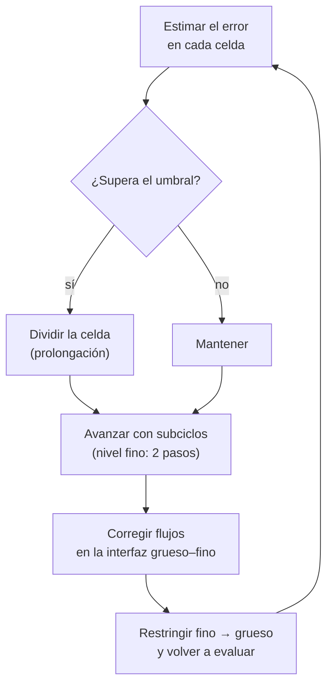

# B21-C05 — Mallas adaptativas (AMR)

<!-- nav:top -->
[🏠 Programa](../../../../README.md) · [📚 Bloque B21](../../../tronco-comun/B21-metodos-numericos-para-edp-y-fluidos-computacionales.md) · [← Anterior: B21-C04 — Ecuaciones de Navier-Stokes y dinámica de fluidos computacional](../B21-C04-ecuaciones-de-navier-stokes-y-dinamica-de-fluidos-computacional/CLASE.md) · [Siguiente: B22-C01 — Problemas directos e inversos y mal condicionamiento →](../../B22/B22-C01-problemas-directos-e-inversos-y-mal-condicionamiento/CLASE.md)
<!-- /nav -->

## 1. Ubicación, nivel y alcance

Quinta y última clase del bloque B21. Hasta aquí todas las mallas eran uniformes: la misma resolución en todo el dominio. Pero un choque, un frente o una estrella en formación ocupan una fracción pequeña del volumen, y pagar la resolución máxima en todas partes es un derroche. Nivel N3. Verás cómo decidir dónde refinar con un criterio de error, cómo se transfieren datos entre niveles de malla de modo que se siga conservando, por qué hace falta corregir los flujos entre niveles y cuánto se ahorra. No verás estructuras de datos en árbol en detalle, balanceo de carga en paralelo ni refinamiento en el tiempo más allá de la razón 2.

## 2. Por qué esta clase existe

Los códigos de referencia en astrofísica, como RAMSES (S1) y Athena++ (S2), usan mallas adaptativas porque los problemas tienen rangos de escala enormes. Pero un esquema adaptativo mal construido no conserva: crea o destruye masa en las interfaces entre niveles, justo donde está el fenómeno interesante. Saber qué corrección falta y cómo comprobarla es lo que permite confiar en el resultado.

La pregunta motivadora: **¿cómo se decide dónde refinar, y qué hay que hacer en la frontera entre una zona gruesa y una fina para no perder masa?** La decisión central: **qué criterio y umbral de refinamiento usar y cómo acoplar los niveles**.

## 3. Lo que podrás hacer al terminar

1. Explicar el refinamiento adaptativo por bloques o celdas y la razón de refinamiento.
2. Aplicar un criterio de gradiente y calcular cuántas celdas ahorra frente a una malla uniforme del mismo error.
3. Restringir y prolongar datos de forma conservativa.
4. Explicar el subciclado y la corrección de flujo en las interfaces grueso–fino.
5. Verificar la conservación de un esquema con dos niveles.
6. Decidir cuándo AMR conviene y cuándo no.

La evidencia es el **informe de verificación de un esquema adaptativo** del ejercicio 12 (sección 20).

## 4. Con qué llegas y cómo comprobarlo

Necesitas el esquema contracorriente y la conservación de [C01](../B21-C01-volumenes-finitos-y-solucionadores-de-riemann-para-leyes-de-conservacion/CLASE.md), la CFL ([C01](../B21-C01-volumenes-finitos-y-solucionadores-de-riemann-para-leyes-de-conservacion/CLASE.md) 8.6) y el orden observado ([B11-C05](../../B11/B11-C05-metodo-de-euler/CLASE.md)). Cinco preguntas:

1. ¿Qué garantiza la conservación en un esquema de volúmenes finitos?
2. Con `ν = aΔt/Δx = 0,8`, ¿qué pasa si se divide `Δx` entre 2 sin cambiar `Δt`?
3. ¿Cuánto es `0,5(3 + 5)`?
4. ¿Cuánto vale `tanh(0)`?
5. ¿Cuál es el máximo de la pendiente de `tanh(x/0,01)`?

<details>
<summary>Ver respuestas</summary>

1. Que cada interfaz use un único flujo, restado en una celda y sumado en la vecina. 2. `ν` se duplica a 1,6 y viola la CFL. 3. `4`. 4. `0`. 5. `100` (en `x = 0`).
</details>

Con cuatro o cinco aciertos, sigue; si no, repasa C01 y B11-C05.

## 5. Un caso real: un frente delgado y un pulso que lo cruza

Imagina un frente de choque suavizado, de ancho `w = 0,01` en un dominio de longitud 1: `u(x) = tanh((x − 0,5)/w)`. Para representarlo con una malla uniforme hacen falta celdas más pequeñas que el frente en todo el dominio. Segundo caso: un pulso gaussiano que viaja con velocidad 1 y cruza un parche de malla fina. Ambos son **sintéticos y adimensionales**, y modelan lo esencial: un rango de escalas grande y una frontera entre resoluciones por la que pasa masa. Este es el **ejemplo conductor**.

## 6. Vocabulario

Una **malla adaptativa** (AMR, *adaptive mesh refinement*) cambia su resolución durante el cálculo. Un **nivel** `ℓ` es un conjunto de celdas del mismo tamaño `Δx_ℓ = Δx₀/2^ℓ` (razón de refinamiento 2). Un **criterio de refinamiento** decide qué celdas se dividen. El **suavizado de malla** marca también las vecinas de una celda marcada. La **restricción** promedia datos finos en una celda gruesa; la **prolongación** reparte datos de una celda gruesa en sus hijas. El **subciclado** da varios pasos de tiempo pequeños en el nivel fino por cada paso del grueso. La **corrección de flujo** (*refluxing*) reemplaza el flujo grueso en una interfaz por el flujo fino. Un **parche** es una región refinada. El **ancho de transición** es la distancia entre niveles.

## 7. Modelo mental: la lupa móvil

Piensa en un mapa con una lupa: la mayor parte se ve con poco detalle y la lupa se desplaza para mostrar con detalle solo donde pasa algo. La lupa tiene un borde, y por el borde pasa información: lo que sale de la lupa debe ser igual a lo que entra al mapa grueso.



*Descripción textual:* en cada celda se estima el error; si supera el umbral se divide, interpolando el dato; los niveles se avanzan con pasos de tiempo proporcionales a su tamaño; en las interfaces se corrige el flujo y se promedia la solución fina sobre la gruesa; el ciclo vuelve a evaluar el error.

Analogía: la lupa sobre un mapa. Su límite: la lupa no cambia el mapa debajo, mientras que aquí la solución fina sustituye a la gruesa en la zona cubierta.

## 8. La explicación, paso a paso

### 8.1 Dónde refinar

En RAMSES, una celda se refina si el gradiente de una variable `q`, multiplicado por el ancho local de celda, supera una fracción `C_q` del valor central: `|∇q_i| ≥ C_q q_i/Δx_ℓ` (S1, ec. 21). Es un criterio relativo a la propia variable. En el laboratorio la amplitud del frente es 1, así que la usamos como escala: se marca la celda si `|∇u|·Δx ≥ C` con `C = 0,05`, con el gradiente por diferencia centrada. Para una función suave, `|∇u|Δx` es el cambio de `u` por celda, y una celda representa a la función con un error de unos `|∇u|Δx/2`. Por eso el criterio equivale a fijar una **tolerancia de error `≈ C/2`**, y hay refinamiento solo mientras no se alcance.

RAMSES añade una regla estricta para que las transiciones sean suaves: toda celda refinada debe estar rodeada de celdas padre vecinas, y también un «suavizado de malla» que marca las vecinas de las marcadas, para que el mapa de refinamiento no sea ruidoso (S1).

### 8.2 Cuántas celdas se ahorran

El frente `tanh((x − 0,5)/0,01)` tiene su pendiente máxima en el centro: `1/w = 100`. Se refina hasta que `100·Δx` baja de `C`: `Δx ≈ 5 × 10⁻⁴`. Partiendo de 32 celdas (`Δx = 1/32`), eso son 6 niveles (`1/(32·64) = 4,9 × 10⁻⁴`). Los niveles siguientes no se activan, porque el error ya es el tolerado. Una malla uniforme con ese error necesita 2 048 celdas; la adaptativa, 96. La razón es del 4,7 %. A medida que se piden niveles más finos, las celdas de la adaptativa no aumentan (el frente tiene un ancho fijo), pero las de la uniforme se duplican por nivel.

### 8.3 Restricción y prolongación conservativas

La restricción de datos finos a gruesos es el promedio ponderado por volumen, `U_grueso = Σ U_fino ΔV_fino/ΔV_grueso`; Athena++ la usa sobre las variables conservadas (S2, ec. 2). La prolongación reparte el valor grueso en sus hijas. Para que sea conservativa, las dos hijas deben promediar al valor de la madre: si se le suma una pendiente `+s` a una y `−s` a la otra, el promedio no cambia. Entonces `restricción(prolongación(U)) = U` y la masa no varía por el solo hecho de refinar.

### 8.4 Subciclado

Con la CFL de C01, `Δt ∝ Δx`: el nivel fino necesita pasos la mitad de grandes. Avanzar toda la malla con el paso más pequeño sería un derroche, así que el nivel fino da 2 pasos por cada uno del grueso. RAMSES lo expresa como `Δt_ℓ` al nivel `ℓ`, con la restricción de que el paso fino no supere al del nivel anterior y de que los pasos se sincronicen (S1).

### 8.5 El problema de la interfaz y la corrección de flujo

En la cara que separa una celda gruesa de la zona fina, el esquema grueso calcula un flujo `F_c` con datos gruesos y el fino calcula, en cada subpaso, un flujo con datos finos. Esos flujos no coinciden. Si cada nivel usa el suyo, la masa que sale de un lado no es la que entra del otro, y el total no se conserva. La solución, de Berger y Colella (citados en S2), es **reemplazar** en la celda gruesa vecina el flujo grueso por el promedio temporal de los flujos finos. Athena++ describe el mismo paso: el flujo integrado de la cara gruesa se sustituye por la suma de los flujos de las caras finas (S2).

Con las notaciones de la sección 13: si la celda gruesa se actualizó con `F_c`, su corrección es `+(Δt/Δx)(F_c − F_f)` en la cara derecha de la celda (cara izquierda del parche) y `+(Δt/Δx)(F_f − F_c)` en la cara izquierda de la celda del otro lado. Con los signos correctos la masa se conserva a la precisión de máquina (ejercicio 11).

### 8.6 Cuándo conviene

Si el 100 % del dominio necesita la resolución máxima, AMR solo añade trabajo. Con una fracción `f` del dominio refinada con razón 2, el número de celdas respecto de la malla uniforme fina es `(1 + f)/2`: con `f = 0,3` es 0,65. El ahorro grande ocurre con frentes delgados (`f` pequeña). El costo extra de la lógica de árbol, el balanceo en paralelo y las interfaces no entra en esa cuenta.

## 9. Magnitudes, símbolos y unidades

| Símbolo | Qué es | Unidad | Nota |
|---|---|---|---|
| `ℓ` | nivel de refinamiento | — | 0 es el más grueso |
| `Δx_ℓ` | ancho de celda | m | `Δx₀/2^ℓ` |
| `N₀` | celdas en el nivel 0 | — | 32 o 64 |
| `w` | ancho del frente | m | 0,01 (adimensional) |
| `C` | umbral del criterio | — | 0,05 |
| `ν` | número de Courant | — | 0,8 |
| `F_c, F_f` | flujo grueso y fino en la interfaz | por unidad de tiempo | |
| `U` | variable conservada | — | |
| `f` | fracción del dominio refinada | — | |

## 10. Convenciones y referencias

Razón de refinamiento 2. Las celdas se centran en `(i + ½)Δx_ℓ`. Los valores se asignan a las celdas en el centro (función muestreada); el error se mide como el máximo de la diferencia entre la función y el valor de su celda dentro de la celda. En 1D la «cara» entre niveles es un punto.

## 11. De dónde sale lo que afirmamos

| ID | Fuente | Localizador | Respalda | Estado |
|---|---|---|---|---|
| S1 | Teyssier, «Cosmological hydrodynamics with adaptive mesh refinement: a new high resolution code called RAMSES» (preprint, 2001) | arXiv:astro-ph/0111367, https://arxiv.org/pdf/astro-ph/0111367 (secciones 2.1.1 y 2.2.5) | Criterio de refinamiento por gradiente (ec. 21), suavizado de malla, regla de vecinos, restricción del paso fino y sincronización de pasos | Texto extraído del PDF el 2026-11-05 |
| S2 | Stone, Tomida, White y Felker, «The Athena++ adaptive mesh refinement framework: design and magnetohydrodynamic solvers» (preprint, 2020) | arXiv:2005.06651, https://arxiv.org/pdf/2005.06651 (secciones 1, 2.1.4 y 2.1.5) | AMR por bloques frente a por parches; corrección de flujo entre niveles; restricción promediada por volumen (ec. 2) | Texto extraído del PDF el 2026-11-05 |

Límites: Berger y Colella y Berger y Oliger se mencionan solo como los autores que S2 cita; **no se consultaron directamente**. La derivación de la corrección de flujo, el criterio de ahorro `(1+f)/2` y la identificación del umbral con un error `C/2` son resultados estándar o cálculo propio. Los datos son **sintéticos y adimensionales**.

## 12. Cómo ver el ahorro

Equivalente accesible a una gráfica de celdas frente a error (laboratorio, frente de ancho 0,01, `C = 0,05`, `N₀ = 32`):

| Niveles máximos | Celdas AMR | Error AMR | Celdas uniformes con ese error |
|---|---|---|---|
| 3 | 50 | 0,1929 | 256 |
| 5 | 76 | 0,0488 | 1 024 |
| 7 | 96 | 0,0244 | 2 048 |
| 8 | 96 | 0,0244 | 2 048 |

Descripción larga: al aumentar los niveles permitidos, el error de la malla adaptativa baja hasta quedar fijo en `C/2 = 0,025`, y el número de celdas se estabiliza en 96; la uniforme necesitaría 2 048. Los niveles 7 y 8 coinciden porque el criterio ya se cumple.

## 13. Ejemplo trabajado: marcar celdas y corregir un flujo

**Paso 1 · Una celda del frente.** En el nivel 0, `Δx = 1/32`. La celda `i = 15` está centrada en `x = 0,484375`. Sus vecinas a `x ± Δx` valen `tanh(1,5625) = 0,9159` y `tanh(−4,6875) = −0,9998`.

**Paso 2 · Gradiente por celda.** `|u(x+Δx) − u(x−Δx)|/2 = (0,9159 + 0,9998)/2 = 0,9579`.

**Paso 3 · Decisión.** `0,9579 ≥ C = 0,05` → se divide en dos. Una celda lejos del frente, por ejemplo la `i = 2`, da 0 → se mantiene.

**Paso 4 · Corrección de flujo.** Sea la advección con `a = 1`, `ν = 0,8` y una celda gruesa a la izquierda del parche con `u_viejo = 1,0`. El esquema grueso usa en la cara del parche `F_c = a·1,0 = 1,0`. El nivel fino, con dato de frontera interpolado en el tiempo, usa en los dos subpasos `1,0` y `0,9`: promedio `F_f = 0,95`.

**Paso 5 · Corrección.** `(Δt/Δx)(F_c − F_f) = 0,8·(1,0 − 0,95) = 0,04`, que se suma a la celda gruesa. Sin esa corrección, la celda gruesa pierde `0,04` más que lo que el parche recibe: ese es el origen del error de masa del laboratorio.

**Paso 6 · Lectura.** Cada paso grueso en que la masa cruza la interfaz deja un error de este orden; sin corregir, se acumula (en el laboratorio, `1,5 × 10⁻³` de la masa). Datos **sintéticos**.

## 14. Comparación de métodos

Frente a una malla uniforme fina, AMR ahorra celdas cuando el fenómeno es localizado (4,7 % en el frente del laboratorio). Frente a una malla uniforme gruesa, es más preciso a un costo moderado. En el laboratorio, con el pulso dentro del parche, el error máximo fue `0,131` con AMR, `0,146` con la malla gruesa y `0,082` con la fina: AMR mejora a la gruesa pero no alcanza a la fina, porque tras salir del parche el pulso vuelve a difundirse. Frente a una malla no estructurada, la AMR por bloques de Athena++ (S2) mantiene datos regulares y es más simple de implementar, y la AMR por parches de Berger y Oliger (citada en S2) permite refinar con más libertad pero con datos repetidos entre niveles.

## 15. Práctica guiada

**Ejercicio 1 · con los pasos indicados.** Restringe dos celdas finas de valores `3` y `5` (mismo volumen) a su celda gruesa. *Pasos:* promedio ponderado por volumen (8.3).

<details><summary>Solución comentada</summary>

`(3ΔV + 5ΔV)/(2ΔV) = 4`.
</details>

**Ejercicio 2 · con una pista.** Prolonga conservativamente una celda gruesa de valor `2` con vecinas `1` y `4`, usando pendiente centrada. *Pista:* pendiente `(4 − 1)/2 = 1,5` por celda; las hijas se desplazan `±pendiente/4`.

<details><summary>Solución comentada</summary>

Hijas: `2 − 1,5/4 = 1,625` y `2 + 1,5/4 = 2,375`. Su promedio es 2: conservativo.
</details>

**Ejercicio 3 · casi autónomo.** Una celda tiene vecinas de valores `0,2` y `0,9`. Con `C = 0,05`, ¿se refina?

<details><summary>Solución comentada</summary>

`|0,9 − 0,2|/2 = 0,35 ≥ 0,05`: sí.
</details>

## 16. Práctica autónoma, transferencia e integrador

**Ejercicio 4.** Para un error de `0,01` con el frente de la clase (`pendiente 100`), ¿qué nivel se necesita desde `N₀ = 32` y cuántas celdas tendría la malla uniforme equivalente?

<details><summary>Solución comentada</summary>

Error `≈ 100·Δx/2 ≤ 0,01` → `Δx ≤ 2 × 10⁻⁴`. `1/(32·2^ℓ) ≤ 2 × 10⁻⁴` → `2^ℓ ≥ 156` → `ℓ = 8` (`Δx = 1,2 × 10⁻⁴`). Malla uniforme: `32·256 = 8 192` celdas.
</details>

**Ejercicio 5.** ¿Por qué el error de la adaptativa se estabiliza en 0,0244 y no baja con más niveles?

<details><summary>Solución comentada</summary>

Porque el criterio deja de marcar celdas cuando `|∇u|Δx < C`; el error por celda queda en `~|∇u|Δx/2 ≈ C/2 = 0,025`. Para bajarlo hay que reducir `C`.
</details>

**Ejercicio 6.** Con tres niveles (razón 2 entre ellos) y subciclado, ¿cuántos pasos da el nivel más fino por cada paso grueso?

<details><summary>Solución comentada</summary>

4 (2 por cada nivel). El nivel `ℓ` da `2^ℓ` pasos por paso grueso (8.4).
</details>

**Ejercicio 7.** Si una celda gruesa tiene `u = 1`, `ν = 0,8` y el flujo fino promedio es 0,9 mientras el grueso es 1,0, ¿qué corrección recibe?

<details><summary>Solución comentada</summary>

`0,8·(1,0 − 0,9) = 0,08`.
</details>

**Ejercicio 8.** ¿Qué fracción de celdas ahorra AMR (frente a la uniforme fina) cuando el 30 % del dominio está refinado?

<details><summary>Solución comentada</summary>

Celdas `(1 + f)/2 = 0,65` de la uniforme fina; ahorra el 35 %.
</details>

**Ejercicio 9 · transferencia.** Un pulso de plasma con frente de 10⁶ m en un dominio de 10⁹ m (valores **ilustrativos**) ocupa el 1 % del dominio. ¿Cuántas celdas ahorra una malla de 2 niveles frente a una uniforme con la resolución fina?

<details><summary>Solución comentada</summary>

`f = 0,01`: `(1 + 0,01)/2 = 0,505` con razón 2; con razón de refinamiento mayor el ahorro es mayor. Para 2 niveles adicionales (ratio 4), `(1 + 3f)/4 = 0,2575`. La fórmula supone el parche con su cobertura exacta; la real incluye zonas de transición.
</details>

**Ejercicio 10 · transferencia.** En cuál caso no conviene AMR: un frente que ocupa el 5 % o un flujo turbulento que llena el dominio.

<details><summary>Solución comentada</summary>

El turbulento: casi todo el dominio necesita la resolución máxima (`f ≈ 1`), el número de celdas es el de la uniforme y la lógica de AMR solo añade costo (8.6).
</details>

**Ejercicio 11 · transferencia.** El laboratorio sin corrección pierde `1,5 × 10⁻³` de masa y con corrección `4 × 10⁻¹⁷`. Si una corrección con el signo equivocado en un lado dejara un error que crece con la presencia de la cola del pulso, ¿qué harías?

<details><summary>Solución comentada</summary>

Monitorear la masa total del compuesto (celdas gruesas descubiertas + finas) paso a paso y buscar cuándo empieza a diferir; si el error crece al acercarse el pulso a una interfaz, el fallo está en esa cara. Sustituir el signo de la corrección la hizo cerrar a `10⁻¹⁷`.
</details>

**Ejercicio 12 · integrador.** Elabora tu *informe de verificación de un esquema adaptativo*: ahorro de celdas, conservación con y sin corrección, precisión frente a mallas uniformes y recomendación.

<details><summary>Solución modelo</summary>

Tabla de la sección 12 (4,7 %), restricción∘prolongación a `10⁻¹⁶`, masa `4 × 10⁻¹⁷` frente a `1,5 × 10⁻³`, errores `0,131`, `0,146`, `0,082`, y una recomendación que mencione el fenómeno localizado, el umbral `C` y los límites del 1D; datos sintéticos rotulados.
</details>

## 17. Laboratorio: refinamiento por gradiente y corrección de flujo

El script [amr_1d_refinamiento_y_reflujo.py](amr_1d_refinamiento_y_reflujo.py) construye una malla adaptativa 1D con el criterio de gradiente y la compara con la uniforme equivalente; verifica que restricción y prolongación son conservativas; y simula un pulso con un parche fino, con subciclado y con y sin corrección de flujo. Falla si el ahorro es menor al 95 %, si la restricción no es exacta, si la masa con corrección supera `10⁻¹³` o si sin ella el error no es visible.

**Datos:** sintéticos y adimensionales. **Predice antes de ejecutar:** ¿qué error de masa deja la falta de corrección? (≈ 10⁻³.) **Ejecución del 2026-11-05 (Python 3.12.9, NumPy 2.4.4):**

```text
Python 3.12.9  NumPy 2.4.4
(a) frente tanh((x-0.5)/0.01); malla gruesa N0 = 32, hasta lmax niveles, C = 0.05
    lmax=3  celdas AMR =   50  error AMR = 0.1929  |  uniforme con ese error:   256 celdas (nivel 3)  AMR/uniforme = 19.53 %
    lmax=5  celdas AMR =   76  error AMR = 0.0488  |  uniforme con ese error:  1024 celdas (nivel 5)  AMR/uniforme =  7.42 %
    lmax=7  celdas AMR =   96  error AMR = 0.0244  |  uniforme con ese error:  2048 celdas (nivel 6)  AMR/uniforme =  4.69 %
    lmax=8  celdas AMR =   96  error AMR = 0.0244  |  uniforme con ese error:  2048 celdas (nivel 6)  AMR/uniforme =  4.69 %
(b) restricción y prolongación conservativas
    max |restricción(prolongación(u)) - u| = 1.11e-16   |sum fino*dxf - sum grueso*dxc| = 6.94e-18
(c) pulso gaussiano con parche fino sobre [0.25, 0.5): conservación de la masa
    corrección de flujo = True   máx |masa - masa inicial| = 4.163e-17
    corrección de flujo = False  máx |masa - masa inicial| = 1.533e-03
    precisión en t = 0.15 (pulso dentro del parche): error máx frente a la solución exacta
    AMR (parche) = 1.3115e-01   malla gruesa pura = 1.4630e-01   malla fina pura = 8.2416e-02
Pruebas superadas.
```

```bash
python programa/clases/B21/B21-C05-mallas-adaptativas-amr/amr_1d_refinamiento_y_reflujo.py
```

**Límites:** 1D, un parche estático, razón 2, interpolación temporal lineal, esquema de primer orden; el criterio se evalúa sobre una función conocida, no sobre una solución que evoluciona. Los resultados son **simulados**.

## 18. Errores frecuentes y cómo corregirlos

**Refinar sin corregir el flujo.** Se corrige con la sección 8.5 y los ejercicios 7 y 11.

**Refinar con un umbral que no corresponde a la tolerancia.** Se corrige con el ejercicio 5.

**Pensar que más niveles siempre bajan el error.** Se corrige con el ejercicio 5.

**Usar AMR cuando casi todo el dominio es interesante.** Se corrige con el ejercicio 10.

**Promediar al restringir con pesos que no son de volumen.** Rompe la conservación (8.3).

## 19. Cómo sabrás que vas bien

Tras 8.1: ¿puedes decir si una celda se marca con un gradiente dado? Si no, ejercicio 3. Tras 8.3: ¿puedes prolongar sin cambiar la masa? Si no, ejercicio 2. Tras 8.5: ¿puedes calcular la corrección? Si no, ejercicio 7. Tras el laboratorio: ¿cómo sabes que el esquema adaptativo conserva? (masa total del compuesto constante).

## 20. Qué entregas y cómo se evalúa

El producto es tu **informe de verificación de un esquema adaptativo** (ejercicio 12).

| Criterio | Inicial | En desarrollo | Logrado | Destacado |
|---|---|---|---|---|
| Criterio de refinamiento | Ausente | Descrito | Aplicado con cifras | Relaciona umbral con error |
| Transferencia entre niveles | Ausente | Enuncia | Restricción y prolongación conservativas | Comprueba `R(P(U)) = U` |
| Corrección de flujo | Ausente | Descrita | Calcula la corrección | Verifica con y sin ella |
| Ahorro | Sin cifras | Cualitativo | Celdas AMR frente a uniforme | Discute cuándo no conviene |
| Fuentes y rotulado | Sin fuentes | Sin fecha | Con localizador y fecha | Rotula lo no consultado |

**Condiciones críticas (no se compensan con promedio):** comprobar la conservación; comparar con malla uniforme; citar solo fuentes consultadas.

## 21. Ética, seguridad y límites

Una malla adaptativa mal verificada puede ocultar un error de conservación justo donde el resultado es más importante, y una conclusión científica o de ingeniería (por ejemplo, la intensidad de un choque) quedaría errada. Ningún resultado de esta clase es operativo. Accesibilidad: fórmulas en texto, tablas equivalentes a las gráficas, ejercicios sin conexión.

## 22. Para cerrar y seguir

La malla adaptativa refina donde un criterio de error lo pide, usa restricción y prolongación conservativas, avanza los niveles con subciclado y corrige los flujos en las interfaces; el umbral fija el error, no el número de niveles. Con esto se cierra el bloque: los volúmenes finitos, las ondas, Poisson y Navier–Stokes se combinan en un código adaptativo. Queda abierta la extensión a 2D y 3D, a esquemas de orden superior y al acoplamiento con partículas y autogravedad que describen RAMSES y Athena++.

**Glosario español–inglés.** malla adaptativa · *adaptive mesh refinement (AMR)*; nivel · *level*; criterio de refinamiento · *refinement criterion*; restricción · *restriction*; prolongación · *prolongation*; subciclado · *subcycling*; corrección de flujo · *flux correction / refluxing*; parche · *patch*; razón de refinamiento · *refinement ratio*.

**Continuidad.** Con B21 completo, los bloques que usan simulación (por ejemplo, los de plasma y heliofísica) reutilizan tu **verificación de solucionadores**.

**Referencias:** ver sección 11.

<!-- nav:bottom -->
---

[← Anterior: B21-C04 — Ecuaciones de Navier-Stokes y dinámica de fluidos computacional](../B21-C04-ecuaciones-de-navier-stokes-y-dinamica-de-fluidos-computacional/CLASE.md) · [📚 Bloque B21](../../../tronco-comun/B21-metodos-numericos-para-edp-y-fluidos-computacionales.md) · [Siguiente: B22-C01 — Problemas directos e inversos y mal condicionamiento →](../../B22/B22-C01-problemas-directos-e-inversos-y-mal-condicionamiento/CLASE.md)
<!-- /nav -->
