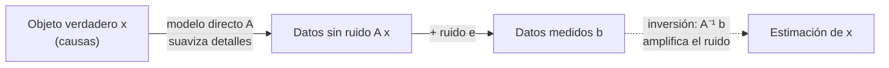

# B22-C01 — Problemas directos e inversos y mal condicionamiento

<!-- nav:top -->
[🏠 Programa](../../../../README.md) · [📚 Bloque B22](../../../tronco-comun/B22-problemas-inversos-y-estimacion-de-modelos.md) · [← Anterior: B21-C05 — Mallas adaptativas (AMR)](../../../tronco-comun/B21-metodos-numericos-para-edp-y-fluidos-computacionales.md#b21-c05) · [Siguiente: B22-C02 — Regularización de Tikhonov →](../B22-C02-regularizacion-de-tikhonov/CLASE.md)
<!-- /nav -->

## 1. Ubicación, nivel y alcance

Primera clase del bloque B22. Hasta ahora, en [B10-C07](../../B10/B10-C07-proyecciones-y-minimos-cuadrados/CLASE.md), ajustabas un modelo a datos suponiendo que el ajuste «sale bien». Aquí te preguntas cuándo no sale bien aunque el modelo sea perfecto: cuando recuperar la causa a partir del efecto amplifica el ruido hasta destruir la respuesta. Nivel N3.

Verás qué es un problema directo y uno inverso, las tres condiciones de Hadamard, la no unicidad, el número de condición y por qué una solución exacta puede ser inservible con datos reales. No verás todavía cómo arreglarlo (regularización: [C02](../B22-C02-regularizacion-de-tikhonov/CLASE.md)) ni cuándo los parámetros quedan determinados (C03).

## 2. Por qué esta clase existe

Un telescopio nunca entrega la imagen verdadera del cielo: la entrega emborronada por su respuesta óptica y con ruido. Calcular lo que verá el telescopio si conoces el objeto es fácil; el camino contrario, recuperar el objeto desde lo que vio, es el que interesa a la ciencia y el que se complica. Lo mismo ocurre al deducir una órbita desde posiciones, la composición de una atmósfera desde un espectro o el interior de un planeta desde su campo gravitatorio.

La decisión central de la clase es: **antes de invertir, ¿puedo confiar en que la inversión directa de mis datos devuelva algo con sentido, y con qué error?** Aprenderás a medir esa confianza con un número (el número de condición) y a reconocer cuando la respuesta es «no».

## 3. Lo que podrás hacer al terminar

1. Distinguir un problema directo de uno inverso y escribir ambos con la misma matriz.
2. Enunciar las tres condiciones de Hadamard y decir cuál falla en un ejemplo.
3. Explicar con un ejemplo por qué datos distintos con ruido pueden dar soluciones muy distintas.
4. Calcular el número de condición de una matriz a partir de sus valores singulares y usarlo en una cota de error.
5. Reconocer una no unicidad (espacio nulo) y escribir la familia completa de soluciones.
6. Ejecutar y leer una prueba que muestre el colapso de la inversión ingenua.

La evidencia es el **diagnóstico de un problema inverso** del ejercicio 12 (sección 20).

## 4. Con qué llegas y cómo comprobarlo

Necesitas matrices y vectores, resolver `A x = b` ([B10-C05](../../B10/B10-C05-sistemas-lineales-y-eliminacion/CLASE.md)), la norma de un vector y mínimos cuadrados ([B10-C07](../../B10/B10-C07-proyecciones-y-minimos-cuadrados/CLASE.md)). Cinco preguntas:

1. Si `A = [[2, 0], [0, 5]]` y `x = (1, 1)`, ¿cuánto vale `b = A x`?
2. ¿Cuánto vale la norma `‖v‖` de `v = (3, 4)`?
3. ¿Cuántas soluciones tiene `x + y = 3` con dos incógnitas?
4. ¿Qué significa que el residuo de un ajuste por mínimos cuadrados sea ortogonal a las columnas de `A`?
5. Si un dato `b` tiene un error relativo del 1 %, ¿qué error relativo esperas en `x = b/2`?

<details>
<summary>Ver respuestas</summary>

1. `b = (2, 5)`. 2. `5`. 3. Infinitas: cualquier `x` con `y = 3 − x`. 4. Que `Aᵀ r = 0`: el residuo no tiene componente en el espacio que el modelo puede producir (B10-C07). 5. También 1 %: dividir por 2 no amplifica el error relativo; esta clase trata de matrices que sí lo amplifican.
</details>

Con cuatro o cinco aciertos, sigue; con tres o menos, repasa B10-C05 y B10-C07.

## 5. Un caso real: ver el cielo a través de un instrumento

Toda observación astronómica es un problema inverso: lo que mide el instrumento es el objeto transformado por un modelo físico más ruido. La revisión de Madhusudhan sobre la recuperación de atmósferas de exoplanetas la describe así: se estiman propiedades atmosféricas (composición, temperatura, nubes) a partir de un espectro observado, con un modelo de parámetros ajustables y métodos estadísticos, y se informa de incertidumbres (S4). El mismo patrón sirve para una imagen: el objeto verdadero se desconoce y lo que tienes es la imagen.

En esta clase usarás una versión **sintética** mínima, para que conozcas la verdad y puedas ver cuánto falla la inversión. El ejemplo conductor es un perfil de brillo a lo largo de una línea (por ejemplo, el borde de un disco de polvo), que el telescopio emborrona con una respuesta gaussiana de ancho conocido. Los datos son **sintéticos**: no son observaciones.

## 6. Vocabulario

Un **problema directo** calcula los datos `b` a partir de las causas `x` con un modelo conocido: `b = A x`. Un **problema inverso** hace lo contrario: dado `b`, hallar `x`. La **incógnita** `x` es un vector de `n` números (aquí, el brillo en `n` posiciones); los **datos** `b` son `m` números; `A` es la **matriz del modelo directo**, de tamaño `m × n`. El **ruido** `e` es el error aleatorio de la medida, de modo que lo que observas es `b = A x + e`.

Un problema está **bien planteado** (*well-posed*, en el sentido de Hadamard) si tiene solución, es única y depende de forma continua de los datos (S1). Si falla alguna, está **mal planteado**. Un problema bien planteado puede ser **mal condicionado**: pequeñas variaciones de los datos producen variaciones grandes de la solución; un número de condición grande lo indica (S1). El **espacio nulo** de `A` son los vectores `v` con `A v = 0`: sumarlos a una solución no cambia los datos.

## 7. Modelo mental: el embudo que no se puede desandar

Piensa en un embudo: muchos objetos distintos desembocan en casi los mismos datos. Ir de arriba abajo (problema directo) es fácil y estable. Subir es ambiguo, porque cada dato de salida corresponde a muchos objetos de entrada que difieren en detalles que el instrumento aplasta.



*Descripción textual:* una flecha continua lleva del objeto `x` a los datos sin ruido mediante `A`; el ruido `e` se suma y da los datos medidos `b`; una flecha de puntos intenta volver desde `b` a una estimación de `x` aplicando `A⁻¹`, y esa vuelta amplifica el ruido.

**Límite de la analogía:** un embudo real pierde información de forma irreversible y definitiva; aquí la información no se pierde por completo, se **atenúa** tanto que el ruido la supera. Con mejores datos se recupera más, algo que con un embudo tapado no ocurre.

## 8. La explicación, paso a paso

### 8.1 Las tres condiciones de Hadamard

Una solución de `A x = b` debe cumplir tres cosas (S1). **Existencia:** hay al menos un `x` con `A x = b`. **Unicidad:** hay uno solo. **Estabilidad:** si los datos cambian poco, la solución cambia poco. Con datos reales casi nunca se cumple la existencia exacta (el ruido saca a `b` del conjunto de lo que `A` puede producir) y se pasa a mínimos cuadrados, como en B10-C07; la unicidad y la estabilidad son las que se rompen en los problemas inversos de esta clase.

### 8.2 Unicidad: el espacio nulo

Supón tres incógnitas `x = (x₁, x₂, x₃)` de las que solo mides las sumas de dos vecinas: `b₁ = x₁ + x₂`, `b₂ = x₂ + x₃`. Entonces `A = [[1,1,0],[0,1,1]]`. El vector `v = (1, −1, 1)` cumple `A v = 0`, de modo que cualquier solución puede desplazarse a lo largo de `v` sin cambiar los datos: hay **infinitas** soluciones, `x = x₀ + t v`. Ningún dato adicional del mismo tipo resuelve esto; hace falta otro tipo de medida o una suposición (por ejemplo, elegir la solución de norma mínima, que verás en C02).

**Pausa.** Con `b = (3, 5)`, ¿es `x = (1, 2, 3)` solución? ¿Y `(2, 1, 4)`? *Respuesta:* ambas: `1+2 = 3`, `2+3 = 5`; `2+1 = 3`, `1+4 = 5`. Se diferencian en `(1, −1, 1)`.

### 8.3 Estabilidad: valores singulares y número de condición

La herramienta que mide la sensibilidad es la **descomposición en valores singulares** (SVD): toda matriz `A` se escribe `A = U Σ Vᵀ`, con `U` y `V` de columnas ortonormales y `Σ` diagonal con los **valores singulares** `σ₁ ≥ σ₂ ≥ … ≥ σₙ ≥ 0` (S6 describe cómo la calcula NumPy: devuelve `u`, los `s` en orden descendente y `vh`). Cada `σᵢ` es el factor por el que `A` multiplica la longitud de la dirección `vᵢ`: las direcciones con `σᵢ` pequeño casi desaparecen de los datos.

Para invertir hay que deshacer ese factor, es decir, **multiplicar por `1/σᵢ`**. Una componente del ruido a lo largo de `uᵢ` se amplifica entonces por `1/σᵢ`, y si `σᵢ` es diminuto, esa amplificación es enorme. El **número de condición** resume el peor caso:

```text
κ(A) = σ₁ / σₙ        (adimensional, κ ≥ 1; para A cuadrada e invertible)
```

Una cota sencilla lo muestra. Como `b = A x`, se cumple `‖b‖ ≤ σ₁ ‖x‖`. Como `δx = A⁻¹ δb`, se cumple `‖δx‖ ≤ ‖δb‖ / σₙ`. Dividiendo,

```text
‖δx‖ / ‖x‖  ≤  κ(A) · ‖δb‖ / ‖b‖
```

El error relativo de los datos puede multiplicarse hasta por `κ`. Es una **cota**, no una igualdad: el error real suele ser menor, pero no puedes asegurarlo. Con aritmética de doble precisión, cuyo error de redondeo relativo es de orden `2,2 × 10⁻¹⁶`, un `κ` de `10¹⁶` ya agota todas las cifras incluso sin ruido.

**Pausa.** Si `κ = 10⁴` y tus datos tienen un error relativo de `10⁻³`, ¿qué error relativo en `x` no puedes descartar? *Respuesta:* hasta `10⁴ × 10⁻³ = 10`, es decir, 1000 %. La solución podría no tener ningún dígito correcto.

### 8.4 Por qué los problemas de observación son así

Un instrumento suaviza: la respuesta gaussiana promedia vecinos y borra los detalles finos. Los valores singulares de ese promedio decaen sin llegar a cero, de modo que los detalles finos (las `vᵢ` oscilantes, con `σᵢ` pequeño) llegan a los datos con amplitudes por debajo del ruido (S2 describe que, al discretizar problemas inversos, los valores singulares decaen gradualmente a cero y que los vectores singulares asociados oscilan más). Invertir equivale a pedirle a los datos que dicten esos detalles, y lo único que dictan es ruido.

## 9. Magnitudes, símbolos y unidades

| Símbolo | Qué es | Unidad | Nota |
|---|---|---|---|
| `x` | incógnita (aquí, brillo en `n` posiciones) | unidades arbitrarias | vector de `n` números |
| `b` | datos medidos | las mismas | vector de `m` números |
| `A` | matriz del modelo directo | adimensional | `m × n` |
| `e` | ruido | como `b` | aquí gaussiano, desviación `σ_ruido` |
| `σᵢ` | valor singular de `A` | adimensional | `σ₁ ≥ … ≥ σₙ` |
| `κ` | número de condición `σ₁/σₙ` | adimensional | `κ ≥ 1` |
| `w` | ancho de la respuesta del instrumento | unidades de posición | aquí `0,05` |

La coordenada de posición `s` va de 0 a 1 en unidades arbitrarias; ni `s` ni el brillo tienen aquí unidad física, porque el interés es el comportamiento matemático.

## 10. Convenciones y referencias

`‖·‖` es la norma euclídea. Los errores relativos se miden como `‖estimación − verdad‖ / ‖verdad‖`, que solo puede calcularse porque el dato es sintético; con datos reales la verdad se desconoce. El ruido se supone aditivo, gaussiano, independiente y de desviación conocida; el modelo `A` se supone exacto. Los números de condición superiores a `~10¹⁶` no son fiables en doble precisión.

## 11. De dónde sale lo que afirmamos

| ID | Fuente | Localizador | Respalda | Estado |
|---|---|---|---|---|
| S1 | Wikipedia, «Well-posed problem» | https://en.wikipedia.org/wiki/Well-posed_problem | Las tres condiciones de Hadamard; mal condicionado frente a mal planteado; número de condición; la regularización como remedio | Consultada el 2026-11-05 (fuente secundaria y mutable; solo localiza el criterio) |
| S2 | Hansen, P. C., «The L-curve and its use in the numerical treatment of inverse problems», en *Computational Inverse Problems in Electrocardiology*, WIT Press, 2001, pp. 119–142 | https://www.sintef.no/globalassets/project/evitameeting/2005/lcurve.pdf | La solución «ingenua» `A†b` está dominada por errores de datos y redondeo; decaimiento gradual de los valores singulares en problemas discretizados | Texto del PDF (24 páginas) leído parcialmente el 2026-11-05: introducción y secciones 2 y 3 |
| S4 | Madhusudhan, N., «Atmospheric Retrieval of Exoplanets», arXiv:1808.04824 | https://arxiv.org/abs/1808.04824 | Recuperar propiedades atmosféricas desde un espectro con modelos paramétricos e inferencia estadística | Solo resumen, consultado el 2026-11-05 |
| S6 | NumPy, `numpy.linalg.svd` | https://numpy.org/doc/stable/reference/generated/numpy.linalg.svd.html | Qué devuelve la SVD (`u`, `s` descendente, `vh`) | Documentación consultada el 2026-11-05 (versión estable en línea) |

Límites: la cota `‖δx‖/‖x‖ ≤ κ ‖δb‖/‖b‖` es un resultado estándar de álgebra lineal que se demuestra en 8.3 y se comprueba numéricamente en el laboratorio; no se atribuye a una fuente concreta. Los datos del laboratorio son **sintéticos**. Los IDs S3 y S5 se reservan a las clases siguientes del bloque.

## 12. Cómo ver la amplificación

Equivalente accesible a una gráfica de la solución ingenua frente a la verdadera: la tabla reúne los resultados del laboratorio (sección 17) para el perfil de `n = 40` posiciones.

| Cantidad | Valor |
|---|---|
| `σ₁` | `9,9 × 10⁻¹` |
| `σ₂₀` | `1,6 × 10⁻²` |
| `σ₄₀` | `2,5 × 10⁻⁸` |
| `κ(A)` | `3,9 × 10⁷` |
| Error relativo de la inversión, datos sin ruido | `5,3 × 10⁻¹⁰` |
| Error relativo de los datos con ruido | `4,3 × 10⁻³` |
| Error relativo de la inversión, datos con ruido | `3,4 × 10⁴` |

Una gráfica mostraría la solución ingenua oscilando con amplitudes de miles de veces el perfil verdadero.

## 13. Ejemplo trabajado: una matriz de 2 × 2 que lo muestra todo

Sea `A = [[1, 1], [1, 1,01]]`. Es casi singular: sus dos filas casi coinciden. Con `x = (1, 1)`, el problema directo da `b = A x = (2, 2,01)`.

**Paso 1 · los datos cambian poco.** Supón que mides `b' = (2, 2,02)`: la segunda componente cambia en `0,01`, un `0,5 %` de `2,01`.

**Paso 2 · la solución cambia mucho.** Resolviendo `A x' = b'` se obtiene `x' = (0, 2)`. Pasaste de `(1, 1)` a `(0, 2)`: cada componente cambió `100 %`. Un cambio del 0,5 % en un dato produjo uno del 100 % en la solución.

**Paso 3 · el número de condición lo anticipa.** Los autovalores de esta matriz simétrica son `((2,01) ± √(4,0001))/2`, es decir `2,005012…` y `0,004987…`; su cociente es `κ ≈ 402` (S6 permite comprobarlo con una SVD). En norma, el error relativo de los datos es `‖δb‖/‖b‖ = 0,01/2,8355 = 3,5 × 10⁻³` y el de la solución, `‖(−1, 1)‖/‖(1, 1)‖ = 1`. La cota predice `402 × 3,5 × 10⁻³ ≈ 1,4`: el error real (1,0) cae dentro, casi en el límite.

**Paso 4 · interpretación.** El segundo dato casi no aporta información independiente del primero. Con un error relativo de datos de `1/402 ≈ 0,25 %` o más, la cota deja de garantizar que la solución se parezca a la verdadera. Fíjate en el orden de la cadena: el problema es «bien planteado» según Hadamard (existe, es única y es continua) y, sin embargo, mal condicionado, que es lo que realmente impide usarlo.

## 14. Distintos modos de afrontar un problema inverso

Se pueden comparar tres actitudes. **Invertir directamente** (`x = A⁻¹ b`) es exacto sin ruido, pero con `κ` grande el error se dispara; sirve cuando `κ` es pequeño. **Mínimos cuadrados** (B10-C07) es lo correcto si `A` tiene más filas que columnas y rango completo, pero no cura el mal condicionamiento: las ecuaciones normales elevan `κ` al cuadrado. **Regularizar** (C02) acepta un pequeño sesgo a cambio de mucha menos varianza. Elegir bien exige conocer `κ`, de ahí que sea lo primero que se calcula.

## 15. Práctica guiada

**Ejercicio 1 · con los pasos indicados.** Sea `A = [[2, 0], [0, 0,01]]` y `x = (1, 1)`. Calcula `b = A x`; luego suma a `b` el ruido `δb = (0, 0,001)`, resuelve de nuevo y compara los errores relativos con `κ`. *Pasos:* (a) `b`; (b) `x'` tras el ruido; (c) `‖δx‖/‖x‖` y `‖δb‖/‖b‖`; (d) `κ` y la cota (sección 8.3).

<details><summary>Solución comentada</summary>

(a) `b = (2, 0,01)`. (b) `b' = (2, 0,011)`, así que `x' = (1, 1,1)`. (c) `δx = (0, 0,1)`, `‖δx‖/‖x‖ = 0,1/√2 = 0,0707`; `‖b‖ = √(4 + 10⁻⁴) = 2,000025`, `‖δb‖/‖b‖ = 0,001/2,000025 = 5,0 × 10⁻⁴`. (d) `κ = 2/0,01 = 200`; la cota es `200 × 5,0 × 10⁻⁴ = 0,1 ≥ 0,0707`. El ruido pequeño actuó solo sobre la dirección débil y se multiplicó por 100 (`1/0,01`).
</details>

**Ejercicio 2 · con una pista.** Para cada situación di qué condición de Hadamard falla: (a) tres incógnitas y dos ecuaciones independientes; (b) `x = b/a` con `a` muy cercano a cero y `b` con ruido; (c) `x² = b` con `b < 0` y `x` real. *Pista:* sección 8.1.

<details><summary>Solución comentada</summary>

(a) Unicidad (espacio nulo de dimensión 1). (b) Estabilidad en la práctica: la solución existe y es única, pero `δx = δb/a` es enorme; el problema es mal condicionado. (c) Existencia: no hay solución real. En (b) formalmente se cumplen las tres, y esa es la diferencia entre mal planteado y mal condicionado (sección 6).
</details>

**Ejercicio 3 · casi autónomo.** Calcula `κ` de `A = [[1, 1], [1, 1,01]]` mediante los autovalores `((2,01) ± √(4,0001))/2`.

<details><summary>Solución comentada</summary>

`√4,0001 = 2,000025`. Autovalores: `(2,01 + 2,000025)/2 = 2,0050125` y `(2,01 − 2,000025)/2 = 0,0049875`. Cociente: `2,0050125/0,0049875 = 402,0`. Como `A` es simétrica definida positiva, los valores singulares son los autovalores y `κ ≈ 402`; el laboratorio da `402,0075`.
</details>

## 16. Práctica autónoma, transferencia e integrador

**Ejercicio 4.** Con `A = [[1,1,0],[0,1,1]]` y `b = (3, 5)`: (a) escribe todas las soluciones; (b) halla la de menor norma. (Sección 8.2.)

<details><summary>Solución comentada</summary>

(a) `x = (1, 2, 3) + t (1, −1, 1)` para todo real `t`. (b) Se minimiza `‖x₀ + t v‖²`; la mejor `t` es `−(x₀·v)/(v·v) = −(1 − 2 + 3)/3 = −2/3`, que da `x = (1/3, 8/3, 7/3)`. Comprobación: `1/3 + 8/3 = 3` y `8/3 + 7/3 = 5`. Su norma cuadrada es `114/9 ≈ 12,67`, menor que la de `(1, 2, 3)`, que es `14`.
</details>

**Ejercicio 5.** En el laboratorio `κ = 3,9 × 10⁷` y la inversión con datos sin ruido tuvo un error relativo de `5,3 × 10⁻¹⁰`. ¿Es coherente con el redondeo de doble precisión (`≈ 2,2 × 10⁻¹⁶`)? (Sección 8.3.)

<details><summary>Solución comentada</summary>

La cota es `κ × ε = 3,9 × 10⁷ × 2,2 × 10⁻¹⁶ ≈ 8,7 × 10⁻⁹`. El error observado, `5,3 × 10⁻¹⁰`, queda por debajo de la cota: coherente. Sin ruido no hubo problema; el ruido es lo que derrota la inversión.
</details>

**Ejercicio 6.** Con los mismos datos, el error relativo de los datos con ruido es `4,3 × 10⁻³`. (a) ¿Cuánto vale la cota? (b) ¿Por debajo de qué error relativo de datos la cota garantiza un error de solución menor que el 100 %?

<details><summary>Solución comentada</summary>

(a) `3,9 × 10⁷ × 4,3 × 10⁻³ = 1,7 × 10⁵` (el laboratorio da `1,686 × 10⁵`); el error real fue `3,4 × 10⁴`, menor que la cota, como debe ser. (b) Se exige `κ δ ≤ 1`, es decir `δ ≤ 1/κ = 2,6 × 10⁻⁸`: un ruido de unas 25 partes por mil millones, imposible en la práctica.
</details>

**Ejercicio 7.** El laboratorio muestra `σ₂₀ = 1,6 × 10⁻²` y `σ₄₀ = 2,5 × 10⁻⁸`, con ruido de `10⁻³` por dato. ¿Por cuánto se amplifica el ruido a lo largo de `u₂₀` y de `u₄₀`? (Sección 8.3.)

<details><summary>Solución comentada</summary>

Por `1/σᵢ`. Con `σ₂₀`: `10⁻³ / 1,6 × 10⁻² = 0,06`, que es inofensivo. Con `σ₄₀`: `10⁻³ / 2,5 × 10⁻⁸ = 4 × 10⁴`: un ruido de una milésima se vuelve una oscilación de `4 × 10⁴`. Solo los modos con `σᵢ` mayores que el ruido aportan información (en el laboratorio, unos 25 de 40 superan `10⁻³`).
</details>

**Ejercicio 8.** Un compañero propone reducir el ruido a la mitad para arreglar la inversión del laboratorio. ¿Qué error esperas? ¿Qué consejo le das?

<details><summary>Solución comentada</summary>

El error de la solución ingenua es lineal en el ruido (`δx = A⁻¹ δb`), así que baja a la mitad: de `3,4 × 10⁴` a unos `1,7 × 10⁴`. Sigue siendo inservible. El consejo es regularizar (C02) o cambiar la información disponible, no solo bajar el ruido.
</details>

**Ejercicio 9 · transferencia.** Un colega dice: «con un instrumento más preciso invertiré directamente la imagen». Evalúalo con `κ`.

<details><summary>Solución comentada</summary>

Mejorar la precisión reduce `‖δb‖/‖b‖`, pero la cota lo multiplica por `κ`. Con `κ ≈ 10⁷`, haría falta un error de datos menor que `10⁻⁷` para tener un error de solución del 100 %. Un instrumento más fino ayuda, pero la regularización sigue siendo necesaria: es una propiedad del modelo `A`, no del ruido.
</details>

**Ejercicio 10 · transferencia.** Clasifica como directo o inverso: (a) calcular dónde estará un satélite en 3 horas conociendo su órbita; (b) hallar la órbita a partir de tres posiciones medidas en 5 minutos. ¿Cuál esperas más sensible al ruido? Razona sin números.

<details><summary>Solución comentada</summary>

(a) Directo. (b) Inverso. Esperas (b) más sensible: un arco corto de 5 minutos apenas distingue órbitas vecinas (los datos son casi iguales para soluciones distintas), que es la señal de un `κ` grande. Es una expectativa cualitativa; no se calculó aquí.
</details>

**Ejercicio 11 · transferencia.** Un modelo simplificado de velocidad radial de una estrella dice que la amplitud medida es proporcional a `m · sen i` (masa del planeta por el seno de la inclinación orbital). ¿Qué falla de Hadamard y qué puedes determinar?

<details><summary>Solución comentada</summary>

Falla la unicidad: infinitos pares `(m, i)` dan el mismo producto, y las observaciones de ese tipo no los distinguen. Determinas el producto `m sen i`, que es cota inferior de `m`. Que la amplitud dependa solo de ese producto es la suposición del enunciado (modelo simplificado; no se consultó ninguna fuente para el modelo completo).
</details>

**Ejercicio 12 · integrador.** Diagnostica un problema inverso a tu elección entre (a) el emborronado del laboratorio con otro ancho `w` y otro `n`, o (b) uno propio de 3 incógnitas. Entrega: modelo `A` y su significado; `σ₁` y `σₙ`; `κ`; qué condición de Hadamard falla o casi falla; una cota de error para un ruido dado; y una conclusión de una frase sobre si invertirías directamente.

<details><summary>Solución modelo</summary>

Con el script de la sección 17 cambiando `n` y `w`: `n = 40`, `w = 0,05` da `κ = 3,9 × 10⁷` y unos 25 valores singulares sobre `10⁻³`; `w = 0,1` (más borroso) da `κ ≳ 10¹⁷` (en el límite de la doble precisión, no fiable) y solo 13; `w = 0,025` da `κ ≈ 53`, invertible directamente. La conclusión debe relacionar `κ` con el ruido: «con `κ = 3,9 × 10⁷` y ruido relativo `4 × 10⁻³` la cota es `10⁵`: no invierto directamente». Se acepta cualquier problema coherente que calcule `κ` y lo use.
</details>

## 17. Laboratorio: la inversión que se rompe

El script [problema_inverso.py](problema_inverso.py) construye `A` (emborronado gaussiano), calcula los valores singulares, invierte con y sin ruido, comprueba la cota de propagación y muestra la no unicidad. Incluye una **prueba contra el caso analítico** del número de condición de la matriz 2 × 2 de la sección 13, que detiene la ejecución si falla.

**Datos:** sintéticos, semilla fija (22). **Predice antes de ejecutar:** ¿cuántos órdenes de magnitud crees que se pierden con ruido de `10⁻³`? **Ejecución del 2026-11-05 (Python 3.12.9, numpy 2.4.4):**

```text
2x2 eps=0.1: cond SVD = 42.076234, cond analitica = 42.076234
2x2 eps=0.001: cond SVD = 4002.000750, cond analitica = 4002.000750
valores singulares: sigma_1 = 9.896e-01, sigma_10 = 3.525e-01, sigma_20 = 1.589e-02, sigma_40 = 2.539e-08
cond(A) = 3.897e+07
error relativo sin ruido (solo redondeo): 5.317e-10
error relativo con ruido sigma = 0.001: 3.446e+04
error relativo de los datos ||ruido||/||b||: 4.320e-03
cota cond*||db||/||b|| = 1.686e+05 (>= error 3.446e+04)
B x1 = [3. 5.] | B x2 = [3. 5.] (mismos datos, soluciones distintas)
Pruebas superadas.
```

```bash
python programa/clases/B22/B22-C01-problemas-directos-e-inversos-y-mal-condicionamiento/problema_inverso.py
```

**Límites:** nucleo exacto y conocido; ruido blanco gaussiano; `κ` depende de `n` y de `w`; con `κ` próximo a `10¹⁶` el cálculo deja de ser fiable.

## 18. Errores frecuentes y cómo corregirlos

**Pensar que «solución exacta» es «buena solución».** Sin ruido la inversión acierta a 10 cifras; con ruido es inservible. Se corrige con los ejercicios 5 y 6.

**Confundir mal planteado con mal condicionado.** Se corrige con el ejercicio 2(b).

**Creer que bajar el ruido arregla todo.** Se corrige con los ejercicios 8 y 9.

**Tratar la cota como el error.** La cota es un máximo; el error real suele ser menor. Se corrige con el ejercicio 6.

**Olvidar la no unicidad cuando hay menos datos que incógnitas.** Se corrige con el ejercicio 4.

## 19. Cómo sabrás que vas bien

Tras 8.1: ¿enuncias las tres condiciones sin mirar? Si no, rehaz el ejercicio 2. Tras 8.3: ¿explicas por qué dividir por `σₙ` amplifica el ruido? Si no, ejercicios 1 y 7. Tras el ejemplo trabajado: ¿calculas `κ` de otra matriz casi singular, por ejemplo `[[1,1],[1,1,001]]`? Si no, repite el cálculo con ella. Tras el laboratorio: ¿qué número te avisó, antes de invertir, de que iba a fallar?

## 20. Qué entregas y cómo se evalúa

El producto es el **diagnóstico de un problema inverso** (una página): modelo directo, valores singulares clave, `κ`, condición de Hadamard comprometida, cota de error y decisión razonada.

| Criterio | Inicial | En desarrollo | Logrado | Destacado |
|---|---|---|---|---|
| Directo e inverso | Los confunde | Los distingue | Escribe ambos con `A` | Los ilustra con un caso astronómico |
| Condiciones de Hadamard | No las nombra | Nombra algunas | Identifica la que falla | Distingue mal planteado de mal condicionado |
| Condicionamiento | No calcula `κ` | Calcula con error | Calcula y aplica la cota | Compara con el error real y explica la diferencia |
| Rotulado y fuentes | Mezcla datos | Rotula datos | Rotula y cita | Declara los límites del modelo |

**Condiciones críticas:** no presentar datos sintéticos como observados; no afirmar que la cota es el error; citar solo fuentes consultadas.

## 21. Ética, seguridad y límites

Una imagen «nítida» obtenida por inversión directa con ruido puede mostrar estructuras que no existen: presentarla como un descubrimiento sería desinformar. La regla es informar siempre del método, del ruido supuesto y de la incertidumbre. Accesibilidad: diagramas con descripción, tablas y ejercicios sin conexión. Material educativo con datos sintéticos; no sirve como procedimiento de reducción de datos reales.

## 22. Para cerrar y seguir

Un problema inverso busca la causa desde el efecto. Hadamard pide existencia, unicidad y estabilidad; los problemas de observación suelen romper la segunda y la tercera. El número de condición `κ = σ₁/σₙ` mide cuánto puede amplificarse el error relativo de los datos, y una inversión directa con `κ` grande es una solución exacta de un problema equivocado. Queda abierta una pregunta: si no se puede invertir directamente, ¿qué se hace en su lugar?

**Glosario español–inglés.** problema directo · *forward problem*; problema inverso · *inverse problem*; bien planteado · *well-posed*; mal condicionado · *ill-conditioned*; valor singular · *singular value*; número de condición · *condition number*; espacio nulo · *null space*; ruido · *noise*.

**Continuidad.** [B22-C02](../B22-C02-regularizacion-de-tikhonov/CLASE.md) responde esa pregunta con la regularización de Tikhonov, que amortigua las direcciones de `σᵢ` pequeño. C03 usa la no unicidad y el mal condicionamiento para preguntar cuándo los parámetros de un modelo quedan determinados. [B10-C07](../../B10/B10-C07-proyecciones-y-minimos-cuadrados/CLASE.md) es el antecedente de mínimos cuadrados.

**Referencias:** ver sección 11. Wikipedia (S1) es secundaria; de S4 se usó solo el resumen y de S2 solo parte del texto.

<!-- nav:bottom -->
---

[← Anterior: B21-C05 — Mallas adaptativas (AMR)](../../../tronco-comun/B21-metodos-numericos-para-edp-y-fluidos-computacionales.md#b21-c05) · [📚 Bloque B22](../../../tronco-comun/B22-problemas-inversos-y-estimacion-de-modelos.md) · [Siguiente: B22-C02 — Regularización de Tikhonov →](../B22-C02-regularizacion-de-tikhonov/CLASE.md)
<!-- /nav -->
