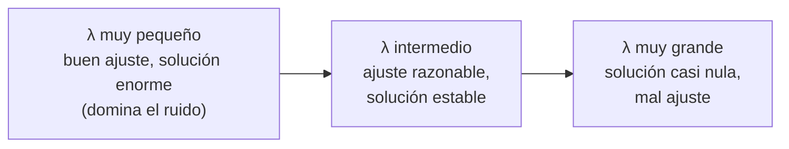

# B22-C02 — Regularización de Tikhonov

<!-- nav:top -->
[🏠 Programa](../../../../README.md) · [📚 Bloque B22](../../../tronco-comun/B22-problemas-inversos-y-estimacion-de-modelos.md) · [← Anterior: B22-C01 — Problemas directos e inversos y mal condicionamiento](../B22-C01-problemas-directos-e-inversos-y-mal-condicionamiento/CLASE.md) · [Siguiente: B22-C03 — Identificabilidad de parámetros →](../B22-C03-identificabilidad-de-parametros/CLASE.md)
<!-- /nav -->

## 1. Ubicación, nivel y alcance

Segunda clase del bloque B22. En [C01](../B22-C01-problemas-directos-e-inversos-y-mal-condicionamiento/CLASE.md) viste que invertir directamente un problema mal condicionado destruye la respuesta. Aquí aprendes el remedio clásico: aceptar un pequeño error sistemático a cambio de eliminar el error enorme debido al ruido. Nivel N3.

Verás la regularización de Tikhonov en forma estándar, sus tres formas de cálculo equivalentes, los factores de filtro de la SVD, la curva L y el principio de discrepancia. No verás regularizaciones con otras normas (esparcidad), métodos iterativos ni elección bayesiana del parámetro; de [B10-C07](../../B10/B10-C07-proyecciones-y-minimos-cuadrados/CLASE.md) solo necesitas mínimos cuadrados.

## 2. Por qué esta clase existe

Si no puedes confiar en `x = A⁻¹ b` y no puedes bajar el ruido a voluntad, necesitas una regla que ignore lo que los datos no pueden decir. Esa regla debe tener una perilla: cuánto ignorar. Si ignoras poco, el ruido te arruina; si ignoras mucho, la solución se aleja de los datos.

La decisión central es: **¿qué valor del parámetro de regularización `λ` uso, y cómo justifico esa elección sin conocer la verdad?** Aprenderás dos criterios (la curva L y la discrepancia), los compararás con el valor óptimo que, solo en un experimento sintético, puedes calcular, y verás sus fallos.

## 3. Lo que podrás hacer al terminar

1. Escribir el funcional de Tikhonov y explicar el papel de cada término.
2. Calcular la solución regularizada por ecuaciones normales, por mínimos cuadrados aumentados y por filtro SVD, y comprobar que coinciden.
3. Interpretar los factores de filtro `fᵢ = σᵢ²/(σᵢ² + λ²)`.
4. Dibujar y leer la curva L (norma de la solución frente a norma del residuo).
5. Elegir `λ` por el principio de discrepancia y por el vértice de la curva L, y compararlos.
6. Describir el sesgo que introduce la regularización y sus límites.

La evidencia es el **informe de una inversión regularizada** del ejercicio 12 (sección 20).

## 4. Con qué llegas y cómo comprobarlo

Necesitas lo de C01 (valores singulares, `κ`, amplificación del ruido) y mínimos cuadrados de B10-C07. Cinco preguntas:

1. Si `σ = 0,01` y el ruido en la dirección correspondiente vale `10⁻³`, ¿por cuánto se amplifica al invertir?
2. ¿Qué minimiza el método de mínimos cuadrados?
3. ¿Qué es la norma `‖x‖²` de `x = (3, 4)`?
4. ¿Qué cambia entre `‖x‖` y `‖x‖²` al minimizar?
5. ¿Por qué la solución ingenua del laboratorio de C01 dio un error de `3 × 10⁴`?

<details>
<summary>Ver respuestas</summary>

1. Por `1/σ = 100`: el ruido se vuelve `0,1`. 2. La suma de cuadrados de los residuos `‖A x − b‖²`. 3. `25`. 4. Nada en el punto donde está el mínimo: elevar al cuadrado no cambia dónde ocurre, solo facilita derivar. 5. Porque `κ = 3,9 × 10⁷` y el ruido relativo era `4 × 10⁻³` (C01).
</details>

Con cuatro o cinco aciertos, sigue; con tres o menos, repasa C01.

## 5. Un caso real: el método tiene décadas de historia

La regularización se inventó varias veces. Hansen cuenta que James Riley, en 1955, propuso resolver `(A + α I) x = b` con `α` pequeño para sistemas mal condicionados; D. L. Phillips la formuló en 1962 para ecuaciones integrales; S. Twomey (1963) la reformuló con las «ecuaciones normales regularizadas», y A. N. Tikhonov la planteó en 1963 para operadores integrales en general (S2). Hoy se la conoce con su nombre. No se inventó para la astronomía, pero se aplica en ella: imágenes, espectros y perfiles de atmósferas se recuperan con variantes de este método.

En esta clase la aplicarás a un caso **sintético**: el mismo perfil de brillo emborronado de C01, con ruido gaussiano de desviación `10⁻³`. Ya sabes que la inversión ingenua da un error de `3,4 × 10⁴`.

## 6. Vocabulario

La **solución regularizada** `x_λ` es el vector que minimiza una suma de dos costes: el **desajuste** `‖A x − b‖²` (qué tan lejos queda `A x` de los datos) y la **penalización** `λ² ‖x‖²` (qué tan grande es la solución). El **parámetro de regularización** `λ ≥ 0` fija el peso de la segunda frente a la primera. La **forma estándar** es la que usa la norma de `x` sin modificar (en la forma general, se penaliza `‖L (x − x₀)‖` con una matriz `L` y un estimado previo `x₀`; S2). Un **factor de filtro** `fᵢ` es el número entre 0 y 1 que multiplica cada componente de la solución ingenua en la base de la SVD. La **curva L** es la gráfica, en escala log–log, de la norma de la solución frente a la norma del residuo al variar `λ` (S2). El **principio de discrepancia** elige `λ` de modo que el residuo iguale el tamaño esperado del ruido.

## 7. Modelo mental: una balanza entre fidelidad y calma

Imagina una balanza con dos platos. En uno pones «ajustar bien los datos»; en el otro, «que la solución no oscile locamente». `λ = 0` quita el segundo plato y el ruido manda; `λ` enorme lo carga todo y la solución se aplana a cero. Entre ambos extremos hay un equilibrio razonable.



*Descripción textual:* una secuencia de tres estados al aumentar `λ`: poco `λ` (buen ajuste, solución enorme), `λ` intermedio (equilibrio) y mucho `λ` (solución casi nula y mal ajuste).

**Límite de la analogía:** una balanza real tiene un punto de equilibrio único; aquí varios criterios razonables dan `λ` distintos, y ninguno garantiza el óptimo.

## 8. La explicación, paso a paso

### 8.1 El funcional

Dado `A` (`m × n`) y datos `b`, la solución de Tikhonov en forma estándar es (S2, ec. 1 con `L = I` y `x₀ = 0`):

```text
x_λ = argmin_x  ‖A x − b‖²  +  λ² ‖x‖²
```

Derivando e igualando a cero se obtienen las **ecuaciones normales regularizadas** (S2, ec. 2):

```text
(Aᵀ A + λ² I) x_λ = Aᵀ b
```

La matriz `Aᵀ A + λ² I` es invertible para `λ > 0`, aunque `A` no lo sea: sus autovalores son los de `Aᵀ A` aumentados en `λ²`. Hansen recomienda numéricamente resolver el problema como mínimos cuadrados aumentados (S2, ec. 3), apilando `A` sobre `λ I` y `b` sobre ceros: es equivalente, porque `‖[A; λ I] x − [b; 0]‖² = ‖A x − b‖² + λ² ‖x‖²`.

### 8.2 Qué hace en la base de la SVD

Con `A = Σᵢ σᵢ uᵢ vᵢᵀ` (C01), la solución ingenua es `Σᵢ (uᵢᵀ b / σᵢ) vᵢ`; la de Tikhonov es la misma con cada término multiplicado por un factor de filtro (S2, ec. 5–6):

```text
x_λ = Σᵢ fᵢ · (uᵢᵀ b / σᵢ) · vᵢ ,     fᵢ = σᵢ² / (σᵢ² + λ²)
```

Si `σᵢ ≫ λ`, `fᵢ ≈ 1`: esa componente pasa intacta. Si `σᵢ ≪ λ`, `fᵢ ≈ σᵢ²/λ² ≈ 0`: se apaga. La transición ocurre en `σᵢ ≈ λ` (S2). En otras palabras, `λ` es el umbral por debajo del cual los valores singulares se consideran ruido. Este filtro hace con suavidad lo que cortar la suma (SVD truncada) hace de golpe.

### 8.3 El sesgo: lo que se paga

Cada componente regularizada difiere de la ingenua por el factor `fᵢ < 1`: **la solución regularizada está sesgada hacia cero** en todas las direcciones. En un escalar (`A = σ`, `b = σ x + e`), el estimador es `x_λ = σ b/(σ² + λ²)`, con sesgo `−λ² x/(σ² + λ²)` y desviación `σ s/(σ² + λ²)` si `e` tiene desviación `s`. Para un `σ` grande, el sesgo es pequeño y la regularización casi no cambia nada; para un `σ` diminuto, el sesgo es casi `−x` (la componente se pierde), pero la desviación cae de `s/σ` a casi cero. Se cambia varianza por sesgo.

**Pausa.** Con `λ = 0,1`, ¿cuál es el factor de filtro de `σ = 1` y el de `σ = 0,01`? *Respuesta:* `1/1,01 = 0,990` y `10⁻⁴/(10⁻⁴ + 10⁻²) = 0,0099`: la dirección fuerte pasa y la débil se apaga.

### 8.4 Elegir λ: la curva L

Para cada `λ` calculas el residuo `‖A x_λ − b‖` y la norma `‖x_λ‖`, y los dibujas en log–log. La curva tiene forma de «L» (S2): con `λ` muy pequeño la norma de la solución explota y el residuo ya casi no baja (rama vertical); con `λ` muy grande el residuo crece y la solución casi no cambia (rama horizontal). El **vértice** de la L es un compromiso: se localiza donde la curvatura de la curva log–log es máxima. En el laboratorio, el vértice se calcula con diferencias finitas sobre una rejilla de `λ`.

### 8.5 Elegir λ: el principio de discrepancia

Si conoces la desviación `σ_ruido` del ruido de cada dato, el residuo de la solución verdadera tendría una norma de orden `σ_ruido √m`. Se elige `λ` para que el residuo valga eso: no se ajusta más de lo que el ruido permite. Exige conocer `σ_ruido`; la curva L, no.

### 8.6 Cómo fallan

Ningún criterio es infalible. Hansen advierte que el vértice de la curva L falla cuando la solución exacta es muy suave, es decir, cuando está dominada por pocos modos de la SVD: cuanto más suave, peor es el `λ` que da el criterio (S2, sec. 8.1, que atribuye el resultado a Hanke). Y la discrepancia depende de conocer bien `σ_ruido`.

## 9. Magnitudes, símbolos y unidades

| Símbolo | Qué es | Unidad | Nota |
|---|---|---|---|
| `λ` | parámetro de regularización | las de `‖b‖/‖x‖` | `λ ≥ 0`; aquí adimensional |
| `x_λ` | solución regularizada | unidades de `x` | |
| `fᵢ` | factor de filtro | adimensional | `0 < fᵢ < 1` |
| `‖A x_λ − b‖` | norma del residuo | las de `b` | eje de la curva L |
| `‖x_λ‖` | norma de la solución | las de `x` | eje de la curva L |
| `σ_ruido` | desviación del ruido por dato | las de `b` | aquí `10⁻³` |
| `m`, `n` | número de datos e incógnitas | — | aquí 40 y 40 |

Aquí, igual que en C01, las magnitudes son adimensionales (brillo en unidades arbitrarias); lo que importa es el comportamiento matemático.

## 10. Convenciones y referencias

Se usa la forma estándar (`L = I`, `x₀ = 0`), con ruido solo en los datos. `λ` pondera la norma, no su cuadrado: el funcional escribe `λ²` (S2). Los errores relativos se calculan con la verdad sintética. Las escalas de las curvas son logarítmicas (base 10). El criterio de la curva L aquí se aplica sobre una rejilla de 61 valores de `λ` entre `10⁻⁶` y `1`, ignorando los tres puntos de cada extremo.

## 11. De dónde sale lo que afirmamos

| ID | Fuente | Localizador | Respalda | Estado |
|---|---|---|---|---|
| S2 | Hansen, P. C., «The L-curve and its use in the numerical treatment of inverse problems», en *Computational Inverse Problems in Electrocardiology*, WIT Press, 2001, pp. 119–142 | https://www.sintef.no/globalassets/project/evitameeting/2005/lcurve.pdf | Funcional de Tikhonov general (ec. 1) y equivalencias (ec. 2–3); historia (Riley, Phillips, Twomey, Tikhonov); factores de filtro (ec. 5–6); definición de la curva L; limitación para soluciones suaves (sec. 8.1) | Texto del PDF leído con PyMuPDF el 2026-11-05: introducción, secciones 2 y 3 y 8.1; el resto no se leyó |
| S6 | NumPy, `numpy.linalg.svd` | https://numpy.org/doc/stable/reference/generated/numpy.linalg.svd.html | Devuelve `u`, `s` (descendente) y `vh` | Consultada el 2026-11-05 |

Límites: el principio de discrepancia y el criterio de curvatura máxima para el vértice son prácticas estándar; no se consultó una fuente específica para el criterio de curvatura que usa el laboratorio (implementación propia). La afirmación «con `σᵢ` mayor que `λ` el filtro deja pasar» viene de S2. Datos **sintéticos**.

## 12. Cómo ver la curva L

Equivalente accesible a la gráfica log–log del laboratorio (sección 17):

| `λ` | `‖A x_λ − b‖` | `‖x_λ‖` | Error relativo vs verdad |
|---|---|---|---|
| `1,0 × 10⁻⁶` | `2,0 × 10⁻³` | `7,8 × 10²` | `3,8 × 10²` |
| `1,0 × 10⁻³` | `4,5 × 10⁻³` | `2,45` | `0,64` |
| `1,6 × 10⁻²` | `5,5 × 10⁻³` | `2,07` | `0,038` |
| `6,3 × 10⁻²` | `1,6 × 10⁻²` | `2,04` | `0,064` |
| `1,0` | `0,96` | `0,83` | `0,63` |

La rama vertical está arriba (`λ` pequeño: norma enorme); la horizontal, abajo a la derecha (`λ = 1`). El mejor error (≈ 0,035) ocurre en el tramo central.

## 13. Ejemplo trabajado: un escalar a mano

Sea `A = (0,5)` (un solo dato y una sola incógnita), `b = 2` y `λ = 0,3`.

**Paso 1 · solución ingenua.** `x = b/σ = 2/0,5 = 4`.

**Paso 2 · factor de filtro.** `f = σ²/(σ² + λ²) = 0,25/(0,25 + 0,09) = 0,25/0,34 = 0,7353`.

**Paso 3 · solución regularizada.** `x_λ = f · x = 0,7353 × 4 = 2,941`. Por la otra fórmula: `σ b/(σ² + λ²) = 0,5 × 2/0,34 = 2,941`. Coinciden (el laboratorio lo comprueba a `10⁻¹⁴`).

**Paso 4 · lo que se pagó.** Si el dato verdadero fuera `x = 4`, el estimador está sesgado `−1,06` (un 26 %). A cambio, si `b` tuviera una desviación `s`, el estimador regularizado tendría `σ s/(σ² + λ²) = 1,47 s` frente a `s/σ = 2 s`: menos ruido amplificado. Con una sola dirección la ganancia es modesta; con un `σ` diminuto sería enorme.

**Paso 5 · incertidumbre.** Este ejemplo no dice qué `λ` es correcto; un `λ` mayor aumenta el sesgo y reduce la varianza. Elegir `λ` es la parte difícil.

## 14. Distintos criterios y cuándo dejan de servir

En el laboratorio (`σ_ruido = 10⁻³`, verdad conocida) el mejor `λ` es `2,0 × 10⁻²` con un error de `3,5 × 10⁻²`. La **discrepancia** (`λ = 2,5 × 10⁻²`, error `3,5 × 10⁻²`) casi lo iguala porque conoce el ruido. El **vértice de la curva L** (`λ = 3,2 × 10⁻³`, error `0,18`) infrarregulariza unas 6 veces y su error es cinco veces el óptimo, aunque sigue siendo mucho mejor que la solución ingenua (`3,4 × 10⁴`). La **verdad** no está disponible en una situación real, así que el óptimo es inalcanzable: el valor del experimento sintético es medir cuánto se pierde con cada criterio. Un criterio es útil mientras se conozcan sus modos de fallo.

## 15. Práctica guiada

**Ejercicio 1 · con los pasos indicados.** Calcula `x_λ` para `A = (0,2)`, `b = 1` y `λ = 0,1` con la fórmula `σ b/(σ² + λ²)` y con el factor de filtro. *Pasos:* (a) `x` ingenua; (b) `f`; (c) `x_λ` de las dos formas (sección 8.2).

<details><summary>Solución comentada</summary>

(a) `x = 1/0,2 = 5`. (b) `f = 0,04/(0,04 + 0,01) = 0,8`. (c) `x_λ = 0,8 × 5 = 4`; por la otra fórmula, `0,2 × 1/0,05 = 4`. Coinciden, como debe ser.
</details>

**Ejercicio 2 · con una pista.** Con `λ = 0,1`, calcula los factores de filtro para `σ = 1`, `0,1` y `0,01`. *Pista:* `fᵢ = σ²/(σ² + λ²)`.

<details><summary>Solución comentada</summary>

`σ = 1`: `1/1,01 = 0,990`. `σ = 0,1`: `0,01/0,02 = 0,5` (la transición ocurre en `σ ≈ λ`). `σ = 0,01`: `10⁻⁴/(10⁻⁴ + 10⁻²) = 0,0099`. La dirección fuerte pasa; la débil casi se anula.
</details>

**Ejercicio 3 · casi autónomo.** Con la tabla de la sección 12 y `σ_ruido = 10⁻³` con 40 datos, calcula el residuo objetivo de la discrepancia y di entre qué dos filas de la tabla queda `λ`. (Sección 8.5.)

<details><summary>Solución comentada</summary>

`σ_ruido √m = 10⁻³ × √40 = 6,3 × 10⁻³`. El residuo vale `5,5 × 10⁻³` en `λ = 1,6 × 10⁻²` y `1,6 × 10⁻²` en `6,3 × 10⁻²`; el objetivo queda entre ambas filas (el laboratorio refina y da `λ = 2,5 × 10⁻²`).
</details>

## 16. Práctica autónoma, transferencia e integrador

**Ejercicio 4.** Demuestra que `‖[A; λ I] x − [b; 0]‖² = ‖A x − b‖² + λ² ‖x‖²`. (Sección 8.1.)

<details><summary>Solución comentada</summary>

El vector `[A; λ I] x − [b; 0]` tiene dos bloques: `A x − b` arriba y `λ x` abajo. Su norma al cuadrado es la suma de las normas al cuadrado de los bloques: `‖A x − b‖² + ‖λ x‖² = ‖A x − b‖² + λ² ‖x‖²`. Por eso un solucionador de mínimos cuadrados sobre la matriz apilada resuelve el problema de Tikhonov sin formar `Aᵀ A` (que elevaría `κ` al cuadrado).
</details>

**Ejercicio 5.** En el caso escalar, ¿a qué tiende `x_λ` cuando `λ → 0` y cuando `λ → ∞`?

<details><summary>Solución comentada</summary>

`x_λ = σ b/(σ² + λ²)`. Con `λ → 0`, `x_λ → b/σ`, la solución ingenua. Con `λ → ∞`, `x_λ → 0`. El laboratorio lo verifica para el problema completo (con `λ = 10⁻¹⁴` coincide con la ingenua y con `λ = 10³` la norma de la solución es menor que `10⁻⁵`).
</details>

**Ejercicio 6.** Un escalar `A = σ` con `x = 1` y ruido de desviación `s = 0,01`; `λ = 0,1`. Calcula sesgo, desviación y error cuadrático medio (ECM = sesgo² + desviación²) de la solución ingenua y de la regularizada, para (a) `σ = 0,1` y (b) `σ = 0,001`. (Sección 8.3.)

<details><summary>Solución comentada</summary>

Ingenua: sesgo 0, desviación `s/σ`. Regularizada: sesgo `−λ² x/(σ² + λ²)`, desviación `σ s/(σ² + λ²)`. (a) `σ = 0,1`: ingenua `0,1`, ECM `0,01`. Regularizada: sesgo `−0,5`, desviación `0,05`, ECM `0,2525`. **Aquí regularizar empeora**: la dirección es fuerte y el ruido pequeño. (b) `σ = 0,001`: ingenua desviación `10`, ECM `100`. Regularizada: sesgo `−0,9999`, desviación `0,001`, ECM `≈ 1,0`. **Aquí mejora 100 veces.** Regularizar conviene en las direcciones débiles y daña en las fuertes; los factores de filtro lo hacen por separado en cada dirección.
</details>

**Ejercicio 7.** En el laboratorio, el vértice de la curva L da `λ = 3,2 × 10⁻³` y el óptimo es `2,0 × 10⁻²`. ¿Por qué factor se queda corto el vértice? ¿Contradice lo que dice Hansen sobre la curva L?

<details><summary>Solución comentada</summary>

`2,0 × 10⁻² / 3,2 × 10⁻³ ≈ 6`. No lo contradice: Hansen no promete que el vértice sea el óptimo, sino que el criterio es robusto y tiene limitaciones, como el fallo con soluciones muy suaves (S2, sec. 8.1). Que aquí el vértice dé un error cinco veces mayor que el óptimo, pero cuatro órdenes de magnitud menor que el ingenuo, ilustra que un criterio puede ser «útil sin ser óptimo». No se investigó si el perfil del laboratorio es «suave» en el sentido de Hanke.
</details>

**Ejercicio 8.** Para `n = 100` datos con `σ_ruido = 0,02`, ¿qué residuo objetivo da la discrepancia? ¿Y qué `‖e‖²` esperas?

<details><summary>Solución comentada</summary>

`σ_ruido √n = 0,02 × 10 = 0,2`; y `‖e‖² ≈ n σ_ruido² = 100 × 4 × 10⁻⁴ = 0,04` (el cuadrado de `0,2`). Es el valor medio: el residuo real fluctúa alrededor.
</details>

**Ejercicio 9 · transferencia.** Tras regularizar, el pico de un perfil recuperado es más bajo y más ancho que el verdadero. ¿Por qué, usando los factores de filtro?

<details><summary>Solución comentada</summary>

Un pico estrecho necesita componentes de `vᵢ` oscilantes (con `σᵢ` pequeño). Esas son las que el filtro apaga (`fᵢ ≈ 0`). Al quitarlas, el pico se ensancha y baja. Es sesgo, no error aleatorio: ocurrirá siempre en la misma dirección, con cualquier ruido. En C04 verás un caso: un pico verdadero de `1,0` que se recupera con `0,67`.
</details>

**Ejercicio 10 · transferencia.** No conoces `σ_ruido`. ¿Qué criterio de los dos usarías y qué precaución tomarías?

<details><summary>Solución comentada</summary>

La curva L, que no necesita `σ_ruido` (S2). Precauciones: comprobar que el vértice es nítido, comparar con la solución para `λ` vecinos y, si puedes, estimar `σ_ruido` aparte (por ejemplo, repitiendo mediciones) para contrastar con la discrepancia. Con un vértice difuso o una solución muy suave, desconfía.
</details>

**Ejercicio 11 · transferencia.** La forma general (S2, ec. 1) penaliza `‖L (x − x₀)‖²`. Si esperas que la solución varíe suavemente, ¿qué `L` elegirías y por qué?

<details><summary>Solución comentada</summary>

Una `L` que mida variación entre vecinos (una diferencia primera o segunda), de modo que se penalice la oscilación y no el tamaño. Con `L = I` se penaliza el tamaño: una solución suave y grande sale cara aunque sea correcta. Elegir `L` es incorporar conocimiento previo; esta clase solo usa `L = I` y cita la forma general de S2.
</details>

**Ejercicio 12 · integrador.** Aplica Tikhonov al problema del laboratorio con tres niveles de ruido (`10⁻⁴`, `10⁻³`, `10⁻²`). Entrega: tabla de `λ` óptimo y su error, el `λ` que da la discrepancia y la curva L (en tabla), y una conclusión sobre cómo cambia `λ` con el ruido.

<details><summary>Solución modelo</summary>

Con la misma semilla y rejilla del laboratorio, el `λ` óptimo (el que minimiza el error con la verdad) vale `6,3 × 10⁻³` con error `1,4 × 10⁻²` para ruido `10⁻⁴`; `2,0 × 10⁻²` con error `3,5 × 10⁻²` para `10⁻³`; y `6,3 × 10⁻²` con error `8,9 × 10⁻²` para `10⁻²`. Conclusión: más ruido exige más regularización (`λ` crece) y el error mínimo alcanzable también crece; solo se recupera menos del objeto, y es información sobre el límite de los datos. Se acepta cualquier tabla coherente con el script.
</details>

## 17. Laboratorio: Tikhonov, filtros y curva L

El script [tikhonov.py](tikhonov.py) implementa los tres cálculos, comprueba que coinciden, verifica el caso escalar analítico y los límites `λ → 0` y `λ → ∞`, construye la curva L y compara tres criterios. La **prueba contra el caso analítico** (`x_λ = σ b/(σ² + λ²)`, a `10⁻¹⁴`) detiene la ejecución si falla.

**Datos:** sintéticos, semilla fija (22); mismo problema que C01. **Predice antes de ejecutar:** ¿qué criterio crees que dará menor error? **Ejecución del 2026-11-05 (Python 3.12.9, numpy 2.4.4):**

```text
escalar: x_lam = 2.9411764705882355 = s b/(s^2+lam^2) = 2.9411764705882355
lam = 0.001: dif. normales-aumentado = 5.26e-11; SVD-aumentado = 1.96e-13
  lam         ||Ax-b||     ||x||     error rel. (vs verdad)
  1.0e-06   2.006e-03   7.805e+02   3.782e+02
  4.0e-06   2.458e-03   2.677e+02   1.297e+02
  1.6e-05   3.089e-03   7.072e+01   3.425e+01
  6.3e-05   3.514e-03   1.278e+01   6.114e+00
  2.5e-04   3.792e-03   5.649e+00   2.549e+00
  1.0e-03   4.459e-03   2.454e+00   6.403e-01
  4.0e-03   4.927e-03   2.090e+00   1.410e-01
  1.6e-02   5.497e-03   2.066e+00   3.829e-02
  6.3e-02   1.592e-02   2.036e+00   6.401e-02
  2.5e-01   1.584e-01   1.820e+00   1.961e-01
  1.0e+00   9.634e-01   8.308e-01   6.348e-01
lam de la curva L (vertice)  = 3.16e-03 -> error 1.775e-01
lam optimo (conoce la verdad)= 2.00e-02 -> error 3.504e-02
lam por discrepancia         = 2.51e-02 -> error 3.519e-02
solucion ingenua (lam = 0)   -> error 3.446e+04
Pruebas superadas.
```

```bash
python programa/clases/B22/B22-C02-regularizacion-de-tikhonov/tikhonov.py
```

**Límites:** ruido blanco de `σ_ruido` conocida; `L = I`; el vértice depende de la implementación de la curvatura y de la rejilla; el error óptimo solo se conoce porque el dato es sintético.

## 18. Errores frecuentes y cómo corregirlos

**Usar las ecuaciones normales sin más.** `Aᵀ A` eleva `κ` al cuadrado; se prefiere la forma aumentada. Se corrige con el ejercicio 4.

**Creer que `λ` pequeño es «más fiel».** Se ajusta mejor el ruido, no la verdad. Se corrige con la tabla de la sección 12.

**Creer que regularizar siempre mejora.** Mejora en las direcciones débiles y empeora en las fuertes. Se corrige con el ejercicio 6.

**Tomar el vértice como el óptimo.** Se corrige con el ejercicio 7.

**Interpretar un pico más bajo como realidad física.** Es el sesgo del filtro. Se corrige con el ejercicio 9.

## 19. Cómo sabrás que vas bien

Tras 8.2: ¿calculas `fᵢ` y dices qué direcciones pasan? Si no, ejercicio 2. Tras 8.3: ¿explicas por qué el sesgo es el precio? Si no, ejercicio 6. Tras 8.4: ¿localizas el vértice en una tabla? Si no, repasa la sección 12. Tras el laboratorio: ¿qué diferencia hay entre el error del vértice y el óptimo, y por qué?

## 20. Qué entregas y cómo se evalúa

El producto es el **informe de una inversión regularizada**: modelo, tres niveles de ruido, `λ` por dos criterios, error frente a la verdad sintética, curva L en tabla y advertencia sobre el sesgo.

| Criterio | Inicial | En desarrollo | Logrado | Destacado |
|---|---|---|---|---|
| Funcional y filtros | Escribe la fórmula sin explicarla | Explica un término | Relaciona `λ` con `σᵢ` | Muestra la equivalencia entre tres cálculos |
| Elección de `λ` | Un valor sin criterio | Un criterio | Dos criterios | Los compara con el óptimo sintético |
| Sesgo | No lo menciona | Lo menciona | Lo calcula en un caso | Explica cuándo regularizar empeora |
| Rotulado y fuentes | Mezcla datos | Rotula | Rotula y cita | Declara los límites del criterio |

**Condiciones críticas:** no presentar la verdad sintética como disponible en un caso real; no atribuir a la fuente lo que es implementación propia; citar solo lo consultado.

## 21. Ética, seguridad y límites

Una solución regularizada es una estimación con un sesgo declarado, no una medida directa. Presentar un perfil suavizado como «la imagen real» o ocultar la elección de `λ` impide a otros reproducirlo. Accesibilidad: curva L en tabla, diagramas con descripción. Material educativo con datos sintéticos; no sirve para reducción profesional de datos.

## 22. Para cerrar y seguir

La regularización de Tikhonov minimiza el desajuste más `λ²` veces el tamaño de la solución; en la SVD multiplica cada componente por `σᵢ²/(σᵢ² + λ²)`, lo que apaga las direcciones débiles y deja pasar las fuertes, al precio de un sesgo. `λ` se elige con criterios imperfectos: la curva L y la discrepancia dieron en el laboratorio errores de `0,18` y `0,035` frente al óptimo `0,035`. Queda abierta una pregunta: antes de regularizar, ¿cómo saber si los datos determinan siquiera los parámetros que buscas?

**Glosario español–inglés.** regularización · *regularization*; parámetro de regularización · *regularization parameter*; factor de filtro · *filter factor*; curva L · *L-curve*; principio de discrepancia · *discrepancy principle*; sesgo · *bias*; residuo · *residual*.

**Continuidad.** [B22-C03](../B22-C03-identificabilidad-de-parametros/CLASE.md) pregunta cuándo los parámetros de un modelo quedan determinados por los datos, el problema previo a regularizar. C04 aplica Tikhonov a espectros y C05 enseña a probarlo con datos sintéticos sin engañarte.

**Referencias:** ver sección 11. De S2 se leyó solo parte; la implementación del vértice es propia.

<!-- nav:bottom -->
---

[← Anterior: B22-C01 — Problemas directos e inversos y mal condicionamiento](../B22-C01-problemas-directos-e-inversos-y-mal-condicionamiento/CLASE.md) · [📚 Bloque B22](../../../tronco-comun/B22-problemas-inversos-y-estimacion-de-modelos.md) · [Siguiente: B22-C03 — Identificabilidad de parámetros →](../B22-C03-identificabilidad-de-parametros/CLASE.md)
<!-- /nav -->
