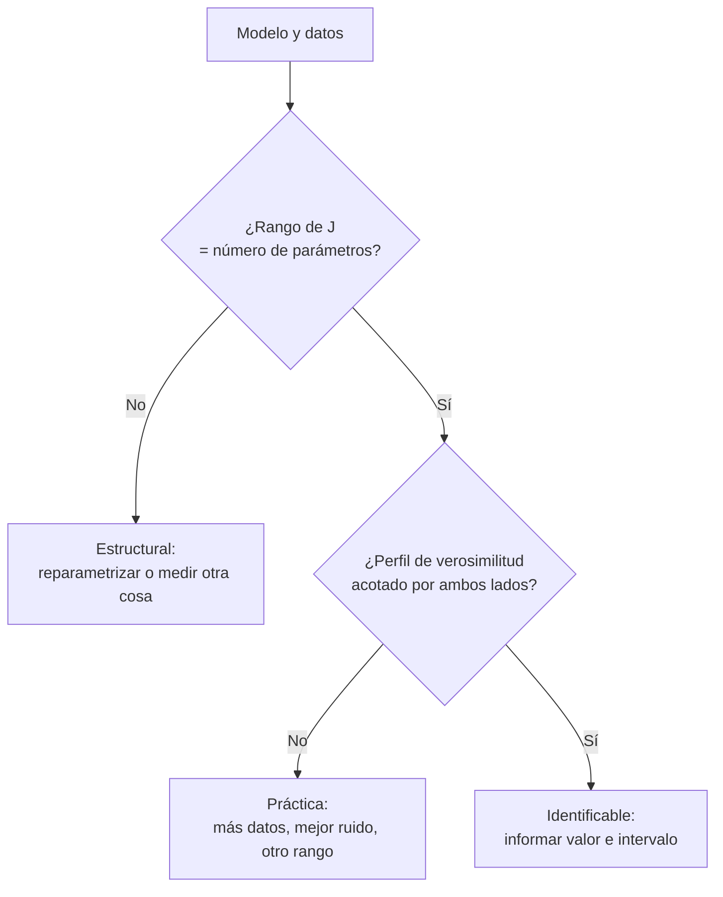

# B22-C03 — Identificabilidad de parámetros

<!-- nav:top -->
[🏠 Programa](../../../../README.md) · [📚 Bloque B22](../../../tronco-comun/B22-problemas-inversos-y-estimacion-de-modelos.md) · [← Anterior: B22-C02 — Regularización de Tikhonov](../B22-C02-regularizacion-de-tikhonov/CLASE.md) · [Siguiente: B22-C04 — Inversión espectral →](../B22-C04-inversion-espectral/CLASE.md)
<!-- /nav -->

## 1. Ubicación, nivel y alcance

Tercera clase del bloque B22. En [C01](../B22-C01-problemas-directos-e-inversos-y-mal-condicionamiento/CLASE.md) viste que los datos pueden no fijar la solución; en [C02](../B22-C02-regularizacion-de-tikhonov/CLASE.md), cómo estabilizarla. Aquí te haces la pregunta previa para un modelo de pocos parámetros: **¿pueden los datos, en principio y en la práctica, determinar los parámetros que quiero estimar?** Nivel N3.

Verás identificabilidad estructural y práctica, la matriz jacobiana, la matriz de información de Fisher, la cota de Cramér–Rao y la verosimilitud de perfil. No verás inferencia bayesiana ni diseño óptimo de experimentos en profundidad; de [B10-C07](../../B10/B10-C07-proyecciones-y-minimos-cuadrados/CLASE.md) usas mínimos cuadrados.

## 2. Por qué esta clase existe

Un ajuste siempre devuelve números. Que el programa converja no demuestra que esos números signifiquen algo: si dos parámetros se compensan, el ajuste elige uno cualquiera de infinitas combinaciones igual de buenas. Publicar «`k₂ = 0,87 ± 0,02`» cuando los datos admiten cualquier valor entre 0,9 y 6 es un error que el ajuste no avisa.

La decisión central es: **¿qué parámetros del modelo están determinados por mis datos, con qué incertidumbre, y qué debo medir de más para determinar los demás?** Aprenderás a responderla con dos pruebas: una algebraica (rango del jacobiano) y una numérica (verosimilitud de perfil).

## 3. Lo que podrás hacer al terminar

1. Distinguir identificabilidad estructural de práctica y dar un ejemplo de cada una.
2. Calcular el jacobiano de un modelo y su rango como prueba de identificabilidad estructural local.
3. Construir la matriz de información de Fisher y leer incertidumbres mínimas (cota de Cramér–Rao).
4. Reconocer la simetría de etiquetas y cómo se rompe.
5. Calcular e interpretar una verosimilitud de perfil con su umbral de confianza.
6. Proponer qué medir de más para identificar un parámetro.

La evidencia es el **informe de identificabilidad** del ejercicio 12 (sección 20).

## 4. Con qué llegas y cómo comprobarlo

Necesitas mínimos cuadrados y cálculo de derivadas parciales, más la matriz de covarianza (idea de B10-C07). Cinco preguntas:

1. ¿Cuál es la derivada parcial de `y = a e^{−k t}` con respecto a `k`?
2. ¿Cuál es el rango de la matriz `[[1, 1], [2, 2]]`?
3. ¿Qué te dice una desviación típica de `0,1` en una estimación?
4. Si `y = a + b t`, ¿cuántos datos hacen falta como mínimo para determinar `a` y `b`?
5. ¿Qué significa «mal condicionada» para una matriz (C01)?

<details>
<summary>Ver respuestas</summary>

1. `−a t e^{−k t}`. 2. `1`: la segunda fila es el doble de la primera. 3. Que si repitieras el experimento, las estimaciones se dispersarían con esa desviación (un 68 % caería a menos de `0,1` de la media, si es gaussiana). 4. Dos, siempre que tengan `t` distintos. 5. Que `σ₁/σₙ` es muy grande: pequeños cambios en los datos producen cambios enormes en la solución.
</details>

Con cuatro o cinco aciertos, sigue; con tres o menos, repasa B10-C07 y C01.

## 5. Un caso real: Raue y la identificabilidad en modelos dinámicos

Raue y colaboradores propusieron en 2009 una manera de comprobar si los parámetros de un modelo dinámico parcialmente observado pueden determinarse, mediante la verosimilitud de perfil (S5). Distinguen dos fallos. La no identificabilidad **estructural** viene del modelo: los parámetros están ligados por una relación funcional, y cambiar uno puede compensarse con otro sin alterar lo predicho; mejores datos del mismo tipo no lo resuelven. La **práctica** viene de los datos: el parámetro tiene un mejor valor único, pero la verosimilitud crece tan despacio que los datos no acotan uno de los lados, y suele resolverse con más datos o más informativos (S5). El método sirve también para planificar qué medir y para decidir si un modelo más simple basta.

Aquí no usarás su modelo biológico, sino un ejemplo **sintético** de ciencias espaciales: la caída de brillo de un transitorio como suma de dos exponenciales.

## 6. Vocabulario

Un **modelo** `y(t; p)` predice una cantidad en el tiempo `t` a partir de un vector de **parámetros** `p`. Los **datos** `yᵢ` se miden en tiempos `tᵢ` con ruido de desviación `σ`. El **jacobiano** `J` es la matriz de derivadas `Jᵢⱼ = ∂y(tᵢ; p)/∂pⱼ`: cuánto cambia cada predicción si se mueve cada parámetro. La **matriz de información de Fisher** es `F = Jᵀ J / σ²` (ruido gaussiano independiente); la **cota de Cramér–Rao** dice que la covarianza de cualquier estimador insesgado es al menos `F⁻¹`. Un parámetro es **identificable estructuralmente** si datos perfectos (sin ruido) lo determinan; **identificable en la práctica** si los datos reales, con su ruido y su cantidad, lo acotan por ambos lados. La **verosimilitud de perfil** de un parámetro `θ` es el mejor ajuste que se obtiene con `θ` fijo y todos los demás parámetros reoptimizados (S5). La **simetría de etiquetas** es la que ocurre cuando intercambiar dos grupos de parámetros da el mismo modelo.

## 7. Modelo mental: un valle estrecho o un valle llano

Imagina el desajuste `χ²` como un terreno cuyas coordenadas son los parámetros. Con parámetros identificables, el mejor ajuste está en el fondo de un pozo redondo. Con no identificabilidad estructural, el fondo es un **canal plano** que se extiende hasta el infinito; con práctica, un valle muy alargado y casi plano, cuyos bordes se alcanzan solo con ruido bajo.



*Descripción textual:* un árbol de decisión. Primera pregunta: ¿el rango del jacobiano iguala al número de parámetros? Si no, hay no identificabilidad estructural. Si sí, segunda pregunta: ¿el perfil de verosimilitud está acotado por ambos lados? Si no, hay no identificabilidad práctica; si sí, el parámetro es identificable.

**Límite de la analogía:** el terreno real es de dimensión alta y no se ve; el rango del jacobiano solo mira el entorno de un punto (identificabilidad local), y el perfil de verosimilitud revisa un camino.

## 8. La explicación, paso a paso

### 8.1 Identificabilidad estructural: el rango del jacobiano

Si `J` (calculado en un valor de los parámetros) tiene menos rango que columnas, existe una dirección `v` con `J v = 0`: mover los parámetros a lo largo de `v` no cambia, a primer orden, la predicción. El ejemplo más simple es `y = (θ₁ + θ₂) t`: `J = [t, t]`, de rango 1 con 2 parámetros; solo la suma `θ₁ + θ₂` se determina. Cualquier par con la misma suma da exactamente los mismos datos. La solución es **reparametrizar** (usar `θ = θ₁ + θ₂`) o medir otra cosa. El rango se calcula con la SVD (C01): el número de valores singulares no nulos.

### 8.2 Identificabilidad práctica: Fisher y Cramér–Rao

Aunque el rango sea completo, `J` puede estar casi degenerada: su valor singular menor es diminuto. Entonces `F = Jᵀ J/σ²` es casi singular y su inversa, que da las incertidumbres mínimas, es enorme. La **cota de Cramér–Rao** de la desviación del parámetro `j` es `√(F⁻¹)ⱼⱼ`. Para un modelo lineal `y = A p`, `F⁻¹ = σ² (Aᵀ A)⁻¹`, que es la covarianza exacta del estimador de mínimos cuadrados de B10-C07. El laboratorio lo comprueba con 4000 repeticiones: las desviaciones empíricas coinciden con la cota a menos del 1 %.

**Pausa.** Si duplicas `σ` (más ruido), ¿qué pasa con la cota de cada parámetro? *Respuesta:* se duplica, porque `F⁻¹` depende de `σ²` y la cota usa su raíz.

### 8.3 Verosimilitud de perfil

La cota de Fisher es una aproximación lineal alrededor del óptimo. Para modelos no lineales con parámetros mal determinados, es poco fiable. El perfil mira el problema real: para cada valor de un parámetro `θ` en una rejilla, ajusta todos los demás y anota el `χ²` mínimo. La curva `χ²(θ) − χ²_min` dice cuánto empeora el ajuste al forzar `θ`. Con ruido gaussiano de `σ` conocida, el intervalo de confianza del 68 % (1 σ) para un parámetro es donde esa curva está bajo `1`, y el del 99,7 % (3 σ) donde está bajo `9` (umbrales estándar de un parámetro, no consultados en S5). Si la curva se mantiene por debajo del umbral hasta el borde de la rejilla, el intervalo está **abierto**: no identificabilidad práctica (S5). Si la curva es plana en todo un camino, es estructural.

### 8.4 La simetría de etiquetas

En `y = A₁ e^{−k₁ t} + A₂ e^{−k₂ t}`, intercambiar `(A₁, k₁)` con `(A₂, k₂)` da el mismo `y`. Los datos no distinguen cuál es «el rápido». Es una no identificabilidad (discreta, no continua) que se elimina imponiendo un orden: `k₁ ≤ k₂`. Sin él, el perfil de `k₂` mostraría un segundo mínimo en `k₂ = k₁` con el mismo `χ²`.

## 9. Magnitudes, símbolos y unidades

| Símbolo | Qué es | Unidad | Nota |
|---|---|---|---|
| `t` | tiempo | días | 0 a 10 en el laboratorio |
| `y` | brillo | unidades arbitrarias | sintético |
| `Aⱼ` | amplitud del componente `j` | unidades arbitrarias | |
| `kⱼ` | ritmo de caída | 1/día | la caída es `e^{−kⱼ t}` |
| `p` | vector de parámetros `(A₁, k₁, A₂, k₂)` | mixtas | |
| `σ` | desviación del ruido | unidades de `y` | `0,01` |
| `J` | jacobiano | mixtas | `m × p` |
| `F` | información de Fisher | mixtas | `Jᵀ J/σ²` |
| `χ²` | suma de residuos² / `σ²` | adimensional | |

## 10. Convenciones y referencias

Los tiempos son días desde el inicio de la caída. El ruido se supone gaussiano, independiente y de `σ` conocida. Los umbrales `Δχ² < 1` y `< 9` valen para un parámetro con el resto reoptimizado. Los intervalos «abiertos» se declaran cuando tocan el borde de la rejilla de búsqueda. La rejilla de `k₂` del laboratorio va de `0,1` a `6,0` 1/día (119 puntos).

## 11. De dónde sale lo que afirmamos

| ID | Fuente | Localizador | Respalda | Estado |
|---|---|---|---|---|
| S5 | Raue, A., Kreutz, C., Maiwald, T., Bachmann, J., Schilling, M., Klingmüller, U., Timmer, J., «Structural and practical identifiability analysis of partially observed dynamical models by exploiting the profile likelihood», *Bioinformatics* 25(15), 1923–1929 (2009) | DOI 10.1093/bioinformatics/btp358 (página del editor: https://academic.oup.com/bioinformatics/article/25/15/1923/213246) | Definiciones de no identificabilidad estructural y práctica; verosimilitud de perfil; uso para planificar mediciones y reducir modelos | Página del editor consultada el 2026-11-05: se leyeron los primeros 100 000 de 124 364 caracteres |
| S6 | NumPy, `numpy.linalg.svd` | https://numpy.org/doc/stable/reference/generated/numpy.linalg.svd.html | La SVD que se usa para el rango y el número de condición | Consultada el 2026-11-05 |

Límites: la cota de Cramér–Rao, la matriz de Fisher `JᵀJ/σ²` y los umbrales `Δχ² = 1, 9` son resultados estadísticos estándar sin cita específica; el laboratorio verifica la cota en el caso lineal. Del trabajo de Raue solo se usan las definiciones. Los datos son **sintéticos**.

## 12. Cómo ver la identificabilidad

Equivalente accesible a los perfiles de verosimilitud del laboratorio (sección 17):

| Caso | `k₂` verdadero | `cond(J)` | Cota 1 σ de `k₂` | Intervalo 1 σ del perfil | Intervalo 3 σ del perfil |
|---|---|---|---|---|---|
| A (`k₁ = 0,2`, `k₂ = 2,0`) | `2,0` | `67` | `0,077` (3,8 %) | `[2,05; 2,15]` | `[1,90; 2,35]` |
| B (`k₁ = 0,8`, `k₂ = 1,0`) | `1,0` | `3340` | `1,51` (151 %) | `[3,75; 6,0]` (abierto) | `[0,90; 6,0]` (abierto) |

En A el parámetro queda acotado a unas décimas; en B, el intervalo de 3 σ toca el borde de la rejilla: los datos no acotan `k₂` por arriba.

## 13. Ejemplo trabajado: dos ritmos de caída

Un transitorio sintético cae como `y(t) = A₁ e^{−k₁ t} + A₂ e^{−k₂ t}` y se mide en 30 tiempos entre 0 y 10 días con `σ = 0,01`.

**Paso 1 · jacobiano.** Las derivadas son `e^{−k₁ t}`, `−A₁ t e^{−k₁ t}`, `e^{−k₂ t}` y `−A₂ t e^{−k₂ t}` (el laboratorio comprueba que coinciden con diferencias finitas a `10⁻⁶`).

**Paso 2 · caso A (ritmos 0,2 y 2,0).** `cond(J) = 67`; la cota de Cramér–Rao da `0,077` para `k₂` (3,8 %). Los ritmos son muy distintos: uno domina al principio y el otro a tiempos largos, y los datos los separan.

**Paso 3 · caso B (ritmos 0,8 y 1,0).** `cond(J) = 3340` y la cota para `k₂` es `1,51`, un 151 % del valor. Ambos componentes decaen casi igual y se parecen a una sola exponencial: los datos no pueden repartir la caída entre ellos.

**Paso 4 · perfil.** En el caso A el perfil de `k₂` da un intervalo de 1 σ `[2,05; 2,15]` (el valor verdadero 2,0 queda fuera por poco, a ≈ 1,3 σ de la cota, y dentro del de 3 σ `[1,90; 2,35]`; una desviación de 1,3 σ ocurre en torno a uno de cada cinco experimentos). En el caso B el ajuste elige `k₂ = 6` (el borde) y el intervalo de 3 σ `[0,9; 6,0]` queda abierto por arriba.

**Paso 5 · incertidumbre y conclusión.** En A se publica `k₂` con su intervalo. En B no se publica un valor puntual, sino la cota: «`k₂ ≳ 0,9` (3 σ) y no acotado superiormente». Ese es un resultado de ciencia correcto; el ajuste solo habría dado «`k₂ = 6`» sin avisar.

## 14. Distintos modos de afrontar la identificabilidad

La **prueba del rango del jacobiano** es barata y detecta la no identificabilidad estructural local, pero no ve la práctica (un rango completo con un valor singular diminuto pasa la prueba). La **matriz de Fisher** cuantifica la práctica de forma lineal y es instantánea, pero engaña en modelos muy no lineales o lejos del óptimo. El **perfil de verosimilitud** respeta la no linealidad y detecta intervalos abiertos, pero exige reoptimizar para cada punto de la rejilla y, con arranques malos, produce curvas irregulares: en el laboratorio hubo que recorrer la rejilla con arranque en el punto anterior y fijar `k₁ ≤ k₂`. Conviene combinar las tres.

## 15. Práctica guiada

**Ejercicio 1 · con los pasos indicados.** Para `y = (θ₁ + θ₂) t`, los datos dan `y = 4 t`. (a) Calcula el rango del jacobiano `J = [t, t]`; (b) da dos pares `(θ₁, θ₂)` que reproducen los datos; (c) propón una reparametrización. *Pasos:* sección 8.1.

<details><summary>Solución comentada</summary>

(a) Las dos columnas son idénticas: rango 1 (menor que los 2 parámetros). (b) `(1, 3)` y `(−2, 6)`, o cualquiera con suma 4. (c) `θ = θ₁ + θ₂`, con `y = θ t` y `θ = 4`. Es una no identificabilidad estructural: ningún dato adicional del mismo tipo la resuelve.
</details>

**Ejercicio 2 · con una pista.** Para `y = a + b t` con `t = 0, 1, 2` y `σ = 0,1`, calcula `Aᵀ A`, su inversa y las desviaciones de `a` y de `b` (cota de Cramér–Rao). *Pista:* `A` tiene filas `(1, t)`; la covarianza es `σ² (Aᵀ A)⁻¹`.

<details><summary>Solución comentada</summary>

`Aᵀ A = [[3, 3], [3, 5]]`, determinante `15 − 9 = 6`, inversa `(1/6) [[5, −3], [−3, 3]]`. Varianzas: `σ² × 5/6` y `σ² × 3/6`. Desviaciones: `0,1 √(5/6) = 0,091` para `a` y `0,1 √(1/2) = 0,071` para `b`. El elemento fuera de la diagonal, `−3/6`, indica que los errores de `a` y `b` están anticorrelacionados.
</details>

**Ejercicio 3 · casi autónomo.** En el ejercicio 2, ¿cómo cambian las cotas si (a) duplicas `σ`; (b) mides cuatro veces cada tiempo (12 datos)? (Sección 8.2.)

<details><summary>Solución comentada</summary>

(a) `F⁻¹ ∝ σ²`, así que las desviaciones se duplican. (b) `Aᵀ A` se multiplica por 4, su inversa por `1/4` y las desviaciones por `1/2`. Más datos reducen la incertidumbre como `1/√N`, pero no arreglan la no identificabilidad estructural.
</details>

## 16. Práctica autónoma, transferencia e integrador

**Ejercicio 4.** Decide si cada modelo es estructuralmente identificable en `(a, b)` y explica por qué: (a) `y = a b t`; (b) `y = a e^{−b t}`; (c) `y = a + b t²`.

<details><summary>Solución comentada</summary>

(a) No: solo se determina el producto `a b` (columnas del jacobiano `b t` y `a t`, proporcionales). (b) Sí: `J = [e^{−b t}, −a t e^{−b t}]`; columnas independientes para varios `t` si `a ≠ 0`. (c) Sí: las columnas `1` y `t²` son independientes con al menos dos `t` distintos y `t² ≠ constante`. Si `a = 0` en (b), `b` no influye: la identificabilidad puede depender del punto.
</details>

**Ejercicio 5.** Explica por qué `y = 1,0 e^{−0,2 t} + 0,8 e^{−2,0 t}` y `y = 0,8 e^{−2,0 t} + 1,0 e^{−0,2 t}` son el mismo modelo, y cómo se evita la ambigüedad al ajustar. (Sección 8.4.)

<details><summary>Solución comentada</summary>

La suma es conmutativa: el modelo es simétrico en el intercambio de `(A₁, k₁)` con `(A₂, k₂)`. Al ajustar, el optimizador puede devolver cualquiera de los dos órdenes; se evita imponiendo `k₁ ≤ k₂` (o `k₁ < k₂`). Sin ello, el perfil de `k₂` tendría dos mínimos iguales (`k₂ = 0,2` y `k₂ = 2,0`), como ocurrió en las primeras pruebas del laboratorio.
</details>

**Ejercicio 6.** Con la tabla de la sección 12, el número de condición de `J` pasa de `67` a `3340` y la cota relativa de `k₂` de `3,8 %` a `151 %`. ¿Es coherente? ¿Por qué un cociente de condiciones de ≈ 50 se traduce en un cociente de cotas de ≈ 40?

<details><summary>Solución comentada</summary>

Sí es coherente en orden de magnitud: `3340/67 ≈ 50` y `151/3,8 ≈ 40`. Ambas cantidades miden la casi-degeneración del jacobiano, pero no son proporcionales exactas: la cota de `k₂` depende de un elemento de `F⁻¹`, que mezcla todos los valores singulares y la geometría de los vectores singulares, no solo de `σ₁/σₙ`. `cond(J)` es una señal de alarma, no un sustituto de la cota.
</details>

**Ejercicio 7.** En el caso A, el intervalo de 1 σ `[2,05; 2,15]` no contiene el valor verdadero `2,0`. ¿Es un fallo del método? (Secciones 8.3 y 13.)

<details><summary>Solución comentada</summary>

No necesariamente: un intervalo de 1 σ cubre el valor verdadero solo en el 68 % de los experimentos. Con una sola realización de ruido puede quedar fuera sin que haya error. El intervalo de 3 σ `[1,90; 2,35]` sí lo contiene. Para juzgar el método habría que repetirlo muchas veces y contar la cobertura (lo que harás en C05 con un caso lineal).
</details>

**Ejercicio 8.** En el caso B el intervalo de 3 σ de `k₂` es `[0,9; 6,0]`, abierto por arriba. Clasifica la no identificabilidad y propón dos remedios.

<details><summary>Solución comentada</summary>

Es práctica: el rango de `J` es completo (cond 3340, no infinito) y existe un mejor valor, pero los datos no acotan `k₂` por arriba. Remedios: reducir el ruido o aumentar el número de puntos (la cota baja como `1/√N`), o medir en tiempos en que ambas exponenciales difieran más. También simplificar el modelo a una sola exponencial, aceptando que los datos no justifican dos componentes. No se calculó aquí cuánto hay que mejorar; se puede estudiar con el script.
</details>

**Ejercicio 9 · transferencia.** En el régimen de Rayleigh–Jeans (`hc/(λkT) ≪ 1`) la radiancia de Planck se aproxima por `B ≈ 2ckT/λ⁴`. Si un flujo medido es proporcional a `R² B` (R radio de la fuente), ¿qué se puede determinar de `R` y `T` con datos solo en ese régimen? (Aproximación obtenida desarrollando `expm1`, no consultada en fuente.)

<details><summary>Solución comentada</summary>

El flujo depende de `R² T`. Solo se determina ese producto: cualquier par con el mismo `R² T` da los mismos datos. Es una no identificabilidad estructural de ese régimen. Para separar `R` y `T` hay que medir también cerca o más allá del pico (donde `B` no es proporcional a `T`), que es lo que se hace en C04.
</details>

**Ejercicio 10 · transferencia.** Clasifica: (a) el producto `m sen i` es lo único que determina la amplitud de una señal; (b) `k₂` solo está acotado inferiormente con tus datos; (c) dos parámetros con jacobiano de rango completo pero con una correlación de `0,9999` en la matriz de covarianza.

<details><summary>Solución comentada</summary>

(a) Estructural (relación funcional exacta entre parámetros). (b) Práctica (intervalo abierto). (c) Práctica, probablemente grave: rango completo (se pasa la prueba estructural) pero casi degenerado; los parámetros se determinan solo en combinación. Las tres tienen soluciones distintas: reparametrizar, medir más o mejor, o informar solo la combinación.
</details>

**Ejercicio 11 · transferencia.** Se quiere decidir si un modelo de una exponencial basta para unos datos del caso B. ¿Qué dirías con la información de S5 sobre reducción de modelos?

<details><summary>Solución comentada</summary>

Los autores señalan que la identificabilidad sirve para decidir si un modelo más simple está justificado por los datos (S5). En B, los datos no pueden separar dos ritmos próximos; una exponencial reproduce lo que se mide con un parámetro menos y sin la no identificabilidad. Habría que comprobar que el `χ²` de la versión simple no empeora de forma significativa (no se hizo aquí).
</details>

**Ejercicio 12 · integrador.** Elige un modelo de tu área con 2–4 parámetros (puede ser el del laboratorio con otros valores). Entrega: el jacobiano y su rango; `cond(J)`; la cota de Cramér–Rao de cada parámetro; el perfil de uno de ellos con su intervalo de 1 σ y 3 σ; la clasificación (identificable, estructural o práctica) y qué medirías para mejorarla.

<details><summary>Solución modelo</summary>

Con el script, `k₁ = 0,5`, `k₂ = 1,0` por ejemplo: calcula `J`, `cond(J)` y las cotas; ejecuta el perfil de `k₂`; declara si el intervalo está cerrado y cuánto ruido soportaría. Debe distinguir entre «rango completo» y «bien acotado» y entregar la recomendación de medición. Se acepta cualquier modelo coherente. Atención: los valores del caso intermedio no se calcularon en esta clase; el estudiante los obtiene ejecutando el código.
</details>

## 17. Laboratorio: identificabilidad estructural y práctica

El script [identificabilidad.py](identificabilidad.py) verifica el jacobiano analítico, la simetría de etiquetas, el rango estructural, la cota de Cramér–Rao con 4000 repeticiones en el caso lineal, la matriz de Fisher de dos casos y el perfil de verosimilitud de `k₂` con `k₁ ≤ k₂`. La **prueba contra el caso analítico/de referencia** compara las desviaciones empíricas con `σ² (Aᵀ A)⁻¹`, y detiene la ejecución si difieren más del 5 %.

**Datos:** sintéticos, semilla fija (3). **Predice antes de ejecutar:** ¿en cuál de los dos casos esperas el intervalo abierto? **Ejecución del 2026-11-05 (Python 3.12.9, numpy 2.4.4, scipy 1.17.1):**

```text
estructural y=(th1+th2)t: rango de J = 1 (2 parametros)
lineal: desv. tipica empirica [0.00354347 0.00060685] | cota [0.00356205 0.00061171]
caso A (k1=0.2, k2=2.0): cond(J) = 6.70e+01; cota 1-sigma (A1,k1,A2,k2) = [0.0133 0.0029 0.0155 0.0767]
   cota relativa de k2 = 3.8 %
caso B (k1=0.8, k2=1.0): cond(J) = 3.34e+03; cota 1-sigma (A1,k1,A2,k2) = [10.2944  0.8848 10.2918  1.5091]
   cota relativa de k2 = 150.9 %
caso A: k2 verdadero = 2.0; k2 optimo del perfil = 2.100; intervalo 1-sigma [2.050, 2.150]; 3-sigma [1.900, 2.350]
caso B: k2 verdadero = 1.0; k2 optimo del perfil = 6.000; intervalo 1-sigma [3.750, 6.000] (toca el borde de la rejilla: intervalo abierto); 3-sigma [0.900, 6.000] (toca el borde de la rejilla: intervalo abierto)
Pruebas superadas.
```

```bash
python programa/clases/B22/B22-C03-identificabilidad-de-parametros/identificabilidad.py
```

**Límites:** una sola realización de ruido por caso; rejilla de `k₂` con paso `0,05`; los intervalos de 1 σ aparecen estrechos o puntuales por esa resolución; el modelo es correcto y `σ` conocida. En el caso B el mejor valor del perfil (6,0) cae lejos del verdadero (1,0): es un efecto del ruido sobre un perfil casi plano y no un error de código.

## 18. Errores frecuentes y cómo corregirlos

**Creer que un ajuste convergente identifica los parámetros.** Se corrige con el caso B de la sección 13.

**Informar un valor puntual con intervalo abierto.** Se corrige con el ejercicio 8.

**Confundir estructural con práctico.** Se corrige con el ejercicio 10.

**Fiarse de la cota de Fisher en modelos no lineales mal determinados.** Se corrige con el perfil de verosimilitud (sección 8.3).

**Olvidar la simetría de etiquetas.** Se corrige con el ejercicio 5.

## 19. Cómo sabrás que vas bien

Tras 8.1: ¿calculas el rango del jacobiano de un modelo nuevo? Si no, ejercicio 4. Tras 8.2: ¿obtienes la cota de Cramér–Rao de una recta? Si no, ejercicio 2. Tras 8.3: ¿distingues un intervalo cerrado de uno abierto en una tabla? Si no, ejercicio 8. Tras el laboratorio: ¿por qué el mejor ajuste del caso B no basta como resultado?

## 20. Qué entregas y cómo se evalúa

El producto es el **informe de identificabilidad** de un modelo: jacobiano y rango, `cond(J)`, cotas de Cramér–Rao, un perfil con sus intervalos, la clasificación y la recomendación de medición.

| Criterio | Inicial | En desarrollo | Logrado | Destacado |
|---|---|---|---|---|
| Estructural | No la distingue | La define | Calcula el rango del jacobiano | Reparametriza y verifica |
| Práctica | No la considera | Usa solo `cond(J)` | Usa Fisher y perfil | Contrasta ambos y explica la diferencia |
| Intervalos | Valor puntual | Intervalo simétrico | Intervalo de perfil | Declara intervalos abiertos |
| Rotulado y fuentes | Mezcla datos | Rotula | Rotula y cita | Declara los límites del método |

**Condiciones críticas:** no publicar un valor puntual de un parámetro con intervalo abierto; no presentar datos sintéticos como observados; citar solo lo consultado.

## 21. Ética, seguridad y límites

Informar un parámetro no identificado como si estuviera medido puede propagarse a otros resultados (por ejemplo, a una masa o a una edad derivadas) con apariencia de precisión que no existe. La responsabilidad es declarar los intervalos y las degeneraciones. Accesibilidad: perfiles en tabla, diagramas con descripción. Material educativo con datos sintéticos; no sirve como análisis profesional de datos.

## 22. Para cerrar y seguir

Un parámetro está determinado por los datos solo si el modelo no lo confunde con otros (identificabilidad estructural) y si el ruido y la cantidad de datos lo acotan por ambos lados (práctica). El rango del jacobiano detecta lo primero; Fisher y la verosimilitud de perfil, lo segundo. En el laboratorio, ritmos separados dieron `k₂` acotado a ±4 %; ritmos próximos, un intervalo abierto. Queda abierta una pregunta: cuando el problema tiene muchos parámetros —un espectro entero—, ¿cómo se aplica todo esto?

**Glosario español–inglés.** identificabilidad · *identifiability*; estructural · *structural*; práctica · *practical*; jacobiano · *Jacobian*; información de Fisher · *Fisher information*; cota de Cramér–Rao · *Cramér–Rao bound*; verosimilitud de perfil · *profile likelihood*; simetría de etiquetas · *label switching*.

**Continuidad.** [B22-C04](../B22-C04-inversion-espectral/CLASE.md) aplica estas ideas y la regularización a espectros: un caso con un parámetro identificable (la temperatura) y otro con muchos parámetros mal determinados (una mezcla de temperaturas). C05 enseña a validar todo con datos sintéticos.

**Referencias:** ver sección 11. De S5 se usaron las definiciones y se leyó solo parte de la página.

<!-- nav:bottom -->
---

[← Anterior: B22-C02 — Regularización de Tikhonov](../B22-C02-regularizacion-de-tikhonov/CLASE.md) · [📚 Bloque B22](../../../tronco-comun/B22-problemas-inversos-y-estimacion-de-modelos.md) · [Siguiente: B22-C04 — Inversión espectral →](../B22-C04-inversion-espectral/CLASE.md)
<!-- /nav -->
