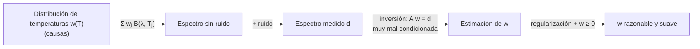

# B22-C04 — Inversión espectral

<!-- nav:top -->
<!-- /nav -->

## 1. Ubicación, nivel y alcance

Cuarta clase del bloque B22. Reúne las tres anteriores: un espectro es un problema inverso ([C01](../B22-C01-problemas-directos-e-inversos-y-mal-condicionamiento/CLASE.md)), a veces con pocos parámetros que quizá no se identifican ([C03](../B22-C03-identificabilidad-de-parametros/CLASE.md)) y a veces con muchos que exigen regularizar ([C02](../B22-C02-regularizacion-de-tikhonov/CLASE.md)). Nivel N3.

Verás la radiancia de Planck como modelo directo, la estimación de una temperatura por ajuste no lineal, la recuperación de una distribución de temperaturas (problema lineal muy mal condicionado) con Tikhonov y con mínimos cuadrados no negativos, y qué pasa cuando el modelo es incorrecto. No verás transferencia radiativa, líneas espectrales ni atmósferas planetarias (la inversión de atmósferas se menciona solo como contexto); tampoco inferencia bayesiana.

## 2. Por qué esta clase existe

Un espectro no trae escritas la temperatura ni la composición: trae un número de fotones por cada longitud de onda. Pasar de ahí a una propiedad física exige un modelo y una inversión. Cada paso oculta decisiones (qué modelo, qué ruido, qué se permite que valga el parámetro) y cada una cambia la respuesta.

La decisión central es: **dado un espectro, ¿qué propiedad física puedo inferir, con qué incertidumbre y qué parte de mi respuesta la ha puesto el método y no los datos?** Aprenderás a separarlo con dos casos: uno con un parámetro bien determinado y otro en que la respuesta depende de la regularización.

## 3. Lo que podrás hacer al terminar

1. Escribir la radiancia de Planck, sus unidades y su dependencia con la longitud de onda y la temperatura.
2. Estimar una temperatura por ajuste de mínimos cuadrados no lineal y dar su incertidumbre.
3. Plantear una mezcla de temperaturas como `b = A w` con pesos `w ≥ 0` y reconocer su mal condicionamiento.
4. Resolver con Tikhonov y con mínimos cuadrados no negativos, y comparar con la inversión ingenua.
5. Reconocer cuándo un ajuste excelente de una forma no implica que el modelo sea correcto (error de modelo).
6. Informar un resultado de inversión espectral con sus límites.

La evidencia es el **informe de inversión espectral** del ejercicio 12 (sección 20).

## 4. Con qué llegas y cómo comprobarlo

Necesitas C01–C03 y la idea de cuerpo negro (el brillo de un objeto caliente depende de su temperatura). Cinco preguntas:

1. ¿Qué diferencia hay entre un ajuste lineal y uno no lineal en los parámetros?
2. Si `cond(A) = 10¹¹`, ¿puedes invertir directamente datos con un ruido relativo de `10⁻²`?
3. ¿Qué hace un factor de filtro `σ²/(σ² + λ²)` con una dirección de `σ ≪ λ`?
4. ¿Qué es un `χ²` por grado de libertad y qué valor esperas si el modelo es correcto?
5. ¿Es razonable que un peso `w` (por ejemplo, una cantidad de masa de polvo) valga `−3`?

<details>
<summary>Ver respuestas</summary>

1. En un ajuste lineal los parámetros multiplican funciones conocidas (se resuelve con álgebra); en uno no lineal aparecen dentro de funciones (se resuelve por iteración). 2. No: la cota de amplificación es `10¹¹ × 10⁻² = 10⁹` (C01). 3. La apaga: `f ≈ σ²/λ² ≈ 0` (C02). 4. El `χ²` dividido por los datos menos los parámetros; vale cerca de 1 (con una dispersión de `√(2/gl)`) si el modelo es correcto y el ruido está bien estimado. 5. No: una cantidad física de masa no puede ser negativa; es una restricción que se puede imponer.
</details>

Con cuatro o cinco aciertos, sigue; con tres o menos, repasa C01–C03.

## 5. Un caso real: recuperar una atmósfera desde un espectro

Madhusudhan describe la **recuperación atmosférica** (*atmospheric retrieval*) de exoplanetas como la estimación de propiedades de la atmósfera (composición química, estructura de temperatura, nubes y neblinas) a partir de un espectro observado; se usan modelos con parámetros ajustables y métodos estadísticos, y el resultado son propiedades estimadas con incertidumbres (S4). Es un problema inverso espectral completo, con muchos parámetros y modelos físicos complejos.

Esta clase usa una versión **sintética** y mínima, para que la verdad esté a la vista: la emisión térmica de polvo frío en el infrarrojo lejano modelada como cuerpos negros. Nada aquí es una observación, ni reproduce el método de la revisión: solo conserva su esquema (modelo directo + datos con ruido + inferencia).

## 6. Vocabulario

La **radiancia espectral de Planck** `B(λ, T)` es la energía por unidad de tiempo, de área, de ángulo sólido y de longitud de onda que emite un cuerpo negro de temperatura `T` a la longitud de onda `λ`. Un **cuerpo negro** es un emisor ideal cuyo espectro depende solo de `T`. La **ley de desplazamiento de Wien** dice que la longitud de onda del máximo de `B` es inversamente proporcional a `T`: `λ_max T = b`, con `b` constante. Una **mezcla de temperaturas** es una suma ponderada de cuerpos negros de distintas `T`; sus **pesos** `wⱼ` son las contribuciones de cada temperatura de una rejilla. **Mínimos cuadrados no negativos** (NNLS) resuelven `min ‖A w − d‖` con `w ≥ 0` (S8). Un **error de modelo** es la discrepancia entre el modelo usado y la realidad física.

## 7. Modelo mental: muchas curvas casi iguales

Cada temperatura aporta una curva con forma de campana (en `λ`) que se desplaza hacia longitudes más cortas al subir `T`. Dos temperaturas próximas dan campanas casi superpuestas. Descomponer un espectro en esas campanas es como separar el sonido de varios instrumentos con tonos casi iguales: con poca precisión, muchas combinaciones suenan igual.



*Descripción textual:* una cadena directa de la distribución de temperaturas al espectro, al que se suma ruido para dar el espectro medido; una cadena de puntos intenta volver por inversión, que está muy mal condicionada y se estabiliza con regularización y la restricción `w ≥ 0`.

**Límite de la analogía:** en audio, el oído añade información que no hay en la señal; aquí la separación solo puede apoyarse en los datos y en las suposiciones que declares.

## 8. La explicación, paso a paso

### 8.1 El modelo directo

La radiancia de Planck, en función de la longitud de onda, es

```text
B(λ, T) = (2 h c² / λ⁵) / ( exp( h c / (λ k T) ) − 1 )        [W m⁻² sr⁻¹ m⁻¹]
```

con `h` la constante de Planck, `c` la velocidad de la luz y `k` la constante de Boltzmann. Sus valores en el SI son exactos: `h = 6,626 070 15 × 10⁻³⁴ J Hz⁻¹`, `k = 1,380 649 × 10⁻²³ J K⁻¹` y `c = 299 792 458 m s⁻¹` (S7, valores CODATA 2022). Esta forma de la ley es estándar y no se consultó una fuente concreta; se comprueba en el laboratorio contra la ley de Wien. La cantidad `x = h c/(λ k T)` decide el régimen: `x ≪ 1` (longitudes largas) es el de Rayleigh–Jeans, donde `B ≈ 2 c k T/λ⁴`; `x ≳ 1` incluye el pico y su lado de cortas longitudes.

El máximo de `B` en `λ` se obtiene de `x = 5 (1 − e^{−x})`, cuya solución es `x ≈ 4,965114`, de modo que `λ_max T = h c/(k x) ≈ 2,897772 × 10⁻³ m K`. El laboratorio calcula `x` y `b` desde `h`, `c` y `k` y comprueba que coinciden con el máximo numérico.

### 8.2 Primer caso: un parámetro (la temperatura)

Un cuerpo negro de `T` desconocida se mide en `n` longitudes de onda con ruido relativo conocido. El modelo es no lineal en `T`; se ajusta por mínimos cuadrados con pesos `1/σ`. La incertidumbre sale de la matriz de información (C03): `σ_T = √(JᵀJ)⁻¹`. Con un modelo correcto, la identificabilidad es buena: la forma de la campana depende de `T`. Es el caso «fácil».

### 8.3 Segundo caso: una mezcla de temperaturas

Ahora el espectro es `d(λᵢ) = Σⱼ wⱼ B(λᵢ, Tⱼ)/B_máx(Tⱼ)`, donde las `Tⱼ` forman una rejilla fija y se normaliza cada columna a su máximo (así los pesos son comparables: «unidades de brillo máximo de cada temperatura»). Es un problema lineal `d = A w`; las columnas de `A` son campanas casi superpuestas, de modo que `A` está muy mal condicionada (C01). Con la inversión ingenua los pesos salen con valores enormes y signos alternados, es decir, ruido amplificado.

### 8.4 Tikhonov y no negatividad

Dos salidas. **Tikhonov** (C02) apaga las direcciones débiles. **No negatividad** impone `w ≥ 0`, restricción física que resuelve NNLS (S8); en problemas mal condicionados, esa restricción ya regulariza en parte porque elimina las soluciones oscilantes con signos alternos. Se pueden combinar: se minimiza `‖A w − d‖² + λ² ‖w‖²` con `w ≥ 0`, lo que se resuelve con NNLS sobre la matriz apilada `[A; λ I]` (S2 describe la forma apilada; la combinación con NNLS es una práctica estándar sin cita específica). El parámetro `λ` se elige por discrepancia (C02): el `χ²` debe igualar el número de datos.

### 8.5 El error de modelo

Si ajustas un solo cuerpo negro a una mezcla, el optimizador devuelve una temperatura intermedia con una incertidumbre formal diminuta; la señal de alarma no es esa incertidumbre, sino el `χ²` por grado de libertad. Un modelo correcto con ruido bien estimado da `χ²/gl ≈ 1`; un valor de varios cientos delata un error de modelo. La incertidumbre de la cota de Fisher mide solo el ruido, no la validez del modelo.

**Pausa.** Un ajuste a datos reales da `T = 24 ± 0,01 K` y `χ²/gl = 2000`. ¿Qué conclusión sacas? *Respuesta:* que el modelo es incorrecto y la barra de error no significa nada; antes de informar `T`, hay que revisar el modelo (por ejemplo, más de una temperatura).

## 9. Magnitudes, símbolos y unidades

| Símbolo | Qué es | Unidad | Nota |
|---|---|---|---|
| `λ` | longitud de onda | m (aquí 30–1000 µm) | `1 µm = 10⁻⁶ m` |
| `T` | temperatura | K | 25 K en el caso 1; 10–80 K en la rejilla |
| `B(λ, T)` | radiancia espectral | W m⁻² sr⁻¹ m⁻¹ | por unidad de longitud de onda |
| `h`, `c`, `k` | constantes de Planck, luz, Boltzmann | J s, m/s, J/K | exactas en el SI (S7) |
| `x` | `h c/(λ k T)` | adimensional | decide el régimen |
| `b` | constante de Wien | m K | `λ_max T`; ≈ `2,897772 × 10⁻³` calculada |
| `wⱼ` | peso de la temperatura `Tⱼ` | unidades de brillo máximo de la columna | `≥ 0` |
| `σ` | desviación del ruido | de `d` | relativo (1 % y 2 %) |
| `χ²` | suma de residuos² ponderados | adimensional | |

## 10. Convenciones y referencias

`λ` es la longitud de onda en el vacío. El ruido es gaussiano y multiplicativo (proporcional a la señal), independiente por longitud de onda. La rejilla de temperaturas va de 10 a 80 K en 15 pasos de 5 K; las longitudes de onda, de 30 a 1000 µm en 40 puntos log-espaciados. No hay emisividad, extinción ni transferencia radiativa: son cuerpos negros puros, una simplificación declarada. `χ²/gl` usa `n − p` grados de libertad.

## 11. De dónde sale lo que afirmamos

| ID | Fuente | Localizador | Respalda | Estado |
|---|---|---|---|---|
| S2 | Hansen, P. C., «The L-curve and its use in the numerical treatment of inverse problems», WIT Press, 2001 | https://www.sintef.no/globalassets/project/evitameeting/2005/lcurve.pdf | Tikhonov como mínimos cuadrados apilados (ec. 3) y factores de filtro (ec. 5–6) | Texto leído parcialmente el 2026-11-05 (introducción y secciones 2 y 3) |
| S4 | Madhusudhan, N., «Atmospheric Retrieval of Exoplanets», arXiv:1808.04824 | https://arxiv.org/abs/1808.04824 | Qué es la recuperación atmosférica desde espectros | Solo resumen, consultado el 2026-11-05 |
| S7 | NIST, *CODATA Recommended Values* (2022): `h`, `k`, `c` | https://physics.nist.gov/cgi-bin/cuu/Value?h · …?k · …?c | `h = 6,626 070 15 × 10⁻³⁴ J Hz⁻¹`, `k = 1,380 649 × 10⁻²³ J K⁻¹`, `c = 299 792 458 m s⁻¹`, todos exactos | Tres páginas consultadas el 2026-11-05 |
| S8 | SciPy, `scipy.optimize.nnls` | https://docs.scipy.org/doc/scipy/reference/generated/scipy.optimize.nnls.html | Resuelve `A x ≈ b` con `x ≥ 0` en el sentido de mínimos cuadrados | Documentación consultada el 2026-11-05 |

Límites: la fórmula de Planck, la ley de Wien y la aproximación de Rayleigh–Jeans son resultados estándar y no se consultaron en una fuente; se comprueban numéricamente (el pico a 30 K se compara con el valor que sale de `h`, `c`, `k`). La constante de Wien se **calculó** a partir de S7, no se tomó de una tabla. Los datos son **sintéticos**.

## 12. Cómo ver el espectro y su inversión

Equivalente accesible a las gráficas de pesos `w(T)` del laboratorio (sección 17). El peso verdadero, con dos componentes (en 20 K y 45 K), frente a las recuperaciones:

| `T` (K) | Verdad | Ingenua | Tikhonov | Tikhonov + NNLS |
|---|---|---|---|---|
| 10 | 0,044 | −0,22 | 0,023 | 0,021 |
| 15 | 0,458 | 23,6 | 0,623 | 0,625 |
| 20 | 1,000 | −757 | 0,669 | 0,694 |
| 30 | 0,075 | −1,2 × 10⁵ | 0,347 | 0,291 |
| 40 | 0,495 | −1,7 × 10⁶ | 0,371 | 0,429 |
| 45 | 0,700 | −3,9 × 10⁵ | 0,390 | 0,495 |
| 55 | 0,175 | −7,9 × 10⁷ | 0,305 | 0,289 |
| 65 | 0,003 | −2,1 × 10⁸ | 0,124 | 0,000 |

La inversión ingenua tiene valores de hasta `10⁸`. La regularizada recupera un máximo cercano a 20 K, pero reparte el segundo en una meseta de 30 a 55 K: no resuelve dos componentes.

## 13. Ejemplo trabajado: el pico de un cuerpo negro a 30 K

Calculemos a mano cuánto vale `B` a `λ = 100 µm` para `T = 30 K` y dónde está el máximo.

**Paso 1 · el régimen.** `x = h c/(λ k T) = (6,62607015 × 10⁻³⁴ × 299 792 458)/(10⁻⁴ × 1,380649 × 10⁻²³ × 30) = 1,98645 × 10⁻²⁵/4,14195 × 10⁻²⁶ = 4,796`. No es ≪ 1: estamos cerca del pico, no en Rayleigh–Jeans.

**Paso 2 · el denominador.** `e^{4,796} − 1 ≈ 120,0`.

**Paso 3 · el numerador.** `2 h c²/λ⁵ = 2 × 6,62607015 × 10⁻³⁴ × (299 792 458)²/(10⁻⁴)⁵ = 1,19104 × 10⁻¹⁶/10⁻²⁰ = 1,19104 × 10⁴`.

**Paso 4 · el valor.** `B = 1,19104 × 10⁴/120,0 ≈ 99,2 W m⁻² sr⁻¹ m⁻¹` (el cálculo del laboratorio da `99,24`).

**Paso 5 · el máximo.** `λ_max = b/T = 2,897772 × 10⁻³/30 = 96,6 µm`, muy cerca de los 100 µm del cálculo: coherente con que `x = 4,796` esté próximo al `4,965` del máximo.

**Paso 6 · incertidumbre y límite.** Un 2 % de ruido en cada dato y 40 longitudes de onda dan una temperatura estimada con una desviación de centésimas de kelvin (laboratorio: `24,994 ± 0,011 K`, verdad `25 K`). Eso vale solo si el cuerpo negro puro es el modelo correcto: con una mezcla de temperaturas, la misma cifra sería engañosa (sección 8.5).

## 14. Comparación de métodos para la mezcla

La inversión ingenua da errores relativos de `2 × 10⁸`: inservible. **Tikhonov** da `0,43` y permite valores negativos (el mínimo es `−0,13`). **NNLS** solo da `0,61`: respeta `w ≥ 0`, pero sin penalización su error (`0,61`) es mayor que el de Tikhonov. **Tikhonov + NNLS** da `0,32`, el mejor del laboratorio, y cumple `w ≥ 0`. Ninguno recupera dos picos separados; la elección del método debe declararse porque cambia la forma del resultado. La **discrepancia** dio `λ = 15,8`: el `χ²` de la solución (54,5) queda por encima del de la verdad (31,3) para 40 datos, como corresponde a una solución regularizada.

## 15. Práctica guiada

**Ejercicio 1 · con los pasos indicados.** ¿A qué longitud de onda está el máximo de `B` para `T = 30 K` y para `T = 25 K`? *Pasos:* `λ_max = b/T` con `b = 2,897772 × 10⁻³ m K` (sección 8.1).

<details><summary>Solución comentada</summary>

`T = 30 K`: `2,897772 × 10⁻³/30 = 9,659 × 10⁻⁵ m = 96,6 µm`. `T = 25 K`: `2,897772 × 10⁻³/25 = 1,159 × 10⁻⁴ m = 115,9 µm`. Más frío, pico en longitudes más largas.
</details>

**Ejercicio 2 · con una pista.** Calcula `x = h c/(λ k T)` y `B` a `λ = 100 µm` para `T = 30 K`. *Pista:* el ejemplo trabajado (sección 13).

<details><summary>Solución comentada</summary>

`x = 4,796` y `B = 1,19104 × 10⁴/(e^{4,796} − 1) ≈ 99,2 W m⁻² sr⁻¹ m⁻¹`. Si te da otro valor, comprueba las unidades: `λ` en metros (`10⁻⁴ m`), no en micras.
</details>

**Ejercicio 3 · casi autónomo.** Con los mismos `λ = 100 µm` y `T = 30 K`, la aproximación de Rayleigh–Jeans da `2 c k T/λ⁴ = 2 483`. ¿Cuántas veces sobrestima a la ley de Planck? ¿Y a `λ = 1000 µm` con `T = 80 K`, donde `x = 0,18`?

<details><summary>Solución comentada</summary>

En el primer caso, `2483/99,2 ≈ 25`: la aproximación falla por un factor 25, porque `x = 4,8` no es ≪ 1. En el segundo, `(e^{0,18} − 1)/0,18 ≈ 1,095`: sobrestima un 9,5 %. La aproximación solo sirve donde `x ≪ 1`, y aun así deja un sesgo del orden de `x/2`.
</details>

## 16. Práctica autónoma, transferencia e integrador

**Ejercicio 4.** Una fuente muestra el máximo de su espectro a `200 µm`. ¿Qué temperatura tiene, si es un cuerpo negro?

<details><summary>Solución comentada</summary>

`T = b/λ_max = 2,897772 × 10⁻³/2 × 10⁻⁴ = 14,49 K`. La respuesta supone cuerpo negro puro y una medida limpia del máximo; si el máximo se localiza con 10 % de error, `T` hereda ese 10 %.
</details>

**Ejercicio 5.** En el caso 1 el laboratorio da `χ²/gl = 1,16` con 39 grados de libertad. ¿Es coherente con un modelo correcto? (Sección 8.5; la dispersión esperada es `√(2/gl)`.)

<details><summary>Solución comentada</summary>

La dispersión es `√(2/39) = 0,226`. El valor `1,16` está a `(1,16 − 1)/0,226 ≈ 0,7` desviaciones de 1: coherente con un modelo correcto y ruido bien estimado.
</details>

**Ejercicio 6.** El ajuste con ruido del 2 % da `σ_T = 0,011 K`. ¿Qué esperas con un ruido del 1 %?

<details><summary>Solución comentada</summary>

La cota de Cramér–Rao es proporcional al ruido (C03): unos `0,0055 K`. Es una estimación por escala lineal, no calculada con el script.
</details>

**Ejercicio 7.** En la mezcla hay 40 datos y 15 incógnitas, más datos que incógnitas, y aun así `cond(A) = 6,1 × 10¹¹`. ¿Por qué? Compáralo con el `κ` de C01.

<details><summary>Solución comentada</summary>

Tener más datos que incógnitas no basta: las 15 columnas son campanas casi superpuestas (temperaturas vecinas dan formas casi iguales), de modo que `A` está casi degenerada. Con `6,1 × 10¹¹` el problema es unos 10⁴ veces más mal condicionado que el de C01 (`3,9 × 10⁷`): la cota de amplificación para un ruido del 1 % es `6 × 10⁹` (el error ingenuo observado fue `2 × 10⁸`, por debajo de la cota).
</details>

**Ejercicio 8.** La solución de Tikhonov tiene un peso mínimo de `−0,13`. ¿Qué significa físicamente y cómo se corrige? ¿Qué cambia en el error?

<details><summary>Solución comentada</summary>

Un peso negativo es una cantidad de materia negativa: físicamente imposible, un artefacto de la regularización con una base de campanas casi superpuestas. Se corrige con la restricción `w ≥ 0` (NNLS, S8). Aquí el error pasa de `0,43` (Tikhonov) a `0,32` (Tikhonov + NNLS): la restricción aporta información correcta y mejora.
</details>

**Ejercicio 9 · transferencia.** El peso verdadero tiene dos picos (`1,0` en 20 K y `0,7` en 45 K). La mejor recuperación da `0,69` en 20 K y una meseta de `0,29–0,50` entre 30 y 55 K. Redacta una conclusión honesta.

<details><summary>Solución comentada</summary>

«Los datos requieren una componente fría cerca de 20 K y emisión adicional entre 30 y 55 K, pero no permiten asegurar que sea una sola componente a 45 K.» No se puede afirmar «dos componentes a 20 y 45 K»: la regularización suaviza y la recuperación no resuelve el segundo pico. Se informa también del método (Tikhonov + NNLS, `λ` por discrepancia) y de la falta de incertidumbres por componente (no se calcularon).
</details>

**Ejercicio 10 · transferencia.** Si solo dispusieras de datos con `λ > 200 µm`, ¿qué perderías de una fuente de 45 K y de una de 20 K? (Sección 8.1 y C03, ejercicio 9.)

<details><summary>Solución comentada</summary>

Los máximos están en `64 µm` (45 K) y `145 µm` (20 K, `b/T`). Con `λ > 200 µm` ambos quedan en el lado de largas longitudes, donde el espectro depende poco de `T` (`x` pequeño, régimen de Rayleigh–Jeans) y sobre todo de un producto con la cantidad de emisor: perderías la capacidad de distinguir temperaturas, sobre todo la de 45 K. Es un argumento cualitativo; no se simuló.
</details>

**Ejercicio 11 · transferencia.** Un ajuste de un solo cuerpo negro a la mezcla devuelve `T = 24,3 K` con `χ²/gl = 2452` (laboratorio). ¿Qué informas?

<details><summary>Solución comentada</summary>

Nada con esa `T`: el `χ²/gl` de 2452 frente a 1 señala un modelo incorrecto, y la barra de error formal (que sale de un modelo supuestamente correcto) no vale. Se informa que un solo cuerpo negro no describe los datos y se pasa a un modelo con más componentes o a una distribución, con el costo de regularizar (C02) y de verificar la identificabilidad (C03).
</details>

**Ejercicio 12 · integrador.** Genera un espectro sintético con dos temperaturas propias y un ruido de tu elección, y entrega: un modelo directo con unidades; el ajuste de un cuerpo negro con su `χ²/gl`; la inversión de la mezcla con Tikhonov + NNLS y `λ` por discrepancia; una conclusión honesta sobre qué se recupera y qué no.

<details><summary>Solución modelo</summary>

Con el script, cambiando `w_ver`, `sigma` y las semillas: el informe debe mostrar que el ajuste de un solo `T` falla (`χ²/gl ≫ 1`) cuando las componentes están separadas; que `cond(A)` es enorme; que la inversión recupera la componente dominante y reparte la otra; y que declara el método, `λ` y la limitación. Se acepta cualquier caso coherente con sus cifras.
</details>

## 17. Laboratorio: de la temperatura a la mezcla

El script [inversion_espectral.py](inversion_espectral.py) comprueba la ley de Wien desde `h`, `c`, `k`, ajusta la temperatura de un cuerpo negro, construye la matriz de la mezcla, compara la inversión ingenua, Tikhonov, NNLS y Tikhonov + NNLS, y ajusta un solo cuerpo negro a la mezcla. La **prueba contra el caso analítico** compara el pico numérico de `B` a 30 K con `b/T` calculado desde las constantes (tolerancia `10⁻⁴`) y detiene la ejecución si falla.

**Datos:** sintéticos, semillas fijas (4 y 5). **Predice antes de ejecutar:** ¿qué método tendrá menor error? **Ejecución del 2026-11-05 (Python 3.12.9, numpy 2.4.4, scipy 1.17.1):**

```text
x de Wien = 4.965114232; b = 2.897771955 mm K; pico numerico a 30 K = 96.59 um (Wien: 96.59 um)
parte 1 sin ruido: T = 25.00000000 K (verdad 25.0); con ruido 2 %: T = 24.994 +- 0.011 K; chi2/gl = 1.16
parte 2: cond(A) = 6.10e+11
lam de discrepancia = 1.58e+01
error relativo: ingenuo 2.085e+08 | Tikhonov 4.289e-01 | NNLS 6.098e-01 | Tikhonov+NNLS 3.197e-01
minimo de w: ingenuo -206816897.09 | Tikhonov -0.13 | NNLS 0.00 | T+NNLS 0.00
  T (K)   verdad   ingenuo   Tikhonov  T+NNLS
   10.0    0.044     -0.22     0.023    0.021
   15.0    0.458     23.57     0.623    0.625
   20.0    1.000   -756.53     0.669    0.694
   25.0    0.461  12652.92     0.468    0.440
   30.0    0.075  -118729.82     0.347    0.291
   35.0    0.175  639411.66     0.338    0.321
   40.0    0.495  -1727569.79     0.371    0.429
   45.0    0.700  -386341.12     0.390    0.495
   50.0    0.495  20625468.13     0.366    0.449
   55.0    0.175  -79032016.74     0.305    0.289
   60.0    0.031  163081600.29     0.220    0.042
   65.0    0.003  -206816897.09     0.124    0.000
   70.0    0.000  161530802.93     0.028    0.000
   75.0    0.000  -71571547.64    -0.058    0.000
   80.0    0.000  13724459.96    -0.131    0.000
chi2 con la verdad = 31.3; chi2 de Tikhonov+NNLS = 54.5; datos = 40
un solo T ajustado a la mezcla: T = 24.34 K, chi2/gl = 2451.7 (modelo incorrecto)
Pruebas superadas.
```

```bash
python programa/clases/B22/B22-C04-inversion-espectral/inversion_espectral.py
```

**Límites:** cuerpos negros puros sin emisividad ni transferencia radiativa; ruido multiplicativo gaussiano conocido; rejilla de 15 temperaturas; una sola realización de ruido; las incertidumbres de la mezcla no se calcularon.

## 18. Errores frecuentes y cómo corregirlos

**Confiar en la barra de error de un modelo incorrecto.** Se corrige con la sección 8.5 y el ejercicio 11.

**Tomar la solución regularizada como la verdad.** Se corrige con el ejercicio 9.

**Aplicar Rayleigh–Jeans fuera de su régimen.** Se corrige con el ejercicio 3.

**Dejar pesos negativos en una cantidad física.** Se corrige con el ejercicio 8.

**Olvidar las unidades de `λ`.** Metros, no micras, en `B`. Se corrige con el ejercicio 2.

## 19. Cómo sabrás que vas bien

Tras 8.1: ¿calculas `x` y `B` de un caso concreto? Si no, ejercicio 2. Tras 8.2: ¿explicas qué mide `χ²/gl`? Si no, ejercicio 5. Tras 8.4: ¿distingues lo que aporta Tikhonov de lo que aporta `w ≥ 0`? Si no, ejercicio 8. Tras el laboratorio: ¿qué parte de la recuperación depende de tus decisiones y no de los datos?

## 20. Qué entregas y cómo se evalúa

El producto es el **informe de inversión espectral**: modelo directo con unidades; ajuste de un cuerpo negro con `χ²/gl`; inversión de una mezcla con método y `λ`; error frente a la verdad sintética; y conclusión honesta.

| Criterio | Inicial | En desarrollo | Logrado | Destacado |
|---|---|---|---|---|
| Modelo directo | Sin unidades | Con unidades | Con régimen y verificación | Comprueba contra Wien |
| Inversión | Solo ingenua | Un método regularizado | Dos con comparación | Con restricción física y `λ` justificado |
| Error de modelo | No lo considera | Menciona `χ²` | Calcula `χ²/gl` | Muestra un modelo incorrecto y lo detecta |
| Rotulado y fuentes | Mezcla datos | Rotula | Rotula y cita | Declara límites del método |

**Condiciones críticas:** no presentar datos sintéticos como observados; no informar una incertidumbre formal sin revisar `χ²/gl`; citar solo lo consultado.

## 21. Ética, seguridad y límites

Una temperatura o una composición derivada de un espectro es una inferencia que depende del modelo; presentarla sin esa condición induce a error. Los resultados de recuperación de atmósferas, por ejemplo, tienen consecuencias en cómo se discute la habitabilidad, que exige cautela. Accesibilidad: tablas en lugar de gráficas. Material educativo con datos sintéticos; no sirve para analizar observaciones reales.

## 22. Para cerrar y seguir

Un espectro se invierte con un modelo directo; con un parámetro bien determinado, el ajuste es fiable (temperatura a ±0,011 K con el modelo correcto) y, con muchos y mal condicionados, la respuesta depende de la regularización y de restricciones como `w ≥ 0`. Un `χ²/gl` muy superior a 1 delata un error de modelo que ninguna barra de error corrige. Queda abierta una pregunta: ¿cómo comprobar que un método de inversión funciona antes de aplicarlo a datos reales, y qué trampas hay en esa comprobación?

**Glosario español–inglés.** inversión espectral · *spectral inversion*; radiancia espectral · *spectral radiance*; cuerpo negro · *blackbody*; ley de desplazamiento de Wien · *Wien's displacement law*; mínimos cuadrados no negativos · *non-negative least squares*; error de modelo · *model error*; recuperación atmosférica · *atmospheric retrieval*.

**Continuidad.** [B22-C05](../B22-C05-pruebas-de-inversion-con-datos-sinteticos/CLASE.md) enseña a validar una inversión con datos sintéticos y a evitar el «crimen inverso». Los espectros reales y su descripción física se tratan en bloques de A03/A05 (B45 describe los espectros sin inversión formal).

**Referencias:** ver sección 11. De S4 solo se usó el resumen; Planck, Wien y Rayleigh–Jeans son resultados estándar verificados numéricamente.

<!-- nav:bottom -->
<!-- /nav -->
