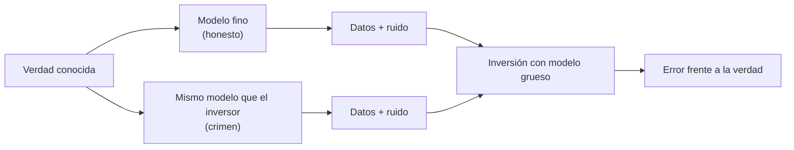

# B22-C05 — Pruebas de inversión con datos sintéticos

<!-- nav:top -->
[🏠 Programa](../../../../README.md) · [📚 Bloque B22](../../../tronco-comun/B22-problemas-inversos-y-estimacion-de-modelos.md) · [← Anterior: B22-C04 — Inversión espectral](../B22-C04-inversion-espectral/CLASE.md) · [Siguiente: B23-C01 — Pruebas unitarias numéricas con tolerancias →](../../B23/B23-C01-pruebas-unitarias-numericas-con-tolerancias/CLASE.md)
<!-- /nav -->

## 1. Ubicación, nivel y alcance

Quinta y última clase del bloque B22. Ya sabes plantear un problema inverso ([C01](../B22-C01-problemas-directos-e-inversos-y-mal-condicionamiento/CLASE.md)), regularizarlo ([C02](../B22-C02-regularizacion-de-tikhonov/CLASE.md)), preguntar si los parámetros se identifican ([C03](../B22-C03-identificabilidad-de-parametros/CLASE.md)) y aplicarlo a espectros ([C04](../B22-C04-inversion-espectral/CLASE.md)). Aquí aprendes a **probar** un método de inversión con datos fabricados por ti, sin engañarte. Nivel N3.

Verás el esquema de una prueba sintética, el «crimen inverso», la discrepancia de modelo, el barrido de ruido y la prueba de cobertura. No verás validación con datos reales ni simulaciones de Monte Carlo avanzadas.

## 2. Por qué esta clase existe

Con datos reales no conoces la verdad, así que no puedes medir el error de tu inversión. Con datos sintéticos sí: tú fijas la verdad, generas los datos y miras si el método la recupera. Pero hay una trampa: si fabricas los datos con el mismo modelo que luego usas para invertir, el método parece mejor de lo que es.

La decisión central es: **¿qué prueba sintética me permite afirmar honestamente que mi inversión funciona, y cuánto debo desconfiar de un resultado demasiado bueno?** Aprenderás a diseñar la prueba, a detectar el crimen inverso y a comprobar que tus intervalos de incertidumbre cubren la verdad con la frecuencia que prometen.

## 3. Lo que podrás hacer al terminar

1. Diseñar una prueba sintética con verdad, modelo generador, ruido y métrica declarados.
2. Definir el crimen inverso y reconocerlo en un experimento.
3. Generar datos con un modelo más fino que el de inversión para una prueba honesta.
4. Barrer el ruido y leer cómo cambian los errores con y sin crimen.
5. Comprobar la cobertura de intervalos de confianza por repetición.
6. Redactar una declaración de límites de una prueba sintética.

La evidencia es el **protocolo de prueba sintética** del ejercicio 12 (sección 20).

## 4. Con qué llegas y cómo comprobarlo

Necesitas C01–C03 (modelo directo, Tikhonov, discrepancia, intervalos). Cinco preguntas:

1. ¿Qué es el principio de discrepancia y qué necesita saber?
2. ¿Qué significa un intervalo de confianza del 68 %?
3. ¿Por qué se fija una semilla en un experimento con números aleatorios?
4. ¿Qué diferencia hay entre error de la solución y residuo?
5. ¿Qué es la regla del punto medio para aproximar una integral?

<details>
<summary>Ver respuestas</summary>

1. Elegir `λ` para que el residuo valga `σ√m`; necesita la desviación del ruido (C02). 2. Que, repitiendo el experimento, el intervalo contendría el valor verdadero en el 68 % de los casos. 3. Para que el resultado se reproduzca. 4. El residuo es dato menos modelo; el error es solución menos verdad, que solo se conoce en simulación (B10-C07). 5. Sustituir la integral por la suma de los valores en el centro de cada celda por el ancho de la celda.
</details>

Con cuatro o cinco aciertos, sigue; con tres o menos, repasa C01–C03.

## 5. Un caso real: el nombre del «crimen»

Wirgin define el **crimen inverso** como usar los mismos componentes teóricos, o casi los mismos, para generar los datos y para invertirlos en un problema inverso, y recuerda que Colton y Kress lo consideran una práctica trivial que debe evitarse (S3). En la literatura de problemas inversos de ondas se identifica cuando el mismo código resuelve el problema directo para fabricar los datos y para la inversión. Aquí no usarás ondas, pero sí el mismo principio sobre el problema de emborronado de C01–C02.

Los datos son **sintéticos** y el perfil verdadero tiene bordes bruscos, pensando en el borde de un disco de polvo.

## 6. Vocabulario

Una **prueba sintética** genera datos desde una verdad conocida, los invierte y compara. El **modelo generador** produce los datos; el **modelo de inversión** es el que usa el método. Si son el mismo, hay **crimen inverso**. La **discrepancia de modelo** es la diferencia entre ambos, y en una prueba honesta existe. La **cobertura** de un intervalo es la fracción de repeticiones en que contiene la verdad. Un **barrido de ruido** repite la prueba con distintos niveles de ruido. La **rejilla fina** es una discretización con muchos puntos que se usa como «realidad» simulada; la **gruesa**, la que usa el inversor.

## 7. Modelo mental: el examen con las respuestas

Piensa en un estudiante que prepara un examen. Si las preguntas del examen son las mismas que ya vio al estudiar, un 10 no demuestra nada. Una prueba honesta cambia las preguntas, pero conserva la materia.



*Descripción textual:* desde la verdad conocida salen dos caminos: un modelo fino (prueba honesta) y el mismo modelo del inversor (crimen). Ambos producen datos con ruido, que entran a la misma inversión con modelo grueso, y de ahí se mide el error frente a la verdad.

**Límite de la analogía:** el estudiante con las respuestas sabe lo que ya vio; el código no «recuerda», simplemente acierta porque el modelo es exacto para esos datos. La prueba honesta tampoco es la realidad: el modelo fino sigue siendo un modelo.

## 8. La explicación, paso a paso

### 8.1 El esquema de una prueba sintética

Se fija la verdad `x_ver`; se genera `b = A_gen x_ver + e`; se invierte con `A_inv`; se mide el error. Cada elemento debe declararse: la verdad, `A_gen`, `A_inv`, el ruido (tipo y `σ`), la semilla, el método de elección de `λ` y la métrica. Sin esa lista, el resultado no es reproducible ni interpretable.

### 8.2 El crimen inverso

Si `A_gen = A_inv` (en el laboratorio, `b = A_c x_ver` con la misma matriz gruesa que luego se invierte), la inversión no se ve afectada por ningún error de modelo; solo por ruido y regularización. Resultado: errores demasiado optimistas (S3). En una prueba honesta `A_gen` es otro modelo, aquí más fino: la integral del emborronado se evalúa con 1000 celdas, y el inversor usa 30.

### 8.3 La discrepancia de modelo

Con un perfil suave, el modelo grueso y el fino coinciden casi exactamente (el laboratorio da una diferencia relativa de `2,9 × 10⁻⁷`). Con un perfil de bordes bruscos que no caen en el borde de las celdas gruesas, difieren en `1,1 × 10⁻¹` del máximo del dato. Esa discrepancia es la que el crimen oculta. Una prueba honesta debe usar un perfil que ponga a prueba el modelo, no solo uno cómodo.

### 8.4 El barrido de ruido

Se repite la prueba con `σ = 10⁻⁶ … 10⁻²`. Con crimen, el error sigue bajando al bajar el ruido; sin crimen, se estanca en un **suelo** fijado por el error de modelo, que no depende del ruido. Ese suelo es información: nada que mejore el instrumento lo bajará, hay que mejorar el modelo.

### 8.5 La cobertura

Si tus intervalos son del 68 % (1 σ), deben contener la verdad en el 68 % de las repeticiones. El laboratorio lo comprueba en un problema bien planteado (regresión lineal), repitiendo 4000 veces. Con N repeticiones, la fracción observada fluctúa con desviación `√(p(1−p)/N)`; para `p = 0,6827` y `N = 4000`, vale `0,0074`.

**Pausa.** Obtienes 0,62 de cobertura al 68 %. ¿Qué indica? *Respuesta:* que 0,62 está a más de 8 desviaciones del esperado: los intervalos son demasiado estrechos (σ subestimada o modelo incorrecto).

## 9. Magnitudes, símbolos y unidades

| Símbolo | Qué es | Unidad | Nota |
|---|---|---|---|
| `s` | posición | unidades arbitrarias | 0 a 1 |
| `x_ver` | perfil verdadero | unidades arbitrarias | bordes en 0,31–0,62 y 0,75–0,85 |
| `A_gen` | modelo generador (fino, 1000 celdas) | adimensional | punto medio |
| `A_inv` | modelo de inversión (grueso, 30 celdas) | adimensional | punto medio |
| `w` | ancho gaussiano del instrumento | de `s` | `0,05` |
| `σ` | desviación del ruido | de `b` | `10⁻⁶ … 10⁻²` |
| `λ` | parámetro de Tikhonov | adimensional | por discrepancia |
| `p` | cobertura esperada | adimensional | `0,6827` para 1 σ |

## 10. Convenciones y referencias

Los datos de prueba son sintéticos y la semilla es fija (5). El error se mide como `‖x − x_ver‖/‖x_ver‖` con la verdad evaluada en las celdas gruesas. `λ` se elige por discrepancia entre `10⁻⁸` y `10`. La regla del punto medio se usa en ambos modelos; el fino tiene 1000 celdas y el grueso 30.

## 11. De dónde sale lo que afirmamos

| ID | Fuente | Localizador | Respalda | Estado |
|---|---|---|---|---|
| S3 | Wirgin, A., «The inverse crime», arXiv:math-ph/0401050 (2004) | https://arxiv.org/abs/math-ph/0401050 | Definición del crimen inverso y su consideración como práctica a evitar (Colton y Kress) | Solo resumen, consultado el 2026-11-05 |
| S2 | Hansen, P. C., «The L-curve and its use in the numerical treatment of inverse problems», 2001 | https://www.sintef.no/globalassets/project/evitameeting/2005/lcurve.pdf | Tikhonov y factores de filtro usados en el laboratorio | Texto leído parcialmente el 2026-11-05 |
| S4 | Madhusudhan, N., arXiv:1808.04824 | https://arxiv.org/abs/1808.04824 | Contexto: la inversión de espectros usa modelos y métodos estadísticos | Solo resumen, consultado el 2026-11-05 |

Límites: no se leyó el texto completo de S3, así que no se afirma nada sobre sus ejemplos. El esquema de prueba, el barrido de ruido y la cobertura son prácticas estándar sin cita específica. Los datos son **sintéticos**.

## 12. Cómo ver el barrido de ruido

Equivalente accesible a la gráfica de error frente a `σ` (resultados del laboratorio, sección 17):

| `σ` | Error con crimen | Error honesto | Cociente honesto/crimen |
|---|---|---|---|
| `10⁻⁶` | `0,023` | `0,194` | 8,5 |
| `10⁻⁵` | `0,081` | `0,197` | 2,4 |
| `10⁻⁴` | `0,114` | `0,202` | 1,8 |
| `10⁻³` | `0,165` | `0,211` | 1,3 |
| `10⁻²` | `0,190` | `0,226` | 1,2 |

El error honesto apenas baja de `0,19`: es el suelo del error de modelo. El error con crimen cae un orden de magnitud al bajar el ruido de `10⁻²` a `10⁻⁶`, un progreso ilusorio.

## 13. Ejemplo trabajado: leer una prueba de inversión

**Paso 1 · declaración.** Verdad: perfil con dos escalones; datos: 30 puntos; modelo del instrumento: gaussiana `w = 0,05`; generador honesto: 1000 celdas; inversor: 30 celdas; método: Tikhonov, `λ` por discrepancia; semilla 5.

**Paso 2 · el ruido muy bajo (`σ = 10⁻⁶`).** Con crimen, el error es `0,023`; con modelo fino, `0,194`. El método parece 8,5 veces mejor sin el engaño de lo que es.

**Paso 3 · el suelo.** Al subir el ruido a `10⁻²`, el error con crimen sube a `0,19`, casi igual que el honesto (`0,226`): con mucho ruido, la discrepancia de modelo pasa a ser secundaria. Con poco ruido, domina.

**Paso 4 · el mensaje honesto.** «El método recupera el perfil con un error relativo de `≈ 0,2`, con un suelo debido a que el inversor usa 30 celdas para un objeto con bordes.» Un resultado de `0,023` sería correcto solo para el caso del crimen.

**Paso 5 · incertidumbre y límites.** Una sola semilla y un solo perfil: no se puede decir nada sobre el caso general; para eso habría que repetir con muchas semillas y verdades.

## 14. Comparación de pruebas

Una prueba **con crimen** sirve para depurar código (verifica que el algoritmo funciona sin errores de programación: debe acertar casi perfecto sin ruido), pero no para estimar errores reales. Una prueba **honesta** con modelo más fino estima mejor el error de modelo, pero depende de la elección de la verdad y del modelo fino. Una prueba de **cobertura** valida las incertidumbres, pero exige repetir muchas veces y un problema donde la verdad esté bien definida. Se combinan las tres: primero depurar, luego estimar con modelo distinto y por último comprobar la cobertura.

## 15. Práctica guiada

**Ejercicio 1 · con los pasos indicados.** El laboratorio da coberturas `0,6902` y `0,6965` para 1 σ con 4000 repeticiones. ¿Son coherentes con `0,6827`? *Pasos:* calcula la desviación `√(p(1−p)/N)` y exprésalas en desviaciones (sección 8.5).

<details><summary>Solución comentada</summary>

`√(0,6827 × 0,3173/4000) = 0,00736`. Diferencias: `0,0075` (1,0 desviaciones) y `0,0138` (1,9 desviaciones). Ambas son aceptables; la segunda está cerca del límite habitual de 2. Por eso la tolerancia de la prueba (`0,66–0,70`) es de unas 2,5 desviaciones.
</details>

**Ejercicio 2 · con una pista.** Con la tabla de la sección 12, calcula el cociente honesto/crimen en `σ = 10⁻⁶`. *Pista:* `0,1936/0,02281`.

<details><summary>Solución comentada</summary>

`≈ 8,5`. Sin el modelo más fino, el método parecería 8,5 veces más preciso de lo que es.
</details>

**Ejercicio 3 · casi autónomo.** Para 30 datos y `σ = 10⁻³`, ¿qué residuo objetivo da la discrepancia?

<details><summary>Solución comentada</summary>

`σ√n = 10⁻³ × √30 = 5,5 × 10⁻³`.
</details>

## 16. Práctica autónoma, transferencia e integrador

**Ejercicio 4.** ¿Por qué el error honesto apenas cambia entre `σ = 10⁻⁶` y `10⁻⁵` (`0,194` y `0,197`)?

<details><summary>Solución comentada</summary>

Porque el error está dominado por el error de modelo (30 celdas frente a bordes bruscos), no por el ruido. Bajar el ruido no puede bajarlo; hay que mejorar el modelo (más celdas) o aceptar el suelo.
</details>

**Ejercicio 5.** Se comprueba que el modelo grueso y el fino difieren `2,9 × 10⁻⁷` con un perfil suave. ¿Qué concluyes sobre la prueba si solo usaras ese perfil?

<details><summary>Solución comentada</summary>

Que la prueba no distingue honesto de crimen: ambos modelos dan casi los mismos datos. Es una prueba de implementación, no de robustez. Hay que usar un perfil con bordes para que la discrepancia de modelo aparezca (`1,1 × 10⁻¹`).
</details>

**Ejercicio 6.** Un compañero dice que su método llega a un error de `10⁻³` en datos sintéticos. ¿Qué tres preguntas le haces?

<details><summary>Solución comentada</summary>

(1) ¿Con qué modelo fabricaste los datos y con cuál inviertes (crimen inverso, S3)? (2) ¿Qué ruido y qué perfil, y con cuántas semillas? (3) ¿Qué ocurre con un perfil con bordes y un modelo generador distinto? Un resultado excelente sin esas respuestas no es evidencia.
</details>

**Ejercicio 7.** Con cobertura observada de 0,55 al 68 % y 4000 repeticiones, ¿qué sospechas?

<details><summary>Solución comentada</summary>

La desviación esperada es `0,0074`; `0,55` está a `(0,6827 − 0,55)/0,0074 ≈ 18` desviaciones: no es azar. Los intervalos son demasiado estrechos: `σ` subestimada, ruido correlacionado, sesgo del método (como el de Tikhonov, C02) o error de modelo.
</details>

**Ejercicio 8.** ¿Por qué se elige el perfil con bordes en lugar del suave?

<details><summary>Solución comentada</summary>

Porque un perfil suave se representa bien con 30 celdas y oculta el error de modelo. Los bordes entre celdas obligan a que la inversión pague el precio de su discretización, que es lo que se quiere medir.
</details>

**Ejercicio 9 · transferencia.** Un artículo prueba su inversión de espectros con espectros fabricados por el mismo código directo. ¿Qué dices?

<details><summary>Solución comentada</summary>

Es un crimen inverso (S3): la prueba comprueba que el código es coherente consigo mismo, no que invierta espectros que otro modelo habría generado. Pido espectros generados con un modelo distinto (otra rejilla, otra física de detalle), un barrido de ruido y la cobertura de los intervalos.
</details>

**Ejercicio 10 · transferencia.** Propón una prueba honesta para el caso de C04 (mezcla de temperaturas).

<details><summary>Solución comentada</summary>

Generar el espectro con una rejilla de temperaturas más fina (por ejemplo, 70 temperaturas) o con una distribución continua y emisividad ligeramente distinta, e invertir con la rejilla de 15; barrer el ruido y la forma de la distribución; contar si los intervalos cubren. No se ejecutó esta prueba; es un diseño.
</details>

**Ejercicio 11 · transferencia.** ¿Qué parte del informe de una inversión real debería salir de una prueba sintética previa?

<details><summary>Solución comentada</summary>

El error esperado del método (con suelo de modelo), la sensibilidad al ruido y la cobertura de los intervalos, siempre con la declaración de qué se simuló y qué no. Los resultados sintéticos no sustituyen la validación con datos reales, y se rotulan como tales.
</details>

**Ejercicio 12 · integrador.** Diseña el protocolo de prueba sintética de una inversión propia: verdad, generador, inversor, ruido, semillas, métrica, barrido, cobertura y declaración de límites. Ejecútalo con el script (cambiando el perfil o el ancho) y comenta.

<details><summary>Solución modelo</summary>

Debe incluir: una verdad con rasgos difíciles; un generador distinto del inversor; barrido de ruido con tabla; cociente honesto/crimen; cobertura con su tolerancia estadística; y una frase de límites («válido para este núcleo, estos perfiles y este ruido gaussiano»). Se acepta cualquier protocolo coherente con sus resultados.
</details>

## 17. Laboratorio: el crimen inverso y la cobertura

El script [pruebas_sinteticas.py](pruebas_sinteticas.py) construye los modelos grueso y fino, mide la discrepancia con un perfil suave y con uno de bordes, barre el ruido con y sin crimen y comprueba la cobertura en una regresión lineal. La **prueba contra el caso de referencia** exige que, con un perfil suave, ambos modelos coincidan a `10⁻²`, y que la cobertura esté entre `0,66` y `0,70`; detiene la ejecución si falla.

**Datos:** sintéticos, semilla fija (5). **Predice antes de ejecutar:** ¿para qué ruido es mayor el engaño del crimen? **Ejecución del 2026-11-05 (Python 3.12.9, numpy 2.4.4):**

```text
discretizacion (perfil suave): diferencia relativa grueso-fino = 2.86e-07
discrepancia de modelo con el perfil con bordes: 1.06e-01 (relativa al maximo del dato)
  sigma      error crimen   error honesto   lam crimen  lam honesto
    1e-06     2.281e-02     1.936e-01     5.01e-05   6.31e-05
    1e-05     8.095e-02     1.966e-01     4.47e-04   5.01e-04
    1e-04     1.138e-01     2.023e-01     3.16e-03   5.01e-03
    1e-03     1.649e-01     2.114e-01     2.51e-02   2.51e-02
    1e-02     1.904e-01     2.261e-01     1.00e-01   1.00e-01
cobertura 1-sigma de (a, b): [0.6902 0.6965] (esperado 0.6827)
Pruebas superadas.
```

```bash
python programa/clases/B22/B22-C05-pruebas-de-inversion-con-datos-sinteticos/pruebas_sinteticas.py
```

**Límites:** un solo perfil y una sola semilla en el barrido; núcleo gaussiano exacto; la cobertura se comprueba en un problema bien planteado, no en la inversión regularizada (cuyo sesgo la reduciría).

## 18. Errores frecuentes y cómo corregirlos

**Fabricar los datos con el modelo del inversor.** Se corrige con la sección 8.2 y el ejercicio 6.

**Usar solo perfiles suaves.** Se corrige con el ejercicio 8.

**Usar una sola semilla como evidencia general.** Se corrige con el ejercicio 12.

**Ignorar el suelo de error de modelo.** Se corrige con el ejercicio 4.

**No comprobar la cobertura.** Se corrige con el ejercicio 7.

## 19. Cómo sabrás que vas bien

Tras 8.2: ¿reconoces un crimen inverso en una descripción? Si no, ejercicio 6. Tras 8.4: ¿explicas el suelo? Si no, ejercicio 4. Tras 8.5: ¿juzgas una cobertura con su desviación esperada? Si no, ejercicio 1. Tras el laboratorio: ¿qué número engañaría a un lector que no conozca el crimen?

## 20. Qué entregas y cómo se evalúa

El producto es el **protocolo de prueba sintética**: declaración completa, tabla del barrido con y sin crimen, cobertura y límites.

| Criterio | Inicial | En desarrollo | Logrado | Destacado |
|---|---|---|---|---|
| Declaración | Incompleta | Casi completa | Completa y reproducible | Con semillas y versiones |
| Crimen inverso | No lo reconoce | Lo define | Lo evita con modelo distinto | Cuantifica su efecto |
| Barrido y cobertura | Un solo ruido | Barrido sin cobertura | Barrido y cobertura | Interpreta el suelo y la tolerancia estadística |
| Rotulado y fuentes | Mezcla datos | Rotula | Rotula y cita | Declara límites de generalidad |

**Condiciones críticas:** no presentar un resultado con crimen inverso como evidencia de precisión; no presentar datos sintéticos como observados; citar solo lo consultado.

## 21. Ética, seguridad y límites

Un método «validado» con una prueba autocomplaciente puede propagarse a análisis de datos reales y a decisiones (por ejemplo, de diseño de misiones). La obligación es declarar cómo se probó. Accesibilidad: tablas en lugar de gráficas. Material educativo con datos sintéticos.

## 22. Para cerrar y seguir

Una prueba sintética permite medir el error de una inversión porque se conoce la verdad, pero solo es honesta si el modelo generador difiere del de inversión; con el crimen inverso, el error parece hasta 8,5 veces menor (laboratorio). El barrido de ruido revela el suelo del error de modelo y la cobertura valida las incertidumbres. Con esto se cierra B22: has pasado de plantear un problema inverso a probar un método sin engañarte. Queda abierta una pregunta: ¿cómo pasar de la regularización clásica a la inferencia estadística completa de los parámetros?

**Glosario español–inglés.** prueba sintética · *synthetic test*; crimen inverso · *inverse crime*; discrepancia de modelo · *model discrepancy*; cobertura · *coverage*; barrido de ruido · *noise sweep*; rejilla fina · *fine grid*.

**Continuidad.** Con B22 cerrado, [B22-C01](../B22-C01-problemas-directos-e-inversos-y-mal-condicionamiento/CLASE.md) a C05 forman la base de estimación para B12 (estadística) y B15 (estimación de parámetros).

**Referencias:** ver sección 11. De S3 y S4 solo se usaron los resúmenes.

<!-- nav:bottom -->
---

[← Anterior: B22-C04 — Inversión espectral](../B22-C04-inversion-espectral/CLASE.md) · [📚 Bloque B22](../../../tronco-comun/B22-problemas-inversos-y-estimacion-de-modelos.md) · [Siguiente: B23-C01 — Pruebas unitarias numéricas con tolerancias →](../../B23/B23-C01-pruebas-unitarias-numericas-con-tolerancias/CLASE.md)
<!-- /nav -->
