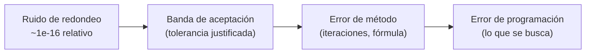

# B23-C01 — Pruebas unitarias numéricas con tolerancias

<!-- nav:top -->
[🏠 Programa](../../../../README.md) · [📚 Bloque B23](../../../tronco-comun/B23-verificacion-y-validacion-de-software-cientifico.md) · [← Anterior: B22-C05 — Pruebas de inversión con datos sintéticos](../../../tronco-comun/B22-problemas-inversos-y-estimacion-de-modelos.md#b22-c05) · [Siguiente: B23-C02 — Pruebas de propiedades físicas →](../B23-C02-pruebas-de-propiedades-fisicas/CLASE.md)
<!-- /nav -->

## 1. Ubicación, nivel y alcance

Primera clase del bloque B23. En [B07-C17](../../B07/B07-C17-pruebas-de-funciones-matematicas/CLASE.md) aprendiste a escribir una prueba y a comparar decimales con `approx`; ahora das el paso siguiente: **diseñar la tolerancia** en vez de copiarla, y saber qué defectos deja pasar. Nivel de entrada N2, de salida N3.

Verás error absoluto y relativo, el criterio de comparación de NumPy y de Python, la precisión de máquina y el *ulp*, cómo derivar una tolerancia del problema, y cómo medir si tus pruebas son lo bastante estrictas inyectando defectos a propósito. No verás conservación de energía (C02), soluciones exactas completas (C03) ni contraste con datos oficiales (C05).

## 2. Por qué esta clase existe

Una prueba con tolerancia muy holgada pasa siempre y no protege nada; una con tolerancia demasiado estricta falla por ruido de redondeo y se termina desactivando. La pregunta motivadora es: **¿cómo elijo una tolerancia que sea lo bastante estricta para detectar un error real y lo bastante amplia para no fallar por redondeo?**

La decisión central es: **¿de dónde sale el número de mi tolerancia?** Si sale de «lo que da hoy el programa» o de un valor por defecto, no está justificada; si sale del algoritmo, del condicionamiento del problema o del requisito científico, sí.

## 3. Lo que podrás hacer al terminar

1. Calcular error absoluto y relativo y explicar cuándo cada uno engaña.
2. Aplicar a mano el criterio de `numpy.isclose` y el de `math.isclose` e indicar en qué difieren.
3. Predecir el orden de magnitud del error de redondeo de un cálculo con la precisión de máquina y el *ulp*.
4. Derivar una tolerancia a partir de un residuo, un caso exacto o un requisito, y escribirla con su justificación.
5. Construir una batería de pruebas con casos exactos, una propiedad y una referencia independiente.
6. Medir la sensibilidad de la batería inyectando defectos (mutantes) y eligiendo la tolerancia que los detecta.

La evidencia es la **batería de pruebas con tolerancias justificadas** del ejercicio 12 (sección 20).

## 4. Con qué llegas y cómo comprobarlo

Necesitas B07-C17 (pruebas básicas), B13-C03 (exactitud y precisión) y la idea de un solver iterativo (B11). Cinco preguntas:

1. Si el valor verdadero es 10 y obtuviste 10,2, ¿cuáles son el error absoluto y el relativo?
2. ¿Por qué `0.1 + 0.2 == 0.3` es falso en Python?
3. ¿Qué mide la precisión de máquina de un número de 64 bits, aproximadamente?
4. ¿Qué es una prueba que «pasa siempre»?
5. ¿Cuál es el error relativo de medir 1,0 × 10⁻⁹ cuando el valor verdadero es 2,0 × 10⁻⁹?

<details>
<summary>Ver respuestas</summary>

1. Absoluto 0,2; relativo 0,02 (2 %). 2. Porque 0,1 y 0,2 no se representan exactamente en binario y la suma redondea. 3. La distancia relativa entre 1 y el número siguiente, unos 2,2 × 10⁻¹⁶. 4. Una cuya condición no puede ser falsa (por ejemplo, tolerancia mayor que cualquier error posible). 5. 0,5 (50 %).
</details>

Con cuatro o cinco aciertos, sigue; con tres o menos, repasa B07-C17 y B13-C03.

## 5. Un caso real: la ecuación de Kepler y lo que dice la documentación

La documentación de NumPy (S1) define `isclose(a, b)` como verdadera cuando `|a − b| ≤ atol + rtol·|b|`, con `rtol = 1e-5` y `atol = 1e-8` por defecto; advierte que no es simétrica (el valor de referencia es `b`) y que el `atol` por defecto es poco adecuado para valores mucho menores que 1: su propio ejemplo es que `isclose(1e-9, 2e-9)` da verdadero. La documentación de Python (S2) define `math.isclose` con `|a − b| ≤ max(rel_tol·max(|a|,|b|), abs_tol)`, `rel_tol = 1e-9`, `abs_tol = 0`, y avisa de que comparar con cero exige un `abs_tol` positivo. `pytest.approx` (S3) usa por defecto `rel = 1e-6` y `abs = 1e-12`, y acepta el valor si cumple **cualquiera** de las dos.

Nuestro **ejemplo conductor** es una función que todo programa de órbitas necesita: resolver la **ecuación de Kepler** `M = E − e·sin E`. Aquí `M` es la *anomalía media* (un ángulo, en radianes, que crece uniformemente con el tiempo), `E` es la *anomalía excéntrica* (otro ángulo, en radianes, que da la posición en la elipse) y `e` es la excentricidad (sin unidad, 0 ≤ e < 1). Dado `M` y `e` queremos `E`. No hay fórmula cerrada, así que se resuelve con el método de Newton, y la pregunta es cómo probar que el resultado es correcto.

## 6. Vocabulario

El **error absoluto** de un valor `x` respecto a una referencia `x₀` es `|x − x₀|`, con las unidades de `x`. El **error relativo** es `|x − x₀| / |x₀|`, sin unidad. La **tolerancia** es la diferencia máxima que aceptas entre lo obtenido y lo esperado; se compone de una parte relativa `rtol` y una absoluta `atol`. La **precisión de máquina** `u` es la distancia relativa entre 1 y el siguiente número representable (≈ 2,2 × 10⁻¹⁶ en 64 bits). El **ulp** (*unit in the last place*, S2) de un número es la distancia al siguiente representable: crece con el tamaño del número. Un **residuo** es lo que sobra al sustituir la solución en la ecuación (aquí `E − e sin E − M`). Un **oráculo** es lo que te dice la respuesta correcta (un caso exacto, una referencia). Un **mutante** es una copia del código con un defecto inyectado a propósito; si tus pruebas no lo detectan, la batería es débil. El **condicionamiento** mide cuánto amplifica el problema una perturbación de la entrada.

## 7. Modelo mental: la prueba como una banda de aceptación

Una tolerancia es una banda alrededor del valor esperado. Los errores del código caen dentro o fuera. Tres regiones: el **ruido de redondeo** (inevitable, muy pequeño), el **error de método** (que depende de cuántas iteraciones o qué fórmula uses) y el **error de programación** (el que buscas). La banda debe ser más ancha que el primero y más angosta que el tercero.



*Descripción textual:* de izquierda a derecha crece el tamaño del error. La tolerancia se coloca después del ruido de redondeo y antes del error de programación; el error de método puede quedar a cualquiera de los lados según lo que se declare como requisito.

**Analogía y su límite.** La tolerancia de una pieza mecánica: un eje de 10 mm admite ±0,01 mm porque la máquina no es perfecta, pero no ±1 mm. Límite: en una pieza la tolerancia viene del uso; en software viene también de la aritmética, y por eso hay que calcularla.

## 8. La explicación, paso a paso

### 8.1 Error absoluto frente a relativo

Si esperas 6371 km (radio medio terrestre) y obtienes 6371,001, el error absoluto es 0,001 km y el relativo 1,6 × 10⁻⁷. Para valores grandes, mira el relativo; para valores cercanos a cero el relativo explota (dividir por casi cero) y debes usar el absoluto. Por eso el criterio de NumPy suma ambos: `atol + rtol·|b|` (S1). El defecto de usar solo uno: con solo relativo, esperar 0 es imposible (S2: `isclose(x, 0)` es falso para cualquier `x ≠ 0` sin `abs_tol`); con solo absoluto, una tolerancia de 1e-8 acepta `1e-9` frente a `2e-9`, un error del 50 %.

### 8.2 La aritmética pone el piso

Con 64 bits, `u ≈ 2,2 × 10⁻¹⁶`. Una operación elemental introduce un error relativo de orden `u`; una cadena de `n` operaciones, de orden `n·u` en el peor caso, y habitualmente `√n·u`. El *ulp* de 1,0 es 2,2 × 10⁻¹⁶ y el de 10⁶ es 1,2 × 10⁻¹⁰ (laboratorio, S2): comparar números grandes con una tolerancia absoluta de 1e-12 es pedir menos de un ulp, que nunca se cumple salvo igualdad exacta. Por eso ninguna tolerancia útil es menor que unos pocos `u` relativos.

### 8.3 De dónde sacar el número

Hay cuatro fuentes legítimas de tolerancia.

**Caso exacto.** Si `M = 0`, entonces `E = 0` exactamente; si `e = 0`, entonces `E = M`. Se pueden exigir con tolerancia cero o de unos pocos `u`.

**Residuo.** Sustituye la solución en la ecuación: `|E − e sin E − M|`. Los argumentos llegan a 2π, así que el redondeo del propio cálculo del residuo es de orden `2π·u`; una cota de `4·2π·u ≈ 5,6 × 10⁻¹⁵` es razonable. El residuo no necesita solución de referencia, pero no detecta una ecuación mal planteada.

**Referencia independiente.** Una bisección (sin derivadas) resuelve la misma ecuación por otro camino; si ambas coinciden a `~10⁻¹⁴`, es improbable que compartan el mismo error.

**Requisito científico.** Si el uso final es calcular la posición de la Tierra a 1 km, y la distancia al Sol es unos 1,5 × 10⁸ km, el error relativo admisible es 7 × 10⁻⁹; esa es una tolerancia que viene del problema, no de la aritmética.

### 8.4 El condicionamiento amplifica

Derivando la ecuación, `dE/dM = 1/(1 − e·cos E)`. Para la Tierra (`e = 0,0167`) vale ≈ 1,017; para `e = 0,9` y `M` pequeño, ≈ 9,6 (cota 1/(1−e) = 10). Un error de 10⁻¹⁶ en `M` se vuelve 10⁻¹⁵ en `E`. A mayor excentricidad, mayor tolerancia necesaria para el mismo requisito; una tolerancia fija para todos los `e` es un error de diseño.

### 8.5 Mutantes: cuánta protección da tu batería

Inyecta un defecto, corre la batería y mira si falla. Cuatro mutantes del laboratorio: signo equivocado en la derivada de Newton; solo 3 iteraciones; solo 5 iteraciones; truncar a `E ≈ M + e·sin M`. Cada uno tiene un error relativo distinto, y la tolerancia determina cuáles ve: con `rtol = 0,1` sobreviven dos; con `rtol = 1e-3`, uno; con `rtol = 1e-9`, ninguno. Es la forma práctica de decidir «¿es esta tolerancia demasiado holgada?»: baja hasta que los mutantes que consideras inaceptables mueran y la versión correcta siga pasando.

### 8.6 Lo que una tolerancia no resuelve

Una tolerancia aceptable para el código no dice que el modelo sea correcto: la ecuación de Kepler resuelta con 10⁻¹⁵ de exactitud describe una órbita de dos cuerpos, no el movimiento real de la Tierra (C05 lo contrasta). Y un valor copiado de lo que hoy devuelve el programa detecta cambios, no errores (B07-C17, sección 8.7).

## 9. Magnitudes, símbolos y unidades

| Símbolo | Qué es | Unidad | Nota |
|---|---|---|---|
| `M` | anomalía media | rad | crece uniformemente en el tiempo |
| `E` | anomalía excéntrica | rad | incógnita |
| `e` | excentricidad | sin unidad | `0 ≤ e < 1`; 0,0167 para la Tierra (valor de ejemplo) |
| `u` | precisión de máquina | sin unidad | ≈ 2,2 × 10⁻¹⁶ en 64 bits |
| `rtol`, `atol` | tolerancias relativa y absoluta | sin unidad; la absoluta con unidad de la magnitud | criterio `|a−b| ≤ atol + rtol·|b|` |
| residuo | `E − e·sin E − M` | rad | debe ser ≈ 0 |

## 10. Convenciones y referencias

Todos los ángulos en radianes; `M` se reduce a [0, 2π) con `fmod`. Los casos de prueba son **sintéticos** y se deducen a mano. La excentricidad 0,0167 es un valor de ejemplo cercano al de la Tierra, no un dato citado. El criterio de comparación se escribe siempre con su convención: `|a−b| ≤ atol + rtol·|b|` (NumPy, referencia en `b`) o la simétrica de Python; nunca se dejan los valores por defecto sin decir.

## 11. De dónde sale lo que afirmamos

| ID | Fuente | Localizador | Respalda | Estado |
|---|---|---|---|---|
| S1 | NumPy, `numpy.isclose` (referencia de la API) | https://numpy.org/doc/stable/reference/generated/numpy.isclose.html | Fórmula, `rtol`/`atol` por defecto, asimetría, aviso sobre `atol` | Consultada el 2026-11-05 (versión estable, mutable) |
| S2 | Python Software Foundation, *The Python Standard Library* 3.12, módulo `math` | https://docs.python.org/3.12/library/math.html | `isclose`, `ulp`, aviso de comparar con cero | Consultada el 2026-11-05 |
| S3 | pytest-dev, referencia de la API (`pytest.approx`, subsección *Tolerances*) | https://docs.pytest.org/en/stable/reference/reference.html | `rel = 1e-6`, `abs = 1e-12`, se acepta si cumple una de las dos | Consultada el 2026-11-05 (solo los primeros 100 000 caracteres de la página; mutable) |

Límites: la precisión de máquina de 64 bits (≈ 2,2 × 10⁻¹⁶) la imprime el laboratorio (`np.finfo`) pero es conocimiento general del estándar IEEE 754, no una fuente consultada. La ecuación de Kepler y el método de Newton se presentan como conocimiento estándar de la mecánica orbital y del cálculo, sin fuente consultada en esta clase.

## 12. Cómo ver los resultados

Tabla de la sensibilidad de la batería (laboratorio), versión accesible de una gráfica de barras.

| `rtol` | Mutantes detectados (de 4) | Sobreviven |
|---|---|---|
| 1e-1 | 2 | 3 iteraciones, 5 iteraciones |
| 1e-3 | 3 | 5 iteraciones |
| 1e-6 | 3 | 5 iteraciones |
| 1e-9 | 4 | ninguno |
| 1e-12 | 4 | ninguno |

## 13. Ejemplo trabajado: tolerancia para `kepler_newton` con `e = 0,0167`

Datos: `M = 1,0` rad, `e = 0,0167` (**sintéticos**).

1. **Caso exacto previo.** Con `M = 0`, `E = 0` exacto; con `M = π`, `E = π` (porque `sin π = 0`). Tolerancia: `atol = 0`, `rtol = 4u` para π.
2. **Resultado.** `E = 1,0141790871647136` rad. El residuo, calculado en la misma aritmética, es exactamente 0,0.
3. **Referencia independiente.** La bisección da el mismo valor dentro de 10⁻¹⁴ (peor diferencia en la rejilla del laboratorio: 7,1 × 10⁻¹⁵).
4. **Tolerancia del residuo.** `4·2π·u ≈ 5,6 × 10⁻¹⁵`; el peor residuo medido en 125 casos es 8,9 × 10⁻¹⁶: queda con margen de 6 veces, ni sobrado ni justo.
5. **Sentido del número.** Con `dE/dM ≈ 1,017`, un error de `u` en `M` casi no se amplifica; con `e = 0,9` se multiplicaría por hasta 10, y esa excentricidad requiere una cota 10 veces mayor.
6. **Chequeo de sensibilidad.** El mutante de primer orden `E ≈ M + e·sin M` se equivoca en 1,3 × 10⁻⁴ rad para este caso: una tolerancia de 1e-9 lo detecta, una de 1e-3 no.

**Paso final · incertidumbre.** Todo lo anterior mide el código frente a su propia ecuación; la órbita real de la Tierra no cumple exactamente una elipse kepleriana (C05).

## 14. Comparación de estilos de tolerancia

La **igualdad exacta** sirve solo para casos sin redondeo (enteros, `E = 0`). La **tolerancia relativa** es natural para magnitudes que cambian de escala; falla en cero. La **absoluta** es natural cuando existe una escala física (km, rad) pero se vuelve ciega a escala si cambian las unidades. La **mixta** (`atol + rtol·|b|`) cubre ambas; exige declarar las dos. Una **cota en ulp** (`|a−b| ≤ n·ulp(b)`) expresa el redondeo directamente y es la más estricta. La regla: usa la que corresponda a lo que sabes del error y escribe por qué.

## 15. Práctica guiada

**Ejercicio 1 · con los pasos.** Aplica el criterio de NumPy con los valores por defecto: ¿`isclose(1,0000100, 1,0)` es verdadero? ¿Y `isclose(0,0000100, 0,0)`? *Pasos:* calcula `atol + rtol·|b|` para cada caso (sección 8.1).

<details><summary>Solución comentada</summary>

Primer caso: `|a−b| = 1,0 × 10⁻⁵`; umbral `1e-8 + 1e-5·1 = 1,001 × 10⁻⁵`; verdadero por muy poco. Segundo: `|a−b| = 1,0 × 10⁻⁵`; umbral `1e-8 + 0 = 1e-8`; falso. Misma diferencia absoluta, resultados opuestos: lo que cuenta es el valor de referencia.
</details>

**Ejercicio 2 · con una pista.** Un colega compara `1e-10` con `0` usando `math.isclose` sin más argumentos y obtiene falso. ¿Por qué y cómo lo arreglas? *Pista:* mira la fórmula de S2 con `b = 0`.

<details><summary>Solución comentada</summary>

La condición es `1e-10 ≤ max(rel_tol·1e-10, 0)`, es decir `1e-10 ≤ 1e-19`: falso. Con `abs_tol = 1e-9` el umbral es 1e-9 y resulta verdadero. El valor de `abs_tol` debe salir de la escala de la magnitud, no de la comodidad.
</details>

**Ejercicio 3 · casi autónomo.** Para `e = 0,5` y `M = π`, ¿qué `E` esperas y por qué sin ejecutar nada? ¿Qué tolerancia usarías?

<details><summary>Solución comentada</summary>

`E = π` porque `sin π = 0` y por tanto `E − 0 = π = M`. Es un caso exacto; usa `rtol = 4u ≈ 9 × 10⁻¹⁶` porque `π` ya está redondeado en coma flotante. Si fallara con una tolerancia de 1e-6, habría un defecto grave, no ruido.
</details>

## 16. Práctica autónoma, transferencia e integrador

**Ejercicio 4.** Calcula el error absoluto y relativo de aproximar `E` con `M + e·sin M` para `e = 0,0167` y `M = 1,0` (usa `E = 1,0141790871647136`).

<details><summary>Solución comentada</summary>

`M + e sin M = 1 + 0,0167·0,841471 = 1,014052`; diferencia con `E`: 1,27 × 10⁻⁴ rad, relativo 1,2 × 10⁻⁴. Coincide con el 1,3 × 10⁻⁴ del mutante de primer orden (el laboratorio usa el mismo caso).
</details>

**Ejercicio 5.** ¿Cuánto vale el ulp de `1e6`? ¿Es razonable pedir `atol = 1e-12` entre dos números cercanos a 1e6?

<details><summary>Solución comentada</summary>

1,2 × 10⁻¹⁰ (laboratorio). Pedir 1e-12 es pedir menos de un ulp: solo se cumple si los números son idénticos. Una tolerancia sensata sería unos pocos ulp, por ejemplo `rtol = 4u`.
</details>

**Ejercicio 6.** Una función devuelve la energía orbital específica `ε` de magnitud 10⁻⁸ (en au²/d²). Un colega la prueba con `isclose` por defecto. ¿Qué pasa?

<details><summary>Solución comentada</summary>

El `atol` por defecto (1e-8) es del tamaño del valor mismo: casi cualquier número cercano pasa. Se debe fijar `atol` pequeño frente a 1e-8 (por ejemplo 1e-14) o usar solo tolerancia relativa. Es el aviso de S1 aplicado.
</details>

**Ejercicio 7.** ¿Por qué `dE/dM = 1/(1 − e cos E)` y qué implica para la tolerancia con `e = 0,9`?

<details><summary>Solución comentada</summary>

Derivando `M = E − e sin E` respecto de `E`: `dM/dE = 1 − e cos E`; la inversa da `dE/dM`. Con `e = 0,9` y `cos E ≈ 1` vale ≈ 10: los errores en `M` se multiplican por 10, y la tolerancia relativa debe ampliarse en la misma proporción.
</details>

**Ejercicio 8.** Diseña dos casos exactos más para `kepler_newton` y deduce su valor.

<details><summary>Solución comentada</summary>

Por ejemplo `M = 2π` (tras `fmod` queda 0, así que `E = 0`) y `e = 0` con cualquier `M`. También sirve la simetría `E(2π − M) = 2π − E(M)`, que sigue de que `sin(2π − E) = −sin E`.
</details>

**Ejercicio 9 · transferencia.** Una función convierte una distancia de au a km (`1 au = 149 597 870,7 km`). ¿Qué tolerancia usarías para probarla con 1,0 au y con 0 au?

<details><summary>Solución comentada</summary>

Con 1 au: relativa, de pocos `u` (la conversión es una multiplicación, un solo redondeo). Con 0 au: debe dar exactamente 0; se prueba con igualdad. Una `rtol` sola no sirve para 0 (sección 8.1).
</details>

**Ejercicio 10 · transferencia.** Un ajuste lineal de datos de brillo devuelve una pendiente de `3,2e-5` con tu función; la referencia es `3,0e-5`. La prueba usa `np.isclose` por defecto y pasa. ¿Qué le dices al autor?

<details><summary>Solución comentada</summary>

Error relativo ≈ 6,7 %. El `atol` por defecto (1e-8) más `rtol·3e-5` (3 × 10⁻¹⁰) da un umbral de ≈ 1,03 × 10⁻⁸ ≪ 2 × 10⁻⁶, así que debería **fallar**. Si pasó, la comparación no se ejecutó con esos datos (por ejemplo, un `assert` sobre un arreglo sin reducir). Revisa también el sentido de `a` y `b`.
</details>

**Ejercicio 11 · transferencia.** Diseña una prueba para una función que calcula el período orbital `T = 2π√(a³/μ)` si no tienes un valor de referencia. ¿Qué casos y tolerancias propones?

<details><summary>Solución comentada</summary>

Casos de escala: duplicar `μ` debe dividir `T²` entre 2 (relativa, pocos `u`); `a → 4a` multiplica `T` por 8 (relación de la tercera ley). Una referencia con unidades: Tierra, `a = 1 au`, `μ = GM☉` da ≈ 365,25 d (C03 lo verifica con más cuidado).
</details>

**Ejercicio 12 · integrador.** Entrega una batería para `kepler_newton` con: tres casos exactos deducidos, una propiedad, una referencia independiente, la tolerancia de cada una con su justificación, y una tabla de sensibilidad con dos mutantes distintos de los del laboratorio.

<details><summary>Solución modelo</summary>

Casos: `M = 0`, `M = π`, `e = 0`. Propiedad: residuo ≤ `4·2π·u` o simetría. Referencia: bisección con diferencia ≤ 1e-13. Mutantes nuevos: p. ej. cambiar `cos` por `sin` en la derivada; arrancar siempre desde `E = 0`. Se acepta cualquier solución que justifique cada tolerancia y muestre qué `rtol` mata a cada mutante.
</details>

## 17. Laboratorio

El script [kepler_tolerancias.py](kepler_tolerancias.py) resuelve la ecuación de Kepler por Newton y por bisección, comprueba casos exactos, residuos y diferencias, y mide la sensibilidad de la tolerancia con cuatro mutantes.

**Datos:** sintéticos. **Predice antes de ejecutar:** ¿qué mutante crees que sobrevive a `rtol = 1e-6`? (El de 5 iteraciones.) **Ejecución del 2026-11-05 (Python 3.12.9, NumPy 2.4.4):**

```text
Python 3.12.9  NumPy 2.4.4  u=2.220e-16
np.isclose(1e-9, 2e-9) = True (atol por defecto 1e-8 oculta un factor 2)
math.isclose(1e-10, 0) = False | con abs_tol=1e-9: True
0.1+0.2 == 0.3: False | isclose: True
ulp(1.0)=2.220e-16  ulp(1e6)=1.164e-10  ulp(0.0)=4.941e-324
casos exactos (M=0, M=π, e=0): correctos
peor residuo = 8.88e-16   peor |Newton-bisección| = 7.11e-15

tolerancia relativa -> mutantes detectados (de 4)
  rtol=1e-01: detectados 2; sobreviven ['3 iteraciones', '5 iteraciones']
  rtol=1e-03: detectados 3; sobreviven ['5 iteraciones']
  rtol=1e-06: detectados 3; sobreviven ['5 iteraciones']
  rtol=1e-09: detectados 4; sobreviven —
  rtol=1e-12: detectados 4; sobreviven —

Pruebas superadas.
```

```bash
python programa/clases/B23/B23-C01-pruebas-unitarias-numericas-con-tolerancias/kepler_tolerancias.py
```

**Límites:** el conjunto de mutantes es pequeño y elegido por el autor; la tolerancia «correcta» depende de los mutantes que consideres inaceptables. La rejilla de 125 casos no prueba ausencia de errores.

## 18. Errores frecuentes y cómo corregirlos

**Copiar los valores por defecto.** `isclose(1e-9, 2e-9)` es verdadero. Se corrige con el ejercicio 6.

**Comparar con cero sin `abs_tol`.** Se corrige con los ejercicios 1 y 2.

**Tolerancia que sale del programa mismo.** Si el número es «lo que da ahora», solo detecta cambios. Se corrige derivándola (sección 8.3, ejercicio 12).

**Misma tolerancia para todo el dominio.** Ignora el condicionamiento (sección 8.4, ejercicio 7).

**Pedir menos de un ulp.** Se corrige con el ejercicio 5.

**Una batería que nunca se prueba a sí misma.** Se corrige con mutantes (sección 8.5).

## 19. Cómo sabrás que vas bien

Tras 8.1: ¿sabes por qué `isclose(a, b)` puede diferir de `isclose(b, a)`? Si no, rehaz el ejercicio 1. Tras 8.2: ¿conviertes «1e-12 sobre números de 1e6» en ulps? Si no, rehaz el 5. Tras 8.3: ¿puedes nombrar las cuatro fuentes de una tolerancia? Tras el laboratorio: ¿qué `rtol` elegirías y por qué? Al final: ¿tu batería distingue la versión correcta de un mutante que tú inventes?

## 20. Qué entregas y cómo se evalúa

El producto es tu **batería de pruebas con tolerancias justificadas** y su tabla de sensibilidad.

| Criterio | Inicial | En desarrollo | Logrado | Destacado |
|---|---|---|---|---|
| Origen de la tolerancia | Valor por defecto | Valor ajustado a prueba y error | Derivado de caso, residuo o requisito | Derivado y contrastado con el condicionamiento |
| Cobertura | Un caso | Varios casos típicos | Exactos, propiedad y referencia | Añade casos de borde y de escala |
| Sensibilidad | Sin mutantes | Un mutante | Varios mutantes y tolerancia elegida | Mutantes propios con tabla |
| Fuentes y alcance | Sin fuente | Fuente sin alcance | Fuente con alcance | Rotula datos sintéticos y dice qué no prueba |

**Condiciones críticas:** no ocultar un fallo ensanchando la tolerancia sin justificar; no usar como referencia la salida del propio código; declarar siempre `rtol` y `atol`.

## 21. Ética, seguridad y límites

Una batería con tolerancias holgadas produce una falsa sensación de seguridad; si el resultado alimenta una decisión (por ejemplo, un cálculo de trayectoria), la tolerancia debe justificarse ante quien decide. Los resultados de este laboratorio son educativos y no sirven para operar misiones. Accesibilidad: los resultados están en tabla y en texto.

## 22. Para cerrar y seguir

Una tolerancia es una decisión con justificación: el piso lo pone la aritmética (`u`, ulp), el techo lo pone el error que quieres detectar, y los mutantes te dicen si la banda está bien colocada. Queda abierta una pregunta: si un programa pasa los casos exactos, ¿cómo pruebas que respeta la física en situaciones sin solución exacta?

**Glosario español–inglés.** tolerancia · *tolerance*; error absoluto · *absolute error*; error relativo · *relative error*; precisión de máquina · *machine epsilon*; ulp · *unit in the last place*; residuo · *residual*; mutante · *mutant*; condicionamiento · *conditioning*; oráculo · *oracle*.

**Continuidad.** B23-C02 usa la tolerancia derivada del paso de integración para probar propiedades físicas (conservación de energía y simetrías).

**Referencias:** ver sección 11.

<!-- nav:bottom -->
---

[← Anterior: B22-C05 — Pruebas de inversión con datos sintéticos](../../../tronco-comun/B22-problemas-inversos-y-estimacion-de-modelos.md#b22-c05) · [📚 Bloque B23](../../../tronco-comun/B23-verificacion-y-validacion-de-software-cientifico.md) · [Siguiente: B23-C02 — Pruebas de propiedades físicas →](../B23-C02-pruebas-de-propiedades-fisicas/CLASE.md)
<!-- /nav -->
