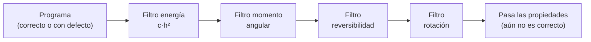

# B23-C02 — Pruebas de propiedades físicas

<!-- nav:top -->
[🏠 Programa](../../../../README.md) · [📚 Bloque B23](../../../tronco-comun/B23-verificacion-y-validacion-de-software-cientifico.md) · [← Anterior: B23-C01 — Pruebas unitarias numéricas con tolerancias](../B23-C01-pruebas-unitarias-numericas-con-tolerancias/CLASE.md) · [Siguiente: B23-C03 — Casos analíticos de validación →](../B23-C03-casos-analiticos-de-validacion/CLASE.md)
<!-- /nav -->

## 1. Ubicación, nivel y alcance

Segunda clase del bloque B23. En la [clase anterior](../B23-C01-pruebas-unitarias-numericas-con-tolerancias/CLASE.md) aprendiste a comparar un número con un valor esperado y a derivar la tolerancia. Aquí el valor esperado no es un número, sino una **propiedad que la física garantiza**: la energía, el momento angular, la reversibilidad, la simetría ante rotaciones. Nivel de entrada N3, de salida N3.

Verás qué propiedades puede exigir una prueba, cómo derivar su tolerancia del método numérico, y —igual de importante— qué defectos **no** detectan. No verás soluciones exactas completas (C03), ni pruebas entre ejecuciones sin oráculo (C06). La teoría de los integradores está en B11 (Euler, Heun, Runge–Kutta, paso adaptativo; los temas de conservación de energía y métodos simplécticos figuran en B11-C10 y C11); aquí solo los usamos como objeto de prueba.

## 2. Por qué esta clase existe

Cuando integras una órbita no tienes una respuesta con la cual comparar, pero sí sabes cosas que la respuesta debe cumplir: la energía mecánica de un cuerpo en un campo central se conserva; también su momento angular; rotar el sistema antes o después de integrarlo da lo mismo; invertir las velocidades y retroceder el mismo tiempo devuelve al punto de partida. La pregunta motivadora es: **¿qué propiedades físicas puedo convertir en pruebas automáticas, y con qué tolerancia?**

La decisión central es: **¿qué propiedad exige mi prueba y qué defecto deja pasar?** Una propiedad conservada por el modelo puede no estar conservada por el método numérico, y una propiedad que el método conserva puede ser ciega a un error de datos.

## 3. Lo que podrás hacer al terminar

1. Enumerar las magnitudes conservadas y las simetrías de un problema de dos cuerpos.
2. Escribir pruebas de energía, momento angular, reversibilidad y equivariancia ante rotación.
3. Derivar la tolerancia de la energía de la forma `c·h²` a partir del orden del método y comprobar que escala así.
4. Distinguir una propiedad que el modelo cumple de una que el método numérico conserva (Verlet frente a RK4).
5. Construir una tabla «defecto × propiedad» e identificar defectos a los que las propiedades son ciegas.
6. Decidir qué prueba adicional necesitas cuando las propiedades no bastan.

La evidencia es la **tabla de propiedades con tolerancias y mutantes** del ejercicio 12 (sección 20).

## 4. Con qué llegas y cómo comprobarlo

Necesitas B23-C01 (tolerancias), un integrador de B11 (Euler o RK4) y la energía de la órbita kepleriana (B05). Cinco preguntas:

1. ¿Cuál es la energía específica de una órbita kepleriana de masa gravitatoria `μ` a distancia `r` y velocidad `v`?
2. ¿Qué es el momento angular específico en el plano, `L`, en términos de `x, y, vx, vy`?
3. ¿Qué significa que un método tenga orden 2?
4. ¿Por qué `1 au = 149 597 870 700 m` permite expresar `μ` en au³/d²?
5. ¿Qué tolerancia usarías para comparar dos flotantes que deberían ser idénticos salvo redondeo?

<details>
<summary>Ver respuestas</summary>

1. `ε = v²/2 − μ/r`. 2. `L = x·vy − y·vx`. 3. Que su error global baja como `h²` al reducir el paso `h`; si divides `h` entre 2, el error se divide entre 4. 4. Porque la unidad de longitud se fija en metros exactos y el día en 86 400 s, de modo que `μ[au³/d²] = μ[m³/s²]·86400²/au³`. 5. Unos pocos `u` relativos (B23-C01).
</details>

Con cuatro o cinco aciertos, sigue; con tres o menos, repasa B23-C01 y B11-C05 a C07.

## 5. Un caso real: lo que fija la Unión Astronómica Internacional

Para integrar una órbita necesitamos `μ = GM☉`, el parámetro gravitatorio del Sol. La IAU, en su Resolución B3 de 2015 (S1), recomienda un valor **nominal** exacto: `GM☉ = 1,3271244 × 10²⁰ m³ s⁻²`, para usarlo como factor de conversión. Y la Resolución B2 de 2012 (S2) define la unidad astronómica como exactamente `149 597 870 700 m`. Con ambas, `μ = 2,9591220819 × 10⁻⁴ au³/d²` (laboratorio) y el período de una órbita con `a = 1 au` es `2π/√μ = 365,2569 d`.

Nuestro **ejemplo conductor** es una órbita **sintética** parecida a la terrestre: `a = 1 au`, excentricidad `e = 0,0167`, empezando en el perihelio, integrada 10 años con dos métodos: Runge–Kutta clásico (RK4) y *velocity-Verlet* (llamado «salto de rana»), ambos de B11. Para ellos no existe una respuesta a la que comparar paso a paso, pero sí cuatro propiedades.

## 6. Vocabulario

Una **magnitud conservada** (o *invariante*) es una cantidad que no cambia a lo largo del movimiento. En el problema de dos cuerpos con el Sol fijo, se conservan la **energía específica** `ε = v²/2 − μ/r` (au²/d²) y el **momento angular específico** `L = x·vy − y·vx` (au²/d). Una **simetría** es una transformación que deja el problema igual: aquí, rotar todo el sistema alrededor del Sol. Un integrador es **equivariante** ante una simetría si integrar y luego transformar da lo mismo que transformar y luego integrar. Un método es **reversible en el tiempo** si, tras avanzar `N` pasos, invertir la velocidad y avanzar otros `N` pasos devuelve el estado inicial. El **orden** de un método es el exponente `p` tal que el error baja como `hᵖ`. Un **mutante** es el programa con un defecto inyectado (C01). Una **propiedad ciega** a un defecto es una propiedad que el programa defectuoso sigue cumpliendo.

## 7. Modelo mental: la propiedad como filtro

Cada propiedad deja pasar los programas que la cumplen. Los programas correctos pasan todos los filtros; los defectuosos quedan atrapados solo por los filtros a los que son sensibles. Un defecto que conserva energía y momento angular pasa ambos filtros aunque la órbita esté mal.



*Descripción textual:* el programa atraviesa cuatro filtros en serie. Quien llega al final solo demuestra que cumple las propiedades, no que sea correcto: para eso hacen falta casos con respuesta conocida (C03).

**Analogía y su límite.** La revisión de un coche: frenos, luces, emisiones. Que pase las tres no demuestra que el motor sea el adecuado para la ruta. Límite: en un coche las revisiones cubren las fallas típicas; en software numérico las propiedades cubren solo lo que la física impone, que puede ser menos de lo que cabe equivocarse.

## 8. La explicación, paso a paso

### 8.1 Energía: el método fija cuánto se conserva

El modelo conserva `ε`; el método, no necesariamente. Para un método de orden 2 como Verlet, el error de energía es **acotado y oscilante** de orden `c·h²`; para RK4, de orden 4, el error por paso es mucho menor pero **se acumula** de forma sistemática. La prueba de energía no puede exigir «cero»: debe exigir `|Δε/ε| ≤ c·h²` (Verlet) con una `c` que **estimas** en un paso grosero y **verificas** en pasos finos. En el laboratorio, con `h = 2 d`, `max|Δε/ε| = 2,01 × 10⁻⁵`, luego `c = 5,03 × 10⁻⁶ d⁻²`. Con `h = 1 d` y `0,5 d` el error medido fue `4,97 × 10⁻⁶` y `1,24 × 10⁻⁶`, ambos por debajo de `1,5·c·h²`; la razón de errores entre `h = 2` y `h = 1` fue 4,05, lo esperado para orden 2.

### 8.2 Momento angular: exacto en una, aproximado en otra

En un campo central la fuerza es paralela a `r`, de modo que `L` se conserva. El esquema Verlet lo conserva a nivel de redondeo (laboratorio: `4,2 × 10⁻¹⁵` en 10 años); RK4 no, pues `L` es una cantidad cuadrática y RK4 solo preserva exactamente las lineales (`1,3 × 10⁻⁹`). La tolerancia depende del método: `1e-12` para Verlet, y una `c·h⁴` para RK4. Fíjate en la lección: la misma propiedad pide tolerancias distintas según el integrador.

### 8.3 Horizonte largo: la acotación frente a la deriva

Con `h = 5 d`, el máximo de `|Δε/ε|` de Verlet es `1,37 × 10⁻⁴` a los 10 años y sigue siendo `1,37 × 10⁻⁴` a los 500; el de RK4 es `8,3 × 10⁻⁶`, `8,3 × 10⁻⁵` y `4,2 × 10⁻⁴`: crece con el tiempo. En 10 años RK4 gana por un factor 16; a los 500 años pierde. Una prueba de energía a un solo horizonte puede dar la respuesta equivocada sobre qué método elegir; la prueba debe fijar el horizonte para el que se pide la tolerancia.

### 8.4 Reversibilidad

Verlet es reversible: tras 3653 pasos hacia adelante, `v → −v`, y 3653 pasos más, el error de posición es `6,2 × 10⁻¹³ au` (redondeo acumulado). RK4 no lo es: `2,5 × 10⁻⁷ au`. La propiedad permite probar el código de avance sin conocer la solución; la tolerancia para Verlet se fija en `1e-10 au`.

### 8.5 Simetría de rotación

Rotar las condiciones iniciales 37° y propagar debe coincidir con propagar y luego rotar el resultado. En el laboratorio la diferencia es `2,2 × 10⁻¹³ au`; la tolerancia es `1e-11 au`. Esta propiedad detecta código que trate `x` e `y` de forma desigual.

### 8.6 Qué dejan pasar las propiedades

El laboratorio inyecta cinco versiones. **Correcto:** pasa todo. **GM mal en 1 %, de forma coherente** (se usa el mismo `μ` en la fuerza, en las condiciones iniciales y en la energía): pasa todo, porque conserva su propia energía; se trata de la órbita de otro Sol. **Exponente 2,01** en la ley de la fuerza: pasa todo, porque sigue siendo una fuerza central y el error de energía queda dentro de la cota. **Fuerza asimétrica** (la componente `y` cambia de signo si `x < 0`): falla energía, momento angular y rotación. **Doble patada** (aceleración vieja usada dos veces): falla energía, momento angular y reversibilidad. La lección: las propiedades detectan **errores estructurales** y son ciegas a **errores de valor** (constantes, exponentes pequeños). Contra esos hacen falta casos con respuesta conocida (C03) y datos de referencia (C05).

## 9. Magnitudes, símbolos y unidades

| Símbolo | Qué es | Unidad | Nota |
|---|---|---|---|
| `μ` | parámetro gravitatorio del Sol, `GM☉` | au³/d² | `2,9591220819 × 10⁻⁴` (S1, S2) |
| `a`, `e` | semieje mayor y excentricidad | au; sin unidad | 1,0 y 0,0167 (sintéticos) |
| `r`, `v` | posición y velocidad | au; au/d | en el plano `(x, y)` |
| `ε` | energía específica | au²/d² | `v²/2 − μ/r` |
| `L` | momento angular específico | au²/d | `x·vy − y·vx` |
| `h` | paso de tiempo | d | 0,5; 1; 2; 5 |
| `c` | constante del error de energía | d⁻² | estimada en `h = 2 d` |
| `u` | precisión de máquina | sin unidad | ≈ 2,2 × 10⁻¹⁶ |

## 10. Convenciones y referencias

Sistema de referencia: inercial centrado en el Sol, plano `(x, y)`, el eje `x` apunta al perihelio inicial; el Sol está fijo (se ignora el retroceso). Escala de tiempo: días de 86 400 s, sin distinguir TT, TDB ni UTC (B13-C08). Los errores de energía y momento angular son **relativos** al valor inicial. Los datos son **sintéticos**: la órbita imita la terrestre pero no es una efeméride (C05 contrasta con una). Versiones: Python 3.12.9, NumPy 2.4.4. El laboratorio tarda unos 22 s por el horizonte largo.

## 11. De dónde sale lo que afirmamos

| ID | Fuente | Localizador | Respalda | Estado |
|---|---|---|---|---|
| S1 | Mamajek, E. E., et al., *IAU 2015 Resolution B3 on Recommended Nominal Conversion Constants for Selected Solar and Planetary Properties* | https://arxiv.org/abs/1510.07674 (texto leído en el PDF, arXiv:1510.07674) | `(GM)☉ᴺ = 1,3271244 × 10²⁰ m³ s⁻²` exacto como factor de conversión | Leída el 2026-11-05 |
| S2 | IAU, Resolución B2 de 2012, redefinición de la unidad astronómica (texto en el sitio del SYRTE, Observatorio de París) | https://syrte.obspm.fr/IAU_resolutions/IAUResol_2012_0.html | `1 au = 149 597 870 700 m` exacto | Consultada el 2026-11-05 |
| S3 | NASA, *NASA-STD-7009B, Standard for Models and Simulations* (aprobada 2024-03-05) | https://standards.nasa.gov/sites/default/files/standards/NASA/B/1/NASA-STD-7009B-Final-3-5-2024.pdf | Definición de verificación: determinar en qué medida un modelo o simulación cumple sus requisitos y especificaciones (sección 3 y 4.2.3) | Leída con PyMuPDF el 2026-11-05 (versión vigente a esa fecha) |

Límites: la conservación de `ε` y `L` en un campo central, la reversibilidad de Verlet y que RK4 no conserva invariantes cuadráticos son conocimiento estándar de la mecánica y del análisis numérico, **no consultado** en una fuente en esta clase; el laboratorio los comprueba numéricamente, lo cual muestra el comportamiento en este caso, no lo demuestra en general. La cota `c·h²` es empírica.

## 12. Cómo ver los resultados

Tabla «defecto × propiedad» del laboratorio (versión accesible de una matriz de colores). «Falla» significa que la prueba detecta el defecto.

| Versión | Energía | Momento angular | Reversibilidad | Rotación |
|---|---|---|---|---|
| Correcta | pasa | pasa | pasa | pasa |
| GM +1 % (coherente) | pasa | pasa | pasa | pasa |
| Exponente 2,01 | pasa | pasa | pasa | pasa |
| Fuerza asimétrica | falla | falla | pasa | falla |
| Doble patada | falla | falla | falla | pasa |

## 13. Ejemplo trabajado: tolerancia de energía para Verlet

Datos: órbita sintética, `h = 1 d`, 3653 pasos (10 años).

1. **Orden esperado.** Verlet es de orden 2: `|Δε/ε| ≈ c·h²`.
2. **Estimar `c`.** Con `h = 2 d`: `max|Δε/ε| = 2,01 × 10⁻⁵`. Entonces `c = 2,01 × 10⁻⁵ / 4 = 5,03 × 10⁻⁶` d⁻².
3. **Predecir.** Con `h = 1`: `c·h² = 5,03 × 10⁻⁶`. Con `h = 0,5`: `1,26 × 10⁻⁶`.
4. **Medir.** `4,97 × 10⁻⁶` y `1,24 × 10⁻⁶`. La predicción acierta a menos del 2 %.
5. **Cota de la prueba.** `1,5·c·h²`: un margen del 50 % para la variación por fase y datos; `7,5 × 10⁻⁶` para `h = 1`.
6. **Qué se concluye.** Si alguien cambia el integrador por uno de orden 1, el error con `h = 1` será de otro orden de magnitud (no medido aquí) y la prueba falla; si baja `h`, la cota baja sola, sin reajustar números.

**Paso final · incertidumbre.** Esta cota vale para esta órbita y este horizonte; con otra excentricidad, `c` cambia (a mayor `e`, mayor cambio de velocidad angular en el perihelio) y debe reestimarse.

## 14. Comparación: RK4, Verlet y sus pruebas

RK4 (orden 4) da errores de energía mucho menores a corto plazo (`2,7 × 10⁻⁹` frente a `5,0 × 10⁻⁶` con `h = 1 d` en 10 años) pero no es reversible ni conserva `L` exactamente, y su error de energía crece con el tiempo. Verlet (orden 2) tiene un error de energía mayor pero **acotado**, es reversible y conserva `L` a redondeo. Para propagar una órbita muchos siglos, Verlet es la elección habitual; para un arco corto con alta precisión, RK4. Un criterio de elección es la propiedad que exige el problema, y la propiedad es también la prueba.

## 15. Práctica guiada

**Ejercicio 1 · con los pasos.** Un integrador de orden 2 da `max|Δε/ε| = 8 × 10⁻⁶` con `h = 2 d`. Predice el valor con `h = 0,5 d` y fija una cota con margen 50 %. *Pasos:* sección 8.1.

<details><summary>Solución comentada</summary>

`c = 8e-6/4 = 2e-6`. Con `h = 0,5`: `c·h² = 5 × 10⁻⁷`. Cota: `7,5 × 10⁻⁷`. Si con `h = 0,5` se midiera `2 × 10⁻⁶`, el método no tiene orden 2 (algo está mal, sección 8.6).
</details>

**Ejercicio 2 · con una pista.** Calcula `L` para `r = (0,9833; 0)` au y `v = (0; 0,01750)` au/d. *Pista:* `L = x·vy − y·vx`.

<details><summary>Solución comentada</summary>

`L = 0,9833 × 0,01750 − 0 × 0 = 1,721 × 10⁻² au²/d`. Es el momento angular específico en el perihelio (valor de ejemplo). Si el programa lo cambia en el segundo paso, hay un defecto estructural.
</details>

**Ejercicio 3 · casi autónomo.** Escribe en prosa la prueba de rotación: qué haces, qué comparas y con qué tolerancia.

<details><summary>Solución comentada</summary>

Tomas las condiciones iniciales `(r₀, v₀)`; las giras un ángulo `θ` con una matriz de rotación `R`; propagas ambas; comparas `r(R·ic)` con `R·r(ic)`. Tolerancia: unas decenas de `u` multiplicadas por la longitud de la integración y la escala (en el laboratorio, `1e-11 au`, con medido `2,2 × 10⁻¹³`). Un resultado mayor indica asimetría entre `x` e `y`.
</details>

## 16. Práctica autónoma, transferencia e integrador

**Ejercicio 4.** Con la constante del laboratorio, ¿qué error de energía esperas de Verlet con `h = 4 d`? ¿Y con `h = 10 d`?

<details><summary>Solución comentada</summary>

`c = 5,03 × 10⁻⁶`: `h = 4` → `8,0 × 10⁻⁵`; `h = 10` → `5,0 × 10⁻⁴`. Para `h = 5` el laboratorio midió `1,37 × 10⁻⁴`, algo por encima de `c·25 = 1,26 × 10⁻⁴`, coherente con un margen del 10 %.
</details>

**Ejercicio 5.** ¿Por qué la tolerancia de `L` para RK4 no puede ser `1e-12`?

<details><summary>Solución comentada</summary>

Porque RK4 no conserva `L` exactamente: el laboratorio mide `1,3 × 10⁻⁹` con `h = 1 d` (10 años), 3 órdenes sobre `1e-12`. Una prueba con `1e-12` fallaría por una causa que no es un defecto. Para RK4 la cota debe seguir `c·h⁴` (sección 8.2).
</details>

**Ejercicio 6.** Un colega cambia `h` de 1 a 0,5 d y la prueba de energía de Verlet empieza a fallar. ¿Qué dos hipótesis consideras?

<details><summary>Solución comentada</summary>

(a) Una cota fija escrita para `h = 1` que no sigue `h²` (aquí no debería fallar al bajar `h`), o (b) un defecto cuyo efecto crece al cambiar el número de pasos (por ejemplo, un `n` fijo que ahora cubre medio horizonte, y la fase hace que el máximo cambie). Se resuelve derivando la cota de `h` y fijando el horizonte en tiempo, no en pasos.
</details>

**Ejercicio 7.** Explica por qué un mutante de GM multiplicado por 1,01 pasa las cuatro propiedades.

<details><summary>Solución comentada</summary>

Todo el código usa el mismo `μ` (fuerza, condiciones iniciales, energía): integra una órbita kepleriana del «Sol mutante», que conserva su propia energía, momento angular y simetrías. Solo se delataría contra el período real de 365,2569 d (C03) o contra una efeméride (C05).
</details>

**Ejercicio 8.** Si en lugar de energía comparas el **perihelio** al volver (distancia mínima tras un período), ¿qué propiedad es? ¿Detectaría el exponente 2,01?

<details><summary>Solución comentada</summary>

Es la **periodicidad** de la órbita cerrada: tras un período, el estado regresa. Con exponente 2,01 la órbita deja de cerrarse (precesa lentamente): el perihelio se desplaza un ángulo pequeño por revolución. Una tolerancia suficientemente estricta lo vería; es un buen complemento. (El valor del desplazamiento no se calculó en esta clase.)
</details>

**Ejercicio 9 · transferencia.** Un código de órbitas de un satélite incluye resistencia atmosférica. ¿Qué propiedades de esta clase siguen valiendo y cuáles no?

<details><summary>Solución comentada</summary>

La energía ya no se conserva (la resistencia es disipativa): debe **decrecer** monótonamente, y eso es una propiedad (signo). La rotación alrededor del eje de la Tierra sigue siendo simetría si la atmósfera se modela axisimétrica. La reversibilidad no vale (la disipación rompe la simetría temporal). Cambia la propiedad, no la filosofía.
</details>

**Ejercicio 10 · transferencia.** Un código de fotometría suma flujos de un cúmulo de estrellas. ¿Qué propiedad física «conservada» o de simetría usarías como prueba?

<details><summary>Solución comentada</summary>

La suma no debe cambiar si se **permutan** las estrellas (invariancia al orden, dentro de la tolerancia de redondeo), ni si se **rota** el campo (el flujo total no depende de la orientación). Y si se **duplica** el área de cada píxel la suma debe duplicarse. Son propiedades del modelo, no soluciones.
</details>

**Ejercicio 11 · transferencia.** Un código de rotación de una sonda alrededor de un eje debe conservar el momento angular total en ausencia de torques. ¿Qué tolerancia propones y por qué?

<details><summary>Solución comentada</summary>

Depende del integrador: derivarla del orden del método y del paso, igual que `c·h²`, y fijar el horizonte en tiempo físico. No se acepta una cota copiada del resultado actual. Además se prueba una versión con torque conocido distinto de cero para comprobar que la prueba puede fallar.
</details>

**Ejercicio 12 · integrador.** Entrega una tabla de propiedades para un integrador propio de dos cuerpos: cuatro propiedades con su tolerancia derivada, tres mutantes distintos de los del laboratorio, y la matriz de cuáles detecta cada propiedad. Señala al menos un defecto al que todas sean ciegas.

<details><summary>Solución modelo</summary>

Propiedades: energía (`c·h²`), momento angular, reversibilidad y rotación. Mutantes posibles: `μ` en un solo lugar mal escrito; paso variable mal calculado; error de signo en un solo eje; constante `au` incorrecta (un factor 10⁻³). Ciego a todas: una constante global coherente (como GM × 1,01). Se acepta cualquier solución que derive las tolerancias del método y que reconozca la ceguera.
</details>

## 17. Laboratorio

El script [propiedades_orbitales.py](propiedades_orbitales.py) integra una órbita sintética con RK4 y Verlet, estima la constante de la cota de energía, comprueba momento angular, horizonte largo, reversibilidad y rotación, e inyecta cuatro defectos.

**Datos:** sintéticos; constantes de S1 y S2. **Predice antes de ejecutar:** ¿qué propiedad detectará la «fuerza asimétrica» además de la energía? (El momento angular y la rotación.) **Ejecución del 2026-11-05 (Python 3.12.9, NumPy 2.4.4; unos 22 s):**

```text
Python 3.12.9  NumPy 2.4.4
mu = 2.9591220819e-04 au^3/d^2   T_kepler(a=1) = 365.2569 d

[Energía] error relativo máximo en 10 años
  h= 2.0 d  Verlet: dE/E=2.01e-05  dL/L=3.43e-15 | RK4: dE/E=8.49e-08  dL/L=4.23e-08
  h= 1.0 d  Verlet: dE/E=4.97e-06  dL/L=4.24e-15 | RK4: dE/E=2.65e-09  dL/L=1.32e-09
  h= 0.5 d  Verlet: dE/E=1.24e-06  dL/L=1.45e-14 | RK4: dE/E=8.48e-11  dL/L=4.13e-11
  constante c = dE/E / h^2 estimada en h=2 d: 5.034e-06
  razón de errores h=2 / h=1 (esperada ≈ 4): 4.05

[Horizonte largo] máximo de |dE/E| hasta 10, 100 y 500 años, h = 5 d
  Verlet : 1.37e-04  1.37e-04  1.37e-04
  RK4    : 8.30e-06  8.31e-05  4.16e-04
  L en Verlet h=1 d: 4.24e-15 (cota 1e-12); en RK4: 1.32e-09

[Reversibilidad] ida N pasos, v -> -v, vuelta N pasos
  Verlet: |r_final - r_0| = 6.22e-13 au
  RK4: |r_final - r_0| = 2.54e-07 au

[Rotación] |r(R·ic) - R·r(ic)| = 2.17e-13 au

[Mutantes] ¿qué propiedad falla? (cotas: dE/E<=1.5*c*h^2, dL/L<1e-12, rev<1e-10, rot<1e-11)
  correcto             dE/E=5.0e-06  falla: — (pasa)
  GM +1 % (coherente)  dE/E=5.0e-06  falla: — (sobrevive)
  exponente 2.01       dE/E=4.9e-06  falla: — (sobrevive)
  fuerza asimétrica    dE/E=2.4e+00  falla: ['energía', 'L', 'rotación']
  doble kick           dE/E=3.8e-01  falla: ['energía', 'L', 'reversib.']

Pruebas superadas.
```

```bash
python programa/clases/B23/B23-C02-pruebas-de-propiedades-fisicas/propiedades_orbitales.py
```

**Límites:** Sol fijo, plano, sin otros cuerpos; la constante `c` es empírica para `e = 0,0167`; la ceguera a GM y al exponente depende de la cota elegida (una cota más estricta vería el exponente 2,01).

## 18. Errores frecuentes y cómo corregirlos

**Exigir conservación exacta.** El método fija cuánto se conserva (sección 8.1, ejercicio 1).

**La misma tolerancia para métodos distintos.** Se corrige con el ejercicio 5.

**Fijar el horizonte en pasos y no en tiempo.** Se corrige con el ejercicio 6.

**Creer que pasar las propiedades prueba la corrección.** Se corrige con el ejercicio 7 y la sección 8.6.

**Usar una propiedad que el modelo no tiene.** Con resistencia atmosférica la energía no se conserva (ejercicio 9).

**Probar una cota copiada del resultado.** Se corrige derivando `c` y `p` (sección 13).

## 19. Cómo sabrás que vas bien

Tras 8.1: ¿predices el error de energía con `h` mitad sin ejecutar? Si no, rehaz el ejercicio 1. Tras 8.2: ¿por qué RK4 no cumple `1e-12` en `L`? Si no, rehaz el 5. Tras 8.6: ¿puedes nombrar un defecto al que las cuatro propiedades son ciegas? Si no, rehaz el 7. Tras el laboratorio: ¿qué cota cambiarías para ver el exponente 2,01? Al final: ¿tu tabla del ejercicio 12 tiene un defecto ciego?

## 20. Qué entregas y cómo se evalúa

El producto es tu **tabla de propiedades con tolerancias derivadas y matriz de mutantes**.

| Criterio | Inicial | En desarrollo | Logrado | Destacado |
|---|---|---|---|---|
| Propiedades | Una | Dos | Cuatro justificadas | Añade una propia del problema |
| Tolerancias | Copiadas del resultado | Ajustadas | Derivadas del orden del método | Verificadas al variar `h` |
| Mutantes | Ninguno | Uno | Tres con matriz | Incluye un defecto ciego identificado |
| Fuentes y alcance | Sin fuente | Fuente sin alcance | Fuente con alcance | Rotula datos sintéticos y límites |

**Condiciones críticas:** no afirmar que el código es correcto solo por pasar propiedades; no copiar la tolerancia del resultado; declarar que los datos son sintéticos.

## 21. Ética, seguridad y límites

Un integrador que conserva bien la energía no está necesariamente bien calibrado para una misión; estos resultados no sirven para planificar maniobras, predecir encuentros ni evaluar riesgos de colisión. La verificación en proyectos reales sigue requisitos formales (S3 describe el marco de la NASA). Accesibilidad: la matriz de propiedades está en tabla; las ecuaciones tienen equivalente textual.

## 22. Para cerrar y seguir

Una propiedad física convierte lo que sabes del mundo en una prueba sin respuesta de referencia, pero la tolerancia sale del método y la propiedad es ciega a los errores que la conservan. Queda abierta una pregunta: si el defecto es una constante coherente, ¿contra qué lo detectas?

**Glosario español–inglés.** magnitud conservada · *conserved quantity*; simetría · *symmetry*; equivariante · *equivariant*; reversibilidad temporal · *time reversibility*; orden de un método · *order of a method*; momento angular · *angular momentum*; salto de rana · *leapfrog*.

**Continuidad.** B23-C03 contrasta el integrador con soluciones exactas, que sí detectan el GM mal escalado y miden el orden de convergencia real.

**Referencias:** ver sección 11.

<!-- nav:bottom -->
---

[← Anterior: B23-C01 — Pruebas unitarias numéricas con tolerancias](../B23-C01-pruebas-unitarias-numericas-con-tolerancias/CLASE.md) · [📚 Bloque B23](../../../tronco-comun/B23-verificacion-y-validacion-de-software-cientifico.md) · [Siguiente: B23-C03 — Casos analíticos de validación →](../B23-C03-casos-analiticos-de-validacion/CLASE.md)
<!-- /nav -->
