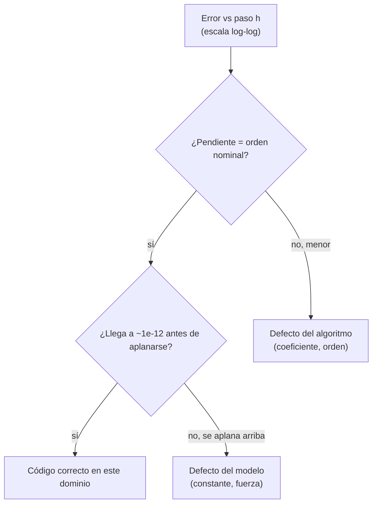

# B23-C03 — Casos analíticos de validación

<!-- nav:top -->
[🏠 Programa](../../../../README.md) · [📚 Bloque B23](../../../tronco-comun/B23-verificacion-y-validacion-de-software-cientifico.md) · [← Anterior: B23-C02 — Pruebas de propiedades físicas](../B23-C02-pruebas-de-propiedades-fisicas/CLASE.md) · [Siguiente: B23-C04 — Soluciones de referencia y manufactured solutions →](../B23-C04-soluciones-de-referencia-y-manufactured-solutions/CLASE.md)
<!-- /nav -->

## 1. Ubicación, nivel y alcance

Tercera clase del bloque B23. En la [clase anterior](../B23-C02-pruebas-de-propiedades-fisicas/CLASE.md) viste que las propiedades físicas atrapan errores estructurales pero son ciegas a una constante mal escalada. Aquí usas el recurso más fuerte que existe cuando se tiene: una **solución exacta** del problema que tu código resuelve de forma aproximada. Nivel de entrada N3, de salida N3.

Verás cómo elegir y usar soluciones analíticas como prueba, cómo medir el **orden de convergencia observado** de un método y qué hacer cuando el error no tiende a cero. No verás cómo fabricar una solución cuando no existe una (C04), ni la comparación con datos oficiales (C05).

Una nota de vocabulario: el título dice «validación», pero en el marco de la NASA (S3) comparar con una solución matemática exacta del mismo modelo es **verificación** (¿resuelvo bien las ecuaciones que dije resolver?); la **validación** compara con el mundo real (¿son las ecuaciones correctas?) y se trata en C05. La palabra se usa aquí en sentido amplio, como el bloque la usa en su nombre.

## 2. Por qué esta clase existe

Un integrador de órbitas puede conservar la energía, ser reversible e invariante ante rotaciones y aun así describir un Sol con otra masa o una ley de fuerza distinta. Para detectarlo necesitas una referencia con valores: «tras exactamente un período, el planeta vuelve a su punto de partida». La pregunta motivadora es: **¿cómo uso una solución exacta para probar que mi código no solo es coherente, sino correcto?**

La decisión central es: **¿cuándo basta un valor exacto y cuándo necesito la tasa a la que el error desaparece?** Un valor exacto confirma un resultado; el orden de convergencia confirma el *algoritmo*.

## 3. Lo que podrás hacer al terminar

1. Escribir la solución exacta del problema de dos cuerpos a partir de la ecuación de Kepler y comprobar que cumple sus propias invariantes.
2. Calcular el error de un integrador frente a esa solución en un instante dado.
3. Estimar el **orden observado** `p = log₂(e(h)/e(h/2))` y compararlo con el nominal.
4. Diagnosticar, por el orden y por el tamaño del error, si un defecto es del algoritmo o del modelo.
5. Reconocer casos donde la solución exacta engaña (errores que se anulan en puntos especiales).
6. Elegir entre un caso simple (oscilador armónico) y uno realista (Kepler) y justificarlo.

La evidencia es el **informe de orden observado de un integrador propio** del ejercicio 12 (sección 20).

## 4. Con qué llegas y cómo comprobarlo

Necesitas B23-C01 (tolerancias y Kepler), B23-C02 (propiedades, Verlet y RK4), la forma de la órbita kepleriana (B05) y el concepto de orden de un método (B11). Cinco preguntas:

1. ¿Cuál es la ecuación de Kepler y qué ángulos relaciona?
2. Si un método tiene orden 4, ¿en cuánto baja el error al dividir el paso entre 2?
3. ¿Dónde está un planeta de excentricidad `e` y semieje `a` en el afelio, respecto del Sol?
4. ¿Qué tolerancia usarías para un valor exacto calculado en `float64`?
5. ¿Para qué sirve probar con un oscilador armónico?

<details>
<summary>Ver respuestas</summary>

1. `M = E − e sin E`: anomalía media y anomalía excéntrica (radianes). 2. En 2⁴ = 16. 3. A la distancia `a(1 + e)`, en el lado opuesto al perihelio. 4. Unos pocos `u` relativos (B23-C01). 5. Porque su solución `cos(ωt)` es simple y el orden de cualquier integrador se mide sin ambigüedad.
</details>

Con cuatro o cinco aciertos, sigue; con tres o menos, repasa B23-C01 y B11-C05 a C07.

## 5. Un caso real: lo que la NASA exige distinguir

La norma NASA-STD-7009B (S3), en su sección 4.2.3, describe la verificación como probar un modelo o simulación con respecto a su especificación y diseño, y exige mantener un registro de su **dominio de verificación**: las condiciones para las que se sabe que da resultados dentro de lo que se construyó. Una solución analítica es la herramienta natural para ese registro: define en qué parámetros el código se ha comparado con la verdad.

Nuestro **ejemplo conductor** es la órbita **sintética** de las clases anteriores: `a = 1 au`, `e = 0,0167`, empezando en el perihelio, con `μ = GM☉` de la IAU (S1) y el au de la IAU (S2). La solución exacta se obtiene de la ecuación de Kepler, y el período es `T = 2π/n = 365,2569 d`, con `n = √(μ/a³) = 0,01720210 rad/d` (el movimiento medio).

## 6. Vocabulario

Una **solución analítica** (o *exacta*) es una expresión cerrada que satisface las ecuaciones del modelo. El **error global** de un integrador en el tiempo `t` es la distancia entre su resultado y la solución exacta. El **orden nominal** `p` del método es el que predice la teoría (1 para Euler, 2 para Verlet, 4 para RK4). El **orden observado** se estima de dos errores: `p_obs = log₂(e(h)/e(h/2))`. El **régimen asintótico** es el rango de pasos pequeños donde el error ya sigue la ley `e ≈ C·hᵖ`. El **error de modelo** es el que no desaparece al reducir el paso, porque proviene de lo que se planteó mal (constante, fuerza). Un **caso simple** (oscilador armónico `x'' = −ω²x`, solución `cos ωt`) es un banco de pruebas de solución obvia. El **movimiento medio** `n` es la velocidad angular promedio de la órbita (rad/d).

## 7. Modelo mental: dos clases de error en una gráfica

Dibuja el error frente al paso en escala logarítmica en ambos ejes. Si el código es correcto, ves una recta de pendiente `p` hasta que el ruido de redondeo la aplana. Si el código tiene un defecto del algoritmo, la pendiente es menor que la nominal. Si el defecto está en el modelo (la masa, la fuerza), la curva se aplana lejos de cero.



*Descripción textual:* se parte del gráfico del error; si la pendiente no coincide con el orden nominal, el defecto es del algoritmo; si coincide pero el error se aplana en un valor grande, el defecto es del modelo; si coincide y el error baja hasta el redondeo, el código es correcto en el dominio probado.

**Analogía y su límite.** Medir la altura de un niño marcando en la pared: si cada año crece lo mismo, la recta tiene pendiente constante; si la marca se sale de la recta, algo cambió. Límite: la pared no tiene redondeo; en un cálculo hay un piso de ruido (`~10⁻¹⁶` relativo) por debajo del cual la pendiente no se ve.

## 8. La explicación, paso a paso

### 8.1 La solución exacta de Kepler

Con `M = n·t`, se resuelve `E` (ecuación de Kepler, B23-C01) y se obtiene la posición `(x, y) = (a(cos E − e), a√(1−e²) sin E)` y la velocidad `(vx, vy) = (−a n sin E/(1 − e cos E), a n √(1−e²) cos E/(1 − e cos E))`, en au y au/d. Cuatro cosas se comprueban en la propia solución antes de usarla como referencia: en `t = 0` está en el perihelio `x = a(1−e)`; en `t = T` regresa al punto de partida (diferencia < 10⁻¹² au); en `t = T/2` está en el afelio `x = −a(1+e) = −1,016700 au`; y conserva `ε` y `L` (< 10⁻¹³). Una referencia no se da por buena: se prueba.

### 8.2 Error frente a la solución exacta

Se propaga desde la condición inicial exacta con `N` pasos de tamaño `h = T/N` hasta `t = T` y se mide la distancia al estado exacto. Con RK4 y `N = 400` el error es `9,3 × 10⁻⁹ au` (≈ 1,4 km); con Verlet y el mismo `N`, `5,3 × 10⁻⁴ au`; con Euler y `N = 12 800`, `3,0 × 10⁻² au`. La elección del método se convierte en un número.

### 8.3 El orden observado

Si `e ≈ C·hᵖ`, entonces `e(h)/e(h/2) = 2ᵖ` y `p = log₂(e(h)/e(h/2))`. En el laboratorio: Euler da 0,97, 0,99, 0,99 (nominal 1); Verlet 1,99, 2,00, 2,00 (nominal 2); RK4 4,35, 4,21, 4,12 (nominal 4; se acerca desde arriba porque aún no entra del todo en el régimen asintótico). La prueba exige que el último `p` esté a ±0,15 del nominal. Para Euler hubo que usar pasos muy finos (`N` de 1600 a 12 800): con `N = 50..400` el error es de ~1 au y el orden observado es 0,5–0,8, porque los pasos aún no están en el régimen asintótico. **Antes de concluir que el orden está mal, comprueba que estás en el régimen asintótico.**

### 8.4 Cuando el orden delata un defecto

Un RK4 con un coeficiente mal escrito (`k3` calculado con `k1` en vez de `k2`) da errores razonables a simple vista (4,2 × 10⁻³ a 1,0 × 10⁻⁴ au) pero un orden observado de 1,62, 1,84 y 1,93: es un método de orden 2, no de 4. Una comparación con una tolerancia fija de `1e-2` lo habría dejado pasar. El orden lo ve.

### 8.5 Cuando el error no baja: error de modelo

Si la fuerza usa `μ` multiplicado por 1,01 mientras la referencia usa `μ`, el error de RK4 es `1,28 × 10⁻¹ au` para `N = 50, 100, 200, 400, 800`: no cambia al refinar. Es la firma de un **error de modelo**: lo que se resuelve con precisión es otro problema. Las propiedades de C02 no lo veían; este caso sí.

### 8.6 La trampa del punto especial

En el oscilador armónico `x'' = −ω²x` con `ω = 2π`, comparar en `t = 1` (un período completo) da para Verlet un orden observado de 4,02 en vez de 2: el error de fase de Verlet es de orden 2, pero al compararse la *posición* en un extremo del coseno ese error entra al cuadrado. En `t = 0,3` el orden es 2,00. Un caso analítico debe evaluarse en un punto donde el error no se anule por simetría; si un resultado «mejora» sin razón, cambia el instante de comparación.

## 9. Magnitudes, símbolos y unidades

| Símbolo | Qué es | Unidad | Nota |
|---|---|---|---|
| `μ` | `GM☉` nominal | au³/d² | `2,9591220819 × 10⁻⁴` (S1, S2) |
| `a`, `e` | semieje mayor y excentricidad | au; sin unidad | 1 y 0,0167 (sintéticos) |
| `n` | movimiento medio, `√(μ/a³)` | rad/d | 0,01720210 |
| `T` | período, `2π/n` | d | 365,2569 |
| `M`, `E` | anomalías media y excéntrica | rad | `M = E − e sin E` |
| `h` | paso, `T/N` | d | |
| `p` | orden de convergencia | sin unidad | `log₂(e(h)/e(h/2))` |
| `ω` | frecuencia angular del oscilador | rad por unidad de tiempo del ejemplo (adimensional) | `2π` |

## 10. Convenciones y referencias

Sistema inercial centrado en el Sol, plano `(x, y)`; ángulos en radianes; el perihelio está en el eje `x` positivo. El tiempo es un contador de días de 86 400 s sin distinguir escalas (B13-C08). El error de posición es la norma euclídea de la diferencia en au. Los datos son **sintéticos**; la conversión a km usa el au exacto de S2. Versiones: Python 3.12.9, NumPy 2.4.4.

## 11. De dónde sale lo que afirmamos

| ID | Fuente | Localizador | Respalda | Estado |
|---|---|---|---|---|
| S1 | Mamajek, E. E., et al., *IAU 2015 Resolution B3 on Recommended Nominal Conversion Constants…* | https://arxiv.org/abs/1510.07674 (texto leído en el PDF) | `(GM)☉ᴺ = 1,3271244 × 10²⁰ m³ s⁻²` | Leída el 2026-11-05 |
| S2 | IAU, Resolución B2 de 2012 (texto en el SYRTE, Observatorio de París) | https://syrte.obspm.fr/IAU_resolutions/IAUResol_2012_0.html | `1 au = 149 597 870 700 m` exacto | Consultada el 2026-11-05 |
| S3 | NASA, *NASA-STD-7009B, Standard for Models and Simulations* (2024-03-05) | https://standards.nasa.gov/sites/default/files/standards/NASA/B/1/NASA-STD-7009B-Final-3-5-2024.pdf | Verificación frente a especificaciones (3, 4.2.3, `[M&S 15–16]`); validación frente al sistema real (4.2.5, `[M&S 17–18]`); registro del dominio | Leída con PyMuPDF el 2026-11-05 |

Límites: la solución de Kepler, la ecuación de Kepler y los órdenes nominales de Euler, Verlet y RK4 son conocimiento estándar, **no consultado** en una fuente en esta clase; el laboratorio los comprueba numéricamente para este caso. Los pasos y horizontes son específicos de este ejemplo.

## 12. Cómo ver los resultados

Orden observado (laboratorio); cada celda es `p` entre dos refinamientos sucesivos.

| Método | Errores en la rejilla (au) | `p` observado | `p` nominal |
|---|---|---|---|
| Euler (`N` = 1600…12 800) | 2,3e-1; 1,2e-1; 6,0e-2; 3,0e-2 | 0,97; 0,99; 0,99 | 1 |
| Verlet (`N` = 50…400) | 3,4e-2; 8,5e-3; 2,1e-3; 5,3e-4 | 1,99; 2,00; 2,00 | 2 |
| RK4 (`N` = 50…400) | 6,1e-5; 3,0e-6; 1,6e-7; 9,3e-9 | 4,35; 4,21; 4,12 | 4 |
| RK4, `k3` mal | 4,2e-3; 1,4e-3; 3,8e-4; 1,0e-4 | 1,62; 1,84; 1,93 | 4 (mal) |
| RK4, GM +1 % | 1,28e-1 en todos | — | no converge |

## 13. Ejemplo trabajado: ¿es correcto mi RK4?

Datos: órbita sintética, un período, `N = 100, 200, 400`.

1. **Referencia.** Verifica la solución exacta: perihelio, regreso tras `T` y afelio en `T/2` (sección 8.1). Todo cumple dentro de 10⁻¹².
2. **Errores.** `3,0 × 10⁻⁶`, `1,62 × 10⁻⁷`, `9,29 × 10⁻⁹` au.
3. **Órdenes.** `log₂(3,0e-6/1,62e-7) = 4,21`; `log₂(1,62e-7/9,29e-9) = 4,12`.
4. **Criterio.** Exige `|p − 4| < 0,15` en el último par: 4,12 pasa.
5. **Segundo criterio, el tamaño.** `9,3 × 10⁻⁹ au` es menor que el `1e-8 au` fijado como requisito del laboratorio; con `N = 800` el error es `5,6 × 10⁻¹⁰`.
6. **Comparación con el mutante.** Con `k3` mal, el último `p` es 1,93: falla el criterio de orden aunque el error absoluto (`1,0 × 10⁻⁴ au` ≈ 15 000 km) sería «aceptable» en algunas aplicaciones.

**Paso final · incertidumbre.** Este resultado es un resultado de **verificación**: dice que el código resuelve bien las ecuaciones de Kepler en este dominio (órbita de `e = 0,0167`, un período, los `N` probados). No dice nada sobre si el movimiento real de la Tierra es kepleriano (C05).

## 14. Comparación: valor exacto, orden observado y propiedades

Un **valor exacto** (como «afelio en T/2») es barato y detecta errores de modelo, pero no distingue entre dos algoritmos con el mismo resultado en ese punto. El **orden observado** necesita varias ejecuciones y una solución exacta en un tramo, pero valida el algoritmo; es sensible al régimen asintótico. Las **propiedades** (C02) no necesitan solución, pero son ciegas a los errores de modelo. Una batería sensata combina las tres: propiedades siempre, valores exactos para constantes, y orden observado cada vez que cambias el integrador.

## 15. Práctica guiada

**Ejercicio 1 · con los pasos.** Los errores de un método con `N = 100, 200, 400` son `8e-4, 2e-4, 5e-5`. Calcula `p` y di el orden del método. *Pasos:* sección 8.3.

<details><summary>Solución comentada</summary>

`log₂(8e-4/2e-4) = 2`, `log₂(2e-4/5e-5) = 2`. Orden 2 (por ejemplo, Verlet). Si la teoría prometía 4, hay un defecto de algoritmo (sección 8.4).
</details>

**Ejercicio 2 · con una pista.** ¿Cuál es el valor de la coordenada `x` en el afelio para `a = 1 au` y `e = 0,0167`? *Pista:* `x = −a(1 + e)`.

<details><summary>Solución comentada</summary>

`−1,0167 au`, en el lado opuesto al perihelio (que está en `+0,9833 au`). Es una prueba exacta de la solución analítica: se espera en `t = T/2`.
</details>

**Ejercicio 3 · casi autónomo.** Un integrador da `N = 100 → 1,0e-3` y `N = 200 → 5,0e-4` en una órbita que debería converger a orden 4. ¿Qué dos explicaciones prueba primero?

<details><summary>Solución comentada</summary>

`p = 1` (error baja a la mitad). (a) Defecto de algoritmo (un coeficiente o el orden del esquema). (b) Aún no estás en el régimen asintótico, o el error está dominado por un componente de orden 1 (por ejemplo, un cálculo de la condición final que usa `Δt` del primer paso). Se decide con más refinamientos: si `p` sube a 4, era (b); si se queda en 1, era (a).
</details>

## 16. Práctica autónoma, transferencia e integrador

**Ejercicio 4.** La solución exacta, evaluada en `t = 100 d`, ¿qué debe cumplir para ser una buena referencia?

<details><summary>Solución comentada</summary>

Conservar la energía específica (`< 10⁻¹³`) y el momento angular (`L = x vy − y vx`), regresar al punto de partida tras `T` y pasar por el afelio en `T/2`. El laboratorio comprueba las cuatro.
</details>

**Ejercicio 5.** Con Verlet y `N = 400` el error es `5,3 × 10⁻⁴ au`. ¿Cuántos km son y qué `N` necesitas para bajar a `10⁻⁶ au` (orden 2)?

<details><summary>Solución comentada</summary>

`5,3e-4 × 149 597 870,7 km ≈ 7,9 × 10⁴ km`. Para pasar de `5,3e-4` a `1e-6` hace falta reducir el error por 530: con orden 2, `h` por √530 ≈ 23, es decir `N ≈ 400 × 23 ≈ 9200`. Es una predicción: se verifica ejecutando.
</details>

**Ejercicio 6.** En el oscilador armónico con `ω = 2π`, ¿por qué `t = 1` da `p ≈ 4` para Verlet y `t = 0,3` da 2?

<details><summary>Solución comentada</summary>

En `t = 1` la solución exacta está en un máximo de `cos`, donde la derivada es cero: un error de fase `δ` cambia `cos(2π + δ)` en `δ²/2`, de orden `h⁴` si `δ ∼ h²`. En `t = 0,3` la derivada no es cero y el error de fase aparece lineal. Moraleja de la sección 8.6.
</details>

**Ejercicio 7.** El error de un código es `1,28e-1` para cinco valores de `N`. ¿Qué concluyes y qué haces?

<details><summary>Solución comentada</summary>

Es un error de modelo: no cambia al refinar. Compara constantes (`μ`, el au), unidades, condiciones iniciales y la ley de fuerza con la referencia. El mutante de GM +1 % reproduce justo esa firma.
</details>

**Ejercicio 8.** ¿Por qué la solución de Kepler no es una buena referencia para una órbita con otros planetas?

<details><summary>Solución comentada</summary>

Porque la solución exacta solo es válida para el problema de dos cuerpos. Con perturbaciones, el código puede ser perfecto y diferir de Kepler; ese caso se contrasta con una efeméride (C05) o con propiedades (C06).
</details>

**Ejercicio 9 · transferencia.** Un código de evolución de la rotación de una nave con torque constante `τ` y momento de inercia `I` calcula la velocidad angular. ¿Qué solución analítica usas y qué orden esperas de un integrador de Euler?

<details><summary>Solución comentada</summary>

`ω(t) = ω₀ + (τ/I)·t` (con `τ`, `I` constantes). Euler es exacto para una derivada constante: el orden observado tendría que dar «error cero» (redondeo), no 1; es un caso patológico que no mide el orden. Para medirlo, usa un torque dependiente del tiempo, p. ej. `τ(t) = τ₀ sin t`, cuya solución también es exacta.
</details>

**Ejercicio 10 · transferencia.** Un código que calcula la curva de luz de un tránsito recibe una solución analítica de un disco opaco ante una estrella uniforme (sin oscurecimiento al limbo). ¿Qué casos exactos puedes derivar sin fórmulas elaboradas?

<details><summary>Solución comentada</summary>

(a) Planeta fuera del disco: flujo relativo 1. (b) Planeta completamente dentro del disco estelar: la pérdida es la razón de áreas `(Rp/R★)²`. (c) Simetría: la curva es simétrica respecto al centro del tránsito. Estos tres casos no requieren la fórmula completa del solapamiento.
</details>

**Ejercicio 11 · transferencia.** Tu equipo cambió un integrador de RK4 a un esquema adaptativo (B11-C08). ¿Cómo ajustas el cálculo del orden observado?

<details><summary>Solución comentada</summary>

En un esquema adaptativo no controlas `h`; controlas la tolerancia. Se mide el error frente a la solución exacta como función de la tolerancia solicitada (`rtol`) y se observa la pendiente del error en `log(rtol)`: se espera aproximadamente lineal (error ∝ tolerancia), con un factor que depende del método. Si el error es insensible a `rtol`, el control está mal o hay error de modelo.
</details>

**Ejercicio 12 · integrador.** Entrega el informe de orden observado de un integrador propio para la órbita kepleriana: verificación de la solución exacta, tabla de errores y órdenes, comparación con el nominal, y un mutante con un defecto de algoritmo y otro de modelo, distinguidos por su firma.

<details><summary>Solución modelo</summary>

Se acepta un informe que incluya: (1) las cuatro comprobaciones de la solución exacta; (2) errores con al menos cuatro `N` y los `p` entre pares sucesivos; (3) justificación de estar en el régimen asintótico; (4) mutante de algoritmo con `p` menor y mutante de modelo con error plano; (5) dominio de validez declarado (excentricidad, horizonte, pasos).
</details>

## 17. Laboratorio

El script [orden_de_convergencia.py](orden_de_convergencia.py) construye la solución exacta, la verifica, mide el orden observado de Euler, Verlet y RK4 en la órbita de Kepler y en el oscilador armónico, e inyecta dos mutantes.

**Datos:** sintéticos; constantes de S1 y S2. **Predice antes de ejecutar:** ¿qué orden darán Euler y Verlet con pasos finos? (1 y 2.) **Ejecución del 2026-11-05 (Python 3.12.9, NumPy 2.4.4; ~2 s):**

```text
Python 3.12.9  NumPy 2.4.4
mu=2.9591220819e-04 au^3/d^2  T=365.2569 d  n=0.01720210 rad/d
solución exacta: perihelio, período T y afelio en T/2 coinciden (afelio x = -1.016700 au)
oscilador t=1.0 Verlet: errores ['3.41e-04', '2.10e-05', '1.31e-06']  p ≈ 4.02 (nominal 2)
oscilador t=1.0 RK4: errores ['1.32e-04', '4.16e-06', '1.30e-07']  p ≈ 4.99 (nominal 4)
oscilador t=0.3 Verlet: errores ['6.64e-04', '1.66e-04', '4.15e-05']  p ≈ 2.00 (nominal 2)
oscilador t=0.3 RK4: errores ['1.21e-06', '7.46e-08', '4.63e-09']  p ≈ 4.01 (nominal 4)

orden observado (error de posición tras un período) (N = 50..400; Euler: 1600..12800)
  Euler   errores [au]: 2.33e-01  1.19e-01  5.98e-02  3.01e-02  p: 0.97 0.99 0.99
  Verlet  errores [au]: 3.40e-02  8.53e-03  2.13e-03  5.34e-04  p: 1.99 2.00 2.00
  RK4     errores [au]: 6.12e-05  3.00e-06  1.62e-07  9.29e-09  p: 4.35 4.21 4.12

mutantes (orden observado y tamaño del error)
  RK4 con k3 mal      errores: 4.20e-03  1.36e-03  3.81e-04  1.00e-04  p: 1.62 1.84 1.93
  GM +1 % en RK4      errores: 1.28e-01  1.28e-01  1.28e-01  1.28e-01  1.28e-01  (no tienden a 0: error de modelo)
  RK4 correcto        errores: 6.12e-05  3.00e-06  1.62e-07  9.29e-09  5.55e-10

Pruebas superadas.
```

```bash
python programa/clases/B23/B23-C03-casos-analiticos-de-validacion/orden_de_convergencia.py
```

**Límites:** una sola excentricidad y un período; sin otros cuerpos; la rejilla es pequeña; el orden de RK4 se acerca desde arriba y la tolerancia ±0,15 es una decisión del autor.

## 18. Errores frecuentes y cómo corregirlos

**Medir el orden fuera del régimen asintótico.** Euler con `N = 50..400` da 0,5–0,8. Se corrige con la sección 8.3 y el ejercicio 3.

**Confiar en la referencia sin probarla.** Se corrige con la sección 8.1 y el ejercicio 4.

**Evaluar en un punto especial.** Se corrige con la sección 8.6 y el ejercicio 6.

**Tomar una tolerancia absoluta como prueba de corrección.** El mutante de `k3` tenía un error «pequeño» pero el orden equivocado (sección 8.4).

**Confundir error de modelo con error de método.** Se corrige con el ejercicio 7.

**Usar una solución válida en otro dominio.** Se corrige con el ejercicio 8.

## 19. Cómo sabrás que vas bien

Tras 8.1: ¿sabes qué cuatro comprobaciones hacerle a la solución exacta? Si no, rehaz el ejercicio 4. Tras 8.3: ¿calculas `p` a mano con tres errores? Si no, rehaz el 1. Tras 8.5: ¿distingues un error plano de uno decreciente? Si no, rehaz el 7. Tras el laboratorio: ¿qué cambiarías si el último `p` de RK4 fuera 3,7? Al final: ¿tu informe del ejercicio 12 declara su dominio de validez?

## 20. Qué entregas y cómo se evalúa

El producto es tu **informe de orden observado** de un integrador propio.

| Criterio | Inicial | En desarrollo | Logrado | Destacado |
|---|---|---|---|---|
| Referencia | Sin comprobar | Un chequeo | Cuatro chequeos | Chequeos con tolerancia justificada |
| Orden observado | Un solo par | Varios pares sin criterio | Varios pares y criterio ±δ | Régimen asintótico argumentado |
| Diagnóstico | Sin mutantes | Un mutante | Algoritmo y modelo distinguidos | Firmas explicadas con la teoría |
| Fuentes y alcance | Sin fuente | Fuente sin alcance | Fuente con alcance | Declara dominio de verificación |

**Condiciones críticas:** no presentar como validado lo que solo está verificado; no usar una referencia sin probarla; declarar el dominio (órbita, horizonte, pasos).

## 21. Ética, seguridad y límites

Una verificación exitosa en una órbita casi circular no autoriza a usar el código en otras (alta excentricidad, encuentros cercanos); el dominio de verificación debe registrarse (S3). Este material es educativo y no sustituye procesos formales de verificación de software de vuelo. Accesibilidad: las tablas contienen los números del gráfico de convergencia.

## 22. Para cerrar y seguir

Una solución exacta convierte «parece bien» en una medida: el valor te dice cuánto, el orden observado te dice si el algoritmo es el que dices, y un error plano te delata una constante o una fuerza mal puestas. Queda abierta una pregunta: si no existe solución exacta, ¿cómo la fabricas?

**Glosario español–inglés.** solución analítica · *analytical solution*; orden observado · *observed order of accuracy*; régimen asintótico · *asymptotic regime*; error de modelo · *model error*; movimiento medio · *mean motion*; anomalía media · *mean anomaly*; anomalía excéntrica · *eccentric anomaly*; verificación · *verification*.

**Continuidad.** B23-C04 construye soluciones cuando no existen: elige una función, calcula qué ecuación resuelve y mide el orden observado igual que aquí.

**Referencias:** ver sección 11.

<!-- nav:bottom -->
---

[← Anterior: B23-C02 — Pruebas de propiedades físicas](../B23-C02-pruebas-de-propiedades-fisicas/CLASE.md) · [📚 Bloque B23](../../../tronco-comun/B23-verificacion-y-validacion-de-software-cientifico.md) · [Siguiente: B23-C04 — Soluciones de referencia y manufactured solutions →](../B23-C04-soluciones-de-referencia-y-manufactured-solutions/CLASE.md)
<!-- /nav -->
