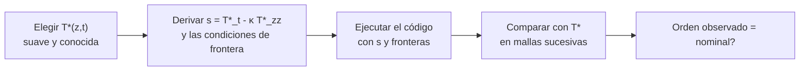

# B23-C04 — Soluciones de referencia y manufactured solutions

<!-- nav:top -->
[🏠 Programa](../../../../README.md) · [📚 Bloque B23](../../../tronco-comun/B23-verificacion-y-validacion-de-software-cientifico.md) · [← Anterior: B23-C03 — Casos analíticos de validación](../B23-C03-casos-analiticos-de-validacion/CLASE.md) · [Siguiente: B23-C05 — Validación con conjuntos oficiales →](../B23-C05-validacion-con-conjuntos-oficiales/CLASE.md)
<!-- /nav -->

## 1. Ubicación, nivel y alcance

Cuarta clase del bloque B23. En la [clase anterior](../B23-C03-casos-analiticos-de-validacion/CLASE.md) usaste soluciones exactas que existen (Kepler, el oscilador). Casi ninguna ecuación en derivadas parciales con condiciones de frontera realistas tiene una. Esta clase enseña a **fabricar** una solución y a **comparar con otro código** cuando no hay solución exacta. Nivel de entrada N3, de salida N4.

Verás el método de soluciones fabricadas (*method of manufactured solutions*, MMS), cómo separar los estudios de refinamiento en espacio y tiempo, qué defectos disfraza una malla mal refinada y cómo usar un código independiente como referencia. No verás esquemas de EDP en general (B11-C13, C14; B21), ni datos observados (C05).

## 2. Por qué esta clase existe

Un modelo de conducción de calor en el regolito, con una fuente variable y una condición de flujo en el borde, no tiene solución cerrada. Pero su código puede estar mal en la frontera, en el término fuente o en el tiempo, y ninguna propiedad global lo delata fácilmente. La pregunta motivadora es: **¿cómo pruebo un solucionador de una ecuación cuya solución no conozco?**

La decisión central es: **¿qué solución elijo yo, en vez de esperar que exista una?** Se elige una función suave cualquiera, se sustituye en la ecuación y lo que sobra se declara fuente: el código resuelve entonces un problema cuya respuesta se conoce.

## 3. Lo que podrás hacer al terminar

1. Fabricar una solución, derivar a mano su fuente y sus condiciones de frontera.
2. Comprobar la fuente derivada con una derivación numérica independiente.
3. Hacer estudios de refinamiento separados en espacio y en tiempo y estimar el orden observado de cada uno.
4. Detectar defectos de frontera o de término fuente por la caída del orden.
5. Explicar por qué un refinamiento con `dt ∝ dz²` puede disfrazar un defecto temporal.
6. Usar un código independiente (otro integrador temporal) como referencia y interpretar la diferencia.

La evidencia es la **batería MMS para un solucionador propio** del ejercicio 12 (sección 20).

## 4. Con qué llegas y cómo comprobarlo

Necesitas B23-C03 (orden observado), diferencias finitas (B11-C14) y derivadas parciales (B09). Cinco preguntas:

1. ¿Qué ecuación gobierna la difusión de calor en una dimensión con coeficiente `κ` constante?
2. ¿Cuál es la derivada segunda aproximada por diferencias centradas con paso `Δz`?
3. ¿Qué orden de error tiene esa aproximación?
4. ¿Cuál es la derivada respecto de `t` de `exp(−t/τ)`?
5. ¿Qué diferencia hay entre una condición de Dirichlet y una de Neumann?

<details>
<summary>Ver respuestas</summary>

1. `T_t = κ T_zz` (con una fuente `s` se suma). 2. `(T_{j+1} − 2T_j + T_{j−1})/Δz²`. 3. Orden 2. 4. `−(1/τ) exp(−t/τ)`. 5. Dirichlet fija el valor de la variable en el borde; Neumann fija su derivada normal (el flujo).
</details>

Con cuatro o cinco aciertos, sigue; con tres o menos, repasa B11-C14 y B09.

## 5. Un caso real: lo que dice el informe de Sandia

El informe SAND2000-1444 de Salari y Knupp (S1), de los Laboratorios Nacionales Sandia, describe el procedimiento de verificación de código por soluciones fabricadas. Según su resumen, su fortaleza es que **detecta cualquier error de programación que degrade el orden de exactitud del método numérico**, que ejerce todas las capacidades del código a la vez, y que mediante pruebas ciegas se sabe qué errores puede y cuáles no puede exponer. La mayor parte de su texto no se consultó: solo el registro y resumen de OSTI.

Nuestro **ejemplo conductor** es la ecuación de difusión de calor en una capa de espesor `L = 1 m` con difusividad `κ = 1,0 × 10⁻⁷ m²/s` (valor de **ejemplo**, no medido), temperatura de fondo `T₀ = 250 K` y una amplitud de 50 K. Se impone la temperatura en `z = 0` (superficie) y el flujo en `z = L` (base). La solución fabricada es `T*(z,t) = T₀ + ΔT·e^{−t/τ}·sin(2z/L + 0,3)`, con `τ = 10⁶ s`. No es una solución física: es la que elegimos.

## 6. Vocabulario

Una **solución fabricada** es una función elegida arbitrariamente (pero suave y con derivadas conocidas) que se declara solución. El **término fuente** `s(z,t)` es lo que hay que añadir a la ecuación para que la función elegida sea solución: `s = T*_t − κ T*_zz`. Las **condiciones de frontera** se obtienen evaluando `T*` (Dirichlet) o `T*_z` (Neumann) en el borde. Un **estudio de refinamiento** repite el cálculo con mallas cada vez más finas y mide cómo baja el error. El **nodo fantasma** es un punto ficticio fuera del dominio que permite imponer Neumann con orden 2: `T_{N+1} = T_{N−1} + 2Δz·g`. El esquema **Crank–Nicolson** avanza en el tiempo promediando la derivada al inicio y al final del paso (orden 2). Un **código de referencia** es una segunda implementación, independiente, del mismo problema. El **método de líneas** discretiza el espacio y deja el tiempo continuo, de modo que un integrador de EDO resuelve el sistema semidiscreto.

## 7. Modelo mental: invertir el problema

Lo normal es partir de la ecuación y buscar la solución; MMS parte de la solución y busca la ecuación. Las dificultades de «no hay solución exacta» desaparecen porque el residuo (la fuente) absorbe toda la complejidad.



*Descripción textual:* de izquierda a derecha: se elige una función; se derivan la fuente y las fronteras que la hacen solución; se corre el código con esos datos; se mide el error frente a la función elegida en mallas más finas; y se compara el orden observado con el nominal.

**Analogía y su límite.** Un profesor que escribe primero la respuesta de un problema y luego fabrica el enunciado que la produce. Límite: el profesor busca un problema interesante; MMS busca una solución *suficientemente suave y variada* para que todos los términos del código intervengan (si la solución fabricada es un polinomio de grado bajo, un esquema de orden 2 la reproduce exactamente y ocultaría el defecto).

## 8. La explicación, paso a paso

### 8.1 Derivar la fuente (a mano) y comprobarla

Con `T* = T₀ + ΔT·e^{−t/τ}·sin(2z/L + 0,3)`: `T*_t = −(1/τ)(T* − T₀)`; `T*_zz = −(2/L)²·ΔT·e^{−t/τ}·sin(2z/L + 0,3)`. Entonces `s = ΔT·e^{−t/τ}·sin(2z/L + 0,3)·(−1/τ + 4κ/L²)`. Un error de signo aquí arruinaría todo lo demás, así que la fuente se comprueba con derivación numérica (diferencias finitas centradas en un punto): en `z = 0,37 m`, `t = 4 × 10⁵ s`, la analítica y la numérica dan `−1,734261 × 10⁻⁵ K/s` ambas. Esa comprobación es la primera prueba del laboratorio, antes de usar el solucionador.

### 8.2 Fronteras

Dirichlet en `z = 0`: `T(0,t) = T*(0,t)`. Neumann en `z = L`: `T_z(L,t) = g(t) = ΔT·e^{−t/τ}·(2/L)·cos(2L/L + 0,3)`. Las fronteras no son triviales (varían en el tiempo y no son cero); una solución fabricada con fronteras cero esconde errores de fronteras.

### 8.3 Dos refinamientos separados

El error total tiene una parte espacial (`∝ Δz²`) y otra temporal (`∝ Δt²` en Crank–Nicolson). Para medir cada una, se refina una y se deja la otra tan fina que su error sea despreciable. **Espacio:** `Δt` fijo y pequeño (4000 pasos), `N = 10, 20, 40, 80, 160` celdas: errores `4,82 × 10⁻²`, `1,20 × 10⁻²`, `3,01 × 10⁻³`, `7,51 × 10⁻⁴`, `1,88 × 10⁻⁴` K; órdenes 2,00; 2,00; 2,00; 2,00. **Tiempo:** `N = 320` fijo, `N_t = 10, 20, 40, 80`: errores `2,33 × 10⁻²`, `5,86 × 10⁻³`, `1,50 × 10⁻³`, `4,10 × 10⁻⁴` K; órdenes 1,99; 1,97; 1,87 (el último baja porque el error espacial residual, ~10⁻⁵ K, ya pesa).

### 8.4 Qué defectos baja el orden

**Frontera de Neumann de primer orden** (usar `T_N' ≈ (T_N − T_{N−1})/Δz` en vez del nodo fantasma): el orden espacial cae a 0,90; 0,95; 0,98; 0,99 (≈ 1). **Fuente evaluada solo en `t_n`** (en vez de promediar `t_n` y `t_{n+1}`): el orden temporal cae a 1,00 en las tres comparaciones. Ambos defectos hacen que el solucionador converja, y por lo tanto no se detectan con un «converge o no converge»; sí con el orden.

### 8.5 La malla que disfraza el defecto

Si en lugar de refinar por separado se refina todo junto con `Δt ∝ Δz²` (`N_t = N²/10`), el defecto temporal, cuyo error es `O(Δt) = O(Δz²)`, aparenta orden 2: p = 2,01; 2,00; 2,00. Con `Δt ∝ Δz` (`N_t = 2N`) se ve el orden 1: 1,05; 1,03; 1,01. Moraleja: la relación entre pasos al refinar debe elegirse para que cada fuente de error sea visible, o los estudios deben separarse.

### 8.6 El código de referencia

Se resuelve el mismo sistema semidiscreto (`N = 40`) con un integrador temporal independiente: `solve_ivp` con el método implícito Radau (orden 5, adecuado para problemas rígidos según la documentación, S2), con `rtol = atol = 10⁻¹⁰`. La diferencia con Crank–Nicolson (2000 pasos) es `5,8 × 10⁻⁷ K`: es el error temporal de Crank–Nicolson. El error respecto de la solución fabricada es `3,0 × 10⁻³ K`: es el error **espacial**, mucho mayor, idéntico en ambos códigos porque comparten la discretización. La referencia valida el integrador temporal, no el esquema espacial; para este último hace falta MMS.

### 8.7 Qué MMS no prueba

MMS verifica que el código resuelve **la ecuación que se le dio**, no que esa ecuación describa la física (eso es validación, C05). Y detecta defectos que cambian el orden, pero no los que no lo cambian (una constante `κ` mal escrita en un solo lugar sí cambia la solución, pero una constante coherente en todo el código y en la fuente pasa).

## 9. Magnitudes, símbolos y unidades

| Símbolo | Qué es | Unidad | Nota |
|---|---|---|---|
| `z` | profundidad | m | 0 en la superficie, `L` en la base |
| `t` | tiempo | s | hasta `t_f = 10⁶ s` |
| `T` | temperatura | K | |
| `κ` | difusividad térmica | m²/s | `1,0 × 10⁻⁷` (ejemplo) |
| `s` | término fuente | K/s | `T*_t − κ T*_zz` |
| `T₀`, `ΔT` | temperatura de fondo y amplitud | K | 250 y 50 |
| `τ` | tiempo de decaimiento | s | `10⁶` |
| `N`, `N_t` | celdas en `z` y pasos en `t` | sin unidad | |
| `p` | orden observado | sin unidad | `log₂(e/e')` |

## 10. Convenciones y referencias

Eje `z` hacia abajo desde la superficie. Argumento del seno en radianes (`2z/L + 0,3`, adimensional). Error medido en norma máxima sobre los nodos, en K. Datos **sintéticos** y de ejemplo: ni `κ` ni las temperaturas representan un cuerpo real. Versiones: Python 3.12.9, NumPy 2.4.4, SciPy 1.17.1. El laboratorio tarda unos 12 s.

## 11. De dónde sale lo que afirmamos

| ID | Fuente | Localizador | Respalda | Estado |
|---|---|---|---|---|
| S1 | Salari, K. y Knupp, P., *Code Verification by the Method of Manufactured Solutions*, SAND2000-1444, Sandia National Laboratories, junio de 2000 | https://www.osti.gov/biblio/759450 (DOI 10.2172/759450) | Que MMS detecta errores que degradan el orden de exactitud y permite probar todas las capacidades del código | Solo el registro y el resumen de OSTI, consultados el 2026-11-05; el informe completo no se leyó |
| S2 | SciPy, `scipy.integrate.solve_ivp` (referencia de la API) | https://docs.scipy.org/doc/scipy/reference/generated/scipy.integrate.solve_ivp.html | Radau es un método implícito de orden 5; los implícitos se aconsejan en problemas rígidos; significado de `rtol` y `atol` | Consultada el 2026-11-05 (versión estable, mutable) |

Límites: la derivación de la fuente y los órdenes de las diferencias centradas y de Crank–Nicolson son conocimiento estándar de análisis numérico, **no consultado** aquí; el laboratorio los verifica. Las afirmaciones sobre qué detecta o no MMS son las del resumen de S1 más lo observado en el laboratorio.

## 12. Cómo ver los resultados

Órdenes observados del laboratorio (versión accesible de un gráfico log-log).

| Estudio | Defecto | `p` observado (comparaciones sucesivas) | `p` nominal |
|---|---|---|---|
| Espacio | ninguno | 2,00; 2,00; 2,00; 2,00 | 2 |
| Tiempo | ninguno | 1,99; 1,97; 1,87 | 2 |
| Espacio | Neumann de 1.er orden | 0,90; 0,95; 0,98; 0,99 | 2 |
| Tiempo | fuente solo en `t_n` | 1,00; 1,00; 1,00 | 2 |
| Conjunto, `Δt ∝ Δz²` | fuente solo en `t_n` | 2,01; 2,00; 2,00 | 2 (disfrazado) |
| Conjunto, `Δt ∝ Δz` | fuente solo en `t_n` | 1,05; 1,03; 1,01 | 2 (visible) |

## 13. Ejemplo trabajado: probar la frontera de flujo

Datos: la solución fabricada de la sección 5.

1. **Derivar la frontera.** `g(t) = T*_z(L,t) = ΔT·e^{−t/τ}·(2/L)·cos(2 + 0,3)`. Con `L = 1 m`, `ΔT = 50 K`: `g(0) = 100·cos(2,3) = −66,6 K/m`.
2. **Escribir el esquema.** Con el nodo fantasma, la última ecuación es `dT_N/dt = 2κ(T_{N−1} − T_N)/Δz² + 2κ g/Δz + s_N`.
3. **Correr con `N = 10, 20, 40, 80, 160`** y `N_t = 4000`.
4. **Errores.** `4,82e-2`, `1,20e-2`, `3,01e-3`, `7,51e-4`, `1,88e-4` K.
5. **Órdenes.** 2,00 en todos los pares.
6. **Mutante.** Sustituye el nodo fantasma por la diferencia de primer orden: los órdenes bajan a 0,90–0,99. El error con 160 celdas pasa de 1,9e-4 K a 8,9e-2 K (laboratorio, mutante); una tolerancia absoluta holgada no lo habría visto.

**Paso final · incertidumbre.** El resultado se limita a este problema suave, con coeficientes constantes y estas fronteras; no cubre `κ` variable, fuentes discontinuas ni pasos adaptativos.

## 14. Comparación: MMS, soluciones exactas y código de referencia

Una **solución exacta** (C03) es la más convincente, pero rara. **MMS** funciona para cualquier ecuación y ejercita fronteras y fuentes, pero solo verifica la discretización, y exige derivar la fuente (con riesgo de errores de derivación, de ahí la comprobación numérica). Un **código de referencia** es útil cuando existe uno confiable; solo prueba lo que hace distinto: aquí el integrador temporal. Para el esquema espacial, una referencia que comparte discretización no sirve. La combinación recomendada: MMS para verificar el esquema, referencia independiente para verificar partes sustituibles, y exacta para casos simples.

## 15. Práctica guiada

**Ejercicio 1 · con los pasos.** Deriva la fuente para `T* = T₀ + A·t·z` (un caso lineal) en `T_t = κ T_zz + s`. *Pasos:* sección 8.1.

<details><summary>Solución comentada</summary>

`T*_t = A z`; `T*_zz = 0`; `s = A z`. Esta solución es **demasiado simple**: un esquema de orden 2 reproduce lo lineal exactamente (error = redondeo), así que no puede medir ningún orden ni detectar un defecto de segundo orden. Para MMS, la solución debe tener derivadas segunda y superiores no nulas.
</details>

**Ejercicio 2 · con una pista.** Calcula `g(0)` si `ΔT = 50 K`, `L = 1 m`. *Pista:* `cos(2,3) = −0,6663`.

<details><summary>Solución comentada</summary>

`g(0) = 50·(2/1)·(−0,6663) = −66,63 K/m`. Es el gradiente impuesto en la base en `t = 0`. Un signo contrario indicaría un error de derivación.
</details>

**Ejercicio 3 · casi autónomo.** En un estudio de refinamiento los errores son `1,2e-2` (N=20), `3,0e-3` (N=40), `7,5e-4` (N=80). ¿Cuál es el orden y qué concluyes si se esperaba 2?

<details><summary>Solución comentada</summary>

`log₂(1,2e-2/3,0e-3) = 2`; `log₂(3,0e-3/7,5e-4) = 2`. El esquema espacial está bien. Si además `Δt` es lo bastante pequeño para que su error sea despreciable (sección 8.3), la conclusión es válida; si no, el orden medido mezcla ambas fuentes.
</details>

## 16. Práctica autónoma, transferencia e integrador

**Ejercicio 4.** ¿Por qué se prefiere `sin(2z/L + 0,3)` a `sin(2z/L)`?

<details><summary>Solución comentada</summary>

Con `sin(2z/L)`, `T* = T₀` en `z = 0` y la condición de Dirichlet no ejercita nada; con el desfase 0,3, la frontera superficial tiene un valor distinto de `T₀` y variable en el tiempo. Una solución fabricada debe activar todos los términos y las fronteras.
</details>

**Ejercicio 5.** Con los errores temporales `2,33e-2, 5,86e-3, 1,50e-3, 4,10e-4` (N_t = 10, 20, 40, 80), ¿qué `N_t` hace falta para bajar de `10⁻⁴ K`, si el orden es 2?

<details><summary>Solución comentada</summary>

De `4,10e-4` a `1e-4` hay un factor 4,1; con orden 2 se divide `Δt` por ≈ 2,02 → `N_t ≈ 160`. Pero el error espacial residual (~10⁻⁵ K con N=320) aparece cuando se va tan abajo; el error total no baja de ese piso.
</details>

**Ejercicio 6.** ¿Por qué el estudio temporal se hace con la malla espacial fina (N=320)?

<details><summary>Solución comentada</summary>

Para que el error espacial sea mucho menor que el temporal y no contamine la medida del orden. El último orden (1,87) ya muestra el efecto del piso espacial.
</details>

**Ejercicio 7.** El mutante de «fuente solo en `t_n`» tiene orden temporal 1 y sin embargo, con `N_t = N²/10`, sale orden 2. Explica por qué.

<details><summary>Solución comentada</summary>

Con `Δt ∝ Δz²`, el error temporal `C·Δt` es proporcional a `Δz²`, igual que el espacial; la suma baja como `Δz²` y el orden total parece 2. No hay contradicción: el defecto sigue ahí, solo que el refinamiento conjunto lo disfraza (sección 8.5).
</details>

**Ejercicio 8.** Fabrica una solución para la ecuación de onda `u_tt = c² u_zz` y deriva su fuente.

<details><summary>Solución comentada</summary>

Por ejemplo `u* = sin(kz − ωt)·e^{−t/τ}`; usa una función con `u*_tt` y `u*_zz` no nulas y distintas; la fuente es `s = u*_tt − c² u*_zz`. Verifica con derivación numérica. (La clase no calcula el resultado; el procedimiento es el de 8.1.)
</details>

**Ejercicio 9 · transferencia.** Un código de transporte de radiación 1D resuelve `μ dI/dz = −κ I + S`. Fabrica `I* = I₀ e^{−z/z₀}(1 + 0,5 sin(z/z₀))` y describe qué hay que derivar.

<details><summary>Solución comentada</summary>

Se calcula `dI*/dz` y se define `S = μ dI*/dz + κ I*`; las condiciones de frontera se toman de `I*` en la entrada. El error se mide en mallas sucesivas y se espera el orden del esquema de transporte.
</details>

**Ejercicio 10 · transferencia.** Tu colega dice «mi código converge, así que es correcto». ¿Qué le muestras?

<details><summary>Solución comentada</summary>

El mutante de Neumann de 1.er orden: converge (el error baja) pero con orden 1 en lugar de 2. Convergencia no es corrección; el orden observado frente al nominal sí es una verificación (S1).
</details>

**Ejercicio 11 · transferencia.** Para un código astrofísico en que `κ` depende de `T`, ¿qué precauciones tomas al fabricar una solución?

<details><summary>Solución comentada</summary>

La fuente incluye la derivada de `κ(T)`: `s = T*_t − ∂z(κ(T*) T*_z)`; debe derivarse con cuidado y comprobarse numéricamente. Además, la solución fabricada debe mantener `T` en el rango donde `κ(T)` está definida y es físicamente razonable.
</details>

**Ejercicio 12 · integrador.** Entrega una batería MMS para un solucionador propio: solución fabricada con fuente y fronteras derivadas y comprobadas numéricamente, estudios de refinamiento separados en espacio y tiempo, dos mutantes (uno de frontera, uno de fuente), y la comparación con un código de referencia para la parte temporal.

<details><summary>Solución modelo</summary>

Se acepta una batería que: (1) comprueba la fuente con diferencias finitas; (2) muestra tablas de errores y órdenes, separando espacio y tiempo; (3) demuestra que cada mutante baja el orden; (4) explica qué no cubre la referencia; (5) declara el dominio (coeficientes constantes, solución suave).
</details>

## 17. Laboratorio

El script [solucion_fabricada.py](solucion_fabricada.py) implementa el problema, comprueba la fuente, mide órdenes en espacio y tiempo, aplica dos mutantes (y muestra el disfraz de `Δt ∝ Δz²`) y contrasta con Radau.

**Datos:** sintéticos; `κ` de ejemplo. **Predice antes de ejecutar:** ¿qué orden darán los dos mutantes? (1 y 1.) **Ejecución del 2026-11-05 (Python 3.12.9, NumPy 2.4.4, SciPy 1.17.1; ~12 s):**

```text
Python 3.12.9  NumPy 2.4.4  SciPy 1.17.1
fuente: analítica=-1.734261e-05 K/s  numérica=-1.734261e-05 K/s

[espacio] N:        10        20        40        80       160
          error[K]:  4.82e-02  1.20e-02  3.01e-03  7.51e-04  1.88e-04
          p:              nan      2.00      2.00      2.00      2.00

[tiempo]  Nt:        10        20        40        80
          error[K]:  2.33e-02  5.86e-03  1.50e-03  4.10e-04
          p:              nan      1.99      1.97      1.87

[mutantes]
  Neumann de 1.er orden  p espacial: 0.90 0.95 0.98 0.99
  fuente solo en t_n     p temporal:  1.00 1.00 1.00
  refinando con Nt = N^2/10 (dt ∝ dz^2), el mismo defecto da p = 2.01 2.00 2.00  <- disfrazado
  refinando con Nt = 2N (dt ∝ dz),        el mismo defecto da p = 1.05 1.03 1.01  <- visible

[referencia] N=40: |CN(Nt=2000) - Radau| = 5.82e-07 K;  error espacial de Radau vs T* = 3.00e-03 K

Pruebas superadas.
```

```bash
python programa/clases/B23/B23-C04-soluciones-de-referencia-y-manufactured-solutions/solucion_fabricada.py
```

**Límites:** solución suave y un solo `κ`; la matriz tridiagonal se guarda densa (solo para tamaños pequeños); la referencia comparte la discretización espacial.

## 18. Errores frecuentes y cómo corregirlos

**Fabricar una solución demasiado simple.** Se corrige con el ejercicio 1 y el 4.

**Derivar mal la fuente.** Se corrige con la comprobación numérica (sección 8.1).

**Fronteras triviales.** Se corrige con la sección 8.2.

**Mezclar los errores de espacio y tiempo.** Se corrige con el ejercicio 6.

**Pensar que «converge» es «correcto».** Se corrige con el ejercicio 10.

**Usar como referencia un código que comparte el esquema.** Se corrige con la sección 8.6.

## 19. Cómo sabrás que vas bien

Tras 8.1: ¿derivas la fuente de una función nueva y la compruebas numéricamente? Si no, rehaz el ejercicio 8. Tras 8.3: ¿explicas por qué el estudio temporal se hace con malla fina? Si no, rehaz el 6. Tras 8.5: ¿explicas el disfraz de `Δt ∝ Δz²`? Si no, rehaz el 7. Tras el laboratorio: ¿qué mutante propio añadirías? Al final: ¿tu batería declara qué no prueba?

## 20. Qué entregas y cómo se evalúa

El producto es tu **batería MMS** para un solucionador propio.

| Criterio | Inicial | En desarrollo | Logrado | Destacado |
|---|---|---|---|---|
| Solución fabricada | Trivial | Suave pero con fronteras nulas | Suave, fronteras y fuente activas | Justificada por qué activa cada término |
| Derivación | Sin comprobar | Comprobada a ojo | Comprobada numéricamente | Comprobada y con signos analizados |
| Refinamiento | Un estudio | Espacio y tiempo mezclados | Separados con órdenes | Separados y con piso de error argumentado |
| Mutantes y referencia | Sin ellos | Un mutante | Dos mutantes y referencia | Explica qué no cubre la referencia |

**Condiciones críticas:** no presentar MMS como validación física; comprobar la fuente derivada; declarar que los datos y el `κ` son sintéticos.

## 21. Ética, seguridad y límites

Un código que pasa MMS puede estar mal en la física que modela; no debe usarse para decidir diseños térmicos sin validación (C05) y revisión. Los valores de este laboratorio son de ejemplo y no describen ningún cuerpo del sistema solar. Accesibilidad: los resultados están en tablas y texto.

## 22. Para cerrar y seguir

Fabricar una solución convierte cualquier ecuación en una con respuesta conocida, y el orden observado delata los defectos que un «converge» deja pasar; pero hay que separar espacio y tiempo y probar también la fuente que derivaste. Queda abierta una pregunta: ¿cómo sabes que la ecuación misma describe el mundo?

**Glosario español–inglés.** solución fabricada · *manufactured solution*; término fuente · *source term*; condición de frontera · *boundary condition*; nodo fantasma · *ghost node*; método de líneas · *method of lines*; estudio de refinamiento · *grid refinement study*; código de referencia · *reference code*.

**Continuidad.** B23-C05 sale del terreno matemático: contrasta un modelo con un conjunto de datos oficial (una efeméride de JPL) y fija criterios de aceptación antes de comparar.

**Referencias:** ver sección 11.

<!-- nav:bottom -->
---

[← Anterior: B23-C03 — Casos analíticos de validación](../B23-C03-casos-analiticos-de-validacion/CLASE.md) · [📚 Bloque B23](../../../tronco-comun/B23-verificacion-y-validacion-de-software-cientifico.md) · [Siguiente: B23-C05 — Validación con conjuntos oficiales →](../B23-C05-validacion-con-conjuntos-oficiales/CLASE.md)
<!-- /nav -->
