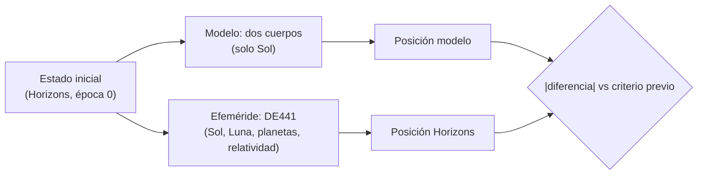

# B23-C05 — Validación con conjuntos oficiales

<!-- nav:top -->
[🏠 Programa](../../../../README.md) · [📚 Bloque B23](../../../tronco-comun/B23-verificacion-y-validacion-de-software-cientifico.md) · [← Anterior: B23-C04 — Soluciones de referencia y manufactured solutions](../B23-C04-soluciones-de-referencia-y-manufactured-solutions/CLASE.md) · [Siguiente: B23-C06 — Pruebas metamórficas →](../B23-C06-pruebas-metamorficas/CLASE.md)
<!-- /nav -->

## 1. Ubicación, nivel y alcance

Quinta clase del bloque B23. Las cuatro anteriores verificaron que el código resuelve bien sus ecuaciones. Ahora sales de la matemática: comparas el **modelo** con un **conjunto de datos oficial** y decides, con criterios fijados antes, si el modelo sirve para su uso. Nivel de entrada N3, de salida N4.

Verás qué es un conjunto de referencia y cuánto vale, cómo verificar los datos copiados antes de usarlos, cómo fijar criterios de aceptación a priori, qué hacer cuando un criterio no se cumple y cómo interpretar la discrepancia. No verás el ajuste de modelos a datos (B22) ni cadenas de tiempo (B13-C08).

## 2. Por qué esta clase existe

Un modelo kepleriano de la Tierra pasó todas las pruebas de C01–C04, pero eso no dice nada sobre si la Tierra se mueve como una elipse perfecta. La pregunta motivadora es: **¿contra qué contrasto mi modelo, y qué diferencia estoy dispuesto a aceptar?**

La decisión central es: **¿qué criterio de aceptación fijo antes de mirar la comparación?** Quien lo fija después ajusta el criterio al resultado y no valida nada.

## 3. Lo que podrás hacer al terminar

1. Distinguir un dato observado de uno que es salida de un modelo (una efeméride) y decir qué valida cada uno.
2. Declarar marco, centro, unidades, escala de tiempo y versión de un conjunto oficial.
3. Verificar los datos copiados con invariantes (energía, momento angular, suavidad) antes de usarlos.
4. Fijar criterios de aceptación a priori y reportar un veredicto por criterio.
5. Investigar un criterio incumplido y atribuir la discrepancia a una causa física sin ensanchar en silencio.
6. Registrar el dominio de validación del modelo.

La evidencia es el **informe de validación con criterios previos** del ejercicio 12 (sección 20).

## 4. Con qué llegas y cómo comprobarlo

Necesitas B23-C03 (solución de Kepler y órdenes), B13-C08 (escalas de tiempo TT/TDB, a nivel conceptual) y B01-C05 (observación frente a interpretación). Cinco preguntas:

1. ¿Es una efeméride una observación?
2. ¿Qué cambia si el centro es el Sol o el baricentro del sistema solar?
3. ¿Qué magnitud permanece constante en una órbita kepleriana además del momento angular?
4. ¿Por qué debe fijarse un criterio antes de comparar?
5. ¿Qué ocurre con la energía osculadora de la Tierra si hay otros cuerpos?

<details>
<summary>Ver respuestas</summary>

1. No: es el resultado de un modelo dinámico ajustado a observaciones. 2. Cambia la posición en cantidades pequeñas pero medibles (el Sol se mueve respecto del baricentro). 3. La energía específica. 4. Para que el resultado no condicione el criterio. 5. Varía lentamente: la órbita deja de ser kepleriana exacta.
</details>

Con cuatro o cinco aciertos, sigue; con tres o menos, repasa B01-C05 y B23-C03.

## 5. Un caso real: Horizons

El sistema Horizons del JPL (S1) ofrece una interfaz web programable: se pide un cuerpo, un centro y una lista de épocas, y devuelve vectores de estado. La documentación de la API (S1) indica que `EPHEM_TYPE=VECTORS` entrega vectores cartesianos para dinámica y propagación, que `TLIST` admite listas de épocas en fecha juliana, y que los errores de Horizons devuelven HTTP 200, por lo que se debe revisar el contenido. La respuesta que usamos declaraba: cuerpo Tierra (399), centro Sol (10), plano eclíptico de J2000, unidades au y au/d, tiempo TDB, efeméride DE441, estados geométricos sin corrección de luz-tiempo.

Nuestro **ejemplo conductor**: el estado de la Tierra el 2025-01-01 00:00 TDB (JD 2460676,5) es el punto de partida; se propaga con dos cuerpos y se compara con Horizons en cuatro épocas posteriores (+91, +182, +274 y +365 d).

**Qué es este dato.** Es una **efeméride oficial**: salida de un modelo (DE441, ajustado a observaciones). Validar contra ella dice si nuestro modelo reproduce el modelo oficial, no si «la Tierra se mueve así» en sentido último.

## 6. Vocabulario

Un **conjunto de referencia** (o *dataset* oficial) es un dato publicado con procedencia, versión y marco que se toma como patrón. Una **efeméride** es una tabla de posiciones y velocidades en función del tiempo. Los **elementos osculadores** son los de la órbita kepleriana que coincide con el estado instantáneo. El **criterio de aceptación** es una condición medible (p. ej. «error ≤ 10⁻³ au a 91 d») fijada antes de comparar. El **dominio de validación** es el rango (cuerpo, tiempo, precisión) en que la comparación respalda el uso del modelo. El **veredicto** es CUMPLE o NO CUMPLE por criterio. La **escala TDB** (tiempo dinámico baricéntrico) es la escala de la efeméride (B13-C08). El **geocentro** es el centro de la Tierra, distinto del **baricentro Tierra–Luna**.

## 7. Modelo mental: dos caminos hacia el mismo punto

El modelo y la efeméride parten del mismo estado inicial; se separan porque la efeméride incluye fuerzas que el modelo ignora. La diferencia no es «error» sin más: es la medida de la física omitida.



*Descripción textual:* ambos caminos salen del mismo estado; el modelo usa solo la atracción del Sol y la efeméride incluye más cuerpos; en cada época se compara la diferencia con el criterio fijado antes.

**Analogía y su límite.** Dos excursionistas que salen del mismo punto con el mismo rumbo, uno con brújula perfecta y otro con viento lateral: al cabo del día los separa el viento. Límite: aquí «el viento» está en las ecuaciones, no es un azar, y se puede nombrar (Luna, Júpiter).

## 8. La explicación, paso a paso

### 8.1 Declarar el conjunto

Antes de usar números, se escribe: fuente (Horizons API), cuerpo y centro (399 respecto de 10), marco (eclíptica J2000, ICRF), unidades (au, au/d), tiempo (JD TDB), efeméride (DE441), tipo de estado (geométrico), fecha de consulta (2026-11-05). Un campo omitido es una comparación irreproducible; cambiar el centro a baricentro desplazaría las posiciones.

### 8.2 Verificar los datos copiados

Los cinco estados se copiaron a mano al script. Antes de comparar se verifican con invariantes: las distancias están entre 0,98 y 1,02 au (0,983353; 0,999506; 1,016636; 1,000970; 0,983327); el momento angular `|L|` varía 8,3 × 10⁻⁴ relativo; la energía osculadora `ε = v²/2 − μ/r` decrece de forma **monótona** de −1,478208 × 10⁻⁴ a −1,480749 × 10⁻⁴ au²/d². La monotonía descarta un dígito mal copiado, porque un error de transcripción rompería la suavidad.

### 8.3 Un criterio previo que no se cumple

Se había fijado como criterio de coherencia que la energía osculadora variara menos de 10⁻⁴ relativo entre épocas. La dispersión real es 1,72 × 10⁻³: **NO CUMPLE**. Se investiga en vez de ensanchar: la Tierra (geocentro) orbita el baricentro Tierra–Luna, y la velocidad del geocentro oscila unos 12 m/s (valor aproximado, de conocimiento general, no consultado); sobre 29,8 km/s, `2·δv/v ≈ 8 × 10⁻⁴`, del orden observado. La causa es física, no de datos. Se **registra** que el criterio inicial fue demasiado optimista y se revisa a 3 × 10⁻³ con esa justificación, dejando constancia de que la revisión se hizo después de ver el resultado. Ese registro es lo que distingue una revisión honesta de un ajuste conveniente.

### 8.4 La comparación

Se propaga el modelo de dos cuerpos (DOP853, `rtol = 10⁻¹²`, `μ = GM☉` nominal de la IAU, S2) desde el estado de la época 0. Errores de posición respecto de Horizons: +91 d, `8,21 × 10⁻⁴ au` (1,2 × 10⁵ km); +182 d, `4,33 × 10⁻³ au`; +274 d, `8,23 × 10⁻³ au`; +365 d, `8,81 × 10⁻³ au` (1,3 × 10⁶ km). Criterios fijados antes: +91 d ≤ 10⁻³ au → **CUMPLE**; +365 d ≤ 5 × 10⁻³ au → **NO CUMPLE**.

### 8.5 Interpretar la discrepancia

Las distancias heliocéntricas del modelo y de Horizons a +365 d difieren solo en `4 × 10⁻⁵ au` (0,983365 frente a 0,983327), mientras la posición difiere `8,8 × 10⁻³ au`: el error es sobre todo **a lo largo de la órbita** (adelanto o retraso), coherente con un período ligeramente distinto por la diferencia de energía de la sección 8.3. El modelo de dos cuerpos reproduce la forma de la órbita, no la fase a un año con la exactitud que pedimos.

### 8.6 El dominio de validación

Resultado reportable: «el modelo de dos cuerpos con Sol fijo reproduce la posición del geocentro dentro de `10⁻³ au` (≈ 1,5 × 10⁵ km) hasta 91 d desde un estado osculador, respecto de DE441 vía Horizons; a 365 d la diferencia es de `8,8 × 10⁻³ au`». Para usos que exijan más, hay que añadir la Luna y los planetas. Y no es una validación de la teoría gravitatoria.

## 9. Magnitudes, símbolos y unidades

| Símbolo | Qué es | Unidad | Nota |
|---|---|---|---|
| `JD` | fecha juliana | d | en TDB |
| `r`, `v` | posición y velocidad heliocéntricas | au; au/d | eclíptica J2000 |
| `μ` | `GM☉` nominal | au³/d² | `2,9591220819 × 10⁻⁴` |
| `ε` | energía osculadora específica | au²/d² | `v²/2 − μ/r` |
| `L` | momento angular específico | au²/d | `|r × v|` |
| `Δ` | error de posición | au (y km) | `|r_modelo − r_Horizons|` |
| `1 au` | unidad astronómica | m | 149 597 870 700 exactos (S3) |

## 10. Convenciones y referencias

Marco: eclíptica y equinoccio medios de J2000, orientación ICRF; centro: Sol (500@10); objeto: geocentro; estados **geométricos**. Tiempo: TDB, sin conversión. Los datos son **efeméride oficial** (salida de modelo), transcritos a mano al script el 2026-11-05 a partir de una respuesta de la API; la respuesta pasó por el resumen de la herramienta de consulta, por lo que la verificación de la sección 8.2 es parte de la validación. Versiones: Python 3.12.9, NumPy 2.4.4, SciPy 1.17.1.

## 11. De dónde sale lo que afirmamos

| ID | Fuente | Localizador | Respalda | Estado |
|---|---|---|---|---|
| S1 | NASA/JPL, *Horizons API* (documentación, v1.3) y respuesta de la API v1.2 | https://ssd-api.jpl.nasa.gov/doc/horizons.html ; https://ssd.jpl.nasa.gov/api/horizons.api | Estados de la Tierra en cinco épocas (cuerpo 399, centro 10, eclíptica J2000, au y au/d, TDB, DE441); uso de `VECTORS` y `TLIST` | Consultadas el 2026-11-05 (mutables); los números pasaron por el resumen de WebFetch y se verificaron con invariantes |
| S2 | Mamajek, E. E., et al., IAU 2015 Resolución B3 | https://arxiv.org/abs/1510.07674 (PDF leído) | `GM☉` nominal | Leída el 2026-11-05 |
| S3 | IAU, Resolución B2 de 2012 | https://syrte.obspm.fr/IAU_resolutions/IAUResol_2012_0.html | 1 au = 149 597 870 700 m | Consultada el 2026-11-05 |
| S4 | NASA, *NASA-STD-7009B* | https://standards.nasa.gov/sites/default/files/standards/NASA/B/1/NASA-STD-7009B-Final-3-5-2024.pdf | Validación: comparar resultados con el sistema real o una alternativa aceptable; registro del dominio de validación (4.2.5, `[M&S 17–18]`); advertencia de criterios de aceptación no cumplidos (4.3.8, `[M&S 32]`) | Leída con PyMuPDF el 2026-11-05 |

Límites: la oscilación de 12 m/s del geocentro y la velocidad de 29,8 km/s son valores aproximados de conocimiento general, no consultados; el orden de magnitud de la sección 8.3 es una explicación plausible, no demostrada aquí. No se consultó la documentación de DE441. Solo se obtuvieron cinco épocas.

## 12. Cómo ver los resultados

| Época | Intervalo | Error [au] | Error [km] | Criterio previo | Veredicto |
|---|---|---|---|---|---|
| 1 | +91 d | 8,21e-4 | 1,2e5 | ≤ 1e-3 au | CUMPLE |
| 2 | +182 d | 4,33e-3 | 6,5e5 | (sin criterio) | — |
| 3 | +274 d | 8,23e-3 | 1,2e6 | (sin criterio) | — |
| 4 | +365 d | 8,81e-3 | 1,3e6 | ≤ 5e-3 au | NO CUMPLE |

## 13. Ejemplo trabajado: un veredicto completo

1. **Declarar** el conjunto (8.1).
2. **Fijar criterios** antes de comparar: +91 d ≤ 10⁻³ au; +365 d ≤ 5 × 10⁻³ au (derivados del uso: ubicar la Tierra a ~10⁵ km en un trimestre).
3. **Verificar los datos** (8.2): rango de distancias, `ε` monótona.
4. **Comparar** (8.4): 8,21 × 10⁻⁴ y 8,81 × 10⁻³ au.
5. **Veredicto:** CUMPLE a 91 d, NO CUMPLE a 365 d.
6. **Explicar** (8.5): error a lo largo de la órbita por energía distinta.
7. **Acción:** o se acepta el modelo para ≤ 91 d, o se añaden perturbaciones y se repite.

**Paso final · incertidumbre.** Los números provienen de una sola efeméride y un solo estado inicial; con otro estado inicial el error cambia. No se estimó incertidumbre estadística.

## 14. Comparación: observación, efeméride y modelo de mayor fidelidad

Validar contra **observaciones** (posiciones medidas) incluye el error del instrumento; es lo ideal para validar física, pero exige tratamiento de incertidumbres (B12). Validar contra una **efeméride** es cómodo y reproducible, pero solo valida frente a otro modelo. Un **modelo de mayor fidelidad** propio sirve cuando no hay efeméride (por ejemplo, una sonda), pero no es referencia independiente si comparte supuestos. Declara siempre cuál de los tres usas.

## 15. Práctica guiada

**Ejercicio 1 · con los pasos.** Calcula la energía osculadora de la época 0 con `|r| = 0,983353 au`, `|v| = 0,017499 au/d`. *Pasos:* `ε = v²/2 − μ/r`.

<details><summary>Solución comentada</summary>

`v²/2 = 1,5311 × 10⁻⁴`; `μ/r = 2,9591221 × 10⁻⁴/0,983353 = 3,00929 × 10⁻⁴`; `ε = −1,4782 × 10⁻⁴ au²/d²`, coincide con el laboratorio (−1,478208 × 10⁻⁴).
</details>

**Ejercicio 2 · con una pista.** Convierte `8,81 × 10⁻³ au` a km. *Pista:* 1 au = 149 597 870,7 km.

<details><summary>Solución comentada</summary>

`8,81e-3 × 1,495979e8 = 1,318e6 km` (el laboratorio da 1 317 366 km con más cifras). Comparado con la distancia Tierra–Luna (unos 3,8 × 10⁵ km, valor aproximado), son ≈ 3,5 distancias lunares.
</details>

**Ejercicio 3 · casi autónomo.** Fija tú un criterio de aceptación para un uso: «ubicar la Tierra para un cálculo de iluminación solar a 10⁻⁴ en dirección». ¿En qué unidad y con qué valor?

<details><summary>Solución comentada</summary>

Error angular visto desde el Sol o relativo en distancia: `10⁻⁴ au` en posición a 1 au equivale a `10⁻⁴ rad`. Se escribe antes de comparar. Cualquier valor justificado por el uso es válido; la clave es que esté por escrito antes.
</details>

## 16. Práctica autónoma, transferencia e integrador

**Ejercicio 4.** ¿Por qué la monotonía de `ε` entre épocas respalda la transcripción de los datos?

<details><summary>Solución comentada</summary>

Un dígito mal copiado produciría un salto aislado en `ε` (o en `L`) respecto de la tendencia. La serie decrece suavemente de −1,478208e-4 a −1,480749e-4.
</details>

**Ejercicio 5.** Si el criterio previo hubiera sido 5 × 10⁻³ au a 365 d y se «ajustara» a 10⁻² tras ver el resultado, ¿qué se pierde?

<details><summary>Solución comentada</summary>

La validación: el criterio deja de ser una prueba y pasa a ser una descripción. Si hay motivo (el uso admite 10⁻²), se registra que se cambió después y por qué (sección 8.3).
</details>

**Ejercicio 6.** Con los errores de la tabla, ¿cuánto crece el error entre 91 y 182 d?

<details><summary>Solución comentada</summary>

`4,33e-3/8,21e-4 ≈ 5,3` en el doble de tiempo: crece más rápido que linealmente (en una deriva de fase constante crecería ∝ t; la diferencia indica que el error de fase se acumula).
</details>

**Ejercicio 7.** ¿Por qué comparar `|r|` modelo frente a Horizons a 365 d (0,983365 y 0,983327) no basta como validación?

<details><summary>Solución comentada</summary>

Porque la distancia casi coincide aunque la posición esté desplazada a lo largo de la órbita (en el perihelio la distancia varía poco con la fase). Hay que comparar el vector.
</details>

**Ejercicio 8.** ¿Qué criterio previo añadirías para la velocidad?

<details><summary>Solución comentada</summary>

Por ejemplo, error de velocidad ≤ 10⁻⁶ au/d a 91 d. El lector debe calcularlo con el script y reportar CUMPLE/NO CUMPLE. (No se calculó en esta clase.)
</details>

**Ejercicio 9 · transferencia.** Un código de catálogo estelar cruza posiciones con un catálogo oficial. ¿Qué declaras antes de comparar?

<details><summary>Solución comentada</summary>

Versión del catálogo, época de las posiciones, marco de referencia, unidades, cómo se tratan los movimientos propios, criterio de emparejamiento (radio) y criterio de aceptación (fracción de coincidencias, desviación mediana), fijados antes.
</details>

**Ejercicio 10 · transferencia.** Un modelo de curva de luz se compara con una curva observada. ¿En qué se diferencia de contrastar con una efeméride?

<details><summary>Solución comentada</summary>

El dato es observado: lleva ruido e incertidumbre propios; el criterio debe expresarse en unidades de esa incertidumbre (p. ej. residuo normalizado) y no en valores absolutos puros.
</details>

**Ejercicio 11 · transferencia.** Un colega valida su propagador contra otro propagador propio de su grupo. ¿Es validación?

<details><summary>Solución comentada</summary>

Es una verificación cruzada o comparación de códigos; si comparten supuestos o autor, no es independiente. La validación requiere un sistema real, datos observados o una referencia oficial con procedencia.
</details>

**Ejercicio 12 · integrador.** Entrega un informe de validación del modelo kepleriano con otra época inicial o con otro cuerpo (a tu elección y con datos que consultes): declaración del conjunto, criterios previos, verificación de datos, veredictos, interpretación y dominio de validación.

<details><summary>Solución modelo</summary>

Se acepta un informe que declare fuente, marco, centro, unidades, tiempo y versión; que escriba los criterios antes de la tabla; que verifique los datos; que dé veredicto por criterio sin ensanchar en silencio; que explique la causa de la discrepancia y que enuncie el dominio.
</details>

## 17. Laboratorio

El script [validar_con_horizons.py](validar_con_horizons.py) contiene los cinco estados de Horizons, los verifica, propaga el modelo de dos cuerpos y reporta veredictos.

**Datos:** efeméride oficial de JPL (modelo DE441), copiada a mano. **Predice antes de ejecutar:** ¿qué criterio fallará? (El de 365 d.) **Ejecución del 2026-11-05 (Python 3.12.9, NumPy 2.4.4, SciPy 1.17.1):**

```text
Python 3.12.9  NumPy 2.4.4  SciPy 1.17.1

[datos] época  JD TDB       |r| [au]   |v| [au/d]   energía [au2/d2]    |L| [au2/d]
        0  2460676.5  0.983353   0.017499   -1.478208e-04   1.720732e-02
        1  2460767.5  0.999506   0.017216   -1.478647e-04   1.720510e-02
        2  2460858.5  1.016636   0.016920   -1.479288e-04   1.720136e-02
        3  2460950.5  1.000970   0.017182   -1.480143e-04   1.719622e-02
        4  2461041.5  0.983327   0.017485   -1.480749e-04   1.719302e-02
        dispersión relativa de la energía: 1.72e-03; del momento angular: 8.31e-04
        criterio previo 1e-4: NO CUMPLE -> se investiga, no se ensancha en silencio
        la energía decrece de forma monótona entre épocas (sin saltos de transcripción): True
        orden de magnitud esperable por la Luna: 2*dv/v ≈ 8.1e-04 (valores aproximados, no consultados)

[validación] error de posición del modelo de dos cuerpos frente a Horizons
  +   91 d: error = 8.210e-04 au = 122816 km  (|r|: modelo 1.000298, Horizons 0.999506)
  +  182 d: error = 4.332e-03 au = 648041 km  (|r|: modelo 1.018466, Horizons 1.016636)
  +  274 d: error = 8.225e-03 au = 1230502 km  (|r|: modelo 1.002113, Horizons 1.000970)
  +  365 d: error = 8.806e-03 au = 1317366 km  (|r|: modelo 0.983365, Horizons 0.983327)
  criterios previos: +91 d <= 1e-03 au ; +365 d <= 5e-03 au
  veredicto +91 d: CUMPLE;  +365 d: NO CUMPLE
[contexto] oscilación del geocentro respecto del baricentro Tierra-Luna ≈ 3.1e-05 au (valor aproximado, no consultado)

Ejecución completa (los criterios se reportan; no son pruebas que detengan el script).
```

```bash
python programa/clases/B23/B23-C05-validacion-con-conjuntos-oficiales/validar_con_horizons.py
```

**Límites:** cinco épocas de un solo cuerpo; el script no descarga datos (funciona sin red); transcripción manual verificada solo por invariantes; la causa lunar es una explicación de orden de magnitud.

## 18. Errores frecuentes y cómo corregirlos

**Fijar el criterio después de ver el resultado.** Se corrige con el ejercicio 5.

**Omitir centro, marco o escala de tiempo.** Se corrige con la sección 8.1.

**No verificar los datos copiados.** Se corrige con el ejercicio 4.

**Comparar solo una magnitud escalar.** Se corrige con el ejercicio 7.

**Llamar validación a una comparación entre códigos propios.** Se corrige con el ejercicio 11.

**Presentar una efeméride como observación.** Se corrige con la sección 5.

## 19. Cómo sabrás que vas bien

Tras 8.2: ¿qué invariantes verificarías en otros datos? Tras 8.3: ¿qué diferencia hay entre ensanchar y revisar con registro? Si no, rehaz el 5. Tras 8.5: ¿por qué la distancia coincide y la posición no? Si no, rehaz el 7. Al final: ¿tu informe declara su dominio?

## 20. Qué entregas y cómo se evalúa

El producto es tu **informe de validación con criterios previos**.

| Criterio | Inicial | En desarrollo | Logrado | Destacado |
|---|---|---|---|---|
| Declaración del conjunto | Parcial | Fuente y unidades | Completa con versión y fecha | Incluye límites de la fuente |
| Criterios previos | Después | Informales | Escritos antes y justificados | Derivados del uso |
| Verificación de datos | Ninguna | Una | Varias invariantes | Con control negativo |
| Interpretación | Solo números | Causa supuesta | Causa con orden de magnitud | Distingue modelo, datos y marco |

**Condiciones críticas:** no cambiar criterios sin registro; no presentar una efeméride como observación; declarar el dominio.

## 21. Ética, seguridad y límites

Este ejercicio no habilita navegación ni predicción de encuentros. Si los resultados alimentan decisiones, debe usarse el flujo formal de validación del proyecto (S4). Los datos de Horizons son públicos; cítalos con versión y fecha. Accesibilidad: tablas con todos los números.

## 22. Para cerrar y seguir

Validar es comparar con algo externo, con criterios escritos antes, con los datos verificados y con la discrepancia explicada. Queda abierta una pregunta: ¿qué haces cuando no tienes ni solución exacta ni dato oficial?

**Glosario español–inglés.** conjunto de referencia · *reference dataset*; efeméride · *ephemeris*; criterio de aceptación · *acceptance criterion*; elementos osculadores · *osculating elements*; dominio de validación · *domain of validation*; geocentro · *geocenter*; baricentro · *barycenter*.

**Continuidad.** B23-C06 aborda justamente ese caso: pruebas basadas en relaciones entre ejecuciones cuando no hay oráculo.

**Referencias:** ver sección 11.

<!-- nav:bottom -->
---

[← Anterior: B23-C04 — Soluciones de referencia y manufactured solutions](../B23-C04-soluciones-de-referencia-y-manufactured-solutions/CLASE.md) · [📚 Bloque B23](../../../tronco-comun/B23-verificacion-y-validacion-de-software-cientifico.md) · [Siguiente: B23-C06 — Pruebas metamórficas →](../B23-C06-pruebas-metamorficas/CLASE.md)
<!-- /nav -->
