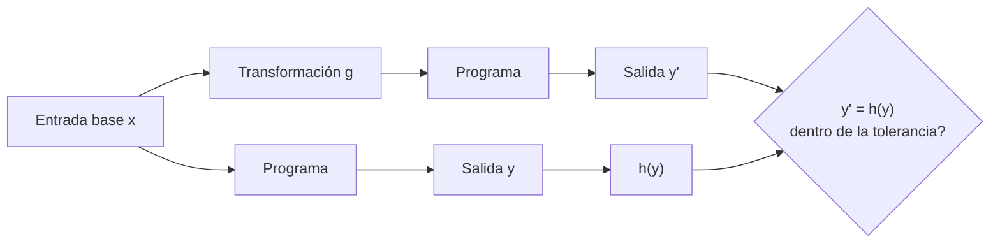

# B23-C06 — Pruebas metamórficas

<!-- nav:top -->
[🏠 Programa](../../../../README.md) · [📚 Bloque B23](../../../tronco-comun/B23-verificacion-y-validacion-de-software-cientifico.md) · [← Anterior: B23-C05 — Validación con conjuntos oficiales](../B23-C05-validacion-con-conjuntos-oficiales/CLASE.md) · [Siguiente: B23-C07 — Trazabilidad científica de resultados →](../../../tronco-comun/B23-verificacion-y-validacion-de-software-cientifico.md#b23-c07)
<!-- /nav -->

## 1. Ubicación, nivel y alcance

Sexta clase del bloque B23. Hasta aquí probaste con soluciones exactas (C03), soluciones fabricadas (C04) y datos oficiales (C05). Pero hay programas para los que no tienes nada de eso: un propagador con perturbaciones, una cadena de reducción de imágenes, un ajuste. Esta clase enseña a probarlos comparando **ejecuciones entre sí**. Nivel de entrada N3, de salida N4.

Verás qué es una relación metamórfica, cómo derivarlas de simetrías, unidades y composición, por qué cada una debe justificarse (una falsa relación genera falsas alarmas), y qué defectos dejan pasar. No verás aprendizaje automático ni pruebas estadísticas de modelos (B17, B19).

## 2. Por qué esta clase existe

El movimiento de un satélite con achatamiento terrestre (J2) no tiene solución cerrada, y tu código no tiene un valor correcto con el que compararse. Sin embargo, sabes cosas: si giras todo el sistema alrededor del eje de la Tierra, la trayectoria gira igual; si cambias de kilómetros a metros, el resultado cambia en un factor 1000. La pregunta motivadora es: **¿cómo pruebo un programa que no tiene respuesta de referencia?**

La decisión central es: **¿qué transformación de la entrada tiene un efecto conocido sobre la salida, y por qué?** La respuesta tiene que venir de la física o de las unidades, no del programa.

## 3. Lo que podrás hacer al terminar

1. Definir una relación metamórfica como un par «transformación de la entrada / efecto esperado en la salida».
2. Derivar relaciones a partir de simetrías, unidades y composición de pasos.
3. Distinguir una relación válida de una que parece razonable pero no lo es (giro alrededor de un eje que no es simetría).
4. Fijar la tolerancia de cada relación desde el ruido del integrador.
5. Construir una matriz «defecto × relación» y reconocer los defectos a los que las relaciones son ciegas.
6. Complementar las relaciones con otras pruebas (propiedades, C02) donde las relaciones no ven.

La evidencia es la **matriz de relaciones metamórficas** del ejercicio 12 (sección 20).

## 4. Con qué llegas y cómo comprobarlo

Necesitas B23-C02 (propiedades y mutantes), B23-C01 (tolerancias) y rotaciones en el espacio (B04, B10). Cinco preguntas:

1. ¿Qué es una rotación alrededor del eje `z` en forma de matriz?
2. ¿Cuáles de estas son simetrías de un campo gravitatorio axisimétrico: giro alrededor del eje, giro alrededor de un eje ecuatorial, reflexión respecto del plano ecuatorial?
3. ¿Qué diferencia hay entre `km³/s²` y `m³/s²` para `μ`?
4. ¿Qué es un oráculo de prueba?
5. ¿Por qué un integrador numérico tiene «ruido» propio?

<details>
<summary>Ver respuestas</summary>

1. `[[cos θ, −sin θ, 0], [sin θ, cos θ, 0], [0, 0, 1]]`. 2. El giro alrededor del eje y la reflexión respecto del plano ecuatorial; el giro alrededor de un eje ecuatorial no. 3. Factor 10⁹: `1 km³ = 10⁹ m³`. 4. El mecanismo que dice cuál es la salida correcta. 5. Porque sus tolerancias `rtol`/`atol` permiten un error local que se acumula; dos ejecuciones con tolerancias distintas difieren.
</details>

Con cuatro o cinco aciertos, sigue; con tres o menos, repasa B04 y B23-C02.

## 5. Un caso real: el problema del oráculo

Chen y colaboradores (S1) revisan la técnica de las pruebas metamórficas como respuesta al *problema del oráculo*: la dificultad de saber cuál es la salida correcta de un programa. Lo que pude consultar de esa obra es su ficha bibliográfica y el resumen que ofrecen los repositorios (el artículo es un estudio de revisión que cubre identificación de relaciones, generación de casos de prueba y validación de software); el texto completo no estaba disponible para esta clase. La definición y los ejemplos de abajo son, por tanto, del autor de la clase, no extraídos de S1.

Nuestro **ejemplo conductor**: un propagador de un satélite **sintético** en órbita baja (`r₀ = (7000, 0, 0) km`, `v₀ = (0; 5,3; 5,95) km/s`, valores de ejemplo) bajo la gravedad terrestre con el término J2. Las constantes son `μ = 3,986004 × 10¹⁴ m³/s²` (nominal de la IAU, S3), `R = 6378,137 km` y `J2 = 1082,63 × 10⁻⁶` (NASA NSSDC, S2). Integra con DOP853 de SciPy (S4). No hay solución exacta.

## 6. Vocabulario

Una **relación metamórfica** es una regla del tipo «si transformo la entrada así, la salida debe transformarse asá». La **entrada seguida** es la ejecución con entrada transformada, y la **entrada base**, la original. Una **simetría** de un modelo es una transformación que deja invariantes sus ecuaciones. El **eje de simetría** de la Tierra axisimétrica con J2 es `z`. La **composición** (o propiedad de semigrupo) dice que propagar `T` equivale a propagar `T/3` y luego `2T/3`. Una **relación de unidades** compara el programa con las mismas magnitudes en otras unidades. El **ruido del integrador** es la diferencia entre dos ejecuciones con tolerancias muy distintas. Un **mutante** es un defecto inyectado (C01). Una **relación ciega** a un defecto es una que el programa defectuoso sigue cumpliendo.

## 7. Modelo mental: dos ejecuciones y una regla

Se ejecuta el programa dos veces; la regla relaciona ambas salidas. Si la relación se rompe, hay un defecto —o la relación estaba mal planteada—.



*Descripción textual:* la entrada base `x` se transforma con `g` y ambas se pasan por el programa; la salida base `y` se transforma con `h` (la transformación esperada); se comprueba que `y'` coincide con `h(y)` dentro de la tolerancia.

**Analogía y su límite.** Comprobar una balanza sin pesas patrón: pones un objeto, lo anotas; luego duplicas el objeto y esperas el doble. No sabes el peso exacto, pero detectas una balanza torcida. Límite: si la balanza multiplica todo por 1,01, el doble sigue siendo el doble y no lo notas (ceguera a defectos coherentes).

## 8. La explicación, paso a paso

### 8.1 Derivar relaciones del problema

Para J2 con eje terrestre `z` hay cinco relaciones que se justifican físicamente: (1) **composición**, porque las ecuaciones no dependen del tiempo absoluto; (2) **giro alrededor de `z`**, porque J2 es axisimétrico; (3) **reflexión `z → −z`**, porque el campo es simétrico respecto del ecuador; (4) **unidades** km ↔ m; (5) **reversibilidad**, porque las fuerzas no dependen de la velocidad. Cada una se escribe con su justificación; una relación sin justificación es una conjetura.

### 8.2 La tolerancia desde el ruido

Se ejecuta el mismo caso con `rtol = 10⁻¹¹` y `10⁻¹³` (6 h): difieren `8,7 × 10⁻⁷ km`. Esa diferencia es el ruido del integrador. La tolerancia de las relaciones se fija en 50 veces ese ruido: `4,3 × 10⁻⁵ km` (4 cm). El factor 50 es una decisión declarada del autor; no sale de ninguna regla.

### 8.3 Una relación falsa

Girar 37° alrededor del eje `x` **no** es una simetría de J2. En la versión correcta, la diferencia entre «propagar el sistema girado» y «girar el resultado» es 107 km. Una prueba basada en esa relación fallaría con el código correcto. Moraleja: la relación se justifica con la física antes de usarse. Con los mutantes, ese mismo número es 107, 477 y 340 km, así que no distingue nada.

### 8.4 Resultados con la versión correcta

Con la tolerancia de 4,3 × 10⁻⁵ km: composición `2,8 × 10⁻⁸ km`, giro alrededor de `z` `2,9 × 10⁻⁷ km`, reflexión `0` (la simetría es exacta en coma flotante), unidades `3,0 × 10⁻¹⁰ km`, reversibilidad `3,6 × 10⁻⁶ km`. Todas por debajo del umbral. La misma versión conserva la energía de J2 con deriva relativa de `1,1 × 10⁻¹¹` en 6 h.

### 8.5 Los defectos y qué relación los ve

El laboratorio inyecta cinco defectos. **Reloj que ignora el instante inicial** (la fuerza crece con `t` medido desde cero en cada llamada): lo detectan la composición (`8,6 × 10⁻² km`) y la reversibilidad (`4,0 × 10⁻² km`). **Asimetría** (error solo para `x < 0`): lo detecta el giro alrededor de `z` (`1,2 × 10³ km`). **Unidades** (radio de la Tierra fijo en km aunque el programa trabaje en metros): lo detecta la relación de unidades (`2,8 × 10² km`). **Signo de J2 invertido** y **factor mal en `a_z`** (`1 − 5z²/r²` en vez de `3 − 5z²/r²`): sobreviven a todas las relaciones, porque siguen siendo axisimétricos, simétricos respecto del ecuador, reversibles y coherentes en unidades.

### 8.6 Lo que las relaciones no ven y qué hacer

Los dos defectos que sobreviven rompen que la fuerza derive de un potencial; la deriva de energía de C02 sí los ve: `1,2 × 10⁻³` y `6,0 × 10⁻⁴` relativos frente a `1,1 × 10⁻¹¹` de la versión correcta. Las pruebas se complementan: las relaciones no necesitan oráculo, las propiedades vigilan lo que la física conserva, y los casos exactos y los datos oficiales fijan los valores. Una batería sensata combina todas.

## 9. Magnitudes, símbolos y unidades

| Símbolo | Qué es | Unidad | Nota |
|---|---|---|---|
| `μ` | parámetro gravitatorio terrestre | km³/s² | 398 600,4 (nominal IAU, S3) |
| `R` | radio ecuatorial | km | 6378,137 (S2) |
| `J2` | coeficiente de achatamiento | sin unidad | `1082,63 × 10⁻⁶` (S2) |
| `r`, `v` | posición y velocidad | km; km/s | inercial geocéntrico |
| `T` | duración de la propagación | s | 21 600 (6 h) |
| `ruido` | diferencia entre `rtol` 1e-11 y 1e-13 | km | `8,7 × 10⁻⁷` |
| `tol` | tolerancia de las relaciones | km | `50 × ruido` |

## 10. Convenciones y referencias

Sistema inercial geocéntrico con eje `z` en el polo; la Tierra se supone axisimétrica con el solo término J2 (sin atmósfera, Luna, Sol ni armónicos superiores). La aceleración es `a = −μ r/r³ − (3/2) J2 μ R² r/r⁵ · (x(1−5z²/r²), y(1−5z²/r²), z(3−5z²/r²))`. Los datos son **sintéticos**: el satélite no es real. Un primer borrador del laboratorio tenía el signo de J2 al revés, y lo delató la propia deriva de energía; ese error cuenta como ejemplo de lo que las relaciones simétricas no ven. Versiones: Python 3.12.9, NumPy 2.4.4, SciPy 1.17.1; ~14 s.

## 11. De dónde sale lo que afirmamos

| ID | Fuente | Localizador | Respalda | Estado |
|---|---|---|---|---|
| S1 | Chen, T. Y., Kuo, F.-C., Liu, H., Poon, P.-L., Towey, D., Tse, T. H. y Zhou, Z. Q., *Metamorphic Testing: A Review of Challenges and Opportunities*, ACM Computing Surveys 51(1), 2018 | DOI 10.1145/3143561 (ficha en https://vuir.vu.edu.au/36919/) | Que las pruebas metamórficas son una técnica de generación y verificación de casos ligada al problema del oráculo | **Parcial:** solo ficha bibliográfica y resumen; el artículo no se leyó; consultada el 2026-11-05 |
| S2 | NASA NSSDC, *Earth Fact Sheet* | https://nssdc.gsfc.nasa.gov/planetary/factsheet/earthfact.html | `J2 = 1082,63 × 10⁻⁶`, radio ecuatorial 6378,137 km | Consultada el 2026-11-05 (actualizada el 2024-11-15) |
| S3 | Mamajek, E. E., et al., IAU 2015 Resolución B3 | https://arxiv.org/abs/1510.07674 (PDF leído) | `(GM)ᴱᴺ = 3,986004 × 10¹⁴ m³ s⁻²` | Leída el 2026-11-05 |
| S4 | SciPy, `scipy.integrate.solve_ivp` | https://docs.scipy.org/doc/scipy/reference/generated/scipy.integrate.solve_ivp.html | DOP853: Runge–Kutta de orden 8, el recomendado para alta precisión; significado de `rtol` y `atol` | Consultada el 2026-11-05 |

Límites: la fórmula de la aceleración por J2 y las simetrías son conocimiento estándar de mecánica orbital, **no consultado** aquí; el laboratorio verifica la consistencia energética de la fórmula, no su coincidencia con una fuente. El efecto de J2 sobre 6 h (≈ 279 km) es resultado del laboratorio.

## 12. Cómo ver los resultados

Distancia entre las dos ejecuciones comparadas, en km (energía: deriva relativa). Umbral: 4,3 × 10⁻⁵ km (energía: 10⁻⁹).

| Versión | Composición | Giro `z` | Reflexión `z` | Unidades | Reversib. | Energía (C02) |
|---|---|---|---|---|---|---|
| Correcta | 2,8e-8 | 2,9e-7 | 0 | 3,0e-10 | 3,6e-6 | 1,1e-11 |
| Signo J2 | 2,2e-8 | 6,1e-7 | 0 | 4,5e-8 | 3,5e-6 | 1,2e-3 |
| `a_z` mal | 4,2e-8 | 5,1e-8 | 0 | 6,5e-8 | 3,7e-6 | 6,0e-4 |
| Asimetría | 1,3e-6 | **1,2e3** | 0 | 3,9e-6 | 2,9e-6 | 1,2e-4 |
| Reloj | **8,6e-2** | 4,1e-7 | 0 | 3,5e-9 | **4,0e-2** | 2,0e-7 |
| Unidades | 2,8e-8 | 2,9e-7 | 0 | **2,8e2** | 3,6e-6 | 1,1e-11 |

(El giro alrededor de `x`, que no es simetría, da 107 km en la versión correcta y por eso no figura en la tabla.)

## 13. Ejemplo trabajado: probar la relación de unidades

1. **Relación.** Si pasas `r₀, v₀` de km a m, `μ` de km³/s² a m³/s² (×10⁹) y `R` a metros, la posición final en metros debe ser 1000 veces la posición en km.
2. **Justificación.** Todas las magnitudes son homogéneas en longitud: el cambio de unidad no altera la física.
3. **Ejecución.** Se propagan 6 h en ambos sistemas.
4. **Medida.** Se pasa la salida en metros a km y se compara: `3,0 × 10⁻¹⁰ km`.
5. **Tolerancia.** `4,3 × 10⁻⁵ km` (50 × ruido); pasa con margen de cinco órdenes.
6. **Mutante.** Si el programa mantiene `R` en km al trabajar en metros, la diferencia es `2,8 × 10² km`: la relación falla con claridad.

**Paso final · incertidumbre.** La relación cubre solo el cambio de unidades; no dice nada sobre si los valores de `μ`, `R`, `J2` son los correctos.

## 14. Comparación: relaciones, propiedades y datos de referencia

Las **relaciones metamórficas** no necesitan oráculo y se derivan de simetrías y unidades, pero son ciegas a defectos coherentes. Las **propiedades** (C02) detectan lo que no se conserva, pero no los errores de valor. Los **casos analíticos** (C03) y los **datos oficiales** (C05) fijan valores, pero hay que tenerlos. La estrategia: relaciones y propiedades siempre; valores de referencia donde existan; y declarar qué defectos quedan sin cubrir.

## 15. Práctica guiada

**Ejercicio 1 · con los pasos.** Justifica por qué la reflexión `z → −z` es una relación válida para J2. *Pasos:* escribe `a_x`, `a_y` y `a_z` y mira cómo cambian al sustituir `z` por `−z`.

<details><summary>Solución comentada</summary>

`a_x` y `a_y` dependen de `z²`, que no cambia; `a_z` es proporcional a `z`, que cambia de signo. El campo es, pues, simétrico respecto del plano ecuatorial; si el estado inicial se refleja, la trayectoria también.
</details>

**Ejercicio 2 · con una pista.** ¿Por qué el giro alrededor de `x` falla incluso con código correcto? *Pista:* J2 distingue el eje `z`.

<details><summary>Solución comentada</summary>

Girar el sistema alrededor de `x` cambia la orientación del satélite respecto del eje terrestre, que no gira con él. El campo ya no es el mismo; la relación es falsa (107 km en el laboratorio).
</details>

**Ejercicio 3 · casi autónomo.** Propón una relación para un programa que calcula el área bajo una curva de luz (suma de flujos).

<details><summary>Solución comentada</summary>

Duplicar todos los flujos debe duplicar el área; desplazar el tiempo no debe cambiarla; reordenar las muestras (si están ordenadas por tiempo) no debe cambiarla. Cada una con su tolerancia relativa.
</details>

## 16. Práctica autónoma, transferencia e integrador

**Ejercicio 4.** ¿Qué factor multiplica la posición si pasas de km a m, y qué factor multiplica `μ`?

<details><summary>Solución comentada</summary>

La posición, 10³; `μ`, 10⁹ (de km³/s² a m³/s²). Con la velocidad (km/s → m/s) ×10³.
</details>

**Ejercicio 5.** Con ruido `8,7 × 10⁻⁷ km`, ¿qué tolerancia resulta con factor 10 y con factor 1000? ¿Qué riesgo corre cada una?

<details><summary>Solución comentada</summary>

`8,7 × 10⁻⁶` y `8,7 × 10⁻⁴ km`. Con 10, riesgo de falsas alarmas por variación del ruido entre casos; con 1000, riesgo de dejar pasar defectos pequeños. 50 es una decisión intermedia.
</details>

**Ejercicio 6.** ¿Por qué la reflexión da exactamente 0 y no ruido?

<details><summary>Solución comentada</summary>

Porque cambiar el signo de `z` y `vz` es exacto en coma flotante y las operaciones que dependen de `z` solo lo usan en `z²` o en `z` multiplicativo; el integrador sigue la misma secuencia de pasos. Si la reflexión diera ruido, sería una pista de un camino numérico distinto.
</details>

**Ejercicio 7.** El mutante «signo de J2» pasa las relaciones. ¿Cómo lo detectas sin un valor de referencia?

<details><summary>Solución comentada</summary>

Con la deriva de energía con el potencial de J2 (C02): `1,2 × 10⁻³` frente a `1,1 × 10⁻¹¹`. También con un dato de referencia: la ascensión recta del nodo de una órbita directa decrece con J2 (regresión nodal); el sentido de ese cambio fija el signo (no se calculó en esta clase).
</details>

**Ejercicio 8.** Inventa un defecto que viole la composición pero no el giro alrededor de `z`.

<details><summary>Solución comentada</summary>

Una constante interna que se reinicia en cada llamada (un contador de pasos, un «tiempo desde el inicio») hace depender la salida de cómo se divida el intervalo. El reloj del laboratorio es un ejemplo.
</details>

**Ejercicio 9 · transferencia.** Un código convierte flujos a magnitudes (`m = −2,5 log₁₀ F + c`). ¿Qué relaciones metamórficas justificas?

<details><summary>Solución comentada</summary>

Multiplicar `F` por 10 debe restar 2,5 a `m`; multiplicar por `k` resta `2,5 log₁₀ k`; el orden de las estrellas por brillo debe invertirse respecto del orden por flujo. Todas salen de la definición.
</details>

**Ejercicio 10 · transferencia.** Un código de ajuste de tendencia lineal a series temporales. Dos relaciones y sus tolerancias.

<details><summary>Solución comentada</summary>

(1) Sumar una constante a los datos debe sumar esa constante a la ordenada en el origen y dejar la pendiente igual. (2) Multiplicar los datos por `k` multiplica pendiente y ordenada por `k`. La tolerancia relativa debe ser pocos `u` multiplicados por el condicionamiento del ajuste.
</details>

**Ejercicio 11 · transferencia.** Un colega propone la relación «si añado ruido, el resultado no cambia mucho». ¿La aceptas?

<details><summary>Solución comentada</summary>

No sin cuantificar: «mucho» no es una tolerancia, y la sensibilidad al ruido forma parte del comportamiento esperado del algoritmo. Se reformula con una cota (p. ej. cambio proporcional al ruido añadido) justificada por el condicionamiento.
</details>

**Ejercicio 12 · integrador.** Entrega una matriz de relaciones metamórficas para un programa propio: al menos cinco relaciones justificadas, una relación falsa identificada, tolerancia derivada del ruido, tres mutantes con su matriz y un defecto ciego con la prueba complementaria que lo detecta.

<details><summary>Solución modelo</summary>

Se acepta una matriz con justificación física o de unidades por relación; una relación falsa demostrada con el código correcto; la tolerancia con factor declarado; mutantes y qué relaciones los matan; y al menos un defecto ciego con una propiedad o un valor de referencia que lo cubre.
</details>

## 17. Laboratorio

El script [relaciones_metamorficas.py](relaciones_metamorficas.py) implementa el propagador con J2, estima el ruido del integrador, ejecuta seis relaciones sobre la versión correcta y cinco mutantes, y añade la energía de C02 como prueba complementaria.

**Datos:** sintéticos; constantes de S2 y S3. **Predice antes de ejecutar:** ¿qué defecto sobrevive a todas las relaciones? (Signo de J2 y `a_z` mal.) **Ejecución del 2026-11-06 (Python 3.12.9, NumPy 2.4.4, SciPy 1.17.1; ~14 s):**

```text
Python 3.12.9  NumPy 2.4.4  SciPy 1.17.1
ruido del integrador (rtol 1e-11 vs 1e-13) tras 6 h: 8.66e-07 km; tolerancia = 50 x ruido = 4.33e-05 km
efecto de J2 en 6 h: 279.199 km de diferencia con dos cuerpos

distancia entre las dos ejecuciones comparadas [km] (tolerancia 4.3e-05 km)
versión          composición            giro z  giro x (no vale)       reflexión z    unidades km->m    reversibilidad     energía (C02)
ninguno             2.84e-08          2.86e-07          1.07e+02          0.00e+00          3.02e-10          3.63e-06          1.06e-11
signo               2.17e-08          6.06e-07          1.07e+02          0.00e+00          4.45e-08          3.45e-06          1.21e-03
az                  4.22e-08          5.11e-08          4.77e+02          0.00e+00          6.47e-08          3.66e-06          6.03e-04
asim                1.27e-06          1.23e+03          3.40e+02          0.00e+00          3.85e-06          2.90e-06          1.23e-04
reloj               8.64e-02          4.13e-07          1.07e+02          0.00e+00          3.48e-09          4.02e-02          1.96e-07
unid                2.84e-08          2.86e-07          1.07e+02          0.00e+00          2.79e+02          3.63e-06          1.06e-11

detecta (distancia > tolerancia; energía: > 1e-09 relativo):
  ninguno   : — (sobrevive)
  signo     : ['energía (C02)']
  az        : ['energía (C02)']
  asim      : ['giro z', 'energía (C02)']
  reloj     : ['composición', 'reversibilidad', 'energía (C02)']
  unid      : ['unidades km->m']

Pruebas superadas.
```

```bash
python programa/clases/B23/B23-C06-pruebas-metamorficas/relaciones_metamorficas.py
```

**Límites:** un solo estado inicial y un arco de 6 h; solo J2; el factor 50 de la tolerancia es una decisión del autor; la deriva de energía es una propiedad, no una relación metamórfica.

## 18. Errores frecuentes y cómo corregirlos

**Usar una relación sin justificarla.** El giro alrededor de `x` falla con código correcto (ejercicio 2).

**Creer que las relaciones demuestran corrección.** Se corrige con el ejercicio 7.

**Tolerancia sin base.** Se corrige con la sección 8.2 y el ejercicio 5.

**Relaciones vagas.** Se corrige con el ejercicio 11.

**No incluir relaciones de unidades.** Se corrige con la sección 13.

## 19. Cómo sabrás que vas bien

Tras 8.1: ¿justificas cada relación con una frase de física? Si no, rehaz el ejercicio 1. Tras 8.3: ¿predices cuál de dos giros es simetría? Si no, rehaz el 2. Tras 8.6: ¿nombras un defecto ciego y su prueba complementaria? Si no, rehaz el 7. Al final: ¿tu matriz del ejercicio 12 tiene una relación falsa señalada?

## 20. Qué entregas y cómo se evalúa

El producto es tu **matriz de relaciones metamórficas** con justificaciones.

| Criterio | Inicial | En desarrollo | Logrado | Destacado |
|---|---|---|---|---|
| Relaciones | Una sin justificar | Varias sin justificar | Cinco justificadas | Incluye una falsa detectada |
| Tolerancia | Arbitraria | Una sola para todo | Desde el ruido | Con sensibilidad al factor |
| Mutantes | Ninguno | Uno | Tres con matriz | Con defecto ciego y complemento |
| Fuentes y alcance | Sin fuente | Fuente sin alcance | Fuente con alcance | Declara fuentes parciales |

**Condiciones críticas:** no afirmar corrección por pasar relaciones; no usar relaciones sin justificar; declarar los datos como sintéticos.

## 21. Ética, seguridad y límites

Un propagador que pasa estas pruebas no está certificado para operar satélites, evitar colisiones ni planificar maniobras. El factor de seguridad de la tolerancia debe revisarse con quien usa el resultado. Accesibilidad: la matriz está en tablas de texto.

## 22. Para cerrar y seguir

Una relación metamórfica convierte la simetría, las unidades y la composición en pruebas sin oráculo, pero cada una debe justificarse y todas son ciegas a los defectos coherentes. Queda abierta una pregunta: cuando un número aparece en un informe, ¿puedes reconstruir con qué código y datos se calculó?

**Glosario español–inglés.** relación metamórfica · *metamorphic relation*; problema del oráculo · *oracle problem*; simetría · *symmetry*; composición · *composition*; ruido del integrador · *integrator noise*; mutante · *mutant*; achatamiento · *oblateness*.

**Continuidad.** B23-C07 asegura que cada cifra de estos laboratorios se pueda trazar a su código, datos y versión.

**Referencias:** ver sección 11.

<!-- nav:bottom -->
---

[← Anterior: B23-C05 — Validación con conjuntos oficiales](../B23-C05-validacion-con-conjuntos-oficiales/CLASE.md) · [📚 Bloque B23](../../../tronco-comun/B23-verificacion-y-validacion-de-software-cientifico.md) · [Siguiente: B23-C07 — Trazabilidad científica de resultados →](../../../tronco-comun/B23-verificacion-y-validacion-de-software-cientifico.md#b23-c07)
<!-- /nav -->
