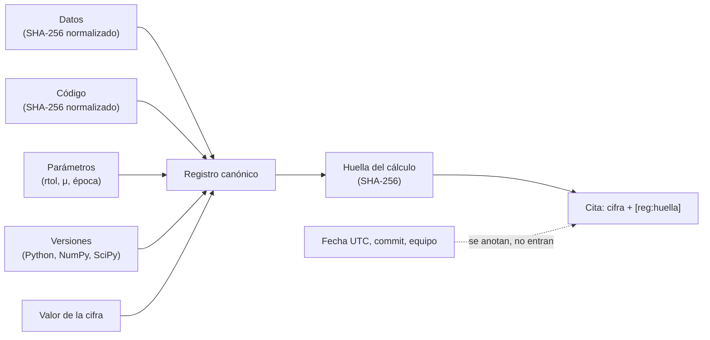

# B23-C07 — Trazabilidad científica de resultados

<!-- nav:top -->
[🏠 Programa](../../../../README.md) · [📚 Bloque B23](../../../tronco-comun/B23-verificacion-y-validacion-de-software-cientifico.md) · [← Anterior: B23-C06 — Pruebas metamórficas](../B23-C06-pruebas-metamorficas/CLASE.md) · [Siguiente: B23-C08 — Informe de verificación y validación →](../B23-C08-informe-de-verificacion-y-validacion/CLASE.md)
<!-- /nav -->

## 1. Ubicación, nivel y alcance

Séptima clase del bloque B23. Con las seis anteriores sabes comprobar que un cálculo es correcto; ahora aseguras que **cualquier persona pueda saber de dónde salió cada cifra** y comprobar que se reproduce. Nivel de entrada N3, de salida N4.

Verás qué es un registro de procedencia, qué debe contener, cómo calcular una huella de datos y código, cómo distinguir «reproducida bit a bit» de «reproducida dentro de tolerancia», y qué detecta un hash que una tolerancia numérica no puede detectar. No verás metadatos de calibración instrumental (B13-C19), control de versiones de datos (B14-C11) ni ejecución con entornos fijos (B14-C12); aquí usas sus ideas, no las enseñas.

## 2. Por qué esta clase existe

Un informe dice «el modelo reproduce la posición con un error de 8,21 × 10⁻⁴ au». Seis meses después, nadie sabe con qué versión del código, qué archivo de datos ni qué tolerancia se calculó, y el número no se puede reproducir ni defender. La pregunta motivadora es: **¿cómo vinculo cada cifra con el código, los datos y la versión que la produjeron?**

La decisión central es: **¿qué debe constar en el registro de una cifra para poder reconstruirla y qué debo hashear?** Todo lo que cambie el valor debe estar en el registro; lo que no lo cambia (la fecha de ejecución) debe quedar fuera de la huella.

## 3. Lo que podrás hacer al terminar

1. Enumerar los elementos que determinan una cifra: datos, código, parámetros, entorno y semilla.
2. Calcular el SHA-256 de un archivo con la biblioteca estándar y normalizar el fin de línea.
3. Construir un registro de procedencia y una huella canónica que excluya lo no determinista.
4. Verificar un registro y clasificar la reproducción en bit a bit, dentro de tolerancia o fallida.
5. Citar una cifra con su identificador de registro.
6. Reconocer qué cambios (un dígito de los datos, un parámetro, un fin de línea) detecta el hash y cuáles no detecta una comparación numérica.

La evidencia es el **registro de procedencia verificable** del ejercicio 12 (sección 20).

## 4. Con qué llegas y cómo comprobarlo

Necesitas B23-C05 (el cálculo cuya cifra trazarás), B07-C16 (JSON) y B07-C19 (documentación y reproducibilidad). Cinco preguntas:

1. ¿Qué es una función hash y qué propiedad la hace útil para detectar cambios?
2. ¿Por qué dos ejecuciones del mismo código pueden dar resultados distintos?
3. ¿Qué es una semilla aleatoria?
4. ¿Cuál es la diferencia entre `\n` y `\r\n`?
5. ¿Qué información sobre el entorno cambia un resultado numérico?

<details>
<summary>Ver respuestas</summary>

1. Convierte datos de cualquier tamaño en una huella de tamaño fijo; un cambio mínimo en los datos cambia la huella por completo. 2. Por aleatoriedad sin semilla, por orden de operaciones (paralelismo), por versiones de bibliotecas o por datos distintos. 3. Un número que fija una secuencia pseudoaleatoria para repetirla. 4. Son finales de línea de Unix y de Windows. 5. Versión de Python y bibliotecas, sistema operativo, hardware (en algunos cálculos).
</details>

Con cuatro o cinco aciertos, sigue; con tres o menos, repasa B07-C19.

## 5. Un caso real: qué dicen los estándares

La norma NASA-STD-7009B (S1) exige que, al informar resultados de un modelo o simulación, el informe incluya la mejor estimación del resultado, una declaración de incertidumbre, evaluaciones de credibilidad, advertencias explícitas y los riesgos (sección 4.3.8), y que se mantenga un **registro de los supuestos y abstracciones** subyacentes (requisito `[M&S 11]`, sección 4.2). Un resultado sin registro no puede acompañar esos elementos. Los principios FAIR (S2) piden en su apartado de reutilización (R1.2) que los datos y metadatos incluyan **registros detallados de dónde vinieron y cómo se produjeron**. Y el modelo de procedencia PROV-DM del W3C (S3) separa tres ideas: una **entidad** (una cosa: un archivo, un resultado), una **actividad** (un proceso que ocurre en el tiempo y actúa sobre entidades) y un **agente** (algo o alguien responsable de una actividad o de una entidad).

Nuestro **ejemplo conductor**: la cifra del error de posición a +91 d de C05 (`8,21 × 10⁻⁴ au`). En términos de PROV, la cifra es una entidad; el script que la calcula, una actividad; el archivo de datos y el código, otras entidades usadas; y la autora o el autor del cálculo, un agente.

## 6. Vocabulario

La **trazabilidad** es la capacidad de reconstruir, para una cifra, los datos, el código, los parámetros y el entorno que la produjeron. Un **registro de procedencia** (*provenance record*) es el documento que lo declara. Un **hash** (huella) es una función que resume un contenido; **SHA-256** produce 256 bits, que se escriben como 64 caracteres hexadecimales. La **huella del cálculo** es el hash del registro canónico. La **forma canónica** es una serialización con orden y formato fijos (claves ordenadas, sin espacios variables) para que dos registros iguales den la misma huella. **Normalizar** es llevar los archivos a un formato único (fin de línea LF) antes de hashearlos. **Bit a bit** significa que la cifra coincide exactamente; **dentro de tolerancia**, que coincide a una tolerancia declarada. Lo **no determinista** es lo que cambia entre ejecuciones sin cambiar el cálculo (fecha, nombre del equipo).

## 7. Modelo mental: la cifra y su certificado de origen

Cada cifra viaja con un certificado que dice qué se usó y con qué. La huella resume el certificado: si algo cambia, la huella cambia.



*Descripción textual:* datos, código, parámetros, versiones y valor forman el registro canónico, cuyo hash es la huella; la cita de la cifra lleva el valor y el identificador del registro. La fecha, el commit y la plataforma se anotan en el contexto pero no forman parte de la huella.

**Analogía y su límite.** El número de serie y la ficha de una pieza en un taller aeronáutico: del número se llega a quién la fabricó, con qué material y qué controles pasó. Límite: el sello de una pieza es físico y único; una cifra se puede recalcular, y por eso el registro debe permitir *reproducir*, no solo certificar.

## 8. La explicación, paso a paso

### 8.1 Qué determina una cifra

Cinco clases de elementos: los **datos** de entrada (archivo y versión), el **código** (el script exacto), los **parámetros** (tolerancias, constantes, época), el **entorno** (versiones de Python y bibliotecas, y a veces el sistema) y la **aleatoriedad** (semilla). En el ejemplo: el archivo `horizons_tierra.csv`, el script `registro_trazable.py`, `rtol = 10⁻¹²`, `μ = 2,9591220819 × 10⁻⁴ au³/d²`, la época 1 (+91 d) y Python 3.12.9 con NumPy 2.4.4 y SciPy 1.17.1. No hay aleatoriedad.

### 8.2 El hash de un archivo

`hashlib.sha256(bytes).hexdigest()` devuelve la huella (S4); desde Python 3.11 existe `hashlib.file_digest(f, "sha256")` para archivos grandes (S4). Un detalle práctico: el mismo texto con fin de línea `\r\n` o `\n` tiene hashes distintos. En el laboratorio, el archivo con CRLF y el original dan hash crudo **distinto** y hash normalizado **igual**: normalizar evita falsas alarmas entre Windows y Linux.

### 8.3 El registro canónico y la huella

El registro agrupa: la cifra y su unidad, los parámetros, los hashes de datos y código, las versiones y el valor. Se serializa en JSON con claves ordenadas y sin espacios variables, y se hashea. La **fecha UTC**, el **commit** de git y la **plataforma** se guardan en un campo de contexto fuera de la huella: son información útil pero cambian entre ejecuciones sin que cambie el cálculo. Dos ejecuciones consecutivas dan la misma huella (`2bcd1ecd3a9e…` en la ejecución del laboratorio) pese a tener fechas distintas.

### 8.4 Verificar: tres estados

`verificar` recalcula los hashes, compara versiones, repite el cálculo y clasifica: **reproducida bit a bit** (valor idéntico), **reproducida dentro de tolerancia** (diferencia relativa ≤ 10⁻⁹) o **NO reproducida**. También lista qué cambió (datos, código, versiones). En el laboratorio, el registro guardado en JSON y verificado inmediatamente da «bit a bit» y ningún cambio; el valor sobrevive a la ida y vuelta por JSON sin pérdida.

### 8.5 Lo que el hash ve y la tolerancia no

Se altera **un** dígito de los datos (`…774551` → `…774552`, un cambio relativo de 10⁻¹⁶). La verificación numérica dice «reproducida dentro de tolerancia», porque la cifra casi no se mueve; pero el hash de los datos cambia, y la verificación lista «datos». Para una auditoría esto es lo que importa: los datos ya no son los mismos aunque el número parezca igual. En sentido inverso, cambiar `rtol` de 10⁻¹² a 10⁻¹⁰ cambia la huella y mueve la cifra en `2,1 × 10⁻⁸` relativo, que es la tolerancia que la reproducción acepta como ruido.

### 8.6 Citar una cifra

La cita lleva el valor, la unidad y un identificador corto: `8.210e-04 au [reg:2bcd1ecd3a9e; datos:981bfbed; código:5cb054c2]`. Quien lea el informe puede localizar el registro completo. Una cifra sin identificador no es trazable; una con identificador, pero sin el registro archivado, tampoco.

### 8.7 Lo que la trazabilidad no hace

El registro no dice que el cálculo sea **correcto**, solo que es **reproducible**. Una cifra mal calculada con trazabilidad perfecta sigue siendo mala. Tampoco sustituye el control de versiones de datos ni del código (el hash del script identifica el contenido, no su historia), ni garantiza que un hardware distinto dé el mismo resultado bit a bit.

## 9. Magnitudes, símbolos y unidades

| Elemento | Qué es | Forma | Nota |
|---|---|---|---|
| valor | cifra trazada | au | error de posición a +91 d (`8,21 × 10⁻⁴`) |
| `rtol` | tolerancia relativa del integrador | sin unidad | `10⁻¹²` |
| `μ` | `GM☉` nominal | au³/d² | `2,9591220819 × 10⁻⁴` |
| datos.sha256 | huella del archivo de datos | 64 hex | normalizada a LF |
| codigo.sha256 | huella del script | 64 hex | normalizada a LF |
| huella | SHA-256 del registro canónico | 64 hex | sin fecha |
| contexto | commit, plataforma, fecha UTC | texto | no entra en la huella |

## 10. Convenciones y referencias

JSON canónico: claves ordenadas, separadores `,` y `:` sin espacios, ASCII. Los hashes de archivo se calculan tras sustituir `\r\n` por `\n`. El tiempo del registro es UTC. Los datos son la **efeméride oficial** de C05 (modelo DE441), transcrita el 2026-11-05 en `horizons_tierra.csv`. Versiones: Python 3.12.9, NumPy 2.4.4, SciPy 1.17.1. Los hashes impresos en la sección 17 corresponden a esta versión exacta del script y del CSV; si los editas, cambian.

## 11. De dónde sale lo que afirmamos

| ID | Fuente | Localizador | Respalda | Estado |
|---|---|---|---|---|
| S1 | NASA, *NASA-STD-7009B, Standard for Models and Simulations* (2024-03-05) | https://standards.nasa.gov/sites/default/files/standards/NASA/B/1/NASA-STD-7009B-Final-3-5-2024.pdf | Contenido que debe acompañar un resultado: estimación, incertidumbre, credibilidad, advertencias y riesgos (4.3.8); registro de supuestos y abstracciones (`[M&S 11]`) | Leída con PyMuPDF el 2026-11-05 (solo las secciones citadas) |
| S2 | GO FAIR, *FAIR Principles* | https://www.gofair.foundation/fair-principles/ | R1.2: datos y metadatos con registros detallados de procedencia; significado de F, A, I, R | Consultada el 2026-11-05; el artículo original (*Scientific Data*) no pudo abrirse |
| S3 | W3C, *PROV-DM: The PROV Data Model*, Recomendación del 30 de abril de 2013 (edit.: Moreau y Missier) y *PROV-Overview* (Nota del 30 de abril de 2013) | https://www.w3.org/TR/prov-dm/ ; https://www.w3.org/TR/prov-overview/ | Definiciones de entidad, actividad y agente; procedencia como información para juzgar calidad y fiabilidad | Consultadas el 2026-11-05 (de PROV-DM se leyeron los primeros 100 000 caracteres) |
| S4 | Python Software Foundation, *The Python Standard Library* 3.12, `hashlib` | https://docs.python.org/3.12/library/hashlib.html | `sha256`, `update`, `hexdigest`; `file_digest` desde 3.11 | Consultada el 2026-11-05 |

Límites: que dos formatos de fin de línea den hashes distintos y que JSON conserve un `float` sin pérdida se **comprobó en el laboratorio**, no en una fuente. Las propiedades de resistencia criptográfica de SHA-256 no se consultaron ni se usan; aquí el hash sirve para **detectar cambios**, no como mecanismo de seguridad.

## 12. Cómo ver los resultados

Qué detecta cada comprobación (laboratorio).

| Cambio | Hash de datos | Huella | Verificación numérica |
|---|---|---|---|
| Ninguno (reejecución) | igual | igual | bit a bit |
| Un dígito en los datos (10⁻¹⁶ relativo) | **distinto** | **distinta** | dentro de tolerancia |
| `rtol` 10⁻¹² → 10⁻¹⁰ | igual | **distinta** | cifra cambia 2,1e-8 |
| Fin de línea CRLF | crudo distinto, normalizado igual | igual | — |
| Otra versión de NumPy en el registro | igual | — | se lista «versiones» |

## 13. Ejemplo trabajado: trazar la cifra de C05

1. **Declarar** la cifra: error de posición a +91 d, en au.
2. **Fijar** parámetros: `rtol = 10⁻¹²`, `μ`, época 1.
3. **Hashear** datos y código tras normalizar: `981bfbed…` y `5cb054c2…` (primeros ocho caracteres).
4. **Anotar** versiones: Python 3.12.9, NumPy 2.4.4, SciPy 1.17.1.
5. **Calcular** el valor: `8,210 × 10⁻⁴ au`.
6. **Huella:** `2bcd1ecd3a9e…`; **cita:** `8.210e-04 au [reg:2bcd1ecd3a9e; datos:981bfbed; código:5cb054c2]`.
7. **Verificar:** reejecutar y obtener «bit a bit».

**Paso final · incertidumbre.** La cifra describe un cálculo; su significado físico (cuánto difiere el modelo de la efeméride) y su incertidumbre están en C05. El registro garantiza que el número es el que dice ser, no que sea correcto.

## 14. Comparación: qué registrar y cuánto

Un **comentario en el código** («datos de Horizons») es mínimo y no verificable. Un **nombre de archivo con fecha** da contexto, pero no detecta cambios. Un **registro con hashes** detecta cambios, a costa de mantenerlo. Un **entorno congelado** (contenedor, gestor de paquetes) fija las versiones, pero no el contenido de los datos. La combinación recomendada: control de versiones para el código, hashes para datos, entorno declarado y un registro por cifra publicada.

## 15. Práctica guiada

**Ejercicio 1 · con los pasos.** Clasifica en «entra en la huella» o «solo contexto»: fecha de ejecución, `rtol`, nombre del equipo, versión de NumPy, hash de los datos. *Pasos:* ¿cambia el valor si cambia?

<details><summary>Solución comentada</summary>

Entran: `rtol`, versión de NumPy, hash de los datos (pueden cambiar el valor). Solo contexto: fecha y nombre del equipo. Una versión distinta de NumPy puede cambiar el redondeo, por eso entra.
</details>

**Ejercicio 2 · con una pista.** ¿Por qué el hash del mismo CSV difiere entre dos computadoras y cómo lo resuelves? *Pista:* fin de línea.

<details><summary>Solución comentada</summary>

Porque una guarda `\r\n` y la otra `\n`. Se normaliza a `\n` antes de hashear (sección 8.2): hash crudo distinto, normalizado igual, como en el laboratorio.
</details>

**Ejercicio 3 · casi autónomo.** Una cifra se cita como «8,2 × 10⁻⁴ au» sin más. ¿Qué le falta y cómo lo mejorarías?

<details><summary>Solución comentada</summary>

Falta el identificador de registro, la versión de código y datos y la unidad de referencia (qué mide). Se mejora con la cita de la sección 8.6.
</details>

## 16. Práctica autónoma, transferencia e integrador

**Ejercicio 4.** Dos ejecuciones dan la misma huella y valores que difieren en el último decimal. ¿Es posible?

<details><summary>Solución comentada</summary>

No: la huella incluye el valor. Si la huella coincide, el valor es idéntico bit a bit. Si el valor cambió, la huella cambió. (Podría haber un error en cómo se serializó el valor: con `repr` de Python la ida y vuelta es exacta.)
</details>

**Ejercicio 5.** ¿Qué clasificación da `verificar` si el valor difiere en 10⁻¹¹ relativo y por qué podría ser aceptable?

<details><summary>Solución comentada</summary>

«Dentro de tolerancia» (≤ 10⁻⁹). Es aceptable cuando la diferencia procede de una versión distinta de biblioteca o de orden de operaciones, y está por debajo de la incertidumbre de la cifra. Debe registrarse la versión que la produjo.
</details>

**Ejercicio 6.** El laboratorio altera un dígito de los datos y la cifra sigue «dentro de tolerancia». ¿Qué te enseña?

<details><summary>Solución comentada</summary>

Que la comparación numérica es ciega a cambios minúsculos de los datos, y el hash no. Una auditoría de procedencia necesita el hash; un criterio de reproducción numérica necesita la tolerancia. Se usan ambos.
</details>

**Ejercicio 7.** ¿Por qué no se incluye `ejecutado_utc` en la huella?

<details><summary>Solución comentada</summary>

Porque cambia en cada ejecución sin cambiar el cálculo; si entrara, nunca dos reproducciones tendrían la misma huella y la huella dejaría de servir para decidir si se reprodujo.
</details>

**Ejercicio 8.** Añade al registro una semilla aleatoria. ¿Dónde va y qué pruebas añades?

<details><summary>Solución comentada</summary>

En los parámetros (entra en la huella). Pruebas: con la misma semilla, el valor es idéntico; con otra, cambia y la huella cambia. Si el algoritmo usa paralelismo, el orden de suma puede introducir diferencias del orden del redondeo (B14-C13).
</details>

**Ejercicio 9 · transferencia.** Una imagen reducida (calibrada) se publica con un mapa de brillo. ¿Qué incluyes en su registro?

<details><summary>Solución comentada</summary>

Hash de las imágenes crudas y de calibración (flat, bias), versión del programa de reducción y sus parámetros, versiones de bibliotecas, unidades y la huella. Es la procedencia (PROV): entidades (imágenes), actividad (reducción) y agente (quien la ejecutó).
</details>

**Ejercicio 10 · transferencia.** Un colega dice que basta con «tener el código en GitHub». ¿Qué responde un registro que no da GitHub?

<details><summary>Solución comentada</summary>

El repositorio da historia del código, pero no dice qué commit produjo la cifra, ni qué datos, ni qué parámetros, ni qué versiones. El registro vincula cada cifra con esos cuatro elementos.
</details>

**Ejercicio 11 · transferencia.** Una cifra se recalcula un año después con otra versión de SciPy y difiere en 3 × 10⁻⁸ relativo. ¿Qué haces?

<details><summary>Solución comentada</summary>

Verificas: el estado es «NO reproducida» con tolerancia 10⁻⁹. Investigas la causa (cambio de algoritmo o de tolerancias por defecto), decides si la nueva cifra es admisible, y registras las dos versiones con sus huellas. No ocultas la diferencia.
</details>

**Ejercicio 12 · integrador.** Entrega un registro de procedencia verificable para una cifra de uno de tus laboratorios: función `registrar` y `verificar`, huella que excluya lo no determinista, pruebas de (a) reproducción, (b) alteración de datos, (c) cambio de parámetro y (d) cita de la cifra.

<details><summary>Solución modelo</summary>

Se acepta una solución que incluya: datos, código, parámetros, versiones y valor en el núcleo hasheado; contexto fuera; normalización de fin de línea; tres estados de verificación; las cuatro pruebas; y la limitación de que no demuestra corrección.
</details>

## 17. Laboratorio

El script [registro_trazable.py](registro_trazable.py) lee [horizons_tierra.csv](horizons_tierra.csv), calcula la cifra, construye el registro y la huella, y ejecuta seis pruebas de trazabilidad.

**Datos:** efeméride oficial (modelo DE441), la de C05. **Predice antes de ejecutar:** ¿qué dirá la verificación numérica si cambias un dígito de los datos? («Dentro de tolerancia»; el hash lo delata.) **Ejecución del 2026-11-06 (Python 3.12.9, NumPy 2.4.4, SciPy 1.17.1):**

```text
Python 3.12.9  NumPy 2.4.4  SciPy 1.17.1
cifra: 8.210e-04 au [reg:2bcd1ecd3a9e; datos:981bfbed; código:5cb054c2]
huella completa: 2bcd1ecd3a9e473a603df7c489d511023777c5f7dbf0638d5213da4cd2ff5381
commit git: 3c3901e  plataforma: Windows
reproducción: misma huella y mismo valor bit a bit (la fecha UTC no entra en la huella)
verificación del registro guardado: reproducida bit a bit; cambios: ninguno
un dígito alterado en los datos: cambios=['datos']; estado=reproducida dentro de tolerancia; huella distinta: True
rtol 1e-12 -> 1e-10: huella distinta: True; diferencia relativa de la cifra: 2.1e-08
CRLF vs LF: hash normalizado igual=True; hash crudo igual=False
registro con otra versión de NumPy: cambios=['versiones']; estado=reproducida bit a bit

Pruebas superadas.
```

```bash
python programa/clases/B23/B23-C07-trazabilidad-cientifica-de-resultados/registro_trazable.py
```

**Límites:** el commit (`3c3901e`) y la plataforma son los de la ejecución y cambiarán en otro equipo; el hash del código es el de esta versión exacta del script; el script crea y borra archivos temporales junto a sí mismo; no se prueba reproducibilidad entre sistemas operativos distintos.

## 18. Errores frecuentes y cómo corregirlos

**Meter la fecha en la huella.** Se corrige con el ejercicio 7.

**No normalizar el fin de línea.** Se corrige con el ejercicio 2.

**Confiar solo en la tolerancia numérica.** Se corrige con el ejercicio 6.

**Citar una cifra sin identificador.** Se corrige con el ejercicio 3.

**Creer que reproducible significa correcto.** Se corrige con la sección 8.7.

**Olvidar las versiones del entorno.** Se corrige con el ejercicio 11.

## 19. Cómo sabrás que vas bien

Tras 8.1: ¿enumeras los cinco determinantes de una cifra? Si no, rehaz el ejercicio 1. Tras 8.3: ¿explicas por qué la fecha queda fuera? Si no, rehaz el 7. Tras 8.5: ¿explicas qué ve el hash y qué no la tolerancia? Si no, rehaz el 6. Al final: ¿tu registro del ejercicio 12 pasa las cuatro pruebas?

## 20. Qué entregas y cómo se evalúa

El producto es tu **registro de procedencia verificable**.

| Criterio | Inicial | En desarrollo | Logrado | Destacado |
|---|---|---|---|---|
| Contenido | Solo el valor | Valor y datos | Datos, código, parámetros, versiones | Añade semilla y contexto separado |
| Huella | Ninguna | Del valor | Canónica sin lo no determinista | Con normalización y prueba |
| Verificación | Manual | Compara valor | Tres estados con cambios listados | Con registro archivado y cita |
| Fuentes y alcance | Sin fuente | Fuente sin alcance | Fuente con alcance | Declara qué no garantiza |

**Condiciones críticas:** no presentar reproducibilidad como corrección; no incluir lo no determinista en la huella; citar cada cifra con su identificador.

## 21. Ética, seguridad y límites

La trazabilidad permite auditar, pero también expone datos y rutas: no incluyas credenciales, nombres de usuario ni rutas privadas en el registro. Los hashes aquí sirven para detectar cambios, no como mecanismo de seguridad. Los datos de Horizons son públicos; cita siempre su versión. Accesibilidad: la tabla de la sección 12 es el equivalente textual del diagrama.

## 22. Para cerrar y seguir

Una cifra trazable lleva consigo sus datos, su código, sus parámetros y su entorno; la huella detecta lo que una tolerancia no ve, y la tolerancia dice si la diferencia importa. Queda abierta una pregunta: ¿cómo reúnes todo esto —verificación, validación y trazabilidad— en un informe que otra persona pueda juzgar?

**Glosario español–inglés.** trazabilidad · *traceability*; procedencia · *provenance*; huella · *fingerprint, hash*; forma canónica · *canonical form*; reproducibilidad · *reproducibility*; entidad · *entity*; actividad · *activity*; agente · *agent*.

**Continuidad.** B23-C08 reúne las evidencias de C01–C07 en un informe de verificación y validación con criterios, advertencias y límites.

**Referencias:** ver sección 11.

<!-- nav:bottom -->
---

[← Anterior: B23-C06 — Pruebas metamórficas](../B23-C06-pruebas-metamorficas/CLASE.md) · [📚 Bloque B23](../../../tronco-comun/B23-verificacion-y-validacion-de-software-cientifico.md) · [Siguiente: B23-C08 — Informe de verificación y validación →](../B23-C08-informe-de-verificacion-y-validacion/CLASE.md)
<!-- /nav -->
