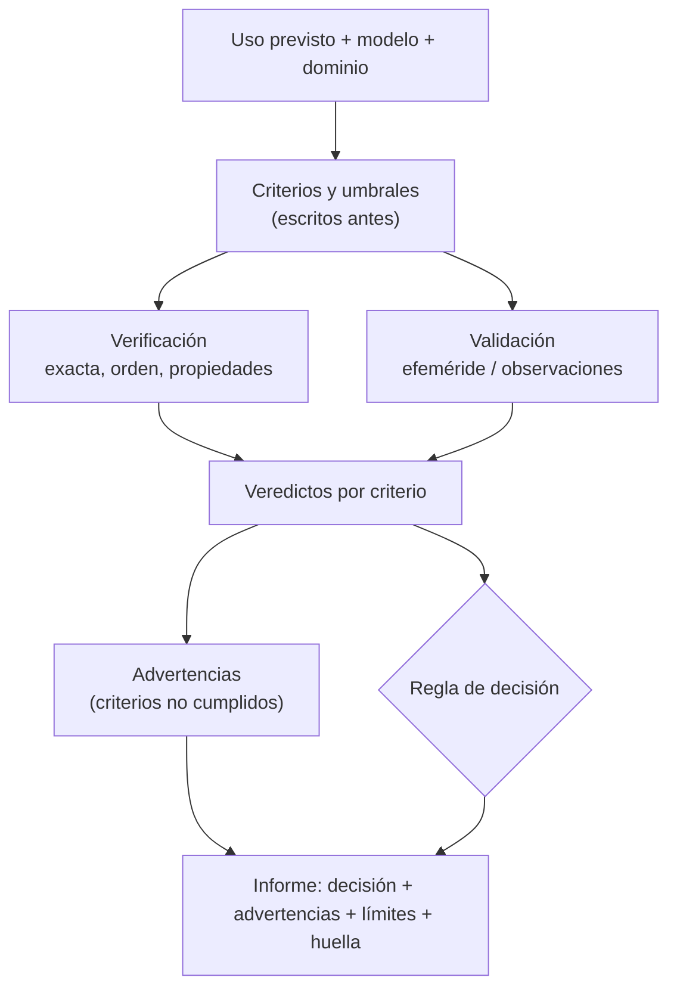

# B23-C08 — Informe de verificación y validación

<!-- nav:top -->
[🏠 Programa](../../../../README.md) · [📚 Bloque B23](../../../tronco-comun/B23-verificacion-y-validacion-de-software-cientifico.md) · [← Anterior: B23-C07 — Trazabilidad científica de resultados](../B23-C07-trazabilidad-cientifica-de-resultados/CLASE.md) · [Siguiente: B24-C01 — Colapso de nubes moleculares →](../../../tronco-comun/B24-fisica-y-evolucion-de-estrellas.md#b24-c01)
<!-- /nav -->

## 1. Ubicación, nivel y alcance

Última clase del bloque B23. Reúnes lo que hiciste en C01–C07 en un documento que otra persona pueda **juzgar**: qué se usó, contra qué se comparó, qué criterios había, cuáles se cumplieron, qué advertencias quedan y para qué uso es apto el software. Nivel de entrada N4, de salida N4.

Verás la estructura de un informe de verificación y validación (V&V), cómo escribir criterios y regla de decisión antes de calcular, cómo reportar advertencias, y cómo generar el informe desde los resultados para que no se desvíe de ellos. No verás certificación formal de software de vuelo ni cuantificación estadística de incertidumbre (B12, B19).

## 2. Por qué esta clase existe

Un conjunto de pruebas que pasan no es un informe. Quien debe decidir si usar el código necesita saber para qué uso se evaluó, con qué criterios, qué falló y qué no se probó. La pregunta motivadora es: **¿qué debe decir un informe V&V para que alguien que no vio las pruebas pueda decidir con él?**

La decisión central es: **¿para qué uso previsto declaro apto el software, y qué evidencia sostiene esa declaración?** El informe no dice «el código es bueno»; dice «es apto para X, con estas evidencias y estos límites».

## 3. Lo que podrás hacer al terminar

1. Declarar el uso previsto, el modelo, los supuestos y el dominio de validez.
2. Escribir criterios medibles con umbral y una regla de decisión antes de ejecutar las pruebas.
3. Distinguir los criterios de verificación de los de validación y los que cuentan para el uso previsto de los que solo limitan la extrapolación.
4. Reportar cada criterio no cumplido como advertencia con su impacto.
5. Generar el informe automáticamente desde los resultados y comprobar su coherencia interna.
6. Enunciar con honestidad qué no se probó y para qué no debe usarse el software.

La evidencia es el **informe V&V de un software propio** del ejercicio 12 (sección 20).

## 4. Con qué llegas y cómo comprobarlo

Necesitas B23-C01 a C07, en especial C03 (orden observado), C05 (criterios previos y validación) y C07 (trazabilidad). Cinco preguntas:

1. ¿Qué diferencia hay entre verificar y validar?
2. ¿Por qué se escriben los criterios antes de comparar?
3. ¿Qué información identifica una cifra de forma trazable?
4. ¿Qué es un dominio de validez?
5. ¿Qué es un resultado «NO CUMPLE» que no afecta al uso previsto?

<details>
<summary>Ver respuestas</summary>

1. Verificar es comprobar que el software resuelve bien las ecuaciones que dice resolver; validar es comparar con el mundo real o una referencia aceptable. 2. Para que el resultado no condicione el criterio. 3. Datos, código, parámetros, versiones y una huella (C07). 4. El rango de condiciones en que la evidencia respalda el uso. 5. Un criterio fuera del uso previsto: se reporta como advertencia porque limita la extrapolación, pero no impide el uso declarado.
</details>

Con cuatro o cinco aciertos, sigue; con tres o menos, repasa B23-C05 y C07.

## 5. Un caso real: lo que la norma de la NASA exige informar

La norma NASA-STD-7009B (S1) define la **verificación** como el proceso de determinar en qué medida un modelo o simulación cumple sus requisitos y especificaciones, y la **validación** como el proceso de determinar en qué grado representa con exactitud el mundo real desde la perspectiva de los usos previstos. Exige mantener un registro del **dominio de verificación** y del **dominio de validación**. Para informar resultados a quienes deciden, indica (sección 4.3.8) que debe incluirse: (1) la mejor estimación del resultado, (2) una declaración de incertidumbre, (3) evaluaciones de credibilidad de las capacidades y los resultados, (4) advertencias explícitas (por ejemplo, el uso fuera de los supuestos) y (5) los riesgos de aceptar el resultado. Y exige advertencias explícitas, con al menos una estimación cualitativa del impacto, para criterios de aceptación no cumplidos, violaciones de supuestos o límites, mensajes de error, problemas durante la configuración y defectos pendientes (requisito `[M&S 32]`).

Esta clase es una versión **educativa y reducida** de esa estructura; no cumple la norma ni es una evaluación de credibilidad en su sentido formal.

Nuestro **ejemplo conductor** es el propagador de dos cuerpos de C02–C05: se declara apto o no para un uso previsto concreto —«propagar la Tierra hasta 91 d con error ≤ 10⁻³ au»— con evidencia de verificación (solución exacta, orden de convergencia, energía) y de validación (efeméride de Horizons).

## 6. Vocabulario

El **uso previsto** es la decisión o el cálculo para el que se evalúa el software. Un **criterio de aceptación** es una condición medible con umbral. La **regla de decisión** dice cómo se combinan los veredictos en una conclusión («apto» solo si todos los criterios marcados como de uso se cumplen). Una **advertencia** es la declaración explícita de que un criterio no se cumplió, un supuesto se violó o un límite se alcanzó, con su impacto. El **dominio de verificación** y el **dominio de validación** son los rangos en que se comprobó cada cosa. Las **evidencias** son los resultados trazables que sostienen cada veredicto. Un **informe reproducible** es el generado desde los resultados y registrado con su huella (C07). Una **limitación** es algo que no se probó.

## 7. Modelo mental: de la evidencia a la decisión

Cada criterio produce un veredicto; la regla de decisión los combina; las advertencias recogen lo que no se cumplió y los límites recogen lo que no se probó. El informe presenta todo, no solo la conclusión.



*Descripción textual:* el uso previsto y el dominio determinan los criterios y umbrales, fijados antes. La verificación y la validación producen veredictos por criterio. Los veredictos alimentan las advertencias y la regla de decisión. El informe final reúne la decisión, las advertencias, los límites y la huella del cálculo.

**Analogía y su límite.** El informe de una revisión técnica de un coche: lista qué se midió, con qué umbral, qué pasó y qué no, y concluye «apto para circular» con observaciones. Límite: en un coche los criterios son normativos; aquí los criterios los fijas tú y deben justificarse por el uso.

## 8. La explicación, paso a paso

### 8.1 Uso previsto, modelo y dominio

Lo primero que debe decir el informe: qué uso, qué modelo (dos cuerpos, Sol fijo, μ nominal de la IAU), qué supuestos (sin otros cuerpos; plano; geocentro respecto del Sol), qué dominio (excentricidad ≈ 0,0167, arcos hasta un año, pasos 0,25–2 d) y de qué tipo son los datos (sintéticos para verificar; efeméride oficial para validar). Sin esto, ningún veredicto tiene sentido.

### 8.2 Criterios escritos antes

Seis criterios, con umbral fijado en el código antes de calcular: V1, la solución exacta regresa al punto de partida tras un período (`≤ 10⁻¹² au`); V2, el orden observado de Verlet entre `N = 200` y `400` difiere de 2 en `≤ 0,15`; V3, lo mismo para RK4 respecto de 4; V4, el error de energía de Verlet con `h = 1 d` en 10 años no supera `1,5·c·h²`, con `c` estimada en `h = 2 d`; D1, la posición a +91 d frente a Horizons es `≤ 10⁻³ au`; D2, la posición a +365 d frente a Horizons es `≤ 5 × 10⁻³ au`. Cinco cuentan para el uso previsto; D2 queda fuera porque el uso llega a 91 d, pero se reporta porque informa de la extrapolación.

### 8.3 Resultados

V1 `0` (exacto); V2 `3,4 × 10⁻⁴`; V3 `0,12`; V4 `0,66` (el error es el 66 % de la cota); D1 `8,21 × 10⁻⁴ au`; D2 `8,81 × 10⁻³ au`. Cumplen cinco; no cumple D2. Fíjate en V3: `0,12` frente a `0,15` pasa, pero con poco margen; un informe honesto lo señala como «cumple con margen reducido» en vez de ocultarlo.

### 8.4 La regla de decisión y las advertencias

Regla: «apto para el uso previsto» solo si todos los criterios marcados «uso» se cumplen. Aquí se cumplen, así que la decisión es **APTO para el uso previsto**. Pero el informe incluye la advertencia: «Criterio D2 no cumplido: valor 8,806 × 10⁻³ frente a umbral ≤ 0,005 — fuera del uso previsto; limita la extrapolación». Esto es lo que la norma (S1, `[M&S 32]`) pide: ningún criterio no cumplido se omite.

### 8.5 Incertidumbre y límites

Se declara lo que falta: no hay estimación estadística de incertidumbre; las diferencias son deterministas con una sola efeméride y un solo estado inicial; el software no se validó frente a observaciones; no debe usarse para navegación, encuentros ni decisiones de operación. Esta sección es parte de la evidencia: un informe sin límites es sospechoso.

### 8.6 Generar el informe desde los resultados

El laboratorio calcula los criterios y construye el informe a partir de la lista. Después prueba la coherencia: el informe tiene sus siete secciones; cada criterio aparece en la tabla; la decisión coincide con los veredictos de los criterios de uso; cada criterio no cumplido genera una advertencia; y, como control negativo, si se corrompe el valor de D1 (`5 × 10⁻³`), la decisión cambia a **NO APTO**. Un informe redactado a mano puede derivar de los números; uno generado no.

### 8.7 Procedencia

La última sección registra versiones (Python 3.12.9, NumPy 2.4.4, SciPy 1.17.1) y la huella del script (C07). Con ello, el informe se puede reproducir y comparar con otro de una versión posterior.

## 9. Magnitudes, símbolos y unidades

| Elemento | Qué es | Unidad | Nota |
|---|---|---|---|
| V1–V4 | criterios de verificación | au, sin unidad | exacta, orden, energía |
| D1, D2 | criterios de validación | au | posición frente a Horizons |
| `p` | orden observado | sin unidad | `log₂(e(N)/e(2N))` |
| `c` | constante del error de energía | d⁻² | estimada en `h = 2 d` |
| `μ` | `GM☉` nominal | au³/d² | `2,9591220819 × 10⁻⁴` |
| uso | indicador de pertenencia al uso previsto | sí/no | decide la regla |
| huella | SHA-256 del script (LF) | 64 hex | primeros 16 en el informe |

## 10. Convenciones y referencias

Los umbrales se escriben en `<=`. «Uso» marca si el criterio cuenta para la regla de decisión. La efeméride (JPL Horizons, DE441, Tierra respecto del Sol, eclíptica J2000, au y au/d, TDB) es la de C05, de la que se copian tres épocas al script. Los datos de verificación son **sintéticos**. Versiones: Python 3.12.9, NumPy 2.4.4, SciPy 1.17.1. El informe que ves en la sección 17 se imprimió en Markdown tal como lo genera el script.

## 11. De dónde sale lo que afirmamos

| ID | Fuente | Localizador | Respalda | Estado |
|---|---|---|---|---|
| S1 | NASA, *NASA-STD-7009B, Standard for Models and Simulations* (aprobada 2024-03-05) | https://standards.nasa.gov/sites/default/files/standards/NASA/B/1/NASA-STD-7009B-Final-3-5-2024.pdf | Definiciones de verificación y validación (sección 3); dominios de verificación y validación (`[M&S 16]`, `[M&S 18]`); contenido del reporte de resultados y advertencias (4.3.8, `[M&S 32]`) | Leída con PyMuPDF el 2026-11-05 (secciones citadas; no se leyó completa) |
| S2 | NASA/JPL, *Horizons API* (documentación v1.3) y respuesta de la API | https://ssd-api.jpl.nasa.gov/doc/horizons.html | Estados de la Tierra usados como referencia (ver C05) | Consultada el 2026-11-05 |
| S3 | Mamajek, E. E., et al., IAU 2015 Resolución B3 | https://arxiv.org/abs/1510.07674 (PDF leído) | `GM☉` nominal | Leída el 2026-11-05 |
| S4 | IAU, Resolución B2 de 2012 | https://syrte.obspm.fr/IAU_resolutions/IAUResol_2012_0.html | 1 au = 149 597 870 700 m | Consultada el 2026-11-05 |

Límites: la estructura de siete secciones del informe es **diseño del autor de la clase**, inspirado en S1 pero no una plantilla de la norma. Los órdenes nominales de Verlet y RK4 y el modelo de dos cuerpos son conocimiento estándar, no consultado aquí. No se consultó la guía de implementación NASA-HDBK-7009 ni normas ASME V&V.

## 12. Cómo ver los resultados

Resultados del informe del laboratorio (versión accesible de la tabla).

| ID | Tipo | Valor | Umbral | Uso | Veredicto |
|---|---|---|---|---|---|
| V1 | verificación | 0 | ≤ 1e-12 | sí | CUMPLE |
| V2 | verificación | 3,4e-4 | ≤ 0,15 | sí | CUMPLE |
| V3 | verificación | 0,12 | ≤ 0,15 | sí | CUMPLE (margen reducido) |
| V4 | verificación | 0,66 | ≤ 1 | sí | CUMPLE |
| D1 | validación | 8,21e-4 au | ≤ 0,001 au | sí | CUMPLE |
| D2 | validación | 8,81e-3 au | ≤ 0,005 au | no | NO CUMPLE |

## 13. Ejemplo trabajado: del resultado a la decisión

1. **Uso previsto:** propagar la Tierra hasta 91 d con error ≤ 10⁻³ au.
2. **Criterios de uso:** V1–V4 y D1.
3. **Resultados:** todos cumplen (D1 con 8,21 × 10⁻⁴ frente a 10⁻³: margen del 18 %).
4. **Decisión:** APTO.
5. **Advertencia:** D2 no cumple (8,81 × 10⁻³ au a 365 d) → no extrapolar el uso a un año.
6. **Cambio de condiciones:** si el uso fuera «hasta 365 d con error ≤ 5 × 10⁻³ au», D2 contaría para el uso y la decisión sería **NO APTO**.
7. **Límites:** sin incertidumbre estadística; una efeméride, un estado inicial.

**Paso final · incertidumbre.** El margen de D1 es estrecho; con otro estado inicial el error podría superar el umbral. El informe lo declara como límite, no lo resuelve.

## 14. Comparación: lista de pruebas, informe narrativo e informe generado

Una **lista de pruebas** (como la salida de `pytest`) dice qué pasó, pero no el uso previsto ni los límites. Un **informe narrativo** escrito a mano es legible y puede contradecir los datos. Un **informe generado** desde los resultados es coherente con ellos y reproducible, pero hay que diseñar su estructura. La opción recomendada: generar la tabla, las advertencias y la decisión; escribir a mano el uso, los supuestos y los límites.

## 15. Práctica guiada

**Ejercicio 1 · con los pasos.** Cambia el uso previsto a «hasta 365 d con error ≤ 5 × 10⁻³ au». ¿Qué criterios cuentan y cuál es la decisión? *Pasos:* sección 13.

<details><summary>Solución comentada</summary>

Pasa D2 a contar para el uso. Su valor, 8,81 × 10⁻³ au, supera 5 × 10⁻³: NO CUMPLE → decisión **NO APTO**. Se reportaría la advertencia con su impacto («afecta al uso previsto»).
</details>

**Ejercicio 2 · con una pista.** Redacta la advertencia para D2 con el formato del laboratorio. *Pista:* criterio, valor, umbral, impacto.

<details><summary>Solución comentada</summary>

«Criterio D2 no cumplido (posición a +365 d frente a Horizons): valor 8,806 × 10⁻³ frente a umbral ≤ 0,005 — fuera del uso previsto; limita la extrapolación.»
</details>

**Ejercicio 3 · casi autónomo.** V3 vale 0,12 con umbral 0,15. ¿Cómo lo reportas y qué haces para ganar margen?

<details><summary>Solución comentada</summary>

Como «cumple con margen reducido». Para ganar margen, mide el orden con mallas más finas (el orden de RK4 se acerca a 4 desde arriba al refinar, como en C03: 4,35, 4,21, 4,12), y declara las `N` usadas.
</details>

## 16. Práctica autónoma, transferencia e integrador

**Ejercicio 4.** ¿Por qué D2 se escribió antes de calcular y por qué no se borra cuando falla?

<details><summary>Solución comentada</summary>

Se escribió antes para que el criterio no dependiera del resultado (C05). No se borra porque la norma pide advertir de criterios de aceptación no cumplidos (S1): ocultarlo falsearía la evidencia.
</details>

**Ejercicio 5.** El informe dice «APTO» sin sección de límites. ¿Qué falla?

<details><summary>Solución comentada</summary>

Falta la declaración de lo no probado y del uso no autorizado; el lector podría extrapolar. La sección 6 (incertidumbre y límites) es parte de la evidencia.
</details>

**Ejercicio 6.** ¿Cuál es la utilidad del control negativo del laboratorio (D1 corrompido)?

<details><summary>Solución comentada</summary>

Prueba que la regla de decisión reacciona a los datos: si el informe dijera «APTO» con D1 fallando, el generador tendría un defecto. Es una prueba del generador, no del propagador.
</details>

**Ejercicio 7.** ¿Qué criterio añadirías para cubrir la excentricidad (otro punto del dominio)?

<details><summary>Solución comentada</summary>

Repetir V2 y V3 con `e = 0,3` (con su propia solución exacta) y declarar el dominio ampliado, o declarar que el dominio es `e ≈ 0,0167`. No se calculó en esta clase.
</details>

**Ejercicio 8.** Ordena por importancia para decidir: dominio, huella del script, tabla de criterios, límites. Justifica.

<details><summary>Solución comentada</summary>

No hay un orden único: el uso previsto y el dominio condicionan el sentido de todo; la tabla sostiene la decisión; los límites protegen del mal uso; la huella permite reproducir. Todos son obligatorios en el informe; si falta uno, el informe es incompleto.
</details>

**Ejercicio 9 · transferencia.** Un código de reducción de imágenes de un telescopio pequeño. Propón el uso previsto, dos criterios de verificación y uno de validación.

<details><summary>Solución comentada</summary>

Uso: calibrar imágenes para fotometría relativa con error ≤ 1 %. Verificación: una imagen sintética con bias y flat conocidos se recupera con error ≤ 10⁻⁶; propiedad (escalar los flujos escala el resultado). Validación: fotometría de una estrella estándar publicada, con criterio en unidades de su incertidumbre.
</details>

**Ejercicio 10 · transferencia.** Un colega entrega «todas las pruebas pasan». ¿Qué le pides para convertirlo en informe V&V?

<details><summary>Solución comentada</summary>

Uso previsto, dominio, criterios con umbral anteriores a las pruebas, datos y su tipo, advertencias, límites, regla de decisión y procedencia (huella).
</details>

**Ejercicio 11 · transferencia.** El informe se regenera tras un cambio de SciPy y V3 pasa de 0,12 a 0,16. ¿Qué haces?

<details><summary>Solución comentada</summary>

Aparece una advertencia y la decisión cambia a NO APTO (V3 cuenta para el uso). Se investiga la causa, se registra la versión que cambió (C07) y no se modifica el umbral sin justificar. Es el uso que da sentido a un informe generado.
</details>

**Ejercicio 12 · integrador.** Entrega un informe V&V de un software propio (puede ser un laboratorio de B23): uso previsto, modelo y dominio, al menos cuatro criterios de verificación y dos de validación con umbrales previos, tabla de veredictos, advertencias, regla de decisión, incertidumbre y límites, y procedencia; más un generador con pruebas de coherencia y un control negativo.

<details><summary>Solución modelo</summary>

Se acepta un informe con las siete secciones; criterios y umbrales fijados antes; separación de verificación y validación; marca de uso en cada criterio; advertencias por cada criterio no cumplido; decisión coherente con la regla; límites explícitos (qué no se probó, qué uso está prohibido); huella del script; y pruebas del generador (estructura, coherencia, control negativo).
</details>

## 17. Laboratorio

El script [informe_vv.py](informe_vv.py) calcula los seis criterios, genera el informe en Markdown y prueba su coherencia.

**Datos:** sintéticos (verificación) y efeméride de JPL (validación; tres épocas). **Predice antes de ejecutar:** ¿qué criterio fallará y cambiará la decisión? (D2 falla, pero no cambia la decisión: no cuenta para el uso previsto.) **Ejecución del 2026-11-06 (Python 3.12.9, NumPy 2.4.4, SciPy 1.17.1; ~8 s):**

```text
# Informe de verificación y validación — propagador de dos cuerpos (ejemplo)

## 1. Uso previsto y alcance
Propagar la posición de la Tierra hasta 91 d desde un estado inicial, con error ≤ 1e-3 au (uso educativo; no operativo).

## 2. Modelo, supuestos y dominio
Dos cuerpos con Sol fijo; GM☉ nominal IAU 2015 B3; 1 au = 149 597 870 700 m; Verlet y RK4. Dominio: e ≈ 0,0167, arcos ≤ 1 año, pasos 0,25–2 d. Datos de verificación: sintéticos. Datos de validación: efeméride oficial (JPL Horizons, DE441).

## 3. Criterios, resultados y veredictos
| ID | Tipo | Criterio | Valor | Umbral | Uso previsto | Veredicto |
|---|---|---|---|---|---|---|
| V1 | verificación | solución exacta: retorno tras un período [au] | 0.000e+00 | <= 1e-12 | sí | CUMPLE |
| V2 | verificación | orden observado de Verlet (N 200→400), abs(p-2) | 3.364e-04 | <= 0.15 | sí | CUMPLE |
| V3 | verificación | orden observado de RK4 (N 200→400), abs(p-4) | 1.202e-01 | <= 0.15 | sí | CUMPLE |
| V4 | verificación | energía Verlet h=1 d, 10 años, error / (1.5·c·h²) | 6.584e-01 | <= 1 | sí | CUMPLE |
| D1 | validación | posición a +91 d frente a Horizons [au] | 8.210e-04 | <= 0.001 | sí | CUMPLE |
| D2 | validación | posición a +365 d frente a Horizons [au] | 8.806e-03 | <= 0.005 | no | NO CUMPLE |

## 4. Advertencias
- Criterio D2 no cumplido (posición a +365 d frente a Horizons [au]): valor 8.806e-03 frente a umbral <= 0.005 — fuera del uso previsto; limita la extrapolación.

## 5. Decisión
**APTO para el uso previsto**

## 6. Incertidumbre y límites
Sin estimación estadística de incertidumbre; los valores son diferencias deterministas con una sola efeméride y un solo estado inicial. No validado frente a observaciones. No usar para navegación, predicción de encuentros ni decisiones de operación.

## 7. Procedencia
Python 3.12.9, NumPy 2.4.4, SciPy 1.17.1; huella del script (SHA-256, LF): bc80c2733c5e86fd…

--- pruebas del generador ---
Pruebas del informe superadas.
```

```bash
python programa/clases/B23/B23-C08-informe-de-verificacion-y-validacion/informe_vv.py
```

**Límites:** tres épocas de una sola efeméride; los umbrales son decisiones del autor para un uso educativo; el informe es una estructura didáctica, no una certificación; la huella del script cambia con cualquier edición.

## 18. Errores frecuentes y cómo corregirlos

**Presentar la lista de pruebas como informe.** Se corrige con el ejercicio 10.

**Omitir un criterio no cumplido.** Se corrige con el ejercicio 4.

**Informe sin límites.** Se corrige con el ejercicio 5.

**Fijar el umbral después del resultado.** Se corrige con los ejercicios 1 y 4.

**Ocultar un margen estrecho.** Se corrige con el ejercicio 3.

**No regenerar el informe al cambiar versiones.** Se corrige con el ejercicio 11.

## 19. Cómo sabrás que vas bien

Tras 8.1: ¿tu informe declara uso previsto, modelo y dominio? Tras 8.4: ¿tu regla de decisión distingue criterios de uso de los demás? Si no, rehaz el ejercicio 1. Tras 8.5: ¿tus límites dicen qué no debe hacerse con el software? Si no, rehaz el 5. Al final: ¿tu generador tiene un control negativo?

## 20. Qué entregas y cómo se evalúa

El producto es tu **informe V&V** con su generador.

| Criterio | Inicial | En desarrollo | Logrado | Destacado |
|---|---|---|---|---|
| Uso y dominio | Ausentes | Uso sin dominio | Uso, modelo, supuestos y dominio | Dominio justificado con evidencia |
| Criterios | Sin umbral | Umbrales posteriores | Umbrales previos y regla de decisión | Márgenes reportados |
| Advertencias | Omitidas | Parciales | Una por criterio no cumplido, con impacto | Con acciones propuestas |
| Límites y procedencia | Sin límites | Límites vagos | Límites concretos y huella | Con uso prohibido explícito y regeneración |

**Condiciones críticas:** no omitir criterios no cumplidos; no presentar «apto» sin uso previsto y límites; no presentar datos sintéticos como observados.

## 21. Ética, seguridad y límites

Un informe V&V educativo no autoriza el uso del software en operaciones, navegación ni decisiones de seguridad. En proyectos reales, los requisitos y los revisores los fija el marco aplicable (S1 es un ejemplo de la NASA, no un requisito para este programa). Declara siempre quién revisó el informe y qué no se revisó. Accesibilidad: el informe se genera en texto y tablas.

## 22. Para cerrar y seguir

Un informe V&V dice para qué uso se evaluó el software, con qué criterios fijados antes, qué cumplió, qué advertencias quedan y qué no se probó; la evidencia está trazada y la decisión sigue una regla visible. Queda abierta una pregunta: ¿cómo cuantificas la incertidumbre de la propia validación (más épocas, observaciones reales, otros estados iniciales)?

**Glosario español–inglés.** informe de verificación y validación · *verification and validation report*; uso previsto · *intended use*; criterio de aceptación · *acceptance criterion*; regla de decisión · *decision rule*; advertencia · *warning*; dominio de validación · *domain of validation*; procedencia · *provenance*.

**Continuidad.** Con B23 cerrado, B21 (EDP y fluidos computacionales) y B38 (validación de galaxias simuladas) reutilizan la estructura de este informe para verificar y validar códigos más complejos.

**Referencias:** ver sección 11.

<!-- nav:bottom -->
---

[← Anterior: B23-C07 — Trazabilidad científica de resultados](../B23-C07-trazabilidad-cientifica-de-resultados/CLASE.md) · [📚 Bloque B23](../../../tronco-comun/B23-verificacion-y-validacion-de-software-cientifico.md) · [Siguiente: B24-C01 — Colapso de nubes moleculares →](../../../tronco-comun/B24-fisica-y-evolucion-de-estrellas.md#b24-c01)
<!-- /nav -->
