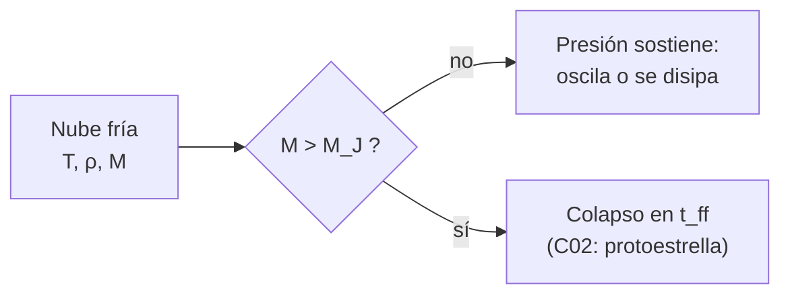

# B24-C01 — Colapso de nubes moleculares

<!-- nav:top -->
[🏠 Programa](../../../../README.md) · [📚 Bloque B24](../../../tronco-comun/B24-fisica-y-evolucion-de-estrellas.md) · [← Anterior: B23-C08 — Informe de verificación y validación](../../B23/B23-C08-informe-de-verificacion-y-validacion/CLASE.md) · [Siguiente: B24-C02 — Formación de protoestrellas →](../B24-C02-formacion-de-protoestrellas/CLASE.md)
<!-- /nav -->

## 1. Ubicación, nivel y alcance

Clase 1 del bloque B24, que abre el área de astrofísica. Nivel N3. Tomas la gravitación ([B05-C10](../../B05/B05-C10-gravitacion-universal/CLASE.md)), los gases ([B05-C14](../../B05/B05-C14-gases-y-presion/CLASE.md)) y las ecuaciones diferenciales ([B11](../../../tronco-comun/B11-ecuaciones-diferenciales-y-simulacion-numerica.md)) para responder una pregunta previa a cualquier estrella: **¿cuándo una masa de gas frío deja de sostenerse y empieza a caer sobre sí misma?** Aquí solo tratas el colapso de una nube idealizada; el objeto que nace del colapso es tema de [C02](../B24-C02-formacion-de-protoestrellas/CLASE.md). La nube se describe como gas isotermo sin rotación, campo magnético ni turbulencia.

## 2. Por qué esta clase existe

Toda estrella es un trozo de gas interestelar que se contrajo. Sin saber cuándo la gravedad vence a la presión no se entiende por qué las estrellas nacen en nubes frías y densas y no en el gas tenue del medio interestelar, ni por qué la masa de las estrellas depende del entorno. La decisión central: **dada la temperatura y la densidad de una nube, ¿su masa supera la masa mínima que puede colapsar y cuánto tarda en hacerlo?**

## 3. Lo que podrás hacer al terminar

1. Definir nube molecular, núcleo denso, velocidad del sonido y criterio de Jeans.
2. Calcular la longitud y la masa de Jeans a partir de la temperatura y la densidad.
3. Calcular el tiempo de caída libre y explicar por qué solo depende de la densidad.
4. Predecir cómo cambian la masa de Jeans y el tiempo de caída al variar `T` y `n`.
5. Comparar la masa de un núcleo con la masa de Jeans y concluir si está sostenido o no.
6. Nombrar qué deja fuera el modelo (turbulencia, campo magnético, rotación).

La evidencia es la **ficha de un núcleo colapsante** del ejercicio 12 (sección 20).

## 4. Con qué llegas y cómo comprobarlo

1. ¿Qué dice la ley de gravitación sobre la fuerza entre dos masas?
2. ¿Qué relación liga presión, densidad y temperatura en un gas ideal?
3. ¿Cuántos metros tiene un parsec (aprox.)?
4. ¿Qué es una ecuación diferencial de segundo orden como `r'' = −GM/r²`?
5. ¿Cómo convertir `cm⁻³` en `m⁻³`?

<details>
<summary>Ver respuestas</summary>

1. Es atractiva y proporcional al producto de las masas e inversa al cuadrado de la distancia. 2. `P = n k T`. 3. `3,0857 × 10¹⁶ m`. 4. Una ecuación que liga la aceleración con la posición; su solución da `r(t)`. 5. Multiplicar por `10⁶`.
</details>

Con cuatro o cinco aciertos, sigue; si no, repasa B05-C10, B05-C14 y B11.

## 5. Un caso real: el núcleo frío de una nube molecular

Las estrellas se forman en el interior de nubes moleculares, regiones frías y densas de gas donde predomina el hidrógeno molecular; la formación estelar se mide en toda la escala, de galaxias enteras a nubes individuales (S3, resumen). Tomaremos como **ejemplo conductor** un núcleo denso con valores **típicos ilustrativos (estimados, no de una nube concreta)**: temperatura `T = 10 K` y densidad numérica de moléculas `n(H₂) = 10⁴ cm⁻³`. Con ellos el laboratorio da una densidad de `4,68 × 10⁻¹⁷ kg/m³`, una velocidad del sonido de `188 m/s`, una masa de Jeans de `2,6 M☉` y un tiempo de caída libre de `0,31 Myr`.

## 6. Vocabulario

Una **nube molecular** es una nube interestelar fría y densa cuyo gas es sobre todo `H₂`. Un **núcleo denso** es la región más densa de una nube, de donde saldrán una o pocas estrellas. La **velocidad del sonido isoterma** `c_s = √(kT/(μ m_H))` es la rapidez con que la presión transmite una perturbación; `k` es la constante de Boltzmann, `μ` la masa media por partícula en unidades de `m_H` y `m_H` la masa del átomo de hidrógeno (aquí `m_H ≈ m_p`). La **longitud de Jeans** `λ_J` es la escala por encima de la cual la gravedad vence a la presión. La **masa de Jeans** `M_J` es la masa contenida en una esfera de diámetro `λ_J`. El **tiempo de caída libre** `t_ff` es lo que tarda una esfera uniforme en colapsar si la presión desaparece. Un gas **isotermo** mantiene la misma temperatura mientras se comprime.

## 7. Modelo mental: una balanza entre presión y gravedad

Piensa en un globo de gas: la presión lo infla, la gravedad lo aprieta. Si lo comprimes un poco, la presión crece y lo devuelve; en una nube suficientemente grande, la gravedad crece más rápido que la presión y la compresión se desboca.



*Descripción textual:* se calcula la masa de Jeans de la nube a partir de su temperatura y densidad; si la masa real la supera, la nube colapsa en un tiempo del orden de `t_ff`; si no, la presión la sostiene.

Analogía: una pelota en lo alto de una colina que solo rueda si se la empuja más allá del borde. Su límite: aquí el «borde» lo fija una masa, no una altura, y una nube real también depende de la turbulencia y del campo magnético, que este modelo omite.

## 8. La explicación, paso a paso

### 8.1 Velocidad del sonido

Una perturbación de presión viaja a `c_s = √(kT/(μ m_H))`. Con `T = 10 K` y `μ = 2,33` (valor típico para gas molecular con helio, ilustrativo) resulta `188 m/s`: un gas frío es «blando».

### 8.2 Longitud y masa de Jeans

Compara el tiempo que tarda el sonido en cruzar una región con el tiempo de caída. Si caer es más rápido que cruzar, la presión no alcanza a responder. Igualando ambos se obtiene

`λ_J = √(π c_s² / (G ρ))`, con `G` la constante de gravitación y `ρ` la densidad.

La masa de Jeans es la de una esfera de diámetro `λ_J`: `M_J = (4π/3) ρ (λ_J/2)³ = π^{5/2} c_s³ / (6 G^{3/2} ρ^{1/2})`. Por tanto `M_J ∝ T^{3/2} ρ^{−1/2}`: nubes más frías y más densas colapsan con menos masa. Con el ejemplo conductor, `λ_J = 0,19 pc` y `M_J = 2,6 M☉`.

### 8.3 Tiempo de caída libre

Una esfera uniforme de densidad `ρ` y radio `r₀`, soltada en reposo, hace caer cada capa bajo la atracción de la masa interior `M`. La conservación de la energía da `v² = 2GM(1/r − 1/r₀)` y el tiempo total es

`t_ff = √(3π / (32 G ρ))`.

Depende solo de la densidad, no de la masa ni del tamaño: una nube del doble de tamaño y la misma densidad cae en el mismo tiempo. Para el ejemplo, `t_ff = 0,31 Myr` (el laboratorio lo comprueba integrando numéricamente). Una consecuencia: `t_ff ∝ ρ^{−1/2}`, así que una región 100 veces más densa colapsa 10 veces más rápido.

### 8.4 El cociente entre tiempos

El tiempo que tarda el sonido en cruzar `λ_J` es `λ_J/c_s = √(π/(Gρ))`, y el cociente con `t_ff` vale `√(32/3) ≈ 3,27` para cualquier densidad. Esto resume el criterio: la caída es unas tres veces más rápida que la respuesta de la presión.

### 8.5 Lo que el modelo deja fuera

La turbulencia, el campo magnético y la rotación añaden soporte o frenan el colapso; la fragmentación divide la nube en varias estrellas. El criterio de Jeans da una **escala de referencia**, no una predicción exacta de la masa de las estrellas.

## 9. Magnitudes, símbolos y unidades

| Símbolo | Qué es | Unidad | Valor / nota |
|---|---|---|---|
| `G` | constante de gravitación | `m³ kg⁻¹ s⁻²` | `6,674 30 × 10⁻¹¹` (S1) |
| `k` | constante de Boltzmann | `J K⁻¹` | `1,380 649 × 10⁻²³`, exacta (S1) |
| `m_p` | masa del protón | kg | `1,672 62 × 10⁻²⁷` (S1) |
| `GM☉` | parámetro de masa solar | `m³ s⁻²` | `1,327 124 4 × 10²⁰` (S2) |
| `T`, `ρ`, `n` | temperatura, densidad, densidad numérica | K; `kg m⁻³`; `cm⁻³` | ejemplo: 10; `4,68 × 10⁻¹⁷`; `10⁴` |
| `c_s`, `λ_J`, `M_J`, `t_ff` | sonido, longitud, masa de Jeans, caída libre | `m s⁻¹`; pc; `M☉`; Myr | `188`; `0,19`; `2,6`; `0,31` |

## 10. Convenciones y referencias

Gas isotermo e ideal; `μ = 2,33` por partícula y `2,8 m_H` por molécula de `H₂` (con helio), ambos **valores típicos ilustrativos**. `M☉ = GM☉/G`. `1 pc = 3,0857 × 10¹⁶ m`; `1 Myr = 3,15576 × 10¹³ s`. Los valores de la nube son **estimados ilustrativos**, no observados.

## 11. De dónde sale lo que afirmamos

| ID | Fuente | Localizador | Respalda | Estado |
|---|---|---|---|---|
| S1 | NIST, *Fundamental Physical Constants — Complete Listing* (CODATA 2022) | https://physics.nist.gov/cuu/Constants/Table/allascii.txt | `G`, `k`, `m_p` | Consultada el 2026-11-09 |
| S2 | Mamajek et al., *IAU 2015 Resolution B3*, arXiv:1510.07674 | https://arxiv.org/abs/1510.07674 | `GM☉` nominal | Texto del PDF extraído el 2026-11-09 |
| S3 | Kennicutt y Evans, *Star Formation in the Milky Way and Nearby Galaxies*, arXiv:1204.3552 | https://arxiv.org/abs/1204.3552 | La formación estelar se estudia de galaxias a nubes | Solo resumen, consultado el 2026-11-09 |

Límites: de S3 solo se leyó el resumen; `T`, `n`, `μ` son ilustrativos y no tienen fuente; las fórmulas de Jeans y de caída libre son resultados estándar que aquí se verifican numéricamente, no se citan de un texto.

## 12. Cómo ver el colapso

Equivalente accesible a una gráfica de `M_J` contra densidad (misma `T = 10 K`):

| `n(H₂)` (`cm⁻³`) | `M_J` (`M☉`) | `t_ff` (Myr) |
|---|---|---|
| `10²` | 26 | 3,1 |
| `10⁴` | 2,6 | 0,31 |
| `10⁶` | 0,26 | 0,031 |

Descripción larga: al subir la densidad cien veces, la masa de Jeans cae diez veces y el tiempo de caída también.

## 13. Ejemplo trabajado: ¿puede colapsar un núcleo de 5 M☉?

**Paso 1 · Datos.** `T = 10 K`, `n = 10⁴ cm⁻³`, `M = 5 M☉` (ilustrativos).

**Paso 2 · Masa de Jeans.** `M_J = 2,6 M☉` (8.2).

**Paso 3 · Comparación.** `M = 5 > M_J = 2,6`: la presión no lo sostiene.

**Paso 4 · Tiempo.** `t_ff = 0,31 Myr` (8.3).

**Paso 5 · Sentido.** Según el modelo, el núcleo colapsa en unos `3 × 10⁵` años, muy breve frente a la vida de una estrella. Pero un núcleo real sostenido por turbulencia o campo podría resistir más; el resultado es una cota, no una predicción.

## 14. Distintos criterios de estabilidad

**Jeans (esta clase):** simple, gas uniforme sin contorno. **Bonnor–Ebert:** esfera isoterma con presión externa; da una masa crítica algo menor, pero exige resolver una ecuación diferencial. **Virial con turbulencia y campo:** más realista y más complejo. Para una primera estimación sirve Jeans; para un núcleo concreto hay que medir velocidades y campo.

## 15. Práctica guiada

**Ejercicio 1 · con los pasos indicados.** Calcula `c_s` para `T = 10 K` y `μ = 2,33`. *Pasos:* `kT = 1,3806 × 10⁻²²`; `μ m_H = 3,897 × 10⁻²⁷`; divide y saca la raíz.

<details><summary>Solución comentada</summary>

`kT/(μm_H) = 3,543 × 10⁴ m²/s²` y `c_s = 188,2 m/s` (8.1).
</details>

**Ejercicio 2 · con una pista.** Convierte `n(H₂) = 10⁴ cm⁻³` a densidad `ρ` con `2,8 m_H` por molécula. *Pista:* pasa a `m⁻³`.

<details><summary>Solución comentada</summary>

`10¹⁰ m⁻³ × 2,8 × 1,6726 × 10⁻²⁷ = 4,68 × 10⁻¹⁷ kg/m³`.
</details>

**Ejercicio 3 · casi autónomo.** Calcula `t_ff` para esa densidad en Myr.

<details><summary>Solución comentada</summary>

`3π/(32 G ρ) = 9,42 × 10²⁵ s²`; raíz `9,7 × 10¹² s`; entre `3,156 × 10¹³` da `0,31 Myr` (8.3).
</details>

## 16. Práctica autónoma, transferencia e integrador

**Ejercicio 4.** Si la temperatura sube de 10 a 20 K con la misma densidad, ¿cómo cambia `M_J`?

<details><summary>Solución comentada</summary>

`M_J ∝ T^{3/2}`: crece `2^{3/2} = 2,83` veces, a `7,4 M☉` (8.2).
</details>

**Ejercicio 5.** La densidad sube a `n = 10⁶ cm⁻³`. ¿Cuánto valen `M_J` y `t_ff`?

<details><summary>Solución comentada</summary>

Cien veces más densidad: `M_J` baja diez veces, a `0,26 M☉`; `t_ff`, también, a `0,031 Myr` (sección 12).
</details>

**Ejercicio 6.** Un núcleo de `2 M☉` mide `0,1 pc` de radio a `10 K`. ¿Está por encima de Jeans?

<details><summary>Solución comentada</summary>

Su densidad es `2 × 1,989 × 10³⁰/(4,19 × (3,086 × 10¹⁵)³) = 3,2 × 10⁻¹⁷ kg/m³`; `M_J = 2,6 × √(4,68/3,2) = 3,1 M☉`. Como `2 < 3,1`, no colapsa por Jeans (8.2).
</details>

**Ejercicio 7.** Explica por qué `t_ff` no depende de la masa de la nube.

<details><summary>Solución comentada</summary>

La atracción sobre una capa crece con la masa interior, pero también la distancia que debe recorrer; ambos efectos se compensan y solo queda la densidad (8.3).
</details>

**Ejercicio 8.** Calcula el cociente entre el tiempo de cruce del sonido por `λ_J` y `t_ff`.

<details><summary>Solución comentada</summary>

`√(π/(Gρ)) / √(3π/(32Gρ)) = √(32/3) = 3,27` para cualquier densidad (8.4).
</details>

**Ejercicio 9 · transferencia.** Una nube difusa tiene `T = 30 K` y `n = 10³ cm⁻³`. ¿Cuál es `M_J`?

<details><summary>Solución comentada</summary>

Relativo al ejemplo: `3^{3/2} × (0,1)^{−1/2} = 5,196 × 3,162 = 16,4`, luego `M_J = 43 M☉`. Una nube tibia y poco densa necesita mucha masa para colapsar.
</details>

**Ejercicio 10 · transferencia.** Un compañero dice: «una nube de 1 M☉ a 10 K y `10⁴ cm⁻³` colapsa porque la gravedad siempre gana». Respóndele.

<details><summary>Solución comentada</summary>

`1 < M_J = 2,6 M☉`: la presión sostiene la nube; la gravedad solo gana por encima de `M_J` (8.2). Haría falta comprimirla o sumarle masa.
</details>

**Ejercicio 11 · transferencia.** Una nube de `10⁵ M☉` con `n = 100 cm⁻³` colapsara toda en un `t_ff`. ¿Qué «tasa de formación» daría y qué te dice sobre la realidad?

<details><summary>Solución comentada</summary>

`t_ff = 0,31 × √(10⁴/100) = 3,1 Myr`; la tasa sería `10⁵/3,1 × 10⁶ = 0,032 M☉/año` solo para esa nube. Si todas las nubes lo hicieran, la tasa sería muy superior a lo observado; luego solo una pequeña fracción del gas colapsa por `t_ff`: la turbulencia y el campo frenan el proceso. (Aquí no se cita una tasa observada: S3 solo se leyó en resumen.)
</details>

**Ejercicio 12 · integrador.** Elabora tu *ficha de un núcleo colapsante*: elige `T`, `n` y `M` (ilustrativos), calcula `c_s`, `ρ`, `λ_J`, `M_J` y `t_ff`, decide si colapsa, indica cómo cambia el resultado si `T` sube al doble y qué dos efectos reales faltan.

<details><summary>Solución modelo</summary>

Para `T = 10 K`, `n = 10⁴`, `M = 5 M☉`: `188 m/s`, `4,68 × 10⁻¹⁷`, `0,19 pc`, `2,6 M☉`, `0,31 Myr`; colapsa (`5 > 2,6`). Con `T = 20 K`, `M_J = 7,4 M☉` y ya no colapsa. Faltan turbulencia y campo magnético; rotulado como ilustrativo.
</details>

## 17. Laboratorio: Jeans y caída libre

El script [colapso_nube.py](colapso_nube.py) calcula `c_s`, `λ_J`, `M_J` y `t_ff`, y **comprueba** que `M_J` coincide con su forma cerrada `π^{5/2}c_s³/(6G^{3/2}ρ^{1/2})` (tolerancia `10⁻⁹`), que la cuadratura numérica del tiempo de caída coincide con `√(3π/(32Gρ))` (tolerancia `10⁻⁶`) y que `M_J` escala como `T^{3/2}` y `ρ^{−1/2}`.

**Datos:** `G`, `k`, `m_p` de NIST (CODATA 2022); `GM☉` de la IAU; nube **ilustrativa**. **Predice antes de ejecutar:** ¿qué pasa con `M_J` si `T` se duplica? (crece 2,83 veces.) **Ejecución del 2026-11-09 (Python 3.12.9):**

```text
Python 3.12.9 (biblioteca estandar)
T = 10 K, n(H2) = 1e+04 cm^-3 -> rho = 4.683e-17 kg/m^3
c_s = 188.2 m/s ; lambda_J = 0.193 pc ; M_J = 2.62 Msol
t_ff = 0.308 Myr ; por cuadratura = 0.308 Myr
M_J(2T)/M_J(T) = 2.8284 (2^1.5 = 2.8284) ; M_J(4 rho)/M_J = 0.5000
Pruebas superadas.
```

```bash
python programa/clases/B24/B24-C01-colapso-de-nubes-moleculares/colapso_nube.py
```

**Límites:** sin presión durante la caída, sin turbulencia, campo, rotación ni fragmentación; los parámetros de la nube son ilustrativos.

## 18. Errores frecuentes y cómo corregirlos

**Creer que `t_ff` depende de la masa.** Se corrige con el ejercicio 7.

**Decir que cualquier nube colapsa.** Se corrige con los ejercicios 6 y 10.

**Mezclar `n` de moléculas con `n` de partículas.** Se corrige con el ejercicio 2 y la sección 10.

**Olvidar el exponente de la temperatura.** Se corrige con el ejercicio 4.

**Tomar `M_J` como la masa de la estrella resultante.** Se corrige con la sección 8.5.

## 19. Cómo sabrás que vas bien

Tras 8.2: ¿sabes decir cómo cambia `M_J` con `T` y `n`? Si no, ejercicios 4 y 5. Tras 8.3: ¿por qué `t_ff` no usa la masa? Ejercicio 7. Tras el laboratorio: ¿qué comprueba la cuadratura? (que la integral de la energía reproduce la forma cerrada).

## 20. Qué entregas y cómo se evalúa

El producto es tu **ficha de un núcleo colapsante** (ejercicio 12).

| Criterio | Inicial | En desarrollo | Logrado | Destacado |
|---|---|---|---|---|
| Definiciones | Las confunde | Parciales | Jeans y caída libre | Distingue ambos tiempos |
| Cálculo | Sin unidades | Con errores | Valores y unidades correctos | Escalas con `T` y `n` |
| Decisión | Sin comparar | Sin razón | `M` frente a `M_J` | Discute turbulencia y campo |
| Numérico | Sin comprobar | Un caso | Dos pruebas superadas | Explica la cuadratura |
| Fuentes | Sin fuente | Sin fecha | S1–S3 con fecha | Rotula lo ilustrativo |

**Condiciones críticas (no se compensan con promedio):** rotular `T`, `n`, `μ` como ilustrativos; no presentar `M_J` como la masa final de la estrella; citar solo fuentes consultadas y decir que S3 es solo resumen.

## 21. Ética, seguridad y límites

La clase es educativa: no da la masa de ninguna estrella real ni sustituye un análisis con datos de una nube observada. Accesibilidad: tablas equivalentes a las gráficas, fórmulas en texto, ejercicios sin conexión.

## 22. Para cerrar y seguir

Una nube colapsa cuando su masa supera la de Jeans, que crece con `T^{3/2}` y cae con `ρ^{−1/2}`, y lo hace en un tiempo `t_ff = √(3π/(32Gρ))` que depende solo de la densidad. Queda una pregunta: ¿qué sucede cuando el centro, ya denso, deja de dejar escapar su calor?

**Glosario español–inglés.** nube molecular · *molecular cloud*; núcleo denso · *dense core*; longitud de Jeans · *Jeans length*; masa de Jeans · *Jeans mass*; tiempo de caída libre · *free-fall time*; velocidad del sonido · *sound speed*; isotermo · *isothermal*.

**Continuidad.** [B24-C02](../B24-C02-formacion-de-protoestrellas/CLASE.md) reutiliza `t_ff` y la energía gravitatoria para estudiar cuándo el colapso se frena en el centro.

**Referencias:** ver sección 11.

<!-- nav:bottom -->
---

[← Anterior: B23-C08 — Informe de verificación y validación](../../B23/B23-C08-informe-de-verificacion-y-validacion/CLASE.md) · [📚 Bloque B24](../../../tronco-comun/B24-fisica-y-evolucion-de-estrellas.md) · [Siguiente: B24-C02 — Formación de protoestrellas →](../B24-C02-formacion-de-protoestrellas/CLASE.md)
<!-- /nav -->
