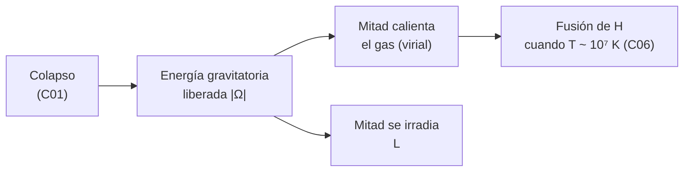

# B24-C02 — Formación de protoestrellas

<!-- nav:top -->
[🏠 Programa](../../../../README.md) · [📚 Bloque B24](../../../tronco-comun/B24-fisica-y-evolucion-de-estrellas.md) · [← Anterior: B24-C01 — Colapso de nubes moleculares](../B24-C01-colapso-de-nubes-moleculares/CLASE.md) · [Siguiente: B24-C03 — Diagrama de Hertzsprung-Russell →](../B24-C03-diagrama-de-hertzsprung-russell/CLASE.md)
<!-- /nav -->

## 1. Ubicación, nivel y alcance

Clase 2 del bloque B24. Nivel N3. En [C01](../B24-C01-colapso-de-nubes-moleculares/CLASE.md) viste cuándo un núcleo frío colapsa. Aquí sigues lo que ocurre en el centro: el gas se calienta, el colapso se frena y nace una **protoestrella**, un objeto que brilla por contracción y acreción, todavía sin fusión de hidrógeno. Necesitas energía y trabajo ([B05-C06](../../B05/B05-C06-trabajo-y-energia/CLASE.md)) y gases ([B05-C14](../../B05/B05-C14-gases-y-presion/CLASE.md)). Se modela una esfera uniforme sin rotación; el disco y los chorros quedan fuera.

## 2. Por qué esta clase existe

Una protoestrella brilla, pero no por el motor que alimenta al Sol. Para saber de dónde sale su energía, cuánto tiempo puede brillar así y cómo distinguirla de una estrella ya estable hay que seguir la energía gravitatoria. La decisión central: **dada la masa y el radio de un objeto que se contrae, ¿cuánta energía libera, durante cuánto tiempo puede brillar con ella y cuál es la luminosidad si además acreta gas?**

## 3. Lo que podrás hacer al terminar

1. Definir protoestrella, energía gravitatoria, teorema del virial y tiempo de Kelvin–Helmholtz.
2. Calcular la energía gravitatoria de una esfera uniforme.
3. Aplicar el virial para estimar la temperatura media y la fracción de energía irradiada.
4. Calcular el tiempo de Kelvin–Helmholtz de una estrella.
5. Calcular la luminosidad de acreción `G M Ṁ / R`.
6. Explicar por qué una protoestrella no se alimenta aún de fusión de hidrógeno.

La evidencia es la **ficha energética de una protoestrella** del ejercicio 12 (sección 20).

## 4. Con qué llegas y cómo comprobarlo

1. ¿Qué es la energía potencial gravitatoria de dos masas?
2. ¿Cómo se relaciona la energía cinética media con la temperatura de un gas?
3. ¿Qué mide una luminosidad y en qué unidad?
4. ¿Cuánto vale un año en segundos?
5. ¿Qué es una suma de capas esféricas de masa `dm`?

<details>
<summary>Ver respuestas</summary>

1. `−G m₁ m₂ / r`. 2. `(3/2) k T` por partícula. 3. Energía emitida por unidad de tiempo; vatios. 4. `3,15576 × 10⁷ s`. 5. Cada capa aporta `4π r² ρ dr` de masa; se suman los aportes.
</details>

## 5. Un caso real: ¿cuánto puede brillar el Sol solo contrayéndose?

Con los valores nominales de la IAU (S2): `GM☉ = 1,327 124 4 × 10²⁰ m³/s²`, `R☉ = 6,957 × 10⁸ m` y `L☉ = 3,828 × 10²⁶ W`. Es el **ejemplo conductor**: la energía gravitatoria de una esfera uniforme del tamaño del Sol es `2,28 × 10⁴¹ J`; si la mitad se irradia a la luminosidad solar, el Sol brillaría solo unos `9,4 Myr`. Los grupos de estrellas jóvenes anteriores a la secuencia principal que estudian Pecaut y Mamajek tienen entre 5 y 30 millones de años (S3, resumen): el orden de magnitud de `t_KH` no es casual.

## 6. Vocabulario

Una **protoestrella** es un objeto central del colapso que aún no obtiene su energía de la fusión de hidrógeno y brilla por contracción y acreción. La **energía gravitatoria** `Ω` es la energía que hay que aportar para dispersar la masa hasta el infinito; es negativa. El **teorema del virial** dice que, para un gas en equilibrio, `2K + Ω = 0`, con `K` la energía térmica total. El **tiempo de Kelvin–Helmholtz** `t_KH` es cuánto brillaría el objeto con la mitad de `|Ω|` a su luminosidad `L`. La **acreción** es la caída de gas sobre el objeto, a un ritmo `Ṁ` (masa por tiempo). La **luminosidad de acreción** `L_acc` es la energía de caída que se irradia. Un objeto **pre-secuencia principal** es una estrella joven que aún se contrae hacia el equilibrio.

## 7. Modelo mental: un resorte que se comprime

Al contraerse, el gas pierde energía gravitatoria; la mitad calienta el gas (la presión crece) y la otra mitad se irradia. Como un resorte que al comprimirse se calienta, el objeto se vuelve más caliente al encoger.



*Descripción textual:* al contraerse, la energía gravitatoria liberada se reparte: una mitad aumenta la temperatura del gas y la otra sale como luz; si la temperatura central alcanza el umbral de la fusión de hidrógeno, el objeto pasa a la secuencia principal.

Analogía: calentarse al comprimir una bomba de bicicleta. Límite: en una estrella el reparto 50–50 vale solo para un gas ideal en equilibrio y varía si hay ionización, rotación o campos.

## 8. La explicación, paso a paso

### 8.1 Energía gravitatoria de una esfera uniforme

Se arma la esfera añadiendo capas: traer una capa de masa `dm` desde el infinito hasta el radio `r`, donde la masa interior es `m = (4π/3) ρ r³`, libera `G m dm / r`. Sumando de `0` a `R` con densidad `ρ` uniforme resulta `Ω = −(3/5) G M² / R`. Para el Sol: `|Ω| = 2,28 × 10⁴¹ J`. En una estrella real la masa está más concentrada hacia el centro y `|Ω|` es mayor.

### 8.2 Virial y temperatura media

Si `K = (3/2) N k T̄` es la energía térmica de `N = M/(μ m_p)` partículas, `2K + Ω = 0` da `T̄ = G M μ m_p / (5 k R)`. Con `μ = 0,6` (gas ionizado de composición solar, estimado) y los valores solares, `T̄ = 2,8 × 10⁶ K`. El modelo de la NASA da una temperatura central de `1,571 × 10⁷ K` (S4, modelo), unas 5,7 veces mayor: la media sobre la masa es menor que la central, como es de esperar.

### 8.3 Tiempo de Kelvin–Helmholtz

Si solo la mitad de `|Ω|` se irradia a luminosidad constante `L`, `t_KH = |Ω| / (2L)`. Para el Sol resulta `9,4 Myr` en la esfera uniforme (unas pocas veces más con la estructura real). Es lo que dura una estrella que solo se contrae, mucho más que `t_ff` (C01): la protoestrella se queda mucho tiempo en la fase de contracción.

### 8.4 Acreción

Cuando cae gas a un ritmo `Ṁ` sobre un objeto de masa `M` y radio `R`, la energía de caída por unidad de tiempo es `L_acc = G M Ṁ / R`. Para `M = 0,5 M☉`, `R = 2 R☉` y `Ṁ = 10⁻⁶ M☉/año` (valores ilustrativos) se obtiene `7,9 L☉`. Un ritmo natural de acreción es del orden de `c_s³/G` (estimación de orden de magnitud con el `c_s` de C01): para `10 K` da `1,6 × 10⁻⁶ M☉/año`.

### 8.5 Por qué todavía no hay fusión

La fusión de hidrógeno necesita temperaturas centrales del orden de `10⁷ K` (se estudia en C06). Hasta alcanzarlas, la fuente de energía es gravitatoria. Una estrella joven observada ya puede ser más fría que una enana de la secuencia principal del mismo tipo espectral: las estrellas pre-secuencia principal de tipos G5 a K6 resultan unos `250 K` más frías que las enanas (S3, resumen).

## 9. Magnitudes, símbolos y unidades

| Símbolo | Qué es | Unidad | Valor / nota |
|---|---|---|---|
| `Ω` | energía gravitatoria | J | `−2,28 × 10⁴¹` (Sol, uniforme) |
| `T̄`, `μ` | temperatura media; masa media por partícula | K; — | `2,8 × 10⁶`; `0,6` |
| `t_KH` | tiempo de Kelvin–Helmholtz | Myr | `9,4` (Sol, uniforme) |
| `Ṁ` | ritmo de acreción | `M☉/año` | `10⁻⁶` (ilustrativo) |
| `L_acc` | luminosidad de acreción | `L☉` | `7,9` |
| `GM☉`, `R☉`, `L☉` | valores nominales solares | `m³ s⁻²`; m; W | `1,327 124 4 × 10²⁰`; `6,957 × 10⁸`; `3,828 × 10²⁶` (S2) |

## 10. Convenciones y referencias

Esfera uniforme, sin rotación ni campo. `M☉ = GM☉/G` con `G` de NIST (S1). Valores de la protoestrella de ejemplo: **ilustrativos (estimados)**. La temperatura central del Sol es un valor de **modelo**, no medido.

## 11. De dónde sale lo que afirmamos

| ID | Fuente | Localizador | Respalda | Estado |
|---|---|---|---|---|
| S1 | NIST, *Fundamental Physical Constants — Complete Listing* (CODATA 2022) | https://physics.nist.gov/cuu/Constants/Table/allascii.txt | `G`, `k`, `m_p` | Consultada el 2026-11-09 |
| S2 | Mamajek et al., *IAU 2015 Resolution B3*, arXiv:1510.07674 | https://arxiv.org/abs/1510.07674 | `R☉`, `L☉`, `GM☉` nominales | Texto del PDF extraído el 2026-11-09 |
| S3 | Pecaut y Mamajek, *Intrinsic Colors, Temperatures, and Bolometric Corrections of Pre-Main Sequence Stars*, arXiv:1307.2657 | https://arxiv.org/abs/1307.2657 | Edad 5–30 Myr de los grupos jóvenes; pre-secuencia G5–K6 ~250 K más fría | Solo resumen, consultado el 2026-11-09 |
| S4 | NASA/NSSDC, *Sun Fact Sheet* (actualizada 2024-05-09) | https://nssdc.gsfc.nasa.gov/planetary/factsheet/sunfact.html | `T` central del modelo solar | Consultada el 2026-11-09 |

Límites: S3 solo resumen; `Ṁ`, `μ`, `M`, `R` de la protoestrella son ilustrativos; el teorema del virial y `Ω = −3/5 GM²/R` se verifican numéricamente en el laboratorio.

## 12. Cómo ver la energía

| Magnitud (Sol, esfera uniforme) | Valor |
|---|---|
| `|Ω|` | `2,28 × 10⁴¹ J` |
| Energía irradiada (mitad) | `1,14 × 10⁴¹ J` |
| `L☉` | `3,828 × 10²⁶ W` |
| `t_KH` | `9,4 Myr` |

Descripción larga: la energía de contracción alcanza para millones de años, no para miles de millones.

## 13. Ejemplo trabajado: ¿cuánto brilla una protoestrella que acreta?

**Paso 1 · Datos.** `M = 0,5 M☉`, `R = 2 R☉`, `Ṁ = 10⁻⁶ M☉/año` (ilustrativos).

**Paso 2 · Fórmula.** `L_acc = G M Ṁ / R` (8.4).

**Paso 3 · Cálculo.** `GM = 0,5 × 1,327 × 10²⁰ = 6,64 × 10¹⁹`; `Ṁ = 6,3 × 10¹⁶ kg/s`; `R = 1,39 × 10⁹ m`; `L_acc = 3,0 × 10²⁷ W = 7,9 L☉`.

**Paso 4 · Sentido.** Por acreción la protoestrella puede ser casi ocho veces más luminosa que el Sol aunque no fusione nada. Es un orden de magnitud, no un valor medido.

## 14. Distintas formas de estimar la energía

**Esfera uniforme:** analítica, sirve de cota. **Politropo o modelo con estructura (C20):** más realista. **Simulación hidrodinámica:** incluye disco y rotación, exige cómputo. Se empieza por la uniforme para fijar el orden de magnitud.

## 15. Práctica guiada

**Ejercicio 1 · con los pasos indicados.** Calcula `|Ω|` del Sol. *Pasos:* `G M² = (GM)²/G`; multiplica por `0,6` y divide por `R`.

<details><summary>Solución comentada</summary>

`(1,3271244 × 10²⁰)² / 6,6743 × 10⁻¹¹ = 2,639 × 10⁵⁰`; `× 0,6 / 6,957 × 10⁸ = 2,28 × 10⁴¹ J` (8.1).
</details>

**Ejercicio 2 · con una pista.** Calcula `t_KH` del Sol. *Pista:* `|Ω|/(2L)` y pasa a Myr.

<details><summary>Solución comentada</summary>

`2,276 × 10⁴¹ / (2 × 3,828 × 10²⁶) = 2,97 × 10¹⁴ s`; entre `3,156 × 10⁷` da `9,4 Myr` (8.3).
</details>

**Ejercicio 3 · casi autónomo.** Calcula `L_acc` para `M = 0,5 M☉`, `R = 2 R☉`, `Ṁ = 10⁻⁶ M☉/año`.

<details><summary>Solución comentada</summary>

`7,9 L☉` (8.4, 13).
</details>

## 16. Práctica autónoma, transferencia e integrador

**Ejercicio 4.** ¿Por qué solo la mitad de `|Ω|` se irradia?

<details><summary>Solución comentada</summary>

Por el virial `2K + Ω = 0`: la otra mitad queda en la energía térmica del gas, que sube la temperatura (8.2).
</details>

**Ejercicio 5.** Si la luminosidad fuera diez veces mayor, ¿cuánto sería `t_KH`?

<details><summary>Solución comentada</summary>

`t_KH ∝ 1/L`: `0,94 Myr` (8.3).
</details>

**Ejercicio 6.** El ritmo `c_s³/G` a `20 K`, ¿cuánto vale?

<details><summary>Solución comentada</summary>

`c_s ∝ T^{1/2}`, luego `c_s³ ∝ T^{3/2}`: `2^{3/2} = 2,83` veces `1,6 × 10⁻⁶`, es decir `4,5 × 10⁻⁶ M☉/año` (8.4).
</details>

**Ejercicio 7.** A `1,6 × 10⁻⁶ M☉/año`, ¿cuánto tarda en acretarse `0,5 M☉`?

<details><summary>Solución comentada</summary>

`0,5 / 1,6 × 10⁻⁶ = 3,1 × 10⁵ años`, del orden de `t_ff = 0,31 Myr` de C01.
</details>

**Ejercicio 8.** Compara `t_KH = 9,4 Myr` con `t_ff = 0,31 Myr`.

<details><summary>Solución comentada</summary>

`9,4/0,31 ≈ 30`: tras el colapso, la contracción dura unas treinta veces más; la fase protoestelar es larga (8.3).
</details>

**Ejercicio 9 · transferencia.** Si esa protoestrella irradia `7,9 L☉` desde `2 R☉`, ¿qué `T_ef` tendría? Usa `L ∝ R² T⁴` con `T☉ = 5772 K`.

<details><summary>Solución comentada</summary>

`T = 5772 × (7,9/4)^{1/4} = 5772 × 1,185 ≈ 6840 K`. Es una estimación de la superficie si toda la luminosidad saliera de ella.
</details>

**Ejercicio 10 · transferencia.** Un compañero dice que las protoestrellas brillan por fusión de hidrógeno. Respóndele.

<details><summary>Solución comentada</summary>

La temperatura virial media es `2,8 × 10⁶ K` para el Sol; la fusión exige del orden de `10⁷ K` en el centro (C06). Mientras se contrae, la fuente es gravitatoria (8.5).
</details>

**Ejercicio 11 · transferencia.** Si una estrella joven de tipo K3 se clasifica con la escala de temperaturas de enanas, ¿qué sesgo se espera? Apóyate en 8.5.

<details><summary>Solución comentada</summary>

Se sobrestima la temperatura en unos `250 K` (S3); a radio fijo y `T ≈ 4500 K`, `L ∝ T⁴` quedaría sobrestimada en `≈ 4 × 250/4500 ≈ 22 %`.
</details>

**Ejercicio 12 · integrador.** Elabora tu *ficha energética de una protoestrella*: elige `M`, `R` y `Ṁ` (ilustrativos), calcula `|Ω|`, `T̄`, `t_KH` y `L_acc`, contrasta con `t_ff` de C01 y nombra tres elementos que el modelo omite.

<details><summary>Solución modelo</summary>

Con `M = 1 M☉`, `R = 2 R☉`: `|Ω| = 1,1 × 10⁴¹ J`, `T̄ = 1,4 × 10⁶ K`; el resto sigue 8.3–8.4. Omite rotación, disco, campo magnético; todo rotulado como ilustrativo.
</details>

## 17. Laboratorio: energía de contracción

El script [protoestrella.py](protoestrella.py) suma capas esféricas para obtener `Ω`, **comprueba** que coincide con `−(3/5)GM²/R` (tolerancia `10⁻⁴`) y que el virial `3NkT̄ = |Ω|` se cumple con la `T̄` calculada, y calcula `t_KH`, `L_acc` y el ritmo `c_s³/G`.

**Datos:** `G`, `k`, `m_p` (NIST); valores nominales solares (IAU); protoestrella **ilustrativa**. **Predice antes de ejecutar:** ¿`t_KH` del Sol será de miles de años, millones o miles de millones? (millones.) **Ejecución del 2026-11-09 (Python 3.12.9):**

```text
Python 3.12.9 (biblioteca estandar)
|Omega| uniforme (Sol) = 2.276e+41 J ; por capas = 2.276e+41 J
T virial medio (Sol, mu=0.6) = 2.773e+06 K
t_KH (Sol, esfera uniforme) = 9.42 Myr
L_acc (0.5 Msol, 2 Rsol, 1e-6 Msol/yr) = 7.85 Lsol
Mdot ~ c_s^3/G (10 K) = 1.59e-06 Msol/yr
Pruebas superadas.
```

```bash
python programa/clases/B24/B24-C02-formacion-de-protoestrellas/protoestrella.py
```

**Límites:** densidad uniforme (la real es más concentrada); sin rotación, disco ni ionización.

## 18. Errores frecuentes y cómo corregirlos

**Pensar que toda la energía gravitatoria sale como luz.** Se corrige con el ejercicio 4.

**Confundir `t_KH` con la vida de la estrella.** Se corrige con el ejercicio 8 y la sección 8.5.

**Olvidar que `Ω` es negativa.** Se corrige con el ejercicio 1.

**Pensar que acreción y fusión son lo mismo.** Se corrige con el ejercicio 10.

**Usar escalas de enanas para estrellas jóvenes.** Se corrige con el ejercicio 11.

## 19. Cómo sabrás que vas bien

Tras 8.1: ¿cuánto vale `|Ω|` del Sol? Si dudas, ejercicio 1. Tras 8.3: ¿por qué `t_KH` es de millones de años? Ejercicio 2. Tras el laboratorio: ¿qué comprueba la suma por capas? (la fórmula cerrada de `Ω`).

## 20. Qué entregas y cómo se evalúa

El producto es tu **ficha energética de una protoestrella** (ejercicio 12).

| Criterio | Inicial | En desarrollo | Logrado | Destacado |
|---|---|---|---|---|
| Conceptos | Los confunde | Parciales | Virial, `Ω`, `t_KH` | Distingue contracción y acreción |
| Cálculo | Sin unidades | Con errores | Valores y unidades correctos | Escalas con `L` y `Ṁ` |
| Numérico | Sin comprobar | Un caso | Capas y virial verificados | Explica la cota de la esfera uniforme |
| Fuentes | Sin fuente | Sin fecha | S1–S4 con fecha | Rotula lo ilustrativo |
| Límites | No los nombra | Uno | Tres omisiones | Discute disco y rotación |

**Condiciones críticas (no se compensan con promedio):** no presentar la esfera uniforme como estructura real; rotular lo ilustrativo; citar solo fuentes consultadas y decir que S3 es solo resumen.

## 21. Ética, seguridad y límites

Clase educativa: no sustituye los modelos de formación estelar con disco, rotación y campo. Accesibilidad: tablas equivalentes a las gráficas, fórmulas en texto, ejercicios sin conexión.

## 22. Para cerrar y seguir

Una protoestrella brilla por la energía que libera al contraerse y al acretar; el virial reparte esa energía entre calor y luz, y el Sol tardó millones de años en la fase de contracción. Queda una pregunta: ¿cómo se ubican en un diagrama las estrellas jóvenes, las estables y las evolucionadas?

**Glosario español–inglés.** protoestrella · *protostar*; energía gravitatoria · *gravitational energy*; teorema del virial · *virial theorem*; tiempo de Kelvin–Helmholtz · *Kelvin–Helmholtz time*; acreción · *accretion*; pre-secuencia principal · *pre-main sequence*.

**Continuidad.** [B24-C03](../B24-C03-diagrama-de-hertzsprung-russell/CLASE.md) reutiliza `L = 4πR²σT⁴` para situar objetos jóvenes y evolucionados en un mismo diagrama.

**Referencias:** ver sección 11.

<!-- nav:bottom -->
---

[← Anterior: B24-C01 — Colapso de nubes moleculares](../B24-C01-colapso-de-nubes-moleculares/CLASE.md) · [📚 Bloque B24](../../../tronco-comun/B24-fisica-y-evolucion-de-estrellas.md) · [Siguiente: B24-C03 — Diagrama de Hertzsprung-Russell →](../B24-C03-diagrama-de-hertzsprung-russell/CLASE.md)
<!-- /nav -->
