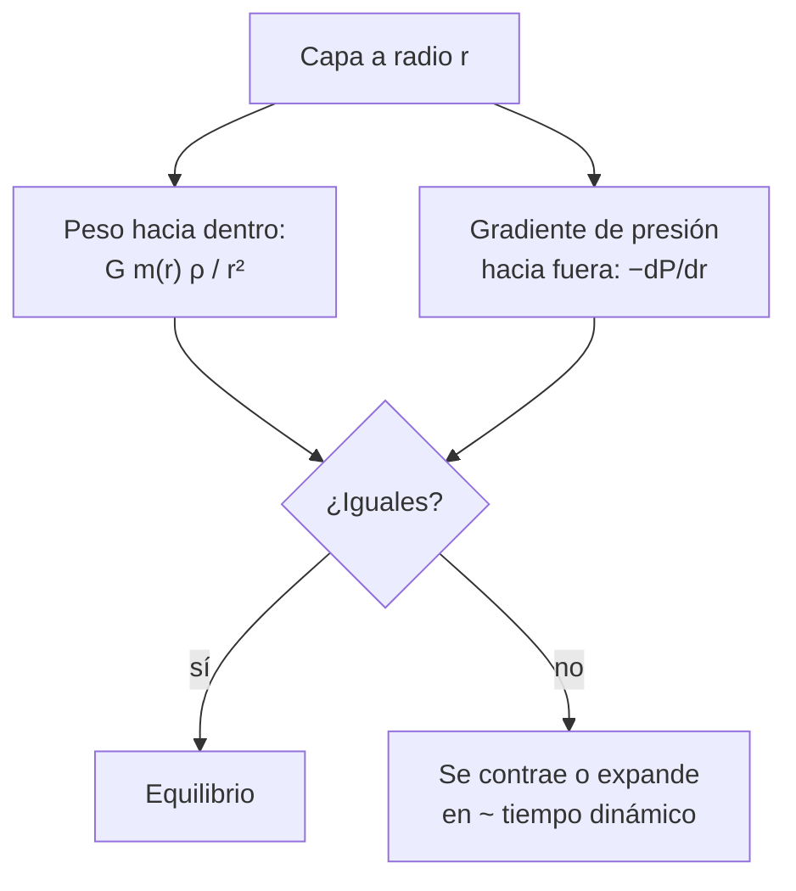

# B24-C04 — Equilibrio hidrostático estelar

<!-- nav:top -->
[🏠 Programa](../../../../README.md) · [📚 Bloque B24](../../../tronco-comun/B24-fisica-y-evolucion-de-estrellas.md) · [← Anterior: B24-C03 — Diagrama de Hertzsprung-Russell](../B24-C03-diagrama-de-hertzsprung-russell/CLASE.md) · [Siguiente: B24-C05 — Transporte radiativo y convectivo →](../B24-C05-transporte-radiativo-y-convectivo/CLASE.md)
<!-- /nav -->

## 1. Ubicación, nivel y alcance

Clase 4 del bloque B24. Nivel N3. Aplicas la segunda ley de Newton ([B05-C04](../../B05/B05-C04-leyes-del-movimiento-de-newton/CLASE.md)), la presión de un gas ([B05-C14](../../B05/B05-C14-gases-y-presion/CLASE.md)) y la integración numérica ([B11-C07](../../B11/B11-C07-runge-kutta-de-cuarto-orden/CLASE.md)) para entender por qué una estrella no colapsa ni se expande. Es la primera ecuación de la estructura estelar; las demás se tratan en [C05](../B24-C05-transporte-radiativo-y-convectivo/CLASE.md) y [C20](../B24-C20-modelo-simplificado-de-estructura-estelar/CLASE.md). Se modela una estrella esférica, sin rotación ni campo.

## 2. Por qué esta clase existe

Una estrella es una bola de gas que lleva miles de millones de años sin cambiar de tamaño. Eso exige que, en cada capa, la presión hacia fuera compense el peso del gas de encima. De ese balance sale la presión central, la temperatura típica y el tiempo que tardaría en reaccionar la estrella. La decisión central: **dadas la masa y el radio de una estrella, ¿qué presión y qué temperatura necesita en el centro para sostenerse?**

## 3. Lo que podrás hacer al terminar

1. Escribir la ecuación de equilibrio hidrostático y explicar cada término.
2. Integrarla para una densidad uniforme y obtener la presión central.
3. Estimar la temperatura media de una estrella con el teorema del virial.
4. Calcular el tiempo dinámico y de caída libre de una estrella.
5. Comparar la presión del modelo uniforme con la de un modelo realista.
6. Explicar por qué el equilibrio es estable y qué lo rompe.

La evidencia es la **ficha de equilibrio de una estrella** del ejercicio 12 (sección 20).

## 4. Con qué llegas y cómo comprobarlo

1. ¿Qué es la presión y en qué unidad se mide?
2. ¿Qué masa contiene una esfera de densidad `ρ` y radio `r`?
3. ¿Qué es una ecuación diferencial de primer orden?
4. ¿Cuánto vale la gravedad en la superficie de una masa `M` y radio `R`?
5. ¿Cuántos pascales es un bar?

<details>
<summary>Ver respuestas</summary>

1. Fuerza por unidad de área; pascal. 2. `(4π/3) ρ r³`. 3. Una relación entre una función y su derivada primera. 4. `GM/R²`. 5. `10⁵ Pa`.
</details>

Con cuatro o cinco aciertos, sigue; si no, repasa B05-C04, B05-C14 y B11.

## 5. Un caso real: cuánto aprieta el Sol en su centro

El modelo solar de la NASA da una presión central de `2,477 × 10¹¹ bar`, una densidad central de `1,622 × 10⁵ kg/m³` y una temperatura central de `1,571 × 10⁷ K` (S3; son valores de **modelo**, no medidos). Con los valores nominales de la IAU (S2), la gravedad en la superficie es `274,2 m/s²`. Es el **ejemplo conductor**: ¿cuánta presión central exigiría un Sol de densidad uniforme y cuánto se queda corto?

## 6. Vocabulario

El **equilibrio hidrostático** es el balance entre el gradiente de presión y el peso: `dP/dr = −G m(r) ρ / r²`. `P` es la presión, `r` la distancia al centro, `m(r)` la masa dentro del radio `r` y `ρ` la densidad. El **tiempo dinámico** `√(R³/GM)` es la escala en que la estrella reaccionaría a una ruptura del equilibrio. La **presión central** `P_c` es el valor en `r = 0`. El **teorema del virial** (C02) liga la energía térmica y la gravitatoria. Un modelo de **densidad uniforme** supone `ρ` constante, lo que sirve de cota. La **presión de radiación** es la que ejerce la luz atrapada, `aT⁴/3`, con `a = 4σ/c` la constante de radiación.

## 7. Modelo mental: una pila de capas

Imagina una columna de personas que se sostienen en los hombros: quien está abajo soporta el peso de todos los de arriba. En la estrella, cada capa soporta el peso de las de encima, y la presión crece hacia el centro.



*Descripción textual:* en cada capa se compara el peso del gas con el gradiente de presión; si son iguales hay equilibrio, y si no, la capa se mueve en un tiempo dinámico.

Analogía: la pila de personas. Límite: aquí el peso depende de la masa interior y del radio y la «fuerza» la hace la agitación térmica del gas, no el músculo.

## 8. La explicación, paso a paso

### 8.1 La ecuación

En una capa delgada de grosor `dr` y densidad `ρ`, el peso por unidad de área es `G m ρ dr / r²`. Para estar en reposo, la presión debe caer hacia fuera en esa cantidad: `dP/dr = −G m(r) ρ(r) / r²`. En la superficie `P ≈ 0`; el centro tiene la presión máxima.

### 8.2 Estrella de densidad uniforme

Con `ρ` constante, `m(r) = (4π/3) ρ r³` y la ecuación se integra a mano: `P(r) = (3GM²/(8πR⁴)) (1 − r²/R²)`. La presión central es `P_c = 3GM²/(8πR⁴)`. Para el Sol uniforme, `P_c = 1,34 × 10¹⁴ Pa`. Escala como `M²/R⁴`: duplicar la masa multiplica `P_c` por 4; duplicar el radio lo divide por 16.

### 8.3 Comparación con el Sol real

El valor del modelo NASA, `2,477 × 10¹⁶ Pa`, es 184 veces mayor. La razón es que el Sol real está muy concentrado hacia el centro: la mayor parte de la masa se encuentra en radios pequeños, donde el peso que se acumula es más intenso. La densidad uniforme da una **cota inferior** de `P_c`.

### 8.4 Temperatura por el virial

El virial (C02) da la temperatura media `T̄ = G M μ m_p / (5 k R)`; con `μ = 0,6` (estimado) resulta `2,8 × 10⁶ K`. La temperatura central del modelo es `1,571 × 10⁷ K`, 5,7 veces mayor. La media es menor que la central porque la temperatura cae hacia afuera. Por eso el centro alcanza las condiciones de fusión (C06).

### 8.5 Tiempos característicos y estabilidad

El tiempo dinámico del Sol es `√(R³/GM) = 1593 s ≈ 26,5 min`, y el de caída libre `√(3π/(32Gρ̄)) ≈ 29,5 min` (con `ρ̄ = 1410 kg/m³`). Si la presión desapareciera, el Sol se desplomaría en media hora. El equilibrio es estable: al comprimirse, la presión sube más que el peso y devuelve la capa.

### 8.6 Presión de radiación

En el centro solar, con `T = 1,571 × 10⁷ K`, `aT⁴/3 = 1,5 × 10¹³ Pa`, solo el `0,06 %` de la presión total del modelo: en el Sol domina la presión del gas. En estrellas masivas la radiación gana peso (C17).

## 9. Magnitudes, símbolos y unidades

| Símbolo | Qué es | Unidad | Valor / nota |
|---|---|---|---|
| `P`, `P_c` | presión; presión central | Pa | `P_c` uniforme `1,34 × 10¹⁴`; modelo `2,477 × 10¹⁶` (S3) |
| `ρ`, `m(r)` | densidad; masa interior | `kg m⁻³`; kg | `ρ_c = 1,622 × 10⁵` (modelo, S3) |
| `T̄`, `T_c` | temperatura media; central | K | `2,8 × 10⁶`; `1,571 × 10⁷` (modelo, S3) |
| `t_dyn` | tiempo dinámico | s | `1593` |
| `a` | constante de radiación | `J m⁻³ K⁻⁴` | `4σ/c = 7,566 × 10⁻¹⁶` |
| `GM☉`, `R☉` | valores nominales | `m³ s⁻²`; m | (S2) |

## 10. Convenciones y referencias

Esfera sin rotación; `r` desde el centro; presión del gas más radiación; `μ = 0,6` (estimado). Los valores centrales del Sol son de **modelo**. El bar se usa tal como lo da la fuente: `1 bar = 10⁵ Pa`.

## 11. De dónde sale lo que afirmamos

| ID | Fuente | Localizador | Respalda | Estado |
|---|---|---|---|---|
| S1 | NIST, *Fundamental Physical Constants — Complete Listing* (CODATA 2022) | https://physics.nist.gov/cuu/Constants/Table/allascii.txt | `G`, `k`, `m_p`, `σ` | Consultada el 2026-11-09 |
| S2 | Mamajek et al., *IAU 2015 Resolution B3*, arXiv:1510.07674 | https://arxiv.org/abs/1510.07674 | `GM☉`, `R☉` nominales | Texto del PDF extraído el 2026-11-09 |
| S3 | NASA/NSSDC, *Sun Fact Sheet* (actualizada 2024-05-09) | https://nssdc.gsfc.nasa.gov/planetary/factsheet/sunfact.html | `P_c`, `ρ_c`, `T_c` del modelo solar; gravedad `274,0 m/s²`; densidad media | Consultada el 2026-11-09 mediante extracción automática |

Límites: la ecuación de equilibrio y su solución uniforme son resultados estándar verificados numéricamente aquí; `μ = 0,6` es estimado; los valores centrales son de modelo.

## 12. Cómo ver la presión

| `r/R` | `P/P_c` (uniforme) |
|---|---|
| 0 | 1,00 |
| 0,5 | 0,75 |
| 0,9 | 0,19 |
| 1 | 0 |

Descripción larga: la presión baja suavemente hasta cero en la superficie; en una estrella real cae mucho más rápido desde el centro.

## 13. Ejemplo trabajado: la presión central de una enana roja

**Paso 1 · Datos.** `M = 0,1 M☉`, `R = 0,12 R☉` (ilustrativos).

**Paso 2 · Escala.** `P_c ∝ M²/R⁴`: `0,01 / 0,12⁴ = 0,01 / 2,07 × 10⁻⁴ = 48,2`.

**Paso 3 · Valor.** `P_c = 48,2 × 1,34 × 10¹⁴ = 6,5 × 10¹⁵ Pa` (uniforme).

**Paso 4 · Sentido.** Una estrella pequeña necesita una presión central 48 veces mayor que la del Sol uniforme porque es mucho más compacta, aunque tiene menos masa. Es una cota inferior.

## 14. Distintas formas de resolver el equilibrio

**Solución analítica con `ρ` uniforme:** simple, cota. **Politropo (C20):** `P ∝ ρ^{1+1/n}`, más realista. **Integración numérica con ecuación de estado completa:** la que usan los códigos de evolución estelar. Se empieza por lo analítico para entender el orden de magnitud.

## 15. Práctica guiada

**Ejercicio 1 · con los pasos indicados.** Calcula `P_c` del Sol uniforme. *Pasos:* `GM² = (GM)²/G`, luego `3 GM²/(8πR⁴)`.

<details><summary>Solución comentada</summary>

`GM² = 2,639 × 10⁵⁰`; `R⁴ = 2,343 × 10³⁵`; `P_c = 3 × 2,639 × 10⁵⁰/(25,13 × 2,343 × 10³⁵) = 1,34 × 10¹⁴ Pa` (8.2).
</details>

**Ejercicio 2 · con una pista.** ¿Cuántas veces mayor es la presión central del modelo NASA? *Pista:* convierte bar a Pa.

<details><summary>Solución comentada</summary>

`2,477 × 10¹¹ × 10⁵ = 2,477 × 10¹⁶ Pa`; cociente `184` (8.3).
</details>

**Ejercicio 3 · casi autónomo.** Calcula la gravedad en la superficie con los valores nominales.

<details><summary>Solución comentada</summary>

`GM/R² = 1,3271244 × 10²⁰ / (6,957 × 10⁸)² = 274,2 m/s²`.
</details>

## 16. Práctica autónoma, transferencia e integrador

**Ejercicio 4.** Si la masa se duplica con el mismo radio, ¿cómo cambia `P_c`?

<details><summary>Solución comentada</summary>

Se multiplica por `4` (8.2).
</details>

**Ejercicio 5.** Si el radio se duplica con la misma masa, ¿cómo cambia `P_c`?

<details><summary>Solución comentada</summary>

Se divide por `2⁴ = 16`.
</details>

**Ejercicio 6.** ¿Cuánto mayor es la temperatura central del modelo que la virial media?

<details><summary>Solución comentada</summary>

`1,571 × 10⁷ / 2,77 × 10⁶ = 5,7` (8.4).
</details>

**Ejercicio 7.** Calcula el tiempo dinámico del Sol y exprésalo en minutos.

<details><summary>Solución comentada</summary>

`R³/GM = 3,367 × 10²⁶/1,3271 × 10²⁰ = 2,537 × 10⁶ s²`; raíz `1593 s = 26,5 min` (8.5).
</details>

**Ejercicio 8.** ¿Por qué el Sol no se desploma en media hora si ese es su tiempo de caída?

<details><summary>Solución comentada</summary>

Porque la presión sostiene cada capa: el tiempo dinámico solo dice cuánto tardaría si la presión desapareciera (8.5).
</details>

**Ejercicio 9 · transferencia.** Calcula la presión de radiación en el centro solar y su fracción de la presión del modelo.

<details><summary>Solución comentada</summary>

`a = 4σ/c = 7,566 × 10⁻¹⁶`; `T⁴ = 6,09 × 10²⁸`; `aT⁴/3 = 1,5 × 10¹³ Pa`; fracción `1,5 × 10¹³/2,477 × 10¹⁶ = 6 × 10⁻⁴` (8.6).
</details>

**Ejercicio 10 · transferencia.** Estima `P_c` (uniforme) de una estrella de `0,1 M☉` y `0,12 R☉` y compárala con la del Sol uniforme.

<details><summary>Solución comentada</summary>

`48,2` veces la del Sol, `6,5 × 10¹⁵ Pa` (13).
</details>

**Ejercicio 11 · transferencia.** Un compañero dice que «la presión central de una estrella es igual a su peso entre su superficie». Responde con 8.1–8.2.

<details><summary>Solución comentada</summary>

La presión se acumula capa a capa con `m(r)` y `ρ(r)`; el peso total sobre la superficie daría un orden de magnitud, pero el resultado correcto depende de cómo se distribuye la masa: con densidad uniforme `3GM²/(8πR⁴)`, y con concentración central, mucho más (184 veces en el Sol).
</details>

**Ejercicio 12 · integrador.** Elabora tu *ficha de equilibrio de una estrella*: elige `M` y `R` (ilustrativos), calcula `g`, `P_c` uniforme, `T̄` virial y `t_dyn`, compara con el Sol, indica si la presión de radiación importa y qué omite el modelo uniforme.

<details><summary>Solución modelo</summary>

Para el Sol: `g = 274,2 m/s²`, `P_c = 1,34 × 10¹⁴ Pa` (cota; modelo `2,477 × 10¹⁶`), `T̄ = 2,8 × 10⁶ K`, `t_dyn = 26,5 min`; la radiación es `0,06 %`; el modelo uniforme omite la concentración central.
</details>

## 17. Laboratorio: presión central

El script [hidrostatica.py](hidrostatica.py) integra `dP/dr` desde la superficie al centro con RK4, **comprueba** que coincide con `3GM²/(8πR⁴)` (tolerancia `10⁻⁶`), que `P_c ∝ M²/R⁴` (duplicar `M` da 4 y duplicar `R` da 1/16) y compara con los valores del modelo NASA; además comprueba que `t_ff/t_dyn = π/√8` para una esfera uniforme y calcula la presión de radiación central.

**Datos:** constantes de NIST; valores nominales de la IAU; modelo solar de la NASA (de **modelo**). **Predice antes de ejecutar:** ¿será `P_c` uniforme mayor o menor que la del modelo? (menor.) **Ejecución del 2026-11-09 (Python 3.12.9):**

```text
Python 3.12.9 (biblioteca estandar)
P_c uniforme (cerrada) = 1.3447e+14 Pa ; RK4 = 1.3447e+14 Pa
P_c modelo NASA = 2.4770e+16 Pa ; cociente modelo/uniforme = 184
T virial media = 2.773e+06 K ; T central modelo NASA = 1.571e+07 K ; cociente = 5.7
t_dyn = 1593 s = 26.5 min ; t_ff medio = 29.5 min ; g = 274.2 m/s2
P_rad centro = 1.536e+13 Pa ; fraccion del modelo = 6.20e-04
Pruebas superadas.
```

```bash
python programa/clases/B24/B24-C04-equilibrio-hidrostatico-estelar/hidrostatica.py
```

**Límites:** densidad uniforme; solo presión del gas; sin rotación ni campo.

## 18. Errores frecuentes y cómo corregirlos

**Olvidar que `m(r)` es la masa interior, no la total.** Se corrige con 8.1 y el ejercicio 11.

**Usar la presión uniforme como la real.** Se corrige con el ejercicio 2.

**Confundir tiempo dinámico con la vida de la estrella.** Se corrige con el ejercicio 8.

**Mezclar bar y pascal.** Se corrige con el ejercicio 2.

**Despreciar la radiación en estrellas masivas.** Se corrige con el ejercicio 9 y C17.

## 19. Cómo sabrás que vas bien

Tras 8.2: ¿cómo escala `P_c` con `M` y `R`? Si dudas, ejercicios 4 y 5. Tras 8.5: ¿cuánto vale el tiempo dinámico solar? Ejercicio 7. Tras el laboratorio: ¿qué verifica RK4? (la solución cerrada de la presión).

## 20. Qué entregas y cómo se evalúa

El producto es tu **ficha de equilibrio de una estrella** (ejercicio 12).

| Criterio | Inicial | En desarrollo | Logrado | Destacado |
|---|---|---|---|---|
| Ecuación | No la plantea | Sin términos | Plantea y explica | Deduce la solución uniforme |
| Cálculo | Sin unidades | Con errores | `P_c`, `T̄`, `t_dyn` | Compara con el modelo |
| Numérico | Sin comprobar | Un caso | RK4 verificado | Explica la cota inferior |
| Fuentes | Sin fuente | Sin fecha | S1–S3 con fecha | Rotula modelo frente a medida |
| Límites | No los nombra | Uno | Tres omisiones | Discute la radiación |

**Condiciones críticas (no se compensan con promedio):** rotular los valores del Sol como de modelo; no presentar la densidad uniforme como estructura real; citar solo lo consultado.

## 21. Ética, seguridad y límites

Clase educativa: no sustituye un modelo de estructura con ecuación de estado y opacidades realistas. Accesibilidad: tablas equivalentes a las gráficas, fórmulas en texto, ejercicios sin conexión.

## 22. Para cerrar y seguir

Cada capa de una estrella se sostiene si el gradiente de presión equilibra el peso; con densidad uniforme `P_c = 3GM²/(8πR⁴)`, una cota inferior; el virial da la temperatura típica y el tiempo dinámico mide la rapidez de la reacción. Queda una pregunta: ¿cómo viaja el calor desde ese centro caliente hasta la superficie?

**Glosario español–inglés.** equilibrio hidrostático · *hydrostatic equilibrium*; presión central · *central pressure*; tiempo dinámico · *dynamical time*; presión de radiación · *radiation pressure*; densidad uniforme · *uniform density*.

**Continuidad.** [B24-C05](../B24-C05-transporte-radiativo-y-convectivo/CLASE.md) reutiliza el gradiente de temperatura para estudiar cómo se transporta la energía.

**Referencias:** ver sección 11.

<!-- nav:bottom -->
---

[← Anterior: B24-C03 — Diagrama de Hertzsprung-Russell](../B24-C03-diagrama-de-hertzsprung-russell/CLASE.md) · [📚 Bloque B24](../../../tronco-comun/B24-fisica-y-evolucion-de-estrellas.md) · [Siguiente: B24-C05 — Transporte radiativo y convectivo →](../B24-C05-transporte-radiativo-y-convectivo/CLASE.md)
<!-- /nav -->
