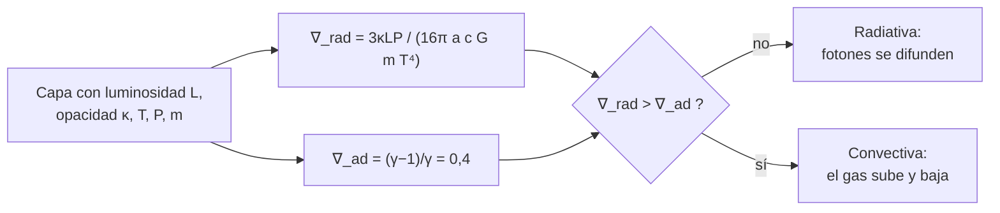

# B24-C05 — Transporte radiativo y convectivo

<!-- nav:top -->
[🏠 Programa](../../../../README.md) · [📚 Bloque B24](../../../tronco-comun/B24-fisica-y-evolucion-de-estrellas.md) · [← Anterior: B24-C04 — Equilibrio hidrostático estelar](../B24-C04-equilibrio-hidrostatico-estelar/CLASE.md) · [Siguiente: B24-C06 — Fusión de hidrógeno →](../B24-C06-fusion-de-hidrogeno/CLASE.md)
<!-- /nav -->

## 1. Ubicación, nivel y alcance

Clase 5 del bloque B24. Nivel N3. En [C04](../B24-C04-equilibrio-hidrostatico-estelar/CLASE.md) viste que el centro de una estrella es caliente y denso. Esa energía debe llegar a la superficie, y puede hacerlo por dos caminos: **radiación** (fotones que se difunden) o **convección** (gas que sube y baja). Usas la ley de Stefan–Boltzmann ([B05-C18](../../B05/B05-C18-electromagnetismo-y-radiacion/CLASE.md)), los gases ([B05-C14](../../B05/B05-C14-gases-y-presion/CLASE.md)) y la estadística de muestras ([B12-C14](../../B12/B12-C14-simulacion-monte-carlo/CLASE.md)). No se resuelve la teoría completa de la convección.

## 2. Por qué esta clase existe

La energía generada en el núcleo tarda milenios en salir y el modo de transporte decide la estructura: si el interior de una estrella es convectivo, su composición se mezcla; si es radiativo, no. De ello depende cuánto combustible alcanza el núcleo, y por tanto la vida de la estrella. La decisión central: **en una capa dada, ¿se transporta la energía por radiación o por convección y cuánto tarda en salir?**

## 3. Lo que podrás hacer al terminar

1. Describir la difusión de fotones como una marcha aleatoria y calcular el tiempo de difusión.
2. Enunciar el criterio de Schwarzschild.
3. Calcular el gradiente adiabático de un gas ideal.
4. Calcular el gradiente radiativo `∇_rad` de una capa y decidir si es convectiva.
5. Explicar por qué una opacidad alta o una luminosidad alta favorecen la convección.
6. Nombrar qué deja fuera el criterio (semiconvección, rotación, campos).

La evidencia es el **informe de transporte de energía** del ejercicio 12 (sección 20).

## 4. Con qué llegas y cómo comprobarlo

1. ¿Qué es la opacidad de un gas y qué mide su inverso?
2. ¿Cuánto vale la velocidad de la luz?
3. ¿Cuánto recorre una marcha aleatoria de `N` pasos de longitud `ℓ`?
4. ¿Qué es el índice adiabático `γ` de un gas monoatómico?
5. ¿Qué es un gradiente de temperatura?

<details>
<summary>Ver respuestas</summary>

1. Qué tan opaco es el gas a la luz; el inverso de `κρ` es el recorrido libre medio. 2. `299 792 458 m/s`. 3. En promedio, `√N ℓ` (de modo que `⟨r²⟩ = Nℓ²`). 4. `γ = 5/3`. 5. El cambio de temperatura con la distancia o la profundidad.
</details>

Con cuatro o cinco aciertos, sigue; si no, repasa B05-C14 y B12-C14.

## 5. Un caso real: ¿cuánto tarda la luz del núcleo solar en salir?

Un fotón producido en el centro del Sol avanza solo una distancia minúscula antes de ser absorbido y reemitido en otra dirección, de modo que sigue una marcha aleatoria. Con un recorrido libre medio ilustrativo de `1 cm` (el real varía mucho con la profundidad; **estimado**), el laboratorio da un tiempo de difusión de `5100 años`; con `0,1 cm`, `51 000 años`. El mismo trayecto en línea recta tomaría `2,3 s`. Es el **ejemplo conductor**. Los neutrinos de la cadena protón–protón, que casi no interaccionan, salen del núcleo sin esa demora, y la colaboración Borexino midió las tasas de neutrinos *pp*, ⁷Be y *pep* (S4, resumen).

## 6. Vocabulario

El **recorrido libre medio** `ℓ` es la distancia media que recorre un fotón entre interacciones; `ℓ = 1/(κρ)` con `κ` la opacidad (m²/kg) y `ρ` la densidad. La **marcha aleatoria** es un recorrido de pasos de dirección al azar. El **tiempo de difusión** `t = R²/(ℓ c)` es lo que tarda un fotón en salir de una región de tamaño `R`. El **gradiente adiabático** `∇_ad = (γ−1)/γ` es el cambio logarítmico de la temperatura con la presión cuando una burbuja sube sin intercambiar calor. El **gradiente radiativo** `∇_rad` es el que necesitaría la capa para llevar toda la luminosidad por radiación. La **convección** es el transporte por movimiento macroscópico del gas. El **criterio de Schwarzschild** dice que hay convección si `∇_rad > ∇_ad`.

## 7. Modelo mental: una multitud y una cinta transportadora

Imagina una multitud muy densa donde cada persona avanza un paso en una dirección al azar: sale, pero tarda muchísimo (radiación). Si la multitud se pone a hervir y las personas suben en bloques, sale mucho antes (convección).



*Descripción textual:* para cada capa se calcula el gradiente que haría falta si todo el flujo fuera radiativo; si supera el adiabático, la capa es inestable y se vuelve convectiva.

Analogía: la multitud. Límite: los fotones no tienen «voluntad»; su paso depende de la opacidad, que cambia con la temperatura y la composición.

## 8. La explicación, paso a paso

### 8.1 Difusión de fotones

En una marcha aleatoria de `N` pasos de longitud `ℓ`, la distancia cuadrática media es `⟨r²⟩ = Nℓ²`. Para alejarse `R` hacen falta `N = (R/ℓ)²` pasos, que tardan `Nℓ/c`: `t = R²/(ℓ c)`. Con `ℓ = 1 cm`, `N = 4,8 × 10²¹` pasos y `t ≈ 5100 años`. La salida es `R/ℓ = 7 × 10¹⁰` veces más lenta que un vuelo directo.

### 8.2 Gradiente adiabático

Una burbuja que sube se expande sin intercambiar calor: `P ∝ T^{γ/(γ−1)}`, es decir `∇_ad = dlnT/dlnP = (γ−1)/γ`. Para `γ = 5/3` vale `0,4`; para `γ = 4/3` (dominio de la radiación), `0,25`. El laboratorio lo calcula derivando numéricamente a entropía constante.

### 8.3 Gradiente radiativo

Si toda la luminosidad `L` pasara por radiación en una capa de presión `P`, temperatura `T` y masa interior `m`, el gradiente necesario sería `∇_rad = 3κLP/(16π a c G m T⁴)`, con `a = 4σ/c` la constante de radiación. Crece con `κ` y con `L/m` y cae con `T⁴`.

### 8.4 El criterio de Schwarzschild

Si `∇_rad ≤ ∇_ad` la capa es estable y transporta por radiación. Si `∇_rad > ∇_ad`, una burbuja desplazada hacia arriba sigue siendo más caliente que su entorno, sigue subiendo y aparece convección. En el laboratorio, una capa interna **sintética** (`κ = 0,1 m²/kg`, `T = 10⁷ K`) da `∇_rad = 0,25` y es radiativa; una capa externa **sintética** (`κ = 20 m²/kg`, `T = 10⁶ K`) da `1,5` y es convectiva.

### 8.5 Consecuencias y límites

Una opacidad alta (capas externas frías) o una luminosidad alta por unidad de masa (núcleos de estrellas masivas) empujan a la convección. Los núcleos convectivos se mezclan y alimentan más hidrógeno a la fusión. El criterio simple no cubre la semiconvección ni los efectos de la rotación; códigos como MESA añaden métodos para seguir los bordes convectivos (S3, resumen).

## 9. Magnitudes, símbolos y unidades

| Símbolo | Qué es | Unidad | Valor / nota |
|---|---|---|---|
| `ℓ` | recorrido libre medio | m | `0,01` (ilustrativo) |
| `κ`, `ρ` | opacidad; densidad | `m² kg⁻¹`; `kg m⁻³` | sintéticos |
| `t_dif` | tiempo de difusión | años | `5100` (`ℓ = 1 cm`) |
| `∇_ad`, `∇_rad` | gradientes | — | `0,4` (`γ = 5/3`); según la capa |
| `a` | constante de radiación | `J m⁻³ K⁻⁴` | `4σ/c = 7,566 × 10⁻¹⁶` |
| `c`, `G`, `σ` | constantes | — | (S1) |

## 10. Convenciones y referencias

Capas con valores uniformes; gas ideal monoatómico; `ℓ`, `κ`, `P`, `T`, `m` de las capas del laboratorio son **sintéticos / ilustrativos**. `GM☉`, `R☉` y `L☉` nominales de la IAU (S2).

## 11. De dónde sale lo que afirmamos

| ID | Fuente | Localizador | Respalda | Estado |
|---|---|---|---|---|
| S1 | NIST, *Fundamental Physical Constants — Complete Listing* (CODATA 2022) | https://physics.nist.gov/cuu/Constants/Table/allascii.txt | `c`, `G`, `σ` | Consultada el 2026-11-09 |
| S2 | Mamajek et al., *IAU 2015 Resolution B3*, arXiv:1510.07674 | https://arxiv.org/abs/1510.07674 | `GM☉`, `R☉`, `L☉` | Texto del PDF extraído el 2026-11-09 |
| S3 | Paxton et al., *MESA: Pulsating Variable Stars, Rotation, Convective Boundaries, and Energy Conservation*, arXiv:1903.01426 | https://arxiv.org/abs/1903.01426 | Seguimiento de bordes convectivos y semiconvección en códigos | Solo resumen, consultado el 2026-11-09 |
| S4 | Borexino Collaboration, *Simultaneous Precision Spectroscopy of pp, ⁷Be, and pep Solar Neutrinos with Borexino Phase-II*, arXiv:1707.09279 | https://arxiv.org/abs/1707.09279 | Medida de neutrinos *pp*, ⁷Be y *pep* | Solo resumen, consultado el 2026-11-09 |

Límites: S3 y S4 solo resumen; el criterio de Schwarzschild y la marcha aleatoria son resultados estándar que se verifican numéricamente en el laboratorio.

## 12. Cómo ver el transporte

| `ℓ` | `N` pasos | `t_dif` |
|---|---|---|
| `0,1 cm` | `4,8 × 10²³` | `51 000 años` |
| `1 cm` | `4,8 × 10²¹` | `5100 años` |
| (vuelo directo) | — | `2,3 s` |

Descripción larga: reducir diez veces el recorrido libre multiplica por diez el tiempo de salida.

## 13. Ejemplo trabajado: ¿radiativa o convectiva?

**Paso 1 · Datos.** Capa sintética: `κ = 0,1 m²/kg`, `L = L☉`, `P = 10¹⁶ Pa`, `m = 0,3 M☉`, `T = 10⁷ K`.

**Paso 2 · Gradiente radiativo.** `∇_rad = 3κLP/(16π a c G m T⁴) = 0,25` (laboratorio).

**Paso 3 · Comparación.** `0,25 < ∇_ad = 0,4`.

**Paso 4 · Conclusión.** La capa es radiativa. Con `κ` diez veces mayor, `∇_rad = 2,5 > 0,4` y pasaría a ser convectiva. Los datos son sintéticos, de modo que la conclusión ilustra el criterio, no la estructura solar.

## 14. Distintas formas de transportar energía

**Radiación:** domina donde la opacidad es baja y el gradiente es suave. **Convección:** domina donde la opacidad o el flujo son altos. **Conducción:** despreciable en estrellas normales; relevante en remanentes degenerados (C18). Los modelos reales combinan los modos capa por capa.

## 15. Práctica guiada

**Ejercicio 1 · con los pasos indicados.** Calcula `t_dif` para `ℓ = 1 cm`. *Pasos:* `R²`; divide por `ℓ c`; pasa a años.

<details><summary>Solución comentada</summary>

`R² = 4,84 × 10¹⁷ m²`; `ℓc = 0,01 × 2,998 × 10⁸ = 2,998 × 10⁶`; `t = 1,61 × 10¹¹ s = 5100 años` (8.1).
</details>

**Ejercicio 2 · con una pista.** Calcula el número de pasos `N`. *Pista:* `(R/ℓ)²`.

<details><summary>Solución comentada</summary>

`R/ℓ = 6,957 × 10¹⁰`; `N = 4,8 × 10²¹`.
</details>

**Ejercicio 3 · casi autónomo.** Calcula `∇_ad` para `γ = 4/3`.

<details><summary>Solución comentada</summary>

`(4/3 − 1)/(4/3) = 1/4 = 0,25` (8.2).
</details>

## 16. Práctica autónoma, transferencia e integrador

**Ejercicio 4.** Si `ℓ` baja a `0,1 cm`, ¿cuánto vale `t_dif`?

<details><summary>Solución comentada</summary>

`t ∝ 1/ℓ`: `51 000 años` (sección 12).
</details>

**Ejercicio 5.** Compara el tiempo de difusión (`ℓ = 1 cm`) con el vuelo directo `R/c`.

<details><summary>Solución comentada</summary>

`R/c = 2,32 s`; cociente `1,6 × 10¹¹ / 2,32 = 6,96 × 10¹⁰ = R/ℓ` (8.1).
</details>

**Ejercicio 6.** Una capa tiene `∇_rad = 0,253`. ¿Es radiativa o convectiva?

<details><summary>Solución comentada</summary>

`0,253 < 0,4`: radiativa (8.4).
</details>

**Ejercicio 7.** ¿Cuánto vale `∇_rad` si `κ` se multiplica por 10? ¿Qué pasa?

<details><summary>Solución comentada</summary>

`∇_rad ∝ κ`: `2,53 > 0,4`, la capa se vuelve convectiva (13).
</details>

**Ejercicio 8.** ¿Por qué `T⁴` en el denominador favorece la radiación en el interior profundo?

<details><summary>Solución comentada</summary>

Donde `T` es alto, `∇_rad` es pequeño: la radiación transporta fácilmente. En capas frías y opacas ocurre lo contrario (8.3).
</details>

**Ejercicio 9 · transferencia.** Los neutrinos *pp* salen del Sol sin demora. Si el núcleo cambiara hoy su ritmo de fusión, ¿qué señal llegaría antes a la Tierra, la de los neutrinos o la de la luz solar, y por qué?

<details><summary>Solución comentada</summary>

Los neutrinos (salen del Sol en unos segundos y llegan a la Tierra en unos ocho minutos, como la luz que ya salió de la superficie); la luz generada en el núcleo tardaría miles de años en difundirse hasta la superficie (S4 mide neutrinos; 8.1). La luz de hoy refleja el núcleo de hace miles de años.
</details>

**Ejercicio 10 · transferencia.** Un compañero dice: «el Sol está en calma, luego no tiene convección». Responde con 8.4–8.5.

<details><summary>Solución comentada</summary>

El criterio de Schwarzschild se cumple en las capas externas, donde `κ` es alta y `T` baja, aunque en el interior profundo sea radiativo. La calma o el brillo uniforme de la superficie no descartan el movimiento convectivo bajo ella.
</details>

**Ejercicio 11 · transferencia.** ¿Por qué se espera un núcleo convectivo en estrellas muy masivas?

<details><summary>Solución comentada</summary>

La luminosidad crece muy rápido con la masa y, en el núcleo, `L` por unidad de masa alta empuja `∇_rad` por encima de `∇_ad`; la fusión sensible a `T` (C07) concentra aún más la energía (8.5).
</details>

**Ejercicio 12 · integrador.** Elabora tu *informe de transporte de energía*: elige dos capas sintéticas, calcula `∇_rad` y decide el modo; calcula `t_dif` para dos `ℓ`, compara con el vuelo directo y nombra dos efectos omitidos.

<details><summary>Solución modelo</summary>

Con el laboratorio: capa interna `0,25` (radiativa), externa `1,5` (convectiva); `t_dif = 5100` y `51 000` años frente a `2,3 s`; se omiten semiconvección y rotación; todo rotulado como sintético o ilustrativo.
</details>

## 17. Laboratorio: difusión y Schwarzschild

El script [transporte.py](transporte.py) simula `20 000` marchas aleatorias de `400` pasos (semilla fija) y **comprueba** que `⟨r²⟩ = Nℓ²` dentro del 3 %, calcula `∇_ad` por derivación numérica a entropía constante (**comprueba** que vale `0,4` a `10⁻⁶`), evalúa `t_dif` y clasifica dos capas sintéticas con `∇_rad`.

**Datos:** constantes de NIST; valores nominales de la IAU; capas **sintéticas**. **Predice antes de ejecutar:** ¿qué valor tendrá `⟨r²⟩/(Nℓ²)`? (cercano a 1.) **Ejecución del 2026-11-09 (Python 3.12.9):**

```text
Python 3.12.9 (biblioteca estandar)
marcha aleatoria: <r^2>/(N l^2) = 1.0038 (esperado 1)
grad_ad numerico = 0.400000 (gamma=5/3 -> 0.4)
t_dif (Sol, l = 0.1 cm) = 51,159 anios
t_dif (Sol, l = 1.0 cm) = 5,116 anios
capa interna (sintetica): grad_rad = 0.253 -> radiativa
capa externa (sintetica): grad_rad = 1.518 -> convectiva
Pruebas superadas.
```

```bash
python programa/clases/B24/B24-C05-transporte-radiativo-y-convectivo/transporte.py
```

**Límites:** `ℓ` uniforme y capas sintéticas; sin dependencia real de la opacidad con `T` y composición.

## 18. Errores frecuentes y cómo corregirlos

**Pensar que los fotones salen en línea recta.** Se corrige con el ejercicio 5.

**Confundir `∇_ad` con `∇_rad`.** Se corrige con el ejercicio 6.

**Olvidar el efecto de `T⁴`.** Se corrige con el ejercicio 8.

**Creer que la calma superficial implica un interior radiativo.** Se corrige con el ejercicio 10.

**Tratar `ℓ = 1 cm` como medido.** Se corrige con la sección 10: es ilustrativo.

## 19. Cómo sabrás que vas bien

Tras 8.1: ¿por qué tarda miles de años? Si dudas, ejercicios 1 y 5. Tras 8.4: ¿qué decide el modo de transporte? Ejercicio 6. Tras el laboratorio: ¿qué verifica la marcha aleatoria? (la ley `⟨r²⟩ = Nℓ²`).

## 20. Qué entregas y cómo se evalúa

El producto es tu **informe de transporte de energía** (ejercicio 12).

| Criterio | Inicial | En desarrollo | Logrado | Destacado |
|---|---|---|---|---|
| Conceptos | Los confunde | Parciales | Difusión y Schwarzschild | Distingue `∇_ad` y `∇_rad` |
| Cálculo | Sin unidades | Con errores | `t_dif` y `∇_rad` correctos | Escalas con `ℓ` y `κ` |
| Decisión | Sin criterio | Sin razón | Modo por capa | Explica consecuencias en la mezcla |
| Numérico | Sin comprobar | Un caso | Pruebas superadas | Explica la semilla y la tolerancia |
| Fuentes | Sin fuente | Sin fecha | S1–S4 con fecha | Rotula lo sintético |

**Condiciones críticas (no se compensan con promedio):** rotular las capas y `ℓ` como sintéticos/ilustrativos; no presentar `5100 años` como medida; citar solo lo consultado y decir que S3 y S4 son resúmenes.

## 21. Ética, seguridad y límites

Clase educativa: no es un modelo de estructura solar. Accesibilidad: tablas equivalentes a las gráficas, fórmulas en texto, ejercicios sin conexión.

## 22. Para cerrar y seguir

La energía se difunde en miles de años como marcha aleatoria de fotones y se vuelve convectiva donde `∇_rad` supera a `∇_ad`. Queda una pregunta: ¿qué reacción nuclear alimenta ese flujo?

**Glosario español–inglés.** recorrido libre medio · *mean free path*; marcha aleatoria · *random walk*; tiempo de difusión · *diffusion time*; gradiente adiabático · *adiabatic gradient*; gradiente radiativo · *radiative gradient*; criterio de Schwarzschild · *Schwarzschild criterion*; convección · *convection*.

**Continuidad.** [B24-C06](../B24-C06-fusion-de-hidrogeno/CLASE.md) reutiliza la luminosidad que atraviesa la estrella para calcular cuánto hidrógeno se fusiona.

**Referencias:** ver sección 11.

<!-- nav:bottom -->
---

[← Anterior: B24-C04 — Equilibrio hidrostático estelar](../B24-C04-equilibrio-hidrostatico-estelar/CLASE.md) · [📚 Bloque B24](../../../tronco-comun/B24-fisica-y-evolucion-de-estrellas.md) · [Siguiente: B24-C06 — Fusión de hidrógeno →](../B24-C06-fusion-de-hidrogeno/CLASE.md)
<!-- /nav -->
