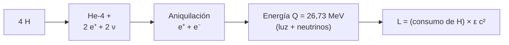

# B24-C06 — Fusión de hidrógeno

<!-- nav:top -->
[🏠 Programa](../../../../README.md) · [📚 Bloque B24](../../../tronco-comun/B24-fisica-y-evolucion-de-estrellas.md) · [← Anterior: B24-C05 — Transporte radiativo y convectivo](../B24-C05-transporte-radiativo-y-convectivo/CLASE.md) · [Siguiente: B24-C07 — Ciclo CNO y cadena protón-protón →](../B24-C07-ciclo-cno-y-cadena-proton-proton/CLASE.md)
<!-- /nav -->

## 1. Ubicación, nivel y alcance

Clase 6 del bloque B24. Nivel N3. Tras ver cómo la energía llega a la superficie ([C05](../B24-C05-transporte-radiativo-y-convectivo/CLASE.md)), preguntas de dónde sale. Respuesta: de convertir hidrógeno en helio. Usas la masa y la energía de la relatividad especial, `E = mc²` ([B05-C06](../../B05/B05-C06-trabajo-y-energia/CLASE.md) para la energía; [B06-C03](../../B06/B06-C03-isotopos-y-masa-atomica/CLASE.md) para masas atómicas) y las constantes del SI ([B13-C01](../../B13/B13-C01-sistema-internacional-y-constantes/CLASE.md)). Se calcula el balance de energía; las reacciones detalladas se ven en [C07](../B24-C07-ciclo-cno-y-cadena-proton-proton/CLASE.md).

## 2. Por qué esta clase existe

Una estrella como el Sol brilla desde hace miles de millones de años; ninguna fuente química ni gravitatoria alcanza (C02). La fusión nuclear sí. Saber cuánta energía rinde cada kilogramo de hidrógeno permite estimar cuánto hidrógeno consume una estrella y cuánto dura. La decisión central: **dada la luminosidad de una estrella, ¿cuánto hidrógeno fusiona por segundo y cuánto tiempo puede sostenerse?**

## 3. Lo que podrás hacer al terminar

1. Escribir la reacción neta `4 p → ⁴He` y explicar el defecto de masa.
2. Calcular la energía liberada por reacción con masas de referencia.
3. Calcular la fracción de masa convertida y la energía por kilogramo.
4. Calcular el hidrógeno consumido por segundo a partir de `L`.
5. Estimar el tiempo nuclear de una estrella.
6. Distinguir entre la energía total y la que se lleva el neutrino.

La evidencia es el **balance energético de la fusión** del ejercicio 12 (sección 20).

## 4. Con qué llegas y cómo comprobarlo

1. ¿Qué dice `E = mc²`?
2. ¿Qué es un electronvoltio y cuántos julios equivale?
3. ¿Qué es la masa atómica y en qué unidad se da?
4. ¿Qué es un positrón?
5. ¿Qué es la luminosidad solar?

<details>
<summary>Ver respuestas</summary>

1. La energía en reposo de una masa `m` es `mc²`. 2. La energía de un electrón acelerado por un voltio; `1,602 176 634 × 10⁻¹⁹ J`. 3. La masa de un átomo, en unidades de masa atómica (u). 4. La antipartícula del electrón. 5. `3,828 × 10²⁶ W`.
</details>

Con cuatro o cinco aciertos, sigue; si no, repasa B05-C06, B06-C03 y B13-C01.

## 5. Un caso real: el hidrógeno que consume el Sol

La luminosidad nominal del Sol es `3,828 × 10²⁶ W` (S2). Con la energía que rinde cada kilogramo de hidrógeno (`6,40 × 10¹⁴ J/kg`, calculada con las masas de NIST), el Sol funde `5,98 × 10¹¹ kg` de hidrógeno por segundo, es decir, casi 600 millones de toneladas, y pierde por radiación `4,26 × 10⁹ kg/s` de masa. Es el **ejemplo conductor**. Los neutrinos que produce se midieron con el detector Borexino (S3, resumen).

## 6. Vocabulario

La **fusión nuclear** une núcleos ligeros en uno más pesado. El **defecto de masa** es la diferencia entre la masa de los reactivos y la del producto; se libera como energía `Q = Δm c²`. Un **protón** es el núcleo del hidrógeno (`p`); una **partícula alfa** es el núcleo de helio-4. Un **positrón** (`e⁺`) es la antipartícula del electrón; al encontrar un electrón se aniquilan y liberan `2 m_e c²`. Un **neutrino** (`ν`) es una partícula neutra que casi no interacciona y escapa de la estrella. La **fracción de masa convertida** `ε = Δm/m` indica qué porción de la masa de combustible pasa a energía. El **tiempo nuclear** es lo que dura el combustible a la luminosidad actual.

## 7. Modelo mental: una balanza que pierde un poco

Cuatro protones pesan algo más que un núcleo de helio con sus dos electrones asociados; la diferencia (0,7 %) desaparece como energía.



*Descripción textual:* cuatro átomos de hidrógeno se convierten en un helio-4; los positrones se aniquilan con electrones; la energía total liberada, `26,73 MeV`, se reparte entre fotones y neutrinos y sostiene la luminosidad.

Analogía: una balanza donde el platillo del helio pesa un 0,7 % menos. Límite: en la realidad no hay una reacción de cuatro cuerpos; ocurre en pasos (C07).

## 8. La explicación, paso a paso

### 8.1 La reacción neta

El resultado neto de las cadenas de fusión es `4 ¹H → ⁴He + 2 e⁺ + 2 ν_e`, con `Q` total contando la aniquilación de los positrones con los electrones del plasma. En términos de masas: `Q = [4 m_p + 4 m_e − (m_α + 2 m_e)] c²`, con `m_p` la masa del protón, `m_α` la de la partícula alfa y `m_e` la del electrón (S1).

### 8.2 Cálculo del defecto de masa

Con las masas de NIST (S1): `4 m_p + 2 m_e − m_α = 0,028 697 u`, lo que da `Q = 26,731 MeV`, tanto por la vía de los kilogramos como por la de las unidades de masa atómica (el laboratorio comprueba que coinciden). La fracción convertida es `ε = 0,00712`, de modo que 1 kg de hidrógeno rinde `6,40 × 10¹⁴ J`.

### 8.3 Consumo del Sol

Si toda la energía sale como luz, el consumo es `Ṁ_H = L/(ε c²) = 5,98 × 10¹¹ kg/s`. Cada reacción consume cuatro átomos (`6,7 × 10⁻²⁷ kg`), así que ocurren `8,9 × 10³⁷` reacciones por segundo. La pérdida de masa por radiar es `L/c² = 4,26 × 10⁹ kg/s`.

### 8.4 Tiempo nuclear

La energía disponible es `f X M ε c²`, con `f` la fracción de la masa que llega a fusionarse (por convección y difusión, del orden de 0,1, **ilustrativo**) y `X` la fracción de masa de hidrógeno (estimada en 0,7). El tiempo nuclear es `t = f X M ε c² / L`: `7,4 Gyr` con `X = 0,7` y `10,5 Gyr` con `X = 1`. Es un orden de magnitud (la estimación usual de unos `10¹⁰` años proviene de estas hipótesis).

### 8.5 Los neutrinos

Una pequeña parte de `Q` se la llevan los neutrinos y no calienta la estrella; la fracción exacta depende de la reacción y no se calcula aquí. Que los neutrinos *pp*, ⁷Be y *pep* se hayan medido con precisión (S3, resumen) confirma que la fusión ocurre hoy en el núcleo.

## 9. Magnitudes, símbolos y unidades

| Símbolo | Qué es | Unidad | Valor / nota |
|---|---|---|---|
| `m_p`, `m_α`, `m_e` | masas del protón, alfa, electrón | kg; u | `1,672 62 × 10⁻²⁷ kg`; `6,644 66 × 10⁻²⁷ kg`; `9,109 38 × 10⁻³¹ kg` (S1) |
| `Q` | energía liberada por reacción | MeV | `26,731` |
| `ε` | fracción de masa convertida | — | `0,00712` |
| `ε c²` | energía por kg de H | J/kg | `6,40 × 10¹⁴` |
| `Ṁ_H` | hidrógeno consumido | kg/s | `5,98 × 10¹¹` (Sol) |
| `t_nuc` | tiempo nuclear | Gyr | `7,4` (`f = 0,1`, `X = 0,7`) |

## 10. Convenciones y referencias

`Q` se calcula con átomos de hidrógeno y helio, incluyendo la aniquilación de los positrones; no descuenta los neutrinos. `f` y `X` son **ilustrativos / estimados**. `L☉` y `GM☉` nominales de la IAU (S2); `M☉ = GM☉/G`.

## 11. De dónde sale lo que afirmamos

| ID | Fuente | Localizador | Respalda | Estado |
|---|---|---|---|---|
| S1 | NIST, *Fundamental Physical Constants — Complete Listing* (CODATA 2022) | https://physics.nist.gov/cuu/Constants/Table/allascii.txt | `m_p`, `m_α`, `m_e`, unidad de masa atómica, `c`, eV | Consultada el 2026-11-09 |
| S2 | Mamajek et al., *IAU 2015 Resolution B3*, arXiv:1510.07674 | https://arxiv.org/abs/1510.07674 | `L☉`, `GM☉` nominales | Texto del PDF extraído el 2026-11-09 |
| S3 | Borexino Collaboration, arXiv:1707.09279 | https://arxiv.org/abs/1707.09279 | Medida de neutrinos *pp*, ⁷Be y *pep* | Solo resumen, consultado el 2026-11-09 |

Límites: S3 solo resumen; `f` y `X` son ilustrativos; la fracción de energía que se llevan los neutrinos no se calculó ni se consultó.

## 12. Cómo ver el balance

| Magnitud | Valor |
|---|---|
| `Q` por reacción | `26,731 MeV` |
| `ε` | `0,00712` (0,7 %) |
| Energía por kg de H | `6,40 × 10¹⁴ J` |
| H consumido (Sol) | `5,98 × 10¹¹ kg/s` |
| Pérdida de masa por radiar | `4,26 × 10⁹ kg/s` |

Descripción larga: de cada kilogramo de hidrógeno, 7 gramos se convierten en energía.

## 13. Ejemplo trabajado: ¿cuánto tarda una estrella de 2 M☉?

**Paso 1 · Datos.** `M = 2 M☉`, `L = 16 L☉` (ilustrativos), `f = 0,1`, `X = 1`.

**Paso 2 · Tiempo base.** Con `M = M☉`, `L = L☉`: `10,5 Gyr` (8.4).

**Paso 3 · Escala.** `t ∝ M/L`: `10,5 × (2/16) = 1,3 Gyr`.

**Paso 4 · Sentido.** Una estrella dos veces más masiva y 16 veces más luminosa (valores ilustrativos) vive ocho veces menos; las estrellas masivas gastan su combustible más deprisa. Se retoma en C15.

## 14. Distintas fuentes de energía

**Química:** del orden de `10⁷ J/kg` (valor aproximado, no consultado), insuficiente por varios órdenes de magnitud. **Gravitatoria (C02):** dura millones de años. **Nuclear (esta clase):** `6 × 10¹⁴ J/kg`, permite miles de millones de años. La comparación es el argumento que obligó a pensar en la fusión.

## 15. Práctica guiada

**Ejercicio 1 · con los pasos indicados.** Calcula `ε` con `Q = 26,731 MeV` y `4 m_p + 4 m_e` en MeV. *Pasos:* `4(938,272 + 0,511) = 3755,13 MeV`.

<details><summary>Solución comentada</summary>

`ε = 26,731/3755,13 = 0,00712` (8.2).
</details>

**Ejercicio 2 · con una pista.** Calcula la energía por kilogramo de hidrógeno. *Pista:* `ε c²`.

<details><summary>Solución comentada</summary>

`0,00712 × 8,98755 × 10¹⁶ = 6,40 × 10¹⁴ J/kg`.
</details>

**Ejercicio 3 · casi autónomo.** Calcula el hidrógeno que consume el Sol por segundo.

<details><summary>Solución comentada</summary>

`3,828 × 10²⁶ / 6,40 × 10¹⁴ = 5,98 × 10¹¹ kg/s` (8.3).
</details>

## 16. Práctica autónoma, transferencia e integrador

**Ejercicio 4.** Calcula la masa que pierde el Sol por segundo al radiar.

<details><summary>Solución comentada</summary>

`L/c² = 3,828 × 10²⁶ / 8,98755 × 10¹⁶ = 4,26 × 10⁹ kg/s`.
</details>

**Ejercicio 5.** ¿Cuánta masa pierde en `10⁹` años?

<details><summary>Solución comentada</summary>

`4,26 × 10⁹ × 3,156 × 10¹⁶ = 1,3 × 10²⁶ kg`, unos `7 × 10⁻⁵ M☉`.
</details>

**Ejercicio 6.** ¿Cuántas reacciones por segundo ocurren en el Sol?

<details><summary>Solución comentada</summary>

`5,98 × 10¹¹ / 6,7 × 10⁻²⁷ = 8,9 × 10³⁷` (8.3).
</details>

**Ejercicio 7.** Calcula `t_nuc` con `f = 0,1` y `X = 1` para el Sol.

<details><summary>Solución comentada</summary>

`0,1 × 1,988 × 10³⁰ × 6,40 × 10¹⁴ / 3,828 × 10²⁶ = 3,3 × 10¹⁷ s = 10,5 Gyr` (8.4).
</details>

**Ejercicio 8.** ¿Qué pasa con `t_nuc` si `X` baja de 1 a 0,7?

<details><summary>Solución comentada</summary>

Disminuye en un `30 %`, a `7,4 Gyr`.
</details>

**Ejercicio 9 · transferencia.** Una estrella tiene `M = 0,5 M☉` y `L = 0,06 L☉` (ilustrativos). Estima su `t_nuc` con `X = 1`.

<details><summary>Solución comentada</summary>

`10,5 × (0,5/0,06) = 87 Gyr`: más que la edad actual del universo si el cálculo ingenuo fuera cierto; en realidad las estrellas de baja masa son convectivas y queman casi todo su hidrógeno (C15). El valor es ilustrativo.
</details>

**Ejercicio 10 · transferencia.** Un compañero dice que el Sol brilla por combustión química. Responde con 8.2 y la sección 14.

<details><summary>Solución comentada</summary>

La energía química (~`10⁷ J/kg`) agotaría al Sol en unos miles de años; la fusión rinde `6 × 10¹⁴ J/kg`, unas `10⁷` veces más (orden de magnitud; valor químico no consultado).
</details>

**Ejercicio 11 · transferencia.** Si el neutrino se llevara el `2 %` de `Q` (valor ilustrativo, no consultado), ¿qué consumo de H daría la misma `L`?

<details><summary>Solución comentada</summary>

La energía útil bajaría al `98 %`: `5,98 × 10¹¹ / 0,98 = 6,1 × 10¹¹ kg/s`, `2 %` más.
</details>

**Ejercicio 12 · integrador.** Elabora tu *balance energético de la fusión*: calcula `Q`, `ε`, energía por kilogramo, consumo de H y `t_nuc` para una estrella ilustrativa, y señala qué falta (neutrinos, composición real).

<details><summary>Solución modelo</summary>

`Q = 26,731 MeV`, `ε = 0,00712`, `6,40 × 10¹⁴ J/kg`; para el Sol `5,98 × 10¹¹ kg/s` y `7,4–10,5 Gyr`; faltan la fracción de neutrinos y la composición; `f`, `X` rotulados como ilustrativos.
</details>

## 17. Laboratorio: defecto de masa

El script [fusion_h.py](fusion_h.py) calcula `Q` con las masas de NIST de dos maneras (en kg y en u) y **comprueba** que coinciden a `10⁻⁶`; calcula `ε`, la energía por kilogramo, el consumo del Sol y el tiempo nuclear.

**Datos:** masas y constantes de NIST (CODATA 2022); `L☉` y `GM☉` de la IAU; `f`, `X` ilustrativos. **Predice antes de ejecutar:** ¿qué fracción de masa se convierte, cercana a 0,7 % o a 7 %? (0,7 %.) **Ejecución del 2026-11-09 (Python 3.12.9):**

```text
Python 3.12.9 (biblioteca estandar)
Q (via kg) = 26.7309 MeV ; Q (via u) = 26.7309 MeV
fraccion de masa convertida epsilon = 0.00712
energia por kg de H = 6.3978e+14 J/kg
H consumido por el Sol = 5.983e+11 kg/s
t_nuc (f=0.1, X=0.7) = 7.37 Gyr ; con f=0.1 y X=1: 10.53 Gyr
Pruebas superadas.
```

```bash
python programa/clases/B24/B24-C06-fusion-de-hidrogeno/fusion_h.py
```

**Límites:** sin descuento de neutrinos; `f`, `X` ilustrativos; luminosidad constante.

## 18. Errores frecuentes y cómo corregirlos

**Confundir masa de protones con masa de átomos.** Se corrige con 8.1 y el ejercicio 1.

**Olvidar la aniquilación de los positrones.** Se corrige con 8.1.

**Tomar `t_nuc` como la vida total de la estrella.** Se corrige con la sección 8.4 y C15–C16.

**Creer que todo el hidrógeno se fusiona.** Se corrige con `f` y el ejercicio 9.

**Usar masa de reposo del Sol en lugar del consumo.** Se corrige con los ejercicios 3 y 4.

## 19. Cómo sabrás que vas bien

Tras 8.2: ¿qué fracción de masa se convierte? Si dudas, ejercicio 1. Tras 8.3: ¿cuánto H consume el Sol? Ejercicio 3. Tras el laboratorio: ¿qué verifica la doble vía? (que kg y u dan el mismo `Q`).

## 20. Qué entregas y cómo se evalúa

El producto es tu **balance energético de la fusión** (ejercicio 12).

| Criterio | Inicial | En desarrollo | Logrado | Destacado |
|---|---|---|---|---|
| Reacción | No la plantea | Incompleta | Neta con aniquilación | Explica el papel del neutrino |
| Cálculo | Sin unidades | Con errores | `Q`, `ε`, consumo | Propaga el efecto de `X` y `f` |
| Numérico | Sin comprobar | Un caso | Doble vía verificada | Explica la tolerancia |
| Fuentes | Sin fuente | Sin fecha | S1–S3 con fecha | Rotula lo ilustrativo |
| Límites | No los nombra | Uno | Tres omisiones | Discute la vida total |

**Condiciones críticas (no se compensan con promedio):** rotular `f`, `X` y las luminosidades de ejemplo como ilustrativos; no presentar `t_nuc` como edad medida; citar solo lo consultado.

## 21. Ética, seguridad y límites

Clase educativa: no sustituye un cálculo de tasas de reacción ni un modelo solar. Accesibilidad: tablas equivalentes a las gráficas, fórmulas en texto, ejercicios sin conexión.

## 22. Para cerrar y seguir

Fusionar cuatro hidrógenos en un helio convierte el 0,7 % de la masa en 26,73 MeV; con ello, el Sol consume unos 600 millones de toneladas de hidrógeno por segundo y podría sostenerse unos diez mil millones de años. Queda una pregunta: ¿por qué esa reacción ocurre a temperaturas donde los protones deberían repelerse?

**Glosario español–inglés.** fusión nuclear · *nuclear fusion*; defecto de masa · *mass defect*; partícula alfa · *alpha particle*; positrón · *positron*; neutrino · *neutrino*; tiempo nuclear · *nuclear timescale*; aniquilación · *annihilation*.

**Continuidad.** [B24-C07](../B24-C07-ciclo-cno-y-cadena-proton-proton/CLASE.md) reutiliza `Q` para estudiar las dos rutas que ejecutan la fusión y su sensibilidad a la temperatura.

**Referencias:** ver sección 11.

<!-- nav:bottom -->
---

[← Anterior: B24-C05 — Transporte radiativo y convectivo](../B24-C05-transporte-radiativo-y-convectivo/CLASE.md) · [📚 Bloque B24](../../../tronco-comun/B24-fisica-y-evolucion-de-estrellas.md) · [Siguiente: B24-C07 — Ciclo CNO y cadena protón-protón →](../B24-C07-ciclo-cno-y-cadena-proton-proton/CLASE.md)
<!-- /nav -->
