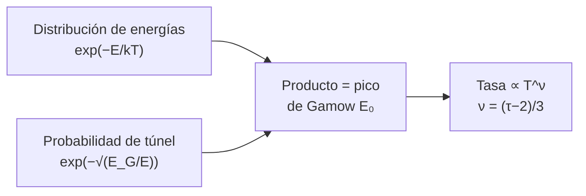

# B24-C07 — Ciclo CNO y cadena protón-protón

<!-- nav:top -->
[🏠 Programa](../../../../README.md) · [📚 Bloque B24](../../../tronco-comun/B24-fisica-y-evolucion-de-estrellas.md) · [← Anterior: B24-C06 — Fusión de hidrógeno](../B24-C06-fusion-de-hidrogeno/CLASE.md) · [Siguiente: B24-C08 — Nucleosíntesis estelar →](../B24-C08-nucleosintesis-estelar/CLASE.md)
<!-- /nav -->

## 1. Ubicación, nivel y alcance

Clase 7 del bloque B24. Nivel N3. En [C06](../B24-C06-fusion-de-hidrogeno/CLASE.md) calculaste cuánta energía rinde convertir hidrógeno en helio. Ahora preguntas **por qué ocurre a unos 15 millones de kelvin** y cómo depende de la temperatura la velocidad de la fusión. Hay dos rutas: la **cadena protón–protón** (p–p) y el **ciclo CNO**, que usa carbono, nitrógeno y oxígeno como catalizadores. Usas electrostática ([B05-C15](../../B05/B05-C15-campos-electricos/CLASE.md)), estructura atómica ([B06-C01](../../B06/B06-C01-estructura-atomica/CLASE.md)) y cálculo ([B09-C03](../../B09/B09-C03-derivada-como-tasa-de-cambio/CLASE.md)). La física nuclear detallada se profundiza en [B31](../../../tronco-comun/B31-fisica-cuantica-nuclear-y-astroparticulas.md).

## 2. Por qué esta clase existe

Dos protones se repelen con una fuerza eléctrica enorme; a las temperaturas de una estrella casi ninguno tiene energía para acercarse lo suficiente. Aun así la fusión ocurre, por efecto túnel. La rapidez de la reacción depende tanto de la temperatura que una pequeña diferencia de calor decide qué ruta domina y si el núcleo es convectivo. La decisión central: **¿a qué energía ocurre en la práctica la fusión y con qué potencia de la temperatura crece su tasa en cada ruta?**

## 3. Lo que podrás hacer al terminar

1. Describir las dos rutas de fusión de hidrógeno y qué las distingue.
2. Calcular la energía de Gamow y el pico de Gamow para un par de núcleos.
3. Calcular el exponente de temperatura `ν` de una tasa de reacción.
4. Comparar la sensibilidad de p–p y CNO.
5. Predecir cuánto cambia una tasa si la temperatura sube un porcentaje.
6. Explicar por qué las estrellas más calientes en el centro usan CNO.

La evidencia es la **comparación p-p frente a CNO** del ejercicio 12 (sección 20).

## 4. Con qué llegas y cómo comprobarlo

1. ¿Cuál es la energía de repulsión eléctrica de dos cargas a una distancia?
2. ¿Qué es el efecto túnel?
3. ¿Cuánto vale `kT` para `T = 10⁷ K` en electronvoltios, aproximadamente?
4. ¿Qué es un catalizador?
5. ¿Qué es la derivada logarítmica `d ln f / d ln x`?

<details>
<summary>Ver respuestas</summary>

1. `q₁q₂/(4πε₀ r)`, que crece al acercarse. 2. La probabilidad cuántica de atravesar una barrera sin energía suficiente para superarla. 3. Unos `860 eV`. 4. Una sustancia que acelera una reacción y se recupera al final. 5. El exponente local `n` si `f ∝ xⁿ`.
</details>

Con cuatro o cinco aciertos, sigue; si no, repasa B05-C15 y B09-C03.

## 5. Un caso real: el centro del Sol según el modelo

El modelo solar de la NASA da una temperatura central de `1,571 × 10⁷ K` (S2, valor de modelo), es decir, `kT = 1,354 keV`. A esa `kT`, el pico de Gamow de dos protones está en `6,09 keV`, unas 4,5 veces `kT`, y la tasa de fusión crece con la temperatura como `T^{3,8}`. Para un protón sobre un núcleo de nitrógeno-14 (ciclo CNO) el exponente sube a `T^{19,6}`. Es el **ejemplo conductor**. La colaboración Borexino midió neutrinos de la cadena p–p y acotó los del ciclo CNO con un límite superior de `8,1` cuentas por día por 100 toneladas (S3, resumen).

## 6. Vocabulario

La **cadena protón–protón (p–p)** fusiona hidrógeno a través de la unión de dos protones y reacciones posteriores. El **ciclo CNO** usa carbono, nitrógeno y oxígeno como catalizadores para el mismo resultado neto. La **barrera de Coulomb** es la repulsión eléctrica entre núcleos. El **efecto túnel** permite atravesarla. La **energía de Gamow** `E_G = 2 μ c² (π α Z₁ Z₂)²` mide la dificultad de la barrera; `μ` es la masa reducida, `α` la constante de estructura fina y `Z₁`, `Z₂` los números de carga. El **pico de Gamow** `E₀` es la energía a la que ocurre la mayoría de las reacciones: compromiso entre pocas partículas muy energéticas y muchas poco energéticas. El **exponente de temperatura** `ν` es el valor de `d ln(tasa)/d ln T`.

## 7. Modelo mental: pocas partículas rápidas, muchas lentas

A baja energía hay muchos protones pero casi ninguno atraviesa la barrera; a alta energía atraviesan, pero hay pocos. El producto de ambas curvas es un pico estrecho.



*Descripción textual:* la tasa de reacción es el producto de la distribución térmica de energías, que cae con `E`, y de la probabilidad de túnel, que crece con `E`; el máximo es el pico de Gamow y su anchura fija cómo crece la tasa con la temperatura.

Analogía: un vendedor que necesita clientes (muchos baratos, pocos caros): el máximo ingreso está en un precio intermedio. Límite: el pico no es un valor de mercado, sino un máximo de un producto de dos funciones exponenciales.

## 8. La explicación, paso a paso

### 8.1 Dos rutas, un resultado

En la cadena p–p, dos protones forman deuterio, que capta otro protón y da helio-3; el helio-3 se une a otro para dar helio-4 o a helio-4 para dar berilio, según la rama. En el ciclo CNO, un protón se une al carbono-12, al nitrógeno-14 y a otros núcleos en secuencia y al final se libera un helio-4 y se recupera el catalizador. En ambos casos el resultado neto es `4 H → ⁴He` (C06).

### 8.2 La barrera y el pico de Gamow

Para dos núcleos de cargas `Z₁`, `Z₂`, la probabilidad de atravesar la barrera varía como `exp(−√(E_G/E))` y la distribución térmica como `exp(−E/kT)`. El producto es máximo en `E₀ = (E_G (kT)²/4)^{1/3}`. Con `α = 1/137,036` (S1), para dos protones `E_G = 493 keV` y a `kT = 1,354 keV`, `E₀ = 6,09 keV`: la mayoría de las fusiones ocurre con energías casi cinco veces la térmica, en la cola de la distribución. Para protón + nitrógeno-14, `E_G = 45 083 keV` y `E₀ = 27,4 keV`.

### 8.3 El exponente de temperatura

Con `τ = 3E₀/kT`, la tasa por pareja varía como `τ² e^{−τ}` y de ello sigue `ν = (τ−2)/3`. Para p–p, `τ = 13,5` y `ν = 3,83`; para p+¹⁴N, `τ = 60,8` y `ν = 19,6`. El laboratorio integra numéricamente la tasa y deriva respecto de `T`, y recupera `3,84` y `19,6`. Una tasa que crece como `T^{19,6}` es tan sensible que una pequeña diferencia de temperatura la multiplica varias veces.

### 8.4 Qué ruta domina

El ciclo CNO cambia más con la temperatura, de modo que domina en núcleos más calientes (estrellas más masivas) y p–p en núcleos más fríos. En el Sol domina p–p, y el CNO aporta una fracción pequeña; la medida directa de los neutrinos CNO tiene un límite superior en el resumen de Borexino (S3). Este texto no cita cifras de la fracción de CNO porque no se consultaron.

### 8.5 Consecuencias estructurales

La sensibilidad `T^{19,6}` concentra la producción de energía en el centro, lo que eleva el gradiente radiativo (C05) y produce núcleos convectivos en las estrellas donde domina el CNO (C15, C17). El factor astrofísico `S` se supone constante; en la realidad tiene resonancias y apantallamiento.

## 9. Magnitudes, símbolos y unidades

| Símbolo | Qué es | Unidad | Valor / nota |
|---|---|---|---|
| `α` | constante de estructura fina | — | `1/137,035 999 177` (S1) |
| `kT` | energía térmica | keV | `1,354` a `1,571 × 10⁷ K` |
| `E_G` | energía de Gamow | keV | p–p: `493`; p+¹⁴N: `45 083` |
| `E₀` | pico de Gamow | keV | `6,09`; `27,4` |
| `τ`, `ν` | parámetro y exponente | — | `13,5` y `3,83`; `60,8` y `19,6` |
| `T_c` | temperatura central (modelo) | K | `1,571 × 10⁷` (S2) |

## 10. Convenciones y referencias

Factor `S` constante; sin apantallamiento; `m(¹⁴N) ≈ 14 u` (aproximación declarada); `T_c` del Sol es de **modelo**. Las energías se dan en keV; `1 keV/k = 1,16 × 10⁷ K`.

## 11. De dónde sale lo que afirmamos

| ID | Fuente | Localizador | Respalda | Estado |
|---|---|---|---|---|
| S1 | NIST, *Fundamental Physical Constants — Complete Listing* (CODATA 2022) | https://physics.nist.gov/cuu/Constants/Table/allascii.txt | `α`, `k`, eV, masa del protón en u, u en MeV | Consultada el 2026-11-09 |
| S2 | NASA/NSSDC, *Sun Fact Sheet* (actualizada 2024-05-09) | https://nssdc.gsfc.nasa.gov/planetary/factsheet/sunfact.html | `T` central del modelo solar | Consultada el 2026-11-09 |
| S3 | Borexino Collaboration, arXiv:1707.09279 | https://arxiv.org/abs/1707.09279 | Medida de neutrinos *pp*, ⁷Be, *pep*; límite superior para CNO | Solo resumen, consultado el 2026-11-09 |

Límites: S3 solo resumen; la fórmula de Gamow y el punto de silla son resultados estándar verificados numéricamente aquí; no se consultó ninguna tabla de tasas de reacción.

## 12. Cómo ver la sensibilidad

| Ruta (a `1,571 × 10⁷ K`) | `E₀` (keV) | `τ` | `ν` |
|---|---|---|---|
| p + p | 6,09 | 13,5 | 3,83 |
| p + ¹⁴N | 27,4 | 60,8 | 19,6 |

Descripción larga: el nitrógeno-14 tiene siete veces la carga del protón; su pico está más alto en energía y su tasa es unas cinco veces más sensible a la temperatura.

## 13. Ejemplo trabajado: ¿cuánto cambia la fusión si el centro se calienta un 10 %?

**Paso 1 · Datos.** `ν_pp = 3,83`, `ν_CNO = 19,6`, `T → 1,10 T`.

**Paso 2 · Factor.** Tasa nueva/tasa = `1,1^ν`.

**Paso 3 · p–p.** `1,1^{3,83} = e^{3,83 × 0,0953} = e^{0,365} = 1,44`.

**Paso 4 · CNO.** `1,1^{19,6} = e^{1,868} = 6,5`.

**Paso 5 · Sentido.** Un 10 % más de temperatura sube la fusión p–p un 44 % y la del CNO más de seis veces. Es una linealización local (el exponente cambia con `T`); el resultado indica la tendencia.

## 14. Distintas formas de describir la tasa

**Aproximación de punto de silla (esta clase):** analítica, da `ν = (τ−2)/3`. **Integración numérica:** exacta para `S` constante y verifica la anterior. **Tablas de tasas con `S(E)` medido:** la que usan los modelos reales (no consultadas aquí).

## 15. Práctica guiada

**Ejercicio 1 · con los pasos indicados.** Calcula `kT` en keV a `1,571 × 10⁷ K`. *Pasos:* `k = 8,617 × 10⁻⁵ eV/K`.

<details><summary>Solución comentada</summary>

`8,617 × 10⁻⁵ × 1,571 × 10⁷ = 1354 eV = 1,354 keV`.
</details>

**Ejercicio 2 · con una pista.** Calcula `E_G` para p–p. *Pista:* `(πα)² m_p c²`.

<details><summary>Solución comentada</summary>

`πα = 0,022926`; al cuadrado `5,256 × 10⁻⁴`; por `938,27 MeV` da `0,4932 MeV = 493 keV`.
</details>

**Ejercicio 3 · casi autónomo.** Calcula `E₀` para p–p a esa temperatura.

<details><summary>Solución comentada</summary>

`(493,1 × 1,3537² / 4)^{1/3} = (225,9)^{1/3} = 6,09 keV` (8.2).
</details>

## 16. Práctica autónoma, transferencia e integrador

**Ejercicio 4.** Calcula `τ` y `ν` para p–p.

<details><summary>Solución comentada</summary>

`τ = 3 × 6,09/1,354 = 13,5`; `ν = (13,5−2)/3 = 3,83` (8.3).
</details>

**Ejercicio 5.** ¿Cuántas veces mayor es `E₀` que `kT` para p–p?

<details><summary>Solución comentada</summary>

`6,09/1,354 = 4,5`.
</details>

**Ejercicio 6.** Si `T` sube un 10 %, ¿cuánto sube la tasa p–p?

<details><summary>Solución comentada</summary>

`1,1^{3,83} = 1,44` (13).
</details>

**Ejercicio 7.** Explica por qué `E_G` de p+¹⁴N es unas 91 veces la de p+p.

<details><summary>Solución comentada</summary>

`E_G ∝ μ (Z₁Z₂)²`: la carga contribuye `7² = 49` y la masa reducida (casi `m_p`, frente a `m_p/2`) casi duplica: `49 × 1,87 ≈ 91` (8.2).
</details>

**Ejercicio 8.** ¿Qué ruta crece más con la temperatura y cuántas veces más?

<details><summary>Solución comentada</summary>

El CNO: `19,6/3,83 = 5,1` veces en exponente (laboratorio).
</details>

**Ejercicio 9 · transferencia.** Un núcleo estelar es un `20 %` más caliente que el solar. ¿Cuánto cambian las tasas p–p y CNO?

<details><summary>Solución comentada</summary>

`1,2^{3,83} = 2,0` y `1,2^{19,6} = 35,6`: el CNO crece unas 18 veces más que p–p, por lo que domina en núcleos más calientes (8.4).
</details>

**Ejercicio 10 · transferencia.** Un compañero dice que «los protones se fusionan porque tienen energía para vencer la barrera». Responde con 8.2.

<details><summary>Solución comentada</summary>

El pico está en `6 keV`, mucho menor que la escala de la barrera (`E_G = 493 keV`); la fusión ocurre por efecto túnel, no por superar la barrera.
</details>

**Ejercicio 11 · transferencia.** Con `ν ≈ 20`, ¿por qué el CNO produce núcleos convectivos?

<details><summary>Solución comentada</summary>

La energía se genera en una región muy pequeña y central; la luminosidad por unidad de masa es alta, `∇_rad > ∇_ad` (C05) y el núcleo se vuelve convectivo (8.5).
</details>

**Ejercicio 12 · integrador.** Elabora tu *comparación p-p frente a CNO*: calcula `E_G`, `E₀`, `τ` y `ν` para p+p y p+¹⁴N a una temperatura que elijas, la variación de cada tasa ante un cambio del 10 % y una conclusión sobre qué ruta domina.

<details><summary>Solución modelo</summary>

A `1,571 × 10⁷ K`: p–p `E₀ = 6,09 keV`, `ν = 3,83`; p+¹⁴N `E₀ = 27,4 keV`, `ν = 19,6`; con +10 %: ×1,44 y ×6,5; domina p–p a esa `T` pero el CNO pasa a ser dominante en núcleos más calientes.
</details>

## 17. Laboratorio: pico de Gamow

El script [gamow.py](gamow.py) calcula `E_G` y `E₀`, busca el máximo del integrando por razón áurea y **comprueba** que coincide con la fórmula (tolerancia `10⁻⁶`), integra la tasa con Simpson y deriva respecto de `T`, y **comprueba** que `ν` numérico y de punto de silla coinciden al 3 %.

**Datos:** constantes de NIST; `T_c` del modelo solar (NASA). **Predice antes de ejecutar:** ¿qué ruta tendrá el mayor `ν`? (CNO.) **Ejecución del 2026-11-09 (Python 3.12.9):**

```text
Python 3.12.9 (biblioteca estandar)
kT a 1.571e+07 K = 1.354 keV
p+p: E_G = 493.1 keV ; E0 = 6.09 keV (numerico 6.09) ; tau = 13.5 ; nu_silla = 3.83 ; nu_numerico = 3.84
p+N14: E_G = 45082.9 keV ; E0 = 27.44 keV (numerico 27.44) ; tau = 60.8 ; nu_silla = 19.60 ; nu_numerico = 19.60
cociente de sensibilidades CNO/pp = 5.1
Pruebas superadas.
```

```bash
python programa/clases/B24/B24-C07-ciclo-cno-y-cadena-proton-proton/gamow.py
```

**Límites:** `S` constante, sin apantallamiento ni resonancias; solo dos pares de núcleos; `m(¹⁴N) ≈ 14 u`.

## 18. Errores frecuentes y cómo corregirlos

**Creer que se vence la barrera clásicamente.** Se corrige con el ejercicio 10.

**Confundir `E₀` con `kT`.** Se corrige con el ejercicio 5.

**Usar `ν` como constante.** Se corrige con la sección 13: es local.

**Olvidar que `E_G` crece con `Z²`.** Se corrige con el ejercicio 7.

**Atribuir al Sol la ruta equivocada.** Se corrige con la sección 8.4.

## 19. Cómo sabrás que vas bien

Tras 8.2: ¿qué es el pico de Gamow? Si dudas, ejercicios 3 y 10. Tras 8.3: ¿qué valor tiene `ν` para p–p? Ejercicio 4. Tras el laboratorio: ¿qué verifica la integración numérica? (el exponente del punto de silla).

## 20. Qué entregas y cómo se evalúa

El producto es tu **comparación p-p frente a CNO** (ejercicio 12).

| Criterio | Inicial | En desarrollo | Logrado | Destacado |
|---|---|---|---|---|
| Conceptos | Los confunde | Parciales | Barrera, túnel, pico | Explica el producto de dos exponenciales |
| Cálculo | Sin unidades | Con errores | `E₀`, `τ`, `ν` | Aplica `1,1^ν` |
| Numérico | Sin comprobar | Un caso | Dos verificaciones | Explica la tolerancia |
| Fuentes | Sin fuente | Sin fecha | S1–S3 con fecha | Declara que no se consultaron tablas de tasas |
| Interpretación | Sin sentido físico | Parcial | Ruta dominante | Une con convección |

**Condiciones críticas (no se compensan con promedio):** rotular `T_c` como de modelo y `m(¹⁴N)` como aproximación; no dar fracciones de CNO en el Sol sin fuente; citar solo lo consultado.

## 21. Ética, seguridad y límites

Clase educativa: no reemplaza las tasas de reacción medidas. Accesibilidad: tablas equivalentes a las gráficas, fórmulas en texto, ejercicios sin conexión.

## 22. Para cerrar y seguir

La fusión ocurre por efecto túnel cerca del pico de Gamow (6 keV para p–p a la temperatura central solar); la tasa crece como `T^{3,8}` en p–p y `T^{19,6}` en CNO, y por eso el CNO domina en núcleos más calientes. Queda una pregunta: ¿qué pasa cuando el hidrógeno del núcleo se agota y empiezan otros combustibles?

**Glosario español–inglés.** cadena protón–protón · *proton–proton chain*; ciclo CNO · *CNO cycle*; barrera de Coulomb · *Coulomb barrier*; efecto túnel · *quantum tunnelling*; pico de Gamow · *Gamow peak*; punto de silla · *saddle point*; catalizador · *catalyst*.

**Continuidad.** [B24-C08](../B24-C08-nucleosintesis-estelar/CLASE.md) reutiliza el cálculo de `Q` para estudiar los combustibles posteriores al hidrógeno.

**Referencias:** ver sección 11.

<!-- nav:bottom -->
---

[← Anterior: B24-C06 — Fusión de hidrógeno](../B24-C06-fusion-de-hidrogeno/CLASE.md) · [📚 Bloque B24](../../../tronco-comun/B24-fisica-y-evolucion-de-estrellas.md) · [Siguiente: B24-C08 — Nucleosíntesis estelar →](../B24-C08-nucleosintesis-estelar/CLASE.md)
<!-- /nav -->
