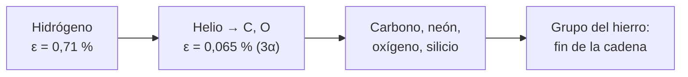

# B24-C08 — Nucleosíntesis estelar

<!-- nav:top -->
[🏠 Programa](../../../../README.md) · [📚 Bloque B24](../../../tronco-comun/B24-fisica-y-evolucion-de-estrellas.md) · [← Anterior: B24-C07 — Ciclo CNO y cadena protón-protón](../B24-C07-ciclo-cno-y-cadena-proton-proton/CLASE.md) · [Siguiente: B24-C09 — Atmósferas y opacidades →](../../../tronco-comun/B24-fisica-y-evolucion-de-estrellas.md#b24-c09)
<!-- /nav -->

## 1. Ubicación, nivel y alcance

Clase 8 del bloque B24. Nivel N3. Cuando el hidrógeno del núcleo se agota ([C06](../B24-C06-fusion-de-hidrogeno/CLASE.md)), el núcleo se contrae y se calienta hasta encender otro combustible. Aquí sigues la secuencia de quemados que fabrica los elementos más pesados que el hidrógeno y el helio. Usas la tabla periódica y las abundancias ([B06-C02](../../B06/B06-C02-tabla-periodica-y-abundancias-cosmicas/CLASE.md)), isótopos ([B06-C03](../../B06/B06-C03-isotopos-y-masa-atomica/CLASE.md)) y ecuaciones diferenciales ([B11-C07](../../B11/B11-C07-runge-kutta-de-cuarto-orden/CLASE.md)). Aquí solo calculas la energía del triple alfa y su cinética; los procesos de captura de neutrones se ven en [C21](../B24-C21-rama-asintotica-de-gigantes-pulsos-termicos-y-proceso-s/CLASE.md).

## 2. Por qué esta clase existe

El carbono de tu cuerpo, el oxígeno que respiras y el hierro de tus huesos se forjaron en estrellas. Entender cómo, y cuánta energía rinde cada etapa, explica por qué la vida de una estrella se acorta con cada combustible y por qué el hierro es el final de la cadena. La decisión central: **¿cuánta energía por unidad de masa rinde cada combustible y qué ritmo de quemado sigue una reacción como el triple alfa?**

## 3. Lo que podrás hacer al terminar

1. Enumerar la secuencia de combustibles nucleares y qué producen.
2. Calcular la energía del triple alfa con masas de referencia.
3. Comparar la energía por unidad de masa de H y He.
4. Integrar y verificar un modelo cinético simple del triple alfa.
5. Explicar por qué las etapas posteriores duran menos.
6. Nombrar por qué la fusión se detiene en el grupo del hierro.

La evidencia es la **tabla de combustibles estelares** del ejercicio 12 (sección 20).

## 4. Con qué llegas y cómo comprobarlo

1. ¿Qué es un isótopo?
2. ¿Qué es la unidad de masa atómica y cuánto vale en MeV?
3. ¿Qué dice la reacción neta de C06?
4. ¿Cómo se integra numéricamente una ecuación `dy/dt = f(y)`?
5. ¿Qué es una reacción de tres cuerpos?

<details>
<summary>Ver respuestas</summary>

1. Un átomo con el mismo número de protones y distinto de neutrones. 2. `1 u = 931,494 MeV/c²`. 3. `4 H → ⁴He` con `Q = 26,73 MeV`. 4. Con pasos como Euler o Runge–Kutta (B11). 5. Una reacción que requiere que tres partículas se encuentren casi a la vez.
</details>

Con cuatro o cinco aciertos, sigue; si no, repasa B06-C02, B06-C03 y B11-C07.

## 5. Un caso real: el carbono del triple alfa

Cuando el núcleo de una estrella se queda sin hidrógeno, sus capas externas lo comprimen y lo calientan; el helio acumulado empieza a fusionar en carbono mediante tres núcleos de helio-4. El laboratorio calcula con masas de NIST que esa reacción libera `7,275 MeV`, es decir, el `0,065 %` de la masa en juego, unas 11 veces menos energía por kilogramo que la fusión de hidrógeno. Es el **ejemplo conductor**. Los modelos de evolución recorren estas etapas para estrellas desde unas 0,1 hasta 300 masas solares (S3, resumen), y la nucleosíntesis de elementos pesados en estrellas de masa baja e intermedia depende de mezclas recurrentes que cambian la composición de la superficie (S4, resumen).

## 6. Vocabulario

La **nucleosíntesis estelar** es la formación de elementos en el interior de las estrellas. El **triple alfa** es la fusión `3 ⁴He → ¹²C`, con ayuda del berilio-8 inestable como paso intermedio. Una **partícula alfa** es un núcleo de helio-4. La **secuencia de quemado** es el orden: hidrógeno, helio, carbono, neón, oxígeno, silicio. El **grupo del hierro** son los núcleos más ligados, donde la fusión deja de liberar energía. La **tasa de reacción** `r` mide la rapidez del triple alfa por unidad de abundancia al cubo. La **abundancia** `Y` es cuántos núcleos de helio quedan, en unidades relativas. La **fracción de masa convertida** `ε` es la porción de masa que se vuelve energía.

## 7. Modelo mental: una escalera cuyos peldaños se acortan

Cada combustible sostiene a la estrella un tiempo; cuando se agota, el núcleo se contrae, se calienta y enciende el siguiente. Cada peldaño rinde menos energía y dura menos.



*Descripción textual:* el núcleo quema hidrógeno, luego helio (con una fracción de masa convertida unas once veces menor), luego combustibles más pesados en etapas cada vez más cortas, hasta el grupo del hierro, donde no se libera más energía.

Analogía: una escalera mecánica que se acelera. Límite: el número de etapas que alcanza una estrella depende de su masa; las de baja masa no pasan del helio o del carbono.

## 8. La explicación, paso a paso

### 8.1 Qué combustible, a qué costo

El hidrógeno enciende hacia `10⁷ K` (C07). Para que el helio-4 se fusione hace falta más temperatura, porque la barrera de Coulomb entre núcleos de carga 2 es mayor; el modelo de Gamow de C07 da la tendencia: más carga, más temperatura. Tras el helio vienen carbono, neón, oxígeno y silicio en estrellas suficientemente masivas (los destinos finales se ven en C18).

### 8.2 Energía del triple alfa

El carbono-12 tiene masa atómica exacta de `12 u` por definición. Con `m_α` y `m_e` de NIST (S1), la masa del helio-4 atómico es `4,002 603 339 u` y `Q = (3 × 4,002 603 339 − 12) u = 0,007 810 u = 7,2750 MeV`. El resultado por la vía de los kilogramos coincide. La fracción de masa convertida es `ε = 6,50 × 10⁻⁴`; la del hidrógeno es `7,12 × 10⁻³`: cociente `10,9`.

### 8.3 Energía por kilogramo y duración

La energía por kilogramo del triple alfa es `ε c² = 5,85 × 10¹³ J/kg`, frente a `6,40 × 10¹⁴` del hidrógeno. Con la misma luminosidad, un núcleo que quema helio dura alrededor de una décima del tiempo que dura con hidrógeno; la luminosidad real de la fase de helio es mayor, así que dura aún menos.

### 8.4 Cinética del triple alfa

La reacción necesita tres núcleos a la vez, por lo que su ritmo es proporcional al cubo de la abundancia: `dY/dt = −3 r Y³`, con `r` una constante. Esta ecuación tiene solución exacta `Y(t) = Y₀ / √(1 + 6 r Y₀² t)`. Con `Y₀ = 1`, `r = 10⁻³` (valores sintéticos) y `t = 50`, `Y = 0,877 058`; el laboratorio integra con Runge–Kutta y recupera la solución exacta a `10⁻⁸`. La abundancia cae como `t^{−1/2}` a tiempos largos, más lentamente que una exponencial.

### 8.5 El final de la cadena

Cada etapa libera menos energía por masa que la anterior. En el grupo del hierro la energía de ligadura por nucleón es máxima: fusionar más no libera energía. Lo que sucede entonces se trata en C18; en estrellas masivas, el desenlace depende sobre todo de las masas del núcleo de helio y de la envoltura de hidrógeno (S2, resumen). Los elementos más pesados que el hierro se forman por captura de neutrones (C21) y por eventos explosivos (otros bloques).

## 9. Magnitudes, símbolos y unidades

| Símbolo | Qué es | Unidad | Valor / nota |
|---|---|---|---|
| `Q_{3α}` | energía del triple alfa | MeV | `7,2750` |
| `ε` | fracción de masa convertida | — | `6,50 × 10⁻⁴` (3α); `7,12 × 10⁻³` (H) |
| `ε c²` | energía por kg | J/kg | `5,85 × 10¹³` (3α); `6,40 × 10¹⁴` (H) |
| `Y`, `r` | abundancia relativa; tasa | —; `t⁻¹` | sintéticos |
| `u` | unidad de masa atómica | MeV | `931,494 103 72` (S1) |

## 10. Convenciones y referencias

La masa atómica del ¹²C es exactamente `12 u`; la del ⁴He se toma como `m_α + 2 m_e` (se desprecia la ligadura electrónica de unos `79 eV`, aproximación declarada). `Y₀`, `r` y `t` del modelo cinético son **sintéticos**.

## 11. De dónde sale lo que afirmamos

| ID | Fuente | Localizador | Respalda | Estado |
|---|---|---|---|---|
| S1 | NIST, *Fundamental Physical Constants — Complete Listing* (CODATA 2022) | https://physics.nist.gov/cuu/Constants/Table/allascii.txt | `m_α`, `m_e`, `m_p` en u; `u` en MeV | Consultada el 2026-11-09 |
| S2 | Heger et al., *How Massive Single Stars End their Life*, arXiv:astro-ph/0212469 | https://arxiv.org/abs/astro-ph/0212469 | Destino de estrellas masivas según el núcleo de helio y la envoltura | Solo resumen, consultado el 2026-11-09 |
| S3 | Choi et al., *MESA Isochrones and Stellar Tracks (MIST). I*, arXiv:1604.08592 | https://arxiv.org/abs/1604.08592 | Modelos de evolución de ~0,1 a 300 `M☉` | Solo resumen, consultado el 2026-11-09 |
| S4 | Karakas y Lattanzio, *The Dawes Review 2*, arXiv:1405.0062 | https://arxiv.org/abs/1405.0062 | Mezclas recurrentes cambian la composición superficial; proceso s | Solo resumen, consultado el 2026-11-09 |

Límites: S2–S4 solo resumen; las temperaturas de encendido y la duración de cada etapa para estrellas concretas no se citan porque no se consultaron tablas de modelos.

## 12. Cómo ver los combustibles

| Combustible | Reacción neta | `ε` | `ε c²` (J/kg) |
|---|---|---|---|
| Hidrógeno | `4 H → ⁴He` | `7,12 × 10⁻³` | `6,40 × 10¹⁴` |
| Helio | `3 ⁴He → ¹²C` | `6,50 × 10⁻⁴` | `5,85 × 10¹³` |

Descripción larga: el helio rinde menos de una décima parte por kilogramo que el hidrógeno.

## 13. Ejemplo trabajado: cuánto dura el helio de un núcleo

**Paso 1 · Datos.** Núcleo de helio de `0,5 M☉` que se convierte entero en carbono; `L = 50 L☉` (ilustrativo).

**Paso 2 · Energía total.** `0,5 × 1,98841 × 10³⁰ × 5,85 × 10¹³ = 5,8 × 10⁴³ J`.

**Paso 3 · Tiempo.** `5,8 × 10⁴³ / (50 × 3,828 × 10²⁶) = 3,0 × 10¹⁵ s = 96 Myr`.

**Paso 4 · Sentido.** El orden de magnitud es de decenas de millones de años, mucho menos que los miles de millones de la fase de hidrógeno. Los valores de masa y luminosidad son ilustrativos.

## 14. Distintas formas de seguir la nucleosíntesis

**Balance de energía (esta clase):** simple, sin cinética. **Cinética con una ecuación (triple alfa):** da la forma de la caída de abundancia. **Red de reacciones con cientos de isótopos:** la usan los códigos reales; exige tasas medidas y un integrador rígido (B11-C22).

## 15. Práctica guiada

**Ejercicio 1 · con los pasos indicados.** Calcula `Q` del triple alfa. *Pasos:* masa del ⁴He atómico, `3 ×`, resta 12 u, por 931,494.

<details><summary>Solución comentada</summary>

`4,001 506 179 + 2 × 0,000 548 580 = 4,002 603 339`; `× 3 − 12 = 0,007 810 017 u`; `× 931,494 = 7,2750 MeV` (8.2).
</details>

**Ejercicio 2 · con una pista.** Calcula la fracción de masa convertida. *Pista:* `Δm / (3 m(⁴He))`.

<details><summary>Solución comentada</summary>

`0,007 810 / 12,007 810 = 6,50 × 10⁻⁴`.
</details>

**Ejercicio 3 · casi autónomo.** ¿Cuántas veces mayor es la `ε` del hidrógeno?

<details><summary>Solución comentada</summary>

`7,12 × 10⁻³ / 6,50 × 10⁻⁴ = 10,9`.
</details>

## 16. Práctica autónoma, transferencia e integrador

**Ejercicio 4.** Calcula la energía por kilogramo del triple alfa.

<details><summary>Solución comentada</summary>

`6,50 × 10⁻⁴ × 8,98755 × 10¹⁶ = 5,85 × 10¹³ J/kg`.
</details>

**Ejercicio 5.** Con `Y₀ = 1`, `r = 10⁻³`, ¿cuánto vale `Y(50)`?

<details><summary>Solución comentada</summary>

`1/√(1 + 6 × 10⁻³ × 50) = 1/√1,3 = 0,8771` (8.4).
</details>

**Ejercicio 6.** ¿En qué tiempo cae `Y` a la mitad?

<details><summary>Solución comentada</summary>

`1 + 6rt = 4`, luego `t = 3/(6r) = 500`.
</details>

**Ejercicio 7.** Si `Y` se reduce a la mitad, ¿cuánto baja la tasa de reacción?

<details><summary>Solución comentada</summary>

La tasa es proporcional a `Y³`: baja a `1/8`.
</details>

**Ejercicio 8.** Si de cada 3 núcleos de helio consumidos nace un carbono, ¿cuántos carbonos hay tras `t = 50` por cada núcleo inicial de helio?

<details><summary>Solución comentada</summary>

Se consumió `1 − 0,877 = 0,123`; carbonos `0,123/3 = 0,041`.
</details>

**Ejercicio 9 · transferencia.** Con la misma luminosidad, ¿qué razón de duraciones tienen la quema de helio y la de hidrógeno en un núcleo del mismo tamaño?

<details><summary>Solución comentada</summary>

`ε_He/ε_H = 1/10,9 ≈ 0,09`: unas once veces menos (8.3).
</details>

**Ejercicio 10 · transferencia.** ¿Por qué la fusión deja de liberar energía en el grupo del hierro?

<details><summary>Solución comentada</summary>

Porque allí la energía de ligadura por nucleón es máxima: fusionar o fisionar desde ahí exige energía (8.5).
</details>

**Ejercicio 11 · transferencia.** Un compañero dice que «todo el carbono se hizo en el Big Bang». Responde con 8.2.

<details><summary>Solución comentada</summary>

El carbono se forma en el interior de estrellas por triple alfa; el análisis del Big Bang (otros bloques) no es objeto de esta clase. Aquí solo se demuestra que el triple alfa libera `7,275 MeV` por reacción y ocurre en núcleos de helio calientes.
</details>

**Ejercicio 12 · integrador.** Elabora tu *tabla de combustibles estelares*: para H y para He, la reacción, `Q`, `ε` y la energía por kilogramo, el cociente entre ambos y un modelo cinético del triple alfa con tiempo de semidesintegración, y dos límites del modelo.

<details><summary>Solución modelo</summary>

Se usa la tabla de la sección 12 y los resultados del laboratorio: `Q_{3α} = 7,275 MeV`, cociente 10,9, `t_{1/2} = 3/(6r)`; límites: sin captura de alfa sobre carbono y tasa constante.
</details>

## 17. Laboratorio: energía del triple alfa y su cinética

El script [combustibles.py](combustibles.py) calcula `Q` del triple alfa de dos maneras (en u y en kg), **comprueba** que coinciden a `10⁻⁶` y que caen en el rango esperado, compara con el hidrógeno e integra `dY/dt = −3rY³` con RK4, **comprobando** que reproduce la solución exacta a `10⁻⁸`.

**Datos:** masas y constantes de NIST; `Y₀`, `r`, `t` **sintéticos**. **Predice antes de ejecutar:** ¿cuántas veces menos energía por masa rinde el helio que el hidrógeno? (unas 11.) **Ejecución del 2026-11-09 (Python 3.12.9):**

```text
Python 3.12.9 (biblioteca estandar)
Q(3 alfa -> C12) = 7.2750 MeV (via kg 7.2750) ; fraccion de masa = 0.000650
Q(4 H -> He4)    = 26.7309 MeV ; fraccion de masa = 0.007119
energia por unidad de masa: H/He = 10.9
Y(t=50) exacta = 0.87705802 ; RK4 = 0.87705802 (Y0=1, r=1e-3, sinteticos)
Pruebas superadas.
```

```bash
python programa/clases/B24/B24-C08-nucleosintesis-estelar/combustibles.py
```

**Límites:** sin la reacción `¹²C(α,γ)¹⁶O`, sin tasas reales, sin electrones libres ni apantallamiento.

## 18. Errores frecuentes y cómo corregirlos

**Pensar que todos los combustibles rinden lo mismo.** Se corrige con los ejercicios 3 y 9.

**Olvidar que el triple alfa es de tres cuerpos.** Se corrige con el ejercicio 7.

**Esperar una caída exponencial.** Se corrige con el ejercicio 6.

**Confundir masa atómica con masa nuclear.** Se corrige con la sección 10.

**Creer que el hierro se forma por fusión exotérmica.** Se corrige con el ejercicio 10.

## 19. Cómo sabrás que vas bien

Tras 8.2: ¿cuánto rinde el triple alfa? Si dudas, ejercicio 1. Tras 8.4: ¿por qué `Y³`? Ejercicio 7. Tras el laboratorio: ¿qué verifica RK4? (la solución exacta de la cinética).

## 20. Qué entregas y cómo se evalúa

El producto es tu **tabla de combustibles estelares** (ejercicio 12).

| Criterio | Inicial | En desarrollo | Logrado | Destacado |
|---|---|---|---|---|
| Secuencia | No la conoce | Parcial | H, He, C… | Explica por qué se acorta |
| Cálculo | Sin unidades | Con errores | `Q`, `ε` correctos | Compara con H |
| Cinética | No la plantea | Sin solución | Resuelve y verifica | Deduce `t_{1/2}` |
| Fuentes | Sin fuente | Sin fecha | S1–S4 con fecha | Declara resúmenes |
| Límites | No los nombra | Uno | Dos | Discute redes completas |

**Condiciones críticas (no se compensan con promedio):** rotular lo sintético; no dar temperaturas de encendido ni duraciones de etapas sin fuente; citar solo lo consultado.

## 21. Ética, seguridad y límites

Clase educativa: no sustituye una red de reacciones con tasas medidas. Accesibilidad: tablas equivalentes a las gráficas, fórmulas en texto, ejercicios sin conexión.

## 22. Para cerrar y seguir

Cada combustible rinde menos energía por kilogramo que el anterior (el triple alfa, unas once veces menos que el hidrógeno) y por eso las etapas se acortan; el triple alfa sigue una cinética de tercer orden con solución exacta. Queda una pregunta: ¿cómo se ve el exterior de la estrella, que es lo único que observamos?

**Glosario español–inglés.** nucleosíntesis · *nucleosynthesis*; triple alfa · *triple-alpha process*; partícula alfa · *alpha particle*; grupo del hierro · *iron group*; secuencia de quemado · *burning sequence*; tasa de reacción · *reaction rate*.

**Continuidad.** [B24-C09](../B24-C09-atmosferas-y-opacidades/CLASE.md) reutiliza el concepto de opacidad para estudiar la capa de donde sale la luz que observamos.

**Referencias:** ver sección 11.

<!-- nav:bottom -->
---

[← Anterior: B24-C07 — Ciclo CNO y cadena protón-protón](../B24-C07-ciclo-cno-y-cadena-proton-proton/CLASE.md) · [📚 Bloque B24](../../../tronco-comun/B24-fisica-y-evolucion-de-estrellas.md) · [Siguiente: B24-C09 — Atmósferas y opacidades →](../../../tronco-comun/B24-fisica-y-evolucion-de-estrellas.md#b24-c09)
<!-- /nav -->
