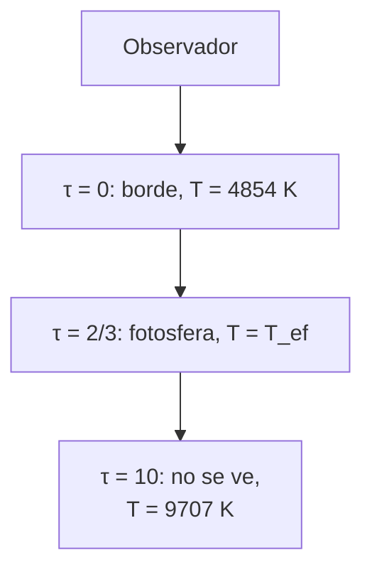

# B24-C09 — Atmósferas y opacidades

<!-- nav:top -->
[🏠 Programa](../../../../README.md) · [📚 Bloque B24](../../../tronco-comun/B24-fisica-y-evolucion-de-estrellas.md) · [← Anterior: B24-C08 — Nucleosíntesis estelar](../B24-C08-nucleosintesis-estelar/CLASE.md) · [Siguiente: B24-C10 — Espectros y clasificación estelar →](../B24-C10-espectros-y-clasificacion-estelar/CLASE.md)
<!-- /nav -->

## 1. Ubicación, nivel y alcance

Clase 9 del bloque B24. Nivel N3. Hasta aquí estudiaste el interior. Lo único que observamos de una estrella es la luz que sale de su **atmósfera**, la capa donde el gas pasa de opaco a transparente. Usas la radiación del cuerpo negro ([B05-C18](../../B05/B05-C18-electromagnetismo-y-radiacion/CLASE.md)), integrales ([B09](../../../tronco-comun/B09-calculo-diferencial-e-integral.md)) y la temperatura efectiva de [C03](../B24-C03-diagrama-de-hertzsprung-russell/CLASE.md). La modelización cuantitativa de atmósferas se profundiza en [B32](../../../tronco-comun/B32-atmosferas-estelares-y-espectroscopia-estelar-cuantitativa.md); aquí se trabaja el caso gris.

## 2. Por qué esta clase existe

Toda temperatura o composición que atribuimos a una estrella se infiere de una capa delgada. Saber de qué profundidad viene la luz, cuánto vale la opacidad y cuánto puede brillar una estrella sin expulsar su atmósfera es lo que permite interpretar espectros (C10) y entender los vientos (C17). La decisión central: **¿a qué profundidad óptica se emite la luz que vemos y qué luminosidad máxima soporta una atmósfera antes de ser expulsada?**

## 3. Lo que podrás hacer al terminar

1. Definir opacidad, profundidad óptica y atmósfera gris.
2. Aplicar la relación `T(τ)` de Eddington y verificar que `T(2/3) = T_ef`.
3. Calcular el oscurecimiento al limbo en la aproximación de Eddington.
4. Calcular la opacidad de Thomson y la luminosidad de Eddington.
5. Estimar la escala de altura de una atmósfera.
6. Nombrar qué deja fuera el modelo gris.

La evidencia es el **perfil de una atmósfera gris** del ejercicio 12 (sección 20).

## 4. Con qué llegas y cómo comprobarlo

1. ¿Qué es la temperatura efectiva?
2. ¿Qué mide la sección eficaz de un proceso?
3. ¿Cómo se calcula una integral numéricamente?
4. ¿Qué es la escala de altura de una atmósfera isoterma?
5. ¿Qué fuerza ejerce la radiación sobre la materia?

<details>
<summary>Ver respuestas</summary>

1. La temperatura del cuerpo negro con la misma luminosidad y radio. 2. Una área efectiva para que ocurra una interacción. 3. Sumando áreas de franjas pequeñas (B09). 4. `H = kT/(μ m_H g)`, la altura en que la presión cae un factor `e`. 5. Una fuerza por absorción o dispersión de fotones, que transfieren momento.
</details>

Con cuatro o cinco aciertos, sigue; si no, repasa B05-C18, B09 y C03.

## 5. Un caso real: la fotosfera del Sol

El Sol tiene una temperatura efectiva de `5772 K` y una gravedad superficial de `274,0 m/s²` (S2, S3). En el modelo gris, la luz que vemos sale de la capa de profundidad óptica `τ ≈ 2/3`, a `5772 K`; la capa más externa (`τ = 0`) está a `4854 K`, y a `τ = 10` la temperatura es `9707 K`. La composición de la fotosfera es un asunto de actualidad: se ha revisado a la baja la abundancia de carbono, nitrógeno, oxígeno y neón (S4, resumen), con consecuencias para la opacidad del interior. Es el **ejemplo conductor**.

## 6. Vocabulario

La **opacidad** `κ` es la sección eficaz de absorción o dispersión por unidad de masa, en `m²/kg`. La **profundidad óptica** `τ` mide cuánta opacidad se atraviesa desde fuera: `τ = ∫ κ ρ dr`; con `τ = 1` la intensidad cae un factor `e`. Una **atmósfera gris** tiene una opacidad independiente de la longitud de onda. La **fotosfera** es la capa de donde sale la mayor parte de la luz, `τ ≈ 2/3`. El **oscurecimiento al limbo** es la caída de brillo hacia el borde del disco. La **dispersión de Thomson** es la dispersión de la luz por electrones libres, con sección eficaz `σ_T`. La **luminosidad de Eddington** es la que equilibra la fuerza de radiación con la gravedad. La **escala de altura** `H` es la altura en que la presión cae un factor `e`.

## 7. Modelo mental: una niebla cuya espesura sube con la profundidad

Mirar una estrella es mirar una niebla: solo ves hasta donde la niebla se vuelve transparente. Más adentro, más caliente; más afuera, más frío.



*Descripción textual:* la temperatura crece con la profundidad óptica; la luz que llega al observador proviene sobre todo de `τ ≈ 2/3`, donde `T = T_ef`.

Analogía: mirar una niebla desde fuera. Límite: la opacidad real depende de la longitud de onda; una atmósfera gris la simplifica.

## 8. La explicación, paso a paso

### 8.1 Temperatura en función de la profundidad

En una atmósfera gris plano–paralela en equilibrio radiativo, en la aproximación de Eddington, `T⁴ = (3/4) T_ef⁴ (τ + 2/3)`. En `τ = 2/3` resulta `T = T_ef`, lo que explica por qué la temperatura efectiva es la de la capa visible. Para el Sol: `4854 K` en `τ = 0`, `6103 K` en `τ = 1`, `6864 K` en `τ = 2` y `9707 K` en `τ = 10`.

### 8.2 Comprobación del flujo

El laboratorio integra la intensidad emergente en profundidad y ángulo, con función fuente `σT⁴/π`, y obtiene un flujo igual a `σT_ef⁴` con un error de `1,2 × 10⁻⁴`: el perfil de Eddington es consistente con la conservación de la energía.

### 8.3 Oscurecimiento al limbo

La intensidad emergente a un ángulo `μ = cos θ` vale `I(μ) ∝ μ + 2/3`. El borde (`μ = 0`) tiene `0,4` veces la intensidad del centro: vemos capas más altas y frías.

### 8.4 Opacidad de Thomson y límite de Eddington

Con una fracción de hidrógeno `X` totalmente ionizado, los electrones libres por unidad de masa son `(1+X)/(2 m_p)` y `κ_es = σ_T (1+X)/(2 m_p)`. Para `X = 0,7`: `κ_es = 0,0338 m²/kg = 0,338 cm²/g`, con `σ_T = 6,652 × 10⁻²⁹ m²` (S1). La fuerza de radiación por unidad de masa a la distancia `r` es `κ L/(4π r² c)`; la gravedad es `GM/r²`. Igualando: `L_Edd = 4π G M c/κ`, independiente de `r`. Para `M = M☉`: `L_Edd = 1,48 × 10³¹ W = 3,9 × 10⁴ L☉`. El laboratorio lo calcula por bisección y por la fórmula, y coinciden.

### 8.5 Escala de altura

Con `T = T_ef`, `μ = 1,3` (gas neutro de composición solar, estimado) y `g = 274,0 m/s²`, `H = kT/(μ m_p g) = 134 km`, unas 5 milésimas del radio: la atmósfera es finísima comparada con la estrella.

### 8.6 Qué falta

La opacidad real depende de la longitud de onda y de la temperatura; las líneas del espectro nacen de ello (C10). La atmósfera puede ser convectiva (C05), no estar en equilibrio local y recibir efectos magnéticos (C12).

## 9. Magnitudes, símbolos y unidades

| Símbolo | Qué es | Unidad | Valor / nota |
|---|---|---|---|
| `κ`, `κ_es` | opacidad; opacidad de Thomson | `m² kg⁻¹` | `0,0338` (`X = 0,7`) |
| `τ` | profundidad óptica | — | `2/3` en la fotosfera |
| `σ_T` | sección eficaz de Thomson | `m²` | `6,652 458 7 × 10⁻²⁹` (S1) |
| `L_Edd` | luminosidad de Eddington | W; `L☉` | `1,48 × 10³¹`; `3,9 × 10⁴` (`M☉`) |
| `H` | escala de altura | km | `134` |
| `T_ef`, `g` | temperatura efectiva; gravedad | K; `m s⁻²` | `5772` (S2); `274,0` (S3) |

## 10. Convenciones y referencias

Atmósfera plano–paralela, gris y en equilibrio radiativo; `X = 0,7` y `μ = 1,3` son **estimados / ilustrativos**. `M☉ = GM☉/G`. `τ` crece hacia el interior.

## 11. De dónde sale lo que afirmamos

| ID | Fuente | Localizador | Respalda | Estado |
|---|---|---|---|---|
| S1 | NIST, *Fundamental Physical Constants — Complete Listing* (CODATA 2022) | https://physics.nist.gov/cuu/Constants/Table/allascii.txt | `σ`, `G`, `c`, `k`, `m_p`, `σ_T` | Consultada el 2026-11-09 |
| S2 | Mamajek et al., *IAU 2015 Resolution B3*, arXiv:1510.07674 | https://arxiv.org/abs/1510.07674 | `GM☉`, `L☉`, `T_ef,☉` | Texto del PDF extraído el 2026-11-09 |
| S3 | NASA/NSSDC, *Sun Fact Sheet* (actualizada 2024-05-09) | https://nssdc.gsfc.nasa.gov/planetary/factsheet/sunfact.html | Gravedad `274,0 m/s²`, composición de la fotosfera | Consultada el 2026-11-09 |
| S4 | Asplund et al., *The chemical composition of the Sun*, arXiv:0909.0948 | https://arxiv.org/abs/0909.0948 | Revisión a la baja de C, N, O, Ne; conflicto con la heliosismología | Solo resumen, consultado el 2026-11-09 |

Límites: S4 solo resumen; la relación de Eddington para `T(τ)` y el límite de Eddington son resultados estándar verificados numéricamente; `X`, `μ` son estimados.

## 12. Cómo ver la atmósfera

| `τ` | `T` (K) del Sol gris |
|---|---|
| 0 | 4854 |
| 2/3 | 5772 |
| 1 | 6103 |
| 2 | 6864 |
| 10 | 9707 |

Descripción larga: la temperatura crece con la profundidad óptica; el cambio entre la capa visible y `τ = 10` es de casi el doble.

## 13. Ejemplo trabajado: la luminosidad de Eddington de una estrella de 20 M☉

**Paso 1 · Datos.** `M = 20 M☉`, `X = 0,7`.

**Paso 2 · Opacidad.** `κ_es = 0,0338 m²/kg` (8.4).

**Paso 3 · Escala.** `L_Edd ∝ M`: `20 × 3,9 × 10⁴ = 7,7 × 10⁵ L☉`.

**Paso 4 · Sentido.** Una estrella que supere esta luminosidad vería su atmósfera empujada por la radiación. Es un límite para gas totalmente ionizado con opacidad de Thomson; la opacidad real puede ser mayor.

## 14. Distintas formas de describir una atmósfera

**Gris de Eddington (esta clase):** analítica, da `T(τ)`. **Atmósferas con opacidad real por longitud de onda:** las que se comparan con espectros (B32). **Modelos tridimensionales con convección:** usados para abundancias solares (S4). Se empieza por la gris.

## 15. Práctica guiada

**Ejercicio 1 · con los pasos indicados.** Calcula `T` en `τ = 1` para el Sol. *Pasos:* `T⁴ = (3/4) T_ef⁴ (1 + 2/3)`.

<details><summary>Solución comentada</summary>

`(3/4)(5/3) = 1,25`; `T = 5772 × 1,25^{1/4} = 5772 × 1,0574 = 6103 K`.
</details>

**Ejercicio 2 · con una pista.** Calcula `κ_es` para `X = 0,7`. *Pista:* `σ_T(1+X)/(2m_p)`.

<details><summary>Solución comentada</summary>

`6,6525 × 10⁻²⁹ × 1,7/(2 × 1,6726 × 10⁻²⁷) = 0,0338 m²/kg`.
</details>

**Ejercicio 3 · casi autónomo.** Calcula `L_Edd` para `1 M☉` en `L☉`.

<details><summary>Solución comentada</summary>

`4π G M c/κ = 1,48 × 10³¹ W`; entre `3,828 × 10²⁶` da `3,9 × 10⁴ L☉`.
</details>

## 16. Práctica autónoma, transferencia e integrador

**Ejercicio 4.** ¿Cuánto vale el cociente de intensidad entre el borde y el centro del disco?

<details><summary>Solución comentada</summary>

`(2/3)/(1 + 2/3) = 0,4` (8.3).
</details>

**Ejercicio 5.** Calcula la escala de altura para `T = 5772 K`, `μ = 1,3`, `g = 274 m/s²`.

<details><summary>Solución comentada</summary>

`1,3806 × 10⁻²³ × 5772/(1,3 × 1,6726 × 10⁻²⁷ × 274) = 134 km`.
</details>

**Ejercicio 6.** Si el gas fuera hidrógeno puro y ionizado (`X = 1`), ¿cuánto vale `κ_es` y cómo cambia `L_Edd`?

<details><summary>Solución comentada</summary>

`κ = σ_T(1+1)/(2 m_p) = 6,6525 × 10⁻²⁹/1,6726 × 10⁻²⁷ = 0,0398 m²/kg`; `L_Edd` baja un factor `0,0338/0,0398 = 0,85`. (Con helio puro, `X = 0`, `κ = 0,0199` y `L_Edd` sube 1,7 veces.)
</details>

**Ejercicio 7.** ¿Cuánto vale `L_Edd` para `M = 0,5 M☉`?

<details><summary>Solución comentada</summary>

`0,5 × 3,9 × 10⁴ = 1,9 × 10⁴ L☉`. Una estrella de baja masa está muy por debajo de su límite.
</details>

**Ejercicio 8.** ¿Cuántas veces es mayor la temperatura en `τ = 10` que en `τ = 2/3`?

<details><summary>Solución comentada</summary>

`9707/5772 = 1,68`.
</details>

**Ejercicio 9 · transferencia.** Una estrella de `40 M☉` tiene `L = 2,5 × 10⁵ L☉` (ilustrativo). ¿Qué fracción de su `L_Edd` emite?

<details><summary>Solución comentada</summary>

`L_Edd = 40 × 3,86 × 10⁴ = 1,55 × 10⁶ L☉`; fracción `2,5 × 10⁵/1,55 × 10⁶ = 0,16`.
</details>

**Ejercicio 10 · transferencia.** Un compañero dice que «la superficie de una estrella es donde empieza el gas». Responde con 8.1.

<details><summary>Solución comentada</summary>

No hay borde nítido: la «superficie» es la capa `τ ≈ 2/3` de la que sale la luz, y su altura depende de la longitud de onda (en la realidad) y del observador.
</details>

**Ejercicio 11 · transferencia.** Las revisiones a la baja de C, N, O y Ne (S4) ¿qué efecto tienen sobre la opacidad del interior solar?

<details><summary>Solución comentada</summary>

Menos elementos pesados significa menos opacidad en el interior; S4 (resumen) dice que ello choca con los modelos basados en heliosismología, un conflicto que el resumen califica de no resuelto.
</details>

**Ejercicio 12 · integrador.** Elabora tu *perfil de una atmósfera gris*: elige una `T_ef`, calcula `T` para cinco valores de `τ`, el oscurecimiento al limbo, `κ_es` y `L_Edd` para una masa, la escala de altura y dos límites.

<details><summary>Solución modelo</summary>

Con la tabla de la sección 12 (Sol), `0,4`, `0,0338 m²/kg`, `3,9 × 10⁴ L☉`, `134 km`; límites: opacidad gris y equilibrio local.
</details>

## 17. Laboratorio: atmósfera gris y Eddington

El script [atmosfera_gris.py](atmosfera_gris.py) verifica que `T(2/3) = T_ef`, integra el flujo emergente y **comprueba** que coincide con `σT_ef⁴` (tolerancia `10⁻³`), calcula `κ_es` y obtiene `L_Edd` por bisección, **comprobando** que coincide con la forma cerrada a `10⁻⁹`.

**Datos:** constantes de NIST; valores solares nominales de IAU y NASA; `X` y `μ` ilustrativos. **Predice antes de ejecutar:** ¿cuál es la temperatura en `τ = 2/3`? (`T_ef`.) **Ejecución del 2026-11-09 (Python 3.12.9):**

```text
Python 3.12.9 (biblioteca estandar)
flujo emergente numerico / sigma T_ef^4 = 0.99988
kappa_es (X=0.7) = 0.03381 m2/kg = 0.338 cm2/g
L_Edd(1 Msol) = 1.4789e+31 W = 38634 L_sol
escala de altura (T_ef, mu=1.3, g=274.0) = 134 km
tau = 0.000 -> T =  4853.7 K
tau = 0.667 -> T =  5772.0 K
tau = 1.000 -> T =  6103.1 K
tau = 2.000 -> T =  6864.1 K
tau = 10.000 -> T =  9707.3 K
limbo: I(mu=0)/I(mu=1) = 0.400
Pruebas superadas.
```

```bash
python programa/clases/B24/B24-C09-atmosferas-y-opacidades/atmosfera_gris.py
```

**Límites:** opacidad gris, sin líneas ni convección, plano–paralela.

## 18. Errores frecuentes y cómo corregirlos

**Pensar que la luz sale de `τ = 0`.** Se corrige con 8.1.

**Confundir `T_ef` con la temperatura central.** Se corrige con el ejercicio 8.

**Aplicar `L_Edd` con la opacidad equivocada.** Se corrige con el ejercicio 6.

**Olvidar que `H` es muy pequeña frente a `R`.** Se corrige con el ejercicio 5.

**Tratar el modelo gris como espectro.** Se corrige con la sección 8.6.

## 19. Cómo sabrás que vas bien

Tras 8.1: ¿qué temperatura tiene la capa visible? Si dudas, ejercicio 1. Tras 8.4: ¿qué iguala `L_Edd`? Ejercicio 3. Tras el laboratorio: ¿qué comprueba la cuadratura del flujo? (la consistencia energética del perfil de Eddington).

## 20. Qué entregas y cómo se evalúa

El producto es tu **perfil de una atmósfera gris** (ejercicio 12).

| Criterio | Inicial | En desarrollo | Logrado | Destacado |
|---|---|---|---|---|
| Conceptos | Los confunde | Parciales | `τ`, fotosfera, Thomson | Explica el limbo |
| Cálculo | Sin unidades | Con errores | `T(τ)`, `κ_es`, `L_Edd` | Cambia `X` y compara |
| Numérico | Sin comprobar | Un caso | Flujo y bisección verificados | Explica la tolerancia |
| Fuentes | Sin fuente | Sin fecha | S1–S4 con fecha | Declara que S4 es resumen |
| Límites | No los nombra | Uno | Tres | Discute opacidad real |

**Condiciones críticas (no se compensan con promedio):** rotular `X` y `μ` como estimados; no tratar `L_Edd` de Thomson como límite absoluto; citar solo lo consultado.

## 21. Ética, seguridad y límites

Clase educativa: no sustituye atmósferas modelo con opacidades reales. Accesibilidad: tablas equivalentes a las gráficas, fórmulas en texto, ejercicios sin conexión.

## 22. Para cerrar y seguir

La luz de una estrella viene de la capa `τ ≈ 2/3`, donde `T = T_ef`; la opacidad de Thomson fija una luminosidad de Eddington de `3,9 × 10⁴ L☉` por masa solar. Queda una pregunta: ¿cómo leemos en esa luz la temperatura y la composición?

**Glosario español–inglés.** opacidad · *opacity*; profundidad óptica · *optical depth*; atmósfera gris · *grey atmosphere*; fotosfera · *photosphere*; oscurecimiento al limbo · *limb darkening*; dispersión de Thomson · *Thomson scattering*; luminosidad de Eddington · *Eddington luminosity*; escala de altura · *scale height*.

**Continuidad.** [B24-C10](../B24-C10-espectros-y-clasificacion-estelar/CLASE.md) reutiliza la temperatura de la fotosfera para leer el espectro.

**Referencias:** ver sección 11.

<!-- nav:bottom -->
---

[← Anterior: B24-C08 — Nucleosíntesis estelar](../B24-C08-nucleosintesis-estelar/CLASE.md) · [📚 Bloque B24](../../../tronco-comun/B24-fisica-y-evolucion-de-estrellas.md) · [Siguiente: B24-C10 — Espectros y clasificación estelar →](../B24-C10-espectros-y-clasificacion-estelar/CLASE.md)
<!-- /nav -->
