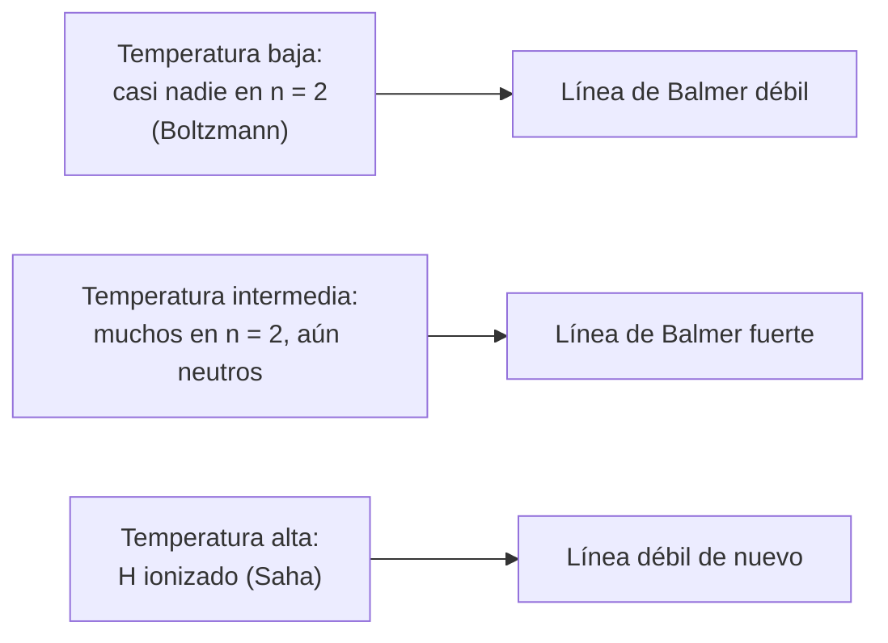

# B24-C10 — Espectros y clasificación estelar

<!-- nav:top -->
[🏠 Programa](../../../../README.md) · [📚 Bloque B24](../../../tronco-comun/B24-fisica-y-evolucion-de-estrellas.md) · [← Anterior: B24-C09 — Atmósferas y opacidades](../B24-C09-atmosferas-y-opacidades/CLASE.md) · [Siguiente: B24-C11 — Rotación y campos magnéticos →](../B24-C11-rotacion-y-campos-magneticos/CLASE.md)
<!-- /nav -->

## 1. Ubicación, nivel y alcance

Clase 10 del bloque B24. Nivel N3. Con la atmósfera de [C09](../B24-C09-atmosferas-y-opacidades/CLASE.md) puedes explicar qué hay en la luz de una estrella: un continuo de cuerpo negro con líneas de absorción. Aquí aprendes a leer esas líneas para clasificar la estrella. Usas la radiación térmica ([B05-C18](../../B05/B05-C18-electromagnetismo-y-radiacion/CLASE.md)), los espectros atómicos ([B06-C17](../../B06/B06-C17-espectros-atomicos-y-moleculares/CLASE.md)) y la estructura atómica ([B06-C01](../../B06/B06-C01-estructura-atomica/CLASE.md)). La espectroscopia cuantitativa se desarrolla en [B32](../../../tronco-comun/B32-atmosferas-estelares-y-espectroscopia-estelar-cuantitativa.md).

## 2. Por qué esta clase existe

La intensidad de una línea espectral no crece simplemente con la temperatura: depende de cuántos átomos están en el nivel adecuado y de cuántos están ionizados. Por eso un mismo elemento domina en estrellas de temperaturas muy distintas. La clasificación espectral es la herramienta para ordenar las estrellas por temperatura. La decisión central: **dada la temperatura de una atmósfera, ¿dónde cae el máximo de la emisión y qué tan intensa es una línea de hidrógeno?**

## 3. Lo que podrás hacer al terminar

1. Aplicar la ley de Wien y calcular la longitud de onda del máximo.
2. Aplicar la ecuación de Boltzmann a poblaciones de niveles.
3. Aplicar la ecuación de Saha a la ionización.
4. Explicar por qué la intensidad de las líneas de Balmer tiene un máximo con la temperatura.
5. Relacionar la secuencia espectral con la temperatura efectiva.
6. Nombrar las limitaciones de la clasificación (presión, abundancias, extinción).

La evidencia es la **ficha de clasificación de una estrella** del ejercicio 12 (sección 20).

## 4. Con qué llegas y cómo comprobarlo

1. ¿Qué es un espectro continuo y uno de líneas?
2. ¿Qué es un nivel de energía atómico?
3. ¿Qué es la energía de ionización?
4. ¿Qué es una distribución de Boltzmann?
5. ¿Qué es un electronvoltio en kelvin (aproximadamente)?

<details>
<summary>Ver respuestas</summary>

1. El continuo tiene todas las longitudes de onda; el de líneas, solo algunas. 2. Una energía permitida de un electrón en el átomo. 3. La energía para arrancar un electrón: `13,6 eV` en el hidrógeno. 4. La probabilidad de un nivel decrece como `exp(−E/kT)`. 5. `1 eV ↔ 11 600 K`.
</details>

Con cuatro o cinco aciertos, sigue; si no, repasa B05-C18 y B06-C17.

## 5. Un caso real: ¿por qué el hidrógeno es visible en estrellas de 10 000 K y no en el Sol?

El hidrógeno es el elemento más abundante en las estrellas (en el Sol, un `90,97 %` de la fotosfera por número, S3), pero las líneas de Balmer son muy débiles en el Sol y muy fuertes en estrellas de tipo A. La razón no es la abundancia sino la excitación e ionización: las líneas de Balmer parten del segundo nivel y esa población es mínima a `5772 K` y desaparece cuando el hidrógeno se ioniza. El laboratorio, con una atmósfera de hidrógeno **ilustrativa** (presión electrónica de 1 Pa), da un máximo en `8500 K`. Es el **ejemplo conductor**. Pecaut y Mamajek construyeron una escala de colores y temperaturas para estrellas desde O9V hasta M9V (S4, resumen).

## 6. Vocabulario

La **ley de Wien** liga la temperatura de un cuerpo negro con la longitud de onda del máximo: `λ_max T = b`, con `b = 2,897 771 955 × 10⁻³ m·K` (S1). El **tipo espectral** (O, B, A, F, G, K, M, de caliente a frío) es una clasificación por las líneas. La **ecuación de Boltzmann** da la fracción de átomos en un nivel excitado: `n₂/n₁ = (g₂/g₁) exp(−ΔE/kT)`, con `g` los pesos estadísticos. La **ecuación de Saha** da la fracción de átomos ionizados, función de `T` y de la presión electrónica `P_e`. La **serie de Balmer** son las líneas del hidrógeno que parten del nivel `n = 2`. Una **clase de luminosidad** distingue enanas, gigantes y supergigantes. El **peso estadístico** de un nivel `n` del hidrógeno es `2n²`.

## 7. Modelo mental: un campo de Goldilocks para cada línea

Una línea es fuerte cuando hay muchos átomos en el nivel de partida: ni tan fríos que casi ninguno esté excitado, ni tan calientes que estén ionizados.



*Descripción textual:* Boltzmann aumenta la población del segundo nivel con la temperatura, pero Saha ioniza el hidrógeno a temperaturas mayores; el producto tiene un máximo en una temperatura intermedia.

Analogía: una fiesta que solo funciona si hay música (excitación) y gente que no se ha ido (neutros). Límite: es una ilustración de un máximo; no da el valor numérico.

## 8. La explicación, paso a paso

### 8.1 Dónde cae el máximo

La función de Planck `B_λ(T)` tiene un máximo en `λ_max = b/T`. El laboratorio busca el máximo numéricamente y recupera la constante de NIST a `10⁻⁶`. Resultados: `3200 K → 905,6 nm`; `5772 K → 502,0 nm`; `9900 K → 292,7 nm`; `30 000 K → 96,6 nm`. Las estrellas más calientes emiten su máximo en el ultravioleta.

### 8.2 Boltzmann

La razón entre la población del nivel 2 y la del nivel 1 del hidrógeno es `4 exp(−10,2 eV/kT)`. A `10 000 K`, con `kT = 0,862 eV`, vale `2,9 × 10⁻⁵`: casi todo el hidrógeno neutro está en el estado fundamental, y aun así hay átomos suficientes en `n = 2` para producir líneas visibles porque la cantidad total de hidrógeno es enorme.

### 8.3 Saha

La fracción ionizada cumple `n_II/n_I = (kT/P_e) (2π m_e kT/h²)^{3/2} exp(−χ/kT)`, con `χ = 13,606 eV` la energía de ionización (S1) y `P_e` la presión de los electrones libres. El factor de traslación se verifica en el laboratorio por integración numérica del espacio de fases. Con `P_e = 1 Pa` (ilustrativo), a `9900 K` solo queda un `2,5 %` de hidrógeno neutro.

### 8.4 El máximo de Balmer

La intensidad relativa de la línea de Balmer es proporcional a la fracción de hidrógeno neutro por la fracción de neutros en `n = 2`. Con las hipótesis del laboratorio (hidrógeno puro, `P_e = 1 Pa`, niveles hasta `n = 6`) el máximo está en `8500 K`; a `5772 K` la intensidad es el `0,4 %` del máximo y a `30 000 K`, el `0,14 %`. El valor del máximo depende de `P_e` y de la composición; no es un resultado observacional.

### 8.5 La secuencia espectral

El orden O, B, A, F, G, K, M corresponde a temperaturas decrecientes. Cada tipo muestra líneas distintas porque cada elemento y cada estado de ionización tiene su propia zona de máxima intensidad. La escala de temperaturas que corresponde a cada tipo depende de la clase de luminosidad y de la edad: las estrellas pre-secuencia principal de tipos G5 a K6 son unos `250 K` más frías que las enanas (S4, resumen).

## 9. Magnitudes, símbolos y unidades

| Símbolo | Qué es | Unidad | Valor / nota |
|---|---|---|---|
| `b` | constante de Wien | m·K | `2,897 771 955 × 10⁻³` (S1) |
| `λ_max` | longitud de onda del máximo | nm | `502,0` a `5772 K` |
| `χ` | energía de ionización del H | eV | `13,6057` (S1) |
| `ΔE` | energía de excitación n = 1 → 2 | eV | `10,20` |
| `P_e` | presión electrónica | Pa | `1` (ilustrativo) |
| `g_n` | peso estadístico | — | `2n²` |

## 10. Convenciones y referencias

Equilibrio termodinámico local, atmósfera de hidrógeno puro, suma de estados hasta `n = 6`; `P_e = 1 Pa` es **ilustrativo**. Longitudes de onda en el vacío. Tipos espectrales de caliente (O) a frío (M).

## 11. De dónde sale lo que afirmamos

| ID | Fuente | Localizador | Respalda | Estado |
|---|---|---|---|---|
| S1 | NIST, *Fundamental Physical Constants — Complete Listing* (CODATA 2022) | https://physics.nist.gov/cuu/Constants/Table/allascii.txt | `b` de Wien, `h`, `c`, `k`, `m_e`, `χ` (Rydberg en eV) | Consultada el 2026-11-09 |
| S2 | Mamajek et al., *IAU 2015 Resolution B3*, arXiv:1510.07674 | https://arxiv.org/abs/1510.07674 | `T_ef,☉` | Texto del PDF extraído el 2026-11-09 |
| S3 | NASA/NSSDC, *Sun Fact Sheet* (actualizada 2024-05-09) | https://nssdc.gsfc.nasa.gov/planetary/factsheet/sunfact.html | Composición de la fotosfera (H 90,965 %) | Consultada el 2026-11-09 |
| S4 | Pecaut y Mamajek, arXiv:1307.2657 | https://arxiv.org/abs/1307.2657 | Escala de colores y temperaturas O9V–M9V; pre-secuencia G5–K6 ~250 K más fría | Solo resumen, consultado el 2026-11-09 |

Límites: S4 solo resumen; las ecuaciones de Boltzmann y Saha son estándar y se verifican parcialmente (factor de traslación) por integración; el hidrógeno de S3 es porcentaje de la fotosfera según la hoja (la hoja no dice «por número»; aquí se usa sin interpretar más).

## 12. Cómo ver la clasificación

| Tipo (orientativo) | `T_ef` (K) | `λ_max` (nm) |
|---|---|---|
| M (enana roja) | 3200 | 906 |
| G (tipo solar) | 5772 | 502 |
| A (blanca) | 9900 | 293 |
| O/B (muy caliente) | 30 000 | 96,6 |

Descripción larga: el máximo de emisión se desplaza del infrarrojo cercano al visible y al ultravioleta lejano al subir la temperatura. Las temperaturas son ejemplos, no la escala oficial (S4).

## 13. Ejemplo trabajado: clasificar una estrella por su máximo

**Paso 1 · Datos.** Una estrella tiene su máximo de emisión en `644 nm`.

**Paso 2 · Wien.** `T = b/λ_max = 2,8978 × 10⁻³ / 6,44 × 10⁻⁷ = 4500 K`.

**Paso 3 · Tipo.** Corresponde a una estrella fría, de tipo K orientativo.

**Paso 4 · Sentido.** Es una estimación por el continuo; la clasificación se confirma con las líneas, porque el color depende también de la extinción y la composición.

## 14. Distintas formas de clasificar

**Por el continuo (color, Wien):** rápido, sensible al enrojecimiento interestelar. **Por las líneas (tipo espectral):** casi independiente del enrojecimiento. **Por espectroscopia cuantitativa (B32):** da `T_ef`, `log g`, abundancias. Se combinan.

## 15. Práctica guiada

**Ejercicio 1 · con los pasos indicados.** Calcula `λ_max` para `5772 K`. *Pasos:* `b/T`.

<details><summary>Solución comentada</summary>

`2,897 77 × 10⁻³/5772 = 5,020 × 10⁻⁷ m = 502,0 nm`.
</details>

**Ejercicio 2 · con una pista.** Calcula `λ_max` para `3200 K`. *Pista:* misma fórmula.

<details><summary>Solución comentada</summary>

`905,6 nm`: infrarrojo cercano.
</details>

**Ejercicio 3 · casi autónomo.** ¿A qué temperatura el máximo está en `100 nm`?

<details><summary>Solución comentada</summary>

`T = 2,8978 × 10⁻³/10⁻⁷ = 28 978 K`.
</details>

## 16. Práctica autónoma, transferencia e integrador

**Ejercicio 4.** ¿Dónde está el máximo para `9900 K` y en qué región del espectro?

<details><summary>Solución comentada</summary>

`292,7 nm`: ultravioleta cercano; las estrellas A se ven blancas porque emiten mucho en el visible, no porque su máximo esté ahí.
</details>

**Ejercicio 5.** Calcula `n₂/n₁` del hidrógeno a `10 000 K`.

<details><summary>Solución comentada</summary>

`kT = 0,8617 eV`; `10,204/0,8617 = 11,84`; `4 e^{−11,84} = 2,9 × 10⁻⁵` (8.2).
</details>

**Ejercicio 6.** Con `P_e = 1 Pa`, ¿qué fracción de hidrógeno neutro hay a `9900 K`?

<details><summary>Solución comentada</summary>

`1/(1 + n_II/n_I) = 0,025` (8.3).
</details>

**Ejercicio 7.** ¿Por qué la línea de Balmer es débil a `5772 K` y a `30 000 K`?

<details><summary>Solución comentada</summary>

A `5772 K` casi ningún átomo está en `n = 2` (Boltzmann); a `30 000 K` casi todo el hidrógeno está ionizado (Saha). Intensidades relativas: `0,4 %` y `0,14 %` del máximo (8.4).
</details>

**Ejercicio 8.** Si el máximo de Balmer del laboratorio está en `8500 K`, ¿es el valor de las estrellas A reales? Responde.

<details><summary>Solución comentada</summary>

No necesariamente: depende de `P_e`, de los niveles incluidos y de la composición. Es una ilustración cualitativa (8.4).
</details>

**Ejercicio 9 · transferencia.** Una estrella tiene el máximo en `644 nm`. ¿Qué temperatura da el continuo? ¿Qué problema podría tener si hay polvo interestelar entre ella y nosotros?

<details><summary>Solución comentada</summary>

`4500 K`. El polvo enrojece la luz y haría parecer más fría la estrella; por eso se contrastan con las líneas (14).
</details>

**Ejercicio 10 · transferencia.** Un compañero dice: «las estrellas más calientes tienen las líneas de hidrógeno más fuertes». Respóndele con 8.4.

<details><summary>Solución comentada</summary>

La línea de Balmer tiene un máximo a una temperatura intermedia; en estrellas muy calientes el hidrógeno está ionizado y la línea es más débil que en estrellas de tipo A.
</details>

**Ejercicio 11 · transferencia.** Una estrella joven de tipo K3 se clasifica con una escala de enanas. ¿En qué sentido está el sesgo de la temperatura?

<details><summary>Solución comentada</summary>

La estrella pre-secuencia principal es unos `250 K` más fría que la enana (S4, resumen); usar la escala de enanas la sobrestima.
</details>

**Ejercicio 12 · integrador.** Elabora tu *ficha de clasificación de una estrella*: da `λ_max`, calcula `T` por Wien, estima la ionización del hidrógeno con Saha (a una `P_e` declarada), indica si la línea de Balmer sería fuerte o débil y nombra dos sesgos.

<details><summary>Solución modelo</summary>

Con `λ_max = 292,7 nm`: `T = 9900 K`; Saha da 2,5 % neutro (con `P_e = 1 Pa`); Balmer cerca del máximo; sesgos: extinción interestelar y dependencia de `P_e`; rotulado como ilustrativo.
</details>

## 17. Laboratorio: Wien, Boltzmann y Saha

El script [espectros.py](espectros.py) busca el máximo de Planck por razón áurea y **comprueba** que `λ_max T` coincide con la constante de NIST (tolerancia `10⁻⁶`); **verifica** el factor de traslación de Saha por integración numérica del espacio de fases (`10⁻³`); calcula la fracción neutra y la intensidad relativa de Balmer y localiza el máximo.

**Datos:** constantes de NIST; `P_e = 1 Pa` y composición de hidrógeno puro **ilustrativas**. **Predice antes de ejecutar:** ¿el máximo de Balmer estará por debajo o por encima de la temperatura solar? (por encima.) **Ejecución del 2026-11-09 (Python 3.12.9):**

```text
Python 3.12.9 (biblioteca estandar)
T =    3200 K -> lambda_max =   905.6 nm
T =    5772 K -> lambda_max =   502.0 nm
T =    9900 K -> lambda_max =   292.7 nm
T =   30000 K -> lambda_max =    96.6 nm
Saha: fraccion neutra a 9900 K = 0.025
Balmer (relativo) a 5772 K = 4.01e-03 ; a 30000 K = 1.42e-03
maximo de la linea de Balmer (P_e = 1 Pa, H puro): T = 8500 K
Pruebas superadas.
```

```bash
python programa/clases/B24/B24-C10-espectros-y-clasificacion-estelar/espectros.py
```

**Límites:** hidrógeno puro, equilibrio local, sin ensanchamiento ni apilamiento de líneas, sin profundidad de línea.

## 18. Errores frecuentes y cómo corregirlos

**Pensar que línea fuerte significa más abundancia.** Se corrige con el ejercicio 7.

**Suponer que más caliente es más línea.** Se corrige con el ejercicio 10.

**Usar el color sin considerar el polvo.** Se corrige con el ejercicio 9.

**Olvidar los pesos estadísticos.** Se corrige con el ejercicio 5 (el factor 4).

**Tratar el máximo del laboratorio como observación.** Se corrige con el ejercicio 8.

## 19. Cómo sabrás que vas bien

Tras 8.1: ¿sabes calcular `λ_max`? Si dudas, ejercicios 1–3. Tras 8.4: ¿por qué hay un máximo? Ejercicio 7. Tras el laboratorio: ¿qué verifica la cuadratura de la traslación? (el factor de Saha).

## 20. Qué entregas y cómo se evalúa

El producto es tu **ficha de clasificación de una estrella** (ejercicio 12).

| Criterio | Inicial | En desarrollo | Logrado | Destacado |
|---|---|---|---|---|
| Conceptos | Los confunde | Parciales | Wien, Boltzmann, Saha | Explica el máximo |
| Cálculo | Sin unidades | Con errores | `T`, `λ_max`, ionización | Declara `P_e` |
| Numérico | Sin comprobar | Un caso | Dos verificaciones | Explica la tolerancia |
| Fuentes | Sin fuente | Sin fecha | S1–S4 con fecha | Declara que S4 es resumen |
| Límites | No los nombra | Uno | Tres | Discute extinción |

**Condiciones críticas (no se compensan con promedio):** rotular `P_e` y el modelo de hidrógeno puro como ilustrativos; no presentar el máximo de `8500 K` como medida; citar solo lo consultado.

## 21. Ética, seguridad y límites

Clase educativa: no sustituye una clasificación con espectros reales y estándares MK. Accesibilidad: tablas equivalentes a las gráficas, fórmulas en texto, ejercicios sin conexión.

## 22. Para cerrar y seguir

El máximo del continuo da la temperatura por Wien, y la intensidad de las líneas depende de Boltzmann y Saha, de modo que tiene un máximo con la temperatura; la secuencia O–M ordena las estrellas por `T_ef`. Queda una pregunta: ¿qué otras propiedades, además de la temperatura, cambian el aspecto de una estrella, como su giro y su campo magnético?

**Glosario español–inglés.** ley de Wien · *Wien's law*; ecuación de Boltzmann · *Boltzmann equation*; ecuación de Saha · *Saha equation*; serie de Balmer · *Balmer series*; tipo espectral · *spectral type*; peso estadístico · *statistical weight*; presión electrónica · *electron pressure*.

**Continuidad.** [B24-C11](../B24-C11-rotacion-y-campos-magneticos/CLASE.md) reutiliza la fotosfera para estudiar la rotación y el campo que afectan a las líneas.

**Referencias:** ver sección 11.

<!-- nav:bottom -->
---

[← Anterior: B24-C09 — Atmósferas y opacidades](../B24-C09-atmosferas-y-opacidades/CLASE.md) · [📚 Bloque B24](../../../tronco-comun/B24-fisica-y-evolucion-de-estrellas.md) · [Siguiente: B24-C11 — Rotación y campos magnéticos →](../B24-C11-rotacion-y-campos-magneticos/CLASE.md)
<!-- /nav -->
