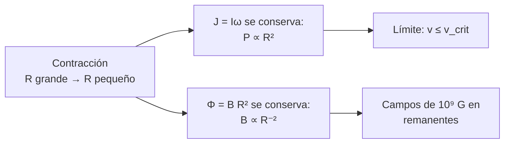

# B24-C11 — Rotación y campos magnéticos

<!-- nav:top -->
[🏠 Programa](../../../../README.md) · [📚 Bloque B24](../../../tronco-comun/B24-fisica-y-evolucion-de-estrellas.md) · [← Anterior: B24-C10 — Espectros y clasificación estelar](../B24-C10-espectros-y-clasificacion-estelar/CLASE.md) · [Siguiente: B24-C12 — Manchas y actividad estelar →](../B24-C12-manchas-y-actividad-estelar/CLASE.md)
<!-- /nav -->

## 1. Ubicación, nivel y alcance

Clase 11 del bloque B24. Nivel N3. Las estrellas giran y tienen campos magnéticos, y ambos cambian con el tiempo. Aquí calculas velocidades de rotación, el límite crítico de giro y qué ocurre con el giro y el campo cuando una estrella se contrae. Usas el momento angular ([B05-C09](../../B05/B05-C09-momento-angular-y-torque/CLASE.md)), los campos magnéticos ([B05-C17](../../B05/B05-C17-campos-magneticos/CLASE.md)) y la integración ([B09](../../../tronco-comun/B09-calculo-diferencial-e-integral.md)). La física de plasmas del campo se profundiza en [B30](../../../tronco-comun/B30-heliofisica-y-fisica-de-plasmas.md); aquí se usan leyes de conservación.

## 2. Por qué esta clase existe

La rotación y el campo explican por qué las estrellas jóvenes son más activas, por qué las enanas blancas y las estrellas de neutrones giran y se magnetizan tanto, y por qué no pueden girar a cualquier velocidad. La decisión central: **dada una estrella que se contrae, ¿cómo cambian su giro y su campo y qué límite impide girar más rápido?**

## 3. Lo que podrás hacer al terminar

1. Calcular la velocidad de rotación en la superficie a una latitud.
2. Calcular la velocidad crítica de rotación.
3. Calcular el momento de inercia de una esfera uniforme y verificarlo por integración.
4. Aplicar la conservación del momento angular y del flujo magnético a una contracción.
5. Interpretar el número de Rossby y la saturación de la actividad.
6. Nombrar qué limita el modelo (rotación diferencial, pérdida de momento angular).

La evidencia es la **ficha de rotación y campo** del ejercicio 12 (sección 20).

## 4. Con qué llegas y cómo comprobarlo

1. ¿Qué es el momento angular de un cuerpo que gira?
2. ¿Qué es un periodo de rotación y cómo se relaciona con la frecuencia angular `ω`?
3. ¿Qué es el flujo magnético a través de una superficie?
4. ¿Qué dice la tercera ley de Newton sobre el equilibrio entre gravedad y fuerza centrífuga?
5. ¿Cómo se integra en coordenadas esféricas?

<details>
<summary>Ver respuestas</summary>

1. `L = I ω`, con `I` el momento de inercia. 2. `ω = 2π/P`. 3. `Φ = B × área` si `B` es uniforme y perpendicular. 4. La fuerza centrífuga `ω² r` compite con la gravedad `GM/r²`. 5. Con el elemento de volumen `r² sen θ dr dθ dφ`.
</details>

Con cuatro o cinco aciertos, sigue; si no, repasa B05-C09, B05-C17 y B09.

## 5. Un caso real: ¿con qué rapidez gira el Sol?

El periodo sideral del Sol es de `609,12 h` a `16°` de latitud (S2, hoja de datos de la NASA), lo que da una velocidad de `1,92 km/s` en ese paralelo con el radio nominal `6,957 × 10⁸ m` (S1). La velocidad crítica `√(GM/R)` es `436,8 km/s`: el Sol gira al `0,44 %` de su límite. Es el **ejemplo conductor**. En una muestra de `34 030` estrellas de la secuencia principal con datos de Kepler (de unas `133 030`, un `25,6 %`), se detectaron periodos entre unos `0,2` y `70` días (S3, resumen).

## 6. Vocabulario

La **velocidad de rotación** en un paralelo es `v = 2π R cos φ/P`, con `φ` la latitud y `P` el periodo. La **velocidad crítica** `v_crit = √(GM/R)` es la de una órbita rasante: a ese giro la fuerza centrífuga iguala a la gravedad en el ecuador. El **momento de inercia** `I` mide la resistencia a cambiar el giro; para una esfera uniforme, `I = (2/5) M R²`. El **momento angular** `J = I ω` se conserva si no hay pares externos. El **flujo magnético congelado** significa que, en un plasma muy conductor, `Φ = B R²` se mantiene al contraerse. El **número de Rossby** `Ro` es el cociente entre el periodo de rotación y el tiempo de vuelco convectivo. La **saturación** es el nivel máximo de actividad que se alcanza cuando `Ro` es pequeño. La **rotación diferencial** es girar a distinto ritmo según la latitud.

## 7. Modelo mental: la patinadora y el imán comprimido

Una patinadora que recoge los brazos gira más rápido; un imán que se comprime concentra sus líneas de campo. Una estrella que se contrae hace ambas cosas.



*Descripción textual:* al contraerse conservando el momento angular el periodo baja con `R²`, pero no puede pasar de la velocidad crítica; con el flujo congelado, el campo crece con `R⁻²`.

Analogía: la patinadora. Límite: una estrella real pierde momento angular por vientos y frenado magnético, y no es un sólido rígido uniforme.

## 8. La explicación, paso a paso

### 8.1 Velocidad en la superficie

Con `P = 609,12 h = 2,1928 × 10⁶ s` y `φ = 16°`: `v = 2π × 6,957 × 10⁸ × cos 16°/2,1928 × 10⁶ = 1,916 km/s`. La velocidad crítica es `√(GM/R) = 436,8 km/s`; el cociente es `0,0044`. La deformación por la rotación es proporcional a `(v/v_crit)² = 1,9 × 10⁻⁵`: el Sol es casi esférico.

### 8.2 Momento de inercia

Para una esfera uniforme de masa `M` y radio `R`, `I = (2/5) M R² = 3,85 × 10⁴⁷ kg m²` en el Sol. El laboratorio lo comprueba integrando `ρ(r sen θ)²` sobre el volumen y obtiene `0,999 995` del valor cerrado. Con `ω = 2π/P`, `J = 1,1 × 10⁴² kg m²/s`; es una cota, porque el Sol real está más concentrado hacia el centro y tiene menos momento de inercia.

### 8.3 Contracción con momento angular conservado

Si la estructura se mantiene, `J = k M R² ω` constante implica `ω R² = const` y `P ∝ R²`. Para una estrella que se contrae de `100 R☉` a `R☉`, `P` baja a `10⁻⁴` del valor inicial. Si el Sol (`609 h`) hiciera eso, su periodo sería de `3,65 min` y `v ≈ 19 900 km/s`, unas 45 veces `v_crit`: imposible. Las estrellas pierden momento angular durante la contracción (discos, vientos, campos).

### 8.4 Flujo congelado

Si el plasma es conductor, `B R²` se conserva. Un campo de `1 G` (`10⁻⁴ T`) en una estrella del tamaño del Sol, comprimida a `10 km`, crece a `4,8 × 10⁵ T = 4,8 × 10⁹ G`. Es una **estimación de escala** que ilustra por qué los remanentes compactos tienen campos enormes; las cifras de 1 G y 10 km son ilustrativas.

### 8.5 Actividad y número de Rossby

Con datos de `824` estrellas de tipo solar y tardías, se encuentra que la actividad coronal (en rayos X) crece al disminuir `Ro` hasta una saturación hacia `Ro ≈ 0,13` (S4, resumen). Por tanto, una estrella de rotación rápida y envoltura convectiva es muy activa (C12).

## 9. Magnitudes, símbolos y unidades

| Símbolo | Qué es | Unidad | Valor / nota |
|---|---|---|---|
| `P`, `ω` | periodo, frecuencia angular | h; s⁻¹ | `609,12` a 16° (S2); `2π/P` |
| `v`, `v_crit` | velocidades | km/s | `1,92`; `436,8` |
| `I`, `J` | momento de inercia, angular | `kg m²`; `kg m²/s` | `3,85 × 10⁴⁷`; `1,1 × 10⁴²` (cotas) |
| `Φ`, `B` | flujo, campo | Wb; T (`1 G = 10⁻⁴ T`) | `B R² = const` |
| `Ro` | número de Rossby | — | saturación ~`0,13` (S4) |
| `GM☉`, `R☉` | valores nominales | `m³ s⁻²`; m | (S1) |

## 10. Convenciones y referencias

Rotación rígida en el modelo; periodo sideral; latitud `φ`. Las cifras de la contracción hipotética (`100 R☉ → R☉`, `1 G` a `10 km`) son **ilustrativas**. `1 G = 10⁻⁴ T`.

## 11. De dónde sale lo que afirmamos

| ID | Fuente | Localizador | Respalda | Estado |
|---|---|---|---|---|
| S1 | Mamajek et al., *IAU 2015 Resolution B3*, arXiv:1510.07674 | https://arxiv.org/abs/1510.07674 | `GM☉`, `R☉` nominales | Texto del PDF extraído el 2026-11-09 |
| S2 | NASA/NSSDC, *Sun Fact Sheet* (actualizada 2024-05-09) | https://nssdc.gsfc.nasa.gov/planetary/factsheet/sunfact.html | Periodo sideral `609,12 h` a 16° | Consultada el 2026-11-09 |
| S3 | McQuillan, Mazeh y Aigrain, arXiv:1402.5694 | https://arxiv.org/abs/1402.5694 | 34 030 periodos de 133 030 objetivos; 0,2–70 d | Solo resumen, consultado el 2026-11-09 |
| S4 | Wright et al., *The stellar activity-rotation relationship and the evolution of stellar dynamos*, arXiv:1109.4634 | https://arxiv.org/abs/1109.4634 | 824 estrellas; saturación en `Ro ≈ 0,13` | Solo resumen, consultado el 2026-11-09 |

Límites: S3 y S4 solo resumen; la conservación de `J` y de flujo son resultados estándar; las cifras de contracción son ilustrativas.

## 12. Cómo ver la rotación

| Magnitud (Sol) | Valor |
|---|---|
| `P` (16°) | 609,12 h |
| `v` (16°) | 1,92 km/s |
| `v_crit` | 436,8 km/s |
| `v/v_crit` | 0,0044 |
| `(v/v_crit)²` | `1,9 × 10⁻⁵` |

Descripción larga: el Sol gira a menos del medio por ciento de su velocidad crítica y es casi esférico.

## 13. Ejemplo trabajado: ¿puede una estrella de rotación lenta contraerse sin romperse?

**Paso 1 · Datos.** Una estrella de masa solar con `P = 609,12 h` y `R = 100 R☉` que se contrae hasta `R☉` conservando `J` (hipótesis ilustrativa de 8.3).

**Paso 2 · Periodo final.** `P_f = P (R_f/R_i)² = 609,12 h × 10⁻⁴ = 0,0609 h = 3,65 min`.

**Paso 3 · Velocidad.** `v = 2πR/P_f = 4,37 × 10⁹/219 = 2,0 × 10⁷ m/s`.

**Paso 4 · Sentido.** `v/v_crit = 45`: imposible, la estrella debe perder momento angular. El resultado es una cota; muestra que la conservación estricta no puede sostenerse.

## 14. Distintas formas de estudiar el giro

**Fotométrica (manchas):** periodos de rotación por modulación (C12). **Espectroscópica:** ensanchamiento de líneas (`v sen i`). **Asterosísmica:** rotación interna (C14). Se combinan.

## 15. Práctica guiada

**Ejercicio 1 · con los pasos indicados.** Calcula `v` a `16°` de latitud. *Pasos:* `2π R cos φ / P`.

<details><summary>Solución comentada</summary>

`2π × 6,957 × 10⁸ × 0,9613/2,1928 × 10⁶ = 1916 m/s`.
</details>

**Ejercicio 2 · con una pista.** Calcula `v_crit`. *Pista:* `√(GM/R)`.

<details><summary>Solución comentada</summary>

`√(1,3271 × 10²⁰/6,957 × 10⁸) = √(1,9075 × 10¹¹) = 436,7 km/s`.
</details>

**Ejercicio 3 · casi autónomo.** ¿Qué fracción de `v_crit` es `v`?

<details><summary>Solución comentada</summary>

`1,916/436,8 = 0,0044` (0,44 %).
</details>

## 16. Práctica autónoma, transferencia e integrador

**Ejercicio 4.** Calcula `I` y `J` del Sol uniforme.

<details><summary>Solución comentada</summary>

`I = 0,4 × 1,988 × 10³⁰ × (6,957 × 10⁸)² = 3,85 × 10⁴⁷`; `ω = 2,865 × 10⁻⁶`; `J = 1,10 × 10⁴² kg m²/s`.
</details>

**Ejercicio 5.** Si un campo de `1 G` se comprime del radio solar a `10 km`, ¿cuánto vale?

<details><summary>Solución comentada</summary>

`B ∝ R⁻²`: factor `(6,957 × 10⁸/10⁴)² = 4,84 × 10⁹`; `4,8 × 10⁹ G = 4,8 × 10⁵ T` (8.4).
</details>

**Ejercicio 6.** ¿Cuál sería el periodo de una estrella solar que baja de `100 R☉` a `R☉` conservando `J`?

<details><summary>Solución comentada</summary>

`609,12 h × 10⁻⁴ = 3,65 min` (8.3).
</details>

**Ejercicio 7.** Una estrella con `P = 2 d` y tiempo de vuelco `τ_c = 20 d` (ilustrativo), ¿está saturada?

<details><summary>Solución comentada</summary>

`Ro = 0,1 < 0,13`: sí (8.5, S4).
</details>

**Ejercicio 8.** Calcula la fracción de estrellas de Kepler con periodo detectado.

<details><summary>Solución comentada</summary>

`34 030/133 030 = 25,6 %` (S3).
</details>

**Ejercicio 9 · transferencia.** Una estrella de `0,5 M☉` y `0,5 R☉` rota con `P = 0,2 d`. Calcula `v` en el ecuador y compara con `v_crit`.

<details><summary>Solución comentada</summary>

`v = 2π × 3,4785 × 10⁸/17 280 = 126 km/s`; `v_crit = √(0,5 GM☉/(0,5 R☉)) = 436,7 km/s` (igual que el Sol); `v/v_crit = 0,29`.
</details>

**Ejercicio 10 · transferencia.** Un compañero dice que «todas las estrellas son esferas perfectas». Responde con 8.1.

<details><summary>Solución comentada</summary>

La deformación crece con `(v/v_crit)²`: para el Sol `1,9 × 10⁻⁵`, esencialmente esférico, pero una estrella con `v/v_crit` de 0,3 o más se aplana apreciablemente.
</details>

**Ejercicio 11 · transferencia.** ¿Por qué ambos remanentes compactos (enana blanca y estrella de neutrones) giran rápido y tienen campos intensos?

<details><summary>Solución comentada</summary>

Por la conservación de `J` (P ∝ R²) y de flujo (B ∝ R⁻²) al contraerse (8.3–8.4); la enana blanca a ~`0,0127 R☉`, la de neutrones a ~10 km. La magnitud real depende de las pérdidas.
</details>

**Ejercicio 12 · integrador.** Elabora tu *ficha de rotación y campo*: para una estrella ilustrativa, calcula `v`, `v/v_crit`, `I` y `J`; simula una contracción con `J` y flujo conservados; indica el límite físico que se alcanza y dos pérdidas reales.

<details><summary>Solución modelo</summary>

Con el Sol: `1,92 km/s`, `0,0044`, `3,85 × 10⁴⁷`, `1,1 × 10⁴²`; contracción 100:1 → `3,65 min` y `45 v_crit`: límite alcanzado; pérdidas: vientos y frenado magnético; todo rotulado como ilustrativo.
</details>

## 17. Laboratorio: rotación y conservaciones

El script [rotacion.py](rotacion.py) integra el momento de inercia sobre el volumen y **comprueba** que coincide con `(2/5)MR²` (tolerancia `10⁻⁴`), calcula `v`, `v_crit` y `J`, y **comprueba** que `P ∝ R²` y `B R²` se conservan en la contracción hipotética.

**Datos:** `GM☉` y `R☉` de la IAU; periodo de la NASA; contracción **ilustrativa**. **Predice antes de ejecutar:** ¿qué fracción de `v_crit` tiene el Sol? (menos del 1 %.) **Ejecución del 2026-11-09 (Python 3.12.9):**

```text
Python 3.12.9 (biblioteca estandar)
I (integral) / (2/5 M R^2) = 0.999995
v a 16 grados de latitud = 1.916 km/s ; v_crit = 436.8 km/s ; cociente = 0.0044
J (uniforme, omega a 16 grados) = 1.103e+42 kg m2/s (cota: la estructura real difiere)
contraccion 100 R_sol -> R_sol con J fijo: P_final/P_inicial = 1.0e-04
flujo congelado: B de 1 G (1e-4 T) a 10 km -> 4.84e+05 T (4.84e+09 G)
v_crit enana blanca (0.6 Msol, 0.0127 Rsol) = 3002 km/s
Pruebas superadas.
```

```bash
python programa/clases/B24/B24-C11-rotacion-y-campos-magneticos/rotacion.py
```

**Límites:** esfera uniforme, rotación rígida, sin pérdida de masa ni de momento angular.

## 18. Errores frecuentes y cómo corregirlos

**Olvidar `cos φ` al calcular `v`.** Se corrige con el ejercicio 1.

**Creer que todo giro es posible.** Se corrige con la sección 8.3 y el ejercicio 6.

**Confundir `B ∝ R⁻²` con `B ∝ R⁻³`.** Se corrige con el ejercicio 5.

**Usar `J` uniforme como real.** Se corrige con el ejercicio 4 (es una cota).

**Ignorar la pérdida de momento angular.** Se corrige con la sección 13.

## 19. Cómo sabrás que vas bien

Tras 8.1: ¿cuánto gira el Sol respecto de su límite? Si dudas, ejercicio 3. Tras 8.3: ¿por qué hay un límite? Ejercicio 6. Tras el laboratorio: ¿qué verifica la integral de volumen? (el factor `2/5`).

## 20. Qué entregas y cómo se evalúa

El producto es tu **ficha de rotación y campo** (ejercicio 12).

| Criterio | Inicial | En desarrollo | Logrado | Destacado |
|---|---|---|---|---|
| Conceptos | Los confunde | Parciales | `v`, `v_crit`, conservaciones | Explica Rossby |
| Cálculo | Sin unidades | Con errores | Valores y unidades | Maneja G y T |
| Numérico | Sin comprobar | Un caso | Integral verificada | Cierra el ciclo con el límite crítico |
| Fuentes | Sin fuente | Sin fecha | S1–S4 con fecha | Declara resúmenes |
| Límites | No los nombra | Uno | Tres | Discute pérdidas de `J` |

**Condiciones críticas (no se compensan con promedio):** rotular las cifras de contracción como ilustrativas; no presentar `J` uniforme como real; citar solo lo consultado y decir que S3 y S4 son resúmenes.

## 21. Ética, seguridad y límites

Clase educativa: no sustituye modelos de evolución con rotación. Accesibilidad: tablas equivalentes a las gráficas, fórmulas en texto, ejercicios sin conexión.

## 22. Para cerrar y seguir

El Sol gira al 0,44 % de su velocidad crítica; al contraerse, `P ∝ R²` y `B ∝ R⁻²` si se conservan `J` y flujo, y el giro está limitado por `v_crit`. Queda una pregunta: ¿qué señales deja en la luz una estrella que gira y tiene un campo intenso?

**Glosario español–inglés.** velocidad crítica · *critical (break-up) velocity*; momento de inercia · *moment of inertia*; momento angular · *angular momentum*; flujo congelado · *frozen-in flux*; número de Rossby · *Rossby number*; saturación · *saturation*; rotación diferencial · *differential rotation*.

**Continuidad.** [B24-C12](../B24-C12-manchas-y-actividad-estelar/CLASE.md) reutiliza el periodo de rotación para estudiar las manchas que lo revelan.

**Referencias:** ver sección 11.

<!-- nav:bottom -->
---

[← Anterior: B24-C10 — Espectros y clasificación estelar](../B24-C10-espectros-y-clasificacion-estelar/CLASE.md) · [📚 Bloque B24](../../../tronco-comun/B24-fisica-y-evolucion-de-estrellas.md) · [Siguiente: B24-C12 — Manchas y actividad estelar →](../B24-C12-manchas-y-actividad-estelar/CLASE.md)
<!-- /nav -->
