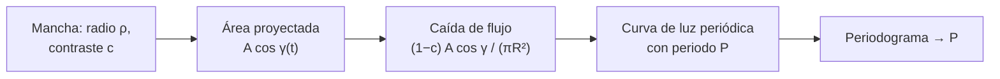

# B24-C12 — Manchas y actividad estelar

<!-- nav:top -->
[🏠 Programa](../../../../README.md) · [📚 Bloque B24](../../../tronco-comun/B24-fisica-y-evolucion-de-estrellas.md) · [← Anterior: B24-C11 — Rotación y campos magnéticos](../B24-C11-rotacion-y-campos-magneticos/CLASE.md) · [Siguiente: B24-C13 — Estrellas variables →](../../../tronco-comun/B24-fisica-y-evolucion-de-estrellas.md#b24-c13)
<!-- /nav -->

## 1. Ubicación, nivel y alcance

Clase 12 del bloque B24. Nivel N3. En [C11](../B24-C11-rotacion-y-campos-magneticos/CLASE.md) viste que el campo magnético y la rotación van juntos. Aquí ves una de sus huellas: las **manchas**, regiones más frías y oscuras que, al girar con la estrella, modulan su brillo. Usas la geometría de la esfera ([B04](../../../tronco-comun/B04-algebra-trigonometria-y-geometria-espacial.md)), el análisis de series temporales ([B15](../../../tronco-comun/B15-senales-imagenes-y-estimacion-cientifica.md)) y la ley de Stefan–Boltzmann (C03). La física solar de la actividad se profundiza en [B30](../../../tronco-comun/B30-heliofisica-y-fisica-de-plasmas.md) y [B34](../../../tronco-comun/B34-corona-solar-y-erupciones-diagnostico-y-modelos.md).

## 2. Por qué esta clase existe

La modulación del brillo por manchas permite medir el periodo de rotación de miles de estrellas sin necesitar espectros, pero también contamina la búsqueda de exoplanetas y limita la precisión de las velocidades radiales. La decisión central: **dada una mancha de cierto tamaño y temperatura sobre una estrella que gira, ¿cuánto cambia el brillo y cómo se recupera el periodo?**

## 3. Lo que podrás hacer al terminar

1. Definir mancha, contraste y modulación rotacional.
2. Calcular el contraste de una mancha con la ley de Stefan–Boltzmann.
3. Calcular la caída de flujo de una mancha centrada.
4. Simular la curva de luz de una mancha en rotación y recuperar el periodo con un periodograma.
5. Relacionar la actividad con la rotación (número de Rossby).
6. Nombrar qué limita el modelo (limbo oscuro, evolución, varias manchas).

La evidencia es la **curva de luz sintética de una estrella con manchas** del ejercicio 12 (sección 20).

## 4. Con qué llegas y cómo comprobarlo

1. ¿Qué es una esfera proyectada sobre el plano del cielo?
2. ¿Cómo depende la emisión de un cuerpo negro de la temperatura?
3. ¿Qué es un periodograma?
4. ¿Qué es la inclinación de un eje de rotación?
5. ¿Qué es un ciclo de actividad?

<details>
<summary>Ver respuestas</summary>

1. Un disco; un elemento de superficie se proyecta con el factor `cos` del ángulo respecto de la línea de visión. 2. Como `T⁴`. 3. Una gráfica de la potencia de una señal frente al periodo de prueba. 4. El ángulo entre el eje y la línea de visión. 5. La variación regular de la actividad, p. ej. el ciclo del número de manchas solares.
</details>

Con cuatro o cinco aciertos, sigue; si no, repasa B04, B15 y C03.

## 5. Un caso real: las manchas del Sol y de las estrellas Kepler

El número de manchas solares sigue un ciclo cuyo seguimiento corresponde al World Data Center SILSO, que indica que el ciclo 25 alcanzó su máximo en octubre de 2024 (S1). En otras estrellas, la misión Kepler midió periodos de rotación para `34 030` estrellas con amplitudes de variabilidad entre unos `950` y `22 700` ppm (percentiles 5 y 95), con una mediana de unos `5600` ppm (S2, resumen). Es el **ejemplo conductor**: una mancha de 10° de radio angular y `4500 K` sobre una estrella de `5772 K` produce una caída máxima del `1,9 %` del flujo.

## 6. Vocabulario

Una **mancha** es una región de la fotosfera más fría que su entorno por un campo magnético intenso que inhibe la convección. El **contraste** `c = (T_m/T_ef)⁴` es el cociente entre el flujo por unidad de área de la mancha y el del entorno. La **modulación rotacional** es la variación periódica del brillo porque la mancha entra y sale de la vista. El **radio angular** `ρ` de la mancha es su tamaño visto desde el centro de la estrella. Un **periodograma** (de Lomb–Scargle) estima el periodo de una señal con muestreo irregular. La **actividad** agrupa manchas, fulguraciones y emisión coronal. El **ciclo de actividad** es la variación de largo plazo de la actividad.

## 7. Modelo mental: una linterna con una moneda pegada

Imagina una linterna esférica con una moneda oscura pegada que gira: cuando la moneda mira hacia ti, la luz total baja; cuando gira hacia atrás, vuelve a subir.



*Descripción textual:* el área proyectada de la mancha cambia con la fase de rotación; multiplicada por `(1−c)` da la caída del flujo; la curva de luz es periódica con el periodo de rotación, y un periodograma lo recupera.

Analogía: la moneda en la linterna. Límite: las manchas reales evolucionan, hay varias a la vez y la estrella tiene oscurecimiento al limbo.

## 8. La explicación, paso a paso

### 8.1 Contraste de una mancha

Una región a temperatura `T_m` emite `σT_m⁴` por unidad de área frente a `σT_ef⁴` del entorno. Con `T_m = 4500 K` y `T_ef = 5772 K`, `c = (4500/5772)⁴ = 0,369`: la mancha emite el `37 %` de lo que emite su entorno. El deficit es `1 − c = 0,631`.

### 8.2 Una mancha centrada

Si una mancha circular de radio angular `ρ` está en el centro del disco, su área proyectada es la de un disco de radio `R sen ρ`, `π R² sen²ρ`, y el flujo total del disco sin manchas es `π R²` (sin oscurecimiento al limbo). La caída es `ΔF/F = (1 − c) sen²ρ`. Con `ρ = 10°`: `0,631 × 0,03015 = 1,90 %`. El laboratorio integra numéricamente sobre el casquete y obtiene `0,019 014`, igual que la fórmula a menos de `10⁻³` relativo.

### 8.3 Una mancha que gira

Para una estrella con inclinación `i` y una mancha a latitud `ℓ`, el factor de proyección de cada punto es `cos γ = n·l`, con `n` el vector normal y `l` la línea de visión, y solo cuenta si es positivo. La caída de flujo es `(1 − c)` por el área proyectada visible, y cambia con la fase `2πt/P`. El laboratorio genera 40 días de datos **sintéticos** (cadencia `0,25 d`, `P = 10 d`, `i = 60°`, `ℓ = 30°`, `ρ = 10°`, ruido de `2 × 10⁻⁴`) con una amplitud de pico a pico de `2,0 %` (`20 231 ppm`).

### 8.4 Recuperar el periodo

El periodograma de Lomb–Scargle ajusta senoides a cada periodo de prueba y selecciona el de mayor potencia. En los datos sintéticos recupera `10,02 d` frente a `10,00 d`: un error de `0,2 %`. La señal de dos manchas opuestas puede mostrar la mitad del periodo; por eso se comprueba el primer armónico.

### 8.5 Actividad y rotación

Cuanto más rápido gira una estrella convectiva, más activa es, hasta una saturación hacia `Ro ≈ 0,13` (S3, resumen), de modo que las estrellas jóvenes y rápidas tienen más manchas. Con ello, la variabilidad es una sonda de la edad (giro) y del campo. Los ciclos de actividad, como el solar, se observan en el largo plazo (S1).

## 9. Magnitudes, símbolos y unidades

| Símbolo | Qué es | Unidad | Valor / nota |
|---|---|---|---|
| `T_m`, `T_ef` | temperatura de la mancha y efectiva | K | `4500`; `5772` (sintético; IAU) |
| `c` | contraste | — | `0,369` |
| `ρ` | radio angular de la mancha | ° | `10` (sintético) |
| `ΔF/F` | caída relativa del flujo | — o ppm | `0,019 0` en el caso centrado |
| `P`, `i`, `ℓ` | periodo, inclinación, latitud | d; °; ° | `10`, `60`, `30` (sintéticos) |

## 10. Convenciones y referencias

Sin oscurecimiento al limbo; mancha circular y estable; todos los parámetros de la curva de luz son **sintéticos**. Las cifras de Kepler y de SILSO son datos **observados** citados de la fuente (solo resúmenes).

## 11. De dónde sale lo que afirmamos

| ID | Fuente | Localizador | Respalda | Estado |
|---|---|---|---|---|
| S1 | SILSO (Royal Observatory of Belgium), página principal | https://www.sidc.be/SILSO/home | Función de SILSO; máximo del ciclo 25 en octubre de 2024 | Consultada el 2026-11-09 |
| S2 | McQuillan, Mazeh y Aigrain, arXiv:1402.5694 | https://arxiv.org/abs/1402.5694 | 34 030 periodos; amplitudes 950–22 700 ppm; mediana ~5600 ppm | Solo resumen, consultado el 2026-11-09 |
| S3 | Wright et al., arXiv:1109.4634 | https://arxiv.org/abs/1109.4634 | Saturación de la actividad en `Ro ≈ 0,13` | Solo resumen, consultado el 2026-11-09 |

Límites: S2 y S3 solo resumen; S1 es la página de inicio, sin la serie ni la longitud del ciclo; el modelo de mancha y el periodograma son resultados estándar verificados numéricamente.

## 12. Cómo ver la modulación

| `ρ` | `ΔF/F` (mancha centrada) |
|---|---|
| 5° | 0,48 % |
| 10° | 1,90 % |
| 20° | 7,38 % |

Descripción larga: duplicar el radio angular de la mancha multiplica la caída por unas cuatro veces.

## 13. Ejemplo trabajado: ¿qué mancha explica una modulación mediana de Kepler?

**Paso 1 · Dato.** Amplitud mediana `5600 ppm = 0,0056` (S2, observado; la amplitud real es un mínimo del efecto de una mancha).

**Paso 2 · Ecuación.** `(1 − c) sen²ρ = 0,0056` con `1 − c = 0,631`.

**Paso 3 · Cálculo.** `sen²ρ = 0,00888`; `sen ρ = 0,0942`; `ρ = 5,4°`.

**Paso 4 · Sentido.** Una mancha centrada de unos 5° de radio produciría esa caída; una mancha más grande descentrada daría lo mismo. El resultado es una **estimación**, porque la mancha puede estar inclinada y la estrella tiene oscurecimiento al limbo.

## 14. Distintas formas de medir la rotación

**Fotometría (esta clase):** muy eficiente, requiere manchas estables. **Ensanchamiento de líneas:** da `v sen i` pero no el periodo. **Asterosismología:** rotación interna (C14). **Monitorización de líneas cromosféricas:** ciclos de actividad. Se complementan.

## 15. Práctica guiada

**Ejercicio 1 · con los pasos indicados.** Calcula el contraste para `T_m = 4500 K`. *Pasos:* `(4500/5772)⁴`.

<details><summary>Solución comentada</summary>

`0,7796⁴ = 0,369`.
</details>

**Ejercicio 2 · con una pista.** Calcula `ΔF/F` para una mancha centrada con `ρ = 10°`. *Pista:* `sen²10° = 0,03015`.

<details><summary>Solución comentada</summary>

`0,631 × 0,03015 = 0,0190` (1,90 %).
</details>

**Ejercicio 3 · casi autónomo.** Calcula la caída para `ρ = 5°`.

<details><summary>Solución comentada</summary>

`sen²5° = 0,00760`; `0,631 × 0,00760 = 0,00479 = 4790 ppm`.
</details>

## 16. Práctica autónoma, transferencia e integrador

**Ejercicio 4.** Si la mancha está a `5000 K`, ¿cuánto vale `c` y la caída para `ρ = 10°`?

<details><summary>Solución comentada</summary>

`c = (5000/5772)⁴ = 0,563`; `(1−c) = 0,437`; `ΔF/F = 0,437 × 0,03015 = 1,32 %`.
</details>

**Ejercicio 5.** Si el radio angular se duplica de `10°` a `20°`, ¿cuánto crece la caída?

<details><summary>Solución comentada</summary>

`sen²20°/sen²10° = 0,1170/0,03015 = 3,88` veces: `7,4 %`.
</details>

**Ejercicio 6.** ¿Qué radio angular da una caída de `5600 ppm` con `1 − c = 0,631`?

<details><summary>Solución comentada</summary>

`ρ = 5,4°` (13).
</details>

**Ejercicio 7.** El periodograma devolvió `10,02 d` para un periodo verdadero de `10,00 d`. ¿Cuál es el error relativo?

<details><summary>Solución comentada</summary>

`0,02/10 = 0,2 %` (8.4).
</details>

**Ejercicio 8.** Si en una muestra de Kepler se detectan periodos en `34 030` de `133 030` objetivos, ¿qué fracción es?

<details><summary>Solución comentada</summary>

`25,6 %` (S2). La mayoría de las estrellas no muestra una modulación detectable.
</details>

**Ejercicio 9 · transferencia.** Dos manchas idénticas en longitudes opuestas, ¿qué periodo se ve en la curva de luz?

<details><summary>Solución comentada</summary>

La mitad del periodo de rotación: cada mancha se esconde mientras la otra aparece, y el patrón se repite dos veces por vuelta. Hay que revisar el primer armónico.
</details>

**Ejercicio 10 · transferencia.** Una mancha de `4500 K` sobre una estrella de `5772 K`, ¿se vería igual en una banda estrecha del azul que en la luminosidad total?

<details><summary>Solución comentada</summary>

No: el contraste en una banda depende de la función de Planck a esa longitud de onda. En el azul el contraste es mayor (más débil la mancha). El modelo bolométrico `T⁴` es una simplificación.
</details>

**Ejercicio 11 · transferencia.** ¿Por qué una estrella muy activa complica la búsqueda de exoplanetas por tránsitos?

<details><summary>Solución comentada</summary>

La modulación de las manchas, con amplitudes de hasta un 2 % en el ejemplo, puede ser mayor que la caída de un tránsito y debe modelarse y restarse. (Las técnicas se tratan en B29.)
</details>

**Ejercicio 12 · integrador.** Elabora tu *curva de luz sintética de una estrella con manchas*: elige `T_m`, `ρ`, `P`, `i` y `ℓ`, calcula el contraste y la caída máxima, genera la curva con ruido, recupera `P` con un periodograma y discute dos efectos omitidos.

<details><summary>Solución modelo</summary>

Con `T_m = 4500 K`, `ρ = 10°`, `P = 10 d`, `i = 60°`, `ℓ = 30°`: `c = 0,369`, amplitud ~`2 %`, `P` recuperado `10,02 d`; omitidos: oscurecimiento al limbo y evolución de la mancha; rotulado como sintético.
</details>

## 17. Laboratorio: curva de luz de una mancha

El script [mancha.py](mancha.py) calcula la caída de flujo por cuadratura sobre el casquete de la mancha y **comprueba** que coincide con `(1−c) sen²ρ` para una mancha centrada (tolerancia `10⁻³`); genera 160 puntos de una curva de luz **sintética** con ruido (semilla fija) y **comprueba** que un periodograma de Lomb–Scargle recupera el periodo con un error menor del 1 %.

**Datos:** ninguno observado; todos los parámetros son **sintéticos**. **Predice antes de ejecutar:** ¿qué amplitud pico a pico esperas para `ρ = 10°`? (del orden del 1–2 %.) **Ejecución del 2026-11-09 (Python 3.12.9):**

```text
Python 3.12.9 (biblioteca estandar)
contraste c = (4500/5772)^4 = 0.3694
mancha centrada (rho=10 grados): numerico = 0.019014 ; (1-c) sin^2(rho) = 0.019014
curva sintetica (i=60, lat=30, rho=10): amplitud pico a pico = 20231 ppm
periodo verdadero = 10.0 d ; recuperado = 10.02 d
Pruebas superadas.
```

```bash
python programa/clases/B24/B24-C12-manchas-y-actividad-estelar/mancha.py
```

**Límites:** una sola mancha estable, sin oscurecimiento al limbo, sin evolución ni rotación diferencial.

## 18. Errores frecuentes y cómo corregirlos

**Olvidar que el flujo va como `T⁴`.** Se corrige con el ejercicio 1.

**Confundir el radio angular con el radio físico.** Se corrige con la sección 8.2.

**Tomar el mínimo de brillo por el periodo.** Se corrige con el ejercicio 9.

**Despreciar el efecto de la banda.** Se corrige con el ejercicio 10.

**Presentar una curva sintética como observada.** Se corrige con la sección 10.

## 19. Cómo sabrás que vas bien

Tras 8.2: ¿cuánto baja el brillo con `ρ = 10°`? Si dudas, ejercicios 2 y 3. Tras 8.4: ¿qué mide el periodograma? Ejercicio 7. Tras el laboratorio: ¿qué verifica la cuadratura sobre el casquete? (la fórmula de la mancha centrada).

## 20. Qué entregas y cómo se evalúa

El producto es tu **curva de luz sintética de una estrella con manchas** (ejercicio 12).

| Criterio | Inicial | En desarrollo | Logrado | Destacado |
|---|---|---|---|---|
| Conceptos | Los confunde | Parciales | Contraste, proyección | Explica armónicos |
| Cálculo | Sin unidades | Con errores | `c` y `ΔF/F` | Estima `ρ` desde una amplitud |
| Numérico | Sin comprobar | Un caso | Cuadratura y periodograma | Discute el error del periodo |
| Fuentes | Sin fuente | Sin fecha | S1–S3 con fecha | Declara resúmenes |
| Límites | No los nombra | Uno | Tres | Discute banda y limbo |

**Condiciones críticas (no se compensan con promedio):** rotular la curva como sintética; no presentar las cifras de Kepler como propias; citar solo lo consultado y decir que S2 y S3 son resúmenes y S1 solo la página de inicio.

## 21. Ética, seguridad y límites

Clase educativa: no sustituye el análisis de curvas de luz reales con sus sistemáticos. Accesibilidad: tablas equivalentes a las gráficas, fórmulas en texto, ejercicios sin conexión.

## 22. Para cerrar y seguir

Una mancha de contraste `c` y radio angular `ρ` baja el brillo en `(1−c) sen²ρ` cuando está centrada, y su paso periódico revela el giro; un periodograma recupera el periodo. Queda una pregunta: ¿qué estrellas varían su brillo por razones internas y no por manchas?

**Glosario español–inglés.** mancha estelar · *starspot*; contraste · *contrast*; modulación rotacional · *rotational modulation*; periodograma · *periodogram*; ciclo de actividad · *activity cycle*; actividad magnética · *magnetic activity*.

**Continuidad.** [B24-C13](../B24-C13-estrellas-variables/CLASE.md) reutiliza las curvas de luz periódicas para estudiar estrellas que varían por pulsación.

**Referencias:** ver sección 11.

<!-- nav:bottom -->
---

[← Anterior: B24-C11 — Rotación y campos magnéticos](../B24-C11-rotacion-y-campos-magneticos/CLASE.md) · [📚 Bloque B24](../../../tronco-comun/B24-fisica-y-evolucion-de-estrellas.md) · [Siguiente: B24-C13 — Estrellas variables →](../../../tronco-comun/B24-fisica-y-evolucion-de-estrellas.md#b24-c13)
<!-- /nav -->
