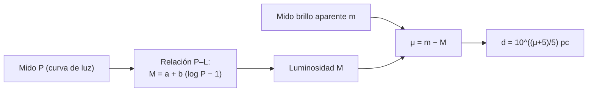

# B24-C13 — Estrellas variables

<!-- nav:top -->
[🏠 Programa](../../../../README.md) · [📚 Bloque B24](../../../tronco-comun/B24-fisica-y-evolucion-de-estrellas.md) · [← Anterior: B24-C12 — Manchas y actividad estelar](../B24-C12-manchas-y-actividad-estelar/CLASE.md) · [Siguiente: B24-C14 — Asterosismología inicial →](../B24-C14-asterosismologia-inicial/CLASE.md)
<!-- /nav -->

## 1. Ubicación, nivel y alcance

Clase 13 del bloque B24. Nivel N3. En [C12](../B24-C12-manchas-y-actividad-estelar/CLASE.md) la variación de brillo venía de manchas; aquí viene de que la estrella entera **late**: se expande y se contrae con un periodo regular. Usas el ajuste lineal ([B12-C10](../../B12/B12-C10-regresion-lineal-y-no-lineal/CLASE.md)), las magnitudes (C03) y el equilibrio hidrostático (C04). La cosmología que usa estas estrellas como reglas de distancia se trata en [B26](../../../tronco-comun/B26-relatividad-y-cosmologia.md); aquí se estudia la relación y su incertidumbre.

## 2. Por qué esta clase existe

Las cefeidas y otras estrellas pulsantes cumplen que cuanto más largo es el periodo, mayor es la luminosidad. Medir un periodo equivale entonces a conocer la luminosidad intrínseca y, por comparación con el brillo aparente, la distancia. Es un escalón básico de la escala de distancias. La decisión central: **a partir de periodos y brillos aparentes, ¿cómo se calibra la relación periodo–luminosidad y qué distancia y qué incertidumbre se obtienen?**

## 3. Lo que podrás hacer al terminar

1. Definir estrella variable pulsante, periodo y relación periodo–luminosidad.
2. Ajustar una relación lineal `m = A + b log P` y dar la incertidumbre de la pendiente.
3. Convertir un módulo de distancia en distancia y propagar su error.
4. Estimar el periodo de pulsación a partir del tiempo dinámico.
5. Evaluar el efecto de la extinción sobre la distancia.
6. Nombrar qué limita la calibración (metalicidad, extinción, dispersión intrínseca).

La evidencia es la **calibración periodo–luminosidad** del ejercicio 12 (sección 20).

## 4. Con qué llegas y cómo comprobarlo

1. ¿Qué es la magnitud absoluta y qué relación tiene con la aparente?
2. ¿Qué es un módulo de distancia?
3. ¿Qué es un ajuste por mínimos cuadrados?
4. ¿Qué es un periodo?
5. ¿Qué es la extinción interestelar?

<details>
<summary>Ver respuestas</summary>

1. La magnitud absoluta es la que tendría a `10 pc`; `m − M = μ`. 2. `μ = m − M = 5 log₁₀(d/10 pc)`. 3. El ajuste que minimiza la suma de cuadrados de los residuos. 4. El tiempo de un ciclo. 5. La absorción y enrojecimiento de la luz por el polvo.
</details>

Con cuatro o cinco aciertos, sigue; si no, repasa B12-C10 y C03.

## 5. Un caso real: las cefeidas de la Gran Nube de Magallanes

Riess y colaboradores midieron con el Telescopio Espacial Hubble `70` cefeidas de periodo largo en la Gran Nube de Magallanes y las usaron, junto con la distancia geométrica a esa galaxia (precisa al `1,2 %` por binarias eclipsantes), para calibrar la luminosidad de las supernovas Ia y obtener `H₀ = 74,22 ± 1,82 km/s/Mpc` solo con ese ancla (S1, resumen). Aquí no se reproduce esa calibración. El **ejemplo conductor** es una muestra **sintética** de `60` cefeidas con una relación periodo–luminosidad inyectada (`M = −4,0 − 2,5 (log P − 1)`, dispersión `0,15 mag`, `μ = 18,50`), para que veas cómo se recupera.

## 6. Vocabulario

Una **estrella variable pulsante** cambia de tamaño y temperatura de forma periódica. Una **cefeida clásica** es una supergigante pulsante de periodo de días a meses. El **periodo** `P` es la duración de un ciclo. La **relación periodo–luminosidad** (de Leavitt) liga `log P` con la magnitud absoluta `M`. La **dispersión intrínseca** es el ancho de la relación por la franja de inestabilidad finita. La **extinción** `A` suma magnitudes: `m = M + μ + A`. El **módulo de distancia** `μ = m − M` da `d = 10^{(μ+5)/5}` pc. La **escala dinámica** `2π√(R³/GM)` es el orden del periodo.

## 7. Modelo mental: un reloj cuyo ritmo delata su tamaño

Un péndulo largo oscila más lento que uno corto. Una estrella grande y poco densa pulsa más despacio que una pequeña y densa; y las grandes son más luminosas.



*Descripción textual:* el periodo medido da la magnitud absoluta por la relación calibrada; la diferencia con la magnitud aparente es el módulo de distancia, de donde sale la distancia.

Analogía: el péndulo. Límite: la relación P–L es empírica y tiene dispersión; un péndulo ideal no la tiene.

## 8. La explicación, paso a paso

### 8.1 Por qué pulsan y por qué P crece con el tamaño

Una estrella pulsa cuando una capa de su envoltura almacena y libera energía de forma cíclica. El periodo es del orden del tiempo que tarda el sonido en cruzar la estrella (C14). Con la escala dinámica `P ≈ 2π√(R³/GM)`: para el Sol `2,78 h`; para una supergigante de `5 M☉` y `50 R☉` (ilustrativa) `18,3 d`. Códigos de evolución modernos incluyen módulos de pulsación para cefeidas y RR Lyrae (S3, resumen).

### 8.2 Calibrar la relación

Con una muestra de periodos y magnitudes aparentes a la misma distancia (como en una galaxia vecina), se ajusta `m = A + b log P`. La pendiente `b` es la pendiente de la relación P–L; la ordenada, junto con la calibración absoluta de una cefeida cercana, fija el punto cero. El laboratorio ajusta `60` cefeidas sintéticas y recupera `b = −2,495 ± 0,044` (verdadero `−2,5`) y una dispersión residual de `0,139` (inyectada `0,15`).

### 8.3 De la magnitud a la distancia

Con `a` conocido, `μ = A + b − a`. El laboratorio recupera `μ = 18,525` frente a `18,50` (el error entra en `1σ`), lo que da `50,7 kpc` frente a `50,1 kpc`. Un error `δμ` en el módulo produce un error relativo en la distancia `10^{δμ/5} − 1`: `0,1 mag` son `4,7 %`.

### 8.4 La extinción

El polvo hace que la estrella parezca más débil: `m = M + μ + A`. Si no se corrige `A`, `μ` se sobrestima en `A` y la distancia, en `10^{A/5} − 1`. Con `A = 0,3 mag`, un `14,8 %`. Por eso se observa en el infrarrojo, donde la extinción es menor, y se miden los tres factores con cuidado (S1, resumen, indica un sistema fotométrico homogéneo).

### 8.5 Límites

La relación depende de la metalicidad y de la dispersión intrínseca; el ajuste lineal es una aproximación; el punto cero absoluto exige distancias geométricas. La muestra de este laboratorio es sintética: no se afirma nada sobre las cefeidas reales más allá de lo citado.

## 9. Magnitudes, símbolos y unidades

| Símbolo | Qué es | Unidad | Valor / nota |
|---|---|---|---|
| `P` | periodo | d | 2,5–63 (sintético) |
| `M`, `m`, `μ` | magnitudes absoluta, aparente; módulo | mag | `a = −4,0`; `μ = 18,50` (sintéticos) |
| `a`, `b` | punto cero y pendiente de la relación | mag | `−4,0`; `−2,5` (sintéticos) |
| `σ` | dispersión intrínseca | mag | `0,15` (sintética) |
| `d` | distancia | kpc | `50,1` (sintética) |
| `A` | extinción | mag | ilustrativa |

## 10. Convenciones y referencias

`m = M + μ + A`; `log` decimal; la muestra es **sintética** con semilla fija. Los valores de Riess et al. son **observados** y se citan solo desde el resumen.

## 11. De dónde sale lo que afirmamos

| ID | Fuente | Localizador | Respalda | Estado |
|---|---|---|---|---|
| S1 | Riess et al., *Large Magellanic Cloud Cepheid Standards Provide a 1% Foundation…*, arXiv:1903.07603 | https://arxiv.org/abs/1903.07603 | 70 cefeidas LMC, distancia LMC al 1,2 %, `H₀ = 74,22 ± 1,82` (solo LMC) | Solo resumen, consultado el 2026-11-09 |
| S2 | Mamajek et al., *IAU 2015 Resolution B3*, arXiv:1510.07674 | https://arxiv.org/abs/1510.07674 | `GM☉`, `R☉` nominales | Texto del PDF extraído el 2026-11-09 |
| S3 | Paxton et al., *MESA… Pulsating Variable Stars…*, arXiv:1903.01426 | https://arxiv.org/abs/1903.01426 | Módulo de pulsación no lineal para RR Lyrae y cefeidas | Solo resumen, consultado el 2026-11-09 |

Límites: S1 y S3 solo resumen; no se consultó ninguna calibración numérica de la relación P–L; la muestra y las constantes del ajuste son sintéticas.

## 12. Cómo ver la relación

| `P` (d) | `log P` | `M` (sintética) |
|---|---|---|
| 3,16 | 0,5 | −2,75 |
| 10 | 1,0 | −4,00 |
| 31,6 | 1,5 | −5,25 |
| 100 | 2,0 | −6,50 |

Descripción larga: cada factor 10 en el periodo vuelve la estrella 2,5 magnitudes más brillante en la relación inyectada.

## 13. Ejemplo trabajado: la distancia de una cefeida

**Paso 1 · Datos.** Una cefeida de `P = 10 d` tiene `m = 15,50` (sin extinción; sintético).

**Paso 2 · Magnitud absoluta.** `M = −4,00` (P–L inyectada).

**Paso 3 · Módulo.** `μ = 15,50 + 4,00 = 19,50`.

**Paso 4 · Distancia.** `d = 10^{(19,5+5)/5} = 10^{4,9} = 79 400 pc = 79,4 kpc`.

**Paso 5 · Sentido.** Si la extinción fuera de `0,3 mag` y no se corrige, la distancia saldría `14,8 %` mayor; por eso es una estimación condicionada a la relación y a la extinción.

## 14. Distintas formas de medir distancias

**Paralaje trigonométrico:** directo, limitado a estrellas cercanas. **Cefeidas (esta clase):** reglas estándar hasta galaxias vecinas. **Binarias eclipsantes:** distancia geométrica a la LMC (S1, resumen). **Supernovas Ia:** más lejos, calibradas con cefeidas (B26). Cada escalón calibra el siguiente.

## 15. Práctica guiada

**Ejercicio 1 · con los pasos indicados.** Calcula la distancia para `μ = 18,50`. *Pasos:* `10^{(μ+5)/5}`.

<details><summary>Solución comentada</summary>

`10^{4,7} = 50 119 pc = 50,1 kpc`.
</details>

**Ejercicio 2 · con una pista.** Calcula `M` para `P = 31,6 d` en la relación inyectada. *Pista:* `log P = 1,5`.

<details><summary>Solución comentada</summary>

`−4,0 − 2,5 × 0,5 = −5,25`.
</details>

**Ejercicio 3 · casi autónomo.** Calcula `m` para `P = 10 d` a `μ = 18,50`.

<details><summary>Solución comentada</summary>

`m = −4,0 + 18,5 = 14,5`.
</details>

## 16. Práctica autónoma, transferencia e integrador

**Ejercicio 4.** Si `m = 15,5` para `P = 10 d`, ¿cuál es la distancia?

<details><summary>Solución comentada</summary>

`μ = 19,5`; `d = 79,4 kpc` (13).
</details>

**Ejercicio 5.** Un error de `0,1 mag` en `μ`, ¿cuánto error de distancia da?

<details><summary>Solución comentada</summary>

`10^{0,02} − 1 = 4,7 %` (8.3).
</details>

**Ejercicio 6.** Calcula la escala dinámica del Sol en horas.

<details><summary>Solución comentada</summary>

`2π × 1593 s = 1,0 × 10⁴ s = 2,78 h` (8.1).
</details>

**Ejercicio 7.** ¿Cuántas veces es mayor la escala dinámica de la supergigante (`5 M☉`, `50 R☉`) que la del Sol?

<details><summary>Solución comentada</summary>

`√(50³/5) = √25 000 = 158`; `18,3 d/2,78 h = 158` (8.1).
</details>

**Ejercicio 8.** Con Riess et al. (S1): ¿qué precisión relativa tiene `H₀ = 74,22 ± 1,82`?

<details><summary>Solución comentada</summary>

`1,82/74,22 = 2,5 %`.
</details>

**Ejercicio 9 · transferencia.** Una cefeida tiene extinción de `0,3 mag` que no se corrigió. ¿Cuánto se sobreestima su distancia?

<details><summary>Solución comentada</summary>

`10^{0,06} − 1 = 14,8 %` (8.4).
</details>

**Ejercicio 10 · transferencia.** Un compañero dice que «dos cefeidas con el mismo brillo aparente están a la misma distancia». Responde con 8.2.

<details><summary>Solución comentada</summary>

No: si sus periodos difieren, sus luminosidades son distintas y también las distancias (relación P–L). Solo con igual periodo, igual `M`.
</details>

**Ejercicio 11 · transferencia.** El error de la pendiente fue `0,044` con `N = 60`. ¿Con `N = 240` cuánto sería?

<details><summary>Solución comentada</summary>

`σ_b ∝ 1/√N`: `0,044/2 = 0,022`.
</details>

**Ejercicio 12 · integrador.** Elabora tu *calibración periodo–luminosidad*: genera una muestra sintética con tus parámetros, ajusta la relación, da la pendiente con su error, recupera `μ` y `d`, propaga una extinción no corregida y nombra dos límites.

<details><summary>Solución modelo</summary>

Con el laboratorio: `b = −2,495 ± 0,044`, `μ = 18,525`, `d = 50,7 kpc`; extinción `0,3 mag` ⇒ `+14,8 %`; límites: metalicidad y dispersión intrínseca; todo rotulado como sintético.
</details>

## 17. Laboratorio: relación periodo–luminosidad

El script [cefeidas.py](cefeidas.py) genera `60` cefeidas sintéticas, ajusta por mínimos cuadrados y **comprueba** que sin ruido recupera los parámetros exactos (`10⁻⁹`) y que con ruido la pendiente cae en `3σ` y `μ` en un margen; calcula la distancia y la escala dinámica y **comprueba** que `P ∝ √(R³/M)`.

**Datos:** ninguno observado; muestra y parámetros **sintéticos**. **Predice antes de ejecutar:** ¿la pendiente recuperada estará dentro de un par de décimas de `−2,5`? (sí, del orden de 0,05.) **Ejecución del 2026-11-09 (Python 3.12.9):**

```text
Python 3.12.9 (biblioteca estandar)
pendiente recuperada = -2.495 +/- 0.044 (verdadera -2.5)
dispersion residual = 0.139 mag (inyectada 0.15)
mu recuperado = 18.525 mag (verdadero 18.5) -> d = 50.70 kpc (verdadera 50.12 kpc)
periodo dinamico Sol = 2.78 h ; (M=5, R=50) = 18.3 d
Pruebas superadas.
```

```bash
python programa/clases/B24/B24-C13-estrellas-variables/cefeidas.py
```

**Límites:** sin extinción, sin metalicidad, relación lineal, muestra sintética.

## 18. Errores frecuentes y cómo corregirlos

**Confundir magnitud aparente con absoluta.** Se corrige con los ejercicios 3 y 4.

**Olvidar la extinción.** Se corrige con el ejercicio 9.

**Tratar la relación P–L como exacta.** Se corrige con la dispersión de 8.2.

**Calcular la distancia sin el módulo exponencial.** Se corrige con el ejercicio 1.

**Presentar la muestra sintética como cefeidas reales.** Se corrige con la sección 10.

## 19. Cómo sabrás que vas bien

Tras 8.2: ¿qué te da el ajuste? Si dudas, ejercicio 2. Tras 8.3: ¿cómo pasa `μ` a `d`? Ejercicios 1 y 5. Tras el laboratorio: ¿qué verifica el caso sin ruido? (que el ajuste recupera exactamente la ley inyectada).

## 20. Qué entregas y cómo se evalúa

El producto es tu **calibración periodo–luminosidad** (ejercicio 12).

| Criterio | Inicial | En desarrollo | Logrado | Destacado |
|---|---|---|---|---|
| Conceptos | Los confunde | Parciales | P–L, módulo, extinción | Explica la escala dinámica |
| Cálculo | Sin unidades | Con errores | Ajuste y distancia | Propaga errores |
| Numérico | Sin comprobar | Un caso | Caso exacto y con ruido | Interpreta el error de la pendiente |
| Fuentes | Sin fuente | Sin fecha | S1–S3 con fecha | Declara resúmenes |
| Límites | No los nombra | Uno | Tres | Discute metalicidad |

**Condiciones críticas (no se compensan con promedio):** rotular la muestra como sintética; no presentar la calibración sintética como la real; citar solo lo consultado y decir que S1 y S3 son resúmenes.

## 21. Ética, seguridad y límites

Clase educativa: no sustituye la calibración de la escala de distancias con datos reales. Accesibilidad: tablas equivalentes a las gráficas, fórmulas en texto, ejercicios sin conexión.

## 22. Para cerrar y seguir

La relación periodo–luminosidad convierte un periodo en distancia: se ajusta con mínimos cuadrados, se pasa del módulo a la distancia y se corrige la extinción. Queda una pregunta: ¿qué más puede decirnos la pulsación sobre el interior de la estrella?

**Glosario español–inglés.** estrella variable · *variable star*; cefeida · *Cepheid*; relación periodo–luminosidad · *period–luminosity relation*; módulo de distancia · *distance modulus*; extinción · *extinction*; dispersión intrínseca · *intrinsic scatter*; escala dinámica · *dynamical timescale*.

**Continuidad.** [B24-C14](../B24-C14-asterosismologia-inicial/CLASE.md) reutiliza la escala dinámica para estudiar las oscilaciones de estrellas como el Sol.

**Referencias:** ver sección 11.

<!-- nav:bottom -->
---

[← Anterior: B24-C12 — Manchas y actividad estelar](../B24-C12-manchas-y-actividad-estelar/CLASE.md) · [📚 Bloque B24](../../../tronco-comun/B24-fisica-y-evolucion-de-estrellas.md) · [Siguiente: B24-C14 — Asterosismología inicial →](../B24-C14-asterosismologia-inicial/CLASE.md)
<!-- /nav -->
