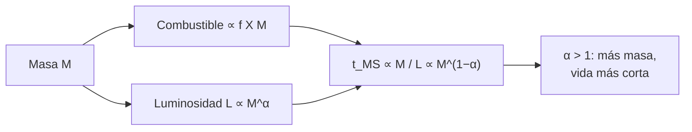

# B24-C15 — Estrellas de baja masa

<!-- nav:top -->
[🏠 Programa](../../../../README.md) · [📚 Bloque B24](../../../tronco-comun/B24-fisica-y-evolucion-de-estrellas.md) · [← Anterior: B24-C14 — Asterosismología inicial](../B24-C14-asterosismologia-inicial/CLASE.md) · [Siguiente: B24-C16 — Gigantes rojas →](../B24-C16-gigantes-rojas/CLASE.md)
<!-- /nav -->

## 1. Ubicación, nivel y alcance

Clase 15 del bloque B24. Nivel N3. Empieza la parte evolutiva del bloque. Las estrellas de baja masa (de décimas de masa solar hasta unas pocas) son las más numerosas y las que más viven. Aquí calculas cuánto dura su fase de secuencia principal con el balance de energía de [C06](../B24-C06-fusion-de-hidrogeno/CLASE.md). Usas potencias y logaritmos ([B03](../../../tronco-comun/B03-matematica-elemental-para-ciencias-espaciales.md)) y la estadística de poblaciones ([B12](../../../tronco-comun/B12-probabilidad-estadistica-e-incertidumbre.md)). La relación masa–luminosidad que se usa es **ilustrativa**.

## 2. Por qué esta clase existe

La masa decide casi todo en la vida de una estrella: cuánto brilla, cuánto dura y cómo termina. Entender por qué una estrella de la mitad de la masa del Sol vive varias veces más tiempo, y por qué las más pequeñas casi no han evolucionado, explica la composición de las poblaciones estelares y la edad de los cúmulos. La decisión central: **dada la masa de una estrella, ¿cuánto tiempo permanece en la secuencia principal?**

## 3. Lo que podrás hacer al terminar

1. Definir secuencia principal, relación masa–luminosidad y tiempo nuclear.
2. Calcular el tiempo en la secuencia principal con `t = f X M ε c²/L`.
3. Explicar por qué `t` cae rápidamente con la masa.
4. Explicar por qué las estrellas completamente convectivas viven aún más.
5. Estimar cuándo una estrella de cierta masa abandona la secuencia principal.
6. Nombrar qué limita una relación masa–luminosidad tabulada.

La evidencia es la **tabla de vidas por masa** del ejercicio 12 (sección 20).

## 4. Con qué llegas y cómo comprobarlo

1. ¿Qué es una ley de potencias?
2. ¿Cuánto rinde un kilogramo de hidrógeno al fusionarse (C06)?
3. ¿Qué es un logaritmo y cómo se lee la pendiente en un gráfico log–log?
4. ¿Qué es una estrella completamente convectiva?
5. ¿Qué es la secuencia principal?

<details>
<summary>Ver respuestas</summary>

1. `y = k xᵅ`. 2. `6,40 × 10¹⁴ J/kg`. 3. La pendiente es el exponente `α`. 4. Una estrella cuyo interior se mezcla del todo (C05). 5. La fase de fusión estable de hidrógeno en el núcleo (C03, C06).
</details>

Con cuatro o cinco aciertos, sigue; si no, repasa B03, C03 y C06.

## 5. Un caso real: ¿cuánto dura una enana roja?

Con una relación masa–luminosidad ilustrativa, una estrella de `0,5 M☉` tiene `L = 0,0625 L☉` y una vida de `59 Gyr`, y una de `0,1 M☉` supera `6000 Gyr`: más tiempo que cualquier edad cósmica razonable. Eker y colaboradores determinaron una relación masa–luminosidad empírica con `509` estrellas de la secuencia principal en binarias eclipsantes, entre `0,179` y `31 M☉`, ajustada por seis tramos de ley de potencias (S3, resumen); aquí **no** se usan sus coeficientes. Es el **ejemplo conductor**.

## 6. Vocabulario

La **secuencia principal** es la fase en que la estrella fusiona hidrógeno en el núcleo en equilibrio (C03). La **relación masa–luminosidad** liga `L` y `M`; por tramos, `L ∝ M^α`. El **tiempo nuclear** `t_MS = f X M ε c²/L` es la vida en la secuencia principal, con `f` la fracción de masa que llega a quemarse y `X` la fracción de hidrógeno. Una **enana roja** es una estrella de secuencia principal de baja masa y baja luminosidad. Una estrella **completamente convectiva** mezcla todo su interior y puede quemar casi todo su hidrógeno (`f ≈ 1`). La **función inicial de masa** es la distribución de masas al nacer; en el campo galáctico presenta cambios de pendiente hacia `0,5` y `0,08 M☉` (S4, resumen).

## 7. Modelo mental: tanque grande, grifo grande

Una estrella es un depósito de combustible con un grifo abierto. Duplicar el depósito (la masa) abre el grifo mucho más (la luminosidad crece como `M^α` con `α > 1`), de modo que el depósito se vacía antes.



*Descripción textual:* el combustible crece con la masa y la luminosidad crece más rápido; el cociente, que es la vida, decrece con la masa con exponente `1 − α`.

Analogía: un coche de depósito mayor que gasta mucho más. Límite: la luminosidad real cambia durante la secuencia principal, de modo que el cálculo es un promedio.

## 8. La explicación, paso a paso

### 8.1 Vida en la secuencia principal

Con la energía por kilogramo de C06 (`6,40 × 10¹⁴ J/kg`), `X = 0,7` y `f = 0,1` (ilustrativos), una estrella de `1 M☉` y `1 L☉` vive `7,4 Gyr`. En general `t_MS = f X M ε c²/L`; si `L ∝ M^α`, `t_MS ∝ M^{1−α}`.

### 8.2 La relación masa–luminosidad ilustrativa

El laboratorio usa tres tramos **ilustrativos**: `L = 0,23 M^{2,3}` para `M < 0,43`, `L = M⁴` hasta `2 M☉` y `L = 1,4 M^{3,5}` por encima (unidades solares). Estas formas se eligen para ilustrar; Eker et al. (S3) muestran que un ajuste por seis tramos describe mejor los datos que un polinomio (resumen), pero sus coeficientes no se usaron. El laboratorio comprueba que los tramos empalman dentro del 10 % y que, en un tramo, la pendiente log–log de `t` es `1 − α` con exactitud (`−3,000 000` para `α = 4`).

### 8.3 Una tabla de vidas

Con esas hipótesis: `0,5 M☉` → `59 Gyr`; `0,8 M☉` → `14 Gyr`; `1 M☉` → `7,4 Gyr`; `2 M☉` → `0,93 Gyr`; `5 M☉` → `94 Myr`; `10 M☉` → `17 Myr`. Una estrella de `0,1 M☉` y `0,2 M☉`, completamente convectivas (`f = 1`), tendrían `6400` y `2600 Gyr`. La caída es muy rápida: duplicar la masa de 0,8 a 1,6 recorta la vida a menos de un cuarto.

### 8.4 Estrellas completamente convectivas

Por debajo de unas `0,35 M☉` (valor ilustrativo), el interior se mezcla del todo y el combustible llega al núcleo desde toda la estrella: `f ≈ 1` y la vida se multiplica por unas diez a igualdad de `L`. Con ello, las enanas rojas de menos de `0,2 M☉` no han salido nunca de la secuencia principal.

### 8.5 Qué decide la fase siguiente

Cuando el hidrógeno del núcleo se agota, la estrella abandona la secuencia principal (C16). Las poblaciones que se observan dependen de la función inicial de masa: muchas más estrellas de baja masa que de alta (S4, resumen), y su suma domina la masa estelar en un cúmulo joven.

## 9. Magnitudes, símbolos y unidades

| Símbolo | Qué es | Unidad | Valor / nota |
|---|---|---|---|
| `M`, `L` | masa; luminosidad | `M☉`; `L☉` | relación ilustrativa |
| `α` | exponente masa–luminosidad | — | `2,3`; `4`; `3,5` (ilustrativos) |
| `f`, `X` | fracción quemada; de hidrógeno | — | `0,1` o `1`; `0,7` (ilustrativos) |
| `ε c²` | energía por kg de H | J/kg | `6,40 × 10¹⁴` (C06) |
| `t_MS` | vida en la secuencia principal | Gyr | `7,4` (`1 M☉`) |

## 10. Convenciones y referencias

Luminosidad constante en la secuencia principal; tramos de la relación **ilustrativos**; `f`, `X` **ilustrativos**. `GM☉` y `L☉` nominales de la IAU (S1) y las masas de NIST (S2) entran a través de C06.

## 11. De dónde sale lo que afirmamos

| ID | Fuente | Localizador | Respalda | Estado |
|---|---|---|---|---|
| S1 | Mamajek et al., *IAU 2015 Resolution B3*, arXiv:1510.07674 | https://arxiv.org/abs/1510.07674 | `GM☉`, `L☉` nominales | Texto del PDF extraído el 2026-11-09 |
| S2 | NIST, *Fundamental Physical Constants — Complete Listing* (CODATA 2022) | https://physics.nist.gov/cuu/Constants/Table/allascii.txt | Masas y constantes de C06 | Consultada el 2026-11-09 |
| S3 | Eker et al., *Interrelated Main-Sequence Mass-Luminosity, Mass-Radius and Mass-Effective Temperature Relations*, arXiv:1807.02568 | https://arxiv.org/abs/1807.02568 | 509 estrellas de binarias eclipsantes; 0,179–31 `M☉`; seis tramos de ley de potencias | Solo resumen, consultado el 2026-11-09 |
| S4 | Kroupa, *On the variation of the Initial Mass Function*, arXiv:astro-ph/0009005 | https://arxiv.org/abs/astro-ph/0009005 | IMF de campo con cambios de pendiente hacia 0,5 y 0,08 `M☉` | Solo resumen, consultado el 2026-11-09 |

Límites: S3 y S4 solo resumen; los exponentes del laboratorio no proceden de ninguna fuente consultada.

## 12. Cómo ver las vidas

| `M` (`M☉`) | `L` (`L☉`, ilustr.) | `t_MS` |
|---|---|---|
| 0,1 | 0,0012 | 6400 Gyr (`f = 1`) |
| 0,5 | 0,0625 | 59 Gyr |
| 1 | 1 | 7,4 Gyr |
| 2 | 15,8 | 0,93 Gyr |
| 5 | 391 | 94 Myr |
| 10 | 4430 | 17 Myr |

Descripción larga: cada fila multiplica la masa por un factor 2 a 5 y la vida cae en uno o dos órdenes de magnitud.

## 13. Ejemplo trabajado: ¿ha salido ya una estrella de 0,8 M☉ de la secuencia principal?

**Paso 1 · Datos.** `M = 0,8 M☉` (ilustrativo).

**Paso 2 · Luminosidad.** `L = 0,8⁴ = 0,4096 L☉`.

**Paso 3 · Vida.** `t = 0,1 × 0,7 × 0,8 × 1,988 × 10³⁰ × 6,40 × 10¹⁴/(0,4096 × 3,828 × 10²⁶) = 14,4 Gyr`.

**Paso 4 · Sentido.** Una estrella de `0,8 M☉` sigue en la secuencia principal después de más de diez mil millones de años en este modelo. La conclusión es cualitativa porque la relación y `f` son ilustrativos.

## 14. Distintas formas de estimar una vida

**Balance de energía (esta clase):** simple, analítico. **Tablas de modelos de evolución (como MIST):** más precisas, con la luminosidad variable. **Isócronas de cúmulos (C19):** inversas, dan la edad desde las estrellas que salen de la secuencia principal.

## 15. Práctica guiada

**Ejercicio 1 · con los pasos indicados.** Calcula `t_MS` de una estrella de `0,5 M☉` con `L = 0,0625 L☉`. *Pasos:* escala desde `1 M☉`.

<details><summary>Solución comentada</summary>

`7,37 Gyr × 0,5/0,0625 = 59,0 Gyr`.
</details>

**Ejercicio 2 · con una pista.** Calcula `L` para `0,8 M☉` con `L = M⁴`. *Pista:* `0,8⁴`.

<details><summary>Solución comentada</summary>

`0,4096 L☉` (13).
</details>

**Ejercicio 3 · casi autónomo.** ¿Cuál es la pendiente log–log de `t` frente a `M` cuando `α = 4`?

<details><summary>Solución comentada</summary>

`1 − 4 = −3` (8.2).
</details>

## 16. Práctica autónoma, transferencia e integrador

**Ejercicio 4.** ¿Cuánto vive una estrella de `2 M☉` con la relación ilustrativa?

<details><summary>Solución comentada</summary>

`L = 1,4 × 2^{3,5} = 15,8`; `t = 7,37 × 2/15,8 = 0,93 Gyr`.
</details>

**Ejercicio 5.** Compara la vida de `0,1 M☉` con la de `1 M☉`.

<details><summary>Solución comentada</summary>

`6395/7,37 = 868` veces más (con `f = 1` para la primera).
</details>

**Ejercicio 6.** Si `f` fuera `0,1` también para `0,1 M☉`, ¿cuánto sería `t`?

<details><summary>Solución comentada</summary>

`640 Gyr`: diez veces menos que con `f = 1` (8.4).
</details>

**Ejercicio 7.** ¿Por qué una relación por seis tramos describe mejor que un polinomio, según Eker et al.?

<details><summary>Solución comentada</summary>

Los cambios bruscos de pendiente reflejan cambios en la generación media de energía por masa; un polinomio los suaviza (S3, resumen).
</details>

**Ejercicio 8.** ¿En qué masas cambia la pendiente de la IMF de campo según Kroupa?

<details><summary>Solución comentada</summary>

Hacia `0,5 M☉` y `0,08 M☉` (S4, resumen).
</details>

**Ejercicio 9 · transferencia.** Un cúmulo tiene `1 Gyr` de edad. ¿Qué estrellas habrán salido ya de la secuencia principal en este modelo?

<details><summary>Solución comentada</summary>

Las de vida menor que `1 Gyr`: `M ≳ 2 M☉` (`0,93 Gyr`). Es la idea de C19.
</details>

**Ejercicio 10 · transferencia.** Un compañero dice que «las enanas rojas ya se están apagando». Responde con 8.3–8.4.

<details><summary>Solución comentada</summary>

Con las hipótesis del modelo viven miles de Gyr; ninguna habrá agotado su combustible en un tiempo comparable a cualquier edad cósmica razonable, aunque el cálculo es ilustrativo.
</details>

**Ejercicio 11 · transferencia.** Si la luminosidad creciera un `20 %` durante la secuencia principal, ¿cómo cambiaría la estimación de vida?

<details><summary>Solución comentada</summary>

Con luminosidad media mayor, la vida disminuye en la proporción inversa; con `L` media un 10 % mayor, `t` baja un 9 %. Es un efecto de segundo orden frente a `M^{1−α}`.
</details>

**Ejercicio 12 · integrador.** Elabora tu *tabla de vidas por masa*: para seis masas, calcula `L` y `t_MS` con tu relación declarada, señala el efecto de `f`, marca cuáles siguen en la secuencia principal en un cúmulo de edad dada y nombra dos límites.

<details><summary>Solución modelo</summary>

Usa la tabla de la sección 12; con edad `1 Gyr` abandonan las de `≥ 2 M☉`; límites: `L` constante y relación ilustrativa; rotulado como ilustrativo.
</details>

## 17. Laboratorio: vidas por masa

El script [vidas.py](vidas.py) aplica `t = f X M ε c²/L` con la relación ilustrativa de tres tramos y **comprueba** que los tramos empalman dentro del 10 % y que la pendiente log–log de `t` es `1 − α` (`10⁻⁹`).

**Datos:** `GM☉`, `L☉` de la IAU; `ε c²` de C06; relación, `f` y `X` **ilustrativos**. **Predice antes de ejecutar:** ¿qué pendiente esperas entre `0,6` y `1,2 M☉`? (`−3`.) **Ejecución del 2026-11-09 (Python 3.12.9):**

```text
Python 3.12.9 (biblioteca estandar)
t_MS(1 Msol) = 7.37 Gyr (X=0.7, f=0.1)
 M/Msol    L/Lsol    f     t_MS [Gyr]
   0.10  0.001153  1.0           6395
   0.20  0.005677  1.0           2597
   0.35   0.02056  0.1          125.5
   0.50    0.0625  0.1          58.97
   0.80    0.4096  0.1           14.4
   1.00         1  0.1          7.372
   1.50     5.062  0.1          2.184
   2.00     15.84  0.1         0.9308
   5.00     391.3  0.1        0.09419
  10.00      4427  0.1        0.01665
pendiente log-log (0.6 -> 1.2 Msol) = -3.000000 (esperada -3)
Pruebas superadas.
```

```bash
python programa/clases/B24/B24-C15-estrellas-de-baja-masa/vidas.py
```

**Límites:** `L` constante, `f` por escalón, relación no calibrada.

## 18. Errores frecuentes y cómo corregirlos

**Pensar que más masa significa más vida.** Se corrige con la sección 8.1 y el ejercicio 4.

**Usar `f = 0,1` para estrellas completamente convectivas.** Se corrige con el ejercicio 6.

**Tomar los exponentes ilustrativos como los de Eker.** Se corrige con la sección 10.

**Olvidar que `L` cambia durante la secuencia principal.** Se corrige con el ejercicio 11.

**Confundir vida en secuencia principal con vida total.** Se corrige con C16.

## 19. Cómo sabrás que vas bien

Tras 8.1: ¿cómo escala `t` con `M`? Si dudas, ejercicio 3. Tras 8.4: ¿qué cambia con la convección total? Ejercicio 6. Tras el laboratorio: ¿qué verifica la pendiente? (que `t ∝ M^{1−α}`).

## 20. Qué entregas y cómo se evalúa

El producto es tu **tabla de vidas por masa** (ejercicio 12).

| Criterio | Inicial | En desarrollo | Logrado | Destacado |
|---|---|---|---|---|
| Conceptos | Los confunde | Parciales | `M^{1−α}`, `f`, `X` | Explica la convección total |
| Cálculo | Sin unidades | Con errores | Tabla correcta | Aplica a un cúmulo |
| Numérico | Sin comprobar | Un caso | Pendiente y empalme | Discute el empalme |
| Fuentes | Sin fuente | Sin fecha | S1–S4 con fecha | Declara que no usa los coeficientes de Eker |
| Límites | No los nombra | Uno | Tres | Discute evolución de `L` |

**Condiciones críticas (no se compensan con promedio):** rotular la relación como ilustrativa; no atribuirla a Eker et al.; citar solo lo consultado y decir que S3 y S4 son resúmenes.

## 21. Ética, seguridad y límites

Clase educativa: no sustituye las isócronas ni los modelos de evolución. Accesibilidad: tablas equivalentes a las gráficas, fórmulas en texto, ejercicios sin conexión.

## 22. Para cerrar y seguir

La vida en la secuencia principal es `t ∝ M/L ∝ M^{1−α}`: con `α > 1`, las estrellas de menor masa viven mucho más y las completamente convectivas aún más. Queda una pregunta: ¿qué ocurre cuando se agota el hidrógeno del núcleo?

**Glosario español–inglés.** estrella de baja masa · *low-mass star*; enana roja · *red dwarf*; relación masa–luminosidad · *mass–luminosity relation*; tiempo nuclear · *nuclear timescale*; completamente convectiva · *fully convective*; función inicial de masa · *initial mass function*.

**Continuidad.** [B24-C16](../B24-C16-gigantes-rojas/CLASE.md) reutiliza el agotamiento del hidrógeno del núcleo para estudiar la expansión a gigante roja.

**Referencias:** ver sección 11.

<!-- nav:bottom -->
---

[← Anterior: B24-C14 — Asterosismología inicial](../B24-C14-asterosismologia-inicial/CLASE.md) · [📚 Bloque B24](../../../tronco-comun/B24-fisica-y-evolucion-de-estrellas.md) · [Siguiente: B24-C16 — Gigantes rojas →](../B24-C16-gigantes-rojas/CLASE.md)
<!-- /nav -->
