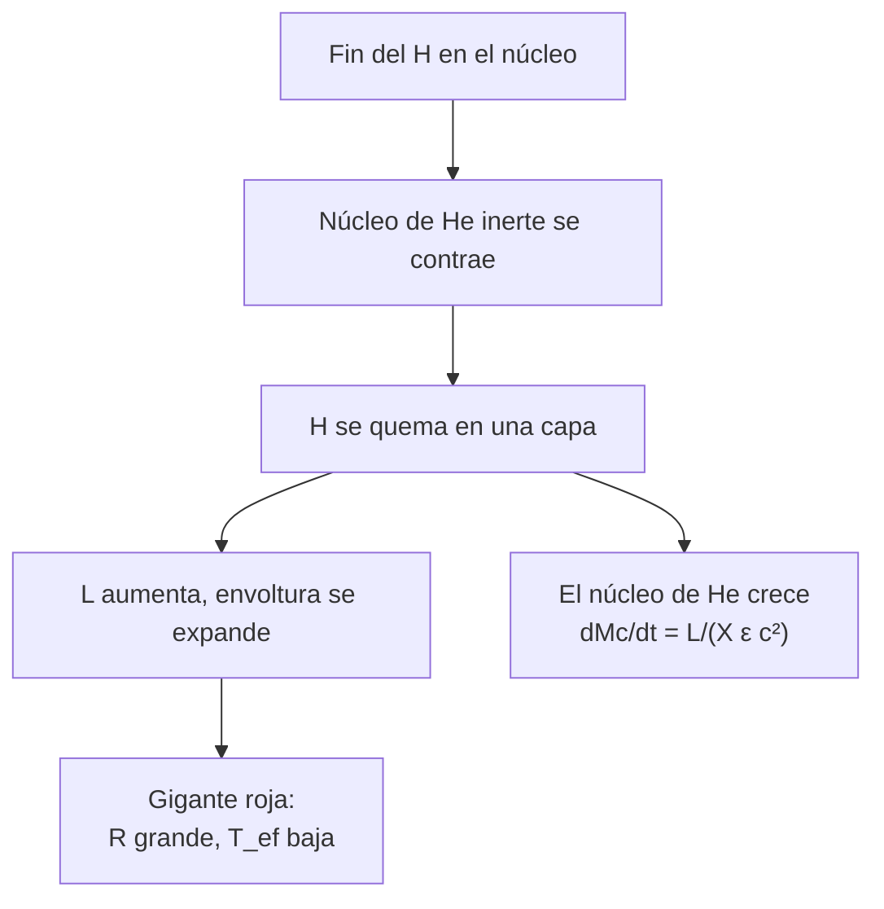

# B24-C16 — Gigantes rojas

<!-- nav:top -->
[🏠 Programa](../../../../README.md) · [📚 Bloque B24](../../../tronco-comun/B24-fisica-y-evolucion-de-estrellas.md) · [← Anterior: B24-C15 — Estrellas de baja masa](../B24-C15-estrellas-de-baja-masa/CLASE.md) · [Siguiente: B24-C17 — Estrellas masivas y pérdida de masa →](../B24-C17-estrellas-masivas-y-perdida-de-masa/CLASE.md)
<!-- /nav -->

## 1. Ubicación, nivel y alcance

Clase 16 del bloque B24. Nivel N3. Cuando el núcleo de una estrella de baja masa se queda sin hidrógeno ([C15](../B24-C15-estrellas-de-baja-masa/CLASE.md)), la estrella se hincha y enfría hasta ser una **gigante roja**. Retomas el radio del diagrama HR ([C03](../B24-C03-diagrama-de-hertzsprung-russell/CLASE.md)), el balance de energía ([C06](../B24-C06-fusion-de-hidrogeno/CLASE.md)) y la asterosismología ([C14](../B24-C14-asterosismologia-inicial/CLASE.md)). Se estudia la estructura simplificada de una gigante; las etapas posteriores se ven en [C18](../B24-C18-etapas-finales-de-evolucion/CLASE.md) y [C21](../B24-C21-rama-asintotica-de-gigantes-pulsos-termicos-y-proceso-s/CLASE.md).

## 2. Por qué esta clase existe

Una gigante roja es mucho mayor y más luminosa que su estrella original y tiene una densidad media ínfima. Entender su tamaño, su gravedad y cómo crece su núcleo permite interpretar las gigantes observadas, usarlas como sondas asterosísmicas y anticipar el destino del Sol. La decisión central: **dadas la luminosidad y la temperatura de una gigante, ¿qué radio, gravedad y densidad tiene y cómo crece su núcleo de helio?**

## 3. Lo que podrás hacer al terminar

1. Describir la secuencia: fin del hidrógeno, quemado en capa, expansión.
2. Calcular el radio, la gravedad y la densidad media de una gigante.
3. Calcular el tiempo dinámico de una gigante.
4. Estimar el crecimiento del núcleo por quemado de hidrógeno en capa.
5. Relacionar la gigante con su señal asterosísmica.
6. Nombrar qué deja fuera el modelo (pérdida de masa, flash del helio).

La evidencia es la **ficha de una gigante roja** del ejercicio 12 (sección 20).

## 4. Con qué llegas y cómo comprobarlo

1. ¿Qué es el quemado de hidrógeno en capa?
2. ¿Cómo se calcula el radio desde `L` y `T`?
3. ¿Qué es la gravedad superficial?
4. ¿Qué es la separación grande `Δν` y cómo escala con la densidad?
5. ¿Cuánta energía rinde un kilogramo de hidrógeno?

<details>
<summary>Ver respuestas</summary>

1. La fusión de hidrógeno en una capa que rodea un núcleo inerte de helio. 2. `R/R☉ = √(L/L☉)(T☉/T)²`. 3. `g = GM/R²`. 4. La distancia en frecuencia entre modos consecutivos; `Δν ∝ √ρ̄`. 5. `6,40 × 10¹⁴ J/kg`.
</details>

Con cuatro o cinco aciertos, sigue; si no, repasa C03, C06 y C14.

## 5. Un caso real: qué ve Kepler en las gigantes

Con más de un año de fotometría de alta precisión de Kepler, Bedding y colaboradores distinguieron entre gigantes rojas que queman hidrógeno en capa y las que queman helio en el núcleo gracias al espaciado de periodos de los modos de gravedad: unos `50 s` en las primeras y de `100` a `300 s` en las segundas (S2, resumen). El **ejemplo conductor** es una gigante **ilustrativa**: `M = 1,3 M☉`, `L = 100 L☉`, `T_ef = 4500 K`, que el laboratorio muestra con `R = 16,5 R☉`, una gravedad unas 200 veces menor que la solar y una densidad media de `0,41 kg/m³`.

## 6. Vocabulario

Una **gigante roja** es una estrella evolucionada, fría (`T_ef` de miles de kelvin), grande y luminosa. El **núcleo inerte de helio** es la zona central sin fusión que crece. El **quemado en capa** es la fusión en una capa que envuelve el núcleo. La **rama de las gigantes rojas** es el tramo del diagrama HR donde la estrella sube en luminosidad con `T_ef` casi constante. La **gravedad superficial** `g = GM/R²` suele darse como `log g` en cgs. El **tiempo dinámico** es `√(R³/GM)`. El **crecimiento del núcleo** es `dM_c/dt = L/(X ε c²)` si toda la luminosidad viene de la capa. La **estrella con helio en el núcleo** quema helio (C08).

## 7. Modelo mental: un núcleo que se contrae mientras la envoltura se hincha

El núcleo inerte se contrae y calienta; la capa que lo rodea fusiona más fuerte; la envoltura, empujada por esa energía, se expande.



*Descripción textual:* al agotarse el hidrógeno del núcleo, este se contrae y la fusión se desplaza a una capa; la luminosidad sube, la envoltura se hincha y la estrella se vuelve una gigante, mientras el núcleo de helio crece con la masa que la capa va convirtiendo.

Analogía: un globo cuyo interior se calienta mientras la piel se estira. Límite: en la estrella la expansión se debe a cómo se reparte la energía entre capas, no a una presión interna uniforme.

## 8. La explicación, paso a paso

### 8.1 Radio, gravedad y densidad

Con la fórmula de C03: `R = √(L/(4πσ))/T²`. Para `L = 100 L☉` y `4500 K`, `R = 16,45 R☉ = 1,14 × 10¹⁰ m`. La gravedad es `g = GM/R² = 1,32 m/s²` (`log g = 2,12` en cgs) frente a `274,2 m/s²` del Sol, y la densidad media `0,41 kg/m³`, unas 3400 veces menor que la solar. Su tiempo dinámico es `1,08 d`.

### 8.2 Consecuencias asterosísmicas

Una densidad `2,9 × 10⁻⁴` de la solar implica (C14) una `Δν` unas 58 veces menor: `2,1 μHz` con la escala `Δν ∝ √ρ̄` aplicada al valor del politropo solar (`123,6 μHz`). Las gigantes oscilan a frecuencias bajas y con periodos largos, lo que facilita su detección con series de meses.

### 8.3 Crecimiento del núcleo

Si toda la luminosidad `L` viene de la capa de hidrógeno, la masa del núcleo crece a `dM_c/dt = L/(X ε c²)`. Con `L = 100 L☉`, `X = 0,7` (ilustrativo) y `ε c² = 6,40 × 10¹⁴ J/kg`, resulta `8,5 × 10¹³ kg/s = 1,36 × 10⁻⁹ M☉/año`: añadir `0,1 M☉` lleva `74 Myr`. El laboratorio integra con Runge–Kutta y obtiene `0,095 M☉` en `70 Myr`, igual que la solución lineal. En la realidad `L` aumenta con la masa del núcleo, de modo que el ritmo se acelera.

### 8.4 Señales de la fase

Los modos de gravedad mixtos de las gigantes tienen espaciados de periodo de ~`50 s` si la estrella solo quema hidrógeno en capa y de `100–300 s` si quema helio en el núcleo (S2, resumen). Eso separa dos estadios de aspecto casi idéntico en el diagrama HR. Los diagramas de Gaia muestran las gigantes y otros estadios evolucionados con gran precisión (S3, resumen).

### 8.5 Lo que falta

El modelo no incluye la pérdida de masa en la gigante, el flash del helio ni la mezcla. Además, los modelos de evolución como MIST siguen estas fases con detalle (S4, resumen). Aquí se ve la escala, no la trayectoria completa.

## 9. Magnitudes, símbolos y unidades

| Símbolo | Qué es | Unidad | Valor / nota |
|---|---|---|---|
| `M`, `L`, `T_ef` | masa, luminosidad, temperatura de la gigante | `M☉`; `L☉`; K | `1,3`; `100`; `4500` (ilustrativos) |
| `R` | radio | `R☉` | `16,45` |
| `g`, `log g` | gravedad superficial | `m/s²`; cgs | `1,32`; `2,12` |
| `ρ̄` | densidad media | `kg/m³` | `0,41` |
| `dM_c/dt` | crecimiento del núcleo | `M☉/año` | `1,36 × 10⁻⁹` |
| `ΔΠ` | espaciado de periodo de modos g | s | ~50; 100–300 (S2) |

## 10. Convenciones y referencias

`σ` de NIST; `GM☉`, `R☉`, `L☉` nominales de la IAU (S1). La gigante, `X` y `L` constante son **ilustrativos**. `ε c²` de C06.

## 11. De dónde sale lo que afirmamos

| ID | Fuente | Localizador | Respalda | Estado |
|---|---|---|---|---|
| S1 | Mamajek et al., *IAU 2015 Resolution B3*, arXiv:1510.07674 | https://arxiv.org/abs/1510.07674 | `GM☉`, `R☉`, `L☉` nominales | Texto del PDF extraído el 2026-11-09 |
| S2 | Bedding et al., arXiv:1103.5805 | https://arxiv.org/abs/1103.5805 | Espaciado de periodo ~50 s frente a 100–300 s | Solo resumen, consultado el 2026-11-09 |
| S3 | Gaia Collaboration, arXiv:1804.09378 | https://arxiv.org/abs/1804.09378 | HRD de Gaia con estadios evolucionados | Solo resumen, consultado el 2026-11-09 |
| S4 | Choi et al., *MIST. I*, arXiv:1604.08592 | https://arxiv.org/abs/1604.08592 | Modelos de evolución desde la pre-secuencia hasta etapas finales | Solo resumen, consultado el 2026-11-09 |

Límites: S2–S4 solo resumen; `σ` y `G` de NIST (CODATA 2022); la gigante y sus parámetros son ilustrativos.

## 12. Cómo ver la gigante

| Magnitud | Sol | Gigante (ilustrativa) |
|---|---|---|
| `R` | 1 `R☉` | 16,45 `R☉` |
| `g` (m/s²) | 274,2 | 1,32 |
| `ρ̄` (kg/m³) | 1410 | 0,41 |
| `t_dyn` | 26,5 min | 1,08 d |
| `Δν` (por escala) | 123,6 μHz | 2,1 μHz |

Descripción larga: el radio crece 16 veces, la gravedad cae 200 veces y la densidad, unas 3400 veces.

## 13. Ejemplo trabajado: ¿cuánto tarda en crecer el núcleo?

**Paso 1 · Datos.** `L = 100 L☉`, `X = 0,7`, `ε c² = 6,40 × 10¹⁴ J/kg` (ilustrativos para `L` y `X`).

**Paso 2 · Ritmo.** `dM_c/dt = 3,828 × 10²⁸/(0,7 × 6,40 × 10¹⁴) = 8,55 × 10¹³ kg/s`.

**Paso 3 · En masas solares por año.** `8,55 × 10¹³ × 3,156 × 10⁷/1,988 × 10³⁰ = 1,36 × 10⁻⁹ M☉/año`.

**Paso 4 · Tiempo.** `0,1/1,36 × 10⁻⁹ = 7,4 × 10⁷ años`.

**Paso 5 · Sentido.** Unos 74 Myr para añadir una décima de masa solar al núcleo, con `L` constante. Con `L` creciente sería menos; es una cota superior.

## 14. Distintas formas de estudiar una gigante

**Estructura simplificada (esta clase):** analítica, da escalas. **Modelos de evolución (MIST):** siguen toda la trayectoria. **Asterosismología:** mide masas y radios en gigantes reales (C14). Se contrastan entre sí.

## 15. Práctica guiada

**Ejercicio 1 · con los pasos indicados.** Calcula el radio de la gigante. *Pasos:* `√100 × (5772/4500)²`.

<details><summary>Solución comentada</summary>

`10 × 1,645 = 16,45 R☉` (8.1).
</details>

**Ejercicio 2 · con una pista.** Calcula la gravedad superficial. *Pista:* `GM/R²`.

<details><summary>Solución comentada</summary>

`1,3 × 1,3271 × 10²⁰/(1,145 × 10¹⁰)² = 1,32 m/s²`.
</details>

**Ejercicio 3 · casi autónomo.** Calcula `log g` en cgs.

<details><summary>Solución comentada</summary>

`g = 132 cm/s²`; `log₁₀ 132 = 2,12`.
</details>

## 16. Práctica autónoma, transferencia e integrador

**Ejercicio 4.** Calcula la densidad media y compárala con la solar.

<details><summary>Solución comentada</summary>

`ρ̄ = 1,3 × 1,988 × 10³⁰/(4,19 × (1,145 × 10¹⁰)³) = 0,41 kg/m³`; cociente con `1410`: `2,9 × 10⁻⁴`.
</details>

**Ejercicio 5.** Calcula el tiempo dinámico en días.

<details><summary>Solución comentada</summary>

`√(R³/GM) = 9,3 × 10⁴ s = 1,08 d` (8.1).
</details>

**Ejercicio 6.** Si `L` fuera `200 L☉`, ¿cuánto tardaría en crecer `0,1 M☉` el núcleo?

<details><summary>Solución comentada</summary>

`dM_c/dt ∝ L`: el doble de rápido, `37 Myr` (8.3).
</details>

**Ejercicio 7.** Si la temperatura fuera `4000 K` con la misma `L`, ¿cuál sería el radio?

<details><summary>Solución comentada</summary>

`R ∝ T⁻²`: `16,45 × (4500/4000)² = 20,8 R☉`.
</details>

**Ejercicio 8.** ¿Cuántas veces mayor es el espaciado de periodo en las estrellas con helio en el núcleo que en las de hidrógeno en capa?

<details><summary>Solución comentada</summary>

De `100–300 s` frente a `~50 s`: entre `2` y `6` veces (S2).
</details>

**Ejercicio 9 · transferencia.** Si `Δν = 2,1 μHz`, ¿cuál es el tiempo de cruce acústico?

<details><summary>Solución comentada</summary>

`1/(2Δν) = 2,4 × 10⁵ s = 2,7 d`.
</details>

**Ejercicio 10 · transferencia.** Si el Sol llegara a ser una gigante de `16,45 R☉`, ¿llegaría a la órbita terrestre (`1 au = 215 R☉`)?

<details><summary>Solución comentada</summary>

No: `16,45 R☉ = 0,076 au`. Una gigante real puede crecer mucho más en etapas posteriores (C21), por lo que esta conclusión se limita a este ejemplo.
</details>

**Ejercicio 11 · transferencia.** Dos gigantes tienen el mismo color y brillo parecido en el diagrama HR. ¿Cómo se sabe cuál quema helio en el núcleo?

<details><summary>Solución comentada</summary>

Por el espaciado de periodo de los modos de gravedad: `100–300 s` (helio) frente a ~`50 s` (hidrógeno en capa) (S2).
</details>

**Ejercicio 12 · integrador.** Elabora tu *ficha de una gigante roja*: elige `M`, `L` y `T_ef` (ilustrativos), calcula `R`, `g`, `ρ̄`, `t_dyn`, `Δν` por escala, el ritmo de crecimiento del núcleo y nombra dos fenómenos omitidos.

<details><summary>Solución modelo</summary>

Con `1,3 M☉`, `100 L☉`, `4500 K`: `16,45 R☉`, `1,32 m/s²`, `0,41 kg/m³`, `1,08 d`, `2,1 μHz`, `1,36 × 10⁻⁹ M☉/año`; omitidos: pérdida de masa y flash del helio.
</details>

## 17. Laboratorio: una gigante ilustrativa

El script [gigante.py](gigante.py) calcula `R`, `g`, `ρ̄` y `t_dyn`, **comprueba** el viaje de ida y vuelta `L → R → L` (`10⁻¹²`) e integra el crecimiento del núcleo con RK4, **comprobando** que coincide con la solución lineal exacta (`10⁻⁹`).

**Datos:** constantes de NIST; valores solares de la IAU; gigante, `X` y `L` constante **ilustrativos**. **Predice antes de ejecutar:** ¿qué radio saldrá? (alrededor de 16 `R☉`.) **Ejecución del 2026-11-09 (Python 3.12.9):**

```text
Python 3.12.9 (biblioteca estandar)
R = 16.45 R_sol ; g = 1.32 m/s2 (Sol 274.2) ; log g(cgs) = 2.12
densidad media = 0.412 kg/m3 = 2.92e-04 rho_sol
tiempo dinamico = 1.08 d
dMc/dt = 8.548e+13 kg/s = 1.36e-09 Msol/yr
crecimiento del nucleo en 70 Myr = 0.095 Msol
tiempo para anadir 0.1 Msol = 74 Myr
Pruebas superadas.
```

```bash
python programa/clases/B24/B24-C16-gigantes-rojas/gigante.py
```

**Límites:** `L` constante, sin pérdida de masa ni flash del helio.

## 18. Errores frecuentes y cómo corregirlos

**Pensar que la gigante es más caliente.** Se corrige con el ejercicio 7: es más fría y mucho mayor.

**Olvidar el cuadrado de `T`.** Se corrige con el ejercicio 1.

**Creer que `L` es constante en la gigante.** Se corrige con la sección 8.3.

**Confundir dos tipos de gigantes.** Se corrige con el ejercicio 11.

**Tratar la gigante ilustrativa como una estrella real.** Se corrige con la sección 10.

## 19. Cómo sabrás que vas bien

Tras 8.1: ¿cuánto vale `R`? Si dudas, ejercicio 1. Tras 8.3: ¿cuánto tarda el núcleo en crecer? Ejercicio 6. Tras el laboratorio: ¿qué verifica RK4? (la solución lineal del ritmo constante).

## 20. Qué entregas y cómo se evalúa

El producto es tu **ficha de una gigante roja** (ejercicio 12).

| Criterio | Inicial | En desarrollo | Logrado | Destacado |
|---|---|---|---|---|
| Conceptos | Los confunde | Parciales | Quemado en capa, expansión | Distingue dos tipos |
| Cálculo | Sin unidades | Con errores | `R`, `g`, `ρ̄` | Ritmo del núcleo |
| Numérico | Sin comprobar | Un caso | Ida y vuelta y RK4 | Discute la cota |
| Fuentes | Sin fuente | Sin fecha | S1–S4 con fecha | Declara resúmenes |
| Límites | No los nombra | Uno | Tres | Discute el flash |

**Condiciones críticas (no se compensan con promedio):** rotular la gigante como ilustrativa; no predecir el destino del Sol con este modelo; citar solo lo consultado y decir que S2–S4 son resúmenes.

## 21. Ética, seguridad y límites

Clase educativa: no sustituye un modelo de evolución con pérdida de masa y flash del helio. Accesibilidad: tablas equivalentes a las gráficas, fórmulas en texto, ejercicios sin conexión.

## 22. Para cerrar y seguir

Una gigante roja es grande, fría y poco densa, con un núcleo de helio que crece por el quemado en capa; sus oscilaciones delatan su fase. Queda una pregunta: ¿qué pasa con estrellas mucho más masivas, que pierden masa mientras viven?

**Glosario español–inglés.** gigante roja · *red giant*; quemado en capa · *shell burning*; núcleo inerte · *inert core*; gravedad superficial · *surface gravity*; rama de las gigantes rojas · *red giant branch*; modos de gravedad mixtos · *mixed gravity modes*.

**Continuidad.** [B24-C17](../B24-C17-estrellas-masivas-y-perdida-de-masa/CLASE.md) reutiliza la luminosidad y la opacidad para estudiar los vientos de estrellas masivas.

**Referencias:** ver sección 11.

<!-- nav:bottom -->
---

[← Anterior: B24-C15 — Estrellas de baja masa](../B24-C15-estrellas-de-baja-masa/CLASE.md) · [📚 Bloque B24](../../../tronco-comun/B24-fisica-y-evolucion-de-estrellas.md) · [Siguiente: B24-C17 — Estrellas masivas y pérdida de masa →](../B24-C17-estrellas-masivas-y-perdida-de-masa/CLASE.md)
<!-- /nav -->
