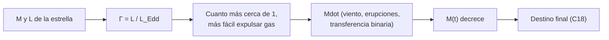

# B24-C17 — Estrellas masivas y pérdida de masa

<!-- nav:top -->
[🏠 Programa](../../../../README.md) · [📚 Bloque B24](../../../tronco-comun/B24-fisica-y-evolucion-de-estrellas.md) · [← Anterior: B24-C16 — Gigantes rojas](../B24-C16-gigantes-rojas/CLASE.md) · [Siguiente: B24-C18 — Etapas finales de evolución →](../B24-C18-etapas-finales-de-evolucion/CLASE.md)
<!-- /nav -->

## 1. Ubicación, nivel y alcance

Clase 17 del bloque B24. Nivel N3. En [C15](../B24-C15-estrellas-de-baja-masa/CLASE.md) y [C16](../B24-C16-gigantes-rojas/CLASE.md) la masa de la estrella se mantenía casi constante. En las estrellas masivas (más de unas pocas decenas de masas solares) la luminosidad es tan alta que la luz expulsa la atmósfera, y la masa cambia de forma decisiva. Retomas la opacidad de Thomson y el límite de Eddington de [C09](../B24-C09-atmosferas-y-opacidades/CLASE.md), el balance energético de [C06](../B24-C06-fusion-de-hidrogeno/CLASE.md) y la integración numérica ([B11-C07](../../B11/B11-C07-runge-kutta-de-cuarto-orden/CLASE.md)). Aquí no se trata la explosión; eso es [C18](../B24-C18-etapas-finales-de-evolucion/CLASE.md).

## 2. Por qué esta clase existe

La masa que una estrella conserva hasta su final decide el destino: remanente, tipo de supernova, enriquecimiento del medio. Y las estrellas masivas no la conservan: pierden masa por vientos, erupciones y transferencia a una compañera. La decisión central: **¿cerca de qué fracción de su límite de Eddington brilla una estrella masiva y cuánta masa pierde durante su vida?**

## 3. Lo que podrás hacer al terminar

1. Calcular el factor de Eddington `Γ = L/L_Edd` de una estrella.
2. Estimar la vida de una estrella masiva.
3. Integrar y verificar un modelo de pérdida de masa con solución exacta.
4. Comparar pérdida de masa por viento constante y variable.
5. Enumerar mecanismos de pérdida de masa y su dependencia de la metalicidad.
6. Nombrar qué limita el modelo (clumping, erupciones, binarias).

La evidencia es el **balance de masa de una estrella masiva** del ejercicio 12 (sección 20).

## 4. Con qué llegas y cómo comprobarlo

1. ¿Qué es la luminosidad de Eddington?
2. ¿Qué es la opacidad de Thomson?
3. ¿Qué es el tiempo nuclear (C06)?
4. ¿Cómo se integra una ecuación diferencial con Runge–Kutta?
5. ¿Qué es la metalicidad?

<details>
<summary>Ver respuestas</summary>

1. La luminosidad a la que la fuerza de radiación iguala a la gravedad. 2. La dispersión de fotones por electrones libres: `κ_es = σ_T(1+X)/(2m_p)`. 3. `t = f X M ε c²/L`. 4. Con cuatro pendientes por paso (B11-C07). 5. La abundancia de elementos más pesados que el helio.
</details>

Con cuatro o cinco aciertos, sigue; si no, repasa C09, C06 y B11-C07.

## 5. Un caso real: las tasas de pérdida de masa se han revisado a la baja

Smith revisó los efectos de la pérdida de masa: las tasas de los vientos estándar de estrellas calientes dependientes de la metalicidad parecen ser de 2 a 3 veces menores que las usadas en los modelos de evolución, en gran parte por la estructura en grumos del viento; cobran peso entonces los vientos, pulsaciones y erupciones de supergigantes evolucionadas y la transferencia de masa en binarias (S3, resumen). Sana y colaboradores encontraron que más del `70 %` de las estrellas masivas intercambiarán masa con una compañera, y que en un tercio de esos casos la fusión de ambas es el desenlace (S4, resumen). El **ejemplo conductor** es una estrella **ilustrativa** de `40 M☉` que pierde masa durante `4 Myr`.

## 6. Vocabulario

El **viento estelar** es el flujo de gas que sale de la superficie impulsado por la luz. El **factor de Eddington** `Γ = L/L_Edd` es la fracción del límite que emite la estrella (C09). La **pérdida de masa** `Ṁ` es la masa que se pierde por unidad de tiempo. Las **erupciones** son expulsiones violentas y esporádicas de masa. La **estructura en grumos** (*clumping*) es la heterogeneidad del viento. Una **estrella de Wolf–Rayet** es una estrella masiva que ha perdido su envoltura de hidrógeno. La **metalicidad** `Z` afecta a la intensidad de los vientos. La **vida en secuencia principal** de una estrella masiva se calcula con `t = f X M ε c²/L` (C06, C15).

## 7. Modelo mental: una vela que sopla su propio aire

Cuanto más brilla la estrella, más empuja la luz sobre su atmósfera; si la luz casi iguala a la gravedad, el gas escapa con facilidad.



*Descripción textual:* de la masa y la luminosidad se obtiene el factor de Eddington; cuanto más cercano a 1, más fácil es expulsar gas; la masa disminuye con el tiempo y fija el destino final.

Analogía: soplar una pelota de pimpón con un ventilador. Límite: en la estrella el empuje depende de las líneas espectrales y no solo de la dispersión de Thomson, de modo que `Γ` es una cota inferior de la relevancia de la radiación.

## 8. La explicación, paso a paso

### 8.1 Factor de Eddington

Con `κ_es = 0,0338 m²/kg` para `X = 0,7` (C09) la luminosidad de Eddington es `L_Edd = 3,86 × 10⁴ (M/M☉) L☉`. Para valores **ilustrativos**: `10 M☉` con `5 × 10³ L☉` → `Γ = 0,013`; `20 M☉` con `4 × 10⁴ L☉` → `0,052`; `40 M☉` con `2,5 × 10⁵ L☉` → `0,162`; `80 M☉` con `8 × 10⁵ L☉` → `0,259`. `Γ` crece con la masa: las estrellas masivas están más cerca de su límite.

### 8.2 Vida corta

Con `t = f X M ε c²/L` (`f = 0,1`, `X = 0,7`, ilustrativos): `10 M☉` → `14,7 Myr`; `20 M☉` → `3,7 Myr`; `40 M☉` → `1,2 Myr`; `80 M☉` → `0,74 Myr`. La vida cae más deprisa que `1/M` (factor 20 al multiplicar la masa por 8) porque `L` crece mucho más rápido que `M`. Estos tiempos son un orden de magnitud; la fracción quemada real es mayor en estrellas masivas.

### 8.3 Pérdida de masa acumulada

Si la tasa fuera constante, `ΔM = Ṁ t`; para `10⁻⁶ M☉/año` durante `4 Myr`, `4 M☉`. Si la tasa depende de la masa actual, el problema es una ecuación diferencial. Con la elección ilustrativa `dM/dt = −kM²` (con `k = Ṁ₀/M₀²`), la solución exacta es `1/M = 1/M₀ + k t`. Para `M₀ = 40 M☉` y `Ṁ₀ = 10⁻⁶ M☉/año`, a `4 Myr` quedan `36,36 M☉` y se pierden `3,64 M☉`. El laboratorio integra con RK4 y recupera el valor exacto a `10⁻⁹`.

### 8.4 Mecanismos

Las tasas de pérdida de masa por vientos de estrellas calientes parecen más bajas de lo que suponían los modelos antiguos, y se dan más peso a las pulsaciones, erupciones y la transferencia en binarias, que dependen menos de la metalicidad (S3, resumen). Los vientos radiativos escalan con la metalicidad, mientras que las erupciones y la transferencia en binarias son menos sensibles; por eso su importancia crece a baja metalicidad.

### 8.5 El papel de las binarias

Que más del `70 %` de las estrellas masivas interactúe con una compañera (S4, resumen) significa que el modelo de estrella aislada solo describe una minoría. La evolución binaria se estudia en [C22](../B24-C22-evolucion-binaria-lobulo-de-roche-y-transferencia-de-masa/CLASE.md). El desenlace depende de las masas del núcleo de helio y de la envoltura de hidrógeno (S5, resumen).

## 9. Magnitudes, símbolos y unidades

| Símbolo | Qué es | Unidad | Valor / nota |
|---|---|---|---|
| `Γ` | factor de Eddington | — | `0,013`–`0,259` (ilustrativo) |
| `L_Edd` | luminosidad de Eddington | `L☉` | `3,86 × 10⁴ M/M☉` |
| `Ṁ` | tasa de pérdida de masa | `M☉/año` | `10⁻⁶` (ilustrativa) |
| `k` | coeficiente del modelo `dM/dt = −kM²` | `(M☉ año)⁻¹` | `Ṁ₀/M₀²` |
| `t_vida` | vida en secuencia principal | Myr | `1,2` (40 `M☉`) |
| `κ_es` | opacidad de Thomson | `m²/kg` | `0,0338` (`X = 0,7`) |

## 10. Convenciones y referencias

`X = 0,7`, `f = 0,1` y las parejas `(M, L)` son **ilustrativos**. La ley `dM/dt = −kM²` es una **elección didáctica** para tener solución exacta, no un resultado astrofísico. `M☉ = GM☉/G`.

## 11. De dónde sale lo que afirmamos

| ID | Fuente | Localizador | Respalda | Estado |
|---|---|---|---|---|
| S1 | NIST, *Fundamental Physical Constants — Complete Listing* (CODATA 2022) | https://physics.nist.gov/cuu/Constants/Table/allascii.txt | `σ_T`, `G`, `c`, `m_p` | Consultada el 2026-11-09 |
| S2 | Mamajek et al., *IAU 2015 Resolution B3*, arXiv:1510.07674 | https://arxiv.org/abs/1510.07674 | `GM☉`, `L☉` | Texto del PDF extraído el 2026-11-09 |
| S3 | Smith, *Mass Loss: Its Effect on the Evolution and Fate of High-Mass Stars*, arXiv:1402.1237 | https://arxiv.org/abs/1402.1237 | Tasas de vientos 2–3 veces menores; peso de erupciones, pulsaciones y binarias | Solo resumen, consultado el 2026-11-09 |
| S4 | Sana et al., *Binary interaction dominates the evolution of massive stars*, arXiv:1207.6397 | https://arxiv.org/abs/1207.6397 | >70 % intercambia masa; ~1/3 de ellos se fusiona | Solo resumen, consultado el 2026-11-09 |
| S5 | Heger et al., arXiv:astro-ph/0212469 | https://arxiv.org/abs/astro-ph/0212469 | Desenlace según masas del núcleo de helio y de la envoltura | Solo resumen, consultado el 2026-11-09 |

Límites: S3–S5 solo resumen; ninguna tasa numérica de pérdida de masa procede de una fuente consultada.

## 12. Cómo ver el balance

| `M` (`M☉`) | `L` (`L☉`, ilustr.) | `Γ` | `t_vida` (Myr) |
|---|---|---|---|
| 10 | `5 × 10³` | 0,013 | 14,7 |
| 20 | `4 × 10⁴` | 0,052 | 3,7 |
| 40 | `2,5 × 10⁵` | 0,162 | 1,2 |
| 80 | `8 × 10⁵` | 0,259 | 0,74 |

Descripción larga: al aumentar la masa, `Γ` crece y la vida cae; por encima de 40 `M☉` la vida es de un millón de años o menos.

## 13. Ejemplo trabajado: ¿cuánta masa pierde la estrella de 40 M☉?

**Paso 1 · Datos.** `M₀ = 40 M☉`, `Ṁ₀ = 10⁻⁶ M☉/año`, `t = 4 × 10⁶` años (ilustrativos).

**Paso 2 · Coeficiente.** `k = 10⁻⁶/40² = 6,25 × 10⁻¹⁰`.

**Paso 3 · Solución.** `1/M = 1/40 + 6,25 × 10⁻¹⁰ × 4 × 10⁶ = 0,025 + 0,0025 = 0,0275`.

**Paso 4 · Masa final.** `M = 36,36 M☉`; se pierden `3,64 M☉`, un `9,1 %`.

**Paso 5 · Sentido.** Con tasa constante se perderían `4 M☉`. La diferencia ilustra cómo el supuesto sobre `Ṁ` cambia el resultado; las tasas reales son más inciertas (S3).

## 14. Distintas formas de modelar la pérdida de masa

**Tasa constante:** simple. **Tasa dependiente de `M` y `L` (esta clase):** cinética con solución exacta. **Prescripciones empíricas en códigos de evolución:** las que se usan en la práctica, con revisión continua (S3); no se consultaron aquí.

## 15. Práctica guiada

**Ejercicio 1 · con los pasos indicados.** Calcula `Γ` para `40 M☉` con `L = 2,5 × 10⁵ L☉`. *Pasos:* `L_Edd = 40 × 3,86 × 10⁴`.

<details><summary>Solución comentada</summary>

`L_Edd = 1,545 × 10⁶ L☉`; `Γ = 2,5 × 10⁵/1,545 × 10⁶ = 0,162`.
</details>

**Ejercicio 2 · con una pista.** Calcula la vida de esa estrella con `f = 0,1`, `X = 0,7`. *Pista:* escala desde el Sol (7,37 Gyr).

<details><summary>Solución comentada</summary>

`7,37 × 10⁹ × 40/2,5 × 10⁵ = 1,18 × 10⁶ años` (8.2).
</details>

**Ejercicio 3 · casi autónomo.** Calcula la pérdida de masa con tasa constante `10⁻⁶ M☉/año` en `4 Myr`.

<details><summary>Solución comentada</summary>

`4 M☉` (8.3).
</details>

## 16. Práctica autónoma, transferencia e integrador

**Ejercicio 4.** Calcula `Γ` para `80 M☉` con `8 × 10⁵ L☉`.

<details><summary>Solución comentada</summary>

`L_Edd = 3,09 × 10⁶`; `Γ = 0,259`.
</details>

**Ejercicio 5.** Con el modelo `dM/dt = −kM²`, ¿qué fracción se pierde en `4 Myr`?

<details><summary>Solución comentada</summary>

`3,64/40 = 9,1 %` (13).
</details>

**Ejercicio 6.** Si las tasas reales fueran 3 veces menores (S3, resumen), ¿cuánta masa se perdería con la ley del ejercicio 5, de forma aproximada?

<details><summary>Solución comentada</summary>

Aproximación lineal en la pérdida: `3,64/3 = 1,2 M☉` (con 2 veces, `1,8 M☉`).
</details>

**Ejercicio 7.** ¿Cuántas veces menos vive la estrella de `80 M☉` que la de `10 M☉`?

<details><summary>Solución comentada</summary>

`14,7/0,74 = 20` veces.
</details>

**Ejercicio 8.** ¿Qué luminosidad igualaría el límite de Eddington de una estrella de `40 M☉`?

<details><summary>Solución comentada</summary>

`L_Edd = 1,545 × 10⁶ L☉`.
</details>

**Ejercicio 9 · transferencia.** Con S4, ¿qué fracción mínima de las estrellas masivas termina fusionándose con su compañera?

<details><summary>Solución comentada</summary>

Más del `70 %` intercambia masa y un tercio de esos casos termina en fusión: `0,70/3 = 23 %` como cota inferior (S4, resumen).
</details>

**Ejercicio 10 · transferencia.** Un compañero dice que «el destino de una estrella masiva lo decide solo su viento». Responde con 8.4–8.5.

<details><summary>Solución comentada</summary>

No: las erupciones, las pulsaciones y la transferencia en binarias pueden pesar más que el viento estándar, y el desenlace depende de las masas del núcleo de helio y de la envoltura (S3, S5).
</details>

**Ejercicio 11 · transferencia.** ¿Por qué cobran más importancia las erupciones y las binarias a baja metalicidad?

<details><summary>Solución comentada</summary>

Porque dependen menos de la metalicidad que los vientos impulsados por líneas, que se debilitan al bajar `Z` (S3, resumen).
</details>

**Ejercicio 12 · integrador.** Elabora tu *balance de masa de una estrella masiva*: elige `M`, `L` y `Ṁ₀` (ilustrativos), calcula `Γ`, la vida, la masa perdida con tasa constante y con `dM/dt = −kM²`, y nombra tres mecanismos omitidos.

<details><summary>Solución modelo</summary>

Con `40 M☉`, `2,5 × 10⁵ L☉`, `10⁻⁶ M☉/año`: `Γ = 0,162`, `1,18 Myr` con las hipótesis de C06, pérdida `4` y `3,64 M☉`; omitidos: erupciones, grumos, transferencia binaria.
</details>

## 17. Laboratorio: Eddington y pérdida de masa

El script [perdida_masa.py](perdida_masa.py) calcula `Γ` y la vida para cuatro estrellas ilustrativas, **comprueba** que `0 < Γ < 1` e integra `dM/dt = −kM²` con RK4, **comprobando** que coincide con la solución exacta a `10⁻⁹`.

**Datos:** constantes de NIST; valores solares de la IAU; parejas `(M, L)` y `Ṁ` **ilustrativas**. **Predice antes de ejecutar:** ¿la masa perdida con `dM/dt = −kM²` será menor o mayor que con tasa constante? (menor, porque `M` baja.) **Ejecución del 2026-11-09 (Python 3.12.9):**

```text
Python 3.12.9 (biblioteca estandar)
L_Edd(1 Msol) = 3.863e+04 L_sol (kappa_es = 0.03381 m2/kg)
    M   L [Lsol]   Gamma  t_vida [Myr]
   10      5e+03   0.013         14.74
   20      4e+04   0.052          3.69
   40    2.5e+05   0.162          1.18
   80    8e+05   0.259          0.74
M(0) = 40.0 ; M(4 Myr) exacta = 36.3636 ; RK4 = 36.3636 ; perdida = 3.636 Msol
comparacion: tasa constante 1e-06 Msol/yr -> perdida = 4.000 Msol
Pruebas superadas.
```

```bash
python programa/clases/B24/B24-C17-estrellas-masivas-y-perdida-de-masa/perdida_masa.py
```

**Límites:** opacidad de Thomson, parejas `(M, L)` ilustrativas, ley de pérdida didáctica, sin binarias.

## 18. Errores frecuentes y cómo corregirlos

**Suponer que `Γ` cercana a 1 es lo normal.** Se corrige con los ejercicios 1 y 4.

**Tomar `dM/dt = −kM²` como ley física.** Se corrige con la sección 10.

**Olvidar las binarias.** Se corrige con el ejercicio 9.

**Aplicar tasas antiguas sin cuestionarlas.** Se corrige con el ejercicio 6.

**Confundir vida real y estimada.** Se corrige con la sección 8.2.

## 19. Cómo sabrás que vas bien

Tras 8.1: ¿qué fracción de su límite emite una estrella de 40 `M☉`? Si dudas, ejercicio 1. Tras 8.3: ¿cómo cambia la solución con la hipótesis? Ejercicio 5. Tras el laboratorio: ¿qué verifica RK4? (la solución exacta `1/M = 1/M₀ + kt`).

## 20. Qué entregas y cómo se evalúa

El producto es tu **balance de masa de una estrella masiva** (ejercicio 12).

| Criterio | Inicial | En desarrollo | Logrado | Destacado |
|---|---|---|---|---|
| Conceptos | Los confunde | Parciales | `Γ`, vientos, binarias | Explica la metalicidad |
| Cálculo | Sin unidades | Con errores | `Γ`, vida, masa perdida | Compara hipótesis |
| Numérico | Sin comprobar | Un caso | RK4 verificado | Discute el modelo didáctico |
| Fuentes | Sin fuente | Sin fecha | S1–S5 con fecha | Declara resúmenes |
| Límites | No los nombra | Uno | Tres | Discute grumos |

**Condiciones críticas (no se compensan con promedio):** rotular todo valor estelar como ilustrativo; no presentar `dM/dt = −kM²` como ley astrofísica; citar solo lo consultado y decir que S3–S5 son resúmenes.

## 21. Ética, seguridad y límites

Clase educativa: no sustituye modelos de evolución de estrellas masivas con prescripciones calibradas. Accesibilidad: tablas equivalentes a las gráficas, fórmulas en texto, ejercicios sin conexión.

## 22. Para cerrar y seguir

Las estrellas masivas viven poco y emiten una fracción apreciable de su límite de Eddington; pierden masa por vientos, erupciones y transferencia binaria, con tasas hoy revisadas a la baja. Queda una pregunta: ¿cómo termina la vida de una estrella según la masa que conserva?

**Glosario español–inglés.** estrella masiva · *massive star*; viento estelar · *stellar wind*; pérdida de masa · *mass loss*; factor de Eddington · *Eddington ratio*; estrella de Wolf–Rayet · *Wolf–Rayet star*; erupción · *eruption*; estructura en grumos · *clumping*.

**Continuidad.** [B24-C18](../B24-C18-etapas-finales-de-evolucion/CLASE.md) reutiliza la masa final para estudiar los destinos de las estrellas.

**Referencias:** ver sección 11.

<!-- nav:bottom -->
---

[← Anterior: B24-C16 — Gigantes rojas](../B24-C16-gigantes-rojas/CLASE.md) · [📚 Bloque B24](../../../tronco-comun/B24-fisica-y-evolucion-de-estrellas.md) · [Siguiente: B24-C18 — Etapas finales de evolución →](../B24-C18-etapas-finales-de-evolucion/CLASE.md)
<!-- /nav -->
