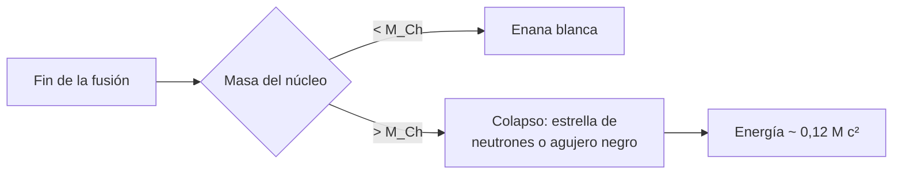

# B24-C18 — Etapas finales de evolución

<!-- nav:top -->
[🏠 Programa](../../../../README.md) · [📚 Bloque B24](../../../tronco-comun/B24-fisica-y-evolucion-de-estrellas.md) · [← Anterior: B24-C17 — Estrellas masivas y pérdida de masa](../B24-C17-estrellas-masivas-y-perdida-de-masa/CLASE.md) · [Siguiente: B24-C19 — Cúmulos y edades estelares →](../B24-C19-cumulos-y-edades-estelares/CLASE.md)
<!-- /nav -->

## 1. Ubicación, nivel y alcance

Clase 18 del bloque B24. Nivel N3. Cuando una estrella agota su combustible ([C08](../B24-C08-nucleosintesis-estelar/CLASE.md)) y ha perdido masa ([C17](../B24-C17-estrellas-masivas-y-perdida-de-masa/CLASE.md)), lo que queda es un remanente compacto. Aquí calculas el límite de masa de una enana blanca (**masa de Chandrasekhar**) con un modelo politrópico y comparas con la energía de formar una estrella de neutrones. Usas mecánica estadística elemental ([B06](../../../tronco-comun/B06-quimica-y-materia-del-universo.md) para la cantidad de sustancia), cuántica básica ([B31](../../../tronco-comun/B31-fisica-cuantica-nuclear-y-astroparticulas.md) la profundiza) y el solver de Lane–Emden de [C14](../B24-C14-asterosismologia-inicial/CLASE.md). Los objetos compactos se estudian en [B27](../../../tronco-comun/B27-objetos-compactos-y-altas-energias.md).

## 2. Por qué esta clase existe

El destino de una estrella es una enana blanca, una estrella de neutrones o un agujero negro; hay una masa límite que separa los dos primeros destinos. Calcularla muestra cómo la mecánica cuántica (presión de degeneración) sostiene a una estrella cuando ya no hay fusión. La decisión central: **¿cuál es la masa máxima que puede sostener la presión de electrones degenerados y cuánta energía se libera al colapsar a un objeto de 10 km?**

## 3. Lo que podrás hacer al terminar

1. Distinguir los tres remanentes y sus destinos según la masa.
2. Explicar la presión de degeneración de electrones.
3. Verificar el solver de Lane–Emden con soluciones analíticas.
4. Calcular la masa de Chandrasekhar con `μ_e` dado.
5. Calcular la energía gravitatoria de un objeto compacto.
6. Nombrar las limitaciones del modelo (temperatura cero, composición, rotación).

La evidencia es la **ficha de remanentes** del ejercicio 12 (sección 20).

## 4. Con qué llegas y cómo comprobarlo

1. ¿Qué dice el principio de exclusión de Pauli?
2. ¿Qué es el momento de Fermi?
3. ¿Qué es un politropo `n = 3`?
4. ¿Qué es la energía gravitatoria de una esfera?
5. ¿Qué es `μ_e`, el peso molecular por electrón?

<details>
<summary>Ver respuestas</summary>

1. Dos fermiones idénticos no ocupan el mismo estado. 2. El momento máximo ocupado a temperatura cero. 3. Un modelo con `P ∝ ρ^{4/3}` (C14, C20). 4. `−(3/5)GM²/R` si es uniforme (C02). 5. La masa media por electrón libre en unidades de `m_u`; vale 2 para carbono y oxígeno.
</details>

Con cuatro o cinco aciertos, sigue; si no, repasa C02, C14 y C20.

## 5. Un caso real: ¿cómo termina cada estrella?

Heger y colaboradores trazan, para estrellas individuales, dónde se forman agujeros negros, estrellas de neutrones y los distintos tipos de supernova según la masa y la metalicidad; el desenlace depende sobre todo de las masas del núcleo de helio y de la envoltura de hidrógeno al final (S3, resumen). Los diagramas de Gaia muestran la secuencia de enanas blancas, que se divide en una de hidrógeno y otra de helio (S4, resumen). El **ejemplo conductor** es el cálculo del límite de masa: un politropo `n = 3` de electrones degenerados ultrarrelativistas con `μ_e = 2` da `1,456 M☉`.

## 6. Vocabulario

Una **enana blanca** es el remanente de una estrella de baja o media masa, sostenido por la presión de electrones degenerados. Una **estrella de neutrones** es un remanente más compacto, de unos 10 km, sostenido por neutrones. Un **agujero negro** es un remanente sin soporte posible. La **presión de degeneración** surge del principio de Pauli: los electrones ocupan estados de momento creciente aunque la temperatura sea cero. La **masa de Chandrasekhar** `M_Ch` es la masa máxima de una enana blanca. El **momento de Fermi** `p_F = h (3n/(8π))^{1/3}` es el momento máximo ocupado. El **politropo `n = 3`** (`P = Kρ^{4/3}`) describe un gas degenerado ultrarrelativista. La **nebulosa planetaria** es la envoltura expulsada por una estrella de masa baja o media. Una **supernova** es la explosión final de una estrella masiva o de una enana blanca que acreta.

## 7. Modelo mental: un edificio con una altura máxima

La presión de los electrones sostiene a la estrella como los pilares sostienen un edificio. Si añades masa, el gas se comprime y los electrones se vuelven relativistas; la presión crece más despacio que la gravedad y el edificio, al llegar a cierta altura, no puede seguir en pie.



*Descripción textual:* según la masa del núcleo al fin de la fusión, queda una enana blanca (por debajo de la masa de Chandrasekhar) o se produce un colapso a una estrella de neutrones o un agujero negro, con una liberación de energía de una fracción apreciable de `Mc²`.

Analogía: el edificio con altura máxima. Límite: el valor exacto depende de la composición y de efectos que el modelo no incluye.

## 8. La explicación, paso a paso

### 8.1 Presión de un gas degenerado

A temperatura cero los electrones llenan todos los estados hasta el momento de Fermi `p_F`, con la densidad numérica `n_e = (8π/3)(p_F/h)³`. En el límite ultrarrelativista (`v = c`), `P = 2π c p_F⁴/(3h³)`. El laboratorio integra sobre estados y obtiene el mismo resultado que la forma cerrada (`2,445 × 10²² Pa` para `n_e = 10³⁶ m⁻³`). Expresada con la densidad, `P = Kρ^{4/3}`, `K = (ħc/4)(3π²)^{1/3}/(μ_e m_u)^{4/3}`.

### 8.2 El politropo n = 3

La solución de Lane–Emden para `n = 3` tiene `ξ₁ = 6,89685` y `ω₃ = −ξ₁²θ'(ξ₁) = 2,01824`. El solver se valida con `n = 1` (`ξ₁ = π`) y con `n = 5` (`θ = (1+ξ²/3)^{−1/2}`). La masa de una estrella con `P = Kρ^{4/3}` es `M = 4π (K/(πG))^{3/2} ω₃`, independiente del radio y de la densidad central: es una masa única.

### 8.3 La masa de Chandrasekhar

Con `μ_e = 2` (carbono y oxígeno), `M_Ch = 1,4563 M☉`; con `μ_e = 2,15` (núcleo de hierro), `1,2602 M☉`. Como `M ∝ μ_e⁻²`, una composición con menos electrones por nucleón da una masa límite menor. Es el resultado para temperatura cero y sin correcciones; los refinamientos modifican el valor.

### 8.4 Energía del colapso

Formar una estrella de neutrones de `1,4 M☉` y `10 km` (valores ilustrativos) libera una energía gravitatoria del orden de `3,1 × 10⁴⁶ J` (esfera uniforme), el `12,4 %` de `Mc²`. La compacidad `GM/(Rc²)` es `0,207`. La mayor parte de esa energía se la llevan los neutrinos, un hecho que este modelo no calcula.

### 8.5 Destinos y límites

Las estrellas de masa baja y media terminan como enanas blancas tras expulsar su envoltura (C16, C21); las más masivas, con colapso. El destino concreto depende de la masa del núcleo de helio y de la envoltura (S3, resumen). El modelo ignora la temperatura, la rotación, las correcciones electrostáticas y la captura de electrones, de modo que `1,456 M☉` es una cota aproximada de `M_Ch`.

## 9. Magnitudes, símbolos y unidades

| Símbolo | Qué es | Unidad | Valor / nota |
|---|---|---|---|
| `h`, `ħ`, `c`, `G`, `m_u` | constantes | — | (S1) |
| `p_F` | momento de Fermi | `kg m/s` | `h (3n_e/8π)^{1/3}` |
| `K` | constante politrópica | SI | `(ħc/4)(3π²)^{1/3}/(μ_e m_u)^{4/3}` |
| `ξ₁`, `ω₃` | raíz y masa adimensional | — | `6,89685`; `2,01824` |
| `M_Ch` | masa de Chandrasekhar | `M☉` | `1,4563` (`μ_e = 2`) |
| `E_g` | energía gravitatoria (ilustr.) | J | `3,1 × 10⁴⁶` |

## 10. Convenciones y referencias

Temperatura cero, electrones ultrarrelativistas, `μ_e` declarado; `1,4 M☉` y `10 km` para una estrella de neutrones son **ilustrativos**. `M☉ = GM☉/G`.

## 11. De dónde sale lo que afirmamos

| ID | Fuente | Localizador | Respalda | Estado |
|---|---|---|---|---|
| S1 | NIST, *Fundamental Physical Constants — Complete Listing* (CODATA 2022) | https://physics.nist.gov/cuu/Constants/Table/allascii.txt | `h`, `c`, `G`, `m_u` | Consultada el 2026-11-09 |
| S2 | Mamajek et al., *IAU 2015 Resolution B3*, arXiv:1510.07674 | https://arxiv.org/abs/1510.07674 | `GM☉` nominal | Texto del PDF extraído el 2026-11-09 |
| S3 | Heger et al., *How Massive Single Stars End their Life*, arXiv:astro-ph/0212469 | https://arxiv.org/abs/astro-ph/0212469 | Desenlaces según el núcleo de helio y la envoltura | Solo resumen, consultado el 2026-11-09 |
| S4 | Gaia Collaboration, arXiv:1804.09378 | https://arxiv.org/abs/1804.09378 | Secuencia de enanas blancas de H y de He | Solo resumen, consultado el 2026-11-09 |

Límites: S3 y S4 solo resumen; no se consultó ninguna referencia primaria para el valor de `M_Ch`; el cálculo del politropo y de la presión de Fermi se verifica internamente (solver con soluciones exactas y cuadratura frente a forma cerrada), no contra una publicación.

## 12. Cómo ver los remanentes

| Remanente | Soporte | Escala |
|---|---|---|
| Enana blanca | electrones degenerados | masa `< 1,456 M☉` (modelo) |
| Estrella de neutrones | neutrones | `~10 km` (ilustrativo) |
| Agujero negro | ninguno | — |

Descripción larga: la masa de Chandrasekhar separa el primer caso de los otros dos; el valor de `μ_e` lo desplaza (`1,456 → 1,260 M☉`).

## 13. Ejemplo trabajado: ¿puede una enana blanca de 0,6 M☉ acretar 0,9 M☉?

**Paso 1 · Datos.** `M_WD = 0,6 M☉`, acreción `0,9 M☉`, `M_Ch = 1,456 M☉` (modelo con `μ_e = 2`).

**Paso 2 · Masa final.** `0,6 + 0,9 = 1,5 M☉`.

**Paso 3 · Comparación.** `1,5 > 1,456`.

**Paso 4 · Sentido.** La masa final supera el límite: el objeto no podría sostenerse con electrones degenerados y sufriría colapso o explosión. El resultado es ilustrativo, porque en la práctica se encienden reacciones antes y la acreción real es incompleta.

## 14. Distintas formas de calcular el límite

**Politropo `n = 3` (esta clase):** analítico y didáctico. **Ecuación de estado completa con temperatura y correcciones:** precisa; exige cálculo. **Modelos de evolución:** predicen el destino según la masa inicial (S3). Se contrastan.

## 15. Práctica guiada

**Ejercicio 1 · con los pasos indicados.** Calcula `M_Ch` con `μ_e = 2` usando `ω₃ = 2,01824`. *Pasos:* `K`, `(K/πG)^{3/2}`, `4πω₃`.

<details><summary>Solución comentada</summary>

El laboratorio da `1,4563 M☉` (8.3).
</details>

**Ejercicio 2 · con una pista.** ¿Cuánto vale `M_Ch` con `μ_e = 2,15`? *Pista:* `M ∝ μ_e⁻²`.

<details><summary>Solución comentada</summary>

`1,4563 × (2/2,15)² = 1,260 M☉`.
</details>

**Ejercicio 3 · casi autónomo.** Calcula la compacidad `GM/(Rc²)` de la estrella de neutrones de `1,4 M☉` y `10 km`.

<details><summary>Solución comentada</summary>

`1,858 × 10²⁰/(10⁴ × 8,988 × 10¹⁶) = 0,207`.
</details>

## 16. Práctica autónoma, transferencia e integrador

**Ejercicio 4.** ¿Qué fracción de `Mc²` es la energía gravitatoria del colapso?

<details><summary>Solución comentada</summary>

`3,1 × 10⁴⁶/(1,4 × 1,988 × 10³⁰ × 8,988 × 10¹⁶) = 0,124` (8.4).
</details>

**Ejercicio 5.** ¿Por qué `M_Ch` no depende del radio ni de la densidad central en este modelo?

<details><summary>Solución comentada</summary>

Para `n = 3`, `a ∝ ρ_c^{−1/3}` y `M ∝ ρ_c a³` es independiente de `ρ_c` (8.2).
</details>

**Ejercicio 6.** Verifica con `n = 1` que el solver de Lane–Emden funciona: ¿cuánto vale `ξ₁`?

<details><summary>Solución comentada</summary>

`π = 3,141 593` (laboratorio).
</details>

**Ejercicio 7.** ¿Cómo depende la presión de Fermi ultrarrelativista de la densidad numérica?

<details><summary>Solución comentada</summary>

`P ∝ p_F⁴ ∝ n_e^{4/3}` (8.1).
</details>

**Ejercicio 8.** ¿Qué observó Gaia en la secuencia de enanas blancas?

<details><summary>Solución comentada</summary>

Que se divide en una secuencia de hidrógeno y otra de helio (S4, resumen).
</details>

**Ejercicio 9 · transferencia.** Una enana blanca de `0,6 M☉` acreta `0,9 M☉`. ¿Supera el límite de Chandrasekhar?

<details><summary>Solución comentada</summary>

`1,5 M☉ > 1,456 M☉` (13).
</details>

**Ejercicio 10 · transferencia.** Un compañero dice que «el límite de Chandrasekhar es exactamente 1,4 M☉ siempre». Responde con 8.3.

<details><summary>Solución comentada</summary>

Depende de `μ_e` (composición) y de efectos que el modelo no incluye: `1,456 M☉` con `μ_e = 2` en el politropo y `1,26 M☉` con `μ_e = 2,15`; los valores publicados difieren por refinamientos.
</details>

**Ejercicio 11 · transferencia.** ¿Por qué una estrella con núcleo de hierro tiene un límite menor que una enana blanca de carbono y oxígeno?

<details><summary>Solución comentada</summary>

El hierro aporta menos electrones por nucleón (`μ_e = 2,15` frente a 2), y `M ∝ μ_e⁻²`.
</details>

**Ejercicio 12 · integrador.** Elabora tu *ficha de remanentes*: valida el solver, calcula `M_Ch` para dos `μ_e`, la energía de formar un objeto de `1,4 M☉` y `10 km`, decide el destino de una enana blanca que acreta y nombra tres limitaciones.

<details><summary>Solución modelo</summary>

`ξ₁ = π` (n=1), `M_Ch = 1,456` y `1,260 M☉`, `3,1 × 10⁴⁶ J` (12,4 % de `Mc²`); `0,6 + 0,9 > 1,456`; limitaciones: temperatura cero, composición y rotación.
</details>

## 17. Laboratorio: Chandrasekhar con Lane–Emden

El script [chandrasekhar.py](chandrasekhar.py) valida el solver con `n = 1` (`10⁻⁶`) y `n = 5` (`10⁻⁸`), **comprueba** que la presión de Fermi por cuadratura coincide con la forma cerrada (`10⁻⁶`) y con `Kρ^{4/3}`, y calcula `M_Ch` para dos `μ_e` y la energía gravitatoria de un objeto de 10 km.

**Datos:** constantes de NIST; `GM☉` de la IAU; `1,4 M☉` y `10 km` **ilustrativos**. **Predice antes de ejecutar:** ¿`M_Ch` será mayor o menor con más nucleones por electrón? (menor.) **Ejecución del 2026-11-09 (Python 3.12.9):**

```text
Python 3.12.9 (biblioteca estandar)
solver validado: n=1 xi1 = 3.141593 ; n=5 theta(5) = 0.32732684
n=3: xi1 = 6.89685 ; omega_3 = 2.01824
presion de Fermi (n_e = 1e36 m^-3): cerrada = 2.4452e+22 Pa ; cuadratura = 2.4452e+22 Pa ; K rho^(4/3) coincide
mu_e = 2.0: M_Ch (politropo n=3) = 1.4563 Msol
mu_e = 2.15: M_Ch (politropo n=3) = 1.2602 Msol
energia gravitatoria (esfera uniforme, 1.4 Msol, 10 km) = 3.10e+46 J = 0.124 M c^2
Pruebas superadas.
```

```bash
python programa/clases/B24/B24-C18-etapas-finales-de-evolucion/chandrasekhar.py
```

**Límites:** temperatura cero, sin correcciones de Coulomb ni captura electrónica, sin rotación; no se comparó el resultado con una publicación.

## 18. Errores frecuentes y cómo corregirlos

**Pensar que `M_Ch` es una constante universal exacta.** Se corrige con el ejercicio 10.

**Olvidar `μ_e`.** Se corrige con los ejercicios 2 y 11.

**Confundir enana blanca con estrella de neutrones.** Se corrige con la tabla de la sección 12.

**Creer que la presión de degeneración depende de la temperatura.** Se corrige con la sección 8.1.

**Tomar la energía gravitatoria como energía radiada.** Se corrige con la sección 8.4.

## 19. Cómo sabrás que vas bien

Tras 8.1: ¿cómo escala `P` con `n_e`? Si dudas, ejercicio 7. Tras 8.3: ¿qué cambia `M_Ch`? Ejercicio 2. Tras el laboratorio: ¿qué valida el caso `n = 5`? (la solución analítica de Lane–Emden).

## 20. Qué entregas y cómo se evalúa

El producto es tu **ficha de remanentes** (ejercicio 12).

| Criterio | Inicial | En desarrollo | Logrado | Destacado |
|---|---|---|---|---|
| Conceptos | Los confunde | Parciales | Degeneración, límite | Explica `μ_e` |
| Cálculo | Sin unidades | Con errores | `M_Ch`, energía | Compara composiciones |
| Numérico | Sin comprobar | Un caso | Solver y cuadratura | Explica la independencia de `ρ_c` |
| Fuentes | Sin fuente | Sin fecha | S1–S4 con fecha | Declara que no hay primaria para `M_Ch` |
| Límites | No los nombra | Uno | Tres | Discute temperatura |

**Condiciones críticas (no se compensan con promedio):** declarar `μ_e`; no presentar `1,456 M☉` como valor definitivo; citar solo lo consultado y decir que S3 y S4 son resúmenes.

## 21. Ética, seguridad y límites

Clase educativa: no sustituye los cálculos de ecuación de estado de objetos compactos. Accesibilidad: tablas equivalentes a las gráficas, fórmulas en texto, ejercicios sin conexión.

## 22. Para cerrar y seguir

La presión de degeneración sostiene a las enanas blancas hasta una masa límite que depende de `μ_e` (`1,456 M☉` en el politropo con `μ_e = 2`); sobre ella, el colapso libera una fracción apreciable de `Mc²`. Queda una pregunta: ¿cómo se compara la edad de un conjunto de estrellas que nacieron juntas?

**Glosario español–inglés.** enana blanca · *white dwarf*; estrella de neutrones · *neutron star*; presión de degeneración · *degeneracy pressure*; masa de Chandrasekhar · *Chandrasekhar mass*; momento de Fermi · *Fermi momentum*; supernova · *supernova*; politropo · *polytrope*.

**Continuidad.** [B24-C19](../B24-C19-cumulos-y-edades-estelares/CLASE.md) reutiliza la vida en secuencia principal para datar cúmulos.

**Referencias:** ver sección 11.

<!-- nav:bottom -->
---

[← Anterior: B24-C17 — Estrellas masivas y pérdida de masa](../B24-C17-estrellas-masivas-y-perdida-de-masa/CLASE.md) · [📚 Bloque B24](../../../tronco-comun/B24-fisica-y-evolucion-de-estrellas.md) · [Siguiente: B24-C19 — Cúmulos y edades estelares →](../B24-C19-cumulos-y-edades-estelares/CLASE.md)
<!-- /nav -->
