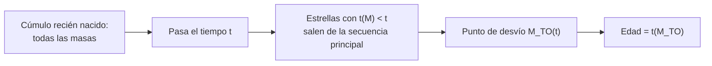

# B24-C19 — Cúmulos y edades estelares

<!-- nav:top -->
[🏠 Programa](../../../../README.md) · [📚 Bloque B24](../../../tronco-comun/B24-fisica-y-evolucion-de-estrellas.md) · [← Anterior: B24-C18 — Etapas finales de evolución](../B24-C18-etapas-finales-de-evolucion/CLASE.md) · [Siguiente: B24-C20 — Modelo simplificado de estructura estelar →](../B24-C20-modelo-simplificado-de-estructura-estelar/CLASE.md)
<!-- /nav -->

## 1. Ubicación, nivel y alcance

Clase 19 del bloque B24. Nivel N3. Un cúmulo estelar es un conjunto de estrellas nacidas casi a la vez y con la misma composición: un laboratorio natural para comprobar la teoría de la evolución. Aquí usas la vida en secuencia principal de [C15](../B24-C15-estrellas-de-baja-masa/CLASE.md), el diagrama HR de [C03](../B24-C03-diagrama-de-hertzsprung-russell/CLASE.md) y la estadística de muestras ([B12-C14](../../B12/B12-C14-simulacion-monte-carlo/CLASE.md)). Se simula un cúmulo **sintético**; los métodos fotométricos con datos reales se amplían en [B38](../../../tronco-comun/B38-poblaciones-estelares-y-simulacion-de-galaxias.md).

## 2. Por qué esta clase existe

La edad de una estrella aislada es difícil de medir; la de un cúmulo se puede leer en su diagrama HR, porque las estrellas más masivas ya han salido de la secuencia principal y el «punto de desvío» marca la edad. Esas edades fijan la cronología de la Galaxia y calibran los modelos. La decisión central: **dado el punto de desvío de un cúmulo, ¿qué edad tiene y con qué incertidumbre?**

## 3. Lo que podrás hacer al terminar

1. Definir cúmulo, punto de desvío e isócrona.
2. Invertir la relación vida–masa para obtener el punto de desvío.
3. Simular un cúmulo sintético con una función inicial de masa de ley de potencias.
4. Estimar la edad a partir de la estrella más masiva que queda en la secuencia principal.
5. Propagar un error de la masa de desvío al error de la edad.
6. Nombrar qué sesgos tiene el método (binarias, rotación, composición).

La evidencia es la **edad de un cúmulo sintético** del ejercicio 12 (sección 20).

## 4. Con qué llegas y cómo comprobarlo

1. ¿Qué es la vida en secuencia principal y cómo depende de la masa (C15)?
2. ¿Qué es una ley de potencias para la función inicial de masa?
3. ¿Qué es una distribución binomial?
4. ¿Qué es un diagrama color–magnitud?
5. ¿Cómo se invierte una función monótona numéricamente?

<details>
<summary>Ver respuestas</summary>

1. El tiempo `t ∝ M/L ∝ M^{1−α}`. 2. `dN/dM ∝ M^{−α}`. 3. La del número de éxitos en `N` intentos con probabilidad `p`. 4. Una gráfica de brillo contra color, equivalente al HR (C03). 5. Por bisección.
</details>

Con cuatro o cinco aciertos, sigue; si no, repasa C15 y B12-C14.

## 5. Un caso real: isócronas empíricas con Gaia

Gaia Collaboration obtuvo diagramas HR de cúmulos abiertos y globulares, con membresía y parámetros medios de varios cúmulos abiertos que sirven para derivar isócronas empíricas (S1, resumen). Los grupos de modelos como MIST publican isócronas calculadas con MESA para masas desde ~0,1 hasta 300 `M☉` y metalicidades de `−2,0` a `+0,5` (S2, resumen). El **ejemplo conductor** de esta clase es un cúmulo **sintético** de `3000` estrellas con edad verdadera `0,5 Gyr` y la relación masa–luminosidad ilustrativa de C15.

## 6. Vocabulario

Un **cúmulo estelar** es un conjunto ligado de estrellas nacidas de la misma nube. El **punto de desvío** (*turn-off*) es la masa de las estrellas que acaban de dejar la secuencia principal. Una **isócrona** es la curva del diagrama HR que reúne estrellas de la misma edad y composición. La **función inicial de masa** `dN/dM ∝ M^{−α}` da el reparto de masas al nacer; la pendiente `α` es aquí `2,3`, un parámetro **ilustrativo** (Kroupa señala cambios de pendiente hacia `0,5` y `0,08 M☉`, S3). La **edad del cúmulo** es la vida en secuencia principal de la estrella en el punto de desvío. La **metalicidad** afecta a las isócronas. Un **superviviente** es una estrella que aún está en la secuencia principal.

## 7. Modelo mental: un reloj de arena con los granos más grandes al fondo

Todas nacen juntas; las más masivas viven menos y salen primero. Con el paso del tiempo, el «corte» de masa que ya salió sube hacia las estrellas menos masivas.



*Descripción textual:* a una edad dada, las estrellas con vida menor que esa edad han salido de la secuencia principal; la masa del punto de desvío decrece con la edad y, medida, da la edad.

Analogía: un reloj de arena. Límite: las estrellas no salen de golpe: hay una zona de transición, y las binarias y la rotación la desdibujan.

## 8. La explicación, paso a paso

### 8.1 Invertir la vida

Con la relación vida–masa de C15, `t(M) = 7,37 Gyr × (f/0,1) M/L(M)` (decrece con `M` para `M ≥ 0,35`). Para una edad dada, la masa del punto de desvío se obtiene por bisección. El laboratorio comprueba que `t(M_TO) = edad` a `10⁻⁹`. Resultados (ilustrativos): `0,01 Gyr → 12,3 M☉`; `0,1 Gyr → 4,9 M☉`; `0,5 Gyr → 2,56 M☉`; `1 Gyr → 1,95 M☉`; `10 Gyr → 0,90 M☉`.

### 8.2 Un cúmulo sintético

Con `dN/dM ∝ M^{−2,3}` entre `0,1` y `30 M☉`, el laboratorio genera `3000` masas por el método de la transformada inversa (semilla fija). A `0,5 Gyr` el punto de desvío es `2,56 M☉` y la fracción esperada de supervivientes es `98,6 %` (`2958 ± 6`); el laboratorio encuentra `2957`, dentro de `3σ`.

### 8.3 Edad a partir de la estrella más masiva

La estrella más masiva que sigue en la secuencia principal tiene `2,51 M☉` y su vida es `0,529 Gyr`: se sobreestima la edad en un `5,7 %`. El sesgo es sistemático: la estrella más masiva observada nunca supera la masa de desvío, así que su vida es siempre mayor que la edad. Con más estrellas el sesgo baja.

### 8.4 Propagación de errores

Si `t ∝ M^{−β}` entonces `δt/t = β δM/M`. En el tramo `0,43–2 M☉` de la relación ilustrativa, `β = 3`; por encima de `2 M☉`, `β = 2,5`. Un error del `5 %` en la masa de desvío da `14 %` en la edad (`1,05⁻³ = 0,864`) en el tramo bajo. Por eso la edad de un cúmulo es sensible a la masa de desvío y a la relación masa–luminosidad.

### 8.5 Sesgos del método

Las binarias, la rotación, el enrojecimiento y la metalicidad desplazan el punto de desvío. Las isócronas empíricas y los modelos (S1, S2) se contrastan para reducir la dependencia del modelo. Esta clase no usa datos reales ni calibra edades de cúmulos concretos.

## 9. Magnitudes, símbolos y unidades

| Símbolo | Qué es | Unidad | Valor / nota |
|---|---|---|---|
| `M_TO` | masa del punto de desvío | `M☉` | `2,564` (0,5 Gyr, ilustr.) |
| `t(M)` | vida en secuencia principal | Gyr | relación ilustrativa de C15 |
| `α` | pendiente de la función inicial de masa | — | `2,3` (ilustrativa) |
| `N` | número de estrellas del cúmulo | — | `3000` (sintético) |
| `β` | exponente de `t ∝ M^{−β}` | — | `3` (0,43–2 `M☉`); `2,5` (`> 2`) |

## 10. Convenciones y referencias

Todas las estrellas nacen a la vez con la misma composición; vida con luminosidad constante; el cúmulo es **sintético**. La relación masa–luminosidad y `α` son **ilustrativos**.

## 11. De dónde sale lo que afirmamos

| ID | Fuente | Localizador | Respalda | Estado |
|---|---|---|---|---|
| S1 | Gaia Collaboration, *Gaia Data Release 2: Observational Hertzsprung-Russell diagrams*, arXiv:1804.09378 | https://arxiv.org/abs/1804.09378 | HRD de cúmulos abiertos y globulares; isócronas empíricas | Solo resumen, consultado el 2026-11-09 |
| S2 | Choi et al., *MIST. I: Solar-Scaled Models*, arXiv:1604.08592 | https://arxiv.org/abs/1604.08592 | Isócronas de ~0,1 a 300 `M☉`, `[Z/H]` de −2,0 a 0,5 | Solo resumen, consultado el 2026-11-09 |
| S3 | Kroupa, arXiv:astro-ph/0009005 | https://arxiv.org/abs/astro-ph/0009005 | Cambios de pendiente de la IMF hacia 0,5 y 0,08 `M☉` | Solo resumen, consultado el 2026-11-09 |

Límites: S1–S3 solo resumen; no se consultó ninguna edad publicada de un cúmulo; el cúmulo, la IMF y la relación masa–luminosidad son sintéticos o ilustrativos.

## 12. Cómo ver el punto de desvío

| Edad | `M_TO` (`M☉`, ilustr.) |
|---|---|
| 0,01 Gyr | 12,3 |
| 0,1 Gyr | 4,88 |
| 0,5 Gyr | 2,56 |
| 1 Gyr | 1,95 |
| 10 Gyr | 0,90 |

Descripción larga: por cada factor 10 en la edad, la masa de desvío baja cerca de un factor 2.

## 13. Ejemplo trabajado: edad desde el punto de desvío

**Paso 1 · Dato.** El punto de desvío de un cúmulo sintético es `M_TO = 1,95 M☉`.

**Paso 2 · Luminosidad.** `L = M⁴ = 14,5 L☉` (tramo 0,43–2 `M☉`; `1,95 < 2`).

**Paso 3 · Vida.** `t = 7,37 Gyr × 1,95/14,5 = 0,99 Gyr`.

**Paso 4 · Sentido.** La edad es de unos `1 Gyr`. Con un error del `5 %` en `M_TO`, `±14 %` en la edad (8.4). El valor depende de la relación ilustrativa.

## 14. Distintas formas de datar

**Punto de desvío (esta clase):** directo para cúmulos. **Enfriamiento de enanas blancas:** edades de poblaciones viejas. **Giro (girocronología):** edades de estrellas de campo (C11). **Asterosismología (C14):** edades de estrellas individuales. Se combinan.

## 15. Práctica guiada

**Ejercicio 1 · con los pasos indicados.** Calcula la vida de una estrella de `2 M☉`. *Pasos:* `L = 1,4 × 2^{3,5}`; `t = 7,37 × 2/L`.

<details><summary>Solución comentada</summary>

`L = 15,8`; `t = 0,93 Gyr`.
</details>

**Ejercicio 2 · con una pista.** ¿Cuál es el punto de desvío de un cúmulo de `1 Gyr`? *Pista:* es la masa con `t(M) = 1 Gyr`.

<details><summary>Solución comentada</summary>

`1,95 M☉` (sección 12).
</details>

**Ejercicio 3 · casi autónomo.** ¿Y a `10 Gyr`?

<details><summary>Solución comentada</summary>

`0,90 M☉`.
</details>

## 16. Práctica autónoma, transferencia e integrador

**Ejercicio 4.** ¿Qué masa tiene el punto de desvío a `0,1 Gyr`?

<details><summary>Solución comentada</summary>

`4,88 M☉`.
</details>

**Ejercicio 5.** ¿Cuántas estrellas esperas que sobrevivan en un cúmulo sintético de 3000 a `0,5 Gyr`?

<details><summary>Solución comentada</summary>

`2958 ± 6` (8.2); el laboratorio obtiene 2957.
</details>

**Ejercicio 6.** ¿Cuál es el desvío a `0,01 Gyr`?

<details><summary>Solución comentada</summary>

`12,3 M☉` (8.1).
</details>

**Ejercicio 7.** El laboratorio estimó `0,529 Gyr` frente a `0,5` verdadero. ¿Cuál es el error y por qué es positivo?

<details><summary>Solución comentada</summary>

`+5,7 %`; la estrella más masiva observada es siempre menos masiva que `M_TO`, de modo que su vida supera la edad (8.3).
</details>

**Ejercicio 8.** ¿Qué fracción de las estrellas del cúmulo sintético son de masa mayor que el desvío a `0,5 Gyr`?

<details><summary>Solución comentada</summary>

`1 − 0,986 = 1,4 %` (43 estrellas).
</details>

**Ejercicio 9 · transferencia.** Un error del `5 %` en la masa de desvío (`1,95 M☉`), ¿cuánto error de edad da?

<details><summary>Solución comentada</summary>

`β = 3`: `δt/t ≈ 15 %` (exactamente `1,05⁻³ − 1 = −13,6 %`) (8.4).
</details>

**Ejercicio 10 · transferencia.** Un compañero dice: «la edad del cúmulo es la de su estrella más brillante». Responde con 8.3.

<details><summary>Solución comentada</summary>

La más brillante puede ser una gigante ya evolucionada; la edad se lee en el punto de desvío de la secuencia principal, no en la estrella más luminosa.
</details>

**Ejercicio 11 · transferencia.** Si la metalicidad cambia las isócronas, ¿qué le pasa a la edad inferida si se ignora?

<details><summary>Solución comentada</summary>

Se introduce un sesgo sistemático: la misma masa de desvío puede corresponder a edades distintas según la composición (S2, resumen: las isócronas cubren un rango de metalicidades).
</details>

**Ejercicio 12 · integrador.** Elabora tu *edad de un cúmulo sintético*: genera un cúmulo con tu edad y pendiente, calcula `M_TO`, la fracción de supervivientes y la edad estimada desde la estrella más masiva, propaga un error del 5 % y nombra tres sesgos.

<details><summary>Solución modelo</summary>

Edad `0,5 Gyr`: `M_TO = 2,56`, supervivientes `2957/3000`, estimada `0,529 Gyr (+5,7 %)`, error del 5 % → ±14 %; sesgos: binarias, rotación, metalicidad; rotulado como sintético.
</details>

## 17. Laboratorio: punto de desvío de un cúmulo sintético

El script [cumulo.py](cumulo.py) invierte `t(M)` por bisección (**comprueba** `10⁻⁹`), genera un cúmulo de `3000` estrellas con una IMF de ley de potencias, **comprueba** que el número de supervivientes cae en `3σ` de la fracción teórica y que la edad estimada queda en un 15 % de la verdadera.

**Datos:** ninguno observado; cúmulo, IMF y relación **sintéticos / ilustrativos**. **Predice antes de ejecutar:** ¿la edad estimada será mayor o menor que la verdadera? (mayor.) **Ejecución del 2026-11-09 (Python 3.12.9):**

```text
Python 3.12.9 (biblioteca estandar)
edad verdadera = 0.5 Gyr -> M_desvio = 2.564 Msol
supervivientes = 2957 de 3000 (esperado 2958 +/- 6)
estrella mas masiva en la secuencia principal = 2.508 Msol -> edad estimada = 0.529 Gyr (error +5.7 %)
edad   0.01 Gyr -> M_desvio = 12.263 Msol
edad   0.10 Gyr -> M_desvio = 4.882 Msol
edad   1.00 Gyr -> M_desvio = 1.946 Msol
edad  10.00 Gyr -> M_desvio = 0.903 Msol
Pruebas superadas.
```

```bash
python programa/clases/B24/B24-C19-cumulos-y-edades-estelares/cumulo.py
```

**Límites:** nacimiento simultáneo, sin binarias ni rotación, `L` constante, relación no calibrada.

## 18. Errores frecuentes y cómo corregirlos

**Confundir la estrella más masiva con la más luminosa.** Se corrige con el ejercicio 10.

**Ignorar el sesgo positivo de la edad.** Se corrige con el ejercicio 7.

**Olvidar la propagación `β`.** Se corrige con el ejercicio 9.

**Usar una IMF única sin declararla.** Se corrige con la sección 10.

**Presentar la edad sintética como de un cúmulo real.** Se corrige con la sección 10.

## 19. Cómo sabrás que vas bien

Tras 8.1: ¿cómo cambia `M_TO` con la edad? Si dudas, ejercicios 2–4. Tras 8.3: ¿por qué hay sesgo? Ejercicio 7. Tras el laboratorio: ¿qué comprueba el recuento de supervivientes? (que el muestreo reproduce la distribución teórica).

## 20. Qué entregas y cómo se evalúa

El producto es tu **edad de un cúmulo sintético** (ejercicio 12).

| Criterio | Inicial | En desarrollo | Logrado | Destacado |
|---|---|---|---|---|
| Conceptos | Los confunde | Parciales | Desvío, isócrona, IMF | Explica el sesgo |
| Cálculo | Sin unidades | Con errores | `M_TO` y edad | Propaga el error |
| Numérico | Sin comprobar | Un caso | Inversión y recuento | Interpreta `3σ` |
| Fuentes | Sin fuente | Sin fecha | S1–S3 con fecha | Declara resúmenes |
| Límites | No los nombra | Uno | Tres | Discute binarias |

**Condiciones críticas (no se compensan con promedio):** rotular el cúmulo y la relación como sintéticos; no atribuir edades a cúmulos reales; citar solo lo consultado y decir que S1–S3 son resúmenes.

## 21. Ética, seguridad y límites

Clase educativa: no sustituye el ajuste de isócronas a fotometría real. Accesibilidad: tablas equivalentes a las gráficas, fórmulas en texto, ejercicios sin conexión.

## 22. Para cerrar y seguir

El punto de desvío de un cúmulo, con la relación vida–masa, da su edad; con una muestra finita la edad estimada sale algo mayor y su error crece con el exponente `β`. Queda una pregunta: ¿cómo unir todo en un modelo simple de la estructura de una estrella?

**Glosario español–inglés.** cúmulo estelar · *star cluster*; punto de desvío · *main-sequence turn-off*; isócrona · *isochrone*; función inicial de masa · *initial mass function*; metalicidad · *metallicity*; superviviente · *survivor*.

**Continuidad.** [B24-C20](../B24-C20-modelo-simplificado-de-estructura-estelar/CLASE.md) reúne equilibrio, estructura y composición en un modelo politrópico.

**Referencias:** ver sección 11.

<!-- nav:bottom -->
---

[← Anterior: B24-C18 — Etapas finales de evolución](../B24-C18-etapas-finales-de-evolucion/CLASE.md) · [📚 Bloque B24](../../../tronco-comun/B24-fisica-y-evolucion-de-estrellas.md) · [Siguiente: B24-C20 — Modelo simplificado de estructura estelar →](../B24-C20-modelo-simplificado-de-estructura-estelar/CLASE.md)
<!-- /nav -->
