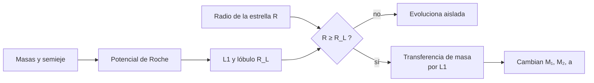

# B24-C22 — Evolución binaria: lóbulo de Roche y transferencia de masa

<!-- nav:top -->
[🏠 Programa](../../../../README.md) · [📚 Bloque B24](../../../tronco-comun/B24-fisica-y-evolucion-de-estrellas.md) · [← Anterior: B24-C21 — Rama asintótica de gigantes: pulsos térmicos y proceso s](../B24-C21-rama-asintotica-de-gigantes-pulsos-termicos-y-proceso-s/CLASE.md) · [Siguiente: B25-C01 — Estructura de la Vía Láctea →](../../B25/B25-C01-estructura-de-la-via-lactea/CLASE.md)
<!-- /nav -->

## 1. Ubicación, nivel y alcance

Clase 22 del bloque B24 (ampliación `0.2.0`). Nivel N3. Todo el bloque trató estrellas aisladas, pero [C17](../B24-C17-estrellas-masivas-y-perdida-de-masa/CLASE.md) ya adelantó que la mayoría de las estrellas masivas interactúa con una compañera. Aquí explicas **cuándo** una estrella llena su lóbulo de Roche, **cómo** cambia la órbita al transferir masa y qué desenlaces posibles hay. `B27-C13` (bloque [B27](../../../tronco-comun/B27-objetos-compactos-y-altas-energias.md)) trata las binarias compactas ya formadas; esta clase explica cómo se llega a ellas. Usas gravitación y marcos rotantes ([B05-C10](../../B05/B05-C10-gravitacion-universal/CLASE.md), [B05-C09](../../B05/B05-C09-momento-angular-y-torque/CLASE.md)), búsqueda de raíces y cuadratura numérica ([B11](../../../tronco-comun/B11-ecuaciones-diferenciales-y-simulacion-numerica.md)).

## 2. Por qué esta clase existe

Una estrella que se expande (C16) o se hincha en una binaria puede llenar la región donde su gravedad domina y verter gas sobre su compañera. Esa transferencia cambia las masas, la órbita y el destino de ambas, y es el camino hacia muchos objetos exóticos. La decisión central: **dadas las masas y el semieje de una binaria, ¿qué tamaño tiene el lóbulo de Roche de cada estrella y cómo cambia el semieje al transferir masa?**

## 3. Lo que podrás hacer al terminar

1. Definir potencial de Roche, punto de Lagrange L1 y lóbulo de Roche.
2. Localizar L1 y calcular el radio efectivo del lóbulo por integración numérica.
3. Comparar el resultado con la aproximación de Eggleton y evaluar su exactitud.
4. Calcular el nuevo semieje tras una transferencia conservativa de masa y momento angular.
5. Decidir si una estrella desborda su lóbulo cuando este cambia de tamaño.
6. Nombrar los supuestos y desenlaces posibles (envoltura común, fusión).

La evidencia es la **ficha de una binaria interactuante** del ejercicio 12 (sección 20).

## 4. Con qué llegas y cómo comprobarlo

1. ¿Qué es la fuerza centrífuga en un sistema que rota?
2. ¿Qué es el centro de masa de dos cuerpos?
3. ¿Qué es el momento angular de una órbita circular?
4. ¿Qué es una superficie equipotencial?
5. ¿Cómo se halla una raíz por bisección?

<details>
<summary>Ver respuestas</summary>

1. Una fuerza aparente `ω²r` hacia fuera del eje de rotación. 2. El punto que divide la distancia en proporción inversa a las masas. 3. Para dos masas, `J = M₁M₂√(Ga/(M₁+M₂))`. 4. El conjunto de puntos con el mismo valor del potencial. 5. Reduciendo a la mitad un intervalo donde la función cambia de signo.
</details>

Con cuatro o cinco aciertos, sigue; si no, repasa B05-C09, B05-C10 y B11.

## 5. Un caso real: la mayoría de las estrellas masivas interactúa

Sana y colaboradores midieron las características binarias de una muestra de estrellas O galácticas y concluyeron que más del `70 %` de las estrellas masivas intercambiará masa con una compañera, y que en un tercio de esos casos el desenlace es una fusión (S2, resumen). La evolución con envoltura común, donde la compañera se hunde dentro de la envoltura de la estrella, sigue siendo un problema con grandes incertidumbres, en particular sobre el formalismo de energía habitual (S3, resumen). Los códigos de evolución, como MESA, ya incluyen el desbordamiento del lóbulo de Roche entre sus casos de demostración (S5, resumen). El **ejemplo conductor** es una binaria **sintética**: donante de `1,5 M☉`, acretor de `1,0 M☉`, semieje de `10 R☉`.

## 6. Vocabulario

El **potencial de Roche** es el potencial efectivo en el sistema que rota con la binaria: la gravedad de las dos estrellas más el término centrífugo. El **punto de Lagrange L1** es el punto entre las dos estrellas donde las fuerzas sobre el gas se anulan. El **lóbulo de Roche** de una estrella es la región encerrada por la equipotencial que pasa por L1. El **radio del lóbulo** `R_L` es el de la esfera de igual volumen. La **razón de masas** es `q = M_donante/M_acretor`. El **desbordamiento del lóbulo** (RLOF) ocurre cuando la estrella lo llena y vierte masa por L1. La **transferencia conservativa** conserva masa total y momento angular orbital. La **envoltura común** es una fase en que ambas estrellas comparten una envoltura. El **semieje** `a` es la separación entre las estrellas en una órbita circular.

## 7. Modelo mental: dos colinas con un puerto entre ellas

Imagina el paisaje del potencial como dos valles (una por estrella) separados por un puerto (L1). Si el gas de una estrella sube más que el puerto, cae al otro valle.



*Descripción textual:* con las masas y el semieje se obtiene el lóbulo de Roche; si el radio de la estrella llega al del lóbulo, la masa fluye por L1 y cambia las masas y la órbita.

Analogía: un lago que desborda por un puerto. Límite: el gas transferido tiene momento angular, y el destino de la órbita depende de eso.

## 8. La explicación, paso a paso

### 8.1 El potencial de Roche

En unidades de `a = 1`, `G(M₁+M₂) = 1` y velocidad angular `1`, con el donante en el origen y el acretor en `x = 1`, y con `m₁ = q/(1+q)`, `m₂ = 1/(1+q)`: `Φ = −m₁/r₁ − m₂/r₂ − ½[(x−m₂)² + y²]`. El término centrífugo depende de la distancia al eje de rotación (perpendicular al plano orbital), no de la distancia a la recta que une las estrellas; por eso el lóbulo no tiene simetría axial alrededor de esa recta. Es un error frecuente.

### 8.2 L1 y el radio efectivo

L1 está donde `dΦ/dx = 0` sobre el eje: para `q = 1` en `x = 0,5000`. El lóbulo es la equipotencial `Φ = Φ(L1)`. Su volumen se obtiene sumando `r³/3` sobre todas las direcciones; el radio efectivo es el de la esfera de igual volumen. El laboratorio calcula `R_L/a` = `0,2054` (`q=0,1`), `0,3206` (`0,5`), `0,3798` (`1`), `0,4419` (`2`) y `0,5803` (`10`).

### 8.3 Comparación con una aproximación

La aproximación de Eggleton, `R_L/a = 0,49 q^{2/3}/(0,6 q^{2/3} + ln(1+q^{1/3}))`, da `0,2068`, `0,3208`, `0,3789`, `0,4400` y `0,5782`: diferencias menores del `0,7 %`. La fórmula se toma de la literatura (no consultada aquí) y se usa solo como referencia independiente del cálculo numérico; que concuerde dentro del `1 %` apoya al código. Para `a = 10 R☉` y `q = 1`, `R_L = 3,8 R☉`.

### 8.4 Transferencia conservativa

Con `J = M₁M₂√(a/(M₁+M₂))` (en `G = 1`) y masa total constante, `J` constante da `a_f/a_i = (M₁ᵢM₂ᵢ/(M₁f M₂f))²`. Con donante `1,5 M☉` y acretor `1,0 M☉` (`J = 3,0` en `M☉`, `R☉`): al transferir `0,25 M☉`, `a = 9,22 R☉`; con `0,5 M☉`, `10,00 R☉` (el producto de masas vuelve al valor inicial); con `0,9 M☉`, `17,31 R☉`; con `1,2 M☉`, `51,65 R☉`. El semieje es mínimo cuando las masas son iguales (`9,22 R☉`) y crece si se transfiere más.

### 8.5 Desbordamiento y desenlace

El lóbulo del donante pasa de `4,14 R☉` a `3,49 R☉` al transferirse `0,25 M☉` (Eggleton): si el radio del donante no cambia, lo desborda por un `19 %` y la transferencia se acelera. Con hipótesis más realistas (la estrella reacciona al perder masa) el resultado puede ser estable o inestable; si es inestable, la compañera puede acabar dentro de la envoltura (envoltura común), con un desenlace incierto (S3, resumen), o fusionarse (S2).

## 9. Magnitudes, símbolos y unidades

| Símbolo | Qué es | Unidad | Valor / nota |
|---|---|---|---|
| `q` | razón de masas del donante al acretor | — | `0,1`–`10` |
| `a` | semieje orbital | `R☉` | `10` (sintético) |
| `L1` | punto de Lagrange | `a` | `0,5000` (`q = 1`) |
| `R_L/a` | radio del lóbulo | — | `0,3798` (`q = 1`) |
| `J` | momento angular orbital | `M☉ R☉^{1/2}` (con `G = 1`) | `3,0` (sintético) |
| `a_f/a_i` | cambio de semieje | — | `(M₁ᵢM₂ᵢ/(M₁fM₂f))²` |

## 10. Convenciones y referencias

Órbita circular, rotación síncrona, estrellas como masas puntuales en el potencial, transferencia conservativa. Las masas y el semieje son **sintéticos**. La fórmula de Eggleton no se consultó en esta clase: sirve solo como contraste del cálculo numérico.

## 11. De dónde sale lo que afirmamos

| ID | Fuente | Localizador | Respalda | Estado |
|---|---|---|---|---|
| S1 | Mamajek et al., *IAU 2015 Resolution B3*, arXiv:1510.07674 | https://arxiv.org/abs/1510.07674 | `R☉` nominal | Texto del PDF extraído el 2026-11-09 |
| S2 | Sana et al., *Binary interaction dominates the evolution of massive stars*, arXiv:1207.6397 | https://arxiv.org/abs/1207.6397 | >70 % intercambia masa; ~1/3 de ellos se fusiona | Solo resumen, consultado el 2026-11-09 |
| S3 | Ivanova et al., *Common Envelope Evolution: Where we stand and how we can move forward*, arXiv:1209.4302 | https://arxiv.org/abs/1209.4302 | Estado de la evolución con envoltura común; incertidumbre del formalismo energético | Solo resumen, consultado el 2026-11-09 |
| S4 | Smith, arXiv:1402.1237 | https://arxiv.org/abs/1402.1237 | La transferencia en binarias como modo de pérdida de masa | Solo resumen, consultado el 2026-11-09 |
| S5 | Paxton et al., *MESA*, arXiv:1009.1622 | https://arxiv.org/abs/1009.1622 | Desbordamiento del lóbulo de Roche entre los casos demostrados | Solo resumen, consultado el 2026-11-09 |

Límites: S2–S5 solo resumen; Eggleton (1983) no fue consultado, de modo que su fórmula no está respaldada por una fuente de esta clase y se usa únicamente como referencia numérica independiente; la conservación de `J` y el potencial de Roche son resultados estándar verificados numéricamente.

## 12. Cómo ver el lóbulo

| `q` | `L1/a` | `R_L/a` (numérico) | Referencia (Eggleton) |
|---|---|---|---|
| 0,1 | 0,2825 | 0,2054 | 0,2068 |
| 0,5 | 0,4292 | 0,3206 | 0,3208 |
| 1 | 0,5000 | 0,3798 | 0,3789 |
| 2 | 0,5708 | 0,4419 | 0,4400 |
| 10 | 0,7175 | 0,5803 | 0,5782 |

Descripción larga: el lóbulo crece con la masa del donante; L1 se acerca a la estrella menos masiva.

## 13. Ejemplo trabajado: ¿qué pasa con el semieje si se transfiere 0,25 M☉?

**Paso 1 · Datos.** Donante `1,5 M☉`, acretor `1,0 M☉`, `a = 10 R☉` (sintéticos).

**Paso 2 · Masas finales.** `1,25` y `1,25 M☉`.

**Paso 3 · Cociente.** `a_f/a_i = (1,5 × 1,0/(1,25 × 1,25))² = (0,96)² = 0,9216`.

**Paso 4 · Semieje.** `a_f = 9,22 R☉`.

**Paso 5 · Lóbulo.** Con `q = 1` y `R_L/a ≈ 0,379`: `R_L = 3,49 R☉` (antes `4,14 R☉`).

**Paso 6 · Sentido.** El semieje se contrajo ligeramente y el lóbulo del donante se encogió: si el radio del donante no se reduce, sigue desbordando. Es una demostración de la aritmética en un modelo conservativo.

## 14. Distintas formas de modelar la transferencia

**Conservativa (esta clase):** exacta, supuesto fuerte. **No conservativa:** parte de la masa se pierde del sistema, con distinto momento angular; cambia el resultado. **Códigos de evolución binaria (como MESA):** siguen ambas estrellas con RLOF (S5). **Envoltura común:** formalismo energético cuestionado (S3).

## 15. Práctica guiada

**Ejercicio 1 · con los pasos indicados.** Halla L1 para `q = 1`. *Pasos:* por simetría, ¿dónde se anulan las fuerzas?

<details><summary>Solución comentada</summary>

Con masas iguales, a mitad de camino: `x = 0,5` (laboratorio: `0,500 000`).
</details>

**Ejercicio 2 · con una pista.** Calcula `R_L` en `R☉` para `q = 1` y `a = 10 R☉`. *Pista:* `R_L/a = 0,3798`.

<details><summary>Solución comentada</summary>

`3,80 R☉` (8.2).
</details>

**Ejercicio 3 · casi autónomo.** Calcula `a_f` si se transfiere `0,25 M☉`.

<details><summary>Solución comentada</summary>

`10 × 0,9216 = 9,22 R☉` (13).
</details>

## 16. Práctica autónoma, transferencia e integrador

**Ejercicio 4.** Calcula `a_f` si se transfiere `0,9 M☉`.

<details><summary>Solución comentada</summary>

Masas `0,6` y `1,9`; producto `1,14`; `(1,5/1,14)² = 1,731`; `a_f = 17,3 R☉`.
</details>

**Ejercicio 5.** ¿Por qué el semieje vuelve a `10 R☉` si se transfiere `0,5 M☉`?

<details><summary>Solución comentada</summary>

Las masas son `1,0` y `1,5`: el producto vale `1,5`, igual que al inicio, y `a_f/a_i = 1`.
</details>

**Ejercicio 6.** ¿Para qué razón de masas es mínimo el semieje?

<details><summary>Solución comentada</summary>

Cuando el producto `M₁M₂` es máximo con suma constante: masas iguales (`q = 1`), `a = 9,22 R☉` en el ejemplo.
</details>

**Ejercicio 7.** Verifica que `J = M₁M₂√(a/(M₁+M₂))` vale `3,0` al inicio.

<details><summary>Solución comentada</summary>

`1,5 × √(10/2,5) = 1,5 × 2 = 3,0`.
</details>

**Ejercicio 8.** ¿Cuánto vale `R_L/a` para `q = 2` y cuál es la diferencia con Eggleton?

<details><summary>Solución comentada</summary>

Numérico `0,4419`; Eggleton `0,4400`; `+0,44 %`.
</details>

**Ejercicio 9 · transferencia.** Si el donante conserva `R = 4,14 R☉` y su lóbulo baja a `3,49 R☉`, ¿cuánto lo desborda?

<details><summary>Solución comentada</summary>

`4,14/3,49 = 1,19`: un `19 %` mayor que su lóbulo (8.5).
</details>

**Ejercicio 10 · transferencia.** Con S2, ¿qué fracción mínima de las estrellas masivas se fusiona con su compañera?

<details><summary>Solución comentada</summary>

`0,70/3 = 23 %` como cota inferior (S2, resumen).
</details>

**Ejercicio 11 · transferencia.** Un compañero dice que «toda la masa que pierde el donante la gana la compañera». Responde con 8.4 y 14.

<details><summary>Solución comentada</summary>

Es el supuesto conservativo de la clase; en la realidad parte de la masa puede perderse del sistema y llevarse momento angular, lo que cambia el semieje. S4 (resumen) incluye la transferencia en binarias entre los modos de pérdida de masa de estrellas masivas.
</details>

**Ejercicio 12 · integrador.** Elabora tu *ficha de una binaria interactuante*: elige masas y semieje (sintéticos), calcula L1 y `R_L` de ambas, evalúa el semieje tras tres cantidades de masa transferida, verifica la conservación de `J` y nombra tres supuestos.

<details><summary>Solución modelo</summary>

Con 1,5 + 1,0 `M☉`, `a = 10 R☉`: `R_L = 4,14 R☉` (donante); `a = 9,22`, `10,00`, `17,31 R☉` para 0,25, 0,5 y 0,9 `M☉`; `J = 3,0` constante; supuestos: órbita circular, conservación, masas puntuales.
</details>

## 17. Laboratorio: Roche numérico

El script [roche.py](roche.py) halla L1 por bisección, **comprueba** `L1(q = 1) = 0,5` (`10⁻⁹`), integra el volumen del lóbulo sobre el ángulo sólido y **comprueba** que el radio efectivo coincide con la aproximación de Eggleton dentro del `1 %` para cinco razones de masa; calcula el semieje tras transferir masa y **comprueba** que `J` se conserva (`10⁻⁹`).

**Datos:** `R☉` de la IAU; masas y semieje **sintéticos**. **Predice antes de ejecutar:** ¿qué valor de `R_L/a` esperas para `q = 1`? (cerca de `0,38`.) **Ejecución del 2026-11-09 (Python 3.12.9):**

```text
Python 3.12.9 (biblioteca estandar)
 q=M1/M2    L1/a  R_L/a (numerico)  Eggleton   dif %
    0.10  0.2825            0.2054    0.2068   -0.68
    0.50  0.4292            0.3206    0.3208   -0.05
    1.00  0.5000            0.3798    0.3789    0.24
    2.00  0.5708            0.4419    0.4400    0.44
   10.00  0.7175            0.5803    0.5782    0.36
transferencia conservativa (donante 1.5, acretor 1.0, a_i = 10 R_sol):
  dM = 0.00: M1 = 1.50, M2 = 1.00, a =  10.00 R_sol, R_L(donante) =  4.14 R_sol
  dM = 0.25: M1 = 1.25, M2 = 1.25, a =   9.22 R_sol, R_L(donante) =  3.49 R_sol
  dM = 0.50: M1 = 1.00, M2 = 1.50, a =  10.00 R_sol, R_L(donante) =  3.44 R_sol
  dM = 0.90: M1 = 0.60, M2 = 1.90, a =  17.31 R_sol, R_L(donante) =  4.93 R_sol
  dM = 1.20: M1 = 0.30, M2 = 2.20, a =  51.65 R_sol, R_L(donante) = 11.68 R_sol
Pruebas superadas.
```

```bash
python programa/clases/B24/B24-C22-evolucion-binaria-lobulo-de-roche-y-transferencia-de-masa/roche.py
```

**Límites:** órbita circular, masas puntuales, transferencia conservativa, sin respuesta del radio del donante; en la columna `R_L(donante)` se usa la aproximación de Eggleton (no consultada).

## 18. Errores frecuentes y cómo corregirlos

**Usar simetría axial alrededor de la recta de las estrellas.** Se corrige con 8.1: el término centrífugo depende del eje de rotación.

**Olvidar el cuadrado en `a_f/a_i`.** Se corrige con el ejercicio 4.

**Pensar que transferir masa siempre acerca las estrellas.** Se corrige con los ejercicios 5 y 6.

**Confundir el lóbulo del donante con el del acretor.** Se corrige con la razón `q = M_donante/M_acretor`.

**Dar por exacta la fórmula de Eggleton.** Se corrige con la sección 10 y 8.3.

## 19. Cómo sabrás que vas bien

Tras 8.2: ¿dónde está L1 para masas iguales? Si dudas, ejercicio 1. Tras 8.4: ¿cuándo es mínimo el semieje? Ejercicio 6. Tras el laboratorio: ¿qué verifica el acuerdo con Eggleton? (que el cálculo numérico del volumen es correcto, no que la fórmula esté citada).

## 20. Qué entregas y cómo se evalúa

El producto es tu **ficha de una binaria interactuante** (ejercicio 12).

| Criterio | Inicial | En desarrollo | Logrado | Destacado |
|---|---|---|---|---|
| Conceptos | Los confunde | Parciales | Roche, L1, RLOF | Explica el término centrífugo |
| Cálculo | Sin unidades | Con errores | `R_L`, `a_f` | Verifica `J` |
| Numérico | Sin comprobar | Un caso | Cinco razones de masa | Discute la exactitud |
| Fuentes | Sin fuente | Sin fecha | S1–S5 con fecha | Declara que Eggleton no se consultó |
| Límites | No los nombra | Uno | Tres | Discute envoltura común |

**Condiciones críticas (no se compensan con promedio):** rotular las binarias como sintéticas; no citar la fórmula de Eggleton como fuente consultada; citar solo lo consultado y decir que S2–S5 son resúmenes.

## 21. Ética, seguridad y límites

Clase educativa: no sustituye un código de evolución binaria con respuesta del radio y pérdidas de masa. Accesibilidad: tablas equivalentes a las gráficas, fórmulas en texto, ejercicios sin conexión.

## 22. Para cerrar y seguir

El lóbulo de Roche se obtiene de la equipotencial que pasa por L1 y aproxima `R_L/a ≈ 0,38` para masas iguales; transferir masa de forma conservativa cambia el semieje como `(M₁M₂)⁻²`, con mínimo en masas iguales. Con esto cierras el bloque: de la nube que colapsa a los sistemas que interactúan. Los cursos siguientes (por ejemplo, [B25](../../../tronco-comun/B25-galaxias-y-medio-interestelar.md)) usan estos resultados para poblaciones y galaxias.

**Glosario español–inglés.** potencial de Roche · *Roche potential*; lóbulo de Roche · *Roche lobe*; punto de Lagrange L1 · *inner Lagrangian point*; transferencia de masa · *mass transfer*; desbordamiento del lóbulo · *Roche-lobe overflow (RLOF)*; envoltura común · *common envelope*; semieje · *semi-major axis*.

**Continuidad.** `B27-C13` (bloque [B27](../../../tronco-comun/B27-objetos-compactos-y-altas-energias.md)) reutiliza el semieje y las masas para estudiar binarias compactas ya formadas.

**Referencias:** ver sección 11.

<!-- nav:bottom -->
---

[← Anterior: B24-C21 — Rama asintótica de gigantes: pulsos térmicos y proceso s](../B24-C21-rama-asintotica-de-gigantes-pulsos-termicos-y-proceso-s/CLASE.md) · [📚 Bloque B24](../../../tronco-comun/B24-fisica-y-evolucion-de-estrellas.md) · [Siguiente: B25-C01 — Estructura de la Vía Láctea →](../../B25/B25-C01-estructura-de-la-via-lactea/CLASE.md)
<!-- /nav -->
