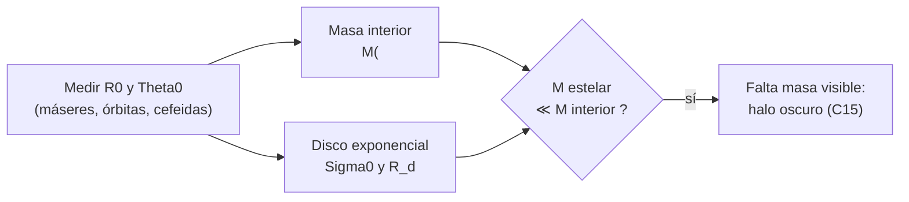

# B25-C01 — Estructura de la Vía Láctea

<!-- nav:top -->
[🏠 Programa](../../../../README.md) · [📚 Bloque B25](../../../tronco-comun/B25-galaxias-y-medio-interestelar.md) · [← Anterior: B24-C22 — Evolución binaria: lóbulo de Roche y transferencia de masa](../../B24/B24-C22-evolucion-binaria-lobulo-de-roche-y-transferencia-de-masa/CLASE.md) · [Siguiente: B25-C02 — Brazos espirales y barra galáctica →](../B25-C02-brazos-espirales-y-barra-galactica/CLASE.md)
<!-- /nav -->

## 1. Ubicación, nivel y alcance

Clase 1 del bloque B25, que abre el estudio de galaxias dentro de A03. Nivel N3. Llegas desde la física de estrellas del bloque [B24](../../../tronco-comun/B24-fisica-y-evolucion-de-estrellas.md), la gravitación ([B05-C10](../../B05/B05-C10-gravitacion-universal/CLASE.md)) y las incertidumbres de medición ([B13](../../../tronco-comun/B13-metrologia-tiempo-y-mediciones-cientificas.md)). Aquí describes **cómo está organizada la galaxia donde vives**: sus componentes, el lugar del Sol y las magnitudes que la fijan. Los brazos y la barra se estudian en [C02](../B25-C02-brazos-espirales-y-barra-galactica/CLASE.md); el gas, desde [C03](../B25-C03-medio-interestelar-multifasico/CLASE.md). Los modelos de esta clase son esféricos o discos exponenciales sin estructura fina.

## 2. Por qué esta clase existe

Estamos dentro de la galaxia y no podemos fotografiarla desde fuera: su forma se reconstruye midiendo distancias y velocidades desde un punto que no es el centro. Sin un esquema claro de componentes (bulbo, barra, disco, halo) y de cifras de referencia, el resto del bloque carece de escala. La decisión central: **dadas la distancia al centro y la velocidad de rotación del Sol, ¿cuánta masa hay dentro de su órbita y qué parte de esa masa es disco estelar?**

## 3. Lo que podrás hacer al terminar

1. Nombrar los componentes de la Vía Láctea y qué tipo de estrellas domina cada uno.
2. Definir `R₀`, `Θ₀`, `Ω₀`, escala de longitud del disco y masa estelar, con sus unidades.
3. Estimar la masa contenida dentro de la órbita solar a partir de la rotación.
4. Calcular qué fracción de un disco exponencial queda dentro de un radio dado.
5. Propagar la incertidumbre de `R₀` y `Θ₀` a la masa interior.
6. Distinguir una medida directa de una dependiente de un modelo.

La evidencia es la **ficha del Sol en la Galaxia** del ejercicio 12 (sección 20).

## 4. Con qué llegas y cómo comprobarlo

1. ¿Qué relación liga la velocidad de una órbita circular con la masa central?
2. ¿Cuántos metros tiene un kiloparsec (aprox.)?
3. ¿Cómo se propagan incertidumbres relativas en un producto de potencias?
4. ¿Qué es una función exponencial decreciente `e^{-x}`?
5. ¿Qué diferencia hay entre un dato observado y un dato de modelo?

<details>
<summary>Ver respuestas</summary>

1. `v² = GM/r`. 2. `3,0857 × 10¹⁹ m`. 3. Para `y ∝ a^p b^q`, `(δy/y)² ≈ (p δa/a)² + (q δb/b)²` si son independientes. 4. Una función que decrece a `1/e ≈ 0,37` cada vez que `x` aumenta en 1. 5. El observado se mide; el de modelo depende de supuestos.
</details>

Con cuatro o cinco aciertos, sigue; si no, repasa B05-C10, B13 y B09.

## 5. Un caso real: el Sol dentro de la Galaxia

Un balance de posición y movimiento del Sol resume la estructura. La revisión de Bland-Hawthorn y Gerhard (S3, texto del PDF) adopta `R₀ = 8,2 ± 0,1 kpc` para la distancia al centro, una velocidad circular `Θ₀ = 238 ± 15 km/s` y una frecuencia angular `Ω₀ = 29,0 ± 1,8 km s⁻¹ kpc⁻¹`; da una masa estelar total de `5 ± 1 × 10¹⁰ M☉`, una escala de longitud del disco de `R_d = 2,6 kpc` y una masa virial del halo oscuro de `1,3 × 10¹² M☉` (valor de un modelo ajustado). Reid y colaboradores (S4) obtienen `R₀ = 8,15 ± 0,15 kpc` con paralajes de máseres, y la colaboración GRAVITY (S5) `R₀ = 8178 ± 13 (est.) ± 22 (sist.) pc` con órbitas estelares alrededor de Sgr A\*. Ese será el **ejemplo conductor**: un Sol a `8,2 kpc` del centro que da una vuelta en unos `212 Myr`.

## 6. Vocabulario

La **Vía Láctea** (o la Galaxia) es la galaxia barrada que contiene al Sol. El **bulbo** es la concentración central de estrellas viejas, con forma de caja o cacahuete; la **barra** es su extensión alargada (C02). El **disco** es el conjunto aplanado de estrellas y gas en rotación, dividido en disco **delgado** y **grueso** según la altura y la edad. El **halo estelar** es la envoltura difusa de estrellas muy viejas, y el **halo de materia oscura** es la masa invisible que domina el potencial a gran radio (C15). `R₀` es la distancia Sol–centro; `Θ₀` la velocidad circular a ese radio; `Ω₀ = Θ₀/R₀` su frecuencia angular. La **escala de longitud** `R_d` fija cómo cae la densidad superficial del disco: `Σ(R) = Σ₀ e^{−R/R_d}`. La **masa interior** `M(<R)` es la masa dentro de la esfera de radio `R`.

## 7. Modelo mental: un sistema de capas girando

Imagina un plato aplanado y giratorio (el disco) con una esfera de luz tenue alrededor (el halo) y una concentración central; tú estás sobre el plato, a unos 8 kpc del centro. Analogía: un disco de vinilo con una bola de niebla encima. Su límite: la galaxia no es rígida (gira más lento por fuera que por dentro en periodo) y la «niebla» pesa más que el vinilo, aunque no se vea.



*Descripción textual:* de la distancia y la velocidad del Sol se obtiene la masa interior; del disco exponencial, la masa estelar; si la segunda es mucho menor que la primera, hay masa no luminosa.

## 8. La explicación, paso a paso

### 8.1 Dónde está el Sol

El centro de la galaxia coincide con la fuente de radio compacta Sgr A\*, que ocupa el centro dinámico dentro de las incertidumbres (S3). La distancia `R₀` se mide de forma **directa** con paralajes de máseres (S4) y con órbitas de estrellas (S5), y de forma **secundaria** con estrellas variables. Las tres cifras citadas en la sección 5 concuerdan dentro de sus errores: ejercicio 8.

### 8.2 Velocidad circular y masa interior

Para una órbita circular de radio `R` y velocidad `Θ`, la aceleración centrípeta `Θ²/R` iguala la atracción `GM(<R)/R²` si la masa fuera esférica: `M(<R) = Θ² R / G`. Con `Θ₀ = 238 km/s` y `R₀ = 8,2 kpc` el laboratorio da `1,08 × 10¹¹ M☉`. Es una **estimación de orden de magnitud**: el disco no es esférico, así que la masa real dentro de `R₀` difiere algo. La frecuencia `Ω₀ = Θ₀/R₀` da `29,0 km/s/kpc` si `Θ₀ = 238`, consistente con S3, y el periodo `T = 2π/Ω₀ ≈ 212 Myr`.

### 8.3 El disco exponencial

Suponemos `Σ(R) = Σ₀ e^{−R/R_d}`. La masa total vale `M_d = 2π Σ₀ R_d²`, y la fracción dentro de `R` es `1 − (1 + R/R_d) e^{−R/R_d}`. Si la densidad estelar superficial en el Sol es `Σ(R₀) = 38 M☉/pc²` (valor de un ajuste de S3) y `R_d = 2,6 kpc`, resulta `Σ₀ ≈ 890 M☉/pc²` y `M_d ≈ 3,8 × 10¹⁰ M☉`. Eso deja `~1 × 10¹⁰ M☉` para el bulbo y la barra dentro de la masa estelar total de `5 × 10¹⁰`: una consistencia, no una medida.

### 8.4 Lo que sobra

La masa dentro de `R₀` por rotación (`1,1 × 10¹¹`) es más del doble de la estelar total (`5 × 10¹⁰`), y eso sin contar el gas (C03). La diferencia se atribuye a materia oscura y a la geometría no esférica; es un indicio, no una prueba, y se afina en C08 y C15.

### 8.5 Componentes y poblaciones

El disco delgado contiene las estrellas jóvenes y el gas; el grueso, estrellas más viejas y a mayor altura (escala de longitud `2,0 ± 0,2 kpc` y masa `6 ± 3 × 10⁹ M☉`, S3); el halo estelar, las más viejas y pobres en metales (C17). Que cada componente se defina por sus estrellas hace que las fronteras sean borrosas.

## 9. Magnitudes, símbolos y unidades

| Símbolo | Qué es | Unidad | Valor / nota |
|---|---|---|---|
| `G` | constante de gravitación | `m³ kg⁻¹ s⁻²` | `6,674 30 × 10⁻¹¹` (S1) |
| `GM☉` | parámetro de masa solar | `m³ s⁻²` | `1,327 124 4 × 10²⁰` (S2) |
| `R₀` | distancia Sol–centro | kpc | `8,2 ± 0,1` (S3) |
| `Θ₀`, `Ω₀` | velocidad circular y frecuencia angular | km/s; km s⁻¹ kpc⁻¹ | `238 ± 15`; `29,0 ± 1,8` (S3) |
| `R_d` | escala de longitud del disco | kpc | `2,6` (S3, valor adoptado) |
| `Σ`, `M_d` | densidad superficial; masa del disco | `M☉ pc⁻²`; `M☉` | `38` en el Sol; `3,8 × 10¹⁰` (cálculo propio) |
| `M(<R)` | masa interior | `M☉` | `1,08 × 10¹¹` en `R₀` (cálculo propio) |

## 10. Convenciones y referencias

Coordenadas galactocéntricas cilíndricas `(R, φ, z)`; `R₀` y `Θ₀` según S3. `1 pc = 648 000/π ua`, con `1 ua = 149 597 870 700 m` (conversión de unidades; la definición de la ua no se reconsultó en esta sesión). `1 Myr = 3,15576 × 10¹³ s`. Se rotulan **observados** `R₀`, `Θ₀`, `Ω₀`; **estimados de modelo** `R_d`, masas y `Σ(R₀)`; **cálculo propio** los demás.

## 11. De dónde sale lo que afirmamos

| ID | Fuente | Localizador | Respalda | Estado |
|---|---|---|---|---|
| S1 | NIST, *Fundamental Physical Constants — Complete Listing* (CODATA 2022) | https://physics.nist.gov/cuu/Constants/Table/allascii.txt | `G` | Consultada el 2026-11-09 |
| S2 | Mamajek et al., *IAU 2015 Resolution B3*, arXiv:1510.07674 | https://arxiv.org/abs/1510.07674 | `GM☉` nominal | Texto del PDF extraído el 2026-11-09 |
| S3 | Bland-Hawthorn y Gerhard, *The Galaxy in Context*, arXiv:1602.07702 | https://arxiv.org/abs/1602.07702 | `R₀`, `Θ₀`, `Ω₀`, `M★`, `R_d`, disco grueso, halo | Texto del PDF extraído el 2026-11-09 |
| S4 | Reid et al., *Trigonometric Parallaxes of High-Mass Star Forming Regions*, arXiv:1910.03357 | https://arxiv.org/abs/1910.03357 | `R₀ = 8,15 ± 0,15 kpc`, `Θ₀ = 236 ± 7 km/s` | Texto del PDF extraído el 2026-11-09 |
| S5 | GRAVITY Collaboration, arXiv:1904.05721 | https://arxiv.org/abs/1904.05721 | `R₀ = 8178 ± 13 ± 22 pc` | Solo resumen, consultado el 2026-11-09 |

Límites: las cifras de S3 proceden de síntesis y modelos, con errores sistemáticos que el texto discute y esta clase no reproduce; la ua no se reconsultó; el cálculo de `M_d` combina un `Σ(R₀)` y un `R_d` de S3 y no es un resultado de S3.

## 12. Cómo ver la estructura

Equivalente accesible a un esquema en corte de la galaxia (cálculo propio con `R_d = 2,6 kpc`):

| Radio `R` (kpc) | Fracción del disco dentro de `R` |
|---|---|
| 2,6 (`R_d`) | 0,264 |
| 5,2 (`2R_d`) | 0,594 |
| 8,2 (`R₀`) | 0,823 |
| 20 | 0,996 |

Descripción larga: el disco concentra su masa hacia dentro; un 82 % cae dentro de la órbita solar y menos del 1 % más allá de 20 kpc.

## 13. Ejemplo trabajado: la masa dentro del Sol y la parte estelar

**Paso 1 · Datos.** `R₀ = 8,2 kpc`, `Θ₀ = 238 km/s`, `R_d = 2,6 kpc`, `Σ(R₀) = 38 M☉/pc²`.

**Paso 2 · Masa interior.** `M(<R₀) = Θ² R/G = 1,08 × 10¹¹ M☉` (8.2).

**Paso 3 · Disco.** `Σ₀ = 38 e^{8,2/2,6} = 890 M☉/pc²`; `M_d = 2π Σ₀ R_d² = 3,8 × 10¹⁰ M☉` (8.3).

**Paso 4 · Fracción.** Dentro de `R₀` está el `82,3 %` del disco.

**Paso 5 · Sentido.** La parte estelar del disco ronda un tercio de la masa interior estimada; el resto es bulbo, barra, gas y, sobre todo, un halo oscuro. Es una cota gruesa: la geometría no es esférica y `R_d` y `Σ(R₀)` tienen incertidumbre que no propagamos aquí.

## 14. Distintas formas de medir la estructura

**Cinemática** (esta clase): muestra la masa total, pero no la reparte. **Conteo de estrellas y fotometría:** da la masa estelar si se conoce la razón masa/luz. **Ajuste dinámico completo:** combina ambas con un potencial de varias componentes (S3). Para una primera estimación sirve la rotación; para separar componentes hace falta el ajuste.

## 15. Práctica guiada

**Ejercicio 1 · con los pasos indicados.** Calcula `M(<R₀)` con `Θ₀ = 238 km/s`, `R₀ = 8,2 kpc`. *Pasos:* `Θ = 2,38 × 10⁵ m/s`; `R = 8,2 × 3,0857 × 10¹⁹ m`; `Θ²R/G`; divide entre `M☉ = 1,989 × 10³⁰ kg`.

<details><summary>Solución comentada</summary>

`Θ²R = 5,664 × 10¹⁰ × 2,530 × 10²⁰ = 1,433 × 10³¹`; entre `G` da `2,147 × 10⁴¹ kg`; entre `M☉` queda `1,08 × 10¹¹ M☉` (8.2).
</details>

**Ejercicio 2 · con una pista.** Calcula el periodo solar con `Ω₀ = 29,0 km s⁻¹ kpc⁻¹`. *Pista:* `1 km s⁻¹ kpc⁻¹ = 1,0227 × 10⁻³ Myr⁻¹`.

<details><summary>Solución comentada</summary>

`Ω₀ = 0,02966 Myr⁻¹`; `T = 2π/Ω₀ = 212 Myr` (8.2).
</details>

**Ejercicio 3 · casi autónomo.** ¿Qué fracción de un disco con `R_d = 2,6 kpc` queda dentro de `R₀ = 8,2 kpc`?

<details><summary>Solución comentada</summary>

`x = 3,154`; `(1 + x)e^{−x} = 4,154 × 0,04274 = 0,1775`; fracción `= 0,8225` (8.3).
</details>

## 16. Práctica autónoma, transferencia e integrador

**Ejercicio 4.** Calcula la fracción del disco dentro de `2R_d`.

<details><summary>Solución comentada</summary>

`1 − 3e^{−2} = 0,594` (8.3, sección 12).
</details>

**Ejercicio 5.** ¿Cuánto vale `Σ` en `R = R_d` si `Σ₀ = 890 M☉/pc²`?

<details><summary>Solución comentada</summary>

`890/e = 327 M☉/pc²` (8.3).
</details>

**Ejercicio 6.** ¿Qué fracción de la masa del disco queda más allá de 20 kpc?

<details><summary>Solución comentada</summary>

`x = 7,69`; `(8,69)e^{−7,69} = 0,0040`: el `0,4 %` (8.3).
</details>

**Ejercicio 7.** Propaga las incertidumbres `δΘ₀ = 15 km/s` y `δR₀ = 0,1 kpc` a `M(<R₀)`, suponiéndolas independientes.

<details><summary>Solución comentada</summary>

`M ∝ Θ²R`: `δΘ/Θ = 0,063`, doble `0,126`; `δR/R = 0,012`. Total `√(0,126² + 0,012²) = 0,127`, o sea `1,08 ± 0,14 × 10¹¹ M☉`. Θ₀ y R₀ están correlacionados en la realidad (S4), de modo que es una cota aproximada (sección 4, pregunta 3).
</details>

**Ejercicio 8.** Compara `R₀` de S3 (8,2 ± 0,1), S4 (8,15 ± 0,15) y S5 (8,178 ± 0,013 ± 0,022 kpc). ¿Son compatibles?

<details><summary>Solución comentada</summary>

`8,178 − 8,15 = 0,028`, con error de S4 `0,15`: `0,19σ`; frente a S3: `0,022/0,1 = 0,2σ`. Compatibles. Un mensaje: tres métodos distintos dan lo mismo (8.1).
</details>

**Ejercicio 9 · transferencia.** Otra galaxia tiene `Θ = 200 km/s` a `10 kpc`. ¿Cuál es su masa interior respecto de la Vía Láctea?

<details><summary>Solución comentada</summary>

`M ∝ Θ²R`: `(200/238)² × (10/8,2) = 0,706 × 1,220 = 0,861`; `9,3 × 10¹⁰ M☉` (8.2).
</details>

**Ejercicio 10 · transferencia.** Un compañero dice: «dentro de la órbita del Sol hay `10¹¹ M☉`, luego esa es la masa de las estrellas». Respóndele.

<details><summary>Solución comentada</summary>

La masa estelar total de la galaxia es `5 × 10¹⁰ M☉` (S3) y el disco aporta `3,8 × 10¹⁰`; el resto de `M(<R₀)` es gas, bulbo, barra y halo oscuro. La rotación mide masa total, no solo la luminosa (8.4).
</details>

**Ejercicio 11 · transferencia.** ¿Cuántos parsecs recorre el Sol en 1 Myr y cuántas vueltas completa en 2 Gyr?

<details><summary>Solución comentada</summary>

`238 × 1,0227 = 243 pc` por Myr; vueltas `= 2000/212 = 9,4` (8.2).
</details>

**Ejercicio 12 · integrador.** Elabora tu *ficha del Sol en la Galaxia*: tabla con `R₀`, `Θ₀`, `Ω₀`, periodo, `M(<R₀)`, `R_d`, fracción del disco interior, rotulando observado, de modelo y propio; incluye la incertidumbre de `M(<R₀)` y dos razones por las que es solo una cota.

<details><summary>Solución modelo</summary>

Valores: `8,2 kpc`, `238 km/s`, `29,0`, `212 Myr`, `1,08 ± 0,14 × 10¹¹ M☉`, `2,6 kpc`, `82 %`. Razones: geometría no esférica y correlación `Θ₀–R₀`; además `R_d` y `Σ(R₀)` son de ajuste.
</details>

## 17. Laboratorio: masa interior y disco exponencial

El script [estructura_galactica.py](estructura_galactica.py) calcula `M(<R₀)`, el periodo y la fracción del disco, y **comprueba** que `Θ₀ ≈ Ω₀ R₀` (2 %), que la cuadratura de Simpson reproduce la forma cerrada `1 − (1 + x)e^{−x}` (tolerancia `10⁻⁶`) y que la velocidad circular a 1 ua con `GM☉` coincide con `29 785 m/s` (comprobación de unidades, `10⁻³`).

**Datos:** constantes de NIST e IAU; parámetros galácticos de S3 (observados/estimados). **Predice antes de ejecutar:** ¿qué fracción del disco queda dentro de `R₀`? (≈ 0,82.) **Ejecución del 2026-11-09 (Python 3.12.9):**

```text
Python 3.12.9 (biblioteca estandar)
M(<R0) por rotacion = 1.080e+11 Msol ; periodo solar = 212 Myr
Omega0 R0 = 237.8 km/s (Theta0 = 238) ; v_Tierra = 29785 m/s
Sigma_0 = 890 Msol/pc2 ; M_disco = 3.781e+10 Msol
fraccion del disco dentro de R0 = 0.8227
fraccion dentro de 2 R_d = 0.5940
Pruebas superadas.
```

```bash
python programa/clases/B25/B25-C01-estructura-de-la-via-lactea/estructura_galactica.py
```

**Límites:** sin incertidumbres, sin bulbo, barra ni halo explícitos; la masa interior supone simetría esférica.

## 18. Errores frecuentes y cómo corregirlos

**Tomar `M(<R₀)` como masa estelar.** Se corrige con el ejercicio 10.

**Olvidar convertir kpc y km/s.** Se corrige con el ejercicio 1.

**Sumar incertidumbres sin ponderar por el exponente.** Se corrige con el ejercicio 7.

**Pensar que la galaxia es un disco rígido.** Se corrige con el ejercicio 11 (periodos) y con C08.

**Presentar `R_d` como una medida independiente de modelo.** Se corrige en la sección 10.

## 19. Cómo sabrás que vas bien

Tras 8.2: ¿puedes calcular la masa interior sin mirar? Ejercicio 1. Tras 8.3: ¿qué fracción cae fuera de 20 kpc? Ejercicio 6. Tras el laboratorio: ¿por qué se cuadra la integral numérica con la forma cerrada? (porque ambas calculan la misma masa por dos vías).

## 20. Qué entregas y cómo se evalúa

El producto es tu **ficha del Sol en la Galaxia** (ejercicio 12).

| Criterio | Inicial | En desarrollo | Logrado | Destacado |
|---|---|---|---|---|
| Definiciones | Las confunde | Parciales | `R₀`, `Θ₀`, `Ω₀`, `R_d` | Distingue observado y modelo |
| Cálculo | Sin unidades | Con errores | Valores y unidades correctos | Propaga incertidumbre |
| Interpretación | Sin comparar | Sin razón | Compara con la masa estelar | Discute la correlación `Θ₀–R₀` |
| Numérico | Sin comprobar | Un caso | Tres pruebas superadas | Explica cada prueba |
| Fuentes | Sin fuente | Sin fecha | S1–S5 con fecha | Declara el alcance de lo consultado |

**Condiciones críticas (no se compensan con promedio):** no presentar `M(<R₀)` como masa estelar; rotular lo de modelo; citar solo lo consultado.

## 21. Ética, seguridad y límites

La clase es educativa y no sustituye a un modelo dinámico de la Galaxia. Las cifras tienen incertidumbres que dependen del método. Accesibilidad: tablas equivalentes a los esquemas, fórmulas en texto, ejercicios sin conexión.

## 22. Para cerrar y seguir

La Galaxia es un disco con bulbo, barra y halo; el Sol, a `8,2 kpc`, orbita a `238 km/s` en `212 Myr`, y dentro de su órbita hay más del doble de masa que la estelar. Queda una pregunta: ¿cómo se ordenan las estrellas jóvenes y el gas dentro del disco?

**Glosario español–inglés.** Vía Láctea · *Milky Way*; bulbo · *bulge*; barra · *bar*; disco delgado/grueso · *thin/thick disc*; halo · *halo*; velocidad circular · *circular speed*; escala de longitud · *scale length*; masa interior · *enclosed mass*.

**Continuidad.** [B25-C02](../B25-C02-brazos-espirales-y-barra-galactica/CLASE.md) usa `R₀`, `Θ₀` y el ángulo de la barra para estudiar brazos y barra.

**Referencias:** ver sección 11.

<!-- nav:bottom -->
---

[← Anterior: B24-C22 — Evolución binaria: lóbulo de Roche y transferencia de masa](../../B24/B24-C22-evolucion-binaria-lobulo-de-roche-y-transferencia-de-masa/CLASE.md) · [📚 Bloque B25](../../../tronco-comun/B25-galaxias-y-medio-interestelar.md) · [Siguiente: B25-C02 — Brazos espirales y barra galáctica →](../B25-C02-brazos-espirales-y-barra-galactica/CLASE.md)
<!-- /nav -->
