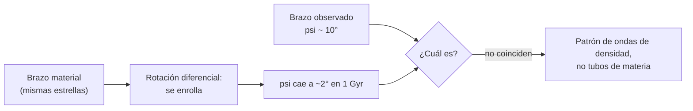

# B25-C02 — Brazos espirales y barra galáctica

<!-- nav:top -->
[🏠 Programa](../../../../README.md) · [📚 Bloque B25](../../../tronco-comun/B25-galaxias-y-medio-interestelar.md) · [← Anterior: B25-C01 — Estructura de la Vía Láctea](../B25-C01-estructura-de-la-via-lactea/CLASE.md) · [Siguiente: B25-C03 — Medio interestelar multifásico →](../B25-C03-medio-interestelar-multifasico/CLASE.md)
<!-- /nav -->

## 1. Ubicación, nivel y alcance

Clase 2 del bloque B25. Nivel N3. Parte de las cifras de [C01](../B25-C01-estructura-de-la-via-lactea/CLASE.md) (`R₀`, `Θ₀`), la trigonometría ([B04](../../../tronco-comun/B04-algebra-trigonometria-y-geometria-espacial.md)) y el cálculo ([B09](../../../tronco-comun/B09-calculo-diferencial-e-integral.md)). Estudia la **forma** del disco y del centro: cómo se describe un brazo espiral, por qué no se enrolla y qué ángulo forma la barra con la línea que nos une al centro. Sobre la dinámica de las ondas de densidad solo da la idea; no se resuelve. Los modelos son geometría plana.

## 2. Por qué esta clase existe

Los brazos espirales son lo más llamativo de una galaxia de disco, pero la rotación diferencial debería enrollarlos hasta borrarlos en unas pocas vueltas. Entender esa paradoja es entender qué es un brazo: no un montón fijo de materia, sino un patrón. La decisión central: **dado un ángulo de paso, ¿cuánto crece el radio por vuelta, y cuánto tardaría la rotación en enrollar un brazo hasta un ángulo de paso mucho menor que el observado?**

## 3. Lo que podrás hacer al terminar

1. Definir ángulo de paso, espiral logarítmica, barra y brazo.
2. Calcular cuánto crece el radio por vuelta de un brazo con un ángulo dado.
3. Calcular el ángulo de paso de un brazo material enrollado por la rotación diferencial.
4. Explicar con ese cálculo por qué los brazos no son tubos de materia.
5. Calcular la longitud galáctica del extremo de una barra a partir de su ángulo y longitud.
6. Describir qué se conoce de los brazos de la Vía Láctea y qué es modelo.

La evidencia es la **ficha de geometría de brazos y barra** del ejercicio 12 (sección 20).

## 4. Con qué llegas y cómo comprobarlo

1. ¿Qué es la tangente de un ángulo en un triángulo rectángulo?
2. ¿Qué es el arco de circunferencia `s = Rφ`?
3. ¿Cuánto vale `Θ₀` y cuántos pc/Myr son?
4. ¿Cómo se deriva `R(φ)` respecto de `φ`?
5. ¿Qué es una longitud galáctica `l`?

<details>
<summary>Ver respuestas</summary>

1. Cateto opuesto entre adyacente. 2. Con `φ` en radianes. 3. `238 km/s ≈ 243 pc/Myr` (C01). 4. Como pendiente de `R` frente a `φ`. 5. El ángulo, medido en el plano del disco desde el Sol, entre la dirección al centro galáctico y la dirección al objeto.
</details>

Con cuatro o cinco aciertos, sigue; si no, repasa B04 y B09.

## 5. Un caso real: cuatro brazos y una barra

Reid y colaboradores (S2) ajustaron espirales logarítmicas a cerca de 200 máseres con paralaje y concluyeron que la Vía Láctea es una **espiral de cuatro brazos** trazada por estrellas masivas jóvenes (Norma–Exterior, Escudo–Centauro–Exterior, Sagitario–Quilla y Perseo); el brazo Local es un segmento aislado y los llamados brazos de 3 kpc se asocian a la barra. El ángulo de paso medio de los brazos mayores es de unos `10°`. La revisión de Bland-Hawthorn y Gerhard (S1) da para la barra larga un ángulo de `28°–33°` y una semilongitud de `5,0 ± 0,2 kpc`, y para el bulbo en forma de caja o cacahuete `27° ± 2°`. El **ejemplo conductor**: un brazo de `10°` en el radio solar y una barra de `5 kpc` a `27°`.

## 6. Vocabulario

El **ángulo de paso** `ψ` es el ángulo entre la tangente al brazo y la tangente al círculo que pasa por ese punto: `ψ = 0` es un círculo y `ψ = 90°` un rayo. Una **espiral logarítmica** es una curva de ángulo de paso constante, `ln(R/R_k) = −(β − β_k) tan ψ`, donde `β` es el acimut galactocéntrico en radianes (0 hacia el Sol, creciente en el sentido de rotación) y `R_k` el radio en el acimut `β_k`. Un **nudo** (*kink*) es un cambio brusco de ángulo de paso. La **barra** es una estructura alargada en estrellas, con ángulo `φ` entre su eje mayor y la línea Sol–centro. La **rotación diferencial** es que la velocidad angular depende del radio. Un **brazo material** sería un brazo formado siempre por las mismas estrellas; una **onda de densidad** es un patrón que atraviesa a las estrellas.

## 7. Modelo mental: un patrón sobre un disco que gira

Piensa en una cola de coches que se forma ante un atasco en una autopista: los coches entran y salen, pero el atasco permanece. Analogía: el atasco es el brazo y los coches, las estrellas. Su límite: un atasco se mueve hacia atrás y en un brazo real el patrón gira con su propia velocidad, determinada por la dinámica del disco, que aquí no se calcula.



*Descripción textual:* un brazo hecho siempre de las mismas estrellas se enrollaría hasta ángulos de paso de pocos grados; como se observan unos `10°`, el brazo debe ser un patrón.

## 8. La explicación, paso a paso

### 8.1 La espiral logarítmica

Si `R = R_k e^{−(β−β_k) tan ψ}`, entonces `dR/dβ = −R tan ψ`: la razón entre el avance radial y el avance a lo largo del círculo vale `tan ψ` en todos los puntos, lo que fija un ángulo de paso constante. En una vuelta completa (`Δβ = 2π`) el radio se multiplica por `e^{2π tan ψ}`. Para `ψ = 10°` el factor es `3,03`; para `5°`, `1,73`; para `20°`, `9,84`.

### 8.2 Cuántos brazos

Reid y colaboradores señalan que una galaxia de dos brazos tendría que enrollarse dos veces para pasar por las paralajes medidas, con ángulos de paso cercanos a `5°`; el promedio de los cuatro brazos mayores ponderado por longitud es de unos `10°` (S2). El resultado «cuatro brazos» es un ajuste a máseres, con huecos de datos, y no una fotografía.

### 8.3 El problema del enrollamiento

Supón un brazo que en `t = 0` es un rayo y que cada estrella lo sigue con curva de rotación plana `Θ`. Tras un tiempo `t`, una estrella en `R` ha girado un ángulo `φ(R) = Θ t / R`. La inclinación del brazo respecto del círculo cumple `tan ψ = R/(Θ t)`: crece con el radio y decrece con el tiempo. En el radio solar, con `Θ = 238 km/s`: tras `0,2 Gyr`, `ψ = 9,6°`; tras `1 Gyr`, `1,9°`; tras `5 Gyr`, `0,4°`. El brazo observado, con unos `10°`, tendría menos de una vuelta de edad (`≈ 0,19 Gyr` frente a un periodo de `212 Myr`), lo que contradice la edad de las estrellas del disco. Por eso se acepta que el brazo es un patrón.

### 8.4 La barra vista desde el Sol

Si una barra recta de semilongitud `a` tiene su eje a un ángulo `φ` de la línea Sol–centro, su extremo cercano está en `x = R₀ − a cos φ` y `y = a sin φ` desde el Sol; su longitud galáctica es `l = atan2(a sin φ, R₀ − a cos φ)`. Con `a = 5,0 kpc`, `φ = 27°`, `R₀ = 8,2 kpc`: `l = 31,2°`. Esta es una consecuencia geométrica, no la forma observada: el extremo real es difuso.

### 8.5 Lo que el modelo deja fuera

No incluye el grosor del disco, la velocidad de giro del patrón ni la corrotación, ni la variación de `ψ` con el radio. Tampoco la barra como orbitas de estrellas: la barra es un conjunto de órbitas, no un palo rígido.

## 9. Magnitudes, símbolos y unidades

| Símbolo | Qué es | Unidad | Valor / nota |
|---|---|---|---|
| `ψ` | ángulo de paso | grados | `≈ 10°` promedio de brazos mayores (S2) |
| `β`, `R_k` | acimut galactocéntrico y radio de referencia | rad; kpc | definición de S2 |
| `R₀`, `Θ₀` | distancia al centro y velocidad circular | kpc; km/s | `8,2`; `238` (S1) |
| `φ`, `a` | ángulo y semilongitud de la barra | grados; kpc | `27° ± 2°` (bulbo); `5,0 ± 0,2` (barra larga) (S1) |
| `l` | longitud galáctica del extremo | grados | `31,2°` (cálculo propio) |
| `1 km/s` | conversión | pc/Myr | `1,0227` (cálculo propio) |

## 10. Convenciones y referencias

Acimut `β` y ángulo de paso como en S2. Las longitudes galácticas se miden desde el Sol. Se rotulan **observados** los ángulos y longitudes de S1 y S2 (con su modelo de ajuste), **cálculo propio** los demás. `1 pc = 648 000/π ua` y `1 Myr = 3,15576 × 10¹³ s` (conversiones).

## 11. De dónde sale lo que afirmamos

| ID | Fuente | Localizador | Respalda | Estado |
|---|---|---|---|---|
| S1 | Bland-Hawthorn y Gerhard, *The Galaxy in Context*, arXiv:1602.07702 | https://arxiv.org/abs/1602.07702 | `R₀`, `Θ₀`, ángulos y longitud de la barra | Texto del PDF extraído el 2026-11-09 |
| S2 | Reid et al., *Trigonometric Parallaxes of High-Mass Star Forming Regions*, arXiv:1910.03357 | https://arxiv.org/abs/1910.03357 | Cuatro brazos, `ψ` medio `≈ 10°`, forma de la espiral, ~200 máseres | Texto del PDF extraído el 2026-11-09 |

Límites: no se reprodujo la tabla de parámetros de brazos de S2; no se consultó la velocidad de patrón de la barra; el modelo de enrollamiento es una idealización escrita aquí.

## 12. Cómo ver los brazos

Equivalente accesible a un esquema (cálculo propio):

| Ángulo de paso `ψ` | Radio por vuelta | Brazo material en `R₀`, `t` | `ψ` |
|---|---|---|---|
| 5° | ×1,73 | 0,2 Gyr | 9,6° |
| 10° | ×3,03 | 1 Gyr | 1,9° |
| 20° | ×9,84 | 5 Gyr | 0,4° |

Descripción larga: ángulos pequeños dan espirales muy apretadas; la rotación diferencial aprieta un brazo material hasta ángulos de pocos grados en un tiempo comparable a pocas vueltas.

## 13. Ejemplo trabajado: ¿puede un brazo de 10° ser material?

**Paso 1 · Datos.** `ψ = 10°` observado; `Θ = 238 km/s`; `R = 8,2 kpc`.

**Paso 2 · Tiempo.** Despeja `tan ψ = R/(Θ t)`: `t = R/(Θ tan ψ)`. `Θ = 243,4 pc/Myr`, `tan 10° = 0,1763`, `R = 8200 pc`.

**Paso 3 · Cálculo.** `t = 8200/(243,4 × 0,1763) = 191 Myr`.

**Paso 4 · Comparación.** Un periodo orbital es `212 Myr`: el brazo habría vivido menos de una vuelta.

**Paso 5 · Sentido.** Si los brazos fueran materiales, el patrón observado solo podría durar una vuelta, y la edad de las estrellas del disco es mucho mayor. Lo razonable es un patrón que se regenera. No prueba la teoría de ondas de densidad; solo descarta los brazos como tubos fijos.

## 14. Distintas descripciones de un brazo

**Espiral logarítmica con nudos (esta clase y S2):** se ajusta a máseres, con pocos parámetros. **Ondas de densidad cuasi-estacionarias:** explican la persistencia, pero requieren dinámica. **Brazos transitorios en simulaciones:** se forman y deshacen en unas vueltas. Para describir la posición de los brazos basta la geometría; para explicar su origen hace falta dinámica.

## 15. Práctica guiada

**Ejercicio 1 · con los pasos indicados.** ¿Cuánto crece el radio por vuelta si `ψ = 10°`? *Pasos:* `tan 10° = 0,1763`; `2π × 0,1763`; exponencial.

<details><summary>Solución comentada</summary>

`2π × 0,1763 = 1,108`; `e^{1,108} = 3,03` (8.1).
</details>

**Ejercicio 2 · con una pista.** Un brazo con `ψ = 10°` tiene `R = 4 kpc` en un acimut. ¿Qué radio tiene una vuelta completa más hacia fuera? *Pista:* multiplica por el factor por vuelta.

<details><summary>Solución comentada</summary>

`4 × 3,03 = 12,1 kpc` (8.1).
</details>

**Ejercicio 3 · casi autónomo.** Calcula el ángulo de paso en `R₀` de un brazo material tras `1 Gyr`.

<details><summary>Solución comentada</summary>

`Θ t = 243,4 pc/Myr × 1000 Myr = 243,4 kpc`; `tan ψ = 8,2/243,4 = 0,0337`; `ψ = 1,93°` (8.3).
</details>

## 16. Práctica autónoma, transferencia e integrador

**Ejercicio 4.** ¿Qué `ψ` da un factor 2 por vuelta?

<details><summary>Solución comentada</summary>

`tan ψ = ln 2/(2π) = 0,1103`; `ψ = 6,3°` (8.1).
</details>

**Ejercicio 5.** Comprueba que dos vueltas con `ψ = 5°` multiplican el radio por `3,0`.

<details><summary>Solución comentada</summary>

`1,73² = 3,0`. Eso explica la afirmación de S2 de que una galaxia de dos brazos tendría que enrollarse dos veces con `ψ` cercano a `5°` (8.2).
</details>

**Ejercicio 6.** Calcula `l` del extremo cercano de una barra de `4 kpc` de semilongitud a `27°`.

<details><summary>Solución comentada</summary>

`x = 8,2 − 4 cos 27° = 4,64`; `y = 4 sen 27° = 1,816`; `l = atan(1,816/4,64) = 21,4°` (8.4).
</details>

**Ejercicio 7.** ¿Tras cuánto tiempo un brazo material en `R₀` baja a `ψ = 10°`?

<details><summary>Solución comentada</summary>

`t = R/(Θ tan ψ) = 191 Myr`, igual al ejemplo trabajado (13).
</details>

**Ejercicio 8.** ¿Cuántas vueltas solares caben en ese tiempo?

<details><summary>Solución comentada</summary>

`191/212 = 0,90`: menos de una vuelta (13).
</details>

**Ejercicio 9 · transferencia.** Una galaxia hipotética tiene curva plana de `150 km/s`. ¿Qué `ψ` tiene un brazo material a `5 kpc` tras `1 Gyr`?

<details><summary>Solución comentada</summary>

`150 km/s = 153,4 pc/Myr`; `Θt = 153,4 kpc`; `tan ψ = 5/153,4`; `ψ = 1,87°` (8.3).
</details>

**Ejercicio 10 · transferencia.** Un compañero dice: «los brazos son bandas de estrellas que giran juntas». Respóndele con un número.

<details><summary>Solución comentada</summary>

Si fuera así, en `1 Gyr` el ángulo de paso del brazo en el radio solar sería `1,9°`, no los `~10°` observados (8.3). Por tanto, el patrón se mueve a través de las estrellas.
</details>

**Ejercicio 11 · transferencia.** Una paralaje de máser vale `π = 1/d` con `π` en milisegundos de arco y `d` en kpc. ¿Qué error relativo de distancia da `δπ = 0,02 mas` para un máser a `5 kpc`? (valores ilustrativos)

<details><summary>Solución comentada</summary>

`π = 0,2 mas`; `δd/d = δπ/π = 0,1`: `10 %`. Por eso las distancias lejanas se miden con muchos máseres y un ajuste global (S2, 8.2).
</details>

**Ejercicio 12 · integrador.** Elabora la *ficha de geometría de brazos y barra*: elige `ψ` y `R_k`; calcula el radio por vuelta, el tiempo de enrollamiento en `R₀` hasta tu `ψ`, y la longitud del extremo de una barra con tu `a` y `φ`; indica qué es observado, qué es modelo y qué falta.

<details><summary>Solución modelo</summary>

Con `ψ = 10°`, `R_k = 4 kpc`: ×3,03 por vuelta, `191 Myr`; con `a = 5 kpc`, `φ = 27°`: `31,2°`. Observado: `ψ` medio, ángulos de barra; modelo: la espiral con nudos y el brazo material; falta: velocidad de patrón y dinámica.
</details>

## 17. Laboratorio: espiral logarítmica y enrollamiento

El script [espirales_y_barra.py](espirales_y_barra.py) calcula el factor por vuelta, el ángulo de paso de un brazo material y la longitud del extremo de una barra. **Comprueba** que el ángulo de paso obtenido derivando numéricamente la espiral coincide con el dado (`10⁻⁶`), que la derivación numérica del brazo enrollado coincide con `atan(R/Θt)` (`10⁻⁶`) y los dos casos límite de la barra (`a = 0` y `φ = 90°`, `10⁻⁹`).

**Datos:** `R₀`, `Θ₀`, ángulo y semilongitud de la barra de S1 (observados/estimados); sin datos nuevos. **Predice antes de ejecutar:** ¿qué `ψ` tendrá un brazo material tras 1 Gyr? (≈ 2°.) **Ejecución del 2026-11-09 (Python 3.12.9):**

```text
Python 3.12.9 (biblioteca estandar)
1 km/s = 1.0227 pc/Myr
psi =  5.0 grados -> R crece x1.733 por vuelta
psi = 10.0 grados -> R crece x3.028 por vuelta
psi = 20.0 grados -> R crece x9.844 por vuelta
brazo material en R0 tras 0.2 Gyr: psi = 9.56 grados
brazo material en R0 tras 1.0 Gyr: psi = 1.93 grados
brazo material en R0 tras 5.0 Gyr: psi = 0.39 grados
extremo cercano de la barra: l = 31.2 grados
Pruebas superadas.
```

```bash
python programa/clases/B25/B25-C02-brazos-espirales-y-barra-galactica/espirales_y_barra.py
```

**Límites:** geometría plana, curva plana, brazo inicialmente radial, barra como segmento.

## 18. Errores frecuentes y cómo corregirlos

**Pensar que `ψ` es el ángulo con el radio.** Se corrige con la sección 6 y el ejercicio 1.

**Usar grados en vez de radianes en `Rφ`.** Se corrige en 8.1.

**Tomar el brazo como materia fija.** Se corrige con el ejercicio 10.

**Leer la longitud `l` como ángulo de la barra.** Se corrige con el ejercicio 6.

**Creer que «cuatro brazos» es una imagen directa.** Se corrige en 8.2.

## 19. Cómo sabrás que vas bien

Tras 8.1: ¿cuánto crece el radio por vuelta con `ψ = 5°`? Ejercicio 5. Tras 8.3: ¿por qué baja `ψ` con el tiempo? Ejercicio 3. Tras el laboratorio: ¿qué comprueba la derivada numérica? (que la forma cerrada y el cálculo diferencial coinciden).

## 20. Qué entregas y cómo se evalúa

El producto es tu **ficha de geometría de brazos y barra** (ejercicio 12).

| Criterio | Inicial | En desarrollo | Logrado | Destacado |
|---|---|---|---|---|
| Definiciones | Las confunde | Parciales | `ψ`, espiral, barra | Distingue brazo y patrón |
| Cálculo | Sin unidades | Con errores | Valores correctos | Propone casos límite |
| Interpretación | Sin comparar | Sin razón | Concluye sobre el enrollamiento | Discute ondas de densidad |
| Numérico | Sin comprobar | Un caso | Tres pruebas superadas | Explica cada prueba |
| Fuentes | Sin fuente | Sin fecha | S1–S2 con fecha | Rotula observado y modelo |

**Condiciones críticas (no se compensan con promedio):** no presentar «cuatro brazos» como imagen directa; rotular el modelo de enrollamiento como idealización; citar solo lo consultado.

## 21. Ética, seguridad y límites

La clase es educativa y no sustituye a un mapa de la Galaxia. Accesibilidad: tablas equivalentes a los esquemas, fórmulas en texto, ejercicios sin conexión.

## 22. Para cerrar y seguir

Un brazo con `ψ = 10°` crece ×3 por vuelta, y la rotación diferencial lo apretaría hasta ~2° en 1 Gyr; por eso es un patrón. La barra de 5 kpc a 27° termina hacia `l ≈ 31°`. Queda una pregunta: ¿de qué está hecho el gas que traza esos brazos?

**Glosario español–inglés.** ángulo de paso · *pitch angle*; espiral logarítmica · *logarithmic spiral*; rotación diferencial · *differential rotation*; onda de densidad · *density wave*; barra · *bar*; nudo · *kink*; longitud galáctica · *Galactic longitude*.

**Continuidad.** [B25-C03](../B25-C03-medio-interestelar-multifasico/CLASE.md) describe las fases del gas que sigue esos brazos.

**Referencias:** ver sección 11.

<!-- nav:bottom -->
---

[← Anterior: B25-C01 — Estructura de la Vía Láctea](../B25-C01-estructura-de-la-via-lactea/CLASE.md) · [📚 Bloque B25](../../../tronco-comun/B25-galaxias-y-medio-interestelar.md) · [Siguiente: B25-C03 — Medio interestelar multifásico →](../B25-C03-medio-interestelar-multifasico/CLASE.md)
<!-- /nav -->
