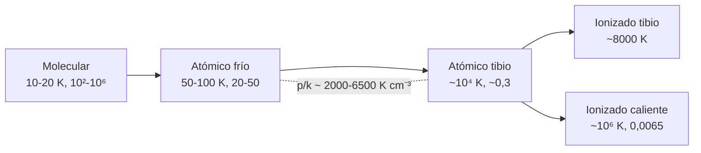

# B25-C03 — Medio interestelar multifásico

<!-- nav:top -->
[🏠 Programa](../../../../README.md) · [📚 Bloque B25](../../../tronco-comun/B25-galaxias-y-medio-interestelar.md) · [← Anterior: B25-C02 — Brazos espirales y barra galáctica](../B25-C02-brazos-espirales-y-barra-galactica/CLASE.md) · [Siguiente: B25-C04 — Nubes moleculares y polvo →](../B25-C04-nubes-moleculares-y-polvo/CLASE.md)
<!-- /nav -->

## 1. Ubicación, nivel y alcance

Clase 3 del bloque B25. Nivel N3. Toma la estructura de [C01](../B25-C01-estructura-de-la-via-lactea/CLASE.md), los gases ideales ([B05-C14](../../B05/B05-C14-gases-y-presion/CLASE.md), [B06-C09](../../B06/B06-C09-gases-ideales-y-no-ideales/CLASE.md)) y la temperatura ([B05-C13](../../B05/B05-C13-temperatura-y-energia-termica/CLASE.md)). Describe el **gas entre las estrellas** como un conjunto de fases con temperaturas y densidades muy distintas, y comprueba cómo conviven bajo presiones comparables. Las nubes moleculares se detallan en [C04](../B25-C04-nubes-moleculares-y-polvo/CLASE.md). Los modelos son de gas ideal homogéneo por fase, sin campo magnético ni turbulencia.

## 2. Por qué esta clase existe

Las estrellas nacen del gas y devuelven gas enriquecido; el medio interestelar (MIS) es el almacén y el escenario de ese ciclo. Pero «gas» sirve de poco: un volumen del MIS puede estar a `10 K` o a `10⁶ K`, y su densidad variar un factor 10⁷ de un punto a otro. La decisión central: **dadas una temperatura y una densidad, ¿a qué fase pertenece el gas y qué presión y velocidad del sonido tiene?**

## 3. Lo que podrás hacer al terminar

1. Nombrar las fases del MIS y dar un orden de magnitud de `T` y `n` de cada una.
2. Calcular la presión térmica `p/k = nT` y compararla entre fases.
3. Calcular la velocidad del sonido adiabática de cada fase.
4. Convertir una densidad superficial en densidad de columna de hidrógeno.
5. Explicar por qué la fase fría y la tibia pueden coexistir.
6. Distinguir lo medido de lo que depende de un valor representativo elegido por ti.

La evidencia es la **ficha de fases del MIS** del ejercicio 12 (sección 20).

## 4. Con qué llegas y cómo comprobarlo

1. ¿Qué liga presión, densidad numérica y temperatura en un gas ideal?
2. ¿Cuánto vale la velocidad del sonido en función de `T`?
3. ¿Qué es la media geométrica de dos números?
4. ¿Cómo se pasa de `M☉/pc²` a `g/cm²`?
5. ¿Qué es la densidad de columna?

<details>
<summary>Ver respuestas</summary>

1. `p = n k T`. 2. `c ∝ √T`. 3. `√(ab)`. 4. Multiplicando por `M☉ = 1,989 × 10³³ g` y dividiendo entre `(3,0857 × 10¹⁸ cm)²`. 5. El número de partículas por unidad de área a lo largo de la línea de visión.
</details>

Con cuatro o cinco aciertos, sigue; si no, repasa B05-C13, B05-C14 y B06-C09.

## 5. Un caso real: el gas cerca del Sol

La revisión de Ferrière (S2, Tabla I del texto del PDF) resume el MIS de nuestra galaxia en cinco componentes: molecular (`T = 10–20 K`, `n = 10²–10⁶ cm⁻³`), atómico frío (`50–100 K`, `20–50 cm⁻³`), atómico tibio (`6000–10 000 K`, `0,2–0,5 cm⁻³`), ionizado tibio (`~8000 K`, `0,2–0,5 cm⁻³`) e ionizado caliente (`~10⁶ K`, `~0,0065 cm⁻³`), donde `n` es la densidad numérica de núcleos de hidrógeno cerca del Sol. La misma tabla da las densidades superficiales en el círculo solar (`~2,5`, `~3,5`, `~3,5`, `~1,4 M☉/pc²` para las cuatro primeras fases mencionadas) y las masas en toda la galaxia: `1,3–2,5 × 10⁹ M☉` en gas molecular, `≳ 6,0 × 10⁹` en atómico (frío y tibio juntos) y `≳ 1,6 × 10⁹` en ionizado tibio. El texto indica además una densidad media de `~2,7 × 10⁻²⁴ g cm⁻³` cerca del Sol. Esos son los **datos estimados** del **ejemplo conductor**: las cuatro fases «atómica fría, atómica tibia, ionizada tibia y caliente».

## 6. Vocabulario

El **medio interestelar (MIS)** es la materia (gas y polvo), los rayos cósmicos y el campo magnético entre las estrellas. Una **fase** es un estado del gas con un rango de temperatura y densidad. El **medio neutro frío** (CNM) y el **medio neutro tibio** (WNM) son gas de hidrógeno atómico; el **medio ionizado tibio** (WIM) y el **ionizado caliente** (HIM) están ionizados. Una **densidad numérica** `n` cuenta núcleos de H por cm³. La **presión térmica** se escribe `p/k = nT` en `K cm⁻³`; `k` es la constante de Boltzmann. La **velocidad del sonido adiabática** es `c = √(γ k T / (μ m_p))`, con `γ = 5/3` el índice adiabático, `μ` la masa media por partícula en unidades de `m_p` y `m_p` la masa del protón. La **densidad de columna** `N` es el número de núcleos de H por cm² a lo largo de la visual. El **factor 1,42** relaciona la masa total (con helio y elementos pesados) con la de H: `ρ = 1,42 m_p n`.

## 7. Modelo mental: fases en equilibrio de presión

Piensa en una olla con agua y vapor a la misma presión: dos fases muy distintas en densidad conviven si la presión coincide. Analogía: la fase fría es el agua (densa, fría) y la tibia es el vapor (tenue, caliente). Su límite: en el MIS no hay un cambio de fase de una sustancia, sino un equilibrio entre calentamiento y enfriamiento radiativo; y las fases no están en reposo.



*Descripción textual:* de la más fría y densa a la más caliente y tenue hay cinco fases; las atómicas fría y tibia, y el medio caliente, tienen presión térmica del mismo orden de magnitud.

## 8. La explicación, paso a paso

### 8.1 Valores representativos

La Tabla I da **rangos**. Para operar elegimos el centro geométrico `√(T_min T_max)` y `√(n_min n_max)` de cada fase: atómico frío `71 K` y `31,6 cm⁻³`; atómico tibio `7746 K` y `0,316 cm⁻³`; ionizado tibio `8000 K` y `0,316 cm⁻³`; caliente `10⁶ K` y `0,0065 cm⁻³`. Esa elección es **nuestra**: no es un valor medido.

### 8.2 Presión térmica

`p/k = nT`. Resulta `2236`, `2449`, `2530` y `6500 K cm⁻³` respectivamente. Las tres primeras difieren menos de un 15 %; la caliente es unas tres veces mayor. S2 interpreta que la proporción de densidades entre las fases fría y tibia es aproximadamente la inversa de la de temperaturas, lo que apoya el equilibrio de presión: aquí `n_frío/n_tibio = 100` y `T_tibio/T_frío = 109`. Que Field y colaboradores (1969) predijeran dos fases atómicas estables con presiones comparables lo cita S2, no esta clase.

### 8.3 Velocidad del sonido

Con `γ = 5/3` y `μ = 1,3` (neutro) o `0,6` (ionizado), valores **ilustrativos**: `0,9`, `9,1`, `13,5` y `151 km/s`. Como `c ∝ √T`, cuadruplicar la temperatura duplica la velocidad. Un gas frío es «blando»: una onda sonora tarda en cruzar, y un movimiento a unos `10 km/s` es supersónico en el gas frío, aunque subsónico en el caliente.

### 8.4 Superficie, columna y densidad media

Con `ρ = 1,42 m_p n`, una densidad superficial de `1 M☉/pc²` equivale a `N = 8,8 × 10¹⁹ cm⁻²`. Sumando las cuatro fases de la Tabla con valor de `Σ` (sin el gas molecular ni el caliente) resultan `8,4 M☉/pc²`, o `N = 7,4 × 10²⁰ cm⁻²`. Con el gas molecular (`~2,5`) son `10,9 M☉/pc²`. La densidad media indicada por S2, `2,7 × 10⁻²⁴ g cm⁻³`, da `n = 1,14 cm⁻³` de núcleos de H.

### 8.5 Lo que el modelo deja fuera

No incluye la presión magnética ni turbulenta, que S2 discute y que aquí no se calculan, ni la dependencia de las fases con la altura sobre el plano. El criterio de estabilidad térmica (que explica por qué hay dos fases atómicas) no se desarrolla; solo se comprueba el equilibrio de presión.

## 9. Magnitudes, símbolos y unidades

| Símbolo | Qué es | Unidad | Valor / nota |
|---|---|---|---|
| `k`, `m_p` | Boltzmann y masa del protón | `J K⁻¹`; kg | `1,380 649 × 10⁻²³` exacta; `1,672 62 × 10⁻²⁷` (S1) |
| `T`, `n` | temperatura y densidad numérica de H | K; `cm⁻³` | Tabla I (S2); representativos propios |
| `p/k` | presión térmica | `K cm⁻³` | `2236–6500` (cálculo propio) |
| `c` | velocidad del sonido | km/s | `0,9–151` (cálculo propio, `μ` ilustrativo) |
| `Σ`, `M` | densidad superficial; masa | `M☉ pc⁻²`; `M☉` | Tabla I (S2) |
| `N` | densidad de columna | `cm⁻²` | `7,4 × 10²⁰` (cálculo propio) |

## 10. Convenciones y referencias

`n` cuenta núcleos de H; `ρ = 1,42 m_p n` por el 70,4 % de H, 28,1 % de He y 1,5 % de elementos pesados en masa (S2). `1 pc = 3,0856776 × 10¹⁶ m` (conversión). Los rangos de la Tabla I son **estimados** (valores cerca del Sol, reescalados a `R☉ = 8,5 kpc`); los valores representativos y `μ`, `γ` son **elegidos por esta clase**.

## 11. De dónde sale lo que afirmamos

| ID | Fuente | Localizador | Respalda | Estado |
|---|---|---|---|---|
| S1 | NIST, *Fundamental Physical Constants — Complete Listing* (CODATA 2022) | https://physics.nist.gov/cuu/Constants/Table/allascii.txt | `k`, `m_p` | Consultada el 2026-11-09 |
| S2 | Ferrière, *The Interstellar Environment of our Galaxy*, Rev. Mod. Phys. 73, 1031; arXiv:astro-ph/0106359 | https://arxiv.org/abs/astro-ph/0106359 | Tabla I de fases; factor 1,42; densidad media | Texto del PDF extraído el 2026-11-09 |

Límites: de S2 solo se usó la Tabla I y las frases citadas, no el artículo completo; la elección de valores representativos y de `μ` es de esta clase; la separación de las masas de gas atómico frío y tibio no la da la tabla.

## 12. Cómo ver las fases

Equivalente accesible a un diagrama `T`–`n` (cálculo propio con valores representativos):

| Fase | `T` (K) | `n` (`cm⁻³`) | `p/k` (`K cm⁻³`) | `c` (km/s) |
|---|---|---|---|---|
| Atómica fría | 71 | 31,6 | 2236 | 0,9 |
| Atómica tibia | 7746 | 0,316 | 2449 | 9,1 |
| Ionizada tibia | 8000 | 0,316 | 2530 | 13,5 |
| Ionizada caliente | 10⁶ | 0,0065 | 6500 | 151 |

Descripción larga: la temperatura sube cuatro órdenes y la densidad baja cinco, de modo que el producto `nT` varía solo un factor tres.

## 13. Ejemplo trabajado: una nube fría rodeada de gas tibio

**Paso 1 · Datos.** Fase fría `71 K`, `31,6 cm⁻³`; fase tibia `7746 K`, `0,316 cm⁻³`.

**Paso 2 · Presiones.** `p_frío/k = 2236`; `p_tibio/k = 2449`.

**Paso 3 · Cociente.** `p_frío/p_tibio = 0,91`.

**Paso 4 · Cociente de densidades y temperaturas.** `n_frío/n_tibio = 100`; `T_tibio/T_frío = 109`.

**Paso 5 · Sentido.** Un cociente de presiones cercano a 1 es coherente con una nube fría en equilibrio con el gas tibio que la rodea. Con rangos tan amplios, que sea `0,91` y no `1,0` no tiene significado: la elección de valores representativos pesa más que esa diferencia.

## 14. Distintas descripciones del MIS

**Tres fases (esta clase, con la fase molecular aparte):** simple, pero muestra el equilibrio. **Dinámica con turbulencia y supernovas:** el gas no está en equilibrio y las fases se mezclan; S2 discute la presión adicional. **Tratamiento por componentes (Tabla I):** da cifras comparables entre autores. Para entender qué cantidad de gas hay sirve la Tabla; para entender el reparto de presiones hay que añadir campo y turbulencia.

## 15. Práctica guiada

**Ejercicio 1 · con los pasos indicados.** Calcula `p/k` de la fase caliente. *Pasos:* `n = 0,0065`; `T = 10⁶`; multiplica.

<details><summary>Solución comentada</summary>

`0,0065 × 10⁶ = 6500 K cm⁻³` (8.2).
</details>

**Ejercicio 2 · con una pista.** Calcula `c` de la fase atómica tibia con `μ = 1,3`. *Pista:* `c = √(γkT/(μ m_p))`.

<details><summary>Solución comentada</summary>

`(5/3 × 1,3806 × 10⁻²³ × 7746)/(1,3 × 1,6726 × 10⁻²⁷) = 8,2 × 10⁷ m²/s²`; `c = 9,1 km/s` (8.3).
</details>

**Ejercicio 3 · casi autónomo.** Pasa `Σ = 8,4 M☉/pc²` a `N` de hidrógeno.

<details><summary>Solución comentada</summary>

`1 M☉/pc² = 2,089 × 10⁻⁴ g/cm²`; `8,4 → 1,755 × 10⁻³ g/cm²`; entre `1,42 × 1,6726 × 10⁻²⁴ g` da `7,4 × 10²⁰ cm⁻²` (8.4).
</details>

## 16. Práctica autónoma, transferencia e integrador

**Ejercicio 4.** ¿Qué fracción de la densidad superficial gaseosa de la Tabla (molecular incluida) es molecular?

<details><summary>Solución comentada</summary>

`2,5/(2,5 + 8,4) = 0,23` (8.4).
</details>

**Ejercicio 5.** Con la densidad media `n = 1,14 cm⁻³` y `N = 7,4 × 10²⁰ cm⁻²`, ¿qué espesor equivalente tiene el gas?

<details><summary>Solución comentada</summary>

`L = N/n = 6,5 × 10²⁰ cm = 210 pc` (8.4). Es un espesor equivalente, no una altura medida.
</details>

**Ejercicio 6.** Suma las masas inferiores de las fases moleculares, atómicas e ionizada tibia y compárala con la masa estelar de C01 (`5 × 10¹⁰ M☉`).

<details><summary>Solución comentada</summary>

`1,3 + 6,0 + 1,6 = 8,9 × 10⁹ M☉`, cota inferior (sin gas caliente); `8,9/50 = 0,18` (sección 5, C01).
</details>

**Ejercicio 7.** Si `p/k = 3000 K cm⁻³` en todas las fases, ¿qué `n` corresponde a `T = 100 K`, `8000 K` y `10⁶ K`?

<details><summary>Solución comentada</summary>

`n = 30`, `0,375` y `0,003 cm⁻³`: cada fase requiere `n ∝ 1/T` (8.2).
</details>

**Ejercicio 8.** Comprueba que `1/0,704 = 1,42`.

<details><summary>Solución comentada</summary>

`1/0,704 = 1,4205` (sección 6 y 10): el factor sale de que el H es el 70,4 % de la masa.
</details>

**Ejercicio 9 · transferencia.** Una nube fría de `71 K` se calienta a `7746 K` sin cambiar de volumen. ¿Cómo cambia su presión y qué hará?

<details><summary>Solución comentada</summary>

`p` sube un factor `109`; el gas se expandirá hasta recuperar la presión del entorno, con `n` disminuyendo unas `100` veces (8.2).
</details>

**Ejercicio 10 · transferencia.** Un compañero dice: «entre las estrellas hay vacío absoluto». Respóndele con un número.

<details><summary>Solución comentada</summary>

La densidad media de S2 equivale a `1,14` núcleos de H por cm³, o `1,1 × 10⁶ m⁻³`. Es muy tenue, pero no es vacío (8.4); en la fase caliente son unos `6500 m⁻³`.
</details>

**Ejercicio 11 · transferencia.** ¿Cuánto tarda el sonido de la fase atómica tibia en cruzar `100 pc`?

<details><summary>Solución comentada</summary>

`9,1 km/s = 9,3 pc/Myr`; `t = 100/9,3 = 10,7 Myr` (8.3). Mucho más que el tiempo de vida de los núcleos de nubes: la respuesta de la presión es lenta.
</details>

**Ejercicio 12 · integrador.** Elabora tu *ficha de fases del MIS*: tabla de las cuatro fases con `T`, `n`, `p/k`, `c`, indicando qué es dato de la Tabla I y qué decidiste tú; señala si hay equilibrio de presión y qué efecto falta.

<details><summary>Solución modelo</summary>

La tabla de la sección 12. Equilibrio: las tres primeras fases dentro del 15 %; la caliente ×3. Faltan campo magnético y turbulencia (S2), y los valores representativos son una decisión propia.
</details>

## 17. Laboratorio: presión y sonido por fase

El script [fases_ism.py](fases_ism.py) calcula `p/k`, `c` y `N` y **comprueba** que `1/0,704 = 1,42` (`10⁻³`), que la conversión `Σ → N` coincide con una vía independiente (masa/área en SI, `10⁻⁹`) y que `c` escala con `√T` (`10⁻¹²`).

**Datos:** Tabla I de S2 (estimados); `k`, `m_p` de NIST; `μ` y `γ` ilustrativos. **Predice antes de ejecutar:** ¿qué fase tiene la mayor presión térmica? (la caliente.) **Ejecución del 2026-11-09 (Python 3.12.9):**

```text
Python 3.12.9 (biblioteca estandar)
fase | T repr. (K) | n repr. (cm^-3) | p/k (K cm^-3) | c (km/s)
cold atomic (CNM)           71        31.6        2236      0.9
warm atomic (WNM)         7746       0.316        2449      9.1
warm ionized (WIM)        8000       0.316        2530     13.5
hot ionized (HIM)      1000000      0.0065        6500    151.4
p/k(CNM) / p/k(WNM) = 0.91
Sigma gas atomico+ionizado = 8.4 Msol/pc2 ; N = 7.39e+20 cm^-2
densidad media de la Tabla: n = 1.14 cm^-3 (de 2,7e-24 g/cm3)
Pruebas superadas.
```

```bash
python programa/clases/B25/B25-C03-medio-interestelar-multifasico/fases_ism.py
```

**Límites:** valores representativos propios, sin campo magnético ni turbulencia; la «suma» de `Σ` excluye el gas molecular y el caliente.

## 18. Errores frecuentes y cómo corregirlos

**Tomar un valor representativo como un dato medido.** Se corrige en 8.1 y 13.

**Confundir `n` de H con `n` de partículas.** Se corrige en la sección 6.

**Olvidar el helio en la masa.** Se corrige con el ejercicio 8.

**Creer que más caliente significa más presión.** Se corrige con el ejercicio 7.

**Concluir que la presión térmica es la única.** Se corrige en 8.5.

## 19. Cómo sabrás que vas bien

Tras 8.2: ¿por qué conviven fases tan distintas? Ejercicio 7. Tras 8.4: ¿cómo se pasa de `Σ` a `N`? Ejercicio 3. Tras el laboratorio: ¿qué prueba la conversión por dos vías? (que la fórmula de unidades es correcta).

## 20. Qué entregas y cómo se evalúa

El producto es tu **ficha de fases del MIS** (ejercicio 12).

| Criterio | Inicial | En desarrollo | Logrado | Destacado |
|---|---|---|---|---|
| Definiciones | Las confunde | Parciales | Fases y `p/k` | Distingue `n` de H y de partículas |
| Cálculo | Sin unidades | Con errores | Valores correctos | Propone casos límite |
| Interpretación | Sin comparar | Sin razón | Concluye sobre equilibrio | Discute lo que falta |
| Numérico | Sin comprobar | Un caso | Tres pruebas superadas | Explica cada prueba |
| Fuentes | Sin fuente | Sin fecha | S1–S2 con fecha | Rotula elegido y medido |

**Condiciones críticas (no se compensan con promedio):** rotular los valores representativos como elegidos; no presentar la suma de `Σ` como el total de gas; citar solo lo consultado.

## 21. Ética, seguridad y límites

La clase es educativa y no sustituye a una síntesis de observaciones del MIS. Accesibilidad: tablas equivalentes a los diagramas, fórmulas en texto, ejercicios sin conexión.

## 22. Para cerrar y seguir

El MIS reúne fases de `10 K` a `10⁶ K` con presiones térmicas de un mismo orden, al menos unos `9 × 10⁹ M☉` de gas en nuestra galaxia (cota inferior sumada de la Tabla I de S2). Queda una pregunta: ¿cómo se mide el gas más frío y denso, donde el hidrógeno es molecular?

**Glosario español–inglés.** medio interestelar · *interstellar medium*; fase · *phase*; medio neutro frío/tibio · *cold/warm neutral medium*; medio ionizado tibio/caliente · *warm/hot ionized medium*; densidad de columna · *column density*; presión térmica · *thermal pressure*.

**Continuidad.** [B25-C04](../B25-C04-nubes-moleculares-y-polvo/CLASE.md) trata del gas molecular que esta clase solo dejó aparte, y del polvo.

**Referencias:** ver sección 11.

<!-- nav:bottom -->
---

[← Anterior: B25-C02 — Brazos espirales y barra galáctica](../B25-C02-brazos-espirales-y-barra-galactica/CLASE.md) · [📚 Bloque B25](../../../tronco-comun/B25-galaxias-y-medio-interestelar.md) · [Siguiente: B25-C04 — Nubes moleculares y polvo →](../B25-C04-nubes-moleculares-y-polvo/CLASE.md)
<!-- /nav -->
