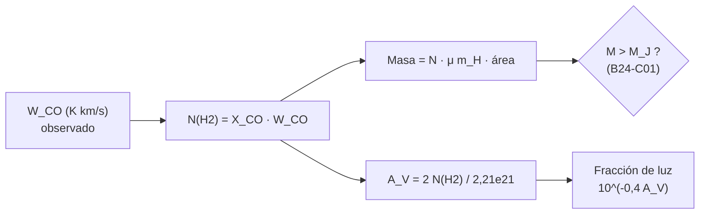

# B25-C04 — Nubes moleculares y polvo

<!-- nav:top -->
[🏠 Programa](../../../../README.md) · [📚 Bloque B25](../../../tronco-comun/B25-galaxias-y-medio-interestelar.md) · [← Anterior: B25-C03 — Medio interestelar multifásico](../B25-C03-medio-interestelar-multifasico/CLASE.md) · [Siguiente: B25-C05 — Regiones de formación estelar →](../../../tronco-comun/B25-galaxias-y-medio-interestelar.md#b25-c05)
<!-- /nav -->

## 1. Ubicación, nivel y alcance

Clase 4 del bloque B25. Nivel N3. Continúa el gas de [C03](../B25-C03-medio-interestelar-multifasico/CLASE.md) con su fase más fría y densa y con el polvo que la acompaña. Usa el colapso de [B24-C01](../../B24/B24-C01-colapso-de-nubes-moleculares/CLASE.md), el espectro de moléculas ([B06-C17](../../B06/B06-C17-espectros-atomicos-y-moleculares/CLASE.md)) y los logaritmos de las magnitudes ([B03](../../../tronco-comun/B03-matematica-elemental-para-ciencias-espaciales.md)). Aquí aprendes a **pesar una nube molecular a través de la luz del monóxido de carbono** y a leer cuánto la oscurece el polvo. Los modelos suponen un factor de conversión constante y extinción uniforme.

## 2. Por qué esta clase existe

El hidrógeno molecular `H₂`, el componente principal de las nubes donde nacen las estrellas, casi no emite en el gas frío. Por eso la masa de una nube se estima con un trazador indirecto, el monóxido de carbono `CO`, y con el polvo que apaga la luz de fondo. Sin entender sus supuestos, una masa «medida» puede errar por factores grandes. La decisión central: **dada una intensidad de CO sobre un área, ¿cuánta masa de gas hay y cuánta luz visible deja pasar?**

## 3. Lo que podrás hacer al terminar

1. Definir nube molecular, trazador, intensidad integrada de CO, factor de conversión y extinción.
2. Calcular la densidad de columna de `H₂` a partir de la intensidad de CO y el factor `X_CO`.
3. Calcular la masa de una nube desde su intensidad y su área, con su incertidumbre.
4. Convertir entre densidad de columna, extinción visual y fracción de luz transmitida.
5. Comparar la masa de una nube con su masa de Jeans.
6. Señalar los supuestos que debilitan la masa estimada con CO.

La evidencia es la **ficha de una nube molecular** del ejercicio 12 (sección 20).

## 4. Con qué llegas y cómo comprobarlo

1. ¿Qué es el logaritmo decimal de `0,1`?
2. ¿Qué masa tiene una molécula de `H₂` en unidades de `m_p`?
3. ¿Qué expresa una incertidumbre relativa del 30 %?
4. ¿Cómo se pasa de `cm⁻²` a una masa si conoces el área?
5. ¿Qué es una magnitud astronómica?

<details>
<summary>Ver respuestas</summary>

1. `−1`. 2. Aproximadamente `2 m_p`. 3. Que el valor puede estar entre `0,7` y `1,3` veces la cifra central. 4. Se multiplica por la masa por partícula y por el área. 5. Una escala logarítmica de brillo: cinco magnitudes son un factor 100.
</details>

Con cuatro o cinco aciertos, sigue; si no, repasa B03 y B06-C17.

## 5. Un caso real: pesar una nube con CO

Bolatto, Wolfire y Leroy (S1) recomiendan, para el disco de la Vía Láctea, un factor de conversión `X_CO = 2 × 10²⁰ cm⁻² (K km/s)⁻¹` con una incertidumbre de `±30 %`: es el número de moléculas de `H₂` por cm² que corresponde a cada `K km/s` de intensidad integrada de CO. Para el polvo, Güver y Özel (S2) obtienen con 22 restos de supernova `N_H = (2,21 ± 0,09) × 10²¹ A_V cm⁻²`. El ejemplo conductor es una **nube sintética** (no es una nube real): intensidad integrada `W_CO = 10 K km/s` sobre un área de `400 pc²`.

## 6. Vocabulario

Una **nube molecular** es una nube interestelar fría y densa donde el hidrógeno es sobre todo molecular. Un **trazador** es una especie fácil de observar que sirve para inferir otra difícil de ver. La **intensidad integrada** `W_CO` es la integral de la temperatura de brillo del `CO` sobre la velocidad, en `K km/s`. El **factor de conversión** `X_CO` pasa de `W_CO` a densidad de columna de `H₂`: `N(H₂) = X_CO W_CO`. La **masa con helio** se obtiene multiplicando por una masa media por molécula `μ_H₂ m_H` (aquí `μ_H₂ = 2,72`, es decir, dos átomos por molécula por 1,36 de factor de helio, valor ilustrativo). El **polvo** son granos sólidos de tamaño inferior a una micra que absorben y dispersan la luz. La **extinción** `A` (en magnitudes) mide la pérdida de luz: `A = −2,5 log₁₀(F/F₀)`; `A_V` es en la banda visual. La **profundidad óptica** `τ` es el exponente de atenuación `F = F₀ e^{−τ}`.

## 7. Modelo mental: gas que se ve por reflejo y por sombra

Piensa en una nube de humo en una habitación: no ves el gas, ves cómo oscurece una lámpara detrás (sombra) o cómo brilla un trazador que añadiste (CO). Analogía: el CO es una pizca de tinte y el polvo, la sombra. Su límite: el CO es un tinte que se apaga si la nube es poco densa y se satura si es muy densa; el factor `X_CO` es una calibración promedio, no una ley.



*Descripción textual:* de la intensidad de CO se obtiene la columna de `H₂`; de ella, la masa (con el área) y la extinción (con el cociente polvo–gas); la masa se compara con la de Jeans.

## 8. La explicación, paso a paso

### 8.1 Del CO al hidrógeno

El `H₂` carece de emisión útil a 10 K, y el `CO` es el trazador más usado. La línea de `CO` suele ser **ópticamente gruesa**: el fotón no escapa de toda la nube, de modo que su intensidad no cuenta moléculas una a una. El factor `X_CO` sustituye ese detalle por una calibración promedio: `N(H₂) = X_CO W_CO`. Para `W_CO = 10 K km/s`, `N(H₂) = 2,0 × 10²¹ cm⁻²`.

### 8.2 La masa de la nube

La masa por cm² es `N(H₂) μ_H₂ m_H`; multiplicada por el área da `M = X_CO W_CO μ_H₂ m_H A`. Para `A = 400 pc²` resulta `M = 1,74 × 10⁴ M☉`. Si se define `α_CO` como los `M☉` por `K km/s pc²`, vale `4,36`. Con la incertidumbre de `X_CO` (±30 %), la masa queda entre `1,22 × 10⁴` y `2,27 × 10⁴ M☉`. La cota se propaga en proporción directa a `X_CO`: es la incertidumbre dominante en este cálculo.

### 8.3 El polvo y la extinción

Cada cm² de columna de hidrógeno trae una dosis de polvo. Con `N_H = 2,21 × 10²¹ A_V`, y dos núcleos de H por molécula, `A_V = 2 N(H₂)/(2,21 × 10²¹) = 1,8 mag` en el ejemplo. La luz visible que pasa es `10^{−0,4 × 1,8} = 0,19` y `τ_V = A_V/1,0857 = 1,7`. Una nube con `A_V = 5` deja pasar `1 %` de la luz visible; con `A_V = 10`, `0,01 %`.

### 8.4 ¿Va a colapsar?

Con el área de `400 pc²` y simetría esférica (radio `≈ 11 pc`), la densidad media es `n(H₂) ≈ 43 cm⁻³`. A `T = 10 K`, la masa de Jeans de B24-C01 escalaría como `2,6 M☉ (10⁴/43)^{1/2} ≈ 40 M☉`, muy inferior a `1,7 × 10⁴ M☉`. El criterio de Jeans dice que la nube entera sería inestable, pero las nubes reales forman estrellas con una eficiencia baja, porque la turbulencia y el campo magnético la sostienen en parte y porque el gas se fragmenta (B24-C01, 8.5). Es un recordatorio de que Jeans da una escala, no un destino.

### 8.5 Lo que el modelo deja fuera

`X_CO` no es constante en todas las nubes; esta clase usa el valor de disco de S1 y no estudia cómo cambia en otros entornos. Tampoco hay modelo de la composición del polvo; S3 revisa que el polvo se modela con silicatos amorfos, grafito y PAH, y esta clase no lo usa en los cálculos.

## 9. Magnitudes, símbolos y unidades

| Símbolo | Qué es | Unidad | Valor / nota |
|---|---|---|---|
| `W_CO` | intensidad integrada de CO | `K km/s` | `10` (sintético) |
| `X_CO` | factor de conversión | `cm⁻² (K km/s)⁻¹` | `2 × 10²⁰ ± 30 %` (S1) |
| `N(H₂)` | columna de hidrógeno molecular | `cm⁻²` | `2,0 × 10²¹` (cálculo propio) |
| `μ_H₂` | masa por molécula en `m_H` | adimensional | `2,72` (ilustrativo) |
| `α_CO` | masa por unidad de `W_CO` y área | `M☉ (K km/s pc²)⁻¹` | `4,36` (cálculo propio) |
| `A_V`, `τ_V` | extinción y profundidad óptica | mag; adimensional | `1,8`; `1,7` (cálculo propio) |
| `N_H/A_V` | columna por magnitud | `cm⁻² mag⁻¹` | `2,21 × 10²¹ ± 0,09` (S2) |

## 10. Convenciones y referencias

`H₂` cuenta moléculas; `N_H` cuenta núcleos (`N_H = 2N(H₂)` en gas molecular). `m_H ≈ m_p` (NIST). `1 pc = 3,0856776 × 10¹⁶ m`; `GM☉` de la IAU 2015 B3. Se rotulan **estimados** `X_CO` y `N_H/A_V` (con su error), **sintéticos** la nube y su `W_CO`, **ilustrativo** `μ_H₂`, y **cálculo propio** el resto.

## 11. De dónde sale lo que afirmamos

| ID | Fuente | Localizador | Respalda | Estado |
|---|---|---|---|---|
| S1 | Bolatto, Wolfire y Leroy, *The CO-to-H₂ Conversion Factor*, arXiv:1301.3498 | https://arxiv.org/abs/1301.3498 | `X_CO = 2 × 10²⁰`, ±30 % en el disco | Solo resumen, consultado el 2026-11-09 |
| S2 | Güver y Özel, arXiv:0903.2057 | https://arxiv.org/abs/0903.2057 | `N_H = (2,21 ± 0,09) × 10²¹ A_V` | Solo resumen, consultado el 2026-11-09 |
| S3 | Draine, *Interstellar Dust Grains*, arXiv:astro-ph/0304489 | https://arxiv.org/abs/astro-ph/0304489 | Extinción, emisión y modelos de granos | Solo resumen, consultado el 2026-11-09 |
| S4 | NIST, *Fundamental Physical Constants — Complete Listing* (CODATA 2022) | https://physics.nist.gov/cuu/Constants/Table/allascii.txt | `m_p` | Consultada el 2026-11-09 |

Límites: de S1–S3 solo se leyó el resumen, de modo que no se verificó cómo varía `X_CO` entre entornos ni la validez del cociente polvo–gas fuera de lo que S2 describe; `μ_H₂` y la nube son ilustrativos o sintéticos.

## 12. Cómo ver la nube

Equivalente accesible a un mapa de intensidad (nube **sintética**; cálculo propio):

| Magnitud | Valor |
|---|---|
| `W_CO` | 10 K km/s |
| `N(H₂)` | `2,0 × 10²¹ cm⁻²` |
| Masa (X_CO ±30 %) | `1,22 × 10⁴ – 2,27 × 10⁴ M☉` |
| `A_V` | 1,8 mag |
| Luz visible transmitida | 19 % |

Descripción larga: una nube con un área de 400 pc² y 10 K km/s pesa unas 17 000 masas solares y atenúa la luz de fondo a casi un quinto.

## 13. Ejemplo trabajado: ¿cuánto pesa y cuánto oscurece?

**Paso 1 · Datos.** `W_CO = 10 K km/s`, `A = 400 pc²`, `X_CO = 2 × 10²⁰`, `μ_H₂ = 2,72`.

**Paso 2 · Columna.** `N(H₂) = 2 × 10²⁰ × 10 = 2 × 10²¹ cm⁻²`.

**Paso 3 · Masa.** `α_CO = 4,36`, `M = 4,36 × 10 × 400 = 1,74 × 10⁴ M☉` (8.2).

**Paso 4 · Extinción.** `A_V = 4 × 10²¹/2,21 × 10²¹ = 1,81`; transmisión `0,19` (8.3).

**Paso 5 · Sentido.** La nube sintética pesa ~`1,7 × 10⁴ M☉` con un margen del 30 %, y es translúcida en el visible. No dice nada sobre estrellas formadas: eso es el ejercicio 8 y el tema de C05.

## 14. Distintas formas de pesar una nube

**CO y `X_CO` (esta clase):** barato y con cobertura amplia, pero con calibración promedio. **Extinción del polvo:** no depende del CO; exige un cociente polvo–gas. **Emisión del polvo en el infrarrojo lejano:** mide polvo, también con supuestos sobre el gas. Para una masa aproximada sirve el CO; para una nube concreta conviene contrastar al menos dos trazadores.

## 15. Práctica guiada

**Ejercicio 1 · con los pasos indicados.** Calcula `N(H₂)` para `W_CO = 10 K km/s`. *Pasos:* `X_CO × W_CO`.

<details><summary>Solución comentada</summary>

`2 × 10²⁰ × 10 = 2 × 10²¹ cm⁻²` (8.1).
</details>

**Ejercicio 2 · con una pista.** Calcula `α_CO` con `μ_H₂ = 2,72`. *Pista:* masa por cm² en g, luego pasa a `M☉/pc²`.

<details><summary>Solución comentada</summary>

`2 × 10²⁰ × 2,72 × 1,6726 × 10⁻²⁴ = 9,10 × 10⁻⁴ g/cm²`; `1 M☉/pc² = 2,089 × 10⁻⁴ g/cm²`, luego `4,36 M☉/pc²` por `K km/s` (8.2).
</details>

**Ejercicio 3 · casi autónomo.** Calcula `A_V` para `N_H = 4 × 10²¹ cm⁻²`.

<details><summary>Solución comentada</summary>

`4/2,21 = 1,81 mag` (8.3).
</details>

## 16. Práctica autónoma, transferencia e integrador

**Ejercicio 4.** Calcula la masa de una nube con `W_CO = 5 K km/s` sobre `1000 pc²`.

<details><summary>Solución comentada</summary>

`4,36 × 5 × 1000 = 2,2 × 10⁴ M☉` (8.2).
</details>

**Ejercicio 5.** ¿Qué fracción de luz visible pasa con `A_V = 5`?

<details><summary>Solución comentada</summary>

`10^{−2} = 1 %` (8.3).
</details>

**Ejercicio 6.** ¿Qué `N_H` corresponde a `A_V = 10`?

<details><summary>Solución comentada</summary>

`10 × 2,21 × 10²¹ = 2,21 × 10²² cm⁻²` (8.3).
</details>

**Ejercicio 7.** Da el intervalo de masa de la nube del ejemplo si `X_CO` varía ±30 %.

<details><summary>Solución comentada</summary>

`0,7` y `1,3` veces `1,74 × 10⁴`: `1,22 × 10⁴` a `2,27 × 10⁴ M☉` (8.2).
</details>

**Ejercicio 8.** Estima la densidad media de la nube (radio `√(400/π) = 11,3 pc`) y compárala con Jeans.

<details><summary>Solución comentada</summary>

Volumen `= 6,0 × 10³ pc³`; `ρ = 2,9 M☉/pc³ ≈ 1,96 × 10⁻¹⁹ kg/m³`; `n(H₂) ≈ 43 cm⁻³`; `M_J ≈ 40 M☉ ≪ 1,7 × 10⁴` (8.4).
</details>

**Ejercicio 9 · transferencia.** Un compañero dice: «el CO es la molécula más abundante, así que su luz mide directamente la masa». Respóndele.

<details><summary>Solución comentada</summary>

El `H₂` es muchísimo más abundante que el `CO`; el CO es un trazador cuya línea es gruesa. La masa sale de aplicar `X_CO` (calibración ±30 % en el disco, S1) (8.1).
</details>

**Ejercicio 10 · transferencia.** Una estrella detrás de una nube pierde `2,5` magnitudes en V. ¿Qué fracción de luz llega y qué `N_H` atraviesa?

<details><summary>Solución comentada</summary>

`10^{−1} = 10 %`; `N_H = 2,5 × 2,21 × 10²¹ = 5,5 × 10²¹ cm⁻²` (8.3).
</details>

**Ejercicio 11 · transferencia.** Con `N_H = 10²¹ cm⁻²` en una zona difusa, ¿qué `A_V` esperas y qué fracción pasa?

<details><summary>Solución comentada</summary>

`A_V = 0,45`; `10^{−0,181} = 0,66`: pasa el 66 % (8.3).
</details>

**Ejercicio 12 · integrador.** Elabora tu *ficha de una nube molecular*: inventa `W_CO` y `A` (rotula «sintético»), calcula `N(H₂)`, masa con su intervalo, `A_V`, transmisión y masa de Jeans aproximada, y señala dos supuestos que debilitan la masa.

<details><summary>Solución modelo</summary>

Con `10 K km/s` y `400 pc²`: `2 × 10²¹`, `1,7 × 10⁴ M☉` (1,2–2,3), `1,8 mag`, `19 %`, `M_J ≈ 40 M☉`. Supuestos: `X_CO` constante y CO opticamente grueso; polvo uniforme.
</details>

## 17. Laboratorio: masa desde CO y extinción

El script [co_y_extincion.py](co_y_extincion.py) calcula `α_CO`, la masa, `A_V` y la transmisión, y **comprueba** que `α_CO` coincide con una vía independiente en `g/cm²` (`10⁻⁹`), que flujo y magnitudes se invierten (`10⁻⁹`), que `τ = 0,9210` para `A = 1 mag` y que la masa es proporcional a `W_CO × A` (`10⁻¹²`).

**Datos:** `X_CO` (S1) y `N_H/A_V` (S2) estimados; nube **sintética**; `m_p` de NIST. **Predice antes de ejecutar:** ¿cuánto vale `α_CO`? (≈ 4,4.) **Ejecución del 2026-11-09 (Python 3.12.9):**

```text
Python 3.12.9 (biblioteca estandar)
alfa_CO = 4.36 Msol / (K km/s pc^2)
nube sintetica: W_CO = 10.0 K km/s, A = 400.0 pc^2 -> N(H2) = 2.00e+21 cm^-2
M = 1.743e+04 Msol ; A_V = 1.8 mag ; transmision en V = 1.89e-01
tau_V = 1.7
con X_CO +-30 %: M entre 1.220e+04 y 2.266e+04 Msol
Pruebas superadas.
```

```bash
python programa/clases/B25/B25-C04-nubes-moleculares-y-polvo/co_y_extincion.py
```

**Límites:** `X_CO` constante, extinción uniforme, `μ_H₂` ilustrativo, nube sintética.

## 18. Errores frecuentes y cómo corregirlos

**Confundir `N_H` con `N(H₂)`.** Se corrige con la sección 10 y el ejercicio 10.

**Olvidar el helio en la masa.** Se corrige con el ejercicio 2.

**Tomar `X_CO` como exacto.** Se corrige con el ejercicio 7.

**Creer que una nube con `M > M_J` formará estrellas con eficiencia total.** Se corrige en 8.4.

**Escribir mal el signo de la magnitud.** Se corrige con el ejercicio 5.

## 19. Cómo sabrás que vas bien

Tras 8.2: ¿qué domina la incertidumbre de la masa? Ejercicio 7. Tras 8.3: ¿cuánta luz pasa con `A_V = 5`? Ejercicio 5. Tras el laboratorio: ¿qué comprueba el viaje de ida y vuelta? (que la escala de magnitudes y la de flujo son la misma).

## 20. Qué entregas y cómo se evalúa

El producto es tu **ficha de una nube molecular** (ejercicio 12).

| Criterio | Inicial | En desarrollo | Logrado | Destacado |
|---|---|---|---|---|
| Definiciones | Las confunde | Parciales | `X_CO`, `W_CO`, `A_V` | Distingue `N_H` y `N(H₂)` |
| Cálculo | Sin unidades | Con errores | Valores correctos | Propaga ±30 % |
| Interpretación | Sin comparar | Sin razón | Compara con Jeans | Discute la eficiencia |
| Numérico | Sin comprobar | Un caso | Cuatro pruebas superadas | Explica cada prueba |
| Fuentes | Sin fuente | Sin fecha | S1–S4 con fecha | Declara que son resúmenes |

**Condiciones críticas (no se compensan con promedio):** rotular la nube como sintética; no presentar la masa con CO sin su incertidumbre; citar solo lo consultado.

## 21. Ética, seguridad y límites

La clase es educativa y no sustituye a un análisis de datos de una nube real. Accesibilidad: tablas equivalentes a los mapas, fórmulas en texto, ejercicios sin conexión.

## 22. Para cerrar y seguir

Una nube con `10 K km/s` sobre `400 pc²` pesa unas `1,7 × 10⁴ M☉` con un margen del 30 %, y oscurece el visible; el CO mide a través de una calibración y el polvo, a través de un cociente con el gas. Queda una pregunta: ¿dónde y cómo se convierte ese gas en estrellas?

**Glosario español–inglés.** nube molecular · *molecular cloud*; trazador · *tracer*; intensidad integrada · *integrated intensity*; factor de conversión · *conversion factor*; polvo · *dust*; extinción · *extinction*; profundidad óptica · *optical depth*.

**Continuidad.** [B25-C05](../B25-C05-regiones-de-formacion-estelar/CLASE.md) estudia cómo se forman las estrellas dentro de esas nubes.

**Referencias:** ver sección 11.

<!-- nav:bottom -->
---

[← Anterior: B25-C03 — Medio interestelar multifásico](../B25-C03-medio-interestelar-multifasico/CLASE.md) · [📚 Bloque B25](../../../tronco-comun/B25-galaxias-y-medio-interestelar.md) · [Siguiente: B25-C05 — Regiones de formación estelar →](../../../tronco-comun/B25-galaxias-y-medio-interestelar.md#b25-c05)
<!-- /nav -->
