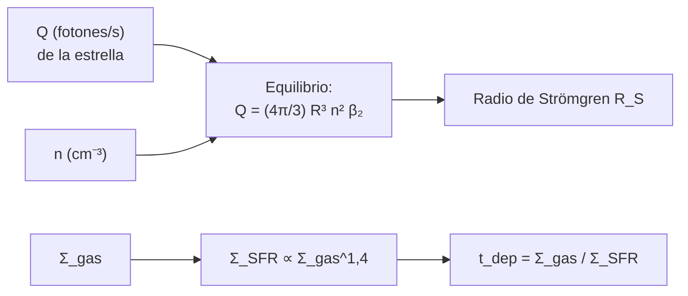

# B25-C05 — Regiones de formación estelar

<!-- nav:top -->
[🏠 Programa](../../../../README.md) · [📚 Bloque B25](../../../tronco-comun/B25-galaxias-y-medio-interestelar.md) · [← Anterior: B25-C04 — Nubes moleculares y polvo](../B25-C04-nubes-moleculares-y-polvo/CLASE.md) · [Siguiente: B25-C06 — Cúmulos estelares →](../B25-C06-cumulos-estelares/CLASE.md)
<!-- /nav -->

## 1. Ubicación, nivel y alcance

Clase 5 del bloque B25. Nivel N3. Retoma las nubes moleculares de [C04](../B25-C04-nubes-moleculares-y-polvo/CLASE.md), el colapso de [B24-C01](../../B24/B24-C01-colapso-de-nubes-moleculares/CLASE.md) y la ionización del hidrógeno ([B06-C01](../../B06/B06-C01-estructura-atomica/CLASE.md)). Estudia dónde y con qué ritmo se forman estrellas: la **burbuja de gas ionizado** que crea una estrella masiva y la **ley que liga la formación estelar con la cantidad de gas**. El modelo de burbuja supone hidrógeno puro y uniforme; la ley de Schmidt es empírica.

## 2. Por qué esta clase existe

Una galaxia no convierte todo su gas en estrellas a la vez: lo hace a un ritmo que puede medirse y comparar. Entender las regiones donde nacen las estrellas masivas permite reconocerlas desde lejos, y entender la relación entre gas y ritmo de formación permite saber cuánto tiempo puede una galaxia seguir formando estrellas. La decisión central: **dada la luz ionizante de una estrella y la densidad del gas, ¿qué tamaño tiene su región ionizada; y dado el gas de una galaxia y su ritmo de formación, cuánto tiempo le queda?**

## 3. Lo que podrás hacer al terminar

1. Definir región HII, tasa de fotones ionizantes, recombinación, esfera de Strömgren y ley de Schmidt.
2. Calcular el radio de Strömgren y cómo escala con la luminosidad ionizante y la densidad.
3. Calcular un tiempo de agotamiento del gas y cómo cambia con la densidad.
4. Estimar una tasa de formación estelar a partir de una eficiencia por tiempo de caída libre.
5. Relacionar la masa de una nube (C04) con el ritmo al que puede formar estrellas.
6. Distinguir lo medido de lo ilustrativo en la formación estelar.

La evidencia es la **ficha de una región de formación estelar** del ejercicio 12 (sección 20).

## 4. Con qué llegas y cómo comprobarlo

1. ¿Qué es la recombinación de un ion con un electrón?
2. ¿Cuál es el volumen de una esfera de radio `R`?
3. ¿Qué significa que una ley sea una potencia, `y = c x^N`?
4. ¿Cuánto vale `t_ff` para `n(H₂) = 10⁴ cm⁻³` según B24-C01?
5. ¿Cuántos `M☉` pesa la nube sintética de C04?

<details>
<summary>Ver respuestas</summary>

1. El ion captura un electrón y emite luz. 2. `4πR³/3`. 3. Que al multiplicar `x` por `f`, `y` se multiplica por `f^N`. 4. `0,308 Myr`. 5. `1,74 × 10⁴ M☉`.
</details>

Con cuatro o cinco aciertos, sigue; si no, repasa B06-C01, B24-C01 y C04.

## 5. Un caso real: gas, estrellas y tiempo

Kennicutt (S1) midió, para 61 espirales normales y 36 galaxias con brotes de formación estelar seleccionadas en infrarrojo, la relación entre el ritmo de formación y la densidad de gas, y halló que un **índice de Schmidt** `N = 1,4 ± 0,15` representa la muestra combinada. Para nuestra galaxia, Bland-Hawthorn y Gerhard (S2) recogen una tasa global `1,65 ± 0,19 M☉/año` (Licquia y Newman, con una función de masa de Kroupa) dentro del intervalo `1–3 M☉/año` citado habitualmente. Con la masa de gas de la Tabla I de Ferrière (C03; cota inferior `8,9 × 10⁹ M☉`), el **ejemplo conductor** es una región HII de una estrella masiva de **fuente sintética** `Q = 10⁴⁹ fotones/s` en gas de `n = 100 cm⁻³`.

## 6. Vocabulario

Una **región HII** es una zona de gas de hidrógeno ionizado por la radiación ultravioleta de estrellas masivas. La **tasa de fotones ionizantes** `Q` (en `s⁻¹`) es el número de fotones por segundo capaces de ionizar H (por encima de 13,6 eV). La **recombinación** es la captura de un electrón por un protón; su coeficiente `β₂` (en `cm³ s⁻¹`) mide cuántas recombinaciones ocurren por unidad de tiempo y de densidad al cuadrado. La **esfera de Strömgren** es la región ionizada en equilibrio: dentro, cada fotón ionizante repone una recombinación; fuera, el gas es neutro. La **densidad superficial de gas** `Σ_gas` y de **formación estelar** `Σ_SFR` se miden en `M☉ pc⁻²` y `M☉ año⁻¹ kpc⁻²`. La **ley de Schmidt** es `Σ_SFR ∝ Σ_gas^N`. El **tiempo de agotamiento** es `t_dep = Σ_gas/Σ_SFR`. La **eficiencia por tiempo de caída libre** `ε_ff` es la fracción de la masa de una nube que se convierte en estrellas por cada `t_ff`.

## 7. Modelo mental: una burbuja que crece hasta equilibrarse

Imagina inflar un globo con ritmo constante de aire mientras el globo pierde aire por pequeñas fugas proporcionales a su volumen: crece hasta que las fugas igualan el aire que entra. Analogía: el aire es la luz ionizante `Q` y las fugas son las recombinaciones. Su límite: la región real se expande por su propia presión y por los vientos de la estrella, no está congelada en el radio de equilibrio.



*Descripción textual:* el radio sale de igualar fotones emitidos con recombinaciones en el volumen; por otro lado, la ley de Schmidt da el ritmo de formación y de él el tiempo de agotamiento.

## 8. La explicación, paso a paso

### 8.1 La esfera de Strömgren

En una esfera de hidrógeno totalmente ionizado de radio `R` y densidad `n`, el número de recombinaciones por segundo es `(4π/3) R³ n² β₂`. En equilibrio iguala `Q`:

`R_S = (3Q / (4π n² β₂))^{1/3}`.

El coeficiente `β₂ ≈ 2 × 10⁻¹⁶ T^{−3/4} m³ s⁻¹` (S3, valor ilustrativo) vale `2,0 × 10⁻¹³ cm³ s⁻¹` a `10⁴ K`. Con `Q = 10⁴⁹ s⁻¹` y `n = 100 cm⁻³`: `R_S = 3,44 pc`.

### 8.2 Escalas

`R_S ∝ Q^{1/3} n^{−2/3}`. Octuplicar `Q` duplica el radio (`6,9 pc`); octuplicar `n` lo divide por cuatro (`0,86 pc`). Las regiones HII compactas, de pocas décimas de parsec, son por tanto muy densas.

### 8.3 Cuántas estrellas nacen: la ley de Schmidt

Con `Σ_SFR ∝ Σ_gas^N` y `N = 1,4` (S1), el tiempo de agotamiento `t_dep ∝ Σ_gas^{1−N} = Σ_gas^{−0,4}`: un gas diez veces más denso se agota `10^{0,4} = 2,5` veces antes, a `0,40` del tiempo. Si `N` fuese 1, `t_dep` sería constante. S1 propone además una alternativa en la que el ritmo escala con el cociente entre gas y tiempo orbital; esta clase no la desarrolla.

### 8.4 Tiempo de agotamiento de la Galaxia

Con la cota inferior de gas `8,9 × 10⁹ M☉` y `1,65 M☉/año`: `t_dep ≈ 5,4 Gyr`. Es una **cota inferior del gas**, así que el tiempo es en realidad algo mayor; además la galaxia recicla parte del gas devuelto por las estrellas (C16 y C17).

### 8.5 De una nube a un ritmo

Una nube que formase estrellas con eficiencia `ε_ff` por `t_ff` produciría `ε_ff M/t_ff`. Con la nube sintética de C04 (`1,74 × 10⁴ M☉`, `n(H₂) ≈ 43 cm⁻³`, `t_ff = 4,69 Myr`) y `ε_ff = 0,01` (**valor ilustrativo**, no medido aquí): `3,7 × 10⁻⁵ M☉/año`. Para reproducir `1,65 M☉/año` haría falta que unas `4,4 × 10⁴` nubes así formasen estrellas a la vez.

## 9. Magnitudes, símbolos y unidades

| Símbolo | Qué es | Unidad | Valor / nota |
|---|---|---|---|
| `Q` | fotones ionizantes por segundo | `s⁻¹` | `10⁴⁹` (sintético) |
| `n` | densidad numérica de H | `cm⁻³` | `100` (sintético) |
| `β₂` | coeficiente de recombinación | `cm³ s⁻¹` | `2,0 × 10⁻¹³` a `10⁴ K` (S3, ilustrativo) |
| `R_S` | radio de Strömgren | pc | `3,44` (cálculo propio) |
| `N` | índice de Schmidt | adimensional | `1,4 ± 0,15` (S1) |
| `t_dep` | tiempo de agotamiento | Gyr | `5,4` para la Galaxia (cota) |
| `ε_ff` | eficiencia por caída libre | adimensional | `0,01` (ilustrativo) |

## 10. Convenciones y referencias

Hidrógeno puro, sin polvo ni helio, a `T = 10⁴ K`. Los datos de la Galaxia son **estimados** (S2, S4); `Q`, `n`, `ε_ff` son **sintéticos o ilustrativos**; `β₂` es de una **fuente secundaria**. `1 pc = 3,0856776 × 10¹⁸ cm`. Constantes de NIST (S5).

## 11. De dónde sale lo que afirmamos

| ID | Fuente | Localizador | Respalda | Estado |
|---|---|---|---|---|
| S1 | Kennicutt, *The Global Schmidt Law in Star Forming Galaxies*, arXiv:astro-ph/9712213 | https://arxiv.org/abs/astro-ph/9712213 | `N = 1,4 ± 0,15`; 61 espirales y 36 galaxias con brotes | Solo resumen, consultado el 2026-11-09 |
| S2 | Bland-Hawthorn y Gerhard, arXiv:1602.07702 | https://arxiv.org/abs/1602.07702 | Tasa global `1,65 ± 0,19 M☉/año`; intervalo `1–3` | Texto del PDF extraído el 2026-11-09 |
| S3 | Wikipedia, *Strömgren sphere* | https://en.wikipedia.org/wiki/Str%C3%B6mgren_sphere | Fórmula de `R_S` y `β₂ ≈ 2 × 10⁻¹⁶ T^{−3/4} m³ s⁻¹` | Fuente secundaria, consultada el 2026-11-09 |
| S4 | Ferrière, arXiv:astro-ph/0106359 | https://arxiv.org/abs/astro-ph/0106359 | Masas de gas (cota inferior `8,9 × 10⁹ M☉`) | Texto del PDF extraído el 2026-11-09 |
| S5 | NIST, *Fundamental Physical Constants — Complete Listing* (CODATA 2022) | https://physics.nist.gov/cuu/Constants/Table/allascii.txt | `G`, `m_p` | Consultada el 2026-11-09 |

Límites: S1 solo en resumen (no se leyó la normalización); `β₂` procede de una fuente secundaria y no se contrastó con una primaria; `Q`, `n` y `ε_ff` no tienen fuente.

## 12. Cómo ver la región

Equivalente accesible a un esquema de la burbuja (cálculo propio):

| Cambio | Radio de Strömgren |
|---|---|
| `Q = 10⁴⁹`, `n = 100` | 3,44 pc |
| `Q × 8` | 6,88 pc |
| `n × 8` | 0,86 pc |
| `n = 10⁴` | 0,16 pc |

Descripción larga: la región crece con la raíz cúbica de la luz y se encoge con la potencia dos tercios de la densidad.

## 13. Ejemplo trabajado: ¿hasta dónde ioniza una estrella?

**Paso 1 · Datos.** `Q = 10⁴⁹ s⁻¹`, `n = 100 cm⁻³`, `β₂ = 2,0 × 10⁻¹³ cm³ s⁻¹`.

**Paso 2 · Denominador.** `4π n² β₂ = 4π × 10⁴ × 2 × 10⁻¹³ = 2,51 × 10⁻⁸ cm³ s⁻¹ cm⁻⁶`.

**Paso 3 · Cociente.** `3Q/(…) = 3 × 10⁴⁹/2,51 × 10⁻⁸ = 1,19 × 10⁵⁷ cm³`.

**Paso 4 · Raíz cúbica.** `R_S = 1,06 × 10¹⁹ cm = 3,44 pc`.

**Paso 5 · Sentido.** La esfera ocupa `170 pc³` y, con `100 cm⁻³`, contiene unas `420 M☉` de hidrógeno ionizado (`1 cm⁻³` de H equivale a `0,0247 M☉/pc³`). Es un orden de magnitud con un coeficiente de fuente secundaria y una estrella sintética; no es una región observada.

## 14. Distintas formas de medir la formación estelar

**Ley de Schmidt global (S1):** relaciona promedios de disco; no resuelve nubes. **Conteo de estrellas jóvenes y regiones HII:** da el ritmo en una región concreta, con supuestos sobre la función de masa. **Eficiencia por caída libre:** une el ritmo con la dinámica de la nube, pero `ε_ff` debe medirse. Para comparar galaxias sirve la ley de Schmidt; para una nube hace falta contar estrellas.

## 15. Práctica guiada

**Ejercicio 1 · con los pasos indicados.** Calcula `R_S` para `Q = 10⁴⁹`, `n = 100`, `β₂ = 2 × 10⁻¹³`. *Pasos:* `4πn²β₂`; `3Q` entre eso; raíz cúbica; pasa a pc.

<details><summary>Solución comentada</summary>

`2,51 × 10⁻⁸`; `1,19 × 10⁵⁷`; `1,06 × 10¹⁹ cm`; `3,44 pc` (8.1).
</details>

**Ejercicio 2 · con una pista.** ¿Qué radio da `Q = 8 × 10⁴⁹` con la misma `n`? *Pista:* `R ∝ Q^{1/3}`.

<details><summary>Solución comentada</summary>

`3,44 × 8^{1/3} = 6,88 pc` (8.2).
</details>

**Ejercicio 3 · casi autónomo.** ¿Qué radio da `n = 800 cm⁻³` con `Q = 10⁴⁹`?

<details><summary>Solución comentada</summary>

`3,44 × 8^{−2/3} = 0,86 pc` (8.2).
</details>

## 16. Práctica autónoma, transferencia e integrador

**Ejercicio 4.** Calcula el tiempo de agotamiento de la Galaxia con `8,9 × 10⁹ M☉` y `1,65 M☉/año`.

<details><summary>Solución comentada</summary>

`5,4 × 10⁹ años` (8.4).
</details>

**Ejercicio 5.** ¿Cómo cambia `t_dep` si `Σ_gas` se multiplica por 10, con `N = 1,4`?

<details><summary>Solución comentada</summary>

`10^{−0,4} = 0,40` (8.3).
</details>

**Ejercicio 6.** Calcula `t_ff` para `n(H₂) = 43 cm⁻³` (`μ = 2,8`).

<details><summary>Solución comentada</summary>

`ρ = 43 × 10⁶ × 2,8 × 1,6726 × 10⁻²⁷ = 2,0 × 10⁻¹⁹ kg/m³`; `t_ff = √(3π/(32 G ρ)) = 4,69 Myr` (B24-C01, 8.5).
</details>

**Ejercicio 7.** Con `ε_ff = 0,01`, ¿qué ritmo da la nube de `1,74 × 10⁴ M☉`?

<details><summary>Solución comentada</summary>

`0,01 × 1,74 × 10⁴/4,69 × 10⁶ = 3,7 × 10⁻⁵ M☉/año` (8.5).
</details>

**Ejercicio 8.** ¿Cuántas nubes así reproducen `1,65 M☉/año` y qué masa suman?

<details><summary>Solución comentada</summary>

`1,65/3,7 × 10⁻⁵ = 4,4 × 10⁴` nubes, de `7,7 × 10⁸ M☉` en total, el `9 %` de la cota de gas de la Galaxia (sección 5).
</details>

**Ejercicio 9 · transferencia.** Un compañero dice: «las regiones HII tienen todas el mismo tamaño». Respóndele.

<details><summary>Solución comentada</summary>

`R_S ∝ Q^{1/3} n^{−2/3}`: depende de la luz y de la densidad; dos regiones con `n` distinta difieren en tamaño aunque su estrella sea idéntica (8.2).
</details>

**Ejercicio 10 · transferencia.** Una región compacta tiene `n = 10⁴ cm⁻³` con `Q = 10⁴⁹`. ¿Qué radio tiene?

<details><summary>Solución comentada</summary>

`3,44 × (100/10⁴)^{2/3} = 3,44 × 0,0464 = 0,16 pc` (8.2).
</details>

**Ejercicio 11 · transferencia.** Con `N = 1,4` y no `N = 1`, ¿cuánto más rápido crece el ritmo de formación al decuplicar el gas?

<details><summary>Solución comentada</summary>

`10^{1,4} = 25` veces con `N = 1,4` y `10` veces con `N = 1`; la ley superlineal acelera el consumo (8.3).
</details>

**Ejercicio 12 · integrador.** Elabora la *ficha de una región de formación estelar*: elige `Q` y `n` (sintéticos), calcula `R_S`; da `t_dep` de tu galaxia con su gas y su tasa; calcula la tasa de una nube con `ε_ff` ilustrativo; indica qué es dato y qué es modelo.

<details><summary>Solución modelo</summary>

`Q = 10⁴⁹`, `n = 100`: `3,44 pc`; Galaxia: `5,4 Gyr` (cota); nube: `3,7 × 10⁻⁵ M☉/año`. Datos: `N`, tasa de la Galaxia, masas de gas; modelo: Strömgren y `ε_ff`.
</details>

## 17. Laboratorio: Strömgren y agotamiento

El script [formacion_estelar.py](formacion_estelar.py) calcula `R_S`, `t_dep` y la tasa de una nube, y **comprueba** que el balance recombinaciones = `Q` se cierra (`10⁻⁹`), que una bisección independiente reproduce `R_S` (`10⁻⁶`), las escalas `Q^{1/3}` y `n^{−2/3}` (`10⁻⁹`) y que `t_ff(10⁴ cm⁻³) = 0,308 Myr`, el valor de la referencia B24-C01.

**Datos:** S1–S4 (estimados), S3 secundario; `Q`, `n`, `ε_ff` sintéticos. **Predice antes de ejecutar:** ¿qué radio da `n × 8`? (la cuarta parte.) **Ejecución del 2026-11-09 (Python 3.12.9):**

```text
Python 3.12.9 (biblioteca estandar)
beta2(1e4 K) = 2.00e-13 cm^3/s
R_S (Q = 1e49 /s, n = 100 cm^-3) = 3.44 pc
R_S con Q x8: 6.88 pc ; con n x8: 0.86 pc
t_dep(MW) = 5.4 Gyr (gas >= 8.9e9 Msol, SFR 1.65 Msol/yr)
t_dep(10 Sigma)/t_dep(Sigma) = 0.398 (N = 1.4) ; N = 1: 1.000
nube de C04: n(H2) = 43 cm^-3 -> t_ff = 4.69 Myr
SFR con eps_ff = 0.01: 3.72e-05 Msol/yr
Pruebas superadas.
```

```bash
python programa/clases/B25/B25-C05-regiones-de-formacion-estelar/formacion_estelar.py
```

**Límites:** hidrógeno puro, `T` uniforme, un solo emisor, sin expansión de la región.

## 18. Errores frecuentes y cómo corregirlos

**Pensar que el radio crece linealmente con `Q`.** Se corrige con el ejercicio 2.

**Olvidar que `n` entra al cuadrado.** Se corrige con el ejercicio 3.

**Tomar `ε_ff` como un dato medido en esta clase.** Se corrige en 8.5 y la sección 10.

**Ignorar que la masa de gas es una cota.** Se corrige en 8.4.

**Confundir `Σ_gas` con `n`.** Se corrige en la sección 6.

## 19. Cómo sabrás que vas bien

Tras 8.1: ¿cómo cambia `R_S` con `n`? Ejercicio 3. Tras 8.3: ¿qué significa `N = 1,4`? Ejercicio 11. Tras el laboratorio: ¿por qué se contrasta `t_ff` con B24-C01? (porque el mismo cálculo debe dar el mismo número).

## 20. Qué entregas y cómo se evalúa

El producto es tu **ficha de una región de formación estelar** (ejercicio 12).

| Criterio | Inicial | En desarrollo | Logrado | Destacado |
|---|---|---|---|---|
| Definiciones | Las confunde | Parciales | `R_S`, `N`, `t_dep` | Distingue `Σ` y `n` |
| Cálculo | Sin unidades | Con errores | Valores correctos | Propone casos límite |
| Interpretación | Sin comparar | Sin razón | Concluye sobre tamaño y tiempo | Discute la cota de gas |
| Numérico | Sin comprobar | Un caso | Cuatro pruebas superadas | Explica cada prueba |
| Fuentes | Sin fuente | Sin fecha | S1–S5 con fecha | Rotula lo secundario |

**Condiciones críticas (no se compensan con promedio):** rotular `Q`, `n`, `ε_ff` como sintéticos o ilustrativos; no presentar `β₂` como valor de una fuente primaria; citar solo lo consultado.

## 21. Ética, seguridad y límites

La clase es educativa; no mide ninguna región real. Accesibilidad: tablas equivalentes a los esquemas, fórmulas en texto, ejercicios sin conexión.

## 22. Para cerrar y seguir

Una estrella con `Q = 10⁴⁹ s⁻¹` ioniza ~3,4 pc de gas de 100 cm⁻³, y una galaxia como la nuestra tardaría ~5 Gyr en agotar su gas al ritmo actual. Queda una pregunta: ¿en qué se convierten esas estrellas recién nacidas cuando nacen juntas?

**Glosario español–inglés.** región HII · *HII region*; esfera de Strömgren · *Strömgren sphere*; recombinación · *recombination*; ley de Schmidt · *Schmidt law*; tiempo de agotamiento · *depletion time*; formación estelar · *star formation*.

**Continuidad.** [B25-C06](../B25-C06-cumulos-estelares/CLASE.md) estudia los cúmulos donde nacen juntas las estrellas.

**Referencias:** ver sección 11.

<!-- nav:bottom -->
---

[← Anterior: B25-C04 — Nubes moleculares y polvo](../B25-C04-nubes-moleculares-y-polvo/CLASE.md) · [📚 Bloque B25](../../../tronco-comun/B25-galaxias-y-medio-interestelar.md) · [Siguiente: B25-C06 — Cúmulos estelares →](../B25-C06-cumulos-estelares/CLASE.md)
<!-- /nav -->
